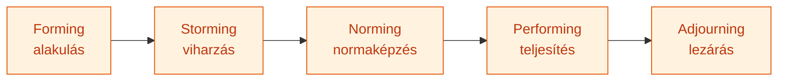
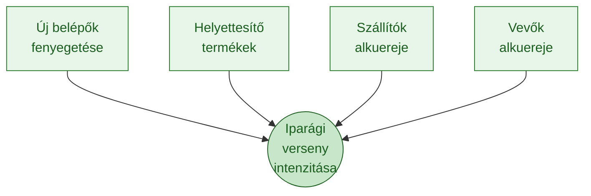
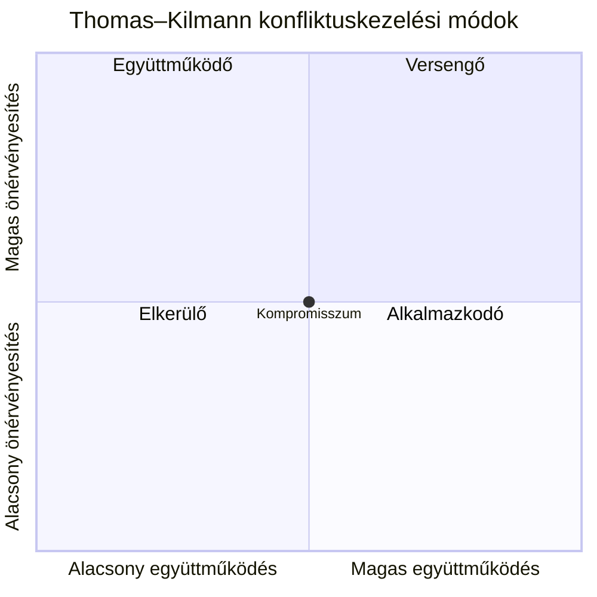
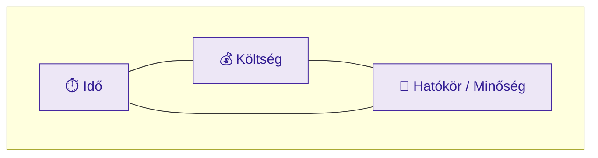
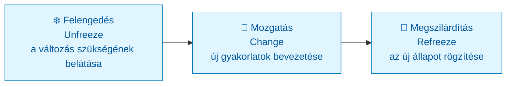
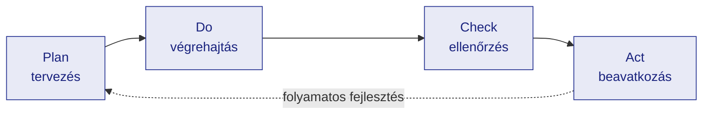

# Menedzsment alapjai (GMXMD1MBLF) — Kontextus és tankönyvi referencia

> **A fájl jellege:** Ez a dokumentum a tárgy **teljes körű, tankönyvi mélységű referenciaanyaga**, a **13 előadás / 5 konzultáció logikája szerint** strukturálva (nem a K1–K7 tételhatárok mentén). A vizsgafókusz megőrzése érdekében minden fejezet jelzi a kapcsolódó K-tételt, a fájl végén pedig megtalálható a tömör **K1–K7 vizsgaösszefoglaló (cheat-sheet)** is.
>
> **Hivatkozási stílus:** APA 7 (szövegközi „(Szerző, év)" + záró Felhasznált irodalom). A klasszikus elsődleges modelleknél az **eredeti megjelenés évét** adjuk meg. Ahol az előadásanyag és a lektorált szakirodalom **eltér** (pl. évszámok), azt külön jelezzük, nem simítjuk el.

---

## Tantárgy adatok
- Kód: GMXMD1MBLF
- Kredit: 4
- Tagozat: Levelező
- Félév: 1. félév (2023/24/1)
- Intézet: Marketing, Menedzsment és Módszertani Intézet (ÓE KGK, 1084 Budapest, Tavaszmező u. 17.)
- Tantárgyfelelős: Dr. Parragh Bianka
- Oktatók: Békésy Mariann; Gombaszögi Ildikó; Mészáros Ágnes; Novák János
- Féléves óraszám: Előadás: 10, Tantermi gyakorlat: 10, Labor: 0
- Félévzárás módja: Félévközi jegy (1 db ZH írásban)

## Oktatási cél
A hallgatók felkészítése a menedzseri munka legfontosabb elvi és gyakorlati sajátosságaira a modern piacgazdaság körülményei között. Legyenek képesek adott körülmények között alkalmazni a megfelelő menedzsment módszereket, és ismerjék azok lehetséges hatásait.

## Témakörök konzultációnként

| Konzultáció | Témák | Előadások |
|---|---|---|
| 1. | Menedzsment általános vonásai, alapfogalmai; menedzsment irányzatok; szervezeti formák | 1–3. |
| 2. | Vezetési stílusok, motiváció, munkaerő-fejlesztés, döntési modellek, vezetőképzés | 4–6., 8. |
| 3. | Menedzsment változó környezete, stratégiai tervezés, kommunikáció, konfliktuskezelés | 7., 9. |
| 4. | Projektmenedzsment, változásmenedzsment, kockázatmenedzsment | 10–12. |
| 5. | Funkcionális menedzsment, ZH | 13. |

## A referencia felépítése és a K-tételek leképezése

A törzset a 13 előadás logikája rendezi fejezetekbe. A K1–K7 záróvizsgatételek ezekre a fejezetekre képződnek le:

| Fejezet (előadás) | Témakör | Kapcsolódó tétel |
|---|---|---|
| 1. (1. ea.) | A menedzsment fogalma és funkciói | **K1** |
| 2. (2. ea.) | Menedzsmenttörténeti irányzatok | **K2** |
| 3. (3. ea.) | Szervezetek, csoportok, szervezeti formák | **K4** |
| 4. (4. ea.) | Vezetői szerep és vezetési stílusok | **K5** |
| 5. (5. ea.) | Motiváció és motivációs elméletek | **K6** |
| 6. (6. ea.) | Szervezeti tanulás, oktatás, képzés-fejlesztés | — (kiegészítő) |
| 7. (7. ea.) | Stratégiai tervezés és környezetelemzés | **K3** |
| 8. (8. ea.) | Döntéselmélet és döntési modellek | **K7** |
| 9. (9. ea.) | Kommunikáció és konfliktuskezelés | — (kiegészítő) |
| 10. (10. ea.) | Projektmenedzsment | — (kiegészítő) |
| 11. (11. ea.) | Válság- és változásmenedzsment | — (kiegészítő) |
| 12. (12. ea.) | Kockázatmenedzsment | — (kiegészítő) |
| 13. (13. ea.) | Funkcionális és egyéb menedzsmentterületek | — (kiegészítő) |

---

# 1. A menedzsment fogalma és funkciói
> » Kapcsolódó tétel: **K1** — A menedzsment fogalma és funkciói

## 1.1 A szervezet fogalma

A menedzsment tárgya a **szervezet**. Chester Barnard (1938) klasszikus definíciója szerint a szervezet „két vagy több személy tudatosan koordinált tevékenységeinek rendszere". Három feltétele: (1) kommunikációra képes személyek, (2) közös cél, (3) hajlandóság a közreműködésre. A szervezet ún. **fekete doboz** modellként is leírható: bemenetek (ember, anyag, pénz, információ, energia) → transzformáció → kimenetek (termék, szolgáltatás), a környezet folyamatos visszacsatolásával. Ez a rendszerszemléletű megközelítés a szervezetet nyílt rendszernek tekinti, amely környezetével kölcsönhatásban él (Barnard, 1938).

## 1.2 A menedzsment definíciója: hatékonyság és eredményesség

A menedzsment az erőforrások **hatékony** és **eredményes** felhasználásával megvalósuló célirányos irányítói tevékenység.

- **Hatékonyság** (*efficiency*): a ráfordítás/eredmény arány kedvező — „a dolgokat jól csináljuk" (minimális erőforrás-pazarlás).
- **Eredményesség** (*effectiveness*): a megfelelő célokat tűzzük ki és érjük el — „a jó dolgokat csináljuk".

A két fogalom független: lehet valaki hatékony, de eredménytelen (kifogástalanul gyárt rossz terméket), és fordítva. A menedzsment egyszerre **tudomány** (általánosítható, oktatható elvek) és **művészet** (szituációfüggő, tapasztalati alkalmazás) — a tárgy egyik vezérgondolata.

## 1.3 A négy menedzsmentfunkció

A Fayol (1916) nyomán kanonizálódott felosztás négy alapfunkciót különböztet meg, amelyek **körfolyamatot** alkotnak:

1. **Tervezés** — célok és az odavezető utak meghatározása. Időtáv szerint: stratégiai (3–5 év), taktikai (kb. 1 év), operatív (napok–hetek).
2. **Szervezés** — erőforrások és feladatok elosztása, a struktúra (organogram, hatáskörök) kialakítása.
3. **Vezetés** (*leading*) — emberek irányítása, motiválása, kommunikáció, konfliktuskezelés.
4. **Ellenőrzés** (*controlling*) — a tényleges teljesítmény összevetése a tervekkel, eltéréselemzés, korrekció.

Az ellenőrzés visszacsatolása zárja a kört: tapasztalatai a következő tervezési ciklus inputjai.

## 1.4 Menedzser és vezető (leader)

Kotter (1990) különbséget tesz **menedzsment** és **leadership** között:

| Szempont | Menedzser (*management*) | Vezető (*leader*) |
|---|---|---|
| Mit kezel? | komplexitást | változást |
| Eszköz | tervezés, költségvetés | irány- és jövőkép-alkotás |
| Embereknél | szervezés, létszámbiztosítás | összefogás, inspiráció |
| Cél | kiszámíthatóság, rend | mozgósítás, áttörés |

Kotter tézise: mindkét szerepre szükség van. A túlmenedzserelt, alulvezetett szervezet elveszíti az irányt; a túlvezetett, alulmenedzserelt szervezet kaotikus. A modern szervezetekben e két szerep egyazon személyben is megjelenhet (Kotter, 1990).

## 1.5 Mintzberg vezetői szerepei

Mintzberg (1973) empirikus megfigyeléssel cáfolta azt a klasszikus képet, hogy a menedzser nyugodt, átgondolt tervező. Megállapította, hogy a menedzseri munka **töredezett**, rövid, gyakran félbeszakított interakciókból áll. Tíz szerepkört azonosított, három csoportban:

- **Interperszonális:** nyilvános megjelenítő (*figurehead*), vezető (*leader*), kapcsolattartó (*liaison*).
- **Információs:** információgyűjtő (*monitor*), -terjesztő (*disseminator*), szóvivő (*spokesperson*).
- **Döntési:** vállalkozó (*entrepreneur*), zavarelhárító (*disturbance handler*), erőforrás-elosztó (*resource allocator*), tárgyaló (*negotiator*).

**Kritika és relevancia:** a modell leíró (mit *tesz* a menedzser), nem normatív (mit *kellene*). XXI. századi jelentősége, hogy rámutat: a vezetői munka jelentős része kommunikáció és információkezelés — ez a digitális, hálózatos szervezetekben tovább erősödött.

## 1.6 A menedzsment szakterületei

HR-menedzsment, marketingmenedzsment, pénzügyi menedzsment, operáció-/termelésmenedzsment, logisztika, controlling, minőségmenedzsment, projektmenedzsment, stratégiai menedzsment, változás- és kockázatmenedzsment. Ezek a 13. fejezetben (funkcionális területek) kerülnek áttekintésre.

---

# 2. Menedzsmenttörténeti irányzatok
> » Kapcsolódó tétel: **K2** — Menedzsment irányzatok

A menedzsmenttudomány fejlődése négy nagy hullámban írható le: klasszikus, emberközpontú, döntés-/rendszerszemléletű és modern (integratív) irányzat.

## 2.1 Klasszikus irányzat (19. sz. vége – 20. sz. eleje)

Középpontjában a hatékonyság, a racionalizálás és a formális struktúra áll.

**Frederick W. Taylor (1856–1915) — tudományos vezetés.** Fő műve a *The Principles of Scientific Management* (Taylor, 1911). Alaptézise: minden munkafolyamat tudományosan elemezhető és optimalizálható. Módszerei: mozdulat- és időelemzés (*time-and-motion study*), az „egyetlen legjobb módszer" (*one best way*) meghatározása, a tervezés és a végrehajtás éles szétválasztása (a tervezés a vezetésé), teljesítményarányos (darabbéres) bérezés, a megfelelő ember kiválasztása és betanítása. **Kritika:** dehumanizálja a munkát, a dolgozót „gazdaságilag racionális gépnek" tekinti, figyelmen kívül hagyja a társas és pszichológiai tényezőket. **XXI. századi hatás:** lean menedzsment, Six Sigma, folyamatszabványosítás (ISO), standardizált munkavégzés — mind a tayloriánus folyamatelemzés örökösei.

**Henri Fayol (1841–1925) — adminisztratív menedzsment.** Fő műve az *Administration industrielle et générale* (Fayol, 1916). Megkülönböztette a vállalat hat alaptevékenységét (műszaki, kereskedelmi, pénzügyi, biztonsági, számviteli, vezetési) és a vezetés öt funkcióját (tervezés, szervezés, irányítás, koordinálás, ellenőrzés). **14 vezetési alapelve** közül kulcsfontosságúak: munkamegosztás; tekintély és felelősség egyensúlya; fegyelem; **egyszemélyi (egységes) utasítás** (*unity of command* — mindenki csak egy felettestől kap utasítást); az irányítás egysége; az egyéni érdek alárendelése a közösnek; **hierarchia/szolgálati út** (*scalar chain*); rend; méltányosság; a dolgozók állandósága; kezdeményezés; egységszellem (*esprit de corps*). **Relevancia:** a funkcionális szervezeti struktúrák és a vállalatirányítási alapelvek máig Fayolra épülnek.

**Henry Ford (1863–1947) — fordizmus.** 1913-ban vezette be a mozgó futószalagos összeszerelést; a Model T összeszerelési ideje a töredékére csökkent. Jellemzői: tömegtermelés, extrém munkamegosztás, a gépi ütem diktálja a tempót, szabványosított termék. 1914-ben bevezette a napi 5 dolláros bért (az iparági átlag kétszerese), ami csökkentette a fluktuációt és megteremtette saját termékének vásárlópiacát. **XXI. századi hatás:** a tömegtermelési logika és annak modern változata, a rugalmas tömegtermelés / testreszabott tömeggyártás (*mass customization*).

**Max Weber (1864–1920) — bürokráciaelmélet.** Az „ideális bürokrácia" hat elve: szabályokhoz kötöttség, hierarchikus alá-fölérendeltség, személytelenség (a pozíció, nem a személy számít), szakképzettség alapú kinevezés, írásos dokumentáció, az alkalmazotti státusz állandósága. A bürokrácia Weber szerint a *racionális-legális* uralom legtisztább formája. **Kritika:** merevség, „bürokratikus ördögi kör", innovációellenesség.

## 2.2 Emberközpontú irányzat (1930-as évektől)

Felismerés: az ember nem puszta termelési tényező.

**George Elton Mayo (1880–1949) — Human Relations.** A Hawthorne-kísérletek (1924–1932) kimutatták, hogy a teljesítményt nemcsak a fizikai munkakörülmények, hanem a **figyelem, a csoportkohézió és az informális normák** is befolyásolják (**Hawthorne-hatás**: a megfigyeltség önmagában növeli a teljesítményt). Ez az emberi viszonyok irányzatának alapköve.

**Douglas McGregor (1906–1964) — X és Y elmélet (McGregor, 1960).** Az **X-elmélet** emberképe: az átlagember lusta, kerüli a felelősséget, irányítani kell → autokratikus vezetés, szoros kontroll. Az **Y-elmélet**: a munka olyan természetes, mint a játék, az ember belső motivált, keresi a felelősséget → participatív vezetés, autonómia. McGregor szerint a vezető emberképe önbeteljesítő jóslatként hat. (Vö. Ouchi Z-elmélete, 5.6.)

## 2.3 Döntés- és rendszerszemléletű irányzat (1950-es évektől)

**Herbert A. Simon — korlátozott racionalitás.** Az *Administrative Behavior* (Simon, 1947) és a „A Behavioral Model of Rational Choice" (Simon, 1955) vezette be a **korlátozott racionalitás** (*bounded rationality*) és a **kielégítő döntés** (*satisficing*) fogalmát: az ember kognitív és információs korlátai miatt nem optimalizál, hanem az első „elég jó" megoldást fogadja el. *(Megjegyzés: a tárgy „Kulcsszerzők" táblázata Simonnál 1956-os évet szerepeltet; a kanonikus elsődleges hivatkozások 1947, illetve 1955.)* — részletesen a 8. fejezetben.

**Peter F. Drucker — célközpontú vezetés (MBO).** A *The Practice of Management* (Drucker, 1954) vezette be a célokkal való vezetést (*Management by Objectives*): a szervezeti célokat le kell bontani egyéni, mérhető célokká, és a teljesítményt ezekhez mérni.

## 2.4 Modern, integratív irányzatok

Rendszerelmélet és kontingenciaelmélet (nincs „egyetlen legjobb mód" — a megfelelő struktúra a helyzettől függ); **tanuló szervezet** (Senge, 1990 — az „öt fegyelem": rendszergondolkodás, személyes irányítás, gondolati modellek, közös jövőkép, csoportos tanulás); **lean menedzsment** (Toyota Termelési Rendszer, veszteségcsökkentés); **agilis menedzsment** (iteratív, ügyfélközpontú, önszerveződő csapatok — ld. 10. fejezet). Ezek a klasszikus hatékonyságot az emberközpontúsággal és a környezeti alkalmazkodással ötvözik.

---

# 3. Szervezetek, csoportok és szervezeti formák
> » Kapcsolódó tétel: **K4** — Szervezetek, szervezeti formák

## 3.1 Tulajdonosi és munkaszervezet

A **tulajdonosi szervezet** a tőke és az érdekeltség rendje (taggyűlés, közgyűlés, igazgatóság, felügyelőbizottság). A **munkaszervezet** az operatív feladatok elosztásának rendje — ezt ábrázolja az **organogram**. Kis- és középvállalkozásban a kettő összefonódhat (a tulajdonos vezet is), nagyobb cégekben szétválik (megbízó–ügynök viszony).

## 3.2 Mechanikus és organikus szervezet

Burns és Stalker (1961) megkülönböztetése:

| Jellemző | Mechanikus | Organikus |
|---|---|---|
| Környezet | stabil, kiszámítható | dinamikus, bizonytalan |
| Struktúra | merev hierarchia | rugalmas, lapos |
| Kommunikáció | vertikális, utasító | horizontális, információmegosztó |
| Szabályozás | írott szabályok | közös értékek, szakmai megítélés |

## 3.3 Strukturális alapjellemzők

- **Munkamegosztás:** a feladatok részfeladatokra bontása és személyekhez/szervezeti egységekhez rendelése (elvei: funkció, tárgy/termék, régió).
- **Hatáskörmegosztás:** centralizáció (döntés a csúcson) vs. decentralizáció (döntés a végrehajtóhoz közel).
- **Koordináció típusai:** vertikális (hierarchikus utasítás), horizontális (teamek, bizottságok, projektek), technokratikus (szabályok, eljárások, ISO, tervek), kulturális (közös értékek, szocializáció).

## 3.4 Főbb szervezeti formák

**Lineáris szervezet** — egyvonalú parancslánc, minden egységnek egy felettese. *Előny:* egyértelmű felelősség, átláthatóság. *Hátrány:* a vezető túlterhelt, rugalmatlan. Kis, stabil szervezeteknek.

**Funkcionális (törzskari) szervezet** — a munkamegosztás szaktevékenységek szerint; a beosztott több, szakterülete szerint illetékes felettestől is kaphat utasítást. *Előny:* magas szakmai színvonal, méretgazdaságosság. *Hátrány:* „silóhatás", a Fayol-féle egységes utasítás elvének sérülése, lassú horizontális koordináció.

**Divizionális szervezet** — nagy, diverzifikált cégeknél; az egységek termék-, vevő- vagy földrajzi elv szerint szerveződnek, saját eredménnyel (P&L). *Előny:* piacközeli, gyors döntés, mérhető felelősség. *Hátrány:* erőforrás-duplikáció, divíziók közti rivalizálás.

**Mátrix szervezet** — funkcionális és projektszervezet keresztezése, **kettős alárendeltséggel** (funkcionális főnök + projektfelelős). *Előny:* rugalmas erőforrás-allokáció, kettős szaktudás. *Hátrány:* a kettős alárendeltség hatásköri konfliktust szül, magas koordinációs igény. IT-, K+F- és tanácsadói iparágban működik jól.

**Modern formák:** projektszervezet (PBO — projektalapú szervezet), hálózati és virtuális szervezet (lazán kapcsolódó, gyakran földrajzilag szétszórt, IKT-val koordinált egységek).

**Mintzberg szervezeti konfigurációi** (Mintzberg, 1979): egyszerű struktúra, gépi bürokrácia, szakértői (professzionális) bürokrácia, divizionális forma, adhokrácia — mindegyik más koordinációs mechanizmusra épül.

## 3.5 Csoportok és teammunka

**Tuckman csoportfejlődési modellje** (Tuckman, 1965; Tuckman & Jensen, 1977) öt szakasz:

A „storming" (konfliktusos) szakasz nem hiba, hanem szükséges fázis; a vezető feladata átsegíteni rajta a csoportot.

**Belbin csapatszerepei** (Belbin, 1981): kilenc szerep három csoportban — *cselekvésorientált* (formáló, megvalósító, befejező), *emberközpontú* (koordinátor, csapatjátékos, forrásfeltáró), *gondolkodó* (palánta/ötletgyáros, helyzetértékelő, szakértő). A kiegyensúlyozott csapatban minden szerep képviselve van.

**McKinsey 7S** (Peters & Waterman nyomán): a szervezet hét, egymástól kölcsönösen függő eleme — *hard* elemek: stratégia (Strategy), struktúra (Structure), rendszerek (Systems); *soft* elemek: stílus (Style), munkatársak (Staff), képességek (Skills), közös értékek (Shared values). Üzenete: a változtatás csak akkor sikeres, ha mind a hét elem összhangban marad.

---

# 4. Vezetői szerep és vezetési stílusok
> » Kapcsolódó tétel: **K5** — Vezetési stílusok

A **vezetési stílus** a vezető és a beosztottak viszonyának visszatérő mintázata. Függ a vezető személyiségétől, a feladat jellegétől, a beosztottak érettségétől és a szituációtól. A megközelítések három hullámban fejlődtek: **tulajdonság-** (a jó vezető veleszületett), **magatartás-** (a vezetés tanulható viselkedés) és **kontingencia-/szituatív** elméletek (a hatékony stílus a helyzettől függ).

## 4.1 Lewin három alapstílusa (Lewin, Lippitt & White, 1939)

| Stílus | Döntés | Kommunikáció | Eredmény |
|---|---|---|---|
| Autokratikus | vezető egyedül | egyirányú | magas termelékenység *jelenlétkor*, de „leáll" nélküle; feszültség |
| Demokratikus | csoport bevonásával | kétirányú | tartósabb teljesítmény, belső motiváció, jobb légkör |
| Laissez-faire | csoport, vezető alig avatkozik | esetleges | csak kiemelkedően kompetens, önálló csoportnál hatékony |

A kísérletekben a demokratikus stílus adta a legkiegyensúlyozottabb eredményt; a laissez-faire a leggyengébbet (a tárgy előadásai a hatékonyság szemléltető arányait is bemutatják).

## 4.2 Likert négy rendszere (Likert, 1961)

1. kizsákmányoló-parancsoló (félelem, büntetés); 2. jóakaratú-parancsoló (paternalista); 3. konzultatív (meghallgat, de maga dönt); 4. **participatív-csoport** (valódi bevonás, kölcsönös bizalom). Likert szerint a 4-es rendszer adja a legjobb hosszú távú teljesítményt.

## 4.3 Tannenbaum–Schmidt kontinuum (1958)

Hétfokozatú skála a főnökközpontú (autokratikus) és a beosztottközpontú (demokratikus) pólus között — a vezető „eladja", „konzultál", „delegál" stb. A stílus megválasztása három erőtér függvénye: a vezető, a beosztottak és a helyzet jellemzői.

## 4.4 Blake–Mouton vezetői rács (1964)

Két dimenzió 1–9 skálán: **termelés iránti** és **emberek iránti** figyelem. Öt jellemző stílus: szegényes (1,1), klubvezetés (1,9), tekintély-engedelmesség (9,1), középutas (5,5) és **csapatvezetés (9,9)** — ez utóbbit tartják ideálisnak.

## 4.5 Hersey–Blanchard szituatív vezetés (1969)

A hatékony stílus a beosztott **érettségéhez** (kompetencia + motiváció) igazodik:

| Érettség | Jellemző | Ajánlott stílus |
|---|---|---|
| M1 | nem tudja, nem akarja | **utasító** (telling) |
| M2 | akarja, de nem tudja | **eladó/coaching** (selling) |
| M3 | tudja, de bizonytalan/nem akarja | **résztvevő** (participating) |
| M4 | tudja és akarja | **delegáló** (delegating) |

Alapüzenet: nincs egyetlen legjobb stílus; a jó vezető rugalmasan vált. *(Eredetileg „Life Cycle Theory of Leadership" néven, a Management of Organizational Behavior tankönyvben, Hersey & Blanchard, 1969.)*

## 4.6 Út-cél elmélet és transzformatív vezetés

**Út-cél elmélet** (House, 1971): a vezető feladata „elsimítani az utat" a beosztott céljaihoz — irányító, támogató, részvételi vagy teljesítményorientált stílussal, a helyzettől függően.

**Tranzakciós vs. transzformatív vezetés** (Burns, 1978; Bass, 1985): a *tranzakciós* vezető cserekapcsolatra épít (jutalom teljesítményért); a *transzformatív* vezető jövőképpel, karizmával, intellektuális ösztönzéssel és személyes törődéssel emeli a beosztottak motivációját és teljesítményét a saját érdeken túlra. A XXI. századi, tudásalapú és változékony környezetben a transzformatív vezetés különösen felértékelődött.

McGregor X/Y emberképe (2.2) a stílusválasztás emberkép-szintű alapja.

---

# 5. Motiváció és motivációs elméletek
> » Kapcsolódó tétel: **K6** — Motivációs elméletek

## 5.1 A motiváció fogalma és folyamata

A **motiváció** (lat. *movere* — mozgatni) mindazon belső indíttatású szükségletek összessége, amelyek cselekvésre késztetnek, fenntartják és irányítják azt. Alapösszefüggés: **Teljesítmény = Képesség × Motiváció**. A motiváció folyamata: kielégítetlen szükséglet → belső feszültség → hajtóerő → kereső magatartás → kielégülés → a feszültség csökkenése.

A motivációs elméletek két fő csoportja: **tartalomelméletek** (*mi* motivál — milyen szükségletek) és **folyamatelméletek** (*hogyan* megy végbe a motiváció).

## 5.2 Tartalomelméletek

**Maslow szükséglethierarchiája** (Maslow, 1943, 1954). Öt szint piramisba rendezve: fiziológiai → biztonsági → társas (szeretet, hovatartozás) → megbecsülés → önmegvalósítás. Az alacsonyabb (deficit-)szükséglet kielégítése előfeltétele a magasabb megjelenésének; csak a kielégítetlen szükséglet motivál. **Vezetői következmény:** bér és munkabiztonság (1–2.), csapatszellem (3.), elismerés és előléptetés (4.), autonóm, alkotó munka (5.). **Kritika:** az empirikus igazolás gyenge, a szigorú hierarchia és a kulturális univerzalitás vitatott. *(Megjegyzés: a tárgy előadása „1950"-et jelöl; a kanonikus évszámok az 1943-as cikk és az 1954-es könyv.)*

**Alderfer ERG-modellje** (Alderfer, 1969). Maslow öt szintjét háromra vonja össze: **létezés** (*Existence*), **kapcsolat** (*Relatedness*), **fejlődés** (*Growth*). Rugalmasabb Maslownál: több szint egyszerre is hathat, és bevezeti a **frusztráció-regresszió** elvét (ha a magasabb szükséglet kielégítetlen, az alacsonyabb felerősödik).

**Herzberg kéttényezős (motivációs-higiéniás) elmélete** (Herzberg, 1959, 1968). Az elégedettséget és az elégedetlenséget **különböző** tényezők okozzák. *Higiéniás (fenntartó) tényezők* (fizetés, munkakörülmények, biztonság, vállalati politika, felettesi viszony): hiányuk elégedetlenséget kelt, jelenlétük csak semleges állapotot teremt — nem motivál. *Motivátorok* (teljesítmény, elismerés, felelősség, előrelépés, maga a munka tartalma): ezek váltanak ki valódi elköteleződést. **Üzenet:** a béremelés önmagában nem motivál tartósan — **munkakör-gazdagítás** (*job enrichment*) szükséges. **Kritika:** inkább attitűdvizsgálat; a módszer (kritikus esetek) torzíthat; a motiváció–teljesítmény kapcsolat nem egyértelmű.

**McClelland szerzett szükségletek elmélete** (McClelland, 1961). Három tanult motívum: **teljesítményigény** (*nAch* — kihívó, de elérhető célok, visszacsatolás), **hatalmi igény** (*nPow* — befolyás, irányítás), **kapcsolódási igény** (*nAff* — elfogadottság, jó viszonyok). A vezető feladata felismerni a domináns motívumot, és aszerint adni feladatot/elismerést. *(Megjegyzés: a tárgy táblázata 1965-öt jelöl; a kanonikus mű — The Achieving Society — 1961.)*

**Hunt cél-elmélete** (Hunt, 1969). Hat egyéni cél irányítja a munkahelyi magatartást: komfort/anyagi jólét, strukturáltság, kapcsolat, elismertség, hatalom, autonómia/kreativitás/fejlődés. Egyszerre több is hathat, és idővel változik.

## 5.3 Folyamatelméletek

**Skinner megerősítéselmélete** (Skinner, 1953). A viselkedést a következményei irányítják: a kellemes következménnyel járó viselkedés megismétlődik. Eszközök: pozitív megerősítés, negatív megerősítés, büntetés, kioltás. A megerősítés ütemezése (folyamatos/időszakos) befolyásolja a hatást. Nem foglalkozik belső szükségletekkel — tisztán környezeti megközelítés.

**Vroom elvárás-elmélete** (Vroom, 1964). **Motiváció = Elvárás × Instrumentalitás × Valencia.** *Elvárás* (E→T): „ha erőfeszítést teszek, teljesítek?" *Instrumentalitás* (T→K): „ha teljesítek, megkapom a jutalmat?" *Valencia*: „értékes-e számomra a jutalom?" Ha bármely szorzótényező nulla, a motiváció nulla. Következmény: a jutalomnak a beosztott számára kell értékesnek lennie, és a teljesítmény–jutalom kapcsolatnak átláthatónak.

**Adams méltányosság-elmélete** (Adams, 1963, 1965). A dolgozó a saját *bevitel/eredmény* arányát egy referenciaszemélyéhez hasonlítja. Ha egyenlőtlenséget észlel, feszültséget él át, és csökkenteni igyekszik: bevitel csökkentése, több jutalom kérése, az arányok átértékelése, referenciaszemély váltása vagy kilépés. Üzenet: a motivációt az **észlelt igazságosság** is meghatározza, nem csak az abszolút jutalom.

**Locke célkitűzés-elmélete** (Locke, 1968). A **konkrét, kihívó, de elérhető** célok magasabb teljesítményhez vezetnek, mint a homályos vagy könnyű célok — feltéve, hogy van elkötelezettség és visszacsatolás. A SMART-célok (specifikus, mérhető, elérhető, releváns, időhöz kötött) gyakorlati lecsapódása ennek az elméletnek.

## 5.4 További elméletek

**McGregor X–Y** (ld. 2.2) és **Ouchi Z-elmélete** (Ouchi, 1981): a Z a japán menedzsment elemeit (tartós foglalkoztatás, lassú előmenetel, kollektív, konszenzusos döntés, holisztikus törődés, kölcsönös bizalom) ülteti át nyugati környezetbe.

**Csíkszentmihályi flow-elmélete** (Csíkszentmihályi, 1990). Az **optimális élmény** (flow) akkor jön létre, ha a feladat **kihívásszintje** és a személy **jártassága** egyensúlyban van, mindkettő magas szinten. Túl nagy kihívás → szorongás; túl kicsi → unalom. A vezető célja olyan munkahelyi feltételeket teremteni, ahol a munka önmagában jutalmazó.

**Chapman — a munkahelyi elismerés 5 nyelve.** Elismerő szavak, minőségi idő, ajándékok, szívességek, elismerő érintés. A vezető feladata felismerni, melyik „nyelv" hat az adott munkatársra.

## 5.5 Összevetés és gyakorlati tanulság

A tartalomelméletek a motiváció *forrását*, a folyamatelméletek a motiváció *mechanizmusát* világítják meg — a kettő kiegészíti egymást. A modern, tudásalapú munkában a belső motivátorok (autonómia, mesterségbeli fejlődés, értelmes cél) felértékelődnek, összhangban Herzberg, Locke és Csíkszentmihályi tanulságaival.

---

# 6. Szervezeti tanulás, oktatás és képzés-fejlesztés
> » Kiegészítő témakör (6. előadás) — a K1–K7 tételsor közvetlenül nem fedi, de a HR- és vezetésfejlesztési kérdéseknél releváns.

## 6.1 Alapfogalmak

A szervezeti tudás fejlesztésének fogalmait Bakacsi (2000) és a HR-szakirodalom nyomán a következőképpen különböztetjük meg:

| Fogalom | Tartalom |
|---|---|
| **Oktatás** | rendszerezett ismeretátadás, általában elméleti tudás |
| **Képzés** | adott munkakör ellátásához szükséges tudás és készség megszerzése |
| **Továbbképzés** | a meglévő tudás bővítése, naprakészen tartása |
| **Átképzés** | új szakmára/munkakörre való felkészítés |
| **Tréning** | készség- és magatartásfejlesztés gyakorlatorientált, élményalapú módszerrel |
| **Fejlesztés** | a hosszú távú potenciál, a jövőbeli szerepek megalapozása |

A **kompetencia** a tudás, a készség, a képesség és az attitűd együttese, amely a sikeres munkavégzést lehetővé teszi. Összetevői a tárgy bontásában: **szakmai**, **módszertani**, **társas (szociális)** és **személyes** kompetencia.

## 6.2 A képzés-fejlesztés folyamata

A rendszerszemléletű (ADDIE-szerű) ciklus: **igényfelmérés** (szervezeti, munkaköri és egyéni szinten — hol a kompetenciarés) → **tervezés** (célok, célcsoport, módszer, költségvetés) → **megvalósítás** (belső/külső, jelenléti/online, on-the-job/off-the-job) → **értékelés**. Az értékelésre **Kirkpatrick négy szintje** a klasszikus keret (Kirkpatrick, 1959): reakció (elégedettség) → tanulás (tudásgyarapodás) → viselkedés (munkahelyi alkalmazás) → eredmény (szervezeti hatás).

## 6.3 Szervezeti tanulás és tudásmenedzsment

A **tanuló szervezet** (Senge, 1990) tudatosan fejleszti tanulási képességét, hogy gyorsabban alkalmazkodjon a környezethez (ld. 2.4). A **tudásmenedzsment** SECI-modellje (Nonaka & Takeuchi, 1995) a hallgatólagos (*tacit*) és explicit tudás átalakulását írja le: szocializáció → externalizáció → kombináció → internalizáció. Gyakorlati eszközök: mentorálás, coaching, utódlástervezés, tudásbázis, közösségi tanulás.

## 6.4 Gyakorlati relevancia

A gyors technológiai változás és a digitalizáció miatt az **élethosszig tartó tanulás** és a folyamatos át-/továbbképzés (*reskilling*, *upskilling*) a versenyképesség alapfeltétele. A képzés a motiváció (Maslow önmegvalósítás, Herzberg fejlődés-motivátor) és a megtartás eszköze is.

---

# 7. Stratégiai tervezés és környezetelemzés
> » Kapcsolódó tétel: **K3** — Tervezés: környezet, jövőkép, stratégia

## 7.1 Alapfogalmak és célhierarchia

| Szint | Időtáv | Tartalom |
|---|---|---|
| Szervezeti filozófia | 10+ év | értékek, etika, önkép |
| Vízió (jövőkép) | 5–10 év | hova tartunk (gazdasági fókusz) |
| Misszió (küldetés) | 3–5 év | kinek és miért létezünk (társadalmi fókusz) |
| Stratégiai célok | 1–3 év | konkrét, mérhető eredmények (SMART) |
| Taktikai terv | kb. 1 év | részletes cselekvési tervek |
| Operatív terv | napok–hetek | napi feladatok |

A **stratégia** a szervezet jövőbeli céljainak és az azokhoz vezető eszközöknek/módszereknek a meghatározása. A **stratégiai vezetés** zárt körfolyamat: célkitűzés → megvalósítás → nyomon követés → korrekció.

**Stratégiai iskolák** (a tárgy időbeli bontásában): klasszikus (60-as évek — profitmaximalizálás, fix környezet), fejlődési (70-es évek — túlélés, alkalmazkodás), eljárási (80-as évek — a tisztán racionális döntés illúzió), rendszerelvű (90-es évek — elemzéssel a jövő feltárható).

## 7.2 A stratégiai tervezés lépései

Helyzetfelmérés (külső + belső) → üzleti területek/portfólió kiválasztása → küldetés és vízió megfogalmazása → stratégiai célok → eszközök és módszerek (akciók, programok, projektek) → megvalósítás, folyamatos nyomon követés és korrekció.

## 7.3 Üzleti etika, CSR és érintettek

Az **üzleti etika** az etikai értékek és normák üzleti magatartásra alkalmazása — túlmutat a jogi minimumon. A **társadalmi felelősségvállalás** (CSR) a társadalomra gyakorolt negatív hatások csökkentése és a pozitív hozzájárulás maximalizálása (fogyasztók, munkavállalók, környezet, beszállítók felé).

**Az érintettek (stakeholderek)** azok az egyének/csoportok, akik befolyásolják a vállalat működését vagy érintettjei annak: tulajdonos, menedzsment, alkalmazottak, beszállítók, vevők, helyi társadalom és intézmények, sajtó, politikai szereplők. Az érintettek **hatalom × érdekeltség** mátrix mentén térképezhetők fel (kit kell bevonni, tájékoztatni, kielégíteni, monitorozni).

## 7.4 Környezetelemző eszközök

A vállalati környezet szintjei és tipikus eszközeik:

| Szint | Eszköz |
|---|---|
| Makrokörnyezet | **PESTEL**, Porter gyémánt modell |
| Iparági környezet | **Porter 5 erő**, iparági életciklus |
| Közvetlen verseny | stratégiai csoport-, versenytárs-elemzés |
| Belső (szervezeti) | **SWOT**, **McKinsey 7S**, **BCG**, erőforrás/kompetencia-elemzés |

**PESTEL** — hat makrokörnyezeti szegmens: **P**olitikai, **E**conomic (gazdasági), **S**ocial (társadalmi), **T**echnológiai, **E**nvironmental (természeti/ökológiai), **L**egal (jogi). Célja a környezeti változások és azok várható hatásának feltárása (gyakran optimista/realista/pesszimista forgatókönyvekkel).

**Porter 5 erő modellje** (Porter, 1979, 1980) — az iparág jövedelmezőségét öt erő határozza meg:

Minél erősebbek az erők, annál kisebb az iparág átlagos nyeresége. Az elemzés segít megtalálni a védhető versenypozíciót.

**Porter gyémánt modellje** (Porter, 1990) — egy nemzet/régió/iparág versenyképességének négy meghatározója: tényezőellátottság, keresleti viszonyok, kapcsolódó és támogató iparágak (klaszterek), valamint a vállalati stratégia és verseny kontextusa.

**SWOT** — belső **erősségek/gyengeségek** és külső **lehetőségek/veszélyek**. A mezőkombinációk stratégiai irányokat adnak: SO (támadó), ST (védekező), WO (felzárkózó), WT (visszavonuló/leépítő).

**BCG mátrix** — a portfóliót piaci részesedés × piacnövekedés szerint osztja: **Sztár** (magas/magas), **Fejőstehén** (magas/alacsony — készpénztermelő), **Kérdőjel** (alacsony/magas — befektetés vagy kivonás), **Döglött kutya** (alacsony/alacsony — kivonás). Stratégiák: kiépítés, fenntartás, „szüretelés", kivonulás. **Kritika:** leegyszerűsít, csak két dimenziót néz, statikus.

## 7.5 Stratégiatípusok

**Miles–Snow adaptációs stratégiák** (Miles & Snow, 1978): **kutató/innovátor** (folyamatos újítás, felfutó iparág), **védő** (egy központi technológia hatékonysága), **elemző** (a kettő közti egyensúly), **reagáló/sodródó** (késői követés). 

**Porter generikus versenystratégiái** (Porter, 1980): **költségdiktáló**, **megkülönböztető** (differenciáló), **összpontosító** (fókusz/niche).

**Ansoff növekedési mátrix** (Ansoff, 1957): piacbehatolás (meglévő termék/piac), piacfejlesztés (új piac), termékfejlesztés (új termék), **diverzifikáció** (új termék + új piac — horizontális, vertikális, laterális).

**Nemzetközi stratégiák:** internacionális, multilokális, globális, transznacionális — a helyi alkalmazkodás és a globális hatékonyság közti egyensúly különböző megoldásai.

---

# 8. Döntéselmélet és döntési modellek
> » Kapcsolódó tétel: **K7** — Döntés mint vezetői feladat

## 8.1 A döntés fogalma és elemei

A **döntés** Kornai János megfogalmazásában „alternatívák közötti célirányos választás, előre rögzített kritériumok szerint, valamilyen stratégiával". A döntés a menedzseri munka magja — minden funkció (tervezés, szervezés, vezetés, ellenőrzés) döntések sorozata.

**A döntési modell elemei:** döntéshozó; cselekvési változatok (alternatívák); tényállapotok (a döntéshozótól független körülmények); a tényállapotok valószínűségi eloszlása; döntési kritérium; eredmény (kimenet).

**A megalapozott döntés feltételei:** hatáskör; felelősség; a döntéshozó felkészültsége; elegendő és megbízható információ; alapos döntés-előkészítés; a döntéshozó érdekeltsége a helyes döntésben.

## 8.2 Döntési osztályok

| Osztály | Jellemző | Kritérium |
|---|---|---|
| **Biztos** körülmények | minden kimenet ismert (ritka) | maximum/minimum |
| **Kockázatos** körülmények | a tényállapotokhoz valószínűség rendelhető | **Bayes** (várható érték) |
| **Bizonytalan** körülmények | a valószínűségek ismeretlenek | Wald, Laplace, Hurwicz, Savage |

## 8.3 Döntési kritériumok bizonytalan körülmények között

- **Wald (MINI-MAX), pesszimista:** a sorminimumok közül a legnagyobbat választjuk (a legrosszabb eset legjobbja).
- **MAX-MAX, optimista:** a sormaximumok maximuma.
- **Laplace:** elégtelen ok elve — egyenlő valószínűségeket feltételez, és a várható értéket (átlagot) maximalizálja.
- **Hurwicz:** optimizmus-index (α) súlyozza a szélsőértékeket: H = α·max + (1−α)·min.
- **Savage–Niehans:** az **elmaradt haszon** (opportunity cost, „bánatmátrix") minimalizálása — minden tényállapotnál az optimumhoz képesti veszteséget nézzük.

## 8.4 Kockázatos döntés — Bayes-kritérium

A tényállapotokhoz (apriori) valószínűségek rendelhetők; a kritérium a **maximális várható érték**: EV(Sᵢ) = Σⱼ P(Tⱼ)·eredmény(Sᵢ,Tⱼ). A tárgy szezontermék-példájában (P(T1)=1/2, P(T2)=1/3, P(T3)=1/6) az „A" technológia adta a legmagasabb várható eredményt — ez a választás.

## 8.5 Döntési mátrix és döntési fa

A **döntési mátrix** sorai az alternatívák, oszlopai a tényállapotok, celláiban a kimenetek. A **döntési fa** többlépéses döntéseket modellez: döntési csomópont (□) és véletlen (esemény-) csomópont (○); a kockázatok és valószínűségek alapján **visszagörgetéssel** (*backward induction*) számolható a várható költség/haszon, és kiválasztható az optimális ág (a tárgy szoftver-vásárlás vs. -fejlesztés példája szemlélteti).

## 8.6 Korlátozott racionalitás és döntési torzítások

- **Korlátozott racionalitás** (Simon, 1947, 1955): kognitív és információs korlátok miatt nem optimalizálunk, hanem **kielégítünk** (*satisficing*) — az első „elég jó" megoldást fogadjuk el.
- **Csoportgondolkodás** (Janis, 1972): erősen kohézív csoportban a konszenzus igénye elnyomja a kritikus elemzést.
- További torzítások: megerősítési torzítás, status quo torzítás, rendelkezésre állási heurisztika (Tversky & Kahneman, 1974), horgonyzás, elsüllyedt költség tévedés.

A hatékony döntéshozatalhoz módszertani tudás **és** önreflexió kell — a jó vezető felismeri és tudatosan ellensúlyozza saját torzításait. A döntéshozatal lépcsői: probléma felismerése → információgyűjtés → alternatívák előállítása és szűkítése → választás → megvalósítás → ellenőrzés (visszacsatolás). A problémafeltáráshoz használt eszközök: Ishikawa- (halszálka-) diagram, Pareto-elemzés, erőtérelemzés, érintett-térkép.

---

# 9. Kommunikáció és konfliktuskezelés
> » Kiegészítő témakör (9. előadás) — a tételsor közvetlenül nem fedi, de a „Vezetés" funkció és a K5 szóbeli kifejtésénél releváns.

## 9.1 A kommunikáció modellje

A **Shannon–Weaver-alapmodell** (1949) elemei: adó → (kódolás) → üzenet/csatorna → (dekódolás) → vevő, **visszacsatolással** és **zaj** jelenlétében. A zaj lehet fizikai, fiziológiai, szemantikai vagy pszichológiai; ezek torzítják az üzenetet. A szervezeti kommunikáció irányai: lefelé (utasítás), felfelé (visszajelzés), horizontális (koordináció) és átlós.

A **formális** csatornák mellett mindig működik az **informális** hálózat (a „szőlőtő"/*grapevine*) — gyors, de pontatlan; a jó vezető figyel rá és tudatosan táplálja megbízható információval.

A kommunikáció hatékonyságát növeli az **aktív hallgatás**, a világos kódolás, a visszacsatolás kérése, a megfelelő csatorna megválasztása és a verbális–nonverbális összhang.

## 9.2 Konfliktus és konfliktuskezelés

A **konfliktus** érdekek, célok vagy értékek észlelt összeütközése. A modern (interakcionista) felfogás szerint a konfliktus nem eleve káros: a **funkcionális** konfliktus ösztönzi a jobb döntést és az innovációt, a **diszfunkcionális** rombolja a teljesítményt és a kapcsolatokat.

**Thomas–Kilmann konfliktuskezelési módok** — két dimenzió (önérvényesítés × együttműködés) mentén öt stílus:

- **Versengő (kényszerítő):** magas önérvényesítés, alacsony együttműködés — gyors, de ronthatja a kapcsolatot; vészhelyzetben indokolt.
- **Alkalmazkodó:** feláldozza saját érdekét a kapcsolatért.
- **Elkerülő:** kitér a konfliktus elől — időnyerésre jó, de a probléma fennmarad.
- **Kompromisszumkereső:** részleges engedmény mindkét oldalon.
- **Együttműködő (problémamegoldó):** magas-magas — win–win megoldást keres; idő- és bizalomigényes, de a legtartósabb.

**Gyakorlati eszközök:** **Gordon-módszer** (én-üzenetek a te-üzenetek helyett), **asszertív kommunikáció** (a passzív és az agresszív közti egészséges középút), **erőszakmentes kommunikáció** (Rosenberg NVC négy eleme: megfigyelés – érzés – szükséglet – kérés). A vezető feladata a konfliktust a felszínre hozni és funkcionális mederbe terelni.

---

# 10. Projektmenedzsment
> » Kiegészítő témakör (10. előadás) — önálló, gyakran szóban kérdezett terület; kapcsolódik a mátrix-/projektszervezethez (3.4) és a változásmenedzsmenthez (11.).

## 10.1 A projekt fogalma és a projektháromszög

A **projekt** egyedi, időben behatárolt, pontos céllal, erőforrás- és időigénnyel rendelkező tevékenységsorozat, amely egy újszerű eredményt hoz létre (Verzuh, 2006). A projektet a folyamatos működéstől az **egyediség** és az **ideiglenesség** különbözteti meg.

A projektmenedzsment központi feszültsége a **vasháromszög** (projektháromszög): a **hatókör/minőség**, az **idő** és a **költség** kölcsönös kompromisszuma — egyik csúcs megváltoztatása a többit is mozgatja.

**Szintek:** projekt → program (több, közös célú projekt) → portfólió (a szervezet összes projektje/programja, stratégiai rangsorolással).

## 10.2 A projekt életciklusa és alapdokumentumai

Klasszikus fázisok: **definiálás** (cél, hatókör, üzleti indok) → **tervezés** (ütemterv, erőforrás, költség, kockázat) → **végrehajtás** (megvalósítás + nyomon követés/kontroll) → **lezárás** (átadás, tapasztalatok rögzítése). Alapdokumentumok: **projektalapító okirat** (*project charter*), hatókör-leírás (SOW), **felelősségi (RACI/RAM) mátrix**, kommunikációs terv, kockázati nyilvántartás.

A **stakeholder-menedzsment** itt is kulcs: az érintettek azonosítása, elvárásaik kezelése, bevonásuk a kommunikációs terv szerint.

## 10.3 Ütemezés- és hálótervezés

- **WBS** (munka-lebontási struktúra): a projekt teljes hatókörének hierarchikus felbontása kezelhető munkacsomagokká (a „8/80 szabály": egy munkacsomag jellemzően 8–80 munkaóra).
- **Precedencia/hálódiagram, CPM** (kritikus út módszere): a tevékenységek függőségi hálója; a **kritikus út** a leghosszabb, tartalék (*slack*) nélküli útvonal — ez határozza meg a legrövidebb projektidőt.
- **PERT:** három idősbecslés (optimista, legvalószínűbb, pesszimista) súlyozott várható ideje — bizonytalan időtartamoknál.
- **Gantt-diagram:** a tevékenységek idősávos megjelenítése; az erőforrás-diagram a kapacitásterhelést mutatja.

## 10.4 Szabványok, érettség és agilis megközelítés

A **PMBOK** (PMI) és a **PRINCE2** a két vezető módszertani keret; az érettségi modellek (pl. CMMI/OPM3) a szervezet projektképességének szintjét mérik. A **prediktív (vízesés)** megközelítés stabil, jól definiált projektekhez illik; az **agilis** (Scrum: termékkövetelmény-lista/*backlog*, sprintek, napi standup, Scrum Master, termékgazda) a bizonytalan, változó követelményű — jellemzően szoftver- és fejlesztési — projektekhez. A PMBOK 7. kiadása (2021) már elvi/alapelvi és értékközpontú szemléletre váltott, és integrálja az agilis gyakorlatokat. A gyakorlatban gyakori a **hibrid** megközelítés.

---

# 11. Válság- és változásmenedzsment
> » Kiegészítő témakör (11. előadás) — kapcsolódik a vezetéshez (4.), a projektmenedzsmenthez (10.) és a 7S-modellhez (3.4).

## 11.1 A változás természete

A **változásmenedzsment** a szervezeti változás tervezett, irányított véghezvitele az emberi (ellenállási) tényező kezelésével. A változások jelentős része kudarcot vall — a szakirodalom gyakran idézett becslése szerint a transzformációk mintegy kétharmada nem éri el a célját, jellemzően nem technikai, hanem emberi-vezetési okokból.

## 11.2 Lewin háromlépéses modellje (1947)

A modell tanulsága: a változás akkor tartós, ha az új állapotot megszilárdítjuk (struktúra, ösztönzők, kultúra) — különben visszarendeződés következik. Lewin **erőtérelemzése** szerint a változást hajtó és gátló erők egyensúlyát kell megbontani (inkább a gátló erők gyengítésével, mint a hajtók erősítésével).

## 11.3 Kotter nyolclépéses modellje (1995, 1996)

Kotter (1995 HBR; 1996 *Leading Change*) szerinti sorrend: (1) a sürgősség érzetének megteremtése; (2) irányító koalíció felállítása; (3) jövőkép és stratégia kialakítása; (4) a jövőkép kommunikálása; (5) az akadályok elhárítása, a cselekvés felhatalmazása; (6) rövid távú győzelmek megtervezése; (7) az eredmények megszilárdítása és továbblendítés; (8) az új megközelítés beépítése a kultúrába. Kotter hangsúlyozza a valódi **tettvágy** (nem ál-tettvágy, nem önelégültség) szerepét.

## 11.4 ADKAR és további modellek

Az **ADKAR** (Prosci/Hiatt, 2006) az egyéni változás öt lépcsője: **A**wareness (tudatosság) → **D**esire (szándék) → **K**nowledge (tudás) → **A**bility (képesség) → **R**einforcement (megerősítés). A szervezeti változás csak akkor sikeres, ha az egyének mindegyik lépcsőn átjutnak. További keretek: a tárgy említi a **SCORES**-modellt (Blanchard), a HPO (kiváló teljesítményű szervezet) szemléletet és Checkland rendszerszemléletű modelljét.

## 11.5 Válságmenedzsment

A **válság** olyan súlyos, gyakran váratlan esemény, amely a szervezet alapvető céljait és működését fenyegeti, és gyors döntést kíván korlátozott információ mellett. A válság **fázisai**: fenyegető → lappangó → konkrét → kifejlett/akut. A válságkezelés szakaszai: **megelőzés/felkészülés** (kockázatelemzés, válságterv, válságstáb), **reagálás** (gyors döntés, hiteles kommunikáció), **helyreállítás** és **tanulás**. A válság- és a változásmenedzsment közös magja a **hiteles vezetői kommunikáció** és a bizalom fenntartása (kapcsolódik a 9. fejezethez).

---

# 12. Kockázatmenedzsment
> » Kiegészítő témakör (12. előadás) — szorosan kapcsolódik a döntéselmélethez (8.), a projekt- (10.) és a változásmenedzsmenthez (11.).

## 12.1 A kockázat fogalma

A **kockázat** olyan bizonytalan jövőbeli esemény, amely — ha bekövetkezik — hatással van a célok elérésére. A hatás lehet **negatív** (fenyegetés) vagy **pozitív** (lehetőség). A kockázat két alapdimenziója a **bekövetkezés valószínűsége** és a **hatás súlyossága**; szorzatuk a kockázat mértéke. Megkülönböztetjük az „ismert ismeretleneket" (azonosítható, kezelhető kockázatok) és az „ismeretlen ismeretleneket" (előre nem látható, tartalékkal fedezendő bizonytalanságok).

## 12.2 A kockázatkezelés folyamata (ISO 31000, 2018)

Az **ISO 31000:2018** keretrendszere alapelvekre, keretre és folyamatra épül; hangsúlyozza a felső vezetés elkötelezettségét és a kockázatkezelés beépítését a döntésekbe. *(A korábbi kiadás az ISO 31000:2009 volt.)*

## 12.3 Azonosítás és értékelés

**Azonosítás:** ötletbörze, ellenőrzőlisták, SWOT, szakértői interjú, korábbi projektek tapasztalata. **Kvalitatív értékelés:** a **kockázati mátrix** (valószínűség × hatás) szerinti rangsorolás; a tárgy a **Peter–Hobbs-féle 1–10 skálát** is használja (valószínűség × súlyosság pontszám). **Kvantitatív értékelés:** érzékenységvizsgálat, döntési fa (ld. 8.5), várható monetáris érték, **Monte-Carlo-szimuláció** (S-görbe). A becslés formái: analóg, parametrikus, alulról felfelé.

## 12.4 Kockázatkezelési stratégiák

**Fenyegetésekre:** elkerülés, csökkentés (valószínűség/hatás mérséklése), átruházás (biztosítás, szerződés), elfogadás, eszkaláció. **Lehetőségekre:** kihasználás, fokozás, megosztás, elfogadás. A maradék (reziduális) kockázatra **tartalékot** képeznek (idő- és költségpuffer). A modern megközelítés szerint a kockázatmenedzsment folyamatos, beépített tevékenység, nem egyszeri esemény.

---

# 13. Funkcionális és egyéb menedzsmentterületek
> » Kiegészítő témakör (13. előadás) — a szakosodott menedzsmentterületek áttekintése; kapcsolódik a szervezeti funkciókhoz (1.6) és a stratégiához (7.).

## 13.1 Minőségmenedzsment

A **minőség** a vevői igényeknek és az előírásoknak való megfelelés. Az **MSZ EN ISO 9001:2015** minőségirányítási szabvány hét alapelvre épül (vevőközpontúság, vezetői szerepvállalás, a munkatársak elkötelezettsége, folyamatszemlélet, fejlesztés, tényeken alapuló döntés, kapcsolatok kezelése). A **TQM** (teljes körű minőségmenedzsment) a minőséget az egész szervezet közös ügyévé teszi. Eszközei: a **PDCA-ciklus** (Shewhart/Deming: Tervezés–Végrehajtás–Ellenőrzés–Beavatkozás), az **Ishikawa-** (ok-okozati, halszálka-) diagram, a Pareto-elemzés, a Six Sigma.

A **benchmarking** a saját folyamatok összemérése a legjobb gyakorlattal (típusai: stratégiai, folyamat-, funkcionális, teljesítmény-benchmarking; a PDCA logikája szerint).

## 13.2 Termelés- és operációmenedzsment

A termelési rendszer a **termék–folyamat mátrix** mentén jellemezhető (egyedi → sorozat → tömeg → folyamatos gyártás). Kulcskérdések: kapacitástervezés, készletgazdálkodás (**EOQ** — gazdaságos rendelési mennyiség), anyagszükséglet-tervezés (**MRP** — *push* elv) szemben a **JIT/Lean** (*pull* elv, **kanban**, veszteségcsökkentés) megközelítéssel. A lean öröksége a tayloriánus folyamatelemzés (2.1) és a Toyota-filozófia.

## 13.3 Marketing-, pénzügyi és logisztikai menedzsment

- **Marketingmenedzsment:** a vevői igények kielégítése nyereségesen; klasszikus kerete a 4P (termék, ár, hely, promóció), kiterjesztve 7P-re a szolgáltatásoknál; STP (szegmentáció, célzás, pozicionálás).
- **Pénzügyi menedzsment:** a tőkeszerkezet, a beruházási döntések (NPV, IRR, megtérülés) és a likviditás kezelése; szorosan kapcsolódik a controllinghoz.
- **Logisztika- és ellátásilánc-menedzsment:** az anyag-, információ- és pénzáramlás összehangolása a beszállítótól a vevőig.

## 13.4 Innováció- és tudásmenedzsment

Az **innovációmenedzsment** az ötlettől a piaci hasznosításig vezető folyamat irányítása (termék-, folyamat-, szervezeti és marketinginnováció). A **tudásmenedzsment** (ld. 6.3) a szervezeti tudás létrehozását, megosztását és hasznosítását támogatja. A digitalizáció, az adatvezérelt döntéshozatal és a mesterséges intelligencia mindezeket a területeket átalakítja — ez adja a tárgy XXI. századi keretét.

---

# A. függelék — Vizsgaösszefoglaló (K1–K7 cheat-sheet)

> Tömör, vizsgára hangolt összefoglaló. A részletes kifejtést a fenti fejezetek tartalmazzák; itt a K-tételek szerinti gyors átismétlés következik.

### K1 — A menedzsment fogalma és funkciói » 1. fejezet
Szervezet (Barnard, 1938): tudatosan koordinált tevékenységek rendszere. Menedzsment = erőforrások **hatékony** (jól csinálni) és **eredményes** (a jót csinálni) célirányos irányítása; tudomány és művészet. Négy funkció: **tervezés → szervezés → vezetés → ellenőrzés** (körfolyamat). Menedzser (komplexitást kezel) vs. leader (változást kezel) — Kotter (1990). Mintzberg (1973) 10 szerepe: interperszonális, információs, döntési.

### K2 — Menedzsment irányzatok » 2. fejezet
Klasszikus: **Taylor** (1911, tudományos vezetés, one best way), **Fayol** (1916, 5 funkció + 14 alapelv), **Ford** (1913, futószalag), **Weber** (bürokrácia 6 elve). Emberközpontú: **Mayo** (Hawthorne-hatás), **McGregor** (X–Y, 1960). Döntés-/rendszerszemléletű: **Simon** (korlátozott racionalitás), **Drucker** (MBO). Modern: lean, agilis, tanuló szervezet.

### K3 — Tervezés, környezet, stratégia » 7. fejezet
Célhierarchia: filozófia → vízió → misszió → stratégiai célok → taktikai → operatív terv. Eszközök: **PESTEL** (makro), **Porter 5 erő** (1979, iparág), **SWOT**, **BCG**, **Ansoff** (1957), **Miles–Snow** (1978), McKinsey 7S. Stratégiatípusok: költségdiktáló / megkülönböztető / összpontosító (Porter).

### K4 — Szervezetek, szervezeti formák » 3. fejezet
Mechanikus vs. organikus (Burns & Stalker, 1961). Strukturális jellemzők: munkamegosztás, hatáskörmegosztás, koordináció. Formák: **lineáris, funkcionális, divizionális, mátrix** (+ projekt, hálózati). Csoport: Tuckman (1965) fázisok, Belbin (1981) szerepek, McKinsey 7S.

### K5 — Vezetési stílusok » 4. fejezet
**Lewin** (1939: autokratikus / demokratikus / laissez-faire), **Likert** (1961: 4 rendszer), **Tannenbaum–Schmidt** (1958: 7 fokozat), **Blake–Mouton** (1964: vezetői rács), **Hersey–Blanchard** (1969: szituatív, M1–M4). Transzformatív vs. tranzakciós vezetés. McGregor X–Y mint emberkép-alap.

### K6 — Motivációs elméletek » 5. fejezet
Tartalom: **Maslow** (1943/1954), **Alderfer** ERG (1969), **Herzberg** kéttényezős (1959/1968), **McClelland** (1961), **Hunt** (1969). Folyamat: **Skinner** (1953), **Vroom** (1964), **Adams** (1963), **Locke** (1968). További: Ouchi Z (1981), **Csíkszentmihályi** flow (1990), Chapman. Alapképlet: Teljesítmény = Képesség × Motiváció.

### K7 — Döntés mint vezetői feladat » 8. fejezet
Döntés (Kornai): célirányos választás alternatívák között. Osztályok: biztos / kockázatos / bizonytalan. Kritériumok bizonytalanságnál: **Wald** (mini-max), max-max, **Laplace**, **Hurwicz**, **Savage–Niehans**; kockázatnál **Bayes** (várható érték). Eszköz: döntési mátrix, döntési fa. Korlátok: korlátozott racionalitás (Simon), torzítások, csoportgondolkodás.

---

## Kötelező irodalom
- A Moodle-ba feltöltött elektronikus tananyag (PPTX-előadások 1–13., összefoglaló PDF, segédletek).

## Ajánlott irodalom
- Lee Iacocca – William Novak: *Egy menedzser élete*. Gondolat Könyvkiadó, Budapest, 1988.
- Lee Iacocca – Catherine Whitney: *Vezetünk, hol vagytok?* Alinea Kiadó, Budapest, 2010.
- Susan Fowler: *Motiváció magasabb szinten*. HVG Kiadó Zrt., Budapest, 2015.
- Zoltayné Paprika Zita (szerk.): *Döntéselmélet*. Alinea Kiadó, Budapest, 2005.
- Bernard Girard: *A Google-modell*. Typotex, Budapest, 2010.
- Marshall B. Rosenberg: *A szavak ablakok vagy falak — Erőszakmentes kommunikáció*. Agykontroll Kft., Budapest. *(EMK/NVC)*
- Michael Ballé – Freddy Ballé: *A tisztelet ereje*. Lean Enterprise Institute Hungary, 2015.
- Farkas András: *Menedzsment — műszakiaknak*. Műszaki Könyvkiadó, Budapest, 1993.
- Have, S. ten et al.: *Legsikeresebb vezetési modellek*. Manager Kiadó, Budapest, 2009.
- *A menedzsment alapjai*. Perfekt, Budapest, 2006.

## Elérhető forrásanyagok a mappában

### PPTX előadásanyagok (13 db)
| Fájl | Témakör | Fejezet | Tétel-relevancia |
|---|---|---|---|
| 1_menedzsment_alapjai0901.pptx | alapfogalmak, funkciók | 1. | K1 |
| 2_menedzsment_iskolák0901.pptx | irányzatok | 2. | K2 |
| 3_szervezet_csoportok_0901.pptx | szervezet, csoportok | 3. | K4 |
| 4_vezető_szerepe_0901.pptx | vezetési stílusok | 4. | K5 |
| 5_motiváció_0901.pptx | motiváció | 5. | K6 |
| 6_szervezeti_oktatás_0901.pptx | képzés-fejlesztés | 6. | — |
| 7_stratégia_tervezés_0901.pptx | stratégia | 7. | K3 |
| 8_döntési_modellek_0901.pptx | döntéselmélet | 8. | K7 |
| 9_kommunikáció_és_konfliktus.pptx | kommunikáció, konfliktus | 9. | — |
| 10_projektmenedzsment_0901.pptx | projektmenedzsment | 10. | — |
| 11_válság_és_változás_menedzsment_0901.pptx | változás-/válságmenedzsment | 11. | — |
| 12_kockázatmenedzsment_0901.pptx | kockázatmenedzsment | 12. | — |
| 13_egyéb_menedzsment_területek_0901.pptx | funkcionális területek | 13. | — |

### Egyéb fájlok
- Menedzsment alapjai_231209_094918.pdf — összefoglaló PDF
- ZH-kérdések-kitöltve-5-oldalas.pdf — korábbi ZH kérdések
- menedzsment-segédlet-1-2.docx — segédlet
- alapfog_0_4aff.docx — alapfogalmak
- Menedzsment gyakorlat anyagok hallgatóknak.docx

## Kulcsszerzők és modellek

| Szerző (év) | Elmélet / Modell | Fejezet | Tétel |
|---|---|---|---|
| Chester Barnard (1938) | Szervezet definíciója | 1. | K1 |
| John P. Kotter (1990; 1996) | Menedzser vs. leader; 8 lépéses változásmodell | 1., 11. | K1, K5 |
| Henry Mintzberg (1973; 1979) | Vezetői szerepkörök; szervezeti konfigurációk | 1., 3. | K1 |
| Frederick W. Taylor (1911) | Tudományos vezetés | 2. | K2 |
| Henri Fayol (1916) | 5 funkció, 14 alapelv | 2. | K2 |
| Henry Ford (1913) | Futószalag, tömeggyártás | 2. | K2 |
| Max Weber | Bürokrácia 6 elve | 2. | K2 |
| George E. Mayo | Human Relations, Hawthorne-hatás | 2. | K2 |
| Douglas McGregor (1960) | X és Y elmélet | 2., 4. | K2, K5 |
| Herbert A. Simon (1947; 1955) | Korlátozott racionalitás, satisficing | 2., 8. | K7 |
| Peter F. Drucker (1954) | MBO — célközpontú vezetés | 2. | K2 |
| Tom Burns – G. M. Stalker (1961) | Mechanikus/organikus szervezet | 3. | K4 |
| Bruce Tuckman (1965; 1977) | Csoportfejlődési szakaszok | 3. | K4 |
| R. M. Belbin (1981) | Csapatszerepek | 3. | K4 |
| Peters – Waterman | McKinsey 7S | 3., 7. | K4 |
| Kurt Lewin (1939; 1947) | 3 vezetési stílus; 3 lépéses változásmodell | 4., 11. | K5 |
| Rensis Likert (1961) | 4 rendszer vezetői tipológia | 4. | K5 |
| Tannenbaum – Schmidt (1958) | Vezetési kontinuum (7 fokozat) | 4. | K5 |
| Blake – Mouton (1964) | Vezetői rács | 4. | K5 |
| Hersey – Blanchard (1969) | Szituatív vezetés (M1–M4) | 4. | K5 |
| House (1971); Bass (1985) | Út-cél elmélet; transzformatív vezetés | 4. | K5 |
| Abraham Maslow (1943; 1954) | Szükséglethierarchia | 5. | K6 |
| Clayton Alderfer (1969) | ERG-modell | 5. | K6 |
| Frederick Herzberg (1959; 1968) | Kéttényezős (motivációs-higiéniás) elmélet | 5. | K6 |
| David McClelland (1961) | Teljesítmény-hatalom-kapcsolódás | 5. | K6 |
| John Hunt (1969) | 6 cél elmélet | 5. | K6 |
| B. F. Skinner (1953) | Megerősítéselmélet | 5. | K6 |
| Victor Vroom (1964) | Elvárás-elmélet | 5. | K6 |
| John Stacy Adams (1963; 1965) | Méltányosság-elmélet | 5. | K6 |
| Edwin Locke (1968) | Célkitűzés-elmélet | 5. | K6 |
| William G. Ouchi (1981) | Z-elmélet | 5. | K6 |
| Csíkszentmihályi Mihály (1990) | Flow-elmélet | 5. | K6 |
| Gary Chapman | A munkahelyi elismerés 5 nyelve | 5. | K6 |
| Donald Kirkpatrick (1959) | Képzésértékelés 4 szintje | 6. | — |
| Peter Senge (1990) | Tanuló szervezet | 2., 6. | — |
| Nonaka – Takeuchi (1995) | SECI tudásmenedzsment-modell | 6. | — |
| Michael E. Porter (1979; 1980; 1990) | 5 erő, generikus stratégiák, gyémánt modell | 7. | K3 |
| Igor Ansoff (1957) | Ansoff-mátrix | 7. | K3 |
| BCG (Henderson) | BCG portfólió-mátrix | 7. | K3 |
| Miles – Snow (1978) | Adaptációs stratégiák | 7. | K3 |
| Kornai János | Döntés definíciója | 8. | K7 |
| Abraham Wald | MINI-MAX / MAX-MAX kritérium | 8. | K7 |
| Pierre-Simon Laplace | Laplace-kritérium | 8. | K7 |
| Leonid Hurwicz | Hurwicz-kritérium | 8. | K7 |
| Savage – Niehans | Elmaradt haszon (bánat-) kritérium | 8. | K7 |
| Thomas Bayes | Bayes-kritérium (várható érték) | 8. | K7 |
| Tversky – Kahneman (1974) | Heurisztikák és torzítások | 8. | K7 |
| Irving Janis (1972) | Csoportgondolkodás | 8. | K7 |
| Shannon – Weaver (1949) | Kommunikációs alapmodell | 9. | — |
| Thomas – Kilmann | Konfliktuskezelési módok | 9. | — |
| Marshall Rosenberg | Erőszakmentes kommunikáció (NVC) | 9. | — |
| Eric Verzuh (2006) | Projektmenedzsment-definíció, vasháromszög | 10. | — |
| PMI (PMBOK, 2021) | Projektmenedzsment-szabvány | 10. | — |
| Kurt Lewin (1947) | Felengedés–mozgatás–megszilárdítás | 11. | — |
| John Kotter (1995; 1996) | 8 lépéses változásmodell | 11. | — |
| Jeff Hiatt / Prosci (2006) | ADKAR változásmodell | 11. | — |
| ISO 31000 (2018) | Kockázatkezelési keretrendszer | 12. | — |
| Shewhart / Deming | PDCA-ciklus | 13. | — |
| Kaoru Ishikawa | Ok-okozati (halszálka-) diagram | 8., 13. | K7 |
| ISO 9001 (2015) | Minőségirányítási szabvány, 7 alapelv | 13. | — |

## Felhasznált irodalom (APA 7)

> A klasszikus elsődleges műveknél az **eredeti megjelenés évét** adjuk meg. Az alábbi tételek létezését és bibliográfiai adatait ellenőriztük; ahol az előadásanyag eltérő évszámot közöl, azt a törzsszövegben jeleztük. A nem teljes bibliográfiai adatú, helyi (Moodle-) anyagok az „Elérhető forrásanyagok" szekcióban szerepelnek.

Adams, J. S. (1963). Toward an understanding of inequity. *Journal of Abnormal and Social Psychology, 67*(5), 422–436.

Alderfer, C. P. (1969). An empirical test of a new theory of human needs. *Organizational Behavior and Human Performance, 4*(2), 142–175.

Ansoff, H. I. (1957). Strategies for diversification. *Harvard Business Review, 35*(5), 113–124.

Bakacsi, Gy. (2000). *Szervezeti magatartás és vezetés*. Közgazdasági és Jogi Könyvkiadó.

Barnard, C. I. (1938). *The functions of the executive*. Harvard University Press.

Bass, B. M. (1985). *Leadership and performance beyond expectations*. Free Press.

Belbin, R. M. (1981). *Management teams: Why they succeed or fail*. Heinemann.

Burns, T., & Stalker, G. M. (1961). *The management of innovation*. Tavistock.

Csíkszentmihályi, M. (1990). *Flow: The psychology of optimal experience*. Harper & Row.

Drucker, P. F. (1954). *The practice of management*. Harper & Row.

Fayol, H. (1916). *Administration industrielle et générale*. Dunod.

Herzberg, F., Mausner, B., & Snyderman, B. B. (1959). *The motivation to work*. Wiley.

Herzberg, F. (1968). One more time: How do you motivate employees? *Harvard Business Review, 46*(1), 53–62.

Hersey, P., & Blanchard, K. H. (1969). *Management of organizational behavior: Utilizing human resources*. Prentice Hall.

Hiatt, J. M. (2006). *ADKAR: A model for change in business, government and our community*. Prosci Learning Center.

House, R. J. (1971). A path-goal theory of leader effectiveness. *Administrative Science Quarterly, 16*(3), 321–339.

International Organization for Standardization. (2018). *ISO 31000:2018 Risk management — Guidelines*. ISO.

International Organization for Standardization. (2015). *ISO 9001:2015 Quality management systems — Requirements*. ISO.

Janis, I. L. (1972). *Victims of groupthink*. Houghton Mifflin.

Kirkpatrick, D. L. (1959). Techniques for evaluating training programs. *Journal of the American Society of Training Directors, 13*, 21–26.

Kotter, J. P. (1990). *A force for change: How leadership differs from management*. Free Press.

Kotter, J. P. (1995). Leading change: Why transformation efforts fail. *Harvard Business Review, 73*(2), 59–67.

Kotter, J. P. (1996). *Leading change*. Harvard Business School Press.

Lewin, K., Lippitt, R., & White, R. K. (1939). Patterns of aggressive behavior in experimentally created "social climates." *Journal of Social Psychology, 10*(2), 269–299.

Lewin, K. (1947). Frontiers in group dynamics. *Human Relations, 1*(1), 5–41.

Likert, R. (1961). *New patterns of management*. McGraw-Hill.

Locke, E. A. (1968). Toward a theory of task motivation and incentives. *Organizational Behavior and Human Performance, 3*(2), 157–189.

Maslow, A. H. (1943). A theory of human motivation. *Psychological Review, 50*(4), 370–396.

Maslow, A. H. (1954). *Motivation and personality*. Harper & Row.

McClelland, D. C. (1961). *The achieving society*. Van Nostrand.

McGregor, D. (1960). *The human side of enterprise*. McGraw-Hill.

Miles, R. E., & Snow, C. C. (1978). *Organizational strategy, structure, and process*. McGraw-Hill.

Mintzberg, H. (1973). *The nature of managerial work*. Harper & Row.

Mintzberg, H. (1979). *The structuring of organizations*. Prentice Hall.

Nonaka, I., & Takeuchi, H. (1995). *The knowledge-creating company*. Oxford University Press.

Ouchi, W. G. (1981). *Theory Z: How American business can meet the Japanese challenge*. Addison-Wesley.

Porter, M. E. (1979). How competitive forces shape strategy. *Harvard Business Review, 57*(2), 137–145.

Porter, M. E. (1980). *Competitive strategy: Techniques for analyzing industries and competitors*. Free Press.

Porter, M. E. (1990). *The competitive advantage of nations*. Free Press.

Rosenberg, M. B. (2003). *Nonviolent communication: A language of life* (2nd ed.). PuddleDancer Press.

Senge, P. M. (1990). *The fifth discipline: The art and practice of the learning organization*. Doubleday.

Shannon, C. E., & Weaver, W. (1949). *The mathematical theory of communication*. University of Illinois Press.

Simon, H. A. (1947). *Administrative behavior: A study of decision-making processes in administrative organization*. Macmillan.

Simon, H. A. (1955). A behavioral model of rational choice. *Quarterly Journal of Economics, 69*(1), 99–118.

Skinner, B. F. (1953). *Science and human behavior*. Macmillan.

Tannenbaum, R., & Schmidt, W. H. (1958). How to choose a leadership pattern. *Harvard Business Review, 36*(2), 95–101.

Taylor, F. W. (1911). *The principles of scientific management*. Harper & Brothers.

Tuckman, B. W. (1965). Developmental sequence in small groups. *Psychological Bulletin, 63*(6), 384–399.

Tuckman, B. W., & Jensen, M. A. C. (1977). Stages of small-group development revisited. *Group & Organization Studies, 2*(4), 419–427.

Tversky, A., & Kahneman, D. (1974). Judgment under uncertainty: Heuristics and biases. *Science, 185*(4157), 1124–1131.

Verzuh, E. (2006). *The fast forward MBA in project management* (2nd ed.). Wiley.

Vroom, V. H. (1964). *Work and motivation*. Wiley.

Weber, M. (1947). *The theory of social and economic organization* (A. M. Henderson & T. Parsons, Eds. & Trans.). Oxford University Press. (Eredeti mű kb. 1922)

Zoltayné Paprika, Z. (szerk.). (2005). *Döntéselmélet*. Alinea Kiadó.
