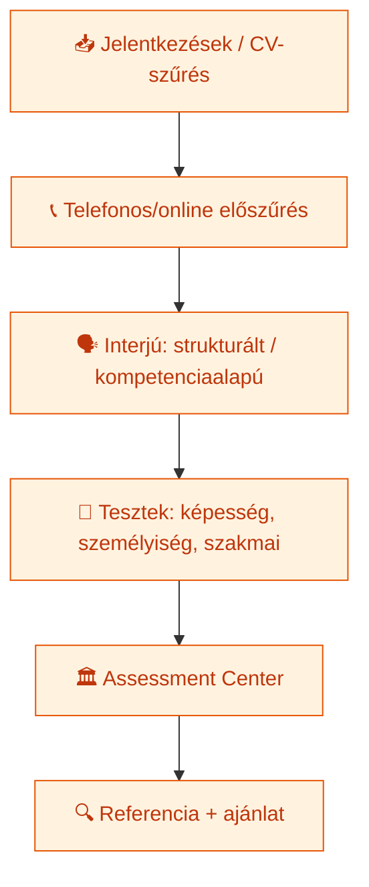
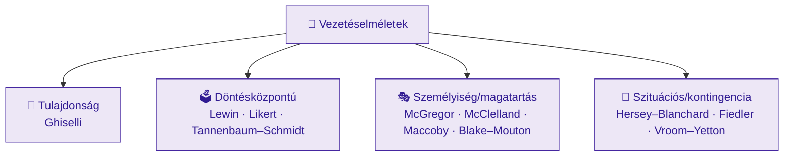

# HR menedzsment és vezetési technikák (GMXHR1MBLF) — Kontextus és tankönyvi referencia

> **A fájl jellege:** Ez a dokumentum a tárgy **teljes körű, tankönyvi mélységű referenciaanyaga**, a **tantárgy belső logikája** szerint strukturálva — a tárgy nevében is megjelenő két tematikai tömb mentén: az **(1.) emberi erőforrás menedzsment (EEM/HRM) funkcióciklusa**, majd a **(2.) vezetés és vezetési technikák (leadership)**, végül a **(3.) szervezeti kultúra és a vezetés kapcsolata**. A felépítés szándékosan **nem** a K8–K13 tételhatárokat követi. A vizsgafókusz megőrzése érdekében minden fejezet jelzi a kapcsolódó K-tételt (» Kapcsolódó tétel: Kxx), a **referencia felépítése** szakaszban pedig megtalálható a teljes **tétel → fejezet megfeleltető index**.
>
> **Hivatkozási stílus:** APA 7 (szövegközi „(Szerző, év)" + záró *Felhasznált irodalom*). A klasszikus elsődleges modelleknél az **eredeti megjelenés évét** adjuk meg. Ahol az előadásanyag és a lektorált szakirodalom **eltér** (pl. Likert modelljének elnevezése, a Maccoby-tipológia magyar fordításai, Katz évszáma), azt külön jelezzük (lásd a *Forrásütközések és pontosítások* szakaszt), nem simítjuk el.

**Oktató / tantárgyfelelős:** Prof. Dr. habil. Karácsony Péter, PhD. (Óbudai Egyetem, Keleti Károly Gazdasági Kar, Módszertani és Menedzsment Intézet)
**Tételek:** K8–K13 (komplex gazdasági tételsor)
**Utolsó frissítés:** 2026-06-03

---

## Tantárgy adatok

| Adat | Érték |
|---|---|
| Neptun kód | GMXHR1MBLF |
| Kredit | **4** |
| Tagozat | Levelező |
| Nyelv | magyar |
| Félév (mintatanterv szerint) | 2023/24/2 (tavaszi) |
| Szak | Műszaki menedzser BSc alapszak (V3 Vállalatirányítás szakirány, F-tanterv 2023) |
| Intézet | Óbudai Egyetem, Keleti Károly Gazdasági Kar, Módszertani és Menedzsment Intézet (1084 Budapest, Tavaszmező u. 17.) |
| Tantárgyfelelős / oktató | Prof. Dr. habil. Karácsony Péter, PhD. (egyetemi tanár, dr. h. c.) |
| Féléves óraszám | Előadás: 10, Tantermi gyakorlat: 10, Labor: 0, Konzultáció: 0 |
| Félévzárás módja | **Félévközi jegy** |

> Forrás: a tantárgy hivatalos *Tantárgynyilvántartó* adatlapja (GMXHR1MBLF) és a `LEV_1` tantárgyismertető dia.

### Értékelés és követelmények

A félévközi jegy három teljesítményelemből áll össze (a hivatalos adatlap szerint):

| Elem | Leírás | Pont |
|---|---|---|
| Prezentáció | EEM és vezetés témaköréből, a tanár által javasolt témában; a 3. héttől tartható | max 20 |
| Írásbeli projektmunka | Egy kiválasztott vezető elemzése (beadandó); leadás a 13. hétig | max 20 |
| Írásbeli vizsga (ZH) | A 13. héten | max 60 |

A beadandó terjedelme A/4-es méretben min. 8–10 oldal + irodalomjegyzék (Times New Roman 12, sorkizárt, 1,5 sortáv). A prezentációt 20 perces időtartamban kell megtartani; a kiselőadás megtartása a tantárgy teljesítésének feltétele, és a vizsgaidőszakban nem pótolható. Az előadásokon és gyakorlatokon a részvétel kötelező, amit jelenléti ív igazol (`LEV_1`).

---

## Oktatási cél

> „A szervezetek sikerének alapja a szervezet humán tőkéjének hatékony felhasználása és fejlesztése. A tantárgy keretében — a gazdasági környezet kontextusában — az emberi erőforrás menedzsment funkcionális elemeinek, témakörének elemzése, összefüggésrendszerük feltárása, valamint egyéb vállalati funkcionális egységekkel való kölcsönhatásának vizsgálata történik. A tantárgy célkitűzése, hogy a hallgatók megismerjék a szervezetek emberierőforrás-menedzsment tevékenységének szervezeti jellegzetességeit, továbbá hogy áttekintést kapjanak a vezetéssel kapcsolatos legfontosabb elméletekről. A tárgy továbbá azon területek fejlesztését is célozza, amelyek a szervezetben való sikeres működéshez hozzájárulnak — így például a hatékony vezetési technikákkal kapcsolatos kompetenciákét is." (a tantárgy hivatalos *Tantárgynyilvántartó* adatlapja)

A cél kettős fókusza pontosan leképezi a tárgy két tematikai tömbjét: az **(1.) EEM-funkcióciklus** és a **(2.) vezetés/vezetési technikák** — kiegészülve a **(3.)** kettőt összekötő szervezeti kultúrával.

---

## Témakörök konzultációnként

A *Tantárgynyilvántartó* a következő 14 témakört (a levelező tagozat előadás-/gyakorlatblokkjai) rögzíti:

| # | Témakör | Tömb | » Tétel |
|---|---|---|---|
| 1 | Bevezetés a tantárgyba, tantárgyi követelmények | — | — |
| 2 | Menedzsment fogalma, feladatai, menedzsment funkciói | B | K11 |
| 3 | Emberi erőforrás menedzsment modellje, az emberi erőforrás jellemzői | A | K8 |
| 4 | Emberi erőforrás tervezése, emberi erőforrás stratégiája | A | K8–K9 |
| 5 | Munkakör, munkakörelemzés, -tervezés, munkakör-értékelés | A | K9 |
| 6 | Munkaerő-biztosítás: toborzás és kiválasztás | A | K9–K10 |
| 7 | Ösztönzésmenedzsment, ösztönzési rendszerek | A | K8/K13 |
| 8 | Teljesítménymenedzsment | A | K13 |
| 9 | HR szerepe a munkahelyi konfliktusok kezelésében | A/B | K8/K11 |
| 10 | Vezetők jellemzői | B | K11 |
| 11 | Vezetési stílusok, modellek | B | K11 |
| 12 | Vezetői készségek fejlesztése | B | K11 |
| 13 | Vezetési technikák | B | K11 |
| 14 | Tantárgy lezárása | — | — |

> A `LEV_1` ismertető ezen felül 20 **kiselőadás-témakört** is felsorol (pl. CSR és a dolgozók, változással szembeni ellenállás, motiváció, szervezeti kommunikáció, generációk, munkahelyi stressz/mobbing, hatalom forrásai, MI/robotizáció, jóllét, távmunka, work–life balance, diszkrimináció, diverzitásmenedzsment). Ezek a beadandó/prezentáció témaforrásai, nem külön vizsgatételek.

---

## A referencia felépítése és a K-tételek leképezése

A korábbi K8–K13 tartalom **nem veszett el**: szétosztottuk és tankönyvi mélységig bővítettük a tematikus fejezetekben. Az alábbi tábla mutatja, melyik tétel anyaga hol található.

| Tétel | Cím | Elsődleges fejezet(ek) |
|---|---|---|
| **K8** | HRM fogalma, céljai, fő funkciói, HR-stratégia | 1.1, 1.2 |
| **K9** | Munkaerő-tervezés és toborzás | 1.3, 1.4, (1.10) |
| **K10** | Kiválasztási folyamat és módszerek | 1.5 |
| **K11** | Vezetés fogalma és vezetői szerepek | 2.1, 2.2, 2.3, 2.4 |
| **K12** | Szervezeti kultúra | 3. |
| **K13** | Teljesítménymenedzsment és értékelés | 1.7, (1.8), (2.4) |

A **bővítések** (a tételsorban csak érintőlegesen szereplő, de a tárgy nevében benne foglalt területek): képzés és fejlesztés (1.6), kompenzáció/javadalmazás (1.8), karrier-/tehetség-/utódlásmenedzsment (1.9), munkaügyi kapcsolatok (1.10), munkaegészség és jóllét (1.11), e-HRM és HR-analitika (1.12), modern leadership (2.3), kommunikáció és konfliktuskezelés (2.5), vezetői gyakorlati eszköztár — delegálás, coaching, mentorálás, csapatépítés (2.6).

---

## Feldolgozott forrásanyagok

### Kurzusforrások (helyi anyag)

| Forrás | Tartalom |
|---|---|
| **Tantárgynyilvántartó adatlap** (GMXHR1MBLF.pdf) | Hivatalos tárgyadatok: kredit (4), óraszám, félévzárás (félévközi jegy), oktatási cél, követelmények pontozása, 14 témakör, kötelező/ajánlott irodalom. *(Szkennelt, kép alapú PDF — tartalmát képi feldolgozással/„olvasott OCR"-rel nyertük ki.)* |
| **LEV_1** — Tantárgyismertető | Követelmények, beadandó- és kiselőadás-szabályok, irodalomjegyzék, 20 kiselőadás-témakör. |
| **LEV_2** — *Human Resource Management and Leadership Techniques* (angol) | HRM fogalma és jelentősége, human/intellectual capital, motiváció (intrinsic/extrinsic), motivációt **nem** támogató vezetői magatartások, HRM-funkciók rendszere (2 blokk), HRM céljai, „HRM Today" (human capital management, engagement, kompetenciaalapú HRM, e-HRM, performance & reward management, etikai dimenzió). |
| **LEV_4** — *Menedzser feladatai és funkciói* | Menedzsment vs. vezetés, menedzsment funkciók (tervezés, szervezés, irányítás, vezetés), Mintzberg-szerepek, Katz-féle készségek (technikai/humán/konceptuális), Pietraziński emberi képességmátrix, W. D. Hitt vezetőtípusok, a menedzsment szakterületei, a vezetés a hierarchia mentén. |
| **LEV_5** — *A vezető magatartása, stílusa* | A vezetési stílusok teljes spektruma: Lewin; Likert; Tannenbaum–Schmidt; Ghiselli; McClelland; McGregor X/Y; Maccoby; Blake–Mouton; Vroom–Yetton; Hersey–Blanchard; Fiedler; „elviselhetetlen főnök" típusok (Rue–Byars nyomán). |
| **Cheat sheet (DOCX)** | Tömör fogalomtár táblázatokban (menedzsment vs. vezetés, Mintzberg, készségek, vezetéselméletek teljes listája, elviselhetetlen főnök típusok). |
| **Vázlat (DOCX)** | Vezetői **kompetencialista** (üzleti éleslátás, hatékonyság, információmegosztás, kapcsolatteremtés, tervezés, projektmenedzsment, döntéshozás, delegálás, motiválás, befolyásolás, fejlesztés stb.) — a 2.6 *vezetési technikák* és a kompetenciaalapú értékelés forrása. |
| **Szervezeti kultúra és a vezetés kapcsolata** (diák, Aizenpreisz O. – Pócsik D.) | Kultúra fogalma, Daft jéghegy-modell, kultúra hatása a dolgozókra, vezető szerepe a kultúraformálásban, Leadership Shadow, HR szerepe. |
| **Pócsik Dénes (2024): Fidel Castro — vezetői elemzés** (beadandó) | A K11 elméletek alkalmazásának szemléltetése (McClelland, McGregor, Maccoby, Tannenbaum–Schmidt, Vroom–Yetton, Hersey–Blanchard). |

### Tudományos cikkek

- **Szabó T. – Molnár E. (2022):** *A szervezeti kultúra és a vezetés kapcsolata.* Gradus, 9(1). DOI: 10.47833/2022.1.ECO.002 — kultúradefiníciók (Deal–Kennedy, Handy, Buchowicz, Schein), Handy-tipológia, Daft jéghegy-modell, leadership-elméletek fejlődése, Schein 6+6 mechanizmusa, Trice–Beyer kultúravezetői típusok, OCAI-kutatás (Cameron–Quinn nyomán, N=70, állami szervezetek).
- **The Leadership Shadow (2023)** — Champions of Change Coalition / Goldman Sachs: a *Leadership Shadow* négy dimenziója (*What I say / How I act / What I prioritise / How I measure*).

---

# 1. Emberi erőforrás menedzsment (EEM/HRM) — a funkcióciklus

> **A tömb logikája:** a HR-stratégia (1.2) a szervezeti stratégiából vezethető le, és ebből bomlik ki a funkcióciklus: *tervezés → munkakörelemzés → toborzás → kiválasztás → beillesztés → képzés-fejlesztés → teljesítménymenedzsment → kompenzáció → karrier/tehetség → munkaügyi kapcsolatok → egészség/jóllét*, mindezt a digitális HR (e-HRM, 1.12) eszközei támogatják.

## 1.1 — HRM fogalma, célja, emberi és intellektuális tőke
» Kapcsolódó tétel: **K8**

**Definíció.** Az emberi erőforrás menedzsment (EEM, angolul *Human Resource Management*, HRM) az a szervezeti funkció, amely az embereket — mint a szervezet legértékesebb erőforrásait — tervezi, szervezi, irányítja és fejleszti a szervezeti célok elérése érdekében. Armstrong és Taylor (2014) meghatározása szerint a HRM *„stratégiai, integrált és koherens megközelítés a szervezet legtöbbet érő vagyonának — az embereknek — a foglalkoztatására, fejlesztésére és jóllétének biztosítására"*. A `LEV_2` gyakorlatorientált definíciója szerint a HR az a funkció, amely a szervezeten belül kezeli az embereket, és iránymutatást ad a munkaerő-ellátás, kompenzáció, juttatások, képzés-fejlesztés, teljesítményértékelés, munkaegészség és -biztonság, munkaügyi kapcsolatok, valamint a munkavállalói elkötelezettség és jóllét területén.

**Emberi és intellektuális tőke.** A HRM elméleti alapja az *emberi tőke* (human capital) fogalma: a munkavállalók tudásának, készségeinek, élettapasztalatainak és motivációjának együttes értéke (Becker, 1964). A `LEV_2` ezt az *intellektuális tőke* tágabb kategóriájaként értelmezi, amely a gondolkodást, a tudást, a kreativitást és a döntéshozatalt foglalja magában. A megközelítés lényege szemléletváltás: az embert nem költségtényezőként (cost), hanem **megtérülő befektetésként** (asset/investment) kezeli.

**Kompetenciaalapú HRM.** A kompetencia a munkakör sikeres betöltéséhez szükséges tudás, képesség és attitűd (KSA: *knowledge, skills, attitudes*) integrált egysége. A kompetenciaalapú HRM (`LEV_2` — „HRM Today") ezeket a kompetenciákat rendszerezi kompetenciamodellbe/-szótárba, és köti össze a teljes funkcióciklust (kiválasztás, képzés, teljesítményértékelés, javadalmazás) egyetlen közös nyelven keresztül.

**A HRM funkcióinak rendszere (`LEV_2` szerint).** A funkciók két blokkra tagolódnak:

| Blokk | Funkciók |
|---|---|
| 1. Az emberi erőforrás **biztosítása** | munkaerő-tervezés (HR planning); munkakörelemzés; toborzás, kiválasztás és előléptetés; képzés és fejlesztés; bér-, ösztönző- és juttatáskezelés (compensation management) |
| 2. Az emberi erőforrás **megtartása és irányítása** | teljesítménymenedzsment; munkaegészség és -biztonság; kollektív alku (collective bargaining); munkaügyi kapcsolatok kezelése |

**A HRM céljai (Armstrong nyomán, `LEV_2`).** A szervezeti hatékonyság és képesség növelése; a HR-politikák kommunikálása minden dolgozó felé; az etikus és társadalmilag felelős magatartás fenntartása; a munka minőségének (quality of work life) fejlesztése; a változás kezelése az egyén, a csoport, a szervezet és a társadalom kölcsönös előnyére.

**Kritika / korlátok.** A HRM „legértékesebb erőforrás" retorikája és a gyakorlati költségcsökkentő intézkedések között gyakran feszültség van; az emberi tőke mérése nehéz (a tudás nagy része hallgatólagos, *tacit*). A kompetenciamodellek statikussá válhatnak, és lemaradhatnak a gyorsan változó munkakörök mögött.

**XXI. századi relevancia.** A `LEV_2` „HRM Today" diája emeli ki a mai irányokat: human capital management, elkötelezettség-menedzsment (engagement), kompetenciaalapú HRM, **e-HRM**, teljesítmény- és jutalmazásmenedzsment, valamint az **etikai dimenzió** (a munkavállalók jólléte iránti felelősség). Ezeket az 1.12 fejezet részletezi.

## 1.2 — HR-stratégia: best practice vs. best fit
» Kapcsolódó tétel: **K8**

A *HR-stratégia* a szervezeti stratégiából levezetett, hosszú távú terv arra, hogyan kezeli a szervezet az emberi erőforrásait. Két alapvető megközelítés áll szemben:

- **Best practice (univerzalista) megközelítés.** Léteznek univerzálisan hatékony HR-gyakorlatok, amelyek minden szervezetben javítják a teljesítményt. Klasszikus képviselője Pfeffer (1998), aki a sikeres szervezetek **hét gyakorlatát** azonosította: (1) foglalkoztatási biztonság; (2) szelektív felvétel; (3) önirányító csapatok / decentralizált döntéshozatal; (4) a szervezeti teljesítményhez kötött magas, kontingens javadalmazás; (5) kiterjedt képzés; (6) a státuszkülönbségek és korlátok csökkentése; (7) a pénzügyi és teljesítményinformációk széles körű megosztása.
- **Best fit (kontingencia-) megközelítés.** A legjobb HR-megoldás mindig a szervezet adott stratégiai helyzetétől, méretétől, életciklusától és környezetétől függ; a HR-gyakorlatoknak illeszkedniük kell a versenystratégiához (vertikális illeszkedés) és egymáshoz (horizontális illeszkedés, „bundling").

**A HR szerepei (Ulrich, 1997).** Ulrich „HR-bajnokok" modellje négy szerepet különít el két tengely (stratégiai/operatív × folyamatok/emberek) mentén: *stratégiai partner*, *adminisztratív szakértő*, *munkavállalói szószóló (employee champion)* és *változásügynök*. Ez a modell adta a „HR business partner" gyakorlat elméleti hátterét.

**Gyakorlati alkalmazás.** A HR-stratégia leképeződik a munkaerő-tervben (1.3), a javadalmazási politikában (1.8) és a tehetségmenedzsment-programokban (1.9). **Kritika:** a best practice empirikus alátámasztottsága vegyes (kultúra- és iparágfüggő), a best fit pedig nehezen operacionalizálható és statikus képet adhat egy dinamikus környezetben.

## 1.3 — Munkaerő-tervezés és munkakörelemzés
» Kapcsolódó tétel: **K9**

**Munkaerő-tervezés (workforce planning).** Célja, hogy a szervezetnek a megfelelő időben, a megfelelő helyen, a megfelelő számú és kompetenciájú munkavállaló álljon rendelkezésre. Négy lépés: (1) a jelenlegi állomány felmérése; (2) a jövőbeli kereslet előrejelzése a szervezeti stratégia alapján; (3) a kereslet–kínálat rés (gap) azonosítása; (4) cselekvési terv a hiány vagy felesleg kezelésére (felvétel, képzés, átcsoportosítás, létszámleépítés).

**Munkakörelemzés (job analysis).** A toborzás és kiválasztás alapdokumentuma. Meghatározza a munkakör tartalmát (feladatok, felelősségek, hatáskörök) és követelményeit (kompetenciák, képesítések, tapasztalat). Két fő kimenete:

| Dokumentum | Mit ír le? | Kérdés |
|---|---|---|
| Munkaköri leírás (*job description*) | magát a **munkát** (feladatok, felelősség, kapcsolatok) | „Mit kell csinálni?" |
| Munkakör-specifikáció (*job/person specification*) | a munkát betöltő **embert** (KSA, képesítés, tapasztalat) | „Milyen ember kell hozzá?" |

**Munkakörtervezés és -értékelés.** A *munkakörtervezés* (job design) a feladatok tartalmi és strukturális kialakítása (pl. munkakörbővítés, -gazdagítás, rotáció — kapcsolódik Herzberg motivációs elméletéhez, 2.4). A *munkakör-értékelés* (job evaluation) a munkakörök relatív szervezeti súlyának/értékének megállapítása, amely a **bérrendszer méltányosságának** (1.8) alapja.

**Kritika / modern relevancia.** A klasszikus, stabil munkakörökre épülő elemzés egyre kevésbé illik az agilis, projektalapú és gyorsan változó szerepekhez; a stratégiai munkaerő-tervezés ma egyre inkább *kompetencia-* és *szerep*-alapú, és HR-analitikára (1.12) támaszkodik.

## 1.4 — Toborzás
» Kapcsolódó tétel: **K9**

A toborzás (recruitment) célja megfelelő számú, alkalmas jelölt **vonzása** a betöltendő pozícióra.

| Forrás | Csatornák | Előny | Hátrány |
|---|---|---|---|
| **Belső** | előléptetés, áthelyezés, belső pályázat, rotáció | alacsonyabb költség, gyorsabb beilleszkedés, motiváló karrierjelzés, ismert jelölt | belső versengés, klikkesedés, „beltenyészet", utánpótlási rés keletkezik |
| **Külső** | álláshirdetés, fejvadász, munkaerő-kölcsönzés, egyetemi kapcsolatok, online platformok, ajánlási programok | friss tudás és nézőpont, szélesebb merítés | magasabb költség, hosszabb beilleszkedés, nagyobb bizonytalanság |

**Munkáltatói márka (employer branding).** A szervezet mint munkahely vonzerejének tudatos építése (értékajánlat, EVP — *employee value proposition*). A digitális toborzás (közösségi média, karrieroldalak) felértékelte; szorosan kapcsolódik a szervezeti kultúrához (3. fejezet).

Dessler (2020) keretrendszere szerint a csatorna megválasztása a munkakör jellegétől, a munkaerőpiaci helyzettől és a rendelkezésre álló időtől függ. **Kritika:** a túl szűk merítés diszkriminációhoz és homogenitáshoz vezethet (vö. diverzitásmenedzsment, `LEV_1` kiselőadás-témák).

## 1.5 — Kiválasztás: a kiválasztási tölcsér és módszerei
» Kapcsolódó tétel: **K10**

A kiválasztás (selection) a jelöltállományból a legalkalmasabb személy **azonosítása**. Logikája a *kiválasztási tölcsér*: minden lépés szűkíti a jelölteket, miközben a módszerek prediktív validitása és a megszerzett információ pontossága nő.

- **CV- és dokumentumszűrés:** a formális követelmények ellenőrzése.
- **Interjú:** a legelterjedtebb eszköz; lehet strukturált (előre rögzített kérdéssor), félig strukturált, nem strukturált, illetve **kompetenciaalapú (behaviourális)** interjú, amely múltbeli viselkedésre kérdez rá konkrét helyzeteken keresztül (STAR-technika).
- **Tesztek:** intelligencia-/képesség-, személyiség- és szakmai tudástesztek, standardizált méréssel.
- **Assessment Center (AC):** több értékelő, több szimulációs feladat (szerepjáték, in-basket, csoportos gyakorlat, prezentáció) és több jelölt egyidejű értékelése; a legmagasabb validitású módszerek egyike, ezért vezetői/menedzseri pozíciókhoz használják — egyúttal a legköltségesebb.

**Validitás és megbízhatóság.** A módszer **validitása** (valóban azt méri-e, ami a teljesítményt előrejelzi) és **megbízhatósága** (konzisztens-e) a két fő minőségi szempont. A metaanalitikus szakirodalom (pl. Schmidt & Hunter, 1998; Anderson et al., 2001) szerint a strukturált interjú, a kognitív képességtesztek és az AC tartoznak a legjobb prediktorok közé, míg a strukturálatlan interjú és a grafológia gyenge. **Kritika:** az AC és a tesztek torzíthatnak (kulturális elfogultság, gyakorláshatás); a kiválasztásban etikai és adatvédelmi kérdések is felmerülnek (vö. e-HRM, 1.12).

## 1.6 — Képzés és fejlesztés; a tanulószervezet *(bővítés)*
» Kapcsolódó tételek: K8 (funkcióciklus része), K13 (fejlesztési cél)

**Fogalmi elhatárolás.** A *képzés* (training) a jelenlegi munkakörhöz szükséges, rövid távú, konkrét tudás/készség fejlesztése; a *fejlesztés* (development) a hosszabb távú, jövőbeli szerepekre felkészítő, tágabb képességépítés.

**A képzési ciklus.** (1) **Képzési igényfelmérés (TNA)** három szinten: szervezeti, munkaköri/feladat-, és egyéni szinten; (2) tervezés és célkitűzés; (3) módszerválasztás; (4) megvalósítás; (5) **értékelés**.

**Módszerek.** *On-the-job*: betanítás, mentorálás, coaching, job rotation, projektmegbízás. *Off-the-job*: tréning, e-learning, szimuláció, esettanulmány, szerepjáték. A `70-20-10` modell szerint a fejlődés ~70%-a tapasztalatból, 20%-a másoktól (visszajelzés, mentorálás), 10%-a formális képzésből származik.

**Kirkpatrick négyszintű értékelési modellje (Kirkpatrick, 1959; bővített kiadás 1994).** A képzés hatásának egymásra épülő szintjei:

| Szint | Mit mér? | Példa eszköz |
|---|---|---|
| 1. Reakció | tetszés, elégedettség | kérdőív a tréning végén |
| 2. Tanulás | tudás-/készségváltozás | elő-/utóteszt |
| 3. Viselkedés | a tanultak munkahelyi alkalmazása | utánkövetés, 360° (1.7) |
| 4. Eredmény | szervezeti hatás (ROI, hiba-, fluktuációcsökkenés) | KPI-k, üzleti mutatók |

**Tanulószervezet (Senge, 1990 — *The Fifth Discipline*).** A folyamatos tanulásra és megújulásra képes szervezet öt diszciplínája: *személyes irányítás* (personal mastery), *gondolati modellek* (mental models), *közös jövőkép* (shared vision), *csapattanulás* (team learning) és — összekötő ötödik diszciplínaként — a *rendszergondolkodás* (systems thinking).

**Kritika / relevancia.** A Kirkpatrick-modell felsőbb szintjeit (3–4.) nehéz tisztán a képzéshez kötni (egyéb tényezők hatása); az ROI-mérés vitatott. A tanulószervezet koncepcióját normatívnak és nehezen operacionalizálhatónak bírálják. Modern fejlemény a *folyamatos tanulás* (LXP-platformok), a microlearning és az AI-alapú perszonalizált képzés (1.12).

## 1.7 — Teljesítménymenedzsment és értékelés
» Kapcsolódó tétel: **K13**

A teljesítménymenedzsment (performance management) **nem** egyetlen éves értékelési esemény, hanem folyamatos ciklus.

**Célkitűzés — MBO és SMART.** A megegyezéses eredménycélokkal való vezetés (*Management by Objectives*, Drucker, 1954) szerint a vezető és a beosztott **közösen** határoz meg célokat; a bevonás növeli az elköteleződést. A célok a **SMART** elveket követik (Specifikus, Mérhető, Elérhető, Releváns, Időhöz kötött).

**Értékelési módszerek.**

| Csoport | Módszerek | Jellemző |
|---|---|---|
| Összehasonlító | rangsorolás, páros összehasonlítás, kényszerelosztás | relatív rang; gyenge fejlesztő visszacsatolás |
| Abszolút / skálás | grafikus skála, **BARS** (viselkedéshorgonyos), **BOS** (viselkedésmegfigyelő) | a dimenziókat konkrét viselkedéshez köti; objektívebb |
| Cél-/eredményalapú | MBO, KPI/OKR | mérhető eredmények |
| Kompetenciaalapú | előre definiált kompetenciák (KSA) mentén | fejlesztési célokra ideális |

**360 fokos visszacsatolás.** Több forrásból (vezető, beosztottak, kollégák, esetenként ügyfelek) gyűjt értékelést, csökkentve az egyoldalúságot. Főként **fejlesztési** célra hatékony; minősítési/bérezési döntésekhez való használata vitatott, mert ronthatja a visszajelzések őszinteségét.

**Értékelési torzítások.** Halo-/horn-hatás, központi tendencia, frissesség-hatás, hasonlóság-torzítás, engedékenység/szigorúság. Ezeket strukturált skálákkal (BARS) és értékelőképzéssel csökkentik.

**Modern relevancia.** Egyre több szervezet vált az éves értékelésről *folyamatos teljesítménybeszélgetésekre* (continuous performance management) és az OKR-keretre; a teljesítményt a 2.4 motivációs elméletek (különösen Pink, 2010) felől is értelmezik.

## 1.8 — Kompenzáció- és javadalmazásmenedzsment *(bővítés)*
» Kapcsolódó tételek: K8 (ösztönzés), K13 (teljesítményhez kötés)

**Cél.** A javadalmazás (compensation/reward management) feladata a megfelelő munkavállalók vonzása, megtartása és motiválása **méltányos**, versenyképes és fenntartható módon.

**Méltányosság (Adams, 1965 — equity theory nyomán).**
- *Belső méltányosság:* a szervezeten belüli munkakörök relatív értéke (munkakör-értékelés, 1.3) alapján.
- *Külső méltányosság:* a piaci bérszinthez (bérfelmérés, benchmark) viszonyítva.
- *Egyéni méltányosság:* az egyéni teljesítmény és tapasztalat elismerése.

**A javadalmazás elemei.**

| Elem | Példa |
|---|---|
| Alapbér | fix havi/órabér, besorolási bértábla |
| Teljesítményhez kötött (variábilis) | bónusz, jutalék, prémium, nyereségrészesedés, részvényopció |
| Béren kívüli juttatások (benefits) | nyugdíj-/egészségpénztár, biztosítás, **cafeteria** (választható juttatási rendszer) |
| Nem pénzbeli elismerés | elismerés, fejlődési lehetőség, rugalmas munkavégzés |

**Total reward (teljes javadalmazás) modell.** A modern megközelítés (Armstrong & Taylor, 2014) a pénzbeli (transactional) és a nem pénzbeli (relational: tanulás, elismerés, munkakörnyezet, work–life balance) elemeket **együtt** kezeli, mert ezek együtt befolyásolják az elkötelezettséget.

**Kapcsolat a motivációval.** A pénz mint ösztönző Herzberg (1959) szerint elsősorban *higiénés tényező* (hiánya elégedetlenséget okoz, megléte önmagában nem motivál tartósan); Pink (2010) szerint a tudásmunkában a méltányos alapbér „leveszi a pénzt az asztalról", a tartós motivációt viszont az autonómia–mesterség–cél hármasa adja (2.4). **Kritika:** a teljesítményhez kötött bér torzíthatja a viselkedést (rövid távra, mérhetőre optimalizál), és alááshatja a belső motivációt (kiszorító hatás).

## 1.9 — Karrier-, tehetség- és utódlásmenedzsment *(bővítés)*
» Kapcsolódó tétel: K8 (megtartás)

- **Karriermenedzsment.** A munkavállaló szervezeten belüli fejlődési útjának közös tervezése (karrierutak, fejlesztési tervek, mentorálás). Schein „karrierhorgonyai" (Schein, 1978) az egyén karrierorientációját írják le (pl. szakmai kompetencia, vezetői kompetencia, autonómia, biztonság).
- **Tehetségmenedzsment (talent management).** A kritikus szerepekhez és a magas potenciálú (HiPo) munkavállalókhoz kötött, integrált folyamat: azonosítás → fejlesztés → megtartás. Gyakori eszköz a **9-box grid** (teljesítmény × potenciál mátrix).
- **Utódlástervezés (succession planning).** A kulcspozíciók folytonosságának biztosítása az utódjelöltek előzetes azonosításával és felkészítésével; csökkenti a kulcsember-kockázatot.

**Relevancia / kritika.** A „tehetség" szelektív kezelése (HiPo-fókusz) demotiválhatja a többséget és méltányossági kérdéseket vet fel; a karrierutak ma laposabbak és gyakran horizontálisak (szakértői vs. vezetői pálya).

## 1.10 — Munkaügyi kapcsolatok, kollektív alku, munkajogi alapok *(bővítés)*
» Kapcsolódó tételek: K8, K9 (HR és konfliktuskezelés témakör)

**Munkaügyi kapcsolatok (labour/industrial relations).** A munkáltató, a munkavállalók (és érdekképviseleteik: szakszervezet, üzemi tanács) és az állam közötti viszonyrendszer. A `LEV_2` a HRM második blokkjában nevesíti a *kollektív alkut* és a *kapcsolatok kezelését*.

**Kollektív alku (collective bargaining).** A munkafeltételekről (bér, munkaidő, juttatások) folytatott, kollektív szerződésben rögzített tárgyalási folyamat a munkáltató és a munkavállalói érdekképviselet között.

**Magyar munkajogi alapok (tájékoztató jelleggel).** A foglalkoztatás kereteit a **2012. évi I. törvény a Munka Törvénykönyvéről (Mt.)** adja: munkaviszony létesítése és megszüntetése, munkaidő- és pihenőidő-szabályok, díjazás, felelősség, kollektív munkajog (szakszervezet, üzemi tanács). *(A pontos hatályos rendelkezéseket mindig az aktuális jogszabályból kell ellenőrizni; ez a szakasz nem jogi tanácsadás.)*

**Relevancia.** A HR a munkaügyi konfliktusok megelőzésében és kezelésében közvetítő szerepet tölt be (vö. a 9. témakör: „HR szerepe a munkahelyi konfliktusok kezelésében"); itt kapcsolódik a 2.5 konfliktuskezelési eszköztárhoz.

## 1.11 — Munkahelyi egészség, biztonság és jóllét (well-being) *(bővítés)*
» Kapcsolódó tétel: K8 (HRM-funkció)

- **Munkavédelem és munkabiztonság.** A balesetek és foglalkozási megbetegedések megelőzése; Magyarországon az **1993. évi XCIII. törvény a munkavédelemről** kerete (kockázatértékelés, oktatás, egyéni védőeszközök). *(Hatályos részleteket ellenőrizni kell.)*
- **Munkahelyi jóllét (well-being).** Fizikai, mentális és szociális dimenziók együttese. A `LEV_1` kiselőadás-témái között kiemelten szerepel a *munkahelyi stressz és mobbing*, a *jóllét összetevői*, a *work–life balance* és a *távmunka* hatása.
- **Stressz és kiégés (burnout).** A munkahelyi stressz tartós fennállása kiégéshez vezethet; a WHO 2019 óta foglalkozási jelenségként (nem betegségként) sorolja be. Kezelése szervezeti (munkaszervezés, vezetői támogatás) és egyéni szinten történik.

**Relevancia.** A jóllét közvetlenül hat az elkötelezettségre, a fluktuációra és a teljesítményre; a HRM etikai dimenziója (`LEV_2`) ide kapcsolódik. *(Megjegyzés: ez a szakasz általános, akadémiai jellegű ismeretterjesztés, nem egészségügyi tanács.)*

## 1.12 — e-HRM, digitális HR és HR-analitika *(bővítés)*
» Kapcsolódó tétel: K8 („HRM Today")

- **e-HRM.** A HR-folyamatok információtechnológiai támogatása és önkiszolgáló (employee/manager self-service) digitalizálása HRIS/HCM rendszerekben (pl. bér, távollét, toborzás, képzés).
- **HR-analitika (people analytics).** Adatvezérelt döntéstámogatás: a fluktuáció, a toborzási hatékonyság, az elkötelezettség és a teljesítmény elemzése. Szintjei: leíró → diagnosztikai → prediktív → preszkriptív.
- **MI a HR-ben.** Önéletrajz-szűrés, chatbotok, perszonalizált képzés — egyúttal komoly **etikai/torzítási és adatvédelmi (GDPR)** kockázatokkal (a `LEV_1` „MI és robotizáció" kiselőadás-témája).

**Kritika.** Az algoritmikus kiválasztás reprodukálhatja a múltbeli torzításokat; a „mérhető" túlsúlya elnyomhatja a kvalitatív szempontokat. A `LEV_2` ezért hangsúlyozza az etikai felelősséget és a munkavállalói jóllétet.

---

# 2. Vezetés és vezetési technikák (leadership)

> **A tömb logikája:** előbb tisztázzuk a menedzsment és a vezetés fogalmát, a vezetői szerepeket és készségeket (2.1); majd rendszerezzük a klasszikus vezetéselméleteket (2.2) és a modern leadership-irányzatokat (2.3); ezután a vezetés gyakorlati „üzemanyagát", a motivációt (2.4), végül a konkrét vezetési technikákat: kommunikáció és konfliktuskezelés (2.5), valamint delegálás, coaching, mentorálás, csapatépítés (2.6).

## 2.1 — Menedzsment vs. vezetés; szerepek és készségek
» Kapcsolódó tétel: **K11**

**Menedzsment vs. vezetés.** A `LEV_4` és a cheat sheet megkülönböztetése szerint a **menedzsment** „az a folyamat, melyet egy vagy több személy végez mások tevékenységének koordinálására, olyan eredmények elérése érdekében, melyeket egyikük sem tudna egyedül elérni" (Kocsis nyomán); a **vezetés** „olyan tevékenység, amely az erőforrások hatékony és eredményes felhasználására irányul bizonyos cél(ok) elérése érdekében". A szakirodalom (pl. Bennis & Nanus, 1985; Kotter) gyakran élesíti: a menedzser a *komplexitást* kezeli (tervezés, szervezés, ellenőrzés), a vezető (leader) a *változást* (irányadás, inspiráció, emberek mozgósítása). A `LEV_4` a menedzsment négy funkcióját rögzíti: **tervezés, szervezés, irányítás, vezetés**.

**Katz készségmodellje (Katz, 1955; HBR-klasszikusként újraközölve 1974).** Három készségtípus:

| Készség | Tartalom | Jelleg |
|---|---|---|
| Technikai | szakterületi szaktudás, módszerek, eljárások | tanulható |
| Humán | együttműködés, kommunikáció, emberek megértése | fejleszthető |
| Konceptuális | a szervezet egészének átlátása, összefüggések | részben adottság |

A hierarchiában felfelé a technikai készség súlya csökken, a konceptuálisé nő. *(Forrásütközés: a `LEV_4`/helyi anyag „Katz (1974)"-ként hivatkozza; az eredeti megjelenés 1955 — lásd a *Forrásütközések és pontosítások* szakaszt.)*

**Mintzberg vezetői szerepei (Mintzberg, 1973).** Tíz szerep három csoportban:

| Csoport | Szerepek |
|---|---|
| Személyközi (interperszonális) | nyilvános megjelenés (figurehead), főnöki (leader), kapcsolatteremtő (liaison) |
| Információs | információgyűjtő (monitor), -elosztó (disseminator), szóvivő (spokesman) |
| Döntési | vállalkozó (entrepreneur), zavarelhárító (disturbance handler), erőforrás-elosztó (resource allocator), tárgyaló (negotiator) |

**Pietraziński emberi képességmátrix (`LEV_4`; Pietraziński, 1977).** A problémafelismerő és problémamegoldó képesség két tengelyén négy alaptípus: technikus, mérnök, kutató, vezető (a vezető a széles horizontú, integráló alkat).

**W. D. Hitt vezetőtípusai (`LEV_4`; Hitt, *A mestervezető*).** A vezetői magatartás minőségi szintjeit írja le (a forrás William D. Hitt: *The Model Leader / A mestervezető* című műve).

**Modern relevancia.** A készség- és szereptipológiák ma a kompetenciamodellek (1.1) alapjául szolgálnak; a „menedzser vs. vezető" megkülönböztetést gyakran bírálják mesterséges dichotómiaként (a gyakorlatban a két szerep keveredik).

## 2.2 — Klasszikus vezetéselméletek
» Kapcsolódó tétel: **K11**

A `LEV_5` négy nagy elméletcsaládot különít el. **Áttekintő mátrix:**

| Elméletcsalád | Alapkérdés | Fő képviselők (helyi anyag) | Eredeti forrás (év) |
|---|---|---|---|
| Tulajdonságelmélet | *Milyen* a sikeres vezető? (személyiségjegyek) | Ghiselli; „siker"-tulajdonságok | Ghiselli (1971) |
| Döntésközpontú | *Hogyan* dönt, mennyi részvételt enged? | Lewin; Likert; Tannenbaum–Schmidt | Lewin et al. (1939); Likert (1961/1967); Tannenbaum–Schmidt (1958) |
| Személyiség-/magatartásközpontú | *Milyen attitűd/stílus* jellemzi? | McGregor X/Y; McClelland; Maccoby; Blake–Mouton | McGregor (1960); McClelland (1961); Maccoby (1976); Blake–Mouton (1964) |
| Szituációs / kontingencia | *A helyzettől* függő stílus | Hersey–Blanchard; Fiedler; Vroom–Yetton | Hersey–Blanchard (1969); Fiedler (1967); Vroom–Yetton (1973) |

### 2.2.1 Tulajdonságelmélet (Ghiselli)
A sikeres vezető meghatározott személyiségjegyekkel rendelkezik. Ghiselli (`LEV_5`): **nagyon fontos** — szakmai felkészültség, intelligencia, önmegvalósítás, önbizalom, határozottság; **mérsékelten fontos** — kockázatvállalás, munkavállalók iránti elkötelezettség, kezdeményezőkészség, jó kommunikációs készség, érettség. **Kritika:** nem vizsgálja a vezető–vezetett viszonyt és a feladat jellegét; az empíria nem talált univerzális „vezetői vonáskészletet" (bár a modern Big Five-kutatás részben rehabilitálta a vonásmegközelítést).

### 2.2.2 Döntésközpontú elméletek
- **Lewin (Lewin, Lippitt & White, 1939):** *autokratikus* (egyedüli döntés, fegyelmező, szubjektív értékelés), *demokratikus* (bevonó, objektív értékelés), *laissez-faire* (passzív, csak kérésre segít, „inkább tanácsadó"). Klasszikus megállapítás: a demokratikus stílus mellett magasabb az elégedettség, a teljesítmény viszont rövid távon az autokratikusnál is magas lehet.
- **Likert (Likert, 1961/1967):** négyfokozatú tipológia — *keménykezű parancsoló* (System 1: bizalmatlan, fenyegetés/büntetés, lefelé irányuló kommunikáció, centralizált döntés), *jóakaratú parancsoló* (System 2: némi bizalom, jutalmazás), *konzultatív* (System 3: bízik, az ötleteket felhasználja, kétirányú kommunikáció), *részvételi csoport* (System 4: teljes bizalom, közös célkitűzés). *(Forrásütközés: a helyi anyag „egytényezős modell"-nek nevezi, mert egyetlen dimenzió — a beosztottak részvételének mértéke — mentén állít fel négy szintet; a nemzetközi szakirodalom „Likert négy rendszere / System 1–4" néven hivatkozza — lásd a *Forrásütközések és pontosítások* szakaszt.)*
- **Tannenbaum–Schmidt (1958):** *hatalom-részvételi kontinuum* a vezetőközpontútól (a vezető dönt és bejelent) a beosztottközpontúig (a vezető a kereteken belül szabad döntést enged) — hét fokozattal.

### 2.2.3 Személyiség- és magatartásközpontú elméletek
- **McGregor X/Y (McGregor, 1960):** az **X** beállítottságú vezető szerint az ember kerüli a munkát és a felelősséget → autokratikus, „furkósbot és mézesmadzag" irányítás, információ-kisajátítás; az **Y** beállítottságú vezető bízik az önirányításban és a kreativitásban → demokratikus/liberális, megosztó, fejlesztő, csoportos döntés. (Később Ouchi „Z elmélete" egészítette ki.)
- **McClelland teljesítménymotivációs elmélet (McClelland, 1961):** három tanult szükséglet — *teljesítmény* (nAch), *kapcsolat* (nAff), *hatalom* (nPow); arányuk határozza meg a preferált vezetői stílust. (Részletesen 2.4-ben is.)
- **Maccoby négy vezetőtípusa (Maccoby, 1976 — *The Gamesman*):** *mesterember*, *dzsungelharcos*, *szervezeti ember*, *játékos*. *(Forrásütközés: a magyar fordítások eltérőek — pl. „mesterember" = craftsman, „dzsungelharcos" = jungle fighter, „szervezeti ember" = company man, „játékos" = gamesman — lásd a *Forrásütközések és pontosítások* szakaszt.)*
- **Blake–Mouton vezetői rács (Blake & Mouton, 1964):** két dimenzió (emberközpontúság × feladatközpontúság, 1–9 skálán) öt nevezetes stílussal: **(1,1)** „fél"-vezetés (minimális erőfeszítés), **(9,1)** hajtós/tekintélyelvű (termelés mindenek felett), **(1,9)** emberközpontú/„country club", **(5,5)** kompromisszumos, **(9,9)** csoportközpontú (a leghatékonyabb ideáltípus: a teljesítmény forrása az emberek összefogása).

### 2.2.4 Szituációs / kontingencia elméletek
- **Hersey–Blanchard helyzetfüggő modell (Hersey & Blanchard, 1969):** a stílust a beosztott **érettségi szintjéhez** (munkaképesség + munkaakarat) igazítja, két viselkedésmód (feladat- és kapcsolatorientáció) kombinációjával: *diktáló* (S1: magas feladat, alacsony kapcsolat) → *eladó/meggyőző* (S2: magas-magas) → *résztvevő/bátorító* (S3: alacsony feladat, magas kapcsolat) → *delegáló* (S4: alacsony-alacsony).
- **Fiedler kontingenciamodell (Fiedler, 1967):** a vezető orientációját a **legkevésbé kedvelt munkatárs (LKM/LPC)** teszttel állapítja meg (feladat- vs. kapcsolatorientált), és a szituáció kedvezőségéhez (vezető–beosztott viszony, feladatstruktúra, pozícionális hatalom) párosítja. Nagyon kedvező és nagyon kedvezőtlen helyzetben a feladatorientált, közepesen kedvezőben a kapcsolatorientált vezető hatékonyabb.
- **Vroom–Yetton döntési modell (Vroom & Yetton, 1973):** öt döntési stílus a bevonás mértéke szerint — **A1** (a vezető a meglévő infóval dönt), **A2** (a vezető infót kér, de maga dönt), **K1** (egyénenként konzultál), **K2** (csoporttal konzultál), **Cs/G** (csoportos, konszenzusos döntés) — döntésfa segítségével (döntési minőség, elfogadottság, idő alapján). *(Megjegyzés: a helyi `LEV_5` jelölése A1/A2/K1/K2/Cs; a nemzetközi irodalom gyakran A1/A2/C1/C2/G — ugyanaz a tartalom.)*

**A szituációs megközelítés kritikája.** Empirikus alátámasztottságuk vegyes (különösen a Hersey–Blanchard modellé gyenge), de gyakorlati, oktatási értékük máig nagy.

## 2.3 — Modern leadership-irányzatok *(bővítés)*
» Kapcsolódó tétel: K11 (a „modern vezetők jellemzői", 10. témakör)

- **Tranzakciós vs. transzformatív vezetés (Burns, 1978; Bass, 1985).** Burns vezette be a *transforming* vs. *transactional* megkülönböztetést; Bass operacionalizálta. A **tranzakciós** vezetés cserekapcsolat (jutalom teljesítményért, kivételes beavatkozás); a **transzformatív** vezetés a követőket magasabb motivációs és morális szintre emeli. Bass négy „I"-je: *idealizált befolyás* (karizma), *inspiráló motiváció*, *intellektuális stimuláció*, *egyéni figyelem (individualized consideration)*.
- **Szolgáló vezetés (servant leadership — Greenleaf, 1970 esszé; 1977 könyv).** A vezető „elsőként szolgál": a követők fejlődése, jólléte és önállósága a cél; az autoritás a szolgálatból fakad.
- **Autentikus vezetés (authentic leadership — Avolio & Gardner, 2005; Luthans & Avolio).** Négy komponens: önismeret, kiegyensúlyozott információfeldolgozás, belsővé tett morális perspektíva, relációs átláthatóság (őszinteség). A pozitív szervezeti magatartás (POB) irányzatához kötődik.

**Relevancia / kritika.** A transzformatív vezetés erős pozitív kapcsolatot mutat az elkötelezettséggel, de „hős-vezető"-szemlélete és a sötét oldal (nárcizmus, manipuláció) miatt bírálják; a fogalmak mérési átfedése (transzformatív/autentikus/szolgáló) is vitatott.

## 2.4 — Motiváció mint vezetési eszköz
» Kapcsolódó tételek: K11, K13

A `LEV_2` szerint az egyéni teljesítményt két, egymástól függő tényező határozza meg: a **személyes motiváció** és a **vezetés típusa**. Megkülönböztetjük a **belső (intrinsic)** — a tevékenység öröméért való — és a **külső (extrinsic)** — jutalomért/büntetés elkerüléséért való — motivációt. A `LEV_2` arra is figyelmeztet, mi **nem** motivál: személyes támadás, félelemmel való vezetés, a felelősség kisajátítása, a dolgozók túlterhelése.

**Tartalomelméletek (mi motivál?).**

| Elmélet | Lényeg | Vezetői tanulság |
|---|---|---|
| **Maslow** (1943) — szükséglethierarchia | fiziológiai → biztonsági → szociális → elismerés → önmegvalósítás | a kielégített szükséglet már nem motivál; eltérő szinten eltérő ösztönző hat |
| **Alderfer** (1969) — ERG | létezés (E), kapcsolat (R), növekedés (G); **egyszerre** is hathatnak, „frusztráció-regresszió" | rugalmasabb, mint Maslow merev lépcsője |
| **Herzberg** (1959/1968) — kéttényezős | *higiénés* tényezők (fizetés, biztonság, körülmények) az elégedetlenséget szüntetik; *motivátorok* (teljesítmény, elismerés, felelősség, fejlődés) motiválnak | munkakör-gazdagítás; a pénz nem tartós motivátor |
| **McClelland** (1961) — tanult szükségletek | teljesítmény (nAch), kapcsolat (nAff), hatalom (nPow) | a vezetőt jellemzően a (szocializált) hatalmi igény hajtja |

**Folyamatelméletek (hogyan motivál?).**
- **Vroom elvárás-elmélet (Vroom, 1964):** Motiváció = *Elvárás* (erőfeszítés → teljesítmény) × *Eszközszerűség* (teljesítmény → jutalom) × *Vegyérték* (a jutalom vonzereje). Bármelyik tényező nullája lenullázza a motivációt.
- **Adams méltányosságelmélet (Adams, 1965):** az egyén a saját input/output arányát másokéhoz hasonlítja; az érzékelt méltánytalanság korrekciós viselkedést vált ki (lásd 1.8).

**Pink — Motiváció 3.0 (Pink, 2009/2010).** A tudásalapú munkában a belső motiváció három pillére hatékonyabb a hagyományos „ha–akkor" jutalmazásnál: **autonómia** (a feladat, idő, technika, csapat feletti önállóság), **mesterség/szakértelem** (a fejlődés igénye, „flow") és **cél** (a munka tágabb értelme). A külső jutalom rutinfeladatnál működik, de a kreatív munkát ronthatja (kiszorító hatás).

**Kapcsolat a vezetéshez.** A McGregor X/Y (2.2.3) és a Likert-rendszerek (2.2.2) közvetlenül az emberkép és a motivációs feltételezés köré épülnek; a Pink-féle autonómia a delegálással és coachinggal (2.6) operacionalizálható.

## 2.5 — Kommunikáció és konfliktuskezelés *(bővítés)*
» Kapcsolódó tételek: K11; a 9. témakör (HR és munkahelyi konfliktusok)

**Kommunikációs alapmodell (Shannon–Weaver nyomán).** Adó → kódolás → **csatorna** → dekódolás → vevő → *visszacsatolás*; a folyamatot **zaj** (fizikai, szemantikai, pszichológiai) torzítja. A szervezeti kommunikáció lehet *lefelé*, *felfelé*, *horizontális* és *informális* (szóbeszéd, „grapevine") irányú. Az aktív hallgatás és a visszacsatolás a zaj csökkentésének fő eszköze.

**Thomas–Kilmann konfliktuskezelési modell (Thomas & Kilmann, 1974 — TKI).** Két dimenzió (önérvényesítés × együttműködési készség) öt módja:

| Mód | Önérvényesítés | Együttműködés | Mikor célszerű? |
|---|---|---|---|
| Versengő (competing) | magas | alacsony | gyors, fontos döntés; vészhelyzet |
| Alkalmazkodó (accommodating) | alacsony | magas | a kapcsolat fontosabb az ügynél; tévedés beismerése |
| Elkerülő (avoiding) | alacsony | alacsony | jelentéktelen ügy; lehiggadás kell |
| Kompromisszumkereső (compromising) | közepes | közepes | időnyomás; részleges megoldás elfogadható |
| Együttműködő/problémamegoldó (collaborating) | magas | magas | mindkét fél érdeke fontos; tartós megoldás (win–win) |

**Tárgyalás- és befolyásolási technikák.** A *Harvard-féle elvi alapú tárgyalás* (Fisher & Ury, 1981): válaszd el az embert a problémától; az érdekekre fókuszálj, ne a pozíciókra; keress kölcsönös előnyű opciókat; alkalmazz objektív kritériumokat; ismerd a **BATNA**-dat (a megállapodás legjobb alternatíváját). A befolyásolás eszközeit Cialdini (1984) hat elve rendszerezi: viszonzás, elköteleződés/következetesség, társas bizonyíték, tekintély, szimpátia, szűkösség. A `Vázlat.docx` „Befolyásolás" kompetenciája ezt a gyakorlati síkot képviseli.

**Relevancia.** A HR közvetítő (mediátor) szerepe a munkahelyi konfliktusokban (9. témakör) közvetlenül a TKI és az elvi tárgyalás eszköztárára épül.

## 2.6 — Vezetői gyakorlati eszköztár: delegálás, coaching, mentorálás, csapatépítés *(bővítés)*
» Kapcsolódó tételek: K11; a 12–13. témakör (vezetői készségfejlesztés, vezetési technikák)

A `Vázlat.docx` vezetői kompetencialistája (delegálás, motiválás, döntéshozás, információmegosztás, fejlesztés, befolyásolás, együttműködésre ösztönzés) adja a tárgy „vezetési technikák" gyakorlati magját.

- **Delegálás.** Feladat, hatáskör és felelősség átruházása világos elvárásokkal, a kontroll megtartásával. Kapcsolódik a Hersey–Blanchard delegáló stílusához (2.2.4) és Pink autonómiájához (2.4). Csapdák: alul- vagy túldelegálás, „felfelé delegálás".
- **Coaching.** Kérdésalapú, fejlesztő beszélgetés, amely a coaching-alanyt saját megoldásai felé vezeti (gyakori keret: **GROW** — Goal, Reality, Options, Will). A vezető mint coach a teljesítmény és a fejlődés támogatója.
- **Mentorálás.** Tapasztaltabb kolléga hosszabb távú, karrier- és szerepfejlesztő támogatása; eltér a coachingtól (szélesebb, kapcsolatközpontúbb, tudásátadó).
- **Csapatépítés.** A csapatfejlődés szakaszai Tuckman (1965) szerint: *forming → storming → norming → performing* (+ *adjourning*, 1977). A vezető feladata a szakasznak megfelelő beavatkozás (irányítás → konfliktuskezelés → normák megerősítése → felhatalmazás).
- **Visszajelzés (feedback).** Konkrét, viselkedésalapú, időszerű és kétirányú; a fejlesztő kultúra (1.6, C) alapeszköze.

**Relevancia / kritika.** Ezek a technikák a transzformatív és szolgáló vezetés (2.3) operacionalizálásai; hatékonyságuk erősen függ a vezetői hitelességtől és a szervezeti kultúrától (3. fejezet).

---

# 3. Szervezeti kultúra és a vezetés kapcsolata
» Kapcsolódó tétel: **K12**

**Definíció.** A szervezeti kultúra a szervezet tagjai által osztott alapfeltevések, értékek, normák és magatartásformák összessége, amelyet a csoport a külső alkalmazkodás és a belső integráció problémáinak megoldása során tanult, és amelyet érvényesnek tekint, ezért átad az új tagoknak (Schein, 1985).

**Schein háromszintű modellje (Schein, 1985).** (1) **Artefaktumok** — látható, de nehezen értelmezhető jelenségek (épület, öltözet, rítusok, nyelv); (2) **vallott értékek** (espoused values) — kinyilvánított stratégiák, célok, filozófiák; (3) **alapvető előfeltevések** (basic underlying assumptions) — tudattalan, magától értetődő hiedelmek, a kultúra valódi magja.

**Daft jéghegy-modell.** A „vízszint feletti", látható elemek (irodaelrendezés, öltözet, szóhasználat, ünnepek) a kultúra kis, megfigyelhető része; a „vízszint alatti" rész (értékek, normák, érzelmi viszonyulás) adja a tömeg nagyját. *(A helyi diák és a Szabó–Molnár (2022) cikk Daft-hoz köti a modellt.)*

**Handy kultúratipológia (Handy, 1986/1993 — *Gods of Management*).**

| Típus | Metafora | Jellemző |
|---|---|---|
| Hatalom-kultúra | pókháló | centralizált, erős vezető, gyors döntés, kevés szabály |
| Szerep-kultúra | görög oszlopcsarnok | szabályok, eljárások, formalizált szerepek; stabil, lassan változik |
| Feladat-kultúra | háló/mátrix | projekt- és csapatorientált, rugalmas, koordinációs nehézségek |
| Személyiség-kultúra | csillaghalmaz | a szakértő egyén a központ, a szervezet csak keret |

**Cameron–Quinn — versengő értékek kerete és OCAI (Cameron & Quinn, 1999/2006).** Két dimenzió (befelé/kifelé fókusz × rugalmasság/kontroll) négy típusa: **klán** (belső, rugalmas — bizalom, csapat), **adhokrácia** (külső, rugalmas — innováció, kockázat), **piac** (külső, kontroll — eredmény, verseny), **hierarchia** (belső, kontroll — stabilitás, szabályok). Az **OCAI** kérdőív méri a jelenlegi és a kívánatos kultúraprofilt. Szabó–Molnár (2022, N=70, állami szervezetek) eredménye: domináns a *klán*, a kívánatos profil viszont az *adhokrácia* felé tolódik.

**Schein kultúraformáló mechanizmusai (Schein, 1985).** Hat *elsődleges* eszköz: mire figyel és mit mér a vezető; hogyan reagál kritikus helyzetekben; erőforrás-allokáció; szerepmodellezés; jutalmazás/büntetés; ki- és beválasztás/eltávolítás. Hat *másodlagos* (megerősítő) mechanizmus: szervezeti felépítés, rendszerek és eljárások, rítusok, történetek/legendák, fizikai tér, hivatalos küldetésnyilatkozat.

**Leadership Shadow (Champions of Change Coalition, 2023).** Négy dimenzióban vizsgálja, hogyan „árnyékolja be" a vezető viselkedése a kultúrát: *What I say* (kommunikált értékek), *How I act* (a szavak és tettek kongruenciája), *What I prioritise* (mire fordít időt/erőforrást), *How I measure* (mit mér és jutalmaz). A modell üzenete: a kultúrát nem a kinyilvánított értékek, hanem a vezető tényleges viselkedése formálja.

**Kapcsolat a vezetéssel + kritika.** Schein tételmondata szerint a kultúra és a vezetés „egyazon érem két oldala": a vezető hozza létre, tartja fenn és változtatja a kultúrát. **Kritika:** a kultúra mérése (kérdőíves vs. mély, etnográfiai megközelítés) vitatott; a „kívánatos kultúra" felülről tervezhetősége korlátozott; az erős kultúra a változás gátja is lehet.

---

## Forrásütközések és pontosítások

A 4. forráskezelési elv szerint az eltéréseket jelezzük, nem simítjuk el:

1. **Katz évszáma.** A helyi anyag (`LEV_4`, cheat sheet) „Katz (1974)"-ként hivatkozik. Az eredeti tanulmány **Katz, R. L. (1955): *Skills of an Effective Administrator*, HBR 33(1), 33–42**; 1974-ben jelent meg újra „HBR Classic"-ként. A modell tartalma azonos; az 1955-ös az elsődleges forrás.
2. **Likert modelljének elnevezése.** A helyi anyag „Likert **egytényezős** modellje" néven említi (mert egyetlen dimenzió: a beosztotti részvétel mértéke). A nemzetközi szakirodalom „Likert **négy rendszere / System 1–4**" néven hivatkozza (Likert, 1961/1967). Ugyanarról a négyfokozatú tipológiáról van szó.
3. **Maccoby-tipológia fordításai.** A magyar elnevezések forrásonként eltérhetnek: mesterember (*craftsman*), dzsungelharcos (*jungle fighter*), szervezeti ember (*company man*), játékos (*gamesman*) — Maccoby (1976): *The Gamesman*.
4. **Vroom–Yetton jelölés.** A `LEV_5` A1/A2/K1/K2/Cs jelölést használ; az angol irodalom A1/A2/C1/C2/G — tartalmilag azonos.
5. **Alderfer közlési helye.** A modell elsődleges forrása: Alderfer (1969), *Organizational Behavior and Human Performance*, 4(2) — nem a „Psychological Review" (utóbbi Maslow 1943-as cikkének helye).
6. **Pink éve.** Az angol kiadás 2009 (*Drive*), a magyar fordítás (*Motiváció 3.0*, HVG) 2010 — a helyi irodalomjegyzék a 2010-es magyar kiadást adja.

---

## Kulcsfogalmak, kulcsszerzők és modellek (összesítő)

| Téma / modell | Szerző (eredeti év) | Lényeg / kulcsszó | Fejezet |
|---|---|---|---|
| HRM-definíció | Armstrong & Taylor (2014) | stratégiai, integrált emberkezelés | 1.1 |
| Emberi tőke | Becker (1964) | tudás+készség+tapasztalat mint befektetés | 1.1 |
| Best practice / 7 gyakorlat | Pfeffer (1998) | univerzális HR-gyakorlatok | 1.2 |
| HR-szerepek | Ulrich (1997) | stratégiai partner, adminisztrátor, szószóló, változásügynök | 1.2 |
| Munkakörelemzés | Milkovich & Glueck (1995) | job description vs. specification | 1.3 |
| Kiválasztási validitás | Schmidt & Hunter (1998); Anderson et al. (2001) | strukturált interjú, AC, kognitív teszt | 1.5 |
| Képzésértékelés | Kirkpatrick (1959) | reakció–tanulás–viselkedés–eredmény | 1.6 |
| Tanulószervezet | Senge (1990) | öt diszciplína, rendszergondolkodás | 1.6 |
| MBO | Drucker (1954) | megegyezéses célok | 1.7 |
| 360°-os értékelés | (gyakorlati eszköz) | többforrású visszajelzés | 1.7 |
| Méltányosságelmélet | Adams (1965) | input/output arány összehasonlítása | 1.8, 2.4 |
| Total reward | Armstrong & Taylor (2014) | pénzbeli + nem pénzbeli javadalmazás | 1.8 |
| Karrierhorgonyok | Schein (1978) | karrierorientációk | 1.9 |
| Készségmodell | Katz (1955) | technikai/humán/konceptuális | 2.1 |
| Vezetői szerepek | Mintzberg (1973) | 10 szerep, 3 csoport | 2.1 |
| Tulajdonságelmélet | Ghiselli (1971) | sikeres vezető vonásai | 2.2.1 |
| Vezetési stílusok | Lewin, Lippitt & White (1939) | autokratikus/demokratikus/laissez-faire | 2.2.2 |
| Négy rendszer | Likert (1961/1967) | System 1–4 (részvétel) | 2.2.2 |
| Hatalom-részvétel kontinuum | Tannenbaum & Schmidt (1958) | vezető- ↔ beosztottközpontú | 2.2.2 |
| X/Y elmélet | McGregor (1960) | emberkép és vezetői attitűd | 2.2.3 |
| Teljesítménymotiváció | McClelland (1961) | nAch / nAff / nPow | 2.2.3, 2.4 |
| Négy vezetőtípus | Maccoby (1976) | mesterember/dzsungelharcos/szervezeti ember/játékos | 2.2.3 |
| Vezetői rács | Blake & Mouton (1964) | feladat × ember (9,9) | 2.2.3 |
| Helyzetfüggő vezetés | Hersey & Blanchard (1969) | érettség → S1–S4 | 2.2.4 |
| Kontingenciamodell | Fiedler (1967) | LKM/LPC teszt | 2.2.4 |
| Döntési modell | Vroom & Yetton (1973) | A1–G döntésfa | 2.2.4 |
| Transzformatív vezetés | Burns (1978); Bass (1985) | 4 I; transforming vs. transactional | 2.3 |
| Szolgáló vezetés | Greenleaf (1970/1977) | „servant first" | 2.3 |
| Autentikus vezetés | Avolio & Gardner (2005) | önismeret, átláthatóság, morál | 2.3 |
| Szükséglethierarchia | Maslow (1943) | 5 szint | 2.4 |
| ERG | Alderfer (1969) | E/R/G, frusztráció-regresszió | 2.4 |
| Kéttényezős modell | Herzberg (1959/1968) | higiénés vs. motivátor | 2.4, 1.8 |
| Elvárás-elmélet | Vroom (1964) | E × I × V | 2.4 |
| Motiváció 3.0 | Pink (2009/2010) | autonómia–mesterség–cél | 2.4, 1.8 |
| Konfliktuskezelés | Thomas & Kilmann (1974) | 5 mód (önérvényesítés × együttműködés) | 2.5 |
| Elvi tárgyalás / BATNA | Fisher & Ury (1981) | érdek a pozíció helyett | 2.5 |
| Befolyásolás 6 elve | Cialdini (1984) | viszonzás, tekintély, szűkösség… | 2.5 |
| Csapatfejlődés | Tuckman (1965) | forming–storming–norming–performing | 2.6 |
| Kultúra 3 szintje + mechanizmusok | Schein (1985) | artefaktum/érték/előfeltevés; 6+6 mechanizmus | C |
| Jéghegy-modell | Daft | látható vs. rejtett | C |
| Kultúratipológia | Handy (1986/1993) | hatalom/szerep/feladat/személyiség | C |
| OCAI / versengő értékek | Cameron & Quinn (1999/2006) | klán/adhokrácia/piac/hierarchia | C |
| Leadership Shadow | Champions of Change (2023) | say/act/prioritise/measure | C |

---

## Kötelező irodalom (kurzus)

A `LEV_1` és a hivatalos adatlap szerint:

1. Borgulya I.-né, Dobay P., Farkas F., Karoliny M.-né, László Gy., Mohácsi G. & Poór J. (2006). *Emberi erőforrás menedzsment kézikönyv.* CompLex Kiadó, Budapest.
2. Bakacsi Gy., Bokor A., Császár Cs., Gelei A., Kováts K. & Takács S. (2000). *Stratégiai emberi erőforrás menedzsment.* KJK KERSZÖV, Budapest.
3. Milkovich, G. T. & Glueck, F. W. (1995). *Personnel/Human Resource Management: A Diagnostic Approach.* Business Publications Inc., Texas.
4. Armstrong, M. & Taylor, S. (2016). *Armstrong kézikönyve az emberi erőforrás menedzsment gyakorlatáról.* Kogan Page (magyar kiadás).
5. Pink, D. H. (2010). *Motiváció 3.0 — Ösztönzés másképp.* HVG Könyvek, Budapest.

## Ajánlott irodalom (adatlap + kiegészítés)

A hivatalos adatlap ajánlott irodalma:

1. Knights, D. & Willmott, H. (2017). *Introducing Organizational Behaviour and Management.* Cengage Learning, Boston.
2. Bakacsi, Gy. (kapcsolódó SHRM-kötet) — *Strategic Human Resource Management* (Wiley, 2014). *(Az adatlap ezt a tételt feltünteti; pontos szerző-/kiadásadatait a katalógusban célszerű ellenőrizni.)*
3. Griffin, R. W. (2016). *Management.* Cengage Learning, Boston.

A tételek mélységéhez használt további lektorált / klasszikus művek:

- Bakacsi, Gy. (2010). *A szervezeti magatartás alapjai.* Aula, Budapest.
- Schein, E. H. (1985/2010). *Organizational Culture and Leadership.* Jossey-Bass.
- Cameron, K. S. & Quinn, R. E. (2006). *Diagnosing and Changing Organizational Culture* (OCAI). Jossey-Bass.
- Handy, C. B. (1993). *Understanding Organizations* (4th ed.). Penguin. (magyarul: *Szervezetek irányítása a változó világban*, 1986.)
- Dessler, G. (2020). *Human Resource Management* (16th ed.). Pearson.
- Senge, P. M. (1990). *The Fifth Discipline.* Doubleday.
- Pfeffer, J. (1998). *The Human Equation.* Harvard Business School Press.
- Ulrich, D. (1997). *Human Resource Champions.* Harvard Business School Press.

---

## Felhasznált irodalom (APA 7)

Adams, J. S. (1965). Inequity in social exchange. In L. Berkowitz (Ed.), *Advances in experimental social psychology* (Vol. 2, pp. 267–299). Academic Press.

Alderfer, C. P. (1969). An empirical test of a new theory of human needs. *Organizational Behavior and Human Performance, 4*(2), 142–175.

Anderson, N., Ones, D. S., Sinangil, H. K., & Viswesvaran, C. (Eds.). (2001). *Handbook of industrial, work and organizational psychology.* Sage.

Armstrong, M., & Taylor, S. (2014). *Armstrong's handbook of human resource management practice* (13th ed.). Kogan Page.

Avolio, B. J., & Gardner, W. L. (2005). Authentic leadership development. *The Leadership Quarterly, 16*(3), 315–338.

Bakacsi, Gy. (2010). *A szervezeti magatartás alapjai.* Aula Kiadó.

Bakacsi, Gy., Bokor, A., Császár, Cs., Gelei, A., Kováts, K., & Takács, S. (2000). *Stratégiai emberi erőforrás menedzsment.* KJK KERSZÖV.

Bass, B. M. (1985). *Leadership and performance beyond expectations.* Free Press.

Becker, G. S. (1964). *Human capital.* University of Chicago Press.

Bennis, W., & Nanus, B. (1985). *Leaders: The strategies for taking charge.* Harper & Row.

Blake, R. R., & Mouton, J. S. (1964). *The managerial grid.* Gulf Publishing.

Borgulya, I.-né, Dobay, P., Farkas, F., Karoliny, M.-né, László, Gy., Mohácsi, G., & Poór, J. (2006). *Emberi erőforrás menedzsment kézikönyv.* CompLex Kiadó.

Burns, J. M. (1978). *Leadership.* Harper & Row.

Cameron, K. S., & Quinn, R. E. (2006). *Diagnosing and changing organizational culture* (Rev. ed.). Jossey-Bass.

Champions of Change Coalition. (2023). *The leadership shadow.*

Cialdini, R. B. (1984). *Influence: The psychology of persuasion.* Harper & Row.

Dessler, G. (2020). *Human resource management* (16th ed.). Pearson.

Drucker, P. F. (1954). *The practice of management.* Harper & Row.

Fiedler, F. E. (1967). *A theory of leadership effectiveness.* McGraw-Hill.

Fisher, R., & Ury, W. (1981). *Getting to yes: Negotiating agreement without giving in.* Houghton Mifflin.

Ghiselli, E. E. (1971). *Explorations in managerial talent.* Goodyear.

Greenleaf, R. K. (1977). *Servant leadership: A journey into the nature of legitimate power and greatness.* Paulist Press. (Eredeti esszé: 1970.)

Griffin, R. W. (2016). *Management.* Cengage Learning.

Handy, C. B. (1993). *Understanding organizations* (4th ed.). Penguin.

Hersey, P., & Blanchard, K. H. (1969). Life cycle theory of leadership. *Training and Development Journal, 23*(5), 26–34.

Herzberg, F. (1968). One more time: How do you motivate employees? *Harvard Business Review, 46*(1), 53–62. (Eredeti mű: Herzberg, Mausner & Snyderman, 1959.)

Katz, R. L. (1955). Skills of an effective administrator. *Harvard Business Review, 33*(1), 33–42.

Kirkpatrick, D. L. (1994). *Evaluating training programs: The four levels.* Berrett-Koehler. (Eredeti cikksorozat: 1959.)

Knights, D., & Willmott, H. (2017). *Introducing organizational behaviour and management.* Cengage Learning.

Lewin, K., Lippitt, R., & White, R. K. (1939). Patterns of aggressive behavior in experimentally created social climates. *The Journal of Social Psychology, 10*(2), 269–299.

Likert, R. (1967). *The human organization.* McGraw-Hill. (Vö. Likert, 1961: *New patterns of management.*)

Maccoby, M. (1976). *The gamesman: The new corporate leaders.* Simon & Schuster.

Maslow, A. H. (1943). A theory of human motivation. *Psychological Review, 50*(4), 370–396.

McClelland, D. C. (1961). *The achieving society.* Van Nostrand.

McGregor, D. (1960). *The human side of enterprise.* McGraw-Hill.

Milkovich, G. T., & Glueck, F. W. (1995). *Personnel/human resource management: A diagnostic approach.* Business Publications.

Mintzberg, H. (1973). *The nature of managerial work.* Harper & Row.

Pfeffer, J. (1998). *The human equation: Building profits by putting people first.* Harvard Business School Press.

Pietraziński, Z. (1977). *Alkotó vezetés.* Gondolat Kiadó.

Pink, D. H. (2010). *Motiváció 3.0 — Ösztönzés másképp.* HVG Könyvek. (Eredeti: *Drive*, 2009.)

Schein, E. H. (1978). *Career dynamics: Matching individual and organizational needs.* Addison-Wesley.

Schein, E. H. (2010). *Organizational culture and leadership* (4th ed.). Jossey-Bass. (Eredeti: 1985.)

Schmidt, F. L., & Hunter, J. E. (1998). The validity and utility of selection methods in personnel psychology. *Psychological Bulletin, 124*(2), 262–274.

Senge, P. M. (1990). *The fifth discipline: The art and practice of the learning organization.* Doubleday.

Szabó, T., & Molnár, E. (2022). A szervezeti kultúra és a vezetés kapcsolata. *Gradus, 9*(1). https://doi.org/10.47833/2022.1.ECO.002

Tannenbaum, R., & Schmidt, W. H. (1958). How to choose a leadership pattern. *Harvard Business Review, 36*(2), 95–101.

Thomas, K. W., & Kilmann, R. H. (1974). *Thomas–Kilmann conflict mode instrument.* Xicom.

Tuckman, B. W. (1965). Developmental sequence in small groups. *Psychological Bulletin, 63*(6), 384–399.

Ulrich, D. (1997). *Human resource champions.* Harvard Business School Press.

Vroom, V. H. (1964). *Work and motivation.* Wiley.

Vroom, V. H., & Yetton, P. W. (1973). *Leadership and decision-making.* University of Pittsburgh Press.

---

## Kidolgozott tételek (a `Tételek/` mappában)

| Tétel | Fájl |
|-------|------|
| K8 | [K08-GMXHR1MBLF-HRM fogalma, céljai, fő funkciói, HR stratégia.md](../Tételek/K08-GMXHR1MBLF-HRM%20fogalma%2C%20céljai%2C%20fő%20funkciói%2C%20HR%20stratégia.md) |
| K9 | [K09-GMXHR1MBLF-Munkaerő-tervezés és toborzás.md](../Tételek/K09-GMXHR1MBLF-Munkaerő-tervezés%20és%20toborzás.md) |
| K10 | [K10-GMXHR1MBLF-Kiválasztási folyamat és módszerek.md](../Tételek/K10-GMXHR1MBLF-Kiválasztási%20folyamat%20és%20módszerek.md) |
| K11 | [K11-GMXHR1MBLF-Vezetés fogalma és vezetői szerepek.md](../Tételek/K11-GMXHR1MBLF-Vezetés%20fogalma%20és%20vezetői%20szerepek.md) |
| K12 | [K12-GMXHR1MBLF-Szervezeti kultúra.md](../Tételek/K12-GMXHR1MBLF-Szervezeti%20kultúra.md) |
| K13 | [K13-GMXHR1MBLF-Teljesítménymenedzsment és értékelés.md](../Tételek/K13-GMXHR1MBLF-Teljesítménymenedzsment%20és%20értékelés.md) |
