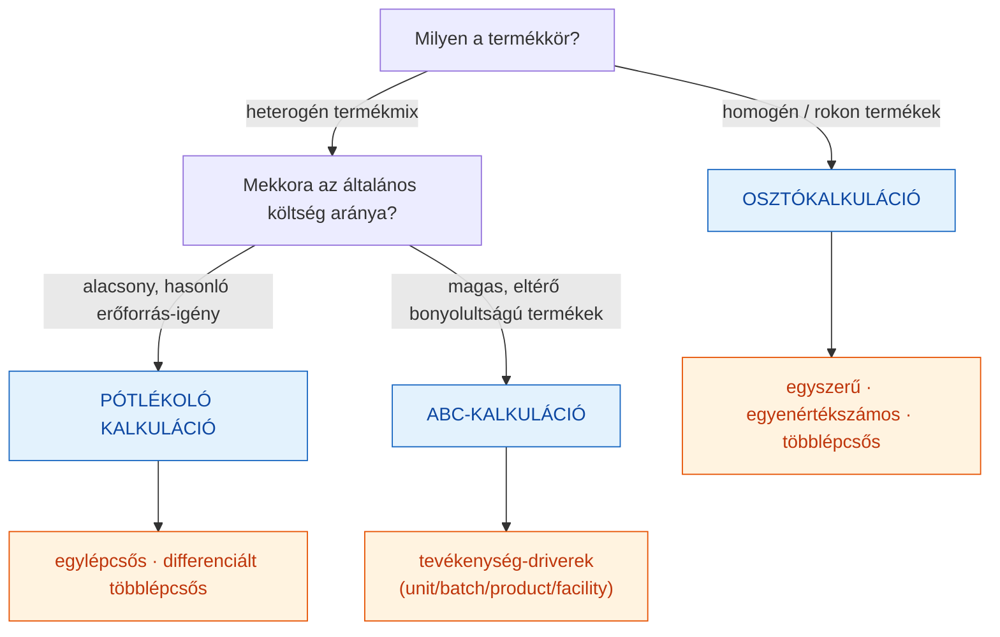
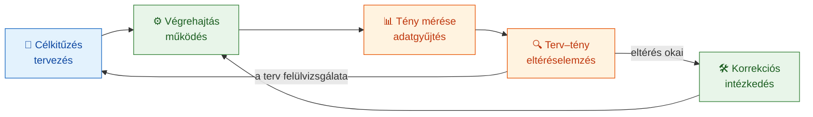
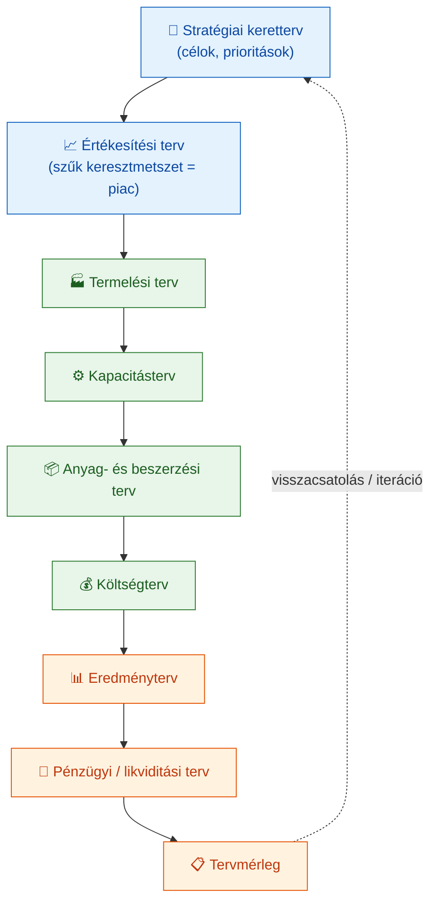
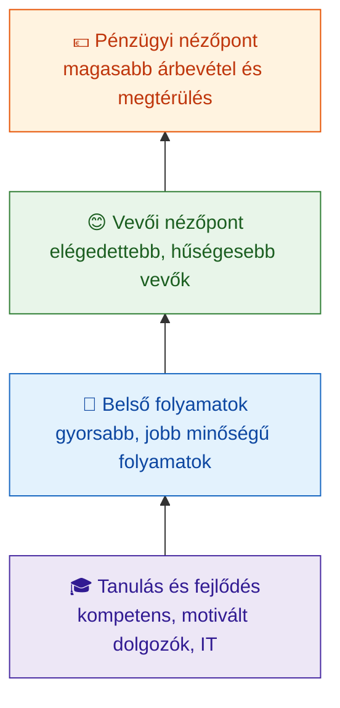
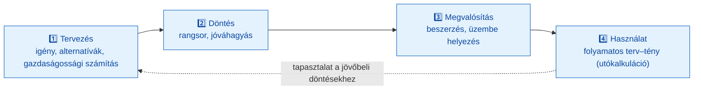

# Vezetői számvitel és controlling (GIXVS2MBLF) — Kontextus és tankönyvi referencia

> **A fájl jellege:** Ez a dokumentum a tárgy **teljes körű, tankönyvi mélységű referenciaanyaga**, a **tantárgy belső logikája** szerint strukturálva — a tárgy nevében is megjelenő két tematikai tömb mentén: **(A) a vezetői számvitel (management accounting)** mint a controlling információs bázisa és döntéstámogató eszköztára, majd **(B) a controlling rendszer, tervezés és stratégiai eszközök**. A felépítés szándékosan **nem** a K14–K20 tételhatárokat követi. A vizsgafókusz megőrzése érdekében minden fejezet jelzi a kapcsolódó K-tételt (» Kapcsolódó tétel: Kxx), a 4. szakaszban pedig megtalálható a teljes **tétel → fejezet megfeleltető index**, a 9. szakaszban pedig tételenkénti **„vizsgára tömören"** összefoglaló.
>
> **Hivatkozási stílus:** APA 7 (szövegközi „(Szerző, év)" + záró *Felhasznált irodalom*). A klasszikus elsődleges modelleknél az **eredeti megjelenés évét** adjuk meg. Ahol az előadásanyag és a lektorált szakirodalom **eltér** (pl. az ABC költséghierarchia szintjeinek száma, az IRR korlátai, a definíciók szerzősége), azt külön jelezzük (lásd 7. szakasz: *Forrásütközések*), nem simítjuk el.
>
> **Számítási példák:** a kalkulációs, eltéréselemzési, fedezeti, készletgazdálkodási és beruházásértékelési fejezetekben a numerikus példák a tárgy saját gyakorlati fájljaiból (`gyak2–gyak4`, `19201gyak5–gyak10`, `gyak_Beruházás-contr`, `gyak1-készletgazd`) származnak, lépésről lépésre levezetve.

**Oktató / tantárgyfelelős:** Katona Ferenc (Óbudai Egyetem, Keleti Károly Gazdasági Kar)
**Tételek:** K14–K20 (komplex gazdasági tételsor)
**Alapirodalom:** Francsovics Anna — *Controlling* (elektronikus jegyzet/tankönyv); kötelező és ajánlott irodalom a 8. szakaszban.
**Utolsó frissítés:** 2026-06-04

---

## 1. Tantárgy adatai

| Adat | Érték |
|---|---|
| Neptun kód | GIXVS2MBLF |
| Tantárgy | Vezetői számvitel és controlling |
| Tagozat | Levelező |
| Nyelv | magyar |
| Szak | Műszaki menedzser BSc alapszak (V3 Vállalatirányítás szakirány, F-tanterv 2023) |
| Intézmény | Óbudai Egyetem, Keleti Károly Gazdasági Kar |
| Tantárgyfelelős / oktató | Katona Ferenc |
| Tételek | K14–K20 (komplex gazdasági tételsor) |

> **Megjegyzés a tárgyadatokról:** A kreditszám, a féléves óraszám és a félévzárás pontos módja a hivatalos *Tantárgynyilvántartó* adatlapból ellenőrizendő — ezeket a rendelkezésre álló forrásanyagok (előadásdiák, gyakorlati fájlok, Francsovics-tankönyv) nem rögzítik egyértelműen, ezért itt **szándékosan nem adunk meg konkrét értéket** (a projektszabály szerint: „ne találd ki"). A kurzus felépítése a 9 előadásblokk (CONTROLLING 1–9) és a hozzájuk tartozó gyakorlatsorozat (önköltség-, pótlékoló, ABC-kalkuláció, fedezet-, standard- és rugalmas tervköltségszámítás, beruházás- és készletgazdálkodási feladatok) alapján rekonstruálható.

---

## 2. Oktatási cél

A *Vezetői számvitel és controlling* tárgy célja, hogy a hallgató megértse, hogyan alakítható a vállalaton belül keletkező pénzügyi és teljesítményadat **döntéstámogató információvá** — nem a külső, kötelező beszámolás, hanem a belső vezetői irányítás számára. A tárgy két, egymásra épülő kompetenciát fejleszt:

1. **Vezetői számvitel (management accounting):** a költségek mérése, felosztása, kalkulálása és döntéscélú értelmezése — kalkulációs módszerek, fedezetszámítás, eltéréselemzés, releváns költségek.
2. **Controlling:** a tervezés, ellenőrzés és információellátás koordinációja — controllingrendszer, operatív és stratégiai tervezés, teljesítménymérés, beruházás- és stratégiai controlling, Balanced Scorecard.

A kettő viszonya alá-fölérendelt: a **vezetői számvitel a controlling adat- és módszertani bázisa**, a **controlling pedig az a vezetési alrendszer, amely ezt az információt a célok kitűzésének, a tervezésnek és az irányításnak a szolgálatába állítja**.

---

## 3. A forrásanyagok és a tematika kapcsolata

### 3.1 Előadásanyagok (Katona Ferenc)

| Fájl | Téma | Tömb | » Tétel |
|---|---|---|---|
| CONTROLLING 1. ea 2022 | Controlling fogalma, controller küldetése, controllingrendszer, szabályozókör | B | K14, K15 |
| CONTROLLING 2. ea 2021 | Vezetői számvitel fogalma és tartalma; költségszámítás alapjai | A | K15, K16 |
| CONTROLLING 3. ea 2021 | Kalkulációs módszerek: osztó-, pótlékoló kalkuláció, ABC | A | K17 |
| CONTROLLING 4. ea 2022 | Tervköltségszámítás, standard cost, eltéréselemzés | A | K16, K17 |
| CONTROLLING 5. ea 2021 | Költség–volumen–eredmény (ÁKFN) elemzés, break-even, fedezet | A | K17 |
| CONTROLLING 6. ea 2022 | Beruházás-gazdaságossági számítások (statikus, dinamikus, NPV, IRR, PI) | B | K19 |
| CONTROLLING 7. ea 2021 | Éves tervezés menete, VIM, tervezési ciklus | B | K15, K18 |
| CONTROLLING 8. ea 2021 | Controlling a szervezetben, controlleri szerepkör, felelősségi egységek | A/B | K14, K15 |
| CONTROLLING 9. ea 2021 | Stratégiai menedzsment, stratégiai controlling, BSC, stratégiai térkép | B | K18, K20 |

### 3.2 Tankönyv és gyakorlati anyagok

| Fájl | Tartalom | » Fejezet |
|---|---|---|
| `Controlling_-_Francsovics_Anna.pdf` | Átfogó elektronikus tankönyv (kötelező irodalom), 11 fejezet — a helyi anyag elsőszámú hivatkozási alapja | mind |
| `gyak2_Önköltségszámítás.xlsx` | Osztókalkuláció: többlépcsős, egyenértékszámos, normaalapú | A.5 |
| `gyak3_pótlékoló kalk.xlsx` | Pótlékoló kalkuláció (anyagmentes közvetlen ktg-alap; gépóra-alap) | A.5 |
| `gyak4_ABC.xlsx` | ABC vs. hagyományos kalkuláció A/B/C termékre, cost driverekkel | A.5 |
| `19201gyak6.xlsx` | Standard költségszámítás, ár-/mennyiségi/intenzitás-/ráfordításeltérés | A.6 |
| `19201gyak7.xlsx` | ÁKFN, fedezeti pont, likviditási pont, többszintű direct costing | A.7 |
| `19201gyak9–10.xlsx` | Szűk keresztmetszet, relatív fedezet, optimális termékösszetétel, rugalmas tervköltség | A.7, A.8 |
| `gyak_Beruházás-contr.pdf` | Beruházás-controlling példatár (NPV, IRR, PI) | B.8 |
| `gyak1-készletgazd.pdf` | Készletgazdálkodási számítások (EOQ, készletszintek) | A.9 |
| Képfájlok (`*.jpe`) | Szemléltető ábrák: ABC, pótlékoló kalk., fedezetszámítás, standard ktg, rugalmas tervktg, beruházás-controlling | A.5–A.7, B.8 |

---

## 4. Tétel → fejezet megfeleltető index (a vizsgafókusz megőrzése)

A korábbi K14–K20 tartalom **nem veszett el**: szétosztottuk a két tematikai tömb fejezeteibe, és tankönyvi mélységig bővítettük. Az alábbi tábla mutatja, melyik tétel anyaga hol található; a tételenkénti tömör vizsgaösszefoglaló a 9. szakaszban van.

| Tétel | Cím | Elsődleges fejezet(ek) |
|---|---|---|
| **K14** | Controlling szemléletmód és rendszer szerepe | B.1, B.2 |
| **K15** | Controlling információs rendszere, VIM | A.1, B.1, B.3 |
| **K16** | Költségszámítás szerepe a controllingban | A.2, A.4, A.6 |
| **K17** | Kalkulációs módszerek és fedezetszámítás | A.5, A.7, A.8 |
| **K18** | Stratégiai és operatív controlling | B.3, B.5, B.6 |
| **K19** | Beruházási és befektetési döntések (NPV, DCF) | B.8 |
| **K20** | Balanced Scorecard (BSC) | B.7 |

A **bővítések** (a tételsorban csak érintőlegesen szereplő, de a tárgy nevében benne foglalt területek): felelősségi egységek és belső elszámolóárak (A.3), releváns költségek és döntéstámogatás (A.8), készletgazdálkodási controlling (A.9), controlling szervezeti elhelyezése (B.2), cash flow- és likviditástervezés (B.4), teljesítménymérés/KPI-rendszerek (B.5), EVA és értékalapú menedzsment (B.6), projekt- és kockázat-controlling (B.9), digitalizáció és ERP-controlling (B.10).

---

## 5. Feldolgozott forrásanyagok

A helyi kurzusanyag (CONTROLLING 1–9 előadás, Francsovics-tankönyv, gyakorlati fájlok) a kiindulópont; ezt egészítik ki a kötelező/ajánlott irodalom kötetei és a lektorált külső akadémiai források (lásd 8. és 10. szakasz). A numerikus példák a tárgy saját gyakorlati fájljaiból származnak, ezekre fejezetenként hivatkozunk.

---

# A) VEZETŐI SZÁMVITEL (MANAGEMENT ACCOUNTING)

> **A tömb logikája:** a vezetői számvitel a controlling információs és módszertani bázisa. A költségek **mérésétől** (A.1–A.2) a felelősségi egységekhez és belső teljesítményekhez **rendelésén** (A.3–A.4), a termékekre/szolgáltatásokra **kalkulálásán** (A.5), a terv–tény **eltéréselemzésén** (A.6) át a **döntéstámogatásig** (fedezetszámítás A.7, releváns költségek A.8, készletgazdálkodás A.9) jut el. A tömb a K15, K16, K17 tételek anyagát fejti ki tankönyvi mélységben.

## A.1 A vezetői számvitel fogalma, viszonya a pénzügyi számvitelhez és a VIM

» Kapcsolódó tétel: **K15**

A **vezetői számvitel** (management accounting) a vállalat belső döntéshozatalát szolgáló információs rendszer: a termelési tényezők vállalkozáson belüli felhasználását követi nyomon, és a működés gazdaságosságának felügyeletét szolgálja. Szemben a **pénzügyi számvitellel**, amely a jogszabály által előírt, múltorientált, a vállalat egészére vonatkozó, külső érdekhordozóknak (tulajdonos, hitelező, állam) szóló beszámolót állít elő, a vezetői számvitel **belső, jövőorientált, részben becsült adatokra is támaszkodó, szabadon strukturálható** információt nyújt a vezetésnek (Drury, 2018; Kaplan & Atkinson, 2003).

| Szempont | Pénzügyi számvitel | Vezetői számvitel |
|---|---|---|
| Célközönség | külső (tulajdonos, állam, hitelező) | belső (vezetés) |
| Szabályozottság | jogszabály (Számviteli törvény, IFRS) | szabadon kialakítható |
| Időorientáció | múlt (lezárt időszak) | múlt + jelen + jövő (terv) |
| Tárgya | a vállalat egésze | szegmensek, költséghelyek, termékek, döntések |
| Pontosság vs. relevancia | pontosság (auditálható) | relevancia és gyorsaság |
| Periodicitás | éves/negyedéves, kötött | igény szerinti (havi, heti, ad hoc) |

A vezetői számvitel tartalmi elemei: a **költség- és teljesítményszámítás** (cost accounting), a **tervezési és beruházás-gazdaságossági számítások**, a **vállalati statisztika**, a **likviditási kimutatások** és a **belső teljesítményelszámolás** (elszámolóárakon). Adatait a pénzügyi számvitellel rendszeresen egyeztetik, de a fix/változó bontás és a belső elszámolóárak révén jóval mélyebb elemzési lehetőséget ad.

A **Vezetői Információs Rendszer (VIM / VIR)** a controlling információszolgáltatásának eszközrendszere. Három funkciója: (1) **adatgyűjtés és -tárolás** az alapbizonylatokból; (2) **adattömörítés és szervezeti egységekhez rendelés** (aggregálás költséghelyekre, felelősségi egységekre); (3) **döntés-előkészítő számítások** végzése. A modern VIM integráltan kezeli a külső (jogszabályi) és a belső (tervezési, irányítási) információigényt; technológiai megvalósítása ma jellemzően az ERP-rendszer controlling modulja (lásd B.10).

## A.2 Költségfogalmak és -osztályozás

» Kapcsolódó tétel: **K16**

A döntéstámogatás alapja a költségek helyes osztályozása. A controlling a következő bontásokat használja:

**1. Reagálás a volumenre — fix vs. változó.** A *fix költség* (kapacitásköltség) a kibocsátott mennyiségtől rövid távon független (épület-amortizáció, törzsbér, biztosítás). A *változó költség* a volumennel együtt mozog; lehet **proporcionális** (arányos), **degresszív** (lassabban nő) vagy **progresszív** (gyorsabban nő, pl. túlóra). A változás mértékét a **reagálási fok** fejezi ki:

$$\text{reagálási fok} = \frac{\text{költségváltozás \%-a}}{\text{volumenváltozás \%-a}}$$

Reagálási fok = 1 → proporcionális; < 1 → degresszív; > 1 → progresszív; = 0 → fix. (A tárgy `19201gyak6/10` fájljai a gépköltség 0,4 és 0,75 reagálási fokával számolnak — vagyis a gépköltség részben fix, részben változó, „vegyes" költség.)

**2. Termékhez rendelhetőség — közvetlen vs. közvetett.** A *közvetlen (direkt) költség* egyértelműen egy költségviselőhöz (termékhez) rendelhető (közvetlen anyag, közvetlen bér). A *közvetett (indirekt, általános) költség* csak felosztással terhelhető a termékekre (üzemi általános, központi irányítás) — ennek igazságos felosztása a kalkuláció (A.5) központi kérdése.

**3. Döntési relevancia — releváns vs. irreleváns; elsüllyedt költség.** A *releváns költség* a vizsgált döntés következtében változik (jövőbeli, döntésfüggő pénzkiadás). Az *irreleváns költség* a döntéstől függetlenül felmerül. Az **elsüllyedt költség (sunk cost)** múltbeli, már elköltött, döntéssel meg nem változtatható kiadás — a racionális döntésből **ki kell hagyni** (a „sunk cost fallacy" a már befektetett pénz miatti ragaszkodás hibája). Ez a megkülönböztetés A.8 (releváns költségek) alapja.

A controlling alapszemlélete a **háromdimenziós költségfelosztás** („költségkocka"): *mit* költünk (**költségnem**), *hol* merül fel (**költséghely**), *miért* — melyik termék érdekében (**költségviselő**). Ezt a három szintet járja végig az A.4 és A.5.

## A.3 Felelősségi egységek és belső elszámolóárak (transfer pricing)

» Kapcsolódó tétel: **K14, K16** — *bővített témakör*

A decentralizált vállalat irányításának kulcseszköze a **felelősségi elszámolás** (responsibility accounting): minden szervezeti egységet ahhoz a teljesítménymutatóhoz mérünk, amelyet a vezetője **ténylegesen befolyásolni tud** (Anthony & Govindarajan, 2007). A felelősségi egységeknek négy alaptípusa van:

| Felelősségi egység | Mire van befolyása a vezetőnek | Fő mutató | Tipikus példa |
|---|---|---|---|
| **Költségközpont** (cost center) | költségek | terv–tény költségeltérés | gyártóüzem, karbantartás, IT |
| **Bevételközpont** (revenue center) | árbevétel | árbevétel-terv teljesítése | értékesítési régió |
| **Profitközpont** (profit center) | bevétel és költség (eredmény) | fedezet / eredmény | üzletág, divízió |
| **Befektetési központ** (investment center) | eredmény és lekötött tőke | ROI, RI, EVA | önálló leányvállalat |

A **befektetési központ** teljesítményét nem elég eredménnyel mérni, mert az nem veszi figyelembe a lekötött tőkét. Két mutató használatos:

- **ROI** (Return on Investment) = eredmény / lekötött tőke. Hátránya: a divízióvezető elutasíthat egy a vállalatnak előnyös (a tőkeköltség felett, de a divízió aktuális ROI-ja alatt hozó) beruházást, mert az rontaná a saját mutatóját.
- **Maradványjövedelem (Residual Income, RI)** = eredmény − (lekötött tőke × tőkeköltség). Ezt a torzítást kiküszöböli; az **EVA** (B.6) a RI piaci/számviteli korrekciókkal finomított változata.

**Belső elszámolóárak (transfer pricing).** Amikor egy egység terméket/szolgáltatást ad át egy másiknak, az átadási ár dönti el, hogyan oszlik meg az eredmény az egységek között. Fő módszerek: (1) **piaci ár alapú** (ha van külső piac — ez ösztönzi a leghatékonyabb döntést); (2) **költségalapú** (teljes vagy változó önköltség + esetleg haszonkulcs); (3) **alku alapú** (egységvezetők megállapodása); (4) **kétszintű/duális** ár. Az elszámolóár célja a **célkongruencia**: úgy ösztönözze az egységeket, hogy az ő optimumuk egyben a vállalat optimuma legyen. Torzított elszámolóár szuboptimális döntésekhez és belső konfliktushoz vezet.

## A.4 Költségnem-, költséghely- és költségviselő-számítás

» Kapcsolódó tétel: **K16**

A controlling költségszámítása a „költségkocka" három szintjén halad végig:

**(1) Költségnemszámítás** — *mit költünk?* Szisztematikusan gyűjti az összes ráfordítást a felhasznált termelési tényező jellege szerint (anyagköltség, személyi jellegű ráfordítás, értékcsökkenés, igénybevett szolgáltatás). Csak az **elsődleges** (a vállalkozáson kívülről érkező) költségekkel foglalkozik, és elvégzi a controlling szempontjából kritikus **fix/változó** szétválasztást.

**(2) Költséghelyszámítás** — *hol merül fel?* A felelősségi területeket (előkészítő, fő-termelési, segédüzemi, igazgatási, értékesítési költséghelyek) lehatárolja, és elszámolja a **belső teljesítményátadásokat** (pl. a karbantartás a gyártóüzemnek dolgozik). A belső teljesítményátadás négy eljárása:

| Eljárás | Logika | Pontosság |
|---|---|---|
| **Blokkeljárás (anonim)** | a segédüzemek csak a végköltséghelyekre adnak, egymásra nem | legdurvább |
| **Lépcsőzetes eljárás** | egyirányú átadás, meghatározott sorrendben | közepes |
| **Kiegyenlítő eljárás** | a kölcsönös átadásokat lineáris egyenletrendszerrel oldja meg | legpontosabb |
| **Elszámolóáras eljárás** | belső elszámolóáron terheli a teljesítményt | gyakorlatias |

**(3) Költségviselő-számítás (kalkuláció)** — *miért, melyik termék érdekében?* Ez a tényleges egységönköltség meghatározása, lásd A.5.

## A.5 Kalkulációs módszerek

» Kapcsolódó tétel: **K17**

A **kalkuláció** (költségviselő-számítás) az egységnyi termék/szolgáltatás önköltségét határozza meg. Három alapmódszer van, növekvő pontossággal és bonyolultsággal. A módszerválasztást a termékkör homogenitása és az általános költség aránya dönti el.



### A.5.1 Osztókalkuláció

A legegyszerűbb módszer: az összes felmerült költséget elosztja az elkészült mennyiséggel. Csak **homogén vagy rokon termékkörnél** alkalmazható.

- **Egyszerű osztókalkuláció:** önköltség = összes költség / mennyiség. Azonos termékekre.
- **Egyenértékszámos osztókalkuláció:** rokon, de eltérő értékű termékekre. Minden terméket egy **egyenértékszámmal** vezértermékre számítunk át.
- **Többlépcsős osztókalkuláció:** fázisonként, a befejezetlen termelés (nyitó/záró készlet) figyelembevételével.

**Számpélda — többlépcsős osztókalkuláció** (forrás: `gyak2_Önköltségszámítás.xlsx`). Egy terméket három munkafázisban állítanak elő:

| Fázis | Gyártott (db) | Időszakra elszámolt termelési ktg | Számítás |
|---|---|---|---|
| 1. fázis | 5 000 | 10 000 eFt | 10 000 |
| 2. fázis | 5 000 | 10 800 eFt | 12 000 − 1 200 (záró bef.) |
| 3. fázis | 4 500 | 22 500 eFt | 2 000 (nyitó) + 21 000 − 500 (záró) |

A halmozott önköltség lépésről lépésre:

1. **1. lépés:** 10 000 / 5 000 = **2,00 eFt/db**
2. **2. lépés:** (5 000 × 2,00 + 10 800) / 5 000 = **4,16 eFt/db**
3. **3. lépés:** (4 500 × 4,16 + 22 500) / 4 500 = **9,16 eFt/db** (a késztermék önköltsége)

**Egyenértékszámos példa** (ugyanonnan): az időszakra terhelt költség 4 000 (nyitó) + 11 500 − 5 000 (záró) = **10 500 eFt**. A négy termék (A, B, C, D) egyenértékszámmal vezértermékre átszámítva 70 000 vezértermék-egység; az egységköltség 10 500 000 / 70 000 = **150 Ft/db** vezértermékben. Az „A" termék egyenértékszáma 0,5 → 75 Ft/db, a „B" 1,0 → 150 Ft/db stb.

### A.5.2 Pótlékoló kalkuláció

**Heterogén termékmixnél** alkalmas. A közvetlen költségeket termékenként közvetlenül, az általános (indirekt) költségeket **pótlékkulcs** segítségével vetítik a termékekre:

$$\text{pótlékkulcs} = \frac{\text{általános költség}}{\text{vetítési alap}}$$

A vetítési alap lehet közvetlen bér, anyagköltség, gépóra. **Egylépcsős** változat: egyetlen pótlékkulcs az egész üzemre. **Differenciált (többlépcsős)** változat: minden költséghely saját pótlékkulccsal — pontosabb.

**Számpélda — differenciált pótlékoló, gépóra-alapon** (forrás: `gyak3_pótlékoló kalk.xlsx`, „pótlékoló2"). Három üzem (Ü1–Ü3) gépköltségét gépóra-arányosan osztjuk fel A, B, C termékre:

| Üzem | Gépóra A | Gépóra B | Gépóra C | Összes gó | Üzem gépktg | Pótlékkulcs (eFt/gó) |
|---|---|---|---|---|---|---|
| Ü1 | 1 200 | 1 200 | 800 | 3 200 | 1 600 | 0,50 |
| Ü2 | 1 200 | 600 | 400 | 2 200 | 2 200 | 1,00 |
| Ü3 | 2 000 | 2 400 | 600 | 5 000 | 2 000 | 0,40 |

A termékek gépköltsége a kulcsokkal: A = 1 200×0,5 + 1 200×1,0 + 2 000×0,4 = **2 600 eFt**; B = 600+600+960 = **2 160 eFt**; C = 400+400+240 = **1 040 eFt**. A közvetlen költséggel (A: 8 000, B: 12 000, C: 10 000 eFt) és a mennyiséggel (A: 400, B: 600, C: 200 ezer db) az önköltség: **A 6,5 · B 3,6 · C 5,2 eFt/db** (kerekítve, megjegyzés: a forrás a gépktg-et tartalmazó szűkített önköltséget mutatja).

> **Pótlékkulcs-torzítás:** ha egyetlen vetítési alapot (pl. közvetlen bér) használunk, miközben a termékek eltérő mértékben veszik igénybe a *nem* béralapú erőforrásokat (gépbeállítás, anyagmozgatás, minőségellenőrzés), a kis szériájú, bonyolult termék **alultervezett**, a nagy szériájú, egyszerű termék **túltervezett** önköltséget kap. Ez a klasszikus „cost cross-subsidization" — pontosan ez vezet át az ABC-hez.

### A.5.3 Tevékenységalapú kalkuláció (ABC — Activity-Based Costing)

Az ABC-t Cooper és Kaplan (1988) vezette be: az általános költségeket nem egyetlen vetítési alap, hanem a **tényleges erőforrás-felhasználást okozó tevékenységek** és azok **költségokozói** (cost driver) szerint rendeli a termékekhez. A logika: *a termék tevékenységeket fogyaszt, a tevékenységek erőforrásokat fogyasztanak.* Cooper (1990) az általános költségeket **négyszintű hierarchiába** sorolta:

| Szint | Mit okoz a költséget | Driver-példa |
|---|---|---|
| **Darabszintű** (unit-level) | minden egyes legyártott darab | gépóra, közvetlen munkaóra |
| **Tételszintű** (batch-level) | gyártási tétel/sorozat indítása | gépátállítások száma, rendelések száma |
| **Termékszintű** (product-level) | egy termékfajta fenntartása | mérnökórák, terméktervezés |
| **Üzemi/vállalati szintű** (facility-level) | a teljes működés fenntartása | nem oszlik fel okozatilag → fedezetből |

**Számpélda — ABC vs. hagyományos** (forrás: `gyak4_ABC.xlsx`). Három termék (A, B, C), mennyiség A = 1 000, B = 1 000, C = 10 000 db. Közvetlen költségek összesen: anyag 930 M Ft, bér 1 400 M Ft. A felosztandó közvetett (általános) költség **400 M Ft**, öt tevékenységre bontva.

*Hagyományos* (egy vetítési alap = közvetlen bér, kulcs = 400 M / 1 400 M ≈ 0,286): az általános költség arányosan a bérrel terhelődik. Eredmény: **A = 213 571 · B = 414 143 · C = 217 429 Ft/db**.

*ABC* — a közvetett 400 M Ft öt tevékenységre, mindegyik saját driverrel:

| Tevékenység | Költség (M Ft) | Cost driver | A | B | C |
|---|---|---|---|---|---|
| Anyagmozgatás | 60 | közvetlen anyagktg | | | |
| Bér- és munkaügyi admin | 80 | közvetlen bérktg | | | |
| Karbantartás | 110 | gépóra (1 000 / 2 000 / 40 000 gó) | | | |
| Termeléstervezés | 130 | gépátállítások száma (2 / 3 / 2) | | | |
| Értékesítés | 20 | rendelések száma (1 / 5 / 1) | | | |

Az ABC eredménye: **A ≈ 238 434 · B ≈ 453 222 · C ≈ 211 034 Ft/db**.

> **Az eredmény tanulsága:** a nagy szériájú „C" termék (10 000 db) önköltsége az ABC-ben **kisebb** (211 034 < 217 429), a kis szériájú „A" és „B" termékeké **nagyobb**. A hagyományos módszer a tételszintű költségeket (gépátállítás, rendelés) is a darabszámmal arányosan terhelte, így a nagy szériát túl-, a kis szériát alulszámolta — pontosan a fenti torzítás. Az ABC ezt korrigálja, mert a tételszintű drivert (átállítások, rendelések száma) használja.

**ABM (Activity-Based Management):** az ABC-adat nemcsak kalkulációra jó, hanem a **tevékenységek menedzselésére** is — a nem értékteremtő tevékenységek (várakozás, átállítás, hibajavítás) azonosítására és csökkentésére. **Kritika és korlát:** az ABC bevezetése és karbantartása **drága és adatigényes**; sok cost driver mérése túl bonyolulttá teheti; ezért fejlesztették ki a *Time-Driven ABC*-t (Kaplan & Anderson, 2004), amely a tevékenységeket egyetlen időegyenlettel modellezi. Az ABC akkor éri meg, ha **magas az általános költség aránya** és **eltérő bonyolultságú a termékmix**.

## A.6 Tervköltségszámítás és standard költségszámítás

» Kapcsolódó tétel: **K16, K17**

A **tervköltségszámítás** jövőorientált: a következő időszak várható, racionális költségét határozza meg, majd a tényadatokkal szembesítve **eltéréselemzést** végez.

- **Merev tervköltségszámítás:** az összes általános költséget egyetlen, tervezett kihasználtsági szinthez rendeli — nem igazítható a tényleges foglalkoztatottsághoz, ezért torz képet ad, ha a kihasználtság eltér a tervezettől.
- **Rugalmas tervköltségszámítás:** a tervköltséget a **tényleges kihasználtsághoz** igazítja, fix/változó bontással. Így a teljes eltérés okai szétbonthatók.
- **Standard költségszámítás** (Kilger & Plaut *Grenzplankostenrechnung*, GPK): a rugalmas tervköltségszámítás technológiai standardokon (norma) alapuló, határköltség-szemléletű finomítása; havi terv–standard–tény összevetés.

**Az eltérések felbontása.** Az árbevétel-/költségeltérés okait külön komponensekre bontjuk. A standard anyagköltség-eltérés három részre:

1. **Mennyiségi eltérés** = ΔQ × terv felhasználás × terv ár
2. **Intenzitási (fajlagos felhasználási) eltérés** = tény volumen × Δfelhasználás × terv ár
3. **Ráfordítási (ár-) eltérés** = tény volumen × tény felhasználás × Δár

**Számpélda — standard anyagköltség-eltérés** (forrás: `19201gyak6.xlsx`, „Standard" lap):

| Adat | Tény | Terv | Eltérés |
|---|---|---|---|
| Mennyiség Q (db/év) | 10 000 | 9 500 | +500 |
| Fajlagos anyagfelh. (kg/db) | 2,4 | 2,5 | −0,1 |
| Fajlagos anyagköltség (Ft/kg) | 85 | 80 | +5 |

Tervezett anyagköltség 9 500 × 2,5 × 80 = 1 900 eFt; tényleges 10 000 × 2,4 × 85 = 2 040 eFt; **teljes eltérés +140 eFt**. Felbontva:

1. Mennyiségi: +500 × 2,5 × 80 = **+100 eFt** (több terméket gyártottunk → több anyag)
2. Intenzitási: 10 000 × (−0,1) × 80 = **−80 eFt** (takarékosabb fajlagos felhasználás → megtakarítás)
3. Ráfordítási: 10 000 × 2,4 × (+5) = **+120 eFt** (drágább beszerzési ár → többletköltség)

Összeg: +100 − 80 + 120 = **+140 eFt** ✓. Az **árbevétel-eltérés** hasonlóan bomlik: áreltérés = tény mennyiség × Δár = 10 000 × 200 = +2 000 eFt; mennyiségi eltérés = ΔQ × terv ár = 500 × 5 000 = +2 500 eFt; összesen +4 500 eFt. Az eltéréselemzés lényege: **az eltérés nem büntetés, hanem intézkedés kiindulópontja** — megmutatja, melyik tényező (volumen, hatékonyság, ár) miatt tér el az eredmény a tervtől.

## A.7 Fedezetszámítás és ÁKFN-elemzés

» Kapcsolódó tétel: **K17**

A **fedezetszámítás** (Ár–Költség–Fedezet–Nyereség, ÁKFN-struktúra) a döntéstámogatás legalapvetőbb eszköze, és a változó költség szemléletre (direct/marginal costing) épül.

$$\text{Fedezet} = \text{Árbevétel} - \text{Változó költség} = Q \times (p - k_{ve})$$

A fedezet először a fix költségeket fedezi, a maradék a nyereség. A **fedezeti pont (break-even)** az a mennyiség, amelynél a fedezet éppen egyenlő a fix költséggel (nyereség = 0):

$$Q_{krit} = \frac{K_{fix}}{p - k_{ve}} = \frac{K_{fix}}{\text{fajlagos fedezet}}$$

**Számpélda — fedezeti és likviditási pont** (forrás: `19201gyak7.xlsx`, 3. feladat). Ár = 32 eFt/db, fajlagos változó ktg = 28 eFt/db (fajlagos fedezet = 4 eFt/db), fix költség = 128 000 eFt, amortizáció = 36 000 eFt.

- **Fedezeti pont:** Q = 128 000 / 4 = **32 000 db** (itt a teljes fix költség megtérül).
- **Likviditási pont:** csak a *pénzkiadással járó* fix költséget kell fedezni, az amortizáció nem pénzkiadás: Q = (128 000 − 36 000) / 4 = **23 000 db**. A likviditási pont mindig a fedezeti pont alatt van — eddig még pozitív a pénzáramlás, bár könyv szerint veszteséges.

**Működési tőkeáttétel (operating leverage).** Magas fixköltség-arányú vállalatnál ugyanakkora volumencsökkenés **aránytalanul nagyobb** eredménycsökkenést okoz, mert a fedezet kis változása a fix költség „karján" felnagyítva csapódik le az eredményben. Ez a kockázat ára a magas automatizáltságnak.

**Többszintű fedezetszámítás (többlépcsős direct costing).** A fix költséget nem egyetlen blokként kezeljük, hanem aszerint bontjuk, milyen szinten szüntethető meg (forrás: `19201gyak7.xlsx`, „Többszintű direct costing"):

```
Nettó árbevétel
−  Változó költség
=  Fedezet I.           (termékenként)
−  Termékszintű fix ktg
=  Fedezet II.
−  Termékcsoport fix ktg
=  Fedezet III.         (termékcsoportonként)
−  Üzemi szintű fix ktg
=  Fedezet IV.          (üzemenként)
−  Vállalati szintű fix ktg
=  Vállalati eredmény
```

Ez megmutatja, hogy egy termék/termékcsoport **megszüntetése** valójában mennyi költséget takarít meg: csak az adott szinten és az alatta elkerülhető fix költség tűnik el; a magasabb szintű (vállalati) fix költség megmarad. Ez közvetlenül átvezet a releváns költségek logikájához (A.8).

## A.8 Releváns költségek és döntéstámogatás

» Kapcsolódó tétel: **K17** — *bővített témakör*

A rövid távú vezetői döntésekben csak a **releváns** (jövőbeli, döntésfüggő) költségek és bevételek számítanak; a fix költség gyakran irreleváns, az elsüllyedt költség mindig az (lásd A.2). A klasszikus döntéstípusok:

**1. Saját gyártás vagy vásárlás (make-or-buy).** A saját gyártás releváns költségét (elkerülhető változó + elkerülhető fix) hasonlítjuk a beszerzési árhoz. Ha a kapacitás felszabadul, az **alternatívaköltséget** (a felszabaduló kapacitás más hasznosításából elérhető fedezetet) is be kell számítani.

**2. Veszteséges termék/üzletág megszüntetése.** A termék csak akkor szüntetendő meg, ha **negatív fedezetet** termel, vagy ha a felszabaduló kapacitás jövedelmezőbben hasznosítható. Pozitív fedezetű, de „könyv szerint veszteséges" (a ráterhelt általános költség miatt) termék megszüntetése **rontja** az összeredményt — ezt a többszintű fedezet (A.7) teszi láthatóvá.

**3. Szűk keresztmetszet — relatív (vetített) fedezet.** Ha egy erőforrás (gép-, normaóra, anyag) szűkös, nem a fajlagos, hanem az **egységnyi szűkös erőforrásra jutó fedezet** (relatív fedezet) alapján rangsorolunk:

$$\text{relatív fedezet} = \frac{\text{fajlagos fedezet}}{\text{szűkös erőforrás fajlagos igénye}}$$

**Számpélda — szűk keresztmetszet** (forrás: `19201gyak9.xlsx`). Négy termék, a szűkös erőforrás a normaóra (összesen 540 000 nó kapacitás):

| Termék | Fajlagos fedezet (Ft/db) | Normaóra-igény (nó/db) | Relatív fedezet (Ft/nó) | Rangsor |
|---|---|---|---|---|
| 1. sz. | 20 000 | 8 | 2 500 | 3. |
| 2. sz. | 14 000 | 10 | 1 400 | 4. |
| 3. sz. | 13 000 | 5 | 2 600 | 2. |
| 4. sz. | 14 000 | 4 | 3 500 | **1.** |

Figyeljük meg: a **4. sz.** termék fajlagos fedezete (14 000) nem a legnagyobb, mégis **első a rangsorban**, mert egységnyi szűkös normaórára nézve ad a legtöbb fedezetet. A szállítási kötelezettség kielégítése után a maradék kapacitást a relatív fedezet rangsora szerint osztjuk fel — a sor végén álló 2. sz. termékből gyártunk a legkevesebbet. Ez a controlling egyik leggyakorlatibb optimalizálási feladata (a `19201gyak9` 2. feladata több szűkös erőforrásnál lineáris programozással oldja meg az optimális termékösszetételt).

## A.9 Készletgazdálkodási controlling

» Kapcsolódó tétel: *bővített témakör* (kapcsolódik K16-hoz a költségoldalon)

A készlet egyszerre köt le tőkét (raktározási, tőkeköltség) és biztosít a kereslet/szállítás bizonytalansága ellen. A controlling a **készletszint optimalizálásával** a két ellentétes költséget egyensúlyozza ki.

**EOQ — optimális rendelési mennyiség** (Harris, 1913). A teljes készletköltség (rendelési + készlettartási) akkor minimális, ha:

$$Q^* = \sqrt{\frac{2 \cdot D \cdot C_r}{C_t}}$$

ahol $D$ = éves igény, $C_r$ = egy rendelés fix költsége, $C_t$ = egységnyi készlet éves tartási költsége. Az optimumban a **rendelési költség és a készlettartási költség egyenlő**. A négyzetgyökös alak miatt a teljes költség az optimum körül lapos — kis eltérés Q\*-tól csak kis többletköltséget okoz (robusztusság).

**Készletszintek.** *Újrarendelési pont* = napi átlagigény × utánpótlási idő + biztonsági készlet. A *biztonsági készlet* a kereslet és az utánpótlási idő ingadozása elleni puffer; szintjét a kívánt kiszolgálási színvonal (service level) határozza meg. (A `gyak1-készletgazd.pdf` ezekre ad számpéldákat.)

**JIT (Just-in-Time) szemlélet.** A JIT a készletet pazarlásnak (*muda*) tekinti, és a rendelési költség (átállítási idő) radikális csökkentésével az EOQ-t a minimum (ideálisan 1 db) felé tolja. Húzásos (pull) rendszer, kis tételek, gyakori szállítás. A controllingra hatása kettős: csökken a lekötött tőke és a raktározási költség, de **nő a kiszolgálás- és beszállítófüggőség kockázata** — ezért a JIT kockázat-controllinggal (B.9) jár együtt.

---

# B) CONTROLLING RENDSZER ÉS ESZKÖZEI

> **A tömb logikája:** a vezetői számvitel adataira épülő controlling mint **vezetési alrendszer**. A controlling fogalmától és szabályozóköréétől (B.1) a szervezeti elhelyezésén (B.2) át az operatív tervezésig (B.3), a likviditás (B.4) és a teljesítménymérés (B.5) eszközein keresztül a stratégiai controllingig (B.6), a Balanced Scorecardig (B.7), a beruházási controllingig (B.8), végül a projekt-/kockázat-controllingig (B.9) és a digitalizációig (B.10) jut. A tömb a K14, K18, K19, K20 tételek anyagát fejti ki tankönyvi mélységben.

## B.1 A controlling fogalma, rendszere és a controller

» Kapcsolódó tétel: **K14, K15**

A **controlling** az 1970-es évektől terjedt el mint a tervezést, ellenőrzést és információellátást **koordináló** vezetési alrendszer. A fogalom megközelítései:

- **Horváth & Partner(s)** (Horváth Péter nyomán): a controlling a vezetés alrendszere, amely a tervezést, az ellenőrzést és az információellátást **koordinálja**, és ezzel támogatja a vezetés adaptációs és koordinációs képességét (Horváth & Partners, 2008).
- **Ladó László (1992):** nyereség- és teljesítménymenedzsment-megközelítés.
- **IGC (2002):** a controllerek és a vezetők *közösen felelősek* a célok eléréséért — a controlling a menedzsment folyamatának része.

A definíciók közös eleme: a controlling **mindig a vezetés alrendszere**, nem önálló cél, és elsősorban a **költség- és eredménymenedzsmentre** összpontosít. Fontos elhatárolás: a controlling **nem** könyvvizsgálat (külső, jogszabályi, múltbeli megfelelőség) és **nem** belső ellenőrzés (szabályszerűség, compliance) — a controlling **jövőorientált, döntéstámogató és koordináló**.

A **controller** nem a döntéshozó vezető, hanem annak belső gazdasági tanácsadója — **navigátor/révkalauz**, a szervezet „közgazdasági lelkiismerete". Öt fő feladata (IGC nyomán): (1) a controlling folyamat menedzselése, (2) jövőbe tekintő koordináció, (3) a részterületi célok vállalati szintű integrálása, (4) a rendszerek és az adatminőség biztosítása, (5) a gazdasági racionalitás feltételeinek megteremtése. Kompetenciái: számviteli/pénzügyi szaktudás, üzleti-folyamati ismeret, kommunikációs és „business partner" készség.

A **controllingrendszer** négy eleme: *stratégiai tervezés*, *operatív tervezés*, *ellenőrzés és eltéréselemzés*, *információszolgáltatás*. Működési alaplogikája a **controlling-szabályozókör** (kibernetikai visszacsatolás):



Alapelv: **az eltérés nem terhelő bizonyíték, hanem a meghozandó intézkedések kiindulópontja.** A kör vagy a működést korrigálja, vagy — ha a terv vált irreálissá — magát a tervet módosítja (egyszeres vs. kétszeres hurkú tanulás).

## B.2 A controlling szervezeti elhelyezése

» Kapcsolódó tétel: **K14** — *bővített témakör*

A controlling szervezeti pozíciója befolyásolja a függetlenségét és a befolyását:

- **Törzskari (staff) vs. vonalbeli (line) controlling.** Törzskariként a controller tanácsadó, nincs utasítási joga (megőrzi a függetlenségét, de gyengébb a befolyása); vonalbeliként beépül a hierarchiába (erősebb befolyás, de a függetlensége sérülhet).
- **Centralizált vs. decentralizált.** Centralizált: egy központi controlling-szervezet — egységes módszertan, de távol a szakterületektől. Decentralizált: az egyes egységeknél helyi controllerek — közelség és testre szabottság, de a módszertani egységesség veszélye. A gyakorlatban gyakori a **dotted-line** (kettős alárendeltség): a helyi controller szakmailag a központi controllinghoz, szervezetileg az egységvezetőhöz tartozik.
- **A controller–vezető viszony.** Modern felfogásban a controller **business partner**: nem „rendőr", hanem a vezető döntéstámogató társa. A controlling fejlődési fokozatai: regisztráló (adatszolgáltató) → navigációs (terv–tény, előrejelzés) → innovációs (üzleti modell és stratégia alakítása).

## B.3 Operatív tervezési rendszer

» Kapcsolódó tétel: **K15, K18**

Az **éves tervezési ciklus** egymásra épülő részterveket kapcsol össze. A tervezés a **szűk keresztmetszettel** indul — ez rendszerint a piac, ezért az értékesítési terv a kiindulópont:



A **kerettervezés** (top-down) a formalizált, pénzértékű célokat osztja le az egységekre; ezt egészíti ki a bottom-up részlettervezés (ellenáramú/gegenstrom eljárás). Tervezési filozófiák:

| Megközelítés | Lényeg | Erőssége | Korlátja |
|---|---|---|---|
| **Bázisalapú** | előző év + korrekció | gyors, egyszerű | konzerválja a pazarlást |
| **Nulla bázisú (ZBB)** | minden költséget nulláról igazolni kell | feltárja a felesleget (7–14% megtakarítás) | nagyon munkaigényes |
| **Gördülő előrejelzés (rolling forecast)** | a horizontot folyamatosan görgeti (pl. mindig 12 hónap előre) | mindig friss, nem szakad meg év végén | gyakoribb tervezési teher |
| **Beyond Budgeting** | a rögzített éves költségvetés elhagyása | adaptív, decentralizált | kulturális váltást igényel |

**Beyond Budgeting** (Hope & Fraser, 2003): kritikájuk szerint a klasszikus éves költségvetés *fix teljesítményszerződésként* működik, ami alkudozásra, „budgetary slack"-re, év végi pénzköltésre és a változásra való lassú reagálásra ösztönöz. Javaslatuk: relatív, versenytárshoz/benchmarkhoz mért célok, gördülő előrejelzés, decentralizált döntéshozatal, erőforrás igény szerinti elosztása. **Kritika:** kevés vállalatnál vezették be teljesen; sokak szerint kiegészíti, nem helyettesíti a tervezést.

## B.4 Cash flow controlling és likviditástervezés

» Kapcsolódó tétel: *bővített témakör* (kapcsolódik a pénzügyi tervhez, B.3)

Az eredmény (eredményszemlélet) és a pénz (pénzforgalmi szemlélet) nem ugyanaz — egy nyereséges vállalat is fizetésképtelenné válhat (a „nyereséges csőd" jelensége). A cash flow controlling a **fizetőképesség** folyamatos biztosítását szolgálja.

- **Cash flow összeállítása.** *Direkt módszer:* a tényleges be- és kifizetésekből. *Indirekt módszer:* az eredményből indul, és korrigálja a nem pénzmozgással járó tételekkel (amortizáció vissza, készlet-/követelésváltozás). Hármas bontás: működési, befektetési, finanszírozási cash flow.
- **Likviditási mutatók:** likviditási ráta (forgóeszköz / rövid lej. kötelezettség), gyorsráta (készlet nélkül), pénzhányad.
- **Rövid távú likviditástervezés:** napi/heti/havi pénzügyi terv, a be- és kifizetések ütemezése, a finanszírozási rés áthidalása (folyószámlahitel, faktoring). A likviditási pont (A.7) ennek a szemléletnek a fedezetszámításba ágyazott megjelenése.

## B.5 Teljesítménymérés és mutatószámrendszerek

» Kapcsolódó tétel: **K18** — *bővített témakör*

A controlling a célokat **mutatószámokká (KPI)** fordítja le. Egy jó mutatószámrendszer hierarchikus és ok-okozati: a csúcsmutatóból részmutatókra bontható. Klasszikus példa a **DuPont-mutatószámfa**:

$$\text{ROI} = \underbrace{\frac{\text{eredmény}}{\text{árbevétel}}}_{\text{árbevétel-arányos nyereség}} \times \underbrace{\frac{\text{árbevétel}}{\text{lekötött tőke}}}_{\text{eszközforgás}}$$

Ez megmutatja, hogy a megtérülés a **margin** és a **forgási sebesség** szorzata — két különböző irányból javítható. A mutatószámrendszer tervezésének elvei: a mutatók legyenek **befolyásolhatók** (a felelős egység által), **egyértelműek**, **konzisztensek** (ne ösztönözzenek ellentétes viselkedésre), és tartalmazzanak **pénzügyi és nem pénzügyi** mutatót egyaránt. A **benchmarking** a mutatókat külső/belső legjobb gyakorlathoz méri. A kizárólag pénzügyi, visszatekintő mutatók egyoldalúságát hivatott feloldani a Balanced Scorecard (B.7).

## B.6 Stratégiai controlling

» Kapcsolódó tétel: **K18**

A controlling kétszintű. Az **operatív controlling** a *hatékonysággal* foglalkozik („jól csináljuk-e a dolgokat?" — terv–tény, éves ciklus, belső adatok, rövid táv). A **stratégiai controlling** az *eredményességgel* („a jó dolgokat csináljuk-e?" — hosszú táv, külső környezet, kvalitatív tényezők, a versenyképesség biztosítása).

| Szempont | Operatív controlling | Stratégiai controlling |
|---|---|---|
| Kérdés | jól csináljuk? (efficiency) | a jót csináljuk? (effectiveness) |
| Időtáv | 1 év / negyedév | 3–5+ év |
| Adat | belső, pénzügyi, pontos | külső + belső, kvalitatív is |
| Cél | nyereség, likviditás | siker- és versenypotenciál |
| Eszköz | költségterv, fedezet, eltéréselemzés | PESTEL, Porter, SWOT, BSC, EVA |

**A stratégiai elemzés eszközei** (a stratégiai controlling információs bázisa): **PESTEL** (tág makrokörnyezet), **Porter öt erő** (iparági verseny), **értéklánc** (belső erőforrások, Porter, 1985), **SWOT** (összegző mátrix), portfólió-modellek (BCG, Ansoff-mátrix).

**EVA és értékalapú menedzsment (VBM).** Az értékalapú vezetés célja a tulajdonosi érték maximalizálása. Az **EVA** (Economic Value Added; Stewart, 1991, Stern Stewart & Co.) azt méri, mennyivel hoz a vállalat **a tőke alternatívaköltsége felett**:

$$\text{EVA} = \text{NOPAT} - (\text{befektetett tőke} \times \text{WACC})$$

ahol NOPAT = adózott üzemi eredmény, WACC = súlyozott átlagos tőkeköltség:

$$\text{WACC} = \frac{E}{D+E} \cdot r_E + \frac{D}{D+E} \cdot r_D \cdot (1 - T)$$

(E = saját tőke, D = idegen tőke, $r_E$ = elvárt sajáttőke-hozam, $r_D$ = hitelkamat, T = társasági adókulcs). **Példa:** ha NOPAT = 120 M Ft, befektetett tőke = 800 M Ft, WACC = 12%, akkor EVA = 120 − 800×0,12 = 120 − 96 = **+24 M Ft** → a vállalat a tőkeköltség felett 24 M Ft értéket teremtett. Pozitív EVA = értékteremtés; negatív = értékrombolás akkor is, ha a számviteli eredmény pozitív. **Kritika:** számviteli korrekciókat igényel (Stern Stewart akár 160 korrekciót sorol), rövidtávra ösztönözhet (a beruházás rontja a tárgyévi EVA-t), és érzékeny a WACC becslésére. Az EVA a maradványjövedelem (A.3) piaci-szemléletű, befektetésközpont-mérésre alkalmas változata, és a BSC pénzügyi nézőpontjának (B.7) gyakori csúcsmutatója.

## B.7 Balanced Scorecard (BSC)

» Kapcsolódó tétel: **K20**

A **Balanced Scorecard** (kiegyensúlyozott mutatószámrendszer) Kaplan és Norton nevéhez fűződik (1992, *Harvard Business Review*; 1996, könyv). Alapgondolata: a vállalat mint komplex rendszer **nem irányítható kizárólag pénzügyi, visszatekintő mutatókkal**; a stratégiát kiegyensúlyozott, ok-okozati logikával összekapcsolt mutatókészletre kell lefordítani. Két innováció: (1) négy nézőpontba rendezi a mutatókat; (2) hidat épít a **stratégia** és a **mindennapi működés** közé.

| Nézőpont | Alapkérdés | Jellemző mutatók |
|---|---|---|
| **Pénzügyi** | Hogyan látnak a tulajdonosok? | ROE, EVA, árbevétel-növekedés, cash flow |
| **Vevői** | Hogyan látnak a vevők? | vevőelégedettség, piaci részesedés, megtartási arány |
| **Belső folyamatok** | Miben kell kitűnnünk? | átfutási idő, selejtarány, innovációs ciklusidő |
| **Tanulás és fejlődés** | Hogyan őrizzük meg a változás képességét? | dolgozói elégedettség, képzési óraszám, IT-infrastruktúra |

Az **ok-okozati lánc** alulról felfelé épül, és ezt jeleníti meg a **stratégiai térkép** (Kaplan & Norton, 2004):



Minden mutatóhoz **célértéket** és **kezdeményezést (akciót)** rendelnek, így a BSC áthidalja a stratégiaalkotás és a végrehajtás közötti „megvalósítási szakadékot" (Kaplan & Norton, 2008: *The Execution Premium*). A controlling-szabályozókörbe integrálva a stratégiai controlling legfontosabb eszköze.

**Korlátok és kritika:** (1) az ok-okozati kapcsolatok feltételezettek, empirikusan nehezen igazolhatók, és időbeli késleltetéssel hatnak; (2) a mutatók kiválasztása és a célértékek szubjektívek; (3) a bevezetés adat- és változásmenedzsment-igényes; (4) statikus modellként kritizálható dinamikus környezetben. Ezért gyakran kombinálják stratégiai térképpel, BSC-szoftverrel és — a szakirányban a V7 tételhez kapcsolódóan — BI/VIR-rendszerekkel.

## B.8 Beruházási controlling

» Kapcsolódó tétel: **K19**

A beruházási controlling nem ér véget a döntéssel — végigkíséri az eszköz teljes élettartamát:



A gazdaságossági módszerek két csoportja:

**Statikus módszerek** (a pénz időértékétől eltekintenek, átlagos éves adatokkal):

| Módszer | Mit hasonlít | Korlát |
|---|---|---|
| Költségösszehasonlítás | alternatívák éves összköltsége | nem méri a hozamot |
| Nyereségösszehasonlítás | éves átlageredmény | figyelmen kívül hagyja az időértéket |
| Statikus megtérülési idő | hány év alatt térül meg | nem nézi a megtérülés utáni pénzáramot |
| ROI (átlagos könyv szerinti hozam) | átlageredmény / átlagos lekötött tőke | számviteli, nem pénzáram-alapú |

**Dinamikus módszerek** (diszkontálással kezelik a pénz időértékét):

- **Nettó jelenérték (NPV):** $\text{NPV} = -I_0 + \sum_{t=1}^{n}\frac{CF_t}{(1+r)^t}$. Pozitív NPV → értékteremtő, megvalósítandó; egymást kizáró alternatívák közül a **legmagasabb NPV** preferált. A diszkontráta $r$ = WACC.
- **Belső megtérülési ráta (IRR):** az a ráta, amelynél NPV = 0. Szabály: ha **IRR > WACC**, a beruházás elfogadható.
- **Jövedelmezőségi index (PI):** $\text{PI} = \frac{\sum CF_t/(1+r)^t}{I_0}$ (vagy NPV/I₀ + 1). Tőkekorlát mellett a PI szerint rangsorolunk, mert az egységnyi befektetésre jutó értéket maximalizálja.
- **Diszkontált megtérülési idő:** mikor éri el a diszkontált pénzáram-összeg a kezdeti befektetést.

**Számpélda — NPV / IRR / PI** (a `gyak_Beruházás-contr.pdf` logikája szerint). Kezdő befektetés $I_0$ = 10 000 eFt; éves nettó pénzáram 3 000 eFt 5 éven át; WACC = 10%.

- Diszkonttényezők összege (annuitás, 10%, 5 év) ≈ 3,7908 → a pénzáramok jelenértéke 3 000 × 3,7908 = 11 372 eFt.
- **NPV** = −10 000 + 11 372 = **+1 372 eFt** → értékteremtő.
- **PI** = 11 372 / 10 000 = **1,14** (> 1 → elfogadható).
- **IRR:** az a ráta, ahol a jelenérték = 10 000; itt az annuitásfaktor 10 000/3 000 = 3,333 → IRR ≈ **15,2%** > 10% WACC → elfogadható.

**Az IRR korlátai (forrásütközés-pont, lásd 7. szakasz):** (1) **többszörös IRR** — ha a pénzáram előjele többször vált (nem konvencionális), több (vagy nulla) IRR is lehet; (2) **skálaérzéketlenség** — két, egymást kizáró projekt közül a magasabb IRR-ű nem feltétlenül teremt több abszolút értéket (ezt az NPV dönti el); (3) az IRR implicit újrabefektetési feltételezése (a köztes pénzáramokat IRR-en fekteti újra) gyakran irreális — ezt a **módosított IRR (MIRR)** korrigálja. **Általános szabály:** ütközés esetén az **NPV az elsődleges** döntési kritérium (Brealey, Myers & Allen, 2020).

**Kockázatelemzés beruházásoknál:** (1) **érzékenységvizsgálat** — egy-egy bemeneti paraméter (ár, volumen, WACC) változtatása, mennyire érzékeny rá az NPV; (2) **szcenárió-elemzés** — összefüggő pesszimista/reális/optimista forgatókönyvek; (3) **Monte Carlo-szimuláció** — a bemenetek eloszlásából véletlen mintavétellel az NPV valószínűségi eloszlása. Ezek a pontbecslést (egyetlen NPV) kockázati profillá egészítik ki.

## B.9 Projektcontrolling és kockázat-controlling

» Kapcsolódó tétel: *bővített témakör*

**Projektcontrolling:** az egyedi, határidős, költségkeretes projektek terv–tény felügyelete. Központi eszköze az **earned value menedzsment (EVM)**, amely három alapadatból (tervezett érték PV, megvalósult érték EV, tényleges költség AC) számít eltérés- és teljesítménymutatókat: költségeltérés CV = EV − AC, ütemeltérés SV = EV − PV, valamint a CPI és SPI indexek. Így a projekt költség- és ütembeli állása **egyszerre** követhető, és a befejezés előrejelezhető (EAC).

**Kockázat-controlling:** a vállalati kockázatok szisztematikus azonosítása, mérése, kezelése és monitorozása. Lépései: kockázatazonosítás → -értékelés (bekövetkezési valószínűség × hatás, kockázati mátrix) → -kezelés (elkerülés, csökkentés, áthárítás/biztosítás, elviselés) → -monitoring. A controlling integrálja a tervezésbe (kockázattal súlyozott tervek) és a riportálásba; szabályozási háttere pl. a magyar tőzsdei társaságoknál a felelős társaságirányítási ajánlások.

## B.10 Digitalizáció és controlling

» Kapcsolódó tétel: *bővített témakör* (kapcsolódik a szakirány V12–V14 ERP-tételeihez)

- **ERP-rendszerek controlling modulja.** Az integrált vállalatirányítási rendszer (pl. SAP CO modul) egységes adatbázisból, valós időben szolgáltatja a költséghely-, költségviselő- és eredményadatokat — a VIM (A.1) mai technológiai megvalósítása. Megszünteti a sziget-adatbázisokat és a kézi adatgyűjtést.
- **Big Data és controlling-analitika.** A strukturált pénzügyi adat mellett megjelenik a nagy mennyiségű, gyorsan keletkező, sokféle (gépi, webes, szenzor-) adat; a prediktív és preskriptív analitika a tervezést és előrejelzést pontosítja.
- **Automatizálás és a controller szerepének változása.** A rutin adatgyűjtést és riportálást az RPA és a BI-eszközök (dashboard, önkiszolgáló riport) átveszik; a controller hangsúlya az adatszolgáltatásról az **értelmezésre, üzleti tanácsadásra és a döntéstámogatásra** (business partner) tolódik (lásd B.2 fejlődési fokozatok). Ez a szakirány V6–V10 (VIR/BI) és V11–V15 (ERP) tételeivel közös metszetet alkot.

---

## 6. Kulcsfogalmak, kulcsszerzők és modellek (összesítő)

| Fogalom / modell | Szerző(k), év | Lényeg | Fejezet |
|---|---|---|---|
| Controlling mint koordinációs alrendszer | Horváth P. / Horváth & Partners (2008) | tervezés-ellenőrzés-információ koordinációja | B.1 |
| Controller-küldetés (Leitbild) | IGC (2002) | controller + vezető közös felelőssége | B.1 |
| Nyereségmenedzsment-megközelítés | Ladó L. (1992) | controlling = teljesítménymenedzsment | B.1 |
| Felelősségi elszámolás, MCS | Anthony & Govindarajan (2007) | befolyásolhatóság elve, felelősségi egységek | A.3 |
| Activity-Based Costing | Cooper & Kaplan (1988) | tevékenység-driver alapú felosztás | A.5 |
| Költséghierarchia (unit/batch/product/facility) | Cooper (1990); Cooper & Kaplan (1991) | általános ktg négy szintje | A.5 |
| Time-Driven ABC | Kaplan & Anderson (2004) | időegyenlet-alapú egyszerűsítés | A.5 |
| Standard cost / GPK | Kilger & Plaut (1960-as évek) | határtervköltség, eltéréselemzés | A.6 |
| Direct/marginal costing, fedezet | — (klasszikus management accounting) | fix/változó bontás, break-even | A.7 |
| EOQ (optimális rendelési mennyiség) | Harris (1913) | rendelési + tartási költség optimuma | A.9 |
| Nulla bázisú tervezés (ZBB) | Pyhrr (1970) | költségek nulláról igazolása | B.3 |
| Beyond Budgeting | Hope & Fraser (2003) | adaptív, fix költségvetés nélküli tervezés | B.3 |
| DuPont-mutatószámfa | DuPont (1910-es évek) | ROI = margin × forgás | B.5 |
| Értéklánc, öt erő, generikus stratégiák | Porter (1980, 1985) | iparági és belső elemzés | B.6 |
| EVA / értékalapú menedzsment | Stewart / Stern Stewart (1991) | NOPAT − tőke×WACC | B.6 |
| Balanced Scorecard | Kaplan & Norton (1992, 1996) | négy nézőpont, ok-okozati lánc | B.7 |
| Stratégiai térkép | Kaplan & Norton (2004) | ok-okozati lánc vizualizációja | B.7 |
| The Execution Premium | Kaplan & Norton (2008) | BSC + operatív tervezés integrálása | B.7 |
| NPV / IRR / PI, DCF | Brealey, Myers & Allen (2020) | diszkontált beruházásértékelés | B.8 |
| Earned Value Management | PMI (PMBOK) | projekt költség/ütem terv–tény | B.9 |

---

## 7. Forrásütközések és jelölt eltérések

A projektszabály szerint a szakirodalmi eltéréseket jelezzük, nem simítjuk el:

1. **ABC költséghierarchia szintjeinek száma.** A magyar oktatási anyag gyakran *három* tevékenységszintet (egység-, tétel-, termékszintű) említ, miközben Cooper (1990) eredetileg **négy** szintet definiált (a negyedik az **üzemi/vállalati szint**, amely *nem* osztható fel okozatilag, ezért a fedezetből finanszírozandó). Itt a négyszintű, eredeti felosztást követjük, és jelezzük, hogy a facility-szintű költség termékre vetítése maga is torzítás.
2. **IRR megítélése.** A helyi előadásanyag az IRR-t az NPV mellett egyenrangú döntési kritériumként mutatja be. A pénzügyi szakirodalom (Brealey, Myers & Allen, 2020) szerint ütközés (egymást kizáró projektek, nem konvencionális pénzáram, eltérő méret/élettartam) esetén **az NPV az elsődleges**, az IRR pedig félrevezethet (többszörös megoldás, skálaérzéketlenség, újrabefektetési feltevés). Ezt a B.8 külön kiemeli.
3. **Definíciók szerzősége.** A korábbi helyi jegyzet „Horváth–Dobák (1990)" megjelölést használt a controlling-definícióra; a nemzetközi szakirodalomban a rendszerszemléletű controlling-fogalom Horváth Péterhez (Péter Horváth) kötődik. A pontos hazai hivatkozás a Francsovics-tankönyvből és a Horváth & Partners (2008) kötetből ellenőrizendő; itt óvatosan, a kötethez kötve hivatkozunk.
4. **EVA „pontos" képlete.** A Stern Stewart-féle EVA számos tőke- és eredménykorrekciót (akár ~160) tartalmaz; az oktatási gyakorlat az egyszerűsített NOPAT − tőke×WACC alakot használja. A számpélda az egyszerűsített alakkal dolgozik, a korrekciók szükségességét jelezve.

---

## 8. Kötelező és ajánlott irodalom

**Kötelező (a tárgy elsődleges forrása):**

- Francsovics A. *Controlling* (elektronikus tankönyv/jegyzet). [A pontos kiadási év és kiadó a tantárgyleírásból ellenőrizendő; a korábbi helyi hivatkozás 2010/2011/2013 évszámokat is említ — lásd 10. szakasz.]

**Ajánlott / a kifejtéshez használt akadémiai szakirodalom** (lásd 10. Felhasznált irodalom a teljes adatokkal): Horváth & Partners (2008); Hanyecz (2006); Kaplan & Atkinson (2003); Kaplan & Cooper (2001); Anthony & Govindarajan (2007); Drury (2018); Brealey, Myers & Allen (2020); Kaplan & Norton (1996, 2004, 2008); Hope & Fraser (2003); Stewart (1991).

---

## 9. K14–K20 — „vizsgára tömören"

> A teljes kifejtés a fenti tematikus fejezetekben van; ez a blokk a szóbeli vizsgára tömörített emlékeztető.

- **K14 — Controlling szemléletmód és rendszer (» B.1, B.2).** Controlling = a vezetés koordináló alrendszere (tervezés–ellenőrzés–információ). Nem könyvvizsgálat/belső ellenőrzés. Controller = navigátor/business partner. Controlling-szabályozókör: terv → tény → eltérés → intézkedés. Szervezeti elhelyezés: staff/line, centralizált/decentralizált.
- **K15 — Controlling információs rendszere, VIM (» A.1, B.1, B.3).** Vezetői vs. pénzügyi számvitel (belső, jövőorientált, szabad). VIM három funkciója (gyűjtés–tömörítés–döntéselőkészítés). Éves tervezési ciklus a piacról indul.
- **K16 — Költségszámítás a controllingban (» A.2, A.4, A.6).** Költségosztályozás (fix/változó, közvetlen/közvetett, releváns/sunk). Költségkocka: költségnem–költséghely–költségviselő. Belső teljesítményátadás 4 módja. Tervköltség: merev/rugalmas/standard.
- **K17 — Kalkulációs módszerek és fedezetszámítás (» A.5, A.7, A.8).** Osztó/pótlékoló/ABC (mikor melyik, torzítás). Fedezet = árbevétel − változó ktg; break-even = Kf/fajlagos fedezet; likviditási pont. Szűk keresztmetszet → relatív fedezet.
- **K18 — Stratégiai és operatív controlling (» B.3, B.5, B.6).** Hatékonyság (operatív) vs. eredményesség (stratégiai). PESTEL/Porter/SWOT/értéklánc. EVA = NOPAT − tőke×WACC. KPI-/mutatószámrendszer (DuPont).
- **K19 — Beruházási döntések (» B.8).** Statikus (megtérülési idő, ROI) vs. dinamikus (NPV, IRR, PI). NPV > 0 / IRR > WACC. IRR korlátai → NPV az elsődleges. Érzékenység-/szcenárió-/Monte Carlo-elemzés.
- **K20 — Balanced Scorecard (» B.7).** Négy nézőpont (pénzügyi, vevői, belső folyamat, tanulás-fejlődés), ok-okozati lánc, stratégiai térkép. Stratégia → mérhető célok + akciók. Korlátok: feltételezett okság, szubjektivitás.

---

## 10. Felhasznált irodalom (APA 7)

> A klasszikus elsődleges műveknél az eredeti megjelenés évét adjuk meg. A magyar fordítások adatai, valamint a Francsovics-tankönyv pontos kiadási adatai a tantárgyleírásból, illetve a forrás-PDF-ek kolofonjából ellenőrizendők; ahol bizonytalanság van, azt jelezzük.

Anthony, R. N., & Govindarajan, V. (2007). *Management control systems* (12th ed.). McGraw-Hill/Irwin. (Magyar kiadás: *Menedzsmentkontroll-rendszerek*. Panem.)

Brealey, R. A., Myers, S. C., & Allen, F. (2020). *Principles of corporate finance* (13th ed.). McGraw-Hill Education.

Cooper, R. (1990). Cost classification in unit-based and activity-based manufacturing cost systems. *Journal of Cost Management, 4*(3), 4–14.

Cooper, R., & Kaplan, R. S. (1988). Measure costs right: Make the right decisions. *Harvard Business Review, 66*(5), 96–103.

Cooper, R., & Kaplan, R. S. (1991). Profit priorities from activity-based costing. *Harvard Business Review, 69*(3), 130–135.

Drury, C. (2018). *Management and cost accounting* (10th ed.). Cengage Learning.

Francsovics, A. (é. n.). *Controlling* [elektronikus tankönyv/jegyzet]. [Kiadó és év a tantárgyleírásból ellenőrizendő.]

Hanyecz, L. (2006). *A controlling rendszere*. Saldo.

Harris, F. W. (1913). How many parts to make at once. *Factory, The Magazine of Management, 10*(2), 135–136, 152.

Hope, J., & Fraser, R. (2003). *Beyond budgeting: How managers can break free from the annual performance trap*. Harvard Business School Press.

Horváth & Partners. (2008). *Controlling: Út egy hatékony controllingrendszerhez*. Complex Kiadó.

Kaplan, R. S., & Anderson, S. R. (2004). Time-driven activity-based costing. *Harvard Business Review, 82*(11), 131–138.

Kaplan, R. S., & Atkinson, A. A. (2003). *Vezetői üzleti gazdaságtan: Haladó vezetői számvitel*. Panem.

Kaplan, R. S., & Cooper, R. (2001). *Költség & hatás: Integrált költségszámítási rendszerek* (eredeti: *Cost & effect*, 1998). Panem.

Kaplan, R. S., & Norton, D. P. (1992). The balanced scorecard: Measures that drive performance. *Harvard Business Review, 70*(1), 71–79.

Kaplan, R. S., & Norton, D. P. (1996). *The balanced scorecard: Translating strategy into action*. Harvard Business School Press.

Kaplan, R. S., & Norton, D. P. (2004). *Strategy maps: Converting intangible assets into tangible outcomes*. Harvard Business School Press.

Kaplan, R. S., & Norton, D. P. (2008). *The execution premium: Linking strategy to operations for competitive advantage*. Harvard Business School Press.

Porter, M. E. (1980). *Competitive strategy: Techniques for analyzing industries and competitors*. Free Press.

Porter, M. E. (1985). *Competitive advantage: Creating and sustaining superior performance*. Free Press.

Pyhrr, P. A. (1970). Zero-base budgeting. *Harvard Business Review, 48*(6), 111–121.

Stewart, G. B. (1991). *The quest for value: A guide for senior managers*. Harper Business / Stern Stewart & Co.

---

## 11. Fogalmi térkép

```mermaid
flowchart TD
    R["VEZETŐI SZÁMVITEL ÉS CONTROLLING"]
    R --> A["A) VEZETŐI SZÁMVITEL<br/>(management accounting)"]
    R --> B["B) CONTROLLING RENDSZER<br/>és eszközei"]

    A --> A1["Költségfogalmak<br/>fix/változó · közvetlen/közvetett · releváns/sunk"]
    A --> A2["Felelősségi egységek<br/>cost/profit/investment · transzferár"]
    A --> A3["Költségnem → költséghely → költségviselő"]
    A --> A4["Kalkuláció<br/>osztó · pótlékoló · ABC"]
    A --> A5["Tervköltség + standard<br/>eltéréselemzés"]
    A --> A6["Fedezet / ÁKFN<br/>break-even · releváns ktg · szűk keresztmetszet"]
    A --> A7["Készletgazdálkodás<br/>EOQ · JIT"]

    B --> B1["Controlling fogalma<br/>szabályozókör · controller"]
    B --> B2["Szervezeti elhelyezés<br/>staff/line · centralizált/decentralizált"]
    B --> B3["Operatív tervezés<br/>éves ciklus · ZBB · rolling · Beyond Budgeting"]
    B --> B4["Cash flow / likviditás"]
    B --> B5["Teljesítménymérés<br/>KPI · DuPont · benchmarking"]
    B --> B6["Stratégiai controlling<br/>PESTEL/Porter/SWOT · EVA/VBM"]
    B --> B7["Balanced Scorecard<br/>4 nézőpont · stratégiai térkép"]
    B --> B8["Beruházási controlling<br/>NPV · IRR · PI · kockázat"]
    B --> B9["Projekt- és kockázat-controlling"]
    B --> B10["Digitalizáció · ERP · Big Data"]

    classDef root fill:#263238,stroke:#000,color:#fff;
    classDef ma fill:#e3f2fd,stroke:#1565c0,color:#0d47a1;
    classDef co fill:#e8f5e9,stroke:#2e7d32,color:#1b5e20;
    class R root;
    class A,A1,A2,A3,A4,A5,A6,A7 ma;
    class B,B1,B2,B3,B4,B5,B6,B7,B8,B9,B10 co;
```



---

*Ez a kontextusfájl a tárgy teljes körű, tankönyvi mélységű referenciája. A K14–K20 vizsgatételek tartalma megőrződött (4. és 9. szakasz), és a tárgy belső logikája szerint — (A) vezetői számvitel → (B) controlling rendszer — rendeződött át és bővült. Számítási példák a tárgy saját gyakorlati fájljaiból; hivatkozások APA 7 szerint, ellenőrzött forrásokból.*


