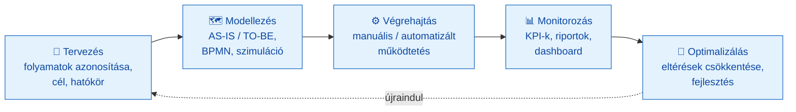
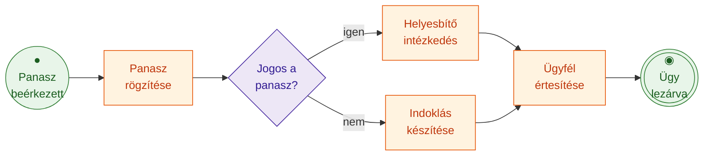
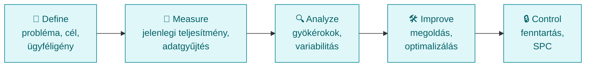
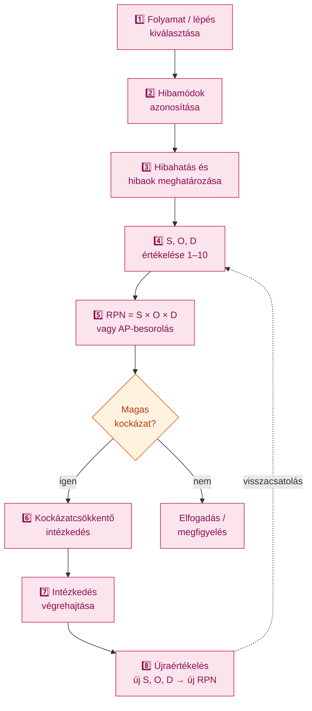
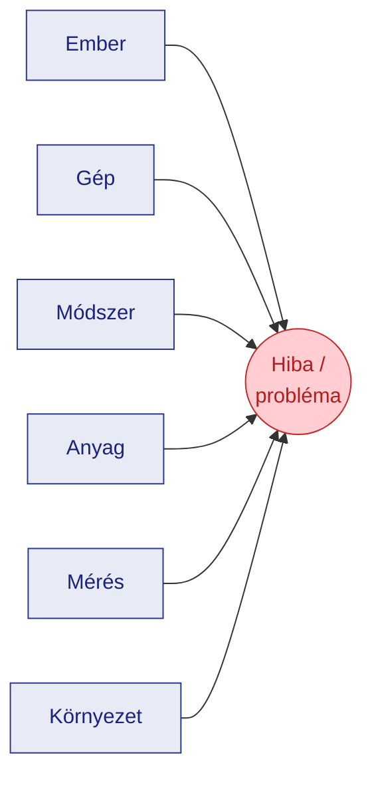
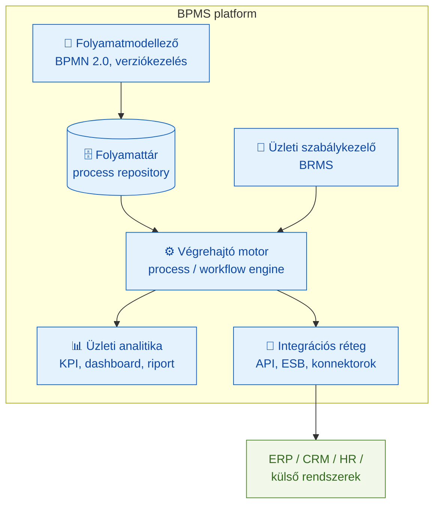
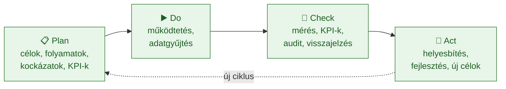
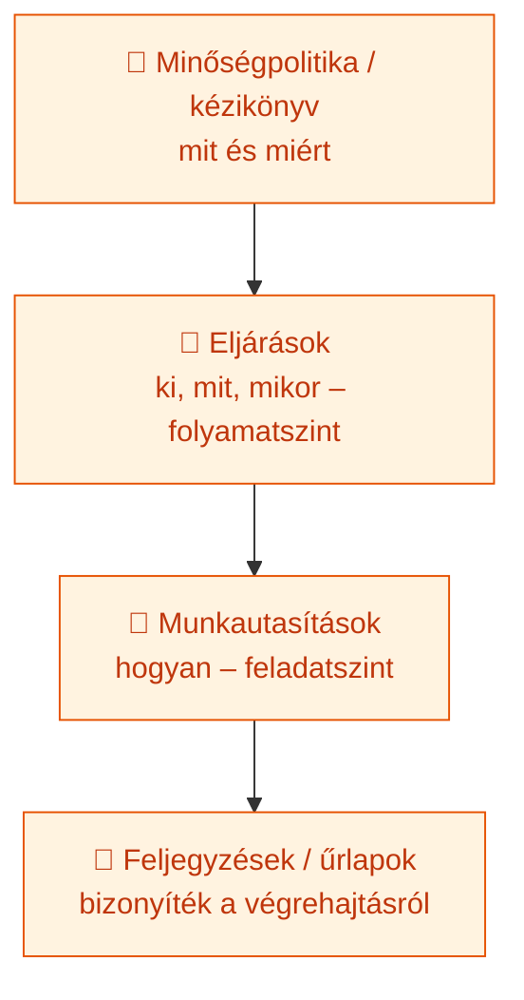

# Számítógépes folyamatmenedzsment (GMXSF2MBLF) — Kontextus és tárgyi referencia

> **Műszaki Menedzser BSc — V3 Vállalatirányítás szakirány — Óbudai Egyetem, Keleti Károly Gazdasági Kar**
>
> Ez a fájl a tárgy **teljes körű, tankönyvi mélységű referenciaanyaga**, a BPM tudásterület belső szakmai logikája szerint (A → E) rendezve. A vizsgafókusz nem vész el: minden fő fejezet jelöli a kapcsolódó **V1–V5 tételt**, a fájl végén pedig külön **vizsgaösszefoglalók** találhatók tételenként.

---

## Tantárgy adatok

| Megnevezés | Adat | Forrás / megjegyzés |
|---|---|---|
| Tantárgy neve | Számítógépes folyamatmenedzsment | Syllabus |
| Neptun-kód | GMXSF2MBLF | Syllabus |
| Intézet | Üzleti Tudományok és Digitális Ismeretek Intézet (1084 Budapest, Tavaszmező u. 15–17.) | Syllabus |
| Tagozat | Levelező | Syllabus |
| Félév | 2025/26/2 | Syllabus |
| **Tantárgyfelelős oktató** | **Prof. Dr. habil. Tick Andrea** | Syllabus |
| Oktatási segédanyag szerzője | **Novák Géza** (2026) | SzgFM.pdf |
| Félévzárás módja | **félévközi jegy** | Syllabus |
| Félévközi követelmény | 2 zárthelyi dolgozat + önálló házi feladat | Syllabus |
| Szoftvertámogatás | t-method, Plató | Syllabus |
| Kreditérték | *a szkennelt Syllabusból nem volt egyértelműen kiolvasható — nem becsültük meg* | Syllabus (OCR-rel sem volt biztonságosan azonosítható) |

> ⚠️ **Forrásütközés jelzése (oktató személye):** a projekt korábbi feljegyzései szerint „az oktató Novák Géza". A Syllabus OCR-feldolgozása alapján azonban a **tantárgyfelelős oktató Prof. Dr. habil. Tick Andrea**, míg **Novák Géza a `SzgFM.pdf` oktatási segédanyag szerzője**. A két szerep nem azonos; a fenti táblázat ennek megfelelően különíti el őket. (A kreditszámot, az óraszámot és a konzultációszámot szándékosan nem találtuk ki — a szkennelt PDF megfelelő mezői nem voltak megbízhatóan kiolvashatók.)

## Oktatási cél

> *„Az üzleti folyamatok menedzselése azok meghatározásával, modellezésével kezdődik. A BPMN, azaz üzleti folyamatmodellezés biztos alapot ad a folyamatok azonosítására, a folyamatszabályozásra vagy akár a folyamatok változáskövetésére. […] A folyamatszemlélet kialakítása elsődleges cél az oktatás során."*

A kurzus elvégzésével a hallgató képes: üzleti folyamat meghatározására és feltérképezésére; folyamatmenedzsment-életciklus modell és folyamattérkép készítésére; folyamatok osztályozására; az **5W+1H** és az **FMEA** módszer alkalmazására; folyamatok kockázatelemzésére.

## Témakörök konzultációnként

| Hét | Témakör | Hova kapcsolódik (fejezet) |
|---|---|---|
| 1 | A folyamat fogalma; a szervezeti folyamatmenedzsment megközelítései | 1. |
| 2 | A folyamatmenedzsment beépítése a szervezet működésébe | 1. / 5. |
| 3 | A folyamatok azonosítása, strukturálása | 1. |
| 4 | Folyamatkövetelmények meghatározása | 1. / 5. |
| 5 | Folyamatmodellezési módszertanok; BPMN jelölésrendszer | 2. |
| 6 | Folyamatszabályozás | 5. |
| 7 | Folyamatok mérése | 3. |
| 8 | Kockázatelemzési módszerek | 3. |
| 9 | Folyamatmenedzsment életciklus-modell | 1. / 5. |
| 10 | Folyamattérkép elkészítése | 1. |
| 11 | Az 5W+1H módszer | 3. |
| 12 | FMEA módszer | 3. |
| 13 | Esettanulmány | — |
| 14 | Önálló feladat bemutatása | — |

---

## A referencia felépítése és a V-tételek leképezése

A tárgyhoz öt szakirányi tétel (V1–V5) tartozik. A referenciaanyag **nem** ezek mentén tagolódik, hanem a BPM-tudásterület belső logikája szerint (1–5. fejezet). Az alábbi tábla mutatja, hol találhatók az egyes tételek tartalmai.

| Tétel | Cím | Elsődleges fejezet(ek) | Vizsgaösszefoglaló |
|---|---|---|---|
| **V1** | BPM életciklusa és BPMS rendszerek felépítése | 1.8, 4.1 | V1 |
| **V2** | Üzleti folyamatok modellezése BPMN 2.0 szerint | 2. (teljes) | V2 |
| **V3** | Üzleti folyamatok mérése és optimalizálása (KPI) | 3.1–3.6 | V3 |
| **V4** | Kockázatkezelés és hibamód-elemzés (FMEA) | 3.7–3.8 | V4 |
| **V5** | Folyamatszemléletű irányítási rendszerek és dokumentáció | 5. (teljes), 1.3–1.5 | V5 |

### Tartalomjegyzék

1. BPM fogalmi alapjai és szervezeti illesztés
2. Folyamatmodellezés és BPMN 2.0
3. Folyamatmérés, -optimalizálás és kockázatkezelés
4. BPMS, SOA és digitális BPM
5. Folyamatszemléletű irányítás és minőségmenedzsment
6. Jelzett forrásütközések és nyitott kérdések
7. Kulcsfogalmak összesítő táblázata
8. Vizsgafókusz: V1–V5 tételösszefoglalók
9. Tantárgyi kapcsolatok
10. Feldolgozott forrásanyagok és felhasznált irodalom

---

# 1. A BPM fogalmi alapjai és szervezeti illesztés

> » **Kapcsolódó tételek: V1, V5** (és a V2–V4 fogalmi háttere)

## 1.1 Az üzleti folyamat fogalma

Az **üzleti folyamat** koordinált tevékenységek olyan sorozata vagy hálózata, amely meghatározott üzleti cél elérése érdekében **bemeneteket kimenetekké alakít**, miközben értéket teremt a szervezet vagy az ügyfél számára (Novák, 2026; Dumas et al., 2018). A folyamat nem pusztán tevékenységek listája: valódi folyamatnak van **meghatározott kezdő- és végpontja, bemenete, kimenete, célja, felelőse, erőforrásigénye, szabályozása és mérhető teljesítménye**.

Dumas és szerzőtársai (2018) formálisabb meghatározása szerint a folyamat olyan eseményekből, tevékenységekből és döntési pontokból álló láncolat, amely egy vagy több szereplőt és tárgyat (objektumot) érint, és amely egy konkrét kimenettel (eredménnyel) zárul, ami értéket képvisel legalább egy szereplő (jellemzően az ügyfél) számára.

**Példa.** A *vevői rendelés kezelése* folyamatként: a **bemenet** a megrendelés, a **kimenet** a teljesített rendelés, a **cél**, hogy a vevő a megfelelő terméket/szolgáltatást a megfelelő időben és minőségben kapja meg.

**Kritika / korlát.** A „folyamat" határai gyakran vitatottak: hol kezdődik és hol ér véget egy end-to-end folyamat. A túl tágan vagy túl szűken húzott folyamathatárok torzítják a mérést és a felelősség kijelölését (Dumas et al., 2018).

## 1.2 Folyamattípusok és a Porter-féle értéklánc

A szervezet folyamatai három fő kategóriába sorolhatók (Novák, 2026):

| Folyamattípus | Szerep | Példák |
|---|---|---|
| **Vezetési (menedzsment-) folyamatok** | Irányítás, stratégiai tervezés, ellenőrzés | stratégiai tervezés, üzleti terv, vezetőségi átvizsgálás, teljesítményértékelés, kockázatkezelés, minőségpolitika |
| **Alap- (kulcs-) folyamatok** | Közvetlen értékteremtés az ügyfélnek | termékfejlesztés, gyártás, szolgáltatásnyújtás, értékesítés, rendelésfeldolgozás, kiszállítás, panaszkezelés |
| **Támogató folyamatok** | A vezetési és alapfolyamatok kiszolgálása | HR, könyvelés, IT, karbantartás, beszerzés, jogi támogatás, képzés |

Ez a hármas tagolás illeszkedik **Porter (1985) értéklánc-modelljéhez**: az alapfolyamatok az *elsődleges tevékenységeknek* (bejövő logisztika, termelés, kimenő logisztika, marketing/értékesítés, szolgáltatás), a támogató folyamatok pedig a *támogató tevékenységeknek* (beszerzés, technológiafejlesztés, emberi erőforrás, vállalati infrastruktúra) felelnek meg. A folyamatok **részfolyamatokra és elemi tevékenységekre** bonthatók: egy rendeléskezelési főfolyamat tartalmazhat rendelésrögzítési, készletellenőrzési, számlázási és kiszállítási részfolyamatot, ezek tovább konkrét feladatokra (pl. „szállítólevél kiállítása").

**Modern relevancia.** A folyamathierarchia adja a **folyamattérkép** (process landscape / process architecture) gerincét, amely a felső vezetés számára átfogó, az operatív szint számára részletes nézetet ad ugyanarról a működésről (Dumas et al., 2018; Harmon, 2019).

## 1.3 BPM-megközelítések: funkcionális vs. folyamatszemlélet; BPR vs. BPM

A **funkcionális (silószerű) szemlélet** a szervezetet osztályok hierarchiájaként kezeli, és minden egység a saját feladatára optimalizál. A probléma, hogy az ügyfélérték az osztályhatárokat átszelő **teljes folyamatból** származik, nem az egyes részlegek lokális teljesítményéből (Novák, 2026; Hammer, 1990).

A **folyamatszemlélet** azt vizsgálja, hogyan halad végig egy ügy/termék/információ a szervezeten, és a *teljes folyamat* értékteremtését állítja középpontba.

### Business Process Reengineering (BPR)

A **BPR** Hammer és Champy nevéhez fűződik. Hammer (1990) *„Reengineering Work: Don't Automate, Obliterate"* című HBR-cikke, majd Hammer és Champy (1993) *Reengineering the Corporation* című könyve a folyamatok **radikális, alapokról induló újratervezését** hirdette meg. Definíciójuk szerint a reengineering „az üzleti folyamatok alapvető újragondolása és radikális újratervezése drámai javulás elérése érdekében a teljesítmény kritikus, korszerű mércéi — költség, minőség, szolgáltatás és sebesség — mentén". Párhuzamos, egymástól független alapmű Davenport (1993) *Process Innovation*ja, amely a folyamatújítást az IT-vel kapcsolja össze.

| Szempont | **BPR** (Hammer–Champy, 1993) | **BPM** (Dumas et al., 2018) |
|---|---|---|
| Változás jellege | Radikális, „tiszta lap" | Evolúciós, folyamatos |
| Kockázat / hatás | Magas kockázat, nagy ugrás | Mérsékelt, fenntartható |
| Időtáv | Egyszeri, projektszerű | Ciklikus, állandó |
| IT szerepe | A radikális újratervezés engedélyezője | A teljes életciklus támogatója (BPMS) |
| Tipikus kudarcok | Túl ambiciózus hatókör, emberi ellenállás, leépítésekkel azonosulás | Felszínes „dokumentálás", ami nem épül be a működésbe |

**Kritika.** A BPR-hullám az 1990-es évek közepére jórészt kifulladt: a projektek nagy része nem hozta a várt eredményt, és sok esetben a „reengineering" eufemizmussá vált a létszámleépítésre. A modern BPM ezért a **fokozatos, mérésre alapozott, az életciklusba beépített** fejlesztést hangsúlyozza, miközben megőrzi a BPR alapgondolatát: a folyamatot, nem a funkciót kell optimalizálni (Harmon, 2019).

## 1.4 A folyamatmenedzsment beépítése a szervezetbe

A BPM bevezetése **szemléletváltás**, nem különálló projekt. Fő lépései (Novák, 2026):

1. **Stratégiai célok** meghatározása (gyorsabb ügyintézés, alacsonyabb hibaarány, jobb ügyfélélmény, költségcsökkentés).
2. **Folyamatok azonosítása** (folyamattérkép).
3. **Folyamatgazdák** kijelölése.
4. **Mérőszámok (KPI-k)** hozzárendelése.
5. **Munkatársak bevonása** (a folyamatot leginkább a benne dolgozók ismerik).
6. **Technológiai támogatás** (workflow, BPMS, adatgyűjtés).
7. **Változáskezelés** (kommunikáció, képzés).

A BPM akkor válik a mindennapi működés részévé, ha **beépül a vezetési, minőségirányítási és teljesítményértékelési rendszerbe** — nem külön projektként kezelik.

## 1.5 A folyamatgazda szerepköre és a felelősségi rendszer

A **folyamatgazda** (process owner) az a személy, aki felelős a folyamat **teljesítményéért, szabályozottságáért és fejlesztéséért** — nem feltétlenül ő hajtja végre a lépéseket, de ő látja át az **end-to-end** folyamatot (Novák, 2026). Feladatai: folyamatcél meghatározása, folyamatleírás karbantartása, KPI-k figyelése, kockázatkezelés, fejlesztési lehetőségek azonosítása, kapcsolattartás az érintett egységekkel, nemmegfelelőségek elemzése, helyesbítő/fejlesztő intézkedések kezdeményezése.

A szerep azért kritikus, mert a folyamatok gyakran **átlépik a szervezeti határokat** (a rendeléskezelés érinti az értékesítést, pénzügyet, raktárt, logisztikát). Folyamatgazda nélkül senki nem felel a teljes eredményért. A felelősségek tisztázására **RACI-mátrix** használható: ki a végrehajtó (**R**esponsible), ki a felelős/elszámoltatható (**A**ccountable), kit kell bevonni (**C**onsulted) és tájékoztatni (**I**nformed).

## 1.6 Folyamatkövetelmények és -azonosítás

A folyamat meghatározásakor tisztázni kell a **követelményeket**: cél, bemenetek, kimenet, ügyfél/kedvezményezett, vonatkozó jogszabályok/szabványok (pl. ISO 9001), erőforrások, kockázatok, mérőszámok (Novák, 2026). A követelmények lehetnek **belsők** (szabályzat, vezetői elvárás, hatékonysági cél) és **külsők** (jogszabály, hatósági előírás, vevői/szerződéses elvárás, szabvány).

## 1.7 Folyamatérettségi modellek (CMMI, OMG BPMM)

A **folyamatérettség** azt méri, mennyire szabályozott, mért és tudatosan fejlesztett a szervezet folyamatkezelése. Két meghatározó modell:

| Szint | **CMMI** (CMMI Product Team, 2010) | **OMG BPMM** (OMG, 2008) |
|---|---|---|
| 1 | *Initial* — ad hoc, kiszámíthatatlan | *Initial* — ösztönös, hősökre épülő |
| 2 | *Managed* — projektszinten irányított | *Managed* — egységszinten ismételhető |
| 3 | *Defined* — szervezeti szabványfolyamatok | *Standardized* — közös, szabványosított folyamatok |
| 4 | *Quantitatively Managed* — statisztikailag kontrollált | *Predictable* — mérésre alapozottan kiszámítható |
| 5 | *Optimizing* — folyamatos fejlesztés | *Innovating* — proaktív, innovatív fejlesztés |

A **CMMI** (Capability Maturity Model Integration, a Carnegie Mellon SEI gondozásában) eredetileg szoftverfejlesztési kontextusból nőtt ki, de általános folyamatérettségi keretté vált. Az **OMG BPMM** kifejezetten az üzleti folyamatokra szabott, ötszintű érettségi modell. A modellek logikája azonos: az érettebb szervezet folyamatai **dokumentáltak, mértek, statisztikailag kontrolláltak és tudatosan optimalizáltak**.

**Gyakorlati alkalmazás.** Az érettségi szint meghatározza a reális BPM-bevezetési stratégiát: egy 1–2. szintű szervezetnél előbb a folyamatok azonosítása és szabályozása a cél, a fejlett process mining vagy a teljes körű automatizálás csak magasabb szinteken értelmes.

**Kritika.** Az érettségi modelleket gyakran éri az a vád, hogy az „5. szint" öncéllá válik, miközben a magasabb szint nem mindig jár jobb üzleti eredménnyel; a modell-alapú értékelés ráadásul költséges és bürokratikus lehet.

## 1.8 A BPM-életciklus

> » **Kapcsolódó tétel: V1**

A BPM nem egyszeri feladat, hanem **iteratív fejlesztési körforgás**. A `SzgFM.pdf` az **ötfázisú** változatot használja:

> ⚠️ **Forrásütközés (életciklus-fázisok száma):**
> - **Novák (2026), `SzgFM.pdf`:** **5 fázis** — Tervezés → Modellezés → Végrehajtás → Monitorozás → Optimalizálás.
> - **A 9. HTML-lecke:** **6 szakasz** — egy előzetes *„Előrelátás / stratégiai irány kijelölése"* fázissal kiegészítve.
> - **Dumas et al. (2018):** **6 fázis** — *process identification → process discovery (AS-IS modellezés) → process analysis → process redesign (TO-BE) → process implementation → process monitoring and controlling*, amelyet egy különálló *stratégiai illesztés* (process architecture) keretez.
>
> A különbség elsősorban a **bontás finomsága**: Dumas a modellezésen belül külön nevesíti a feltárást, az elemzést és az újratervezést, és kiemeli a kezdeti azonosítási fázist. Tartalmi ellentmondás nincs — ugyanaz a logika, eltérő granularitással. **Vizsgán** célszerű a Novák-féle 5 fázist megadni, és megemlíteni a Dumas-féle 6 fázisú bontást mint a szakirodalom finomabb felosztását.

---

# 2. Folyamatmodellezés és BPMN 2.0

> » **Kapcsolódó tétel: V2**

## 2.1 Modellezési módszertanok és a BPMN helye

A folyamatmodellezés célja, hogy a valós működést **áttekinthető formában** ábrázolja: milyen lépésekből áll, kik vesznek részt, hol vannak a döntési pontok és az átadások (Novák, 2026).

| Módszertan | Erősség | Korlát | Tipikus használat |
|---|---|---|---|
| **Folyamatábra** (flowchart) | Egyszerű, mindenki érti | Nincs szabványos szemantika a párhuzamosságra, felelősségre | Gyors vázlat, oktatás |
| **Úszósávos diagram** (swimlane) | Felelősségeket láthatóvá teszi | Komplex logikára korlátozott | Szervezeti folyamatok |
| **Petri-háló** | Formális, matematikailag elemezhető (token-szemantika) | Üzleti felhasználónak nehéz | Verifikáció, kutatás, process mining alapja |
| **EPC** (eseményvezérelt folyamatlánc) | Esemény–funkció váltakozás, ARIS-ban elterjedt | Kevésbé szabványos, nehézkes elágazás-szemantika | SAP/ARIS környezet |
| **UML aktivitásdiagram** | Szoftvertervezéshez illeszkedik | Üzleti oldalnak kevésbé intuitív | Rendszerfejlesztés |
| **BPMN 2.0** | Szabványos (OMG), üzleti + IT közös nyelv, végrehajtható | Teljes elemkészlete bonyolult | Üzleti folyamatmodellezés, BPMS |

A **BPMN** (Business Process Model and Notation) ma a legelterjedtebb üzleti folyamatmodellezési szabvány. Fő előnye, hogy **közös nyelvet** ad az üzleti elemzők, folyamatgazdák, vezetők és informatikai megvalósítók között (OMG, 2011; Allweyer, 2016).

## 2.2 A BPMN 2.0 jelölésrendszere

A BPMN 2.0-t az **Object Management Group (OMG)** szabványosította (a 2.0 verzió 2011-ben, a 2.0.2 karbantartott kiadás 2013-ban jelent meg). Az elemek négy fő kategóriába sorolhatók: **folyamatobjektumok** (események, tevékenységek, átjárók), **összekötők**, **úszósávok** (medencék/sávok) és **tárgyi/adatelemek**.

### 2.2.1 Események (events)

Az **esemény** a folyamat során bekövetkező történés (vékony körrel jelölve). Pozíció szerint **start / közbenső (intermediate) / vég (end)**, viselkedés szerint **elkapó (catching) / kiváltó (throwing)**.

| Eseménytípus | Start | Közbenső | Vég | Jelentés |
|---|---|---|---|---|
| **None** (üres) | ✔ | ✔ | ✔ | Általános kezdő/befejező pont |
| **Message** (üzenet) | ✔ | ✔ (catch/throw) | ✔ | Üzenet érkezése/küldése résztvevők között |
| **Timer** (idő) | ✔ | ✔ | — | Időpont, időtartam, ciklikus időzítés |
| **Error** (hiba) | (eseményalfolyamatban) | ✔ (határ) | ✔ | Hibadobás/-elkapás |
| **Signal** (jelzés) | ✔ | ✔ | ✔ | Broadcast jelzés (1:N) |
| **Conditional** (feltétel) | ✔ | ✔ | — | Üzleti feltétel teljesülése |
| **Escalation** (eszkaláció) | (alfolyamat) | ✔ | ✔ | Magasabb szintre továbbítás |
| **Compensation** (kompenzáció) | — | ✔ | ✔ | Tranzakció visszagörgetése |
| **Terminate** (lezáró) | — | — | ✔ | A teljes folyamatpéldány azonnali leállítása |
| **Link** | — | ✔ | — | Diagramon belüli „ugrópont" |

A **határesemény** (boundary event) egy tevékenység szegélyén ül; lehet **megszakító** (interrupting) vagy **nem megszakító** (non-interrupting). Tipikus: időtúllépés (timer boundary), hibakezelés (error boundary).

### 2.2.2 Tevékenységek (activities)

A **tevékenység** az elvégzendő munka (lekerekített téglalap).

| Tevékenység | Jelentés |
|---|---|
| **Feladat (task)** | Atomi munkaelem. Altípusok: *user* (emberi), *service* (rendszer), *script*, *send/receive* (üzenet), *manual*, *business rule* (szabálymotor) |
| **Alfolyamat (sub-process)** | Összevont, lenyitható részfolyamat; lehet *beágyazott* vagy *eseményalfolyamat* |
| **Hívott folyamat (call activity)** | Újrahasznosított, máshol definiált folyamat meghívása |
| **Tranzakció** | Atomi, „mind vagy semmi" alfolyamat kompenzációval |
| **Ismétlési jelölők** | *Loop*, *multi-instance* (párhuzamos/szekvenciális), *ad-hoc* |

### 2.2.3 Átjárók (gateways)

Az **átjáró** (rombusz) szabályozza a szekvenciafolyam szét- és összefutását.

| Átjáró | Jelölés | Viselkedés |
|---|---|---|
| **Exkluzív (XOR)** | × vagy üres rombusz | Pontosan **egy** kimenő ág (a feltételek közül az igaz) |
| **Párhuzamos (AND)** | + | **Minden** ág egyszerre indul (split), majd mind bevárása (join) |
| **Inkluzív (OR)** | ○ | **Egy vagy több** ág, a feltételek szerint; join az aktivált ágakat várja be |
| **Eseményalapú** | ⬠ (ötszög körben) | A folyamat a **soron következő esemény** szerint dönt (pl. „válasz VAGY időtúllépés") |
| **Komplex** | ✳ | Egyedi, kifejezéssel megadott szinkronizációs feltétel (ritka) |

### 2.2.4 Úszósávok: medence és sáv

A **medence (pool)** egy önálló résztvevőt/szervezetet jelöl; a **sáv (lane)** a medencén belüli szervezeti egységet vagy szerepkört. Eltérő medencék között **csak üzenetfolyam** haladhat (nem szekvenciafolyam), mert külön résztvevőkről van szó (Novák, 2026; Silver, 2009).

### 2.2.5 Összekötők és tárgyi elemek

| Összekötő | Jelölés | Jelentés |
|---|---|---|
| **Szekvenciafolyam** | folytonos nyíl | A lépések sorrendje **egy** medencén belül |
| **Üzenetfolyam** | szaggatott nyíl, üres kör/nyílhegy | Kommunikáció **különböző** résztvevők (medencék) között |
| **Asszociáció** | pontozott vonal | Adat/dokumentum/megjegyzés kapcsolása elemhez |

**Tárgyi (artifact) és adatelemek:** adatobjektum (data object), adattár (data store), csoport (group), szöveges megjegyzés (text annotation).

### 2.2.6 Példa — egyszerű panaszkezelés BPMN-logikával

*(A Mermaid-flowchart a BPMN logikáját szemlélteti; a tényleges BPMN-jelölés az események körét, a tevékenységek lekerekített téglalapját és a rombusz-átjárót használja.)*

## 2.3 Modellezési szintek és hibás modellezési minták

Silver (2009/2011) háromszintű modellt javasol:

| Szint | Cél | Jellemző |
|---|---|---|
| **Leíró (descriptive)** | Emberi kommunikáció, áttekintés | Az elemkészlet egy szűk, „happy path" részhalmaza |
| **Analitikus (analytic)** | Pontos folyamatlogika, kivételkezelés | Eseménytípusok, átjárók, határesemények teljes körű használata |
| **Végrehajtható (executable)** | BPMS-motoron futtatható modell | Technikai attribútumok, adat-mapping, service-task konfiguráció |

**Tipikus hibás minták (anti-patterns):**

- **Deadlock (holtpont):** egy AND-join olyan ágra vár, amely sosem aktiválódik (pl. XOR-split után AND-join) → a folyamat megáll.
- **Lack of synchronization / „token-szaporodás":** AND-split után XOR-join → a folyamat többször fut le a kelleténél.
- **Livelock:** a folyamat „forog", de nem halad előre (rosszul zárt ciklus).
- **Lógó / hiányzó esemény:** vég nélküli ág vagy explicit start/end hiánya.
- **Medencén átívelő szekvenciafolyam** (üzenetfolyam helyett) — szemantikai hiba.

Ezek a **Petri-háló token-szemantikájával** formálisan kimutathatók; a BPMS- és modellezőeszközök validátorai (és a process mining *conformance checking*) ezek egy részét automatikusan jelzik (van der Aalst, 2016).

## 2.4 Choreography és Conversation diagramok

A BPMN 2.0 a sima folyamatdiagramon túl két további diagramtípust definiál:

- **Choreography (koreográfia) diagram:** a résztvevők **közötti üzenetváltások sorrendjét** modellezi, központi vezérlő nélkül — akkor hasznos, ha több **független szervezet** együttműködését írjuk le (pl. vevő–webáruház–bank).
- **Conversation diagram:** a résztvevők és a köztük zajló üzenetcsoportok **magas szintű áttekintése**.

Ezek a B2B-/szervezetközi folyamatoknál relevánsak, ahol nincs egyetlen „karmester" (lásd a koreográfia fogalmát a 4.2-ben).

---

# 3. Folyamatmérés, -optimalizálás és kockázatkezelés

> » **Kapcsolódó tételek: V3 (mérés/optimalizálás), V4 (FMEA)**

## 3.1 A folyamatmérés alapjai és a KPI-k

„Amit nem mérünk, azt nehéz objektíven értékelni és fejleszteni" (Novák, 2026). A **KPI** (Key Performance Indicator, kulcsfontosságú teljesítménymutató) a folyamat kritikus teljesítményterületét mérő számszerű mutató.

A **Devil's Quadrangle** (Dumas et al., 2018; Reijers nyomán) szerint a folyamatteljesítmény négy — gyakran egymással versengő — dimenzióban mérhető: **idő, költség, minőség, rugalmasság**. Egy dimenzió javítása rendszerint egy másik rovására megy (pl. a gyorsítás növelheti a költséget).

| Dimenzió | Mutató | Definíció |
|---|---|---|
| **Idő** | Ciklusidő (*cycle time*) | Egy folyamatpéldány tényleges feldolgozási ideje a starttól a végig |
| | Átfutási idő (*throughput time*) | A teljes idő, beleértve a várakozást is |
| | Várakozási idő | Nem értékteremtő holtidő (sorban állás) |
| | Átbocsátóképesség (*throughput*) | Időegység alatt teljesített példányok száma |
| **Költség** | Egy ügyre jutó költség, erőforrásköltség | A folyamatpéldány előállításának költsége |
| **Minőség** | Hibaarány, selejtarány, újramunka aránya, elsőre helyesen (*first-pass yield*), reklamációk száma, ügyfél-elégedettség | A kimenet megfelelősége |
| **Rugalmasság** | Variánsok kezelése, csúcsterhelés-tűrés | A folyamat alkalmazkodóképessége |

Származtatott, fontos mutató az **értékteremtő arány** (*value-added ratio*): az értékteremtő idő aránya a teljes átfutási időhöz — gyakran meglepően alacsony (sok a várakozás), ezért kiemelt optimalizálási célpont. A **kapacitáskihasználás** az erőforrás terheltségét méri.

**A jó KPI jellemzői** (Novák, 2026): a folyamatcélhoz kapcsolódik, mérhető, egyértelmű, rendszeresen gyűjthető, **célértékkel** összevethető, felelőshöz rendelhető, döntéstámogatásra alkalmas. „Javuljon a minőség" nem KPI; „a határidőre lezárt panaszok aránya ≥ 95%" igen.

## 3.2 Szűk keresztmetszetek és AS-IS / TO-BE elemzés

A **szűk keresztmetszet (bottleneck)** a folyamat teljesítményét korlátozó pont, ahol a munka feltorlódik. Monitorozási adatokból (várakozási idők, sorhosszak, erőforrás-kihasználás) azonosítható.

Az **optimalizálás** menete (Novák, 2026; Dumas et al., 2018):

1. **Célok és hatókör** meghatározása.
2. **AS-IS elemzés** — a jelenlegi állapot feltárása (folyamatfeltárás, modellezés, mérés).
3. **Problémaelemzés és gyökérok-feltárás** — bottleneck, redundancia, felesleges/párhuzamosítható lépések, kézi átadások.
4. **TO-BE modell** — a javított jövőbeli folyamat (egyszerűsítés, automatizálás, párhuzamosítás, jóváhagyási szintek racionalizálása).
5. **Megoldások értékelése** (pl. szimulációval).
6. **Megvalósítás és változáskezelés.**
7. **Bevezetés utáni visszamérés** — valóban javult-e a KPI.

## 3.3 Lean a BPM-ben

A **Lean** szemlélet a Toyota Termelési Rendszerből ered (Ohno, 1988; Womack & Jones, 1996). Központi fogalma a **veszteség (muda)** kiküszöbölése. A hét (gyakran nyolc) klasszikus veszteségtípus: túltermelés, várakozás, felesleges szállítás, túlmunkálás/felesleges feldolgozás, készlet, felesleges mozgás, hibák/selejt (+ a kihasználatlan emberi tudás mint nyolcadik).

Fő eszközök:

- **Értékfolyam-térkép (VSM, Value Stream Mapping):** az anyag- és információáramlás feltérképezése az értékteremtő és nem értékteremtő lépések szétválasztásával.
- **Húzóelv (pull):** a tevékenységet a tényleges kereslet indítja (nem az előretolás).
- **5S:** Seiri–Seiton–Seiso–Seiketsu–Shitsuke (szortírozás, elrendezés, takarítás, standardizálás, fenntartás) — a munkahely rendje és vizuális szabályozása.

**BPM-kapcsolat:** a Lean a folyamatból a *várakozást és a felesleges lépéseket* célozza, így közvetlenül javítja az értékteremtő arányt és az átfutási időt.

## 3.4 Six Sigma és a DMAIC

A **Six Sigma** (Motorola, 1980-as évek; Pyzdek & Keller, 2014; George, 2002) statisztikai alapú minőségfejlesztési módszertan, amely a **folyamatszórás (variabilitás) csökkentésére** összpontosít. Mércéje a **DPMO** (Defects Per Million Opportunities); a „hat szigma" szint ≈ **3,4 hiba/millió** lehetőség. A javítási projektek vázát a **DMAIC** ciklus adja:

A **Lean Six Sigma** (George, 2002) a Lean sebesség-/veszteségfókuszát ötvözi a Six Sigma szórásredukciójával. **BPM-kapcsolat:** a DMAIC az AS-IS/TO-BE optimalizálás strukturált, mérésre alapozott változata; a *Control* fázis a folyamatszabályozással és a PDCA-val (5.2) cseng össze.

## 3.5 Folyamatszimuláció

A **szimuláció** a TO-BE modellek „futtatás előtti" tesztelését teszi lehetővé (Dumas et al., 2018):

- **Diszkrét eseményszimuláció (DES):** a folyamatpéldányok áramlását modellezi erőforrás-korlátokkal, érkezési rátákkal, kiszolgálási idő-eloszlásokkal → megmutatja a várható átfutási időt, sorhosszakat, erőforrás-kihasználást és a szűk keresztmetszeteket.
- **Monte Carlo-szimuláció:** a bizonytalan paraméterek (idő, költség, valószínűségek) eloszlásából sok véletlen lefutást generál → kockázat/szórás becslése.

**Korlát:** a szimuláció eredménye csak annyira jó, amennyire a bemeneti feltételezések; az emberi viselkedés és a ritka kivételek nehezen modellezhetők.

## 3.6 Process Mining

> » **Kapcsolat: V3 (monitorozás/optimalizálás), V1 (életciklus)**

A **process mining** (van der Aalst, 2016) a BPM és az adattudomány találkozása: az információs rendszerek **eseménynaplóiból (event log)** nyeri ki a folyamatok tényleges viselkedését. Az event log minimálisan tartalmazza: **case ID** (folyamatpéldány), **activity** (tevékenység), **timestamp** (időbélyeg), gyakran **resource** (végrehajtó).

Három fő feladat:

| Feladat | Mit csinál |
|---|---|
| **Process discovery** | Az event logból automatikusan **felépíti** a tényleges folyamatmodellt (pl. α-algoritmus, inductive miner) |
| **Conformance checking** | Összeveti a **tényleges** lefutást a **tervezett** (de jure) modellel → eltérések, szabálysértések |
| **Enhancement** | A meglévő modellt **gazdagítja** a logból (pl. szűk keresztmetszetek, átfutási idők, körök) |

**BPM-kapcsolat:** a process mining a monitorozási fázis adatvezérelt motorja, és tényekkel (nem feltételezésekkel) alapozza meg az AS-IS elemzést.

**Kritika / korlát.** Erősen **adatminőség-függő**: hiányos, pontatlan vagy rosszul időbélyegzett logok félrevezető modellt adnak. Adatvédelmi kérdéseket vet fel (ki mit, mennyi idő alatt végzett — munkavállalói megfigyelés). A „spagetti-modellek" (túl sok variáns) nehezen értelmezhetők.

## 3.7 FMEA — hibamód- és hatáselemzés

> » **Kapcsolódó tétel: V4**

Az **FMEA** (Failure Mode and Effects Analysis, hibamód- és hatáselemzés; Stamatis, 2003) **szisztematikus, proaktív** kockázatkezelési módszer: a hiba bekövetkezése **előtt** azonosítja a lehetséges meghibásodási módokat, azok okait és következményeit.

**Alapfogalmak:** **hibamód** (failure mode — mi hibásodhat meg), **hibahatás** (effect — mi a következménye), **hibaok** (cause — mi okozza), **jelenlegi kontroll**, **intézkedés**.

**Típusok:**

| Típus | Tárgya |
|---|---|
| **DFMEA** (Design FMEA) | Termék/szolgáltatás/rendszer **tervezési** kockázatai |
| **PFMEA** (Process FMEA) | **Folyamatlépések** lehetséges hibái — *a BPM-ben ez a fő típus* |
| **SFMEA** (System FMEA) | Rendszerszintű, alrendszerek közötti kölcsönhatások |
| **FMEA-MSR** | Monitoring & System Response (az AIAG–VDA 2019 új típusa, üzem közbeni diagnosztika) |

### Az RPN (kockázati prioritási szám)

A klasszikus értékelés a három tényező szorzata:

> **RPN = S × O × D**

ahol **S** = Súlyosság (Severity), **O** = Előfordulás (Occurrence), **D** = Észlelhetőség (Detection). Mindhárom **1–10** skálán. Fontos: a **D-nél a magasabb szám rosszabb** (nehezebben észlelhető).

| Érték | **S — Súlyosság** | **O — Előfordulás** | **D — Észlelhetőség** |
|---|---|---|---|
| 1–2 | Csekély hatás | Nagyon ritka | Szinte biztosan észlelhető (erős kontroll) |
| 3–4 | Kisebb zavar | Ritka, de ismert | Jó eséllyel észlelhető |
| 5–6 | Érezhető probléma, ügyfél érintett lehet | Időnként előforduló | Közepes esély, részleges kontroll |
| 7–8 | Jelentős hatás (késedelem, költség, minőség) | Gyakori | Nehezen, főként utólag derül ki |
| 9–10 | Kritikus (jogszabály, biztonság, jelentős üzleti kár) | Szinte biztos | Nagyon nehezen / egyáltalán nem észlelhető |

### Az FMEA folyamata

### Számpélda (Novák, 2026 nyomán)

*Hibamód:* a számla rossz költséghelyre kerül könyvelésre. *Hibahatás:* pontatlan kimutatás, hibás vezetői döntés. *Hibaok:* manuális adatbevitel, nem egyértelmű költséghely-lista. *Kontroll:* havi könyvelési ellenőrzés.

> **RPN = S × O × D = 7 × 5 × 6 = 210** *(magas)*

*Intézkedés:* automatikus költséghely-választó lista + ellenőrző szabály. Újraértékelés után pl. **3 × 3 × 2 = 18** → a kockázat jelentősen mérséklődött.

Egy mintatáblázat (Novák, 2026):

| Folyamatlépés | Hibamód | Hibahatás | Hibaok | Kontroll | S | O | D | RPN | Intézkedés |
|---|---|---|---|---|---|---|---|---|---|
| Számla rögzítése | Hibás költséghely | Pontatlan kimutatás | Manuális bevitel | Havi ellenőrzés | 7 | 5 | 6 | **210** | Automatizált lista |
| Panasz rögzítése | Hiányos adat | Késedelmes kivizsgálás | Nem kötelező mezők | Ügyintézői ellenőrzés | 6 | 7 | 5 | **210** | Kötelező mezők |
| Ügyfél értesítése | Értesítés elmarad | Elégedetlenség | Manuális e-mail | Nincs auto. kontroll | 8 | 4 | 7 | **224** | Automatikus értesítés |

### Kockázatcsökkentő intézkedések és visszamérés

Az intézkedések három irányban hathatnak: csökkentik az **előfordulást (O)**, javítják az **észlelhetőséget (D)**, ritkábban csökkentik a **súlyosságot (S)** (Novák, 2026). Tipikus eszközök: munkautasítás pontosítása, képzés, kötelező űrlapmezők, automatikus adatellenőrzés, jóváhagyási pont, ellenőrzőlista, rendszerintegráció, jogosultság-módosítás. Az intézkedés után **újra kell értékelni S, O, D-t és új RPN-t számolni** — ez igazolja a tényleges csökkenést.

> ⚠️ **Forrásütközés / módszertani fejlemény (RPN vs. Action Priority):**
> - **Novák (2026), `SzgFM.pdf`:** a klasszikus **RPN = S × O × D** logikát tanítja, ugyanakkor maga is figyelmeztet, hogy **nem szabad mechanikusan alkalmazni**: ha pl. S = 10, a kockázat alacsony RPN mellett is kiemelt figyelmet igényelhet.
> - **AIAG & VDA (2019) FMEA Handbook:** az új iparági szabvány **leváltotta az RPN-t** az **Action Priority (AP)** módszerrel. Az AP nem szoroz, hanem **döntési táblázat** alapján **Magas / Közepes / Alacsony (H/M/L)** prioritást ad az S–O–D kombinációkhoz, és **a súlyosságot teszi elsődlegessé** (magas S esetén ritka előfordulás és jó észlelhetőség mellett is „High" lehet). Indok: különböző kockázatok azonos RPN-t kaphatnak nagyon eltérő ügyfélhatás mellett.
>
> **Vizsgán** az RPN-számítás a kötelező mag (a tananyag ezt kéri), de érdemes megemlíteni, hogy az **autóipari szabvány ma az AP-t** használja, és tudni az okát (súlyosság-elsőbbség, az RPN félrevezető rangsorának kiküszöbölése).

**Az FMEA korlátai:** az S, O, D értékelése **szubjektív**, csapatfüggő; az RPN ordinális skálák szorzata (matematikailag vitatható); időigényes; statikus pillanatkép, amelyet karban kell tartani.

## 3.8 Gyökérok-elemzés: 5W+1H és az Ishikawa-diagram

Az **5W+1H** strukturált kérdezéstechnika a folyamat feltárására és szabályozására (Novák, 2026): **Who? (Ki?), What? (Mit?), Why? (Miért?), When? (Mikor?), Where? (Hol?), How? (Hogyan?)**. A *Why?* különösen fontos: kiszűri az értéket nem teremtő lépéseket (rokon a Lean „5 Miért?" — 5 Whys — technikájával).

Az **Ishikawa- (halszálka-) diagram** (Ishikawa, 1990) a hiba lehetséges okait **kategóriákba** rendezi. A gyártásban a **6M**: Man (ember), Machine (gép), Method (módszer), Material (anyag), Measurement (mérés), Milieu/Mother Nature (környezet); szolgáltatásban gyakori a **4P/8P** felosztás.

**Kapcsolat:** az 5W+1H és az Ishikawa az FMEA *hibaok*-oszlopát és a DMAIC *Analyze* fázisát táplálja, az eredmény pedig a PDCA *Act* szakaszába (helyesbítő intézkedés) folyik be.

---

# 4. BPMS, SOA és digitális BPM

> » **Kapcsolódó tételek: V1 (BPMS), V5 (integráció)**

## 4.1 A BPMS architektúrája

A **BPMS** (Business Process Management Suite/System) integrált szoftverkörnyezet, amely a BPM-életciklus szakaszait támogatja, és **hidat képez az üzleti és az informatikai oldal között** (Novák, 2026; Weske, 2019). Fő komponensei:

- **Folyamatmodellező eszköz:** grafikus (gyakran BPMN 2.0) modellkészítés, szereplők/döntési pontok/kivételek megadása, dokumentáció, verziókezelés. Előny: az üzleti szakember is részt vehet a tervezésben.
- **Végrehajtó motor (process/workflow engine):** elindítja a folyamatpéldányokat, kiosztja a feladatokat, kezeli a döntési pontokat és határidőket, továbbítja az adatokat, kezeli a kivételeket, kapcsolatot teremt más rendszerekkel. Ez teszi a modellt működő folyamattá.
- **Üzleti szabálykezelő (BRMS):** a döntési logika elkülönítve a kódtól (pl. „500 000 Ft felett pénzügyi vezetői jóváhagyás is kell"), így a szabály a fejlesztés újraírása nélkül módosítható.
- **Üzleti analitika:** KPI-mérés, folyamatstatisztika, riport, dashboard, trend-/eltéréselemzés, vezetői döntéstámogatás.
- **Folyamattár (repository):** a modellek, verziók, szabályok tárháza.
- **Integrációs réteg:** API-k, konnektorok, ESB a háttérrendszerek (ERP, CRM, HR) felé.

**Eszközpéldák (tényszerűen, reklámjelleg nélkül):** nyílt forráskódú motorok (pl. *Camunda*, *Activiti*, *Flowable*), valamint nagy gyártói csomagok (pl. *SAP* folyamateszközei). Ezek mind BPMN 2.0-alapú modellezést és végrehajtást kínálnak.

## 4.2 SOA — szolgáltatásorientált architektúra

> » **Kapcsolat: V5, és a GMXIV2MBLF (ERP) tárgy**

A **SOA** (Service-Oriented Architecture; Erl, 2005) olyan architektúra, amelyben az alkalmazások funkcióit önálló, **lazán csatolt, újrahasználható, szabványos interfészen** keresztül elérhető **szolgáltatások** valósítják meg (Novák, 2026; Molnár, 2013). Egy üzleti folyamat lépései így informatikai szolgáltatások hívásaivá fordíthatók.

A szolgáltatások együttműködésének két alapmódja:

| Szempont | **Orkesztráció** | **Koreográfia** |
|---|---|---|
| Irányítás | **Központi** folyamatmotor („karmester") | **Nincs** egyetlen központi irányító |
| Logika helye | A folyamatmotorban koncentrálódik | Több résztvevő között oszlik meg |
| Áttekinthetőség | Központilag jól követhető | Nehezebb teljes képet kapni |
| Rugalmasság | Jól szabályozott, kontrollált | Elosztott, rugalmasabb |
| Analógia | Zenekar + karmester | Tánc közös szabályok szerint |
| Tipikus használat | **Belső** üzleti folyamatok (BPMS vezérli) | **Szervezetek közötti** együttműködés (eseményvezérelt) |

A gyakorlatban a kettő **együtt** él: egy vállalat belső rendelésfeldolgozását a BPMS **orkesztrálja**, miközben a bankkal, futárral, beszállítóval **koreográfiaszerű** üzenetváltás zajlik (Novák, 2026).

Az **ESB** (Enterprise Service Bus) a SOA központi integrációs gerince: üzenetútválasztást, protokoll- és formátumtranszformációt, szolgáltatás-közvetítést végez a heterogén rendszerek között.

## 4.3 Mikroszolgáltatások és eseményvezérelt architektúra

A **mikroszolgáltatás-architektúra** (Newman, 2015/2021) a SOA „finomszemcsés" utódja: kicsi, **önállóan telepíthető**, egy-egy üzleti képességet lefedő szolgáltatások, saját adattárral.

| Szempont | SOA (klasszikus) | Mikroszolgáltatások |
|---|---|---|
| Integráció | Központi ESB, „okos" busz | Könnyű protokollok (REST, üzenetsor), „okos végpontok, buta cső" |
| Adattár | Gyakran megosztott | Szolgáltatásonként **külön** |
| Szemcsézettség | Durvább | Finom |
| Telepítés | Nagyobb egységek | Független, gyakori (CI/CD) |

Az **eseményvezérelt architektúra (EDA)** a koreográfia rokona: a szolgáltatások eseményeket publikálnak és fogyasztanak. **Következmény a folyamatmodellezésre:** a klasszikus, központilag orkesztrált modell mellett egyre fontosabb az **esemény-alapú** gondolkodás (BPMN üzenet-/jelzéseseményei, choreography diagram).

## 4.4 RPA és intelligens automatizálás

Az **RPA** (Robotic Process Automation; van der Aalst, Bichler & Heinzl, 2018) szoftverrobotokkal automatizálja az **ismétlődő, szabályalapú, strukturált** feladatokat azáltal, hogy a robot a **felhasználói felületen** (UI) utánozza az emberi műveleteket (bejelentkezés, adatmásolás rendszerek között, űrlapkitöltés).

**RPA vs. BPMS:** az RPA „felülről", a meglévő rendszereken **kívülről** automatizál (gyors, olcsó, nem nyúl a háttérrendszerhez), míg a BPMS a folyamatot **belülről, end-to-end** vezérli és integrálja. A kettő **kiegészíti** egymást: a BPMS orkesztrálja a folyamatot, és egyes lépéseknél RPA-robotot hív meg ott, ahol nincs API.

**Korlátok:** az RPA **törékeny** (a UI változása elronthatja a robotot), nem old meg rossz folyamatot („ne automatizálj kaotikus folyamatot"), és nem helyettesíti a valódi rendszerintegrációt.

**IPA / hiperautomatizálás:** az **Intelligent Process Automation** az RPA-t **AI/ML** képességekkel (dokumentumolvasás, NLP, döntéstámogatás) ötvözi, így a **strukturálatlan** bemenetek is kezelhetők. A process mining gyakran az IPA „felderítő" rétege: megmutatja, mit érdemes automatizálni.

---

# 5. Folyamatszemléletű irányítás és minőségmenedzsment

> » **Kapcsolódó tétel: V5**

## 5.1 MIR és az ISO 9001:2015 folyamatszemlélete

A **minőségirányítási rendszer (MIR)** a szervezet azon eszköz- és szabályrendszere, amely a minőségcélok elérését biztosítja. Nemzetközi szabványa az **ISO 9001:2015**, amelynek két alappillére a **folyamatszemléletű megközelítés** (process approach) és a **kockázatalapú gondolkodás** (risk-based thinking) (ISO, 2015).

- **Folyamatszemlélet:** a szervezet egymással összefüggő folyamatok rendszereként működik; minden folyamatnál meg kell határozni a bemeneteket, kimeneteket, felelősöket, erőforrásokat és a mérést.
- **Kockázatalapú gondolkodás:** a megelőző intézkedés beépül a rendszer logikájába — a kockázatok és lehetőségek azonosítása kötelező (kapcsolat az FMEA-val).
- **PDCA-keret:** a szabvány szerkezete a Plan–Do–Check–Act ciklusra épül.
- **Dokumentálási követelmények:** „dokumentált információ" (a 2015-ös verzió rugalmasabb a korábbi merev „eljárás" előírásnál) — a szervezet maga dönti el a szükséges mélységet.

## 5.2 A PDCA-ciklus

A **PDCA** (Plan–Do–Check–Act) a folyamatos fejlesztés legismertebb modellje. A ciklust **Shewhart** dolgozta ki az 1930-as években (Shewhart-ciklus), és **Deming (1986)** tette világszerte ismertté — ezért „Deming-ciklusnak" is nevezik.

- **Plan:** célok, folyamatok, erőforrások, kockázatok, mérőszámok meghatározása.
- **Do:** működtetés a tervek szerint, adatgyűjtés.
- **Check:** mérés és értékelés (KPI-k, auditok, vevői visszajelzések, hibajelentések).
- **Act:** beavatkozás — helyesbítő intézkedés, fejlesztés, szabályozásmódosítás, új célok.

## 5.3 Teknős-elemzés (turtle diagram)

A **teknős-elemzés** (turtle diagram) a folyamat **teljes működési környezetét** mutatja be egyetlen ábrán; az ISO 9001-es **auditfelkészülés** és folyamatleírás gyakori eszköze (Novák, 2026). A folyamat (a „teknős teste") körül helyezkednek el a kérdések (a „lábak"):

| Teknős-dimenzió | Kérdés | Példa (panaszkezelés) |
|---|---|---|
| **Folyamat** | Mi a folyamat? | Ügyfélpanasz kezelése |
| **Bemenetek** | Miből indul? | Beérkezett panasz, ügyféladatok, bizonyítékok |
| **Kimenetek** | Mit állít elő? | Kivizsgált panasz, ügyfélválasz, helyesbítő intézkedés, lezárt ügy |
| **Kik? (erőforrás – ember)** | Kik végzik? | Ügyfélszolgálat, minőségügy, szakmai terület, folyamatgazda |
| **Mivel? (erőforrás – eszköz)** | Milyen eszközökkel? | CRM, dokumentumkezelő, e-mail, panaszűrlap |
| **Hogyan? (módszer)** | Milyen szabály szerint? | Panaszkezelési szabályzat, adatvédelmi előírás, határidő-szabály |
| **Mérés (mutatók)** | Hogyan mérjük? | Átfutási idő, határidőre lezárt ügyek aránya, ismételt panaszok száma |

> ℹ️ **Megjegyzés (dimenziószám):** a `SzgFM.pdf` a teknőst hat alapkérdéssel + a méréssel mutatja be (és a példában külön sorként szerepelnek a **kockázatok** is). A nemzetközi gyakorlatban gyakran **7 dimenzióként** hivatkoznak rá (a fenti hét sor), néhol külön nevesítve az **ellenőrzési pontot** is. A lényeg azonos: a folyamatot nem csak lépésekként, hanem **erőforrások, felelősségek, szabályok, mutatók és kockázatok** együtteseként vizsgáljuk.

A teknős-elemzés **kiegészíti**, de nem helyettesíti a BPMN-modellt: a BPMN a **sorrendet**, a teknős a **működési feltételeket** mutatja.

## 5.4 Folyamatszabályozás és a dokumentáció hierarchiája

A **folyamatszabályozás** célja, hogy a folyamatok **stabilan, ismételhetően és ellenőrizhetően** működjenek; meghatározza, ki, mit, mikor, hol, miért és hogyan végez (5W+1H-kapcsolat) (Novák, 2026). Fő elemei: folyamatleírás, folyamatábra, munkautasítás, felelősségi mátrix, ellenőrzési pontok, dokumentumsablonok, elektronikus workflow, jogosultsági és döntési szabályok, teljesítménymutatók.

A dokumentáció szokásos **hierarchiája** (a MIR-piramis):

A szabályozás ott kritikus, ahol a hiba nagy kockázatot okoz (pénzügyi, egészségügyi, gyártási, adatvédelmi folyamatok). A **döntési pontok** azonosítása és szabályozása csökkenti a hibákat és növeli az átláthatóságot.

## 5.5 A KPI–PDCA visszacsatolás

A KPI-k a PDCA **Check** szakaszában kapnak kiemelt szerepet, de az egész ciklust támogatják (Novák, 2026): a **Plan**ben kitűzzük a célokat és KPI-ket (pl. „a panaszok ≥ 95%-át határidőn belül lezárjuk"), a **Do**ban adatot gyűjtünk, a **Check**ben összevetjük a tényt a céllal (ha csak 82% → eltérés), az **Act**ban fejlesztünk (új felelősségi rend, automatikus határidő-figyelés, képzés). Ezzel a KPI-rendszer a folyamatos fejlesztés gyakorlati motorja, és pontosan ez a **BPM-életciklus monitorozás → optimalizálás** visszacsatolása (1.8).

---

# Jelzett forrásütközések és nyitott kérdések

A projekt szabálya, hogy a helyi anyag és a szakirodalom **eltéréseit jelezni, nem elsimítani** kell. Összefoglalva:

1. **Oktató személye:** korábbi feljegyzés „Novák Géza" — a Syllabus szerint a **tantárgyfelelős Prof. Dr. habil. Tick Andrea**, Novák Géza a **segédanyag szerzője**. (lásd: *Tantárgy adatok*)
2. **BPM-életciklus fázisszáma:** Novák **5 fázis**; a 9. HTML-lecke **6 szakasz** (+ stratégiai irány); Dumas et al. **6 fázis**. Tartalmi ellentmondás nincs, csak eltérő granularitás. (1.8)
3. **FMEA — RPN vs. AP:** Novák a klasszikus **RPN = S×O×D**-t tanítja (de óva int a mechanikus alkalmazástól); az **AIAG–VDA (2019)** az **Action Priority (H/M/L, súlyosság-elsőbbség)** módszerre váltott. (3.7)
4. **Teknős-elemzés dimenziószáma:** Novák 6 kérdés + mérés (+ kockázatok); a nemzetközi gyakorlat gyakran **7 dimenziót** említ. (5.3)
5. **Silver kiadása:** a Syllabus **Silver (2009)** 1. kiadását listázza; a 2. bővített kiadás **2011/2012**. Mindkettő érvényes hivatkozás. (lásd: *Felhasznált irodalom*)
6. **Kreditérték / óraszám / konzultációszám:** a szkennelt Syllabusból **nem volt biztonságosan kiolvasható** — szándékosan nem becsültük. (lásd: *Tantárgy adatok*)

---

# Kulcsfogalmak összesítő táblázata

| Fogalom | Definíció | Fejezet |
|---|---|---|
| **BPM** | Üzleti folyamatmenedzsment; a folyamatok tervezésének, modellezésének, végrehajtásának, mérésének és fejlesztésének irányítási megközelítése | 1. |
| **BPR** | Business Process Reengineering; a folyamatok radikális újratervezése (Hammer–Champy, 1993) | 1.3 |
| **Folyamatgazda** | A folyamat teljesítményéért és fejlesztéséért felelős személy (end-to-end) | 1.5 |
| **RACI** | Felelősségi mátrix: Responsible, Accountable, Consulted, Informed | 1.5 |
| **CMMI / OMG BPMM** | Ötszintű folyamatérettségi modellek | 1.7 |
| **BPM-életciklus** | Tervezés → Modellezés → Végrehajtás → Monitorozás → Optimalizálás (5 fázis; Dumas: 6) | 1.8 |
| **BPMN 2.0** | OMG-szabvány folyamatmodellezési jelölésrendszer | 2. |
| **Esemény / Tevékenység / Átjáró** | BPMN folyamatobjektumok (kör / lekerekített téglalap / rombusz) | 2.2 |
| **Medence / Sáv** | Résztvevő / szervezeti egység (úszósáv); köztük csak üzenetfolyam | 2.2.4 |
| **Modellezési szintek** | Leíró / analitikus / végrehajtható (Silver) | 2.3 |
| **Deadlock / livelock** | Holtpont / haladás nélküli körözés (hibás modellezési minták) | 2.3 |
| **KPI** | Kulcsfontosságú teljesítménymutató | 3.1 |
| **Cycle time / throughput time** | Feldolgozási idő / teljes átfutási idő (várakozással) | 3.1 |
| **Értékteremtő arány** | Az értékteremtő idő aránya a teljes átfutási időhöz | 3.1 |
| **Bottleneck** | Szűk keresztmetszet, a teljesítményt korlátozó pont | 3.2 |
| **AS-IS / TO-BE** | Jelenlegi / fejlesztett jövőbeli folyamatmodell | 3.2 |
| **Lean / MUDA / VSM / 5S** | Veszteségminimalizálás; veszteségtípusok; értékfolyam-térkép; munkahelyi rend | 3.3 |
| **Six Sigma / DMAIC / DPMO** | Szóráscsökkentés; Define-Measure-Analyze-Improve-Control; hiba/millió | 3.4 |
| **Szimuláció (DES / Monte Carlo)** | TO-BE-modellek futtatás előtti tesztelése | 3.5 |
| **Process Mining** | Eseménynaplóból: discovery / conformance checking / enhancement (van der Aalst) | 3.6 |
| **Event log** | Eseménynapló: case ID + activity + timestamp (+ resource) | 3.6 |
| **FMEA / PFMEA / DFMEA / SFMEA** | Hibamód- és hatáselemzés és típusai | 3.7 |
| **RPN** | Kockázati prioritási szám; RPN = S × O × D | 3.7 |
| **Action Priority (AP)** | AIAG–VDA (2019) H/M/L döntési tábla az RPN helyett | 3.7 |
| **5W+1H** | Who/What/Why/When/Where/How kérdezéstechnika | 3.8 |
| **Ishikawa-diagram** | Halszálka; okok kategorizálása (6M) | 3.8 |
| **BPMS** | Business Process Management Suite; a BPM-életciklust támogató integrált rendszer | 4.1 |
| **Process engine** | A BPMS végrehajtó motorja (folyamatpéldányok futtatása) | 4.1 |
| **BRMS** | Üzleti szabálykezelő (a döntési logika a kódtól elválasztva) | 4.1 |
| **Process repository** | Folyamattár (modellek, verziók) | 4.1 |
| **SOA** | Szolgáltatásorientált architektúra | 4.2 |
| **Orkesztráció / koreográfia** | Központi vezérlés / elosztott, eseményvezérelt együttműködés | 4.2 |
| **ESB** | Enterprise Service Bus; integrációs gerinc | 4.2 |
| **Mikroszolgáltatás / EDA** | Finomszemcsés, önállóan telepíthető szolgáltatás / eseményvezérelt architektúra | 4.3 |
| **RPA / IPA** | Robotic / Intelligent Process Automation | 4.4 |
| **MIR / ISO 9001:2015** | Minőségirányítási rendszer; folyamatszemlélet + kockázatalapú gondolkodás | 5.1 |
| **PDCA** | Plan-Do-Check-Act folyamatos fejlesztési ciklus (Shewhart/Deming) | 5.2 |
| **Teknős-elemzés** | Turtle diagram; a folyamat működési környezetének átfogó elemzése | 5.3 |
| **Dokumentációs hierarchia** | Politika/kézikönyv → eljárás → munkautasítás → feljegyzés | 5.4 |
---

# Vizsgafókusz — V1–V5 tételösszefoglalók

> Tömör „vizsgára" összefoglalók, hogy a szakirányi tételsor fókusza ne vesszen el. A részletek a hivatkozott fejezetekben.

## V1 — BPM életciklusa és BPMS rendszerek felépítése  *(→ 1.8, 4.1)*

A BPM az üzleti folyamatokat középpontba állító, **ciklikus** irányítási szemlélet. A **`SzgFM.pdf` öt fázisa:** Tervezés → Modellezés → Végrehajtás → Monitorozás → Optimalizálás, az optimalizálás után újraindul (a szakirodalom — Dumas et al. — 6 fázist nevesít). A **BPMS** a ciklus informatikai támogatója, amely **hidat képez az üzleti és IT-oldal között**. Fő komponensei: **folyamatmodellező** (BPMN), **végrehajtó motor** (process engine), **üzleti szabálykezelő** (BRMS), **üzleti analitika** (KPI/dashboard), **folyamattár** és **integrációs réteg** (ERP/CRM felé). Példa: a beszerzési igény elektronikus, értékhatár szerint jóváhagyott, ERP-vel integrált TO-BE folyamata.

## V2 — Üzleti folyamatok modellezése BPMN 2.0 szerint  *(→ 2)*

A **BPMN 2.0** OMG-szabvány, közös nyelv az üzlet és az IT között. Négy elemcsoport: **folyamatobjektumok** (esemény = kör, start/közbenső/vég, üzenet/idő/hiba/jelzés stb.; tevékenység = lekerekített téglalap, feladat/alfolyamat; átjáró = rombusz, **XOR/AND/OR/eseményalapú/komplex**), **összekötők** (szekvenciafolyam egy medencén belül, üzenetfolyam medencék között, asszociáció), **úszósávok** (medence = résztvevő, sáv = szerepkör) és **adat-/tárgyi elemek**. Három **modellezési szint** (leíró / analitikus / végrehajtható). Kerülendő **hibás minták:** deadlock, token-szaporodás, medencén átívelő szekvenciafolyam.

## V3 — Üzleti folyamatok mérése és optimalizálása (KPI)  *(→ 3.1–3.6)*

„Amit nem mérünk, nem fejleszthető." A **KPI** célhoz kötött, célértékkel összevethető mutató; négy dimenzió: **idő** (ciklus-/átfutási idő, throughput, **értékteremtő arány**), **költség**, **minőség** (hibaarány, first-pass yield), **rugalmasság**. Az optimalizálás **AS-IS → gyökérok (bottleneck, redundancia) → TO-BE → értékelés (szimuláció) → bevezetés → visszamérés** menetű. Modern eszközök: **Lean** (MUDA, VSM, 5S), **Six Sigma/DMAIC**, **szimuláció** (DES, Monte Carlo) és **process mining** (event logból discovery/conformance/enhancement).

## V4 — Kockázatkezelés és hibamód-elemzés (FMEA)  *(→ 3.7–3.8)*

Az **FMEA** proaktív kockázatkezelés: a hiba **előtt** azonosítja a hibamódot, -hatást, -okot. A BPM-ben a **PFMEA** a fő típus (DFMEA = tervezés, SFMEA = rendszer). Klasszikus mutató: **RPN = S × O × D** (mind 1–10; D-nél a magas érték rosszabb). Magas RPN → **kockázatcsökkentő intézkedés** (O csökkentése, D javítása, ritkán S), majd **újraértékelés** (visszamérés). Fontos: az RPN-t **nem** szabad mechanikusan használni (magas S kiemelt!), és az **AIAG–VDA (2019)** ma **Action Priority (H/M/L)** módszert használ helyette. Kiegészítő gyökérok-eszközök: **5W+1H** és **Ishikawa**-diagram.

## V5 — Folyamatszemléletű irányítási rendszerek és dokumentáció  *(→ 5, 1.5)*

A folyamatszemléletű irányítás a szervezetet **folyamatok rendszereként** kezeli; kulcsszereplő a **folyamatgazda** (RACI). A **MIR / ISO 9001:2015** két pillére a **folyamatszemlélet** és a **kockázatalapú gondolkodás**, kerete a **PDCA** (Shewhart/Deming). A **teknős-elemzés** a folyamat működési környezetét (bemenet, kimenet, ki, mivel, hogyan, mérés, kockázat) tárja fel — ISO-auditeszköz. A **folyamatszabályozás** dokumentációs hierarchiája: politika/kézikönyv → eljárás → munkautasítás → feljegyzés. A **KPI-k** a PDCA Check-jén keresztül táplálják a folyamatos fejlesztést.

---

# Tantárgyi kapcsolatok

- **GMXIV2MBLF — Integrált vállalatirányítási rendszerek:** a BPM/BPMS szorosan kapcsolódik az **ERP**-hez (a BPMS integrációs rétege ERP-modulokat hív); a **BPR** közös téma (V13: ERP-bevezetés és BPR); a **SOA/mikroszolgáltatások** az integrált rendszerek architektúrái.
- **GMXIR1MBLF — Menedzsment információs rendszerek:** a **KPI-k, dashboardok, BI** és az adatalapú döntéstámogatás átfed a folyamatméréssel és a process mininggal (V9: dashboard/Power BI; V10: adattárház/adatbányászat).
- **GMXMD1MBLF — Menedzsment alapjai:** a **folyamatalapú szervezeti szemlélet**, a **változásmenedzsment** (BPM-bevezetés) és a **döntési modellek** alapozzák meg a BPM-et; a **Porter-értéklánc** ott is megjelenik.
- **GIXVS2MBLF — Vezetői számvitel és controlling:** a **KPI–PDCA** és a teljesítménymérés rokon a controlling mutatószámrendszerével és a **BSC**-vel (K20); a folyamatköltség-mérés a **tevékenységalapú költségszámítással** (ABC) cseng össze.

---

# Feldolgozott forrásanyagok és felhasznált irodalom

## Helyi (elsődleges) forrásanyagok

| Forrás | Leírás | Felhasználás |
|---|---|---|
| **Novák Géza (2026): Számítógépes folyamatmenedzsment** (`SzgFM.pdf`, 106 o.) | A tárgy elsődleges oktatási segédanyaga | A–E minden fejezet törzse |
| **BPMN Quick Reference Guide** (`BPMN_Quick_Reference_Guide_ENG.pdf`, OMG) | A BPMN 2.0 jelölésrendszer grafikus referenciája | 2.2 elemtáblák megerősítése |
| **HTML tananyagegységek (1–13. lecke + Ellenőrző kérdések + Összegzés)** | A konzultációs tematika digitális leckéi | A–E, fogalomtár |
| **Syllabus** (`… - Syllabus.pdf`, szkennelt; OCR-rel feldolgozva) | Tantárgyi adatok, kötelező irodalom, tematika | lásd: *Tantárgy adatok* |

## A Syllabusban megadott kötelező irodalom

- White, S. A., & Miers, D. (2008). *BPMN Modeling and Reference Guide*. Future Strategies.
- Silver, B. (2009). *BPMN Method and Style*. Cody-Cassidy Press. *(2. bővített kiadás: 2011/2012.)*
- Havey, M. (2005). *Essential Business Process Modeling*. O'Reilly Media.
- Allweyer, T. (2016). *BPMN 2.0: Introduction to the Standard for Business Process Modeling*. Books on Demand.
- Molnár, B. (2013). *Szolgáltatás orientált architektúrák információs rendszerekben*.

## Felhasznált és ajánlott szakirodalom (APA 7)

*(A klasszikus, elsődleges modelleknél az eredeti megjelenés éve szerepel; minden tétel bibliográfiai adatát ellenőriztük, kitalált forrás nincs.)*

- AIAG, & VDA. (2019). *FMEA handbook: Design FMEA and process FMEA* (1st ed.). Automotive Industry Action Group & Verband der Automobilindustrie.
- Allweyer, T. (2016). *BPMN 2.0: Introduction to the standard for business process modeling*. Books on Demand.
- CMMI Product Team. (2010). *CMMI for Development, Version 1.3* (Technical Report CMU/SEI-2010-TR-033). Software Engineering Institute, Carnegie Mellon University.
- Davenport, T. H. (1993). *Process innovation: Reengineering work through information technology*. Harvard Business School Press.
- Deming, W. E. (1986). *Out of the crisis*. MIT Center for Advanced Engineering Study.
- Dumas, M., La Rosa, M., Mendling, J., & Reijers, H. A. (2018). *Fundamentals of business process management* (2nd ed.). Springer. https://doi.org/10.1007/978-3-662-56509-4
- Erl, T. (2005). *Service-oriented architecture: Concepts, technology, and design*. Prentice Hall.
- Freund, J., & Rücker, B. (2019). *Real-life BPMN* (4th ed.). Camunda.
- George, M. L. (2002). *Lean Six Sigma: Combining Six Sigma quality with Lean speed*. McGraw-Hill.
- Hammer, M. (1990). Reengineering work: Don't automate, obliterate. *Harvard Business Review, 68*(4), 104–112.
- Hammer, M., & Champy, J. (1993). *Reengineering the corporation: A manifesto for business revolution*. HarperBusiness.
- Harmon, P. (2019). *Business process change: A business process management guide for managers and process professionals* (4th ed.). Morgan Kaufmann.
- Havey, M. (2005). *Essential business process modeling*. O'Reilly Media.
- International Organization for Standardization. (2015). *Quality management systems — Requirements* (ISO 9001:2015).
- Ishikawa, K. (1990). *Introduction to quality control*. 3A Corporation.
- Kaplan, R. S., & Norton, D. P. (1992). The balanced scorecard — Measures that drive performance. *Harvard Business Review, 70*(1), 71–79.
- Molnár, B. (2013). *Szolgáltatás orientált architektúrák információs rendszerekben*.
- Newman, S. (2021). *Building microservices: Designing fine-grained systems* (2nd ed.). O'Reilly Media. *(1. kiadás: 2015.)*
- Novák, G. (2026). *Számítógépes folyamatmenedzsment: oktatási segédanyag*. Óbudai Egyetem, Keleti Károly Gazdasági Kar.
- Object Management Group. (2011). *Business Process Model and Notation (BPMN), Version 2.0* (formal/2011-01-03). *(Karbantartott kiadás: BPMN 2.0.2, 2013.)*
- Object Management Group. (2008). *Business Process Maturity Model (BPMM), Version 1.0* (formal/2008-06-01).
- Ohno, T. (1988). *Toyota production system: Beyond large-scale production*. Productivity Press.
- Porter, M. E. (1985). *Competitive advantage: Creating and sustaining superior performance*. Free Press.
- Pyzdek, T., & Keller, P. (2014). *The Six Sigma handbook* (4th ed.). McGraw-Hill.
- Shewhart, W. A. (1939). *Statistical method from the viewpoint of quality control*. The Graduate School, U.S. Department of Agriculture.
- Silver, B. (2011). *BPMN method and style* (2nd ed.). Cody-Cassidy Press.
- Stamatis, D. H. (2003). *Failure mode and effect analysis: FMEA from theory to execution* (2nd ed.). ASQ Quality Press.
- van der Aalst, W. M. P. (2016). *Process mining: Data science in action* (2nd ed.). Springer. https://doi.org/10.1007/978-3-662-49851-4
- van der Aalst, W. M. P., Bichler, M., & Heinzl, A. (2018). Robotic process automation. *Business & Information Systems Engineering, 60*(4), 269–272. https://doi.org/10.1007/s12599-018-0542-4
- Weske, M. (2019). *Business process management: Concepts, languages, architectures* (3rd ed.). Springer.
- White, S. A., & Miers, D. (2008). *BPMN modeling and reference guide*. Future Strategies.
- Womack, J. P., & Jones, D. T. (1996). *Lean thinking: Banish waste and create wealth in your corporation*. Simon & Schuster.

---

*Ez a kontextusfájl a `SzgFM.pdf`, a BPMN Quick Reference Guide, a 13 HTML-lecke és a Syllabus helyi feldolgozására, valamint ellenőrzött külső akadémiai szakirodalomra épül. A V1–V5 tételek tartalma teljes egészében megőrződött, a BPM-tudásterület belső logikája (A–E) szerint újrastrukturálva és tankönyvi mélységben kibővítve.*
