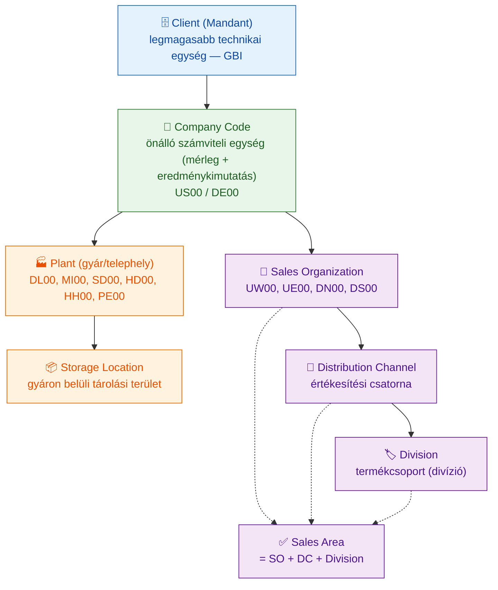
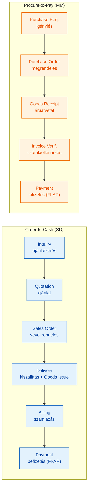
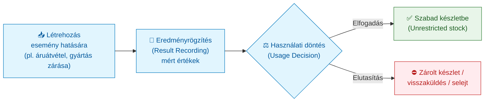

# Integrált vállalatirányítási rendszerek (GMXIV2MBLF) — Kontextus és tankönyvi referencia

> **A fájl jellege:** Ez a dokumentum a tárgy **teljes körű, tankönyvi mélységű referenciaanyaga**, az **ERP tudásterület belső szakmai logikája szerint** strukturálva (fogalmi alap és fejlődéstörténet → architektúra és modulok → bevezetési módszertan és BPR → projektmenedzsment → BI, digitális innováció, üzemeltetés és minőségmenedzsment), **nem** a V11–V15 tételhatárok mentén. A vizsgafókusz megőrzése érdekében minden fejezet jelzi a kapcsolódó V-tételt, a fájl végén pedig megtalálható a tömör **V11–V15 vizsgaösszefoglaló (cheat-sheet)** is.
>
> **Hivatkozási stílus:** APA 7 (szövegközi „(Szerző, év)" + záró Felhasznált irodalom). A klasszikus elsődleges modelleknél az **eredeti megjelenés évét** adjuk meg. Ahol a helyi oktatási anyag és a lektorált szakirodalom **eltér** (pl. az ERP-generációk határai, az SAP R/2 datálása, az SAP Activate fázisszáma), azt a záró **Forrásütközések** szekcióban külön jelezzük, nem simítjuk el.

---

## Tantárgy adatok

- **Kód:** GMXIV2MBLF
- **Kredit:** 4 *(a tárgy Syllabusa szkennelt, kép alapú PDF; a kreditmező értéke OCR-rel nem volt egyértelműen kiolvasható — lásd Forrásütközések. A korábbi kontextus és a tételsor 4 kreditet rögzít.)*
- **Tagozat:** Levelező
- **Félév:** 2025/26/2 (tavaszi félév)
- **Oktatás nyelve:** magyar (az SAP gyakorlati tananyag — Global Bike v4.3 — angol)
- **Intézet:** Üzleti Tudományok és Digitális Ismeretek Intézet (ÓE KGK, 1084 Budapest, Tavaszmező u. 15–17.)
- **Tantárgyfelelős:** Prof. Dr. habil. Tick Andrea
- **Oktató:** Novák Géza
- **Félévzárás módja:** félévközi jegy
- **Félévközi követelmények (Syllabus + Tantárgyi követelmények alapján):** 2 zárthelyi dolgozat (egyenként max. 50 pont: 10 pont elmélet + 40 pont gyakorlat; részenként min. 20% az aláírás feltétele) + beadandó dolgozat vagy prezentáció (külön mellékelt témakörökből) + SAP challenge-ek teljesítése. Az aláírás feltétele a gyakorlatokon való aktív részvétel és a két érvényes ZH; az évközi jegyé az aláírás és az összevont min. 51%-os teljesítés. *(A challenge-ek darabszámában a két forrás eltér — lásd Forrásütközések.)*

## Oktatási cél

A hallgatók megismerik az integrált vállalatirányítási rendszereket (ERP), amelyek a mai infokommunikációs színvonalat kihasználva a teljes vállalati vertikumot lefedő egységes rendszerek: a szervezeti egységeknél és az irányítás különböző szintjein rendelkezésre álló adatokkal és az azokból nyert információkkal támogatják a vállalati folyamatokat. A rendszerekkel szemben támasztott követelmények, valamint a rendszerek szolgáltatásainak és felépítésének megismerésén túl a hallgatók gyakorlati ismereteket szereznek olyan ERP-rendszerekkel, amelyek magukba foglalják a legfontosabb alrendszereket: ügyfélkezelés (CRM), emberierőforrás-menedzsment (HR), erőforrás- és kapacitástervezés, beszerzés, termelés és értékesítés, idő- és költségrögzítés, munka-/szolgáltatás-/projektmenedzsment, pénzügy, számlázás, könyvelés és kontrolling. A folyamatokat a hallgatók az **SAP** integrált vállalatirányítási rendszerben, a gyakorlatban is megismerik.

A kurzus elvégzésével a hallgató: definiálni tudja az integrált vállalatirányítási rendszer fogalmát; elsajátítja egy integrált ERP-rendszer felépítését; megismeri annak moduljait; képes meghatározni és leírni az üzleti folyamatokat; jártasságot szerez az SAP rendszer használatában; és képes egy üzleti folyamatot végigvinni egy integrált vállalatirányítási rendszerben.

## Témakörök konzultációnként

A tárgy a tantárgynyilvántartó (Syllabus) szerint a következő oktatási hetek / témakörök köré szerveződik. (A szkennelt Syllabus OCR-olvasata alapján rekonstruált sorrend; a tartalom egyezik a 12 HTML oktatási leckével és a Global Bike v4.3 modulokkal.)

| Hét / konzultáció | Témakör | Kapcsolódó forrás |
|---|---|---|
| 1. | Integrált VIR fogalma, SAP navigáció, ERP rendszerek fejlődése | VIR fogalma és alapjai; Vállalatirányítási rendszerek |
| 2. | S/4HANA rendszer struktúrája, felépítése, moduljai; Fiori navigáció, modulok | SAP S/4HANA struktúra |
| 3. | Integrált VIR szerepe a vállalatok életében; új üzleti modellek, új folyamatkoncepció | VIR szerepe a vállalatok életében |
| 4. | Integrált VIR a vállalati információs rendszerben, nyomonkövetés; FI és CO esettanulmányok | VIR az információs rendszerben; FI, CO Global Bike |
| 5. | MRP és PP esettanulmányok, gyártási folyamat, törzsadatok (BOM, routing); VIR a szervezeti felépítésben és kultúrában; WM modul esettanulmány | BPR az ERP-ben; ERP a szervezeti kultúrában; WM Global Bike |
| 6. | BPR az ERP rendszerben | BPR az ERP-ben |
| 7. | Üzleti Intelligencia az ERP-ben; CSM – ügyfélkapcsolatok; Minőségügymenedzsment; QM modul esettanulmány | BI az ERP-ben; QM integráció |
| 8. | Projektmenedzsment a VIR-ben; PS modul esettanulmány | Projektmenedzsment az ERP-ben; PS Global Bike |
| 9. | SAP Leonardo Digital Innovation System, iparági megoldások; HCM (HR) modul esettanulmány | SAP Leonardo; HCM Global Bike |
| 10. | Komplex (integratív) esettanulmány | Integrative Case Study (MM+PP+SD) |

## A referencia felépítése és a V-tételek leképezése

A törzset az ERP-tudásterület belső logikája rendezi öt tematikus blokkba (A–E), 1-től folyamatosan számozott fejezetekkel. A V11–V15 záróvizsgatételek ezekre a fejezetekre képződnek le; a leképezést a törzsfejezetek elején szereplő `» Kapcsolódó tétel: V1x` jelzések is megerősítik.

| Tematikus blokk | Fejezet (szám) | Témakör | Kapcsolódó tétel |
|---|---|---|---|
| **A) ERP fogalmi alapjai és fejlődéstörténete** | 1. | Az üzleti információrendszer és a szigetrendszerek | **V11** |
| | 2. | Az ERP fogalma és az integráltság lényege | **V12** |
| | 3. | Az ERP fejlődéstörténete: MRP → ERP II → S/4HANA | **V11, V12** |
| | 4. | Az SAP fejlődéstörténete (R/1 → S/4HANA) | **V12** |
| | 5. | Kritikus sikertényezők (CSF) az ERP-bevezetésben | **V13** |
| **B) SAP S/4HANA architektúra, szervezeti egységek és modulok** | 6. | A HANA in-memory technológia | **V14** |
| | 7. | Deployment modellek (on-premise, cloud, RISE with SAP) | **V14** |
| | 8. | SAP szervezeti egységek hierarchiája | **V14** |
| | 9. | Adattípusok, bizonylati elv és bizonylatfolyam | **V14** |
| | 10. | Moduláris felépítés és integrált adatfolyam (O2C, P2P) | **V14** |
| | 11. | A CO almodul-logikája | **V14** |
| | 12. | A SAP Fiori UX-paradigma | **V14** |
| **C) ERP bevezetési módszertan, BPR és szervezeti illesztés** | 13. | Átállási forgatókönyvek (greenfield/brownfield/landscape) | **V13** |
| | 14. | SAP Activate módszertan (vs. ASAP) | **V13** |
| | 15. | BPR az ERP-kontextusban | **V13** |
| | 16. | Szervezeti kultúra és változásmenedzsment | **V13** |
| | 17. | ERP-bevezetések sikeressége és kudarcai | **V13** |
| **D) ERP projektmenedzsment** | 18. | A PS modul logikája (WBS, hálózati tervek) | **V15** |
| | 19. | A projekt életciklusa az SAP PS-ben | **V15** |
| | 20. | Settlement (elszámolási) típusok | **V15** |
| | 21. | Tevékenységtípusok a PS-ben | **V15** |
| | 22. | PMBOK® és az SAP PS kapcsolata | **V15** |
| **E) BI, digitális innováció, üzemeltetés és minőségmenedzsment** | 23. | Embedded Analytics és SAP BW/4HANA | **V15** |
| | 24. | SAP BTP / Leonardo és az Intelligent Enterprise | **V15** |
| | 25. | ITIL 4 és az ERP-üzemeltetés | **V15** |
| | 26. | A QM modul és az ISO 9001:2015 | **V15** |

---

# A) ERP fogalmi alapjai és fejlődéstörténete

# 1. Az üzleti információrendszer és a szigetrendszerek
> » Kapcsolódó tétel: **V11** — IT-fejlődés (70-es évektől), szigetrendszerek vs. integrált rendszerek

## 1.1 Az üzleti információrendszer fogalma

Az **üzleti (vállalati) információrendszer** (Management Information System, MIS; tágabban Enterprise Information System) az a szervezeti, technológiai és emberi elemekből álló rendszer, amely az adatokat üzleti eseményekből gyűjti, tárolja, feldolgozza és a döntéshozatalhoz használható információvá alakítja. Az informatikai támogatás az 1960-as évek kötegelt (batch) adatfeldolgozásától az 1970–80-as évek funkcionális alkalmazásain át jutott el a mai integrált, valós idejű platformokig. A vállalatirányítási rendszer (VIR) e fejlődés csúcspontja: a teljes vállalati vertikumot egyetlen, egységes adatmodellre építő rendszerbe vonja össze.

## 1.2 A szigetrendszerek tipológiája

A **szigetrendszer** (information silo / island system) önálló, csak egy részleg vagy funkció igényeit kiszolgáló, más rendszerekkel nem (vagy csak ponton-ponti interfészeken keresztül) kommunikáló alkalmazás. A tipikus szigetrendszerek funkcionális vonalak mentén alakultak ki: különálló pénzügyi/könyvelési, készletnyilvántartó, bérszámfejtési, értékesítési és gyártásütemezési programok, amelyek mindegyike saját adatbázist vezet.

A szigetrendszerek három fő kategóriája:

| Típus | Jellemző | Probléma |
|---|---|---|
| **Funkcionális sziget** | Egy-egy osztály (pénzügy, HR, raktár) önálló alkalmazása | Az osztályok közötti adat csak manuálisan vagy interfészen át áramlik |
| **Földrajzi/divizionális sziget** | Telephelyenként vagy régiónként eltérő rendszer | Nincs konszolidált, vállalatszintű kép |
| **Technológiai sziget** | Eltérő platformon, adatbázison futó, nehezen integrálható megoldások | Magas integrációs és karbantartási költség |

## 1.3 A szigetrendszerek hátrányai és az integráltság előnyei

A szigetrendszerek központi problémája az **adatredundancia** (ugyanazt az adatot — pl. egy vevő címét — több rendszer is tárolja) és az ebből fakadó **inkonzisztencia** (a párhuzamos példányok eltérnek egymástól). Ehhez társul a többszörös adatrögzítés munkaterhe és hibalehetősége, a részlegek közötti információs késleltetés, valamint a ponton-ponti interfészek magas integrációs és fenntartási költsége (a kapcsolatok száma a rendszerek számával négyzetesen nő).

Az integrált rendszer e problémákat az **egyverziós adatelv** (single version of the truth) és az **egyszeri adatrögzítés** elvével küszöböli ki: az adat egyetlen, közös adatbázisban, egyetlen hiteles példányban él, és minden modul ugyanazt az adatot olvassa és frissíti (Davenport, 1998; Monk & Wagner, 2012). A helyi oktatási anyag az integráltság előnyeit három pontban foglalja össze: **egyszeri adatrögzítés**, **automatikus frissítés** (egy adat módosítása azonnal végiggyűrűzik a kapcsolódó folyamatokon — pl. egy rendelés rögzítése módosítja a raktárkészletet és a termelési tervet is), valamint **valós idejű környezet**.

Az integráltság gazdasági előnye a teljes birtoklási költség (TCO) csökkenésében, a folyamatok átfutási idejének rövidülésében és a redundancia megszűnésében jelentkezik — bár ezt ellensúlyozza a bevezetés magas kezdeti költsége és kockázata (lásd 5. és 17. fejezet).

---

# 2. Az ERP fogalma és az integráltság lényege
> » Kapcsolódó tétel: **V12** — Az ERP fogalma és fejlődéstörténete

## 2.1 Definíció

Az **ERP** (Enterprise Resource Planning) magyarul **integrált vállalatirányítási rendszer**: olyan szabványos, moduláris szoftvercsomag, amely a vállalat valamennyi lényeges működési adatát egyetlen központi adatbázisban tárolja, és a fő üzleti folyamatokat (pénzügy, kontrolling, beszerzés, termelés, értékesítés, HR, logisztika) egységes modellben integrálja.

A tudományos szakirodalom az ERP-t három, egymással összefüggő nézőpontból határozza meg (Klaus, Rosemann & Gable, 2000):

1. **Termékként / szoftverként** — egy konkrét, megvásárolható informatikai termék (pl. SAP S/4HANA).
2. **A vállalati erőforrások leképezésének céljaként** — törekvés arra, hogy minden folyamat és erőforrás egyetlen integrált rendszerben jelenjen meg.
3. **Az üzleti folyamatok kezelésének kulcselemeként** — szervezetalakító eszköz, amely a folyamatokat (nem a funkciókat) helyezi a középpontba.

## 2.2 Az integráltság lényege

Az integráltság technikai értelemben azt jelenti, hogy a modulok **közös adatbázison** osztoznak, és a folyamatok között az adat **automatikusan, emberi beavatkozás nélkül** áramlik. A helyi tananyag megfogalmazásában: „egy rendelés rögzítése azonnal módosítja a raktárkészletet és a termelési tervet is". Davenport (1998) klasszikus tanulmánya hangsúlyozza, hogy ez nemcsak technikai, hanem szervezeti integráció: az enterprise system rákényszeríti a vállalatot a folyamatainak egységesítésére, és ezzel egyfajta beépített folyamatlogikát (best practice) is hoz magával.

## 2.3 Az ERP funkcionális lefedettsége

Egy átfogó ERP a következő funkcionális területeket integrálja: pénzügyi számvitel és kontrolling, beszerzés és készletgazdálkodás, termeléstervezés és -irányítás, értékesítés és disztribúció, raktárkezelés, minőségmenedzsment, projektmenedzsment, eszközgazdálkodás és humánerőforrás-menedzsment. Az **ERP II** generációtól ehhez társulnak a vállalati határokon átnyúló folyamatok is: ügyfélkapcsolat-kezelés (CRM) és ellátásilánc-menedzsment (SCM).

---

# 3. Az ERP fejlődéstörténete: MRP → MRP II → ERP → ERP II → S/4HANA
> » Kapcsolódó tétel: **V11, V12** — IT-fejlődés és az ERP fejlődéstörténete

## 3.1 A fejlődés logikája

Az ERP-rendszerek a gyártásban használt anyaggazdálkodási logikából nőttek ki, és fokozatosan bővítették hatókörüket előbb a teljes gyártásra, majd a teljes vállalatra, végül a vállalati hálózatra és a valós idejű, intelligens platformra. Minden generációváltás mögött egy-egy technológiai (számítási kapacitás, kliens-szerver, internet, in-memory) és üzleti (globalizáció, folyamatszemlélet, digitalizáció) hajtóerő áll.

## 3.2 Összehasonlító táblázat

| Generáció | Kor | Funkcionális hatókör | Kiváltó tényező |
|---|---|---|---|
| **MRP** (Material Requirements Planning) | 1960-as évek | Anyagszükséglet-tervezés; raktárkészlet és beszerzés a darabjegyzék (BOM) alapján | Számítógépes készletgazdálkodás megjelenése |
| **Zárt láncú MRP** (Closed-loop MRP) | 1970-es évek | Az MRP kiegészül a kapacitásszükséglet-tervezéssel (CRP) és visszacsatolással | A kapacitáskorlátok figyelembevételének igénye |
| **MRP II** (Manufacturing Resource Planning) | 1980-as évek | A teljes gyártás erőforrás-tervezése, pénzügyi riportokkal integrálva | A gyártás és a pénzügy összekapcsolásának igénye |
| **ERP** | 1990-es évek | A vállalat összes belső erőforrásának integrált, vállalatszintű tervezése | Kliens-szerver architektúra (pl. SAP R/3) |
| **ERP II** | 2000-es évektől | Vállalati határokon átnyúló folyamatok: CRM, SCM, e-business, BI | Internet, webalapú integráció |
| **S/4HANA (digitális mag)** | 2015-től | Valós idejű, in-memory platform; OLTP+OLAP egyesítése; Intelligent Enterprise | In-memory adatbázis, felhő, AI/IoT |

## 3.3 A generációk értelmezése

Az **MRP** a kész­termék darabjegyzékéből (BOM) és a gyártási ütemtervből visszaszámolja a szükséges alapanyagokat és azok rendelési időpontját. A **zárt láncú MRP** ezt kiegészíti a kapacitásszükséglet-tervezéssel (CRP) és a tényadatok visszacsatolásával. Az **MRP II** a gyártás minden erőforrását (anyag, kapacitás, munkaerő, pénz) tervezi, és integrálja a pénzügyi kimutatásokkal. Az **ERP** kiterjeszti ezt a teljes vállalatra (pénzügy, HR, értékesítés, beszerzés). Az **ERP II** áttöri a vállalati határokat (CRM, SCM, e-business). Az **S/4HANA** pedig az in-memory technológiával valós idejűvé teszi az egészet, és „digitális magként" (Digital Core) az intelligens vállalat platformjává válik.

> **Megjegyzés (forrásütközés):** A helyi tananyag két leckéje az ERP-generációk határait kissé eltérően adja meg (az egyik kihagyja a zárt láncú MRP-t és az ERP II-t a 2000-es évektől SCM-mel azonosítja). A generációhatárok a szakirodalomban sem teljesen egységesek — ezt a Forrásütközések szekció részletezi.

---

# 4. Az SAP fejlődéstörténete (R/1 → S/4HANA)
> » Kapcsolódó tétel: **V12** — Az ERP fejlődéstörténete (gyártói perspektíva)

## 4.1 Az SAP mérföldkövei

Az **SAP** céget 1972-ben öt korábbi IBM-mérnök alapította Walldorfban (Németország) azzal a vízióval, hogy szabványos szoftvert fejlesszenek a **valós idejű** üzleti adatfeldolgozáshoz (az „SAP" mozaikszó: *Systeme, Anwendungen und Produkte in der Datenverarbeitung*).

| Termék | Év | Architektúra / jelentőség |
|---|---|---|
| **SAP R/1 (RF)** | 1973 | Az első pénzügyi könyvelési modul; egyrétegű architektúra |
| **SAP R/2** | 1979/1981 | Mainframe-alapú, integrált standard ERP (az „R" = *Realtime*) |
| **SAP R/3** | 1992 | Kliens-szerver (háromrétegű) architektúra; nemzetközi áttörés |
| **SAP ERP / ECC 6.0** | 2004/2006 | A Business Suite alapja (ERP Central Component) |
| **SAP S/4HANA** | 2015 | Negyedik generációs üzleti csomag, kizárólag a HANA in-memory adatbázison |

A „4" az **S/4HANA** nevében a negyedik termékgenerációra, a „HANA" pedig az alatta futó in-memory adatbázisra utal (a „S" a *Simple* szóra). Az S/4HANA a kétféle elérési felülettel — a klasszikus **SAP GUI**-val és a modern **SAP Fiori**-val — is használható.

> **Megjegyzés (forrásütközés):** A helyi tananyag az R/2-t hol az 1980-as évekhez, hol 1981-hez köti; a szakirodalom az R/2 megjelenését gyakran 1979-re datálja. A táblázat mindkét értéket feltünteti.

---

# 5. Kritikus sikertényezők (CSF) az ERP-bevezetésben
> » Kapcsolódó tétel: **V13** — ERP bevezetése: célok, előnyök, hátrányok, BPR

## 5.1 A CSF-módszer eredete

A **kritikus sikertényezők** (Critical Success Factors, CSF) fogalmát Rockart (1979) vezette be a *Harvard Business Review*-ban: azok a néhány kulcsterületek, amelyeken a kedvező eredmény elengedhetetlen ahhoz, hogy a szervezet (vagy egy adott vezető) elérje céljait. A módszer eredetileg a felsővezetők információs igényének meghatározására szolgált, de a folyamat- és informatikai projektek — köztük az ERP-bevezetések — sikerkritériumainak azonosítására is széles körben alkalmazzák.

## 5.2 Az ERP-bevezetés kritikus sikertényezői

A szakirodalom (Davenport, 1998; Monk & Wagner, 2012) és a hazai bevezetési tapasztalatok (Hetyei) alapján a leggyakrabban azonosított CSF-ek:

- **Felsővezetői támogatás és elkötelezettség** — a projekt erőforrásainak és prioritásának biztosítása.
- **Világos, mérhető célok és projektmenedzsment** — reális ütemterv, hatókör- (scope) kontroll, dedikált projektszervezet.
- **Az üzleti folyamatok újratervezése (BPR)** — a rendszer best practice folyamataihoz való illeszkedés (lásd 15. fejezet).
- **Változásmenedzsment és felhasználói felkészítés** — oktatás, kommunikáció, az ellenállás kezelése (lásd 16. fejezet).
- **Adatminőség és adatmigráció** — a régi rendszerek adatainak tisztítása és helyes átvitele.
- **Kulcsfelhasználók (Key Userek) bevonása** — a folyamatszakértők részvétele a tesztelésben és az oktatásban.
- **Megfelelő tanácsadói és szállítói támogatás** — szakértelem és módszertan (pl. SAP Activate).

## 5.3 Kritika és relevancia

A CSF-megközelítést azzal bírálják, hogy a tényezők listája gyakran túl általános, és nem ad iránymutatást a tényezők közötti prioritásra vagy kölcsönhatásokra. Ennek ellenére az ERP-bevezetések magas (a szakirodalomban gyakran idézett 50% feletti) kudarc- vagy célfelülmúlási rátája miatt a CSF-szemlélet máig hasznos keret: a leggyakoribb bukási okok (gyenge vezetői támogatás, alábecsült változásmenedzsment, rossz adatminőség) éppen a CSF-ek hiányai. A modern, felhőalapú, SAP Activate-vezérelt bevezetéseknél a CSF-hangsúly a fit-to-standard szemléletre és a folyamatos (agilis) felhasználói visszacsatolásra tolódott.

---

# B) SAP S/4HANA architektúra, szervezeti egységek és modulok

# 6. A HANA in-memory technológia
> » Kapcsolódó tétel: **V14** — SAP rendszer struktúrája, S/4HANA, modulok

## 6.1 Az in-memory paradigma

A hagyományos ERP-k lemezalapú (disk-based) adatbázison futottak, ahol a tranzakciós (OLTP) és az analitikai (OLAP) feldolgozás külön rendszerekben, az adatok éjszakai áttöltésével (ETL) valósult meg. Az **SAP HANA** ezzel szemben **in-memory** adatbázis: az adatokat a fő memóriában (RAM) tárolja, ahonnan a hozzáférés nagyságrendekkel gyorsabb a lemezesnél. Ez teszi lehetővé, hogy az S/4HANA megszüntesse az OLTP/OLAP különbségét, és a riportok közvetlenül az élő, pillanatnyi adatokon fussanak (Plattner & Zeier, 2012).

## 6.2 Az architektúra építőelemei

- **Oszlopalapú tárolás (columnar storage):** az adatokat nem sorokban, hanem oszlopokban tárolja. Az analitikai lekérdezések jellemzően kevés oszlop sok sorát olvassák — oszlopos tárolásnál ez sokkal hatékonyabb, és az azonos típusú értékek egymás mellett jól tömöríthetők.
- **Adattömörítés:** a redundáns és aggregált táblák megszüntetésével és a tömörítéssel az adatlábnyom drasztikusan csökken. A helyi tananyag illusztratív SAP-példája: hagyományos adatbázis **593 GB** → HANA **118,6 GB** → S/4HANA **42,4 GB**. Az adattáblák száma több mint 70%-kal csökkent.
- **Egyszerűsített adatmodell:** az aggregátumok és indexek elhagyásával (pl. a klasszikus pénzügyi aggregátumtáblák helyett az Universal Journal egyetlen táblája) gyorsabb a tranzakciókezelés.
- **OLTP és OLAP egyesítése:** egyetlen rendszerben, valós időben, ún. **Embedded Analytics** formájában (lásd 23. fejezet).

## 6.3 Gyakorlati hatás és kritika

A helyi PP-esettanulmány szemlélteti a gyakorlati hatást: míg korábban az **MRP-futás** órákig tartott és éjszakai kötegelt feldolgozásban történt, az S/4HANA-ban bármikor, igény szerint lefuttatható („MRP run on request"), azonnali beszerzési/gyártási javaslatokkal; a valós idejű készletgazdálkodás csökkenti a biztonsági készletet és a készlethiány kockázatát. **Kritika és korlát:** az in-memory megoldás magas memóriaköltséget és specifikus hardver- (vagy felhő-) követelményeket támaszt, és a meglévő egyedi fejlesztések (Z-tranzakciók) átállítása jelentős migrációs munkát igényel.

---

# 7. Deployment modellek (on-premise, cloud, RISE with SAP)
> » Kapcsolódó tétel: **V14** — SAP rendszer struktúrája, S/4HANA

Az S/4HANA több telepítési (deployment) modellben érhető el. A választás a rugalmasság, a testreszabhatóság, a teljes birtoklási költség (TCO), a frissítési ciklus és az adatszuverenitás közötti kompromisszum.

| Szempont | On-premise | Private Cloud (RISE with SAP) | Public Cloud (SaaS) |
|---|---|---|---|
| **Üzemeltetés helye** | Saját adatközpont | Dedikált felhőkörnyezet (SAP/hyperscaler) | Megosztott, többbérlős felhő |
| **Testreszabhatóság** | Teljes (egyedi fejlesztés is) | Magas (kiterjesztett) | Korlátozott (fit-to-standard) |
| **Frissítési ciklus** | A vállalat dönt (ritkább, nagy projekt) | Féléves | Negyedéves, kötelező |
| **Kezdeti költség (CAPEX) / TCO** | Magas CAPEX | Vegyes (előfizetés + bevezetés) | Alacsony CAPEX, OPEX-alapú |
| **Adatszuverenitás / kontroll** | Teljes | Magas | Korlátozott |
| **Tipikus választó** | Erősen szabályozott, egyedi folyamatú nagyvállalat | Komplex, de modernizálni kívánó vállalat | Standardizálható, gyorsan induló szervezet |

A **RISE with SAP** az SAP „business transformation as a service" ajánlata: a privát felhős S/4HANA-t, az átállási eszközöket (lásd 13–14. fejezet) és a kapcsolódó szolgáltatásokat egyetlen előfizetésbe csomagolja. A modern trend (a helyi tananyag „2026-os" előrejelzése szerint is) egyértelműen a felhőalapú megoldások, az AI/gépi tanulás beépítése, az iparág-specifikus ERP és a mobilitás felé mutat.

---

# 8. SAP szervezeti egységek hierarchiája
> » Kapcsolódó tétel: **V14** — SAP rendszer struktúrája, modulok

## 8.1 A szervezeti egységek szerepe

A **szervezeti egységek** (organizational units) a vállalat jogi és operatív felépítését képezik le az SAP-ban. Ezek adják a tranzakciók és a törzsadatok keretét: minden bizonylat valamely szervezeti egységhez kötődik. A hierarchia a legmagasabb, technikai szinttől (Client) a konkrét operatív egységekig (telephely, raktárhely, értékesítési szervezet) terjed.



## 8.2 A főbb egységek

- **Client (Mandant):** a legmagasabb szintű, önálló jogi és adminisztratív egység saját adatkörnyezettel; egy rendszerpéldány több clientet is tartalmazhat (pl. tesztelési és éles).
- **Company Code:** az önálló **számviteli** egység (pl. egy leányvállalat); ezen a szinten készül a **mérleg** és az **eredménykimutatás**. A Global Bike-nál: US00 (USA), DE00 (Németország).
- **Plant (gyár/telephely):** operatív egység, ahol a termelés folyik vagy a készleteket tárolják (Dallas DL00, Miami MI00, San Diego SD00, Heidelberg HD00, Hamburg HH00, Perth PE00).
- **Storage Location:** a gyáron belüli fizikai tárolási terület.
- **Sales Area:** az SD-ben az árazás és a feltételek kerete — az **értékesítési szervezet + értékesítési csatorna + divízió** hármasa.

---

# 9. Adattípusok, bizonylati elv és bizonylatfolyam
> » Kapcsolódó tétel: **V14** — SAP rendszer struktúrája

## 9.1 A három adattípus

| Adattípus | Jellemző | Példa (Global Bike) |
|---|---|---|
| **Szervezeti adat** (Organizational Data) | A vállalat felépítését tükrözi; ritkán változik | Client GBI, Company Code US00, Plant DL00 |
| **Törzsadat** (Master Data) | Hosszú életű, sok tranzakcióban újrahasznált; ritkán változik | Material Master, Customer/Vendor Master (Business Partner), Purchasing Info Record, főkönyvi számlák |
| **Tranzakciós adat** (Transaction Data) | Üzleti események során keletkezik; szervezeti és törzsadatokra hivatkozik | Sales Order, Purchase Order, Goods Receipt, Invoice |

Az S/4HANA-ban a vevőket és szállítókat egységesen **Üzleti Partnerként** (Business Partner, BP) kezelik: egy BP-hez több szerepkör (vevő, szállító, kapcsolattartó) is rendelhető, így a törzsadat redundanciamentes és „360 fokos ügyfélkép" alakítható ki.

## 9.2 A bizonylati elv

A **bizonylati elv** (document principle) szerint minden üzleti tranzakció egyedi sorszámú, elektronikus **bizonylatot** (document) hoz létre, amely az esemény hiteles, **nem törölhető** rekordja. A bizonylat hivatkozik a felhasznált törzs- és szervezeti adatokra. Tipikus bizonylatok: értékesítési bizonylat, beszerzési bizonylat, anyagbizonylat (material document) és számviteli bizonylat (accounting document).

## 9.3 A bizonylatfolyam

A **bizonylatfolyam** (document flow) a bizonylatok logikai láncolata: minden lépés bizonylata hivatkozik az előzőre, így a folyamat bármely pillanatban végigkövethető. A rendszer minden kapcsolódó bizonylat változásakor frissíti a státuszt, biztosítva a teljes körű nyomonkövethetőséget.



---

# 10. Moduláris felépítés és integrált adatfolyam (O2C, P2P)
> » Kapcsolódó tétel: **V14** — modulok (FI, CO, MM, SD…) és integráció

## 10.1 A főbb modulok

Az SAP a logikailag összetartozó tranzakciókat **modulokba** rendezi. A négy „alapige" (buy–make–sell–track) köré szervezve:

| Modul | Terület | Folyamat | „Ige" |
|---|---|---|---|
| **MM** (Materials Management) | Beszerzés, készletgazdálkodás | Procure-to-Pay | *buy* |
| **PP** (Production Planning) | Termeléstervezés és -irányítás | Plan-to-Produce | *make* |
| **SD** (Sales & Distribution) | Értékesítés, disztribúció | Order-to-Cash | *sell* |
| **FI** (Financial Accounting) | Külső (pénzügyi) számvitel: G/L, AR, AP, eszközök | Record-to-Report | *track* |
| **CO** (Controlling) | Belső (vezetői) számvitel, költség- és jövedelmezőségelemzés | — | *track* |
| **WM/EWM** | Raktárkezelés (tárhelyszint) | — | — |
| **PS** (Project System) | Projektmenedzsment | — | — |
| **QM** (Quality Management) | Minőségmenedzsment | — | — |
| **HCM** (Human Capital Mgmt) | Humánerőforrás | Hire-to-Retire | — |
| **EAM, CS, EHS** | Eszközgazdálkodás, ügyfélszolgálat, EHS | — | — |

## 10.2 Az integrált adatfolyam (end-to-end)

Az integráció lényege, hogy egy fizikai folyamat lépései automatikusan generálják a pénzügyi és kontrolling könyveléseket. Például az **Order-to-Cash** során: az SD vevői rendelés → kiszállításkor (Goods Issue) az **MM** csökkenti a készletet, és az **FI/CO** elszámolja az eladott áruk önköltségét (COGS) → a számlázás (Billing) az **FI-AR**-ban követelést és árbevételt könyvel → a befizetés rendezi a követelést. A **Procure-to-Pay** tükörképe ennek a beszerzési oldalon (PO → áruátvétel készletnövekedés és FI-könyvelés → számlaellenőrzés → kifizetés). A helyi FI/CO-esettanulmány ezt szemlélteti: a bizonylatok automatikusan áramlanak a modulok között, így a pénzügyi (FI) és vezetői (CO) adatok mindig összhangban vannak a fizikai folyamatokkal.

> **Global Bike illusztráció:** egy női terepkerékpár (OWRN1###) San Diegó-i (SD00) beszerzésekor a P2P-folyamat áruátvétele QM-vizsgálati tételt is generál (lásd 26. fejezet), majd az értékesítés a Quality Bikes vevő felé O2C-folyamatként zárul — egyetlen, összefüggő bizonylatláncban.

---

# 11. A CO almodul-logikája
> » Kapcsolódó tétel: **V14** — Controlling modul

## 11.1 A CO és az FI viszonya

Az **FI** (pénzügyi számvitel) a **külső** érdekhordozók (hatóság, tulajdonos, hitelező) felé szolgáltat adatot: a Company Code szintjén mérleget és eredménykimutatást készít. A **CO** (kontrolling) a **belső** vezetői döntéseket támogatja: költséghelyek, termékek és piaci szegmensek jövedelmezőségét elemzi. A CO kerete a **Controlling Area** (egy vagy több Company Code-ot átfoghat), a piaci szegmentáció szintje pedig az **Operating Concern**.

## 11.2 Költségelemek és almodulok

A **költségelemek** kötik össze az FI-t a CO-val:

- **Elsődleges költségelem (Primary Cost Element):** FI-kiadásszámlából ered, a költség CO-beli megfelelője.
- **Másodlagos költségelem (Secondary Cost Element):** kizárólag a CO-n belüli belső átterhelésekhez (pl. assessment, distribution) használt.

A CO főbb almoduljai:

| Almodul | Funkció |
|---|---|
| **CO-CCA** (Cost Center Accounting) | Költséghelyi elszámolás: a felelősségi területek (pl. karbantartás, étkezde) költségeinek gyűjtése és felosztása |
| **CO-OPA / Internal Order** | Belső megbízás: egyedi, időszakos tevékenység (pl. marketingkampány, kisebb beruházás) költséggyűjtője |
| **CO-PCA** (Profit Center Accounting) | Profitközpontok: bevétel- és költségfelelős egységek jövedelmezősége (ROI-szemlélet) |
| **CO-PC** (Product Costing) | Termékköltség-számítás: a BOM és a routing alapján kalkulált standard önköltség |
| **CO-PA** (Profitability Analysis) | Jövedelmezőség-elemzés piaci szegmensek (termék, régió, vevő) szerint |

A helyi CO-esettanulmány a Global Bike üzemi étkezdéjének költségeit határozza meg és osztja fel a szolgáltatást igénybe vevő egységek között (CO-CCA), illetve egy különleges kiadású kerékpár standard önköltségét kalkulálja a BOM és a routing alapján (CO-PC).

---

# 12. A SAP Fiori UX-paradigma
> » Kapcsolódó tétel: **V14** — felhasználói felület és navigáció

## 12.1 A paradigmaváltás

Az **SAP Fiori** a modern, webalapú, **szerepkör-alapú** felhasználói felület, amely szakít a klasszikus SAP GUI tranzakciókód-központú (T-code) logikájával. A belépési pont a **Fiori Launchpad**, ahol az alkalmazások üzleti folyamatok és szerepkörök szerint csoportosított **csempékként** (tiles) jelennek meg; a felhasználó csak a munkájához szükséges appokat látja (személyre szabható: App Finder, Recent Activities, beállítások).

## 12.2 Alkalmazástípusok

| Típus | Cél | Példa |
|---|---|---|
| **Tranzakciós** | Napi operatív feladatok (create/change/display) | Rendelés rögzítése |
| **Analitikai** | Vizuális áttekintés, KPI-k | Jövedelmezőségi grafikon |
| **Factsheet** | Egy üzleti objektum (vevő, anyag) összes lényeges adata egy helyen | Vevő-adatlap |

## 12.3 SAP GUI vs. Fiori

| Jellemző | SAP GUI | SAP Fiori |
|---|---|---|
| Típus | Desktop (vastag) kliens | Webalapú, böngészős |
| Megközelítés | Tranzakció-központú (T-kódok) | Szerepkör-alapú appok |
| Eszköz | PC/laptop | Reszponzív (tablet, telefon is) |
| Kinézet | Technikai, sűrű mezők | Egyszerű, feladatfókuszú |

A Fiori UX a folyamatorientált, lapított szervezet (lásd 16. fejezet) és a „Run Simple" filozófia felületi megvalósítása: növeli a felhasználói elégedettséget és a produktivitást, és csökkenti a betanulási időt.

---

# C) ERP bevezetési módszertan, BPR és szervezeti illesztés

# 13. Átállási forgatókönyvek (greenfield / brownfield / landscape)
> » Kapcsolódó tétel: **V13** — ERP bevezetése: célok, előnyök, hátrányok, BPR

Az S/4HANA-ra való átállásra az SAP három forgatókönyvet (transition scenario) kínál:

| Forgatókönyv | Mit jelent | Előny | Kockázat / korlát | Mikor? |
|---|---|---|---|---|
| **New Implementation (greenfield)** | Új bevezetés „nulláról", a best practice folyamatokra építve; adatmigráció szükséges | Folyamatok megújítása (BPR-lehetőség), tiszta, egyszerűsített modell | Magas változásmenedzsment-igény, a régi egyedi logika elvész | Elavult/heterogén folyamatok, radikális megújítás célja |
| **System Conversion (brownfield)** | A meglévő SAP ECC-rendszer technikai konvertálása S/4HANA-ra | A folyamatok nem szakadnak meg, az előzmények megmaradnak | A régi (esetleg rossz) folyamatokat is átviszi; korlátozott megújulás | Jól működő ECC, gyors átállás célja |
| **Landscape Transformation** | Több forrásrendszer (pl. régiós ERP-k) szelektív összevonása egyetlen S/4HANA-ba | Konszolidáció, részleges adat/folyamat átvitel | Komplex, projektigényes | Vállalatcsoport rendszereinek egységesítése |

A választás kulcskérdése: **megújítjuk** a folyamatokat (greenfield + BPR), vagy **megőrizzük** a meglévőket (brownfield)? A döntés szorosan összefügg a BPR mértékével (15. fejezet) és a deployment modellel (7. fejezet).

---

# 14. SAP Activate módszertan (vs. ASAP)
> » Kapcsolódó tétel: **V13** — ERP bevezetése (módszertan)

## 14.1 A SAP Activate hat fázisa

Az **SAP Activate** az SAP jelenlegi bevezetési módszertana, amely az **agilis** szemléletet, a moduláris felépítést és a **SAP Best Practice** előre konfigurált folyamatait egyesíti. On-premise, felhő és hibrid környezetre egyaránt alkalmazható. Hat fázisból áll:


- **Discover** — nem elkötelező felfedező fázis: az SAP-portfólió megismerése, az illeszkedő innovációk és a hatókör meghatározása.
- **Prepare** — projektindítás: kormányzás, csapat, szerepek, sandbox/starter rendszer felállítása.
- **Explore** — **fit-to-standard** workshopok a Best Practice tartalmon: az illeszkedés vizsgálata, a delta-konfigurációs igények és a gap-ek azonosítása.
- **Realize** — agilis, iteratív build és teszt (integrációs és felhasználói átvételi teszt) a backlog alapján.
- **Deploy** — az éles környezet beállítása, az átállás és a go-live, majd a hypercare (megerősített támogatás).
- **Run** — üzemeltetés, incidenskezelés és folyamatos fejlesztés (átvezet az ITIL-szemléletbe, 25. fejezet).

## 14.2 SAP Activate vs. ASAP

| Szempont | ASAP (korábbi) | SAP Activate (jelenlegi) |
|---|---|---|
| Szemlélet | Vízesés (waterfall), részletes specifikáció előre | Agilis, iteratív, folyamatos visszacsatolás |
| Hatókör | Csak on-premise | On-premise, cloud, hibrid |
| Kiindulás | Blueprint „üres lapról" | SAP Best Practice + fit-to-standard |
| Fázisok | Project Preparation → Blueprint → Realization → Final Prep → Go-Live & Support | Discover → Prepare → Explore → Realize → Deploy → Run |

> **Megjegyzés (forrásütközés):** A helyi tananyag az SAP Activate-et nem tárgyalja külön; a fenti hatfázisú modell külső, lektorált/hivatalos SAP-forrásból származik. Egyes kiadványok 5 fázist említenek (a Discover nélkül), mert az nem elkötelező, projekt-előtti szakasz.

---

# 15. BPR az ERP-kontextusban
> » Kapcsolódó tétel: **V13** — ERP bevezetése és BPR

## 15.1 A BPR fogalma

A **BPR** (Business Process Reengineering, üzleti folyamatok újratervezése) az üzleti folyamatok **alapvető újragondolása és radikális áttervezése** a teljesítmény drámai (nem inkrementális) javítása érdekében — költség, minőség, szolgáltatás és átfutási idő dimenzióiban (Hammer & Champy, 1993). A megközelítés Hammer (1990) HBR-cikkéből nőtt ki, amelynek mottója: **„Don't automate, obliterate"** — ne automatizáld a rossz folyamatot, hanem szüntesd meg és tervezd újra.

## 15.2 BPR vs. inkrementális fejlesztés

| Szempont | BPR (radikális) | Inkrementális (pl. Kaizen, TQM) |
|---|---|---|
| Változás mértéke | Gyökeres, „tiszta lap" | Apró, folyamatos lépések |
| Kockázat | Magas | Alacsony |
| Időtáv | Egyszeri, nagy projekt | Folyamatos |
| Kiindulás | A folyamat megkérdőjelezése | A meglévő folyamat finomítása |

## 15.3 BPR és az ERP — best practice mint katalizátor

Az ERP-bevezetés természetes BPR-katalizátor: a rendszer **beépített best practice folyamatai** kész, optimalizált sablont kínálnak, így a vállalat — különösen **greenfield** bevezetésnél — az SAP standard folyamataira építve újratervezheti működését. A helyi tananyag az S/4HANA három **optimalizációs emelőjét** emeli ki:

- **Hatékonyság (Efficiency):** a végrehajtás gyorsítása, a lépések automatizálása, digitális feladatkiosztás.
- **Eredményesség (Effectiveness):** a folyamatok intelligenciájának növelése, a válaszidő rövidítése, a hierarchiaszintek csökkentése.
- **Agilitás (Agility):** a szervezeti és folyamatbeli rugalmasság, az innovációk gyors befogadása.

## 15.4 Kritika

A BPR-t a túlzott radikalizmus, a magas kudarcráta és az „emberi tényező" elhanyagolása miatt bírálták (sok 1990-es évekbeli BPR-projekt valójában leépítéssé fajult). Az ERP-kontextusban a fő veszély a „digitalizáljuk a káoszt" csapdája: ha a rossz folyamatot visszük át a rendszerbe (jellemzően brownfield esetén), a BPR elmarad, és a rendszer csak konzerválja a problémát. A helyi PP-lecke éppen ezt fogalmazza meg: a cél „nem a káosz digitalizálása", hanem valóban hatékonyabb folyamatok kialakítása.

---

# 16. Szervezeti kultúra és változásmenedzsment
> » Kapcsolódó tétel: **V13** — ERP bevezetése (szervezeti hatások)

## 16.1 A folyamatorientált, lapított szervezet

Az ERP-bevezetés nem pusztán technológiai, hanem **szervezeti** projekt: a vállalatot a merev funkcionális silóktól a **folyamatközpontú** működés felé tolja. A helyi tananyag Global Bike-példája szerint a felsővezetés nem funkciókban, hanem kulcsfolyamatokban (Idea-to-Market, Build-to-Stock, Order-to-Cash) gondolkodik; az átláthatóság növekedése lehetővé teszi a menedzsmentszintek ritkítását (**hierarchia laposítása**) és a gyorsabb döntéshozatalt. A kultúra a **„Run Simple"** filozófia és az **adatvezérelt döntéshozatal** felé mozdul (megérzés helyett valós idejű adat).

## 16.2 Kotter nyolclépéses változásmenedzsmentje

A szervezeti változás vezetésének legismertebb modellje Kotter (1996) nyolc lépése:

1. A sürgősség érzetének megteremtése.
2. Erős irányító koalíció létrehozása.
3. Jövőkép és stratégia kialakítása.
4. A jövőkép kommunikálása.
5. Az alkalmazottak felhatalmazása, akadályok elhárítása.
6. Rövid távú győzelmek megtervezése és elérése.
7. Az eredmények megszilárdítása és további változás.
8. Az új megközelítések beágyazása a kultúrába.

## 16.3 Felhasználói ellenállás és a kulcsfelhasználók

A felhasználói **ellenállás** okai: a megszokott munkamódszerek elvesztése, a kompetenciavesztéstől való félelem, a megnövekedett átláthatóság (kontroll) és a kezdeti termelékenységesés. Kezelésük eszközei: korai és folyamatos kommunikáció, oktatás, a felhasználók bevonása, valamint a **kulcsfelhasználók (Key User) / szuperfelhasználók** szerepe — ők a folyamatszakértők, akik hidat képeznek a projekt és a végfelhasználók között a tesztelésben, oktatásban és a go-live utáni támogatásban.

---

# 17. ERP-bevezetések sikeressége és kudarcai
> » Kapcsolódó tétel: **V13** — ERP bevezetése: célok, előnyök, hátrányok

Davenport (1998) klasszikus elemzése figyelmeztet: az enterprise system bevezetése nemcsak technikai, hanem **stratégiai és szervezeti** döntés. A legnagyobb veszély, hogy a vállalat „a rendszerért, nem az üzletért" vezet be: ráerőlteti magára a szoftver beépített folyamatlogikáját anélkül, hogy átgondolná, az illeszkedik-e a versenystratégiájához. A tipikus csapdák: a hatókör (scope) alábecslése, a változásmenedzsment elhanyagolása, a gyenge adatminőség, a testreszabás (custom development) elszabadulása és a felsővezetői támogatás hiánya — ezek tükörképei a CSF-eknek (5. fejezet). A magas — gyakran idézett 50% feletti — célfelülmúlási/kudarcráta miatt a szervezeti **felkészültség** (readiness) és a reális elvárások menedzselése legalább annyira fontos, mint a technológia.

**Modern relevancia:** a felhőalapú, fit-to-standard, SAP Activate-vezérelt bevezetés mérsékli a klasszikus kockázatok egy részét (kevesebb egyedi fejlesztés, gyorsabb érték), de új kihívásokat hoz: a standardhoz való alkalmazkodás kényszerét és a negyedéves kötelező frissítések kezelését.

---

# D) ERP projektmenedzsment

# 18. A PS modul logikája (WBS, hálózati tervek)
> » Kapcsolódó tétel: **V15** — ERP és projektmenedzsment, BSP, ITIL

## 18.1 A PS modul szerepe

Az **SAP PS** (Project System) a komplex, időben behatárolt, egyedi célú folyamatok (projektek) tervezését, irányítását és ellenőrzését támogatja az ötlettől a lezárásig. Stratégiai erőssége az **integráció**: a projektadatok közvetlenül kapcsolódnak a pénzügyhöz (FI), kontrollinghoz (CO), anyaggazdálkodáshoz (MM) és a termeléshez (PP), így a műszaki megvalósítás és a pénzügyi kontroll együtt halad. Ez valós idejű rálátást ad a tervezett és tényleges költségekre, csökkentve a túlköltekezés kockázatát.

## 18.2 A projekt két strukturáló eleme

- **WBS-struktúra (Work Breakdown Structure):** a projekt **hierarchikus** lebontása **WBS-elemekre** (PSP-elem). Ezek a költségek és bevételek gyűjtőhelyei; mindegyikhez költségkeret, határidő és felelős rendelhető. A WBS a „mit" kérdésre felel (a feladatok hierarchiája).
- **Hálózati terv és tevékenységek (Network / Activities):** a tevékenységek **időbeli lefolyását és logikai kapcsolatait** ábrázolja; minden tevékenységhez időtartam és erőforrás-szükséglet tartozik. A **mérföldkövek (Milestones)** jelentős események vagy döntési pontok, amelyekhez gyakran számlázási események kötődnek. A hálózati terv a „mikor és milyen sorrendben" kérdésre felel.

## 18.3 WBS-elem státuszok

A WBS-elemek életciklusa státuszokkal követhető: **Released (REL)** — tényleges költség rögzíthető; **Technically Complete (TECO)** — műszakilag kész; **Closed (CLSD)** — logisztika és FI zárva; **Deletion flag** — törlésre jelölt; **Fully Invoiced** — teljesen kiszámlázott. A státusz vezérli, milyen könyvelések engedélyezettek.

---

# 19. A projekt életciklusa az SAP PS-ben
> » Kapcsolódó tétel: **V15** — ERP és projektmenedzsment

```mermaid
flowchart LR
    T["📐 Tervezés<br/>WBS + hálózati terv,<br/>ütemezés, budget allokáció"] --> V["⚙️ Végrehajtás<br/>REL státusz, tényleges költségek<br/>(számla, anyagkivét, munkaidő)"] --> L["🧾 Lezárás<br/>Settlement: költségek<br/>átvezetése a fogadóra"]
    L -. visszacsatolás (terv vs. tény) .-> T
    classDef ps fill:#fff3e0,stroke:#ef6c00,color:#e65100;
    class T,V,L ps;
```

1. **Tervezési fázis:** a projektstruktúra (WBS, hálózati terv) kialakítása, az ütemezés és a **budget** allokálása a WBS-elemekhez.
2. **Végrehajtási fázis:** a tényleges adatok rögzítése. A **REL (Released)** státusz engedélyezi a könyveléseket; a tényleges költségek szállítói számlákból, anyagkivételekből és munkaidő-visszaigazolásokból keletkeznek.
3. **Lezárási fázis:** a projekt pénzügyi elszámolása (**settlement**), ahol a felmerült költségeket a végső fogadóra (vevő, belső költséghely, eszköz) vezetik át.

A **projekttípusok**: **vevői projekt** (Customer project), **általános költségprojekt** (Overhead cost project) és **beruházási projekt** (Investment project). A helyi PS-esettanulmány egy ultrakönnyű versenykerékpár fejlesztési projektjén (P/2###) keresztül mutatja be a modult, hat WBS-elemmel: Development → Engineering → Prototype → Testing → Small series production → Release to mass production. A hallgatók a Structure Overview és a Project Costs (Actual/Commitment/Plan) riportokkal követik, hogyan jelenik meg egy FI-bizonylat a projekt költségriportjában — ez az integráció szemléltetése.

---

# 20. Settlement (elszámolási) típusok
> » Kapcsolódó tétel: **V15** — ERP és projektmenedzsment

A **settlement** a projekten gyűjtött költségek átvezetése (elszámolása) a végső fogadó cost object-re. Két fő típusa:

| Típus | Logika | Mikor |
|---|---|---|
| **Közvetlen (Direct settlement)** | A WBS-elem költségei közvetlenül egy külső fogadóra (pl. vevő, eszköz, költséghely) kerülnek | Egyszerű projektstruktúra |
| **Többszintű (Multi-level settlement)** | Az alsóbb WBS-elemek előbb a magasabb szintű WBS-elemre, majd onnan a végső fogadóra számolódnak el | Hierarchikus, összetett projekt |

A settlement szorosan kapcsolódik a **CO**-hoz: a beruházási projektnél a settlement gyakran egy eszközre (FI-AA), az általános költségprojektnél költséghelyre, a vevői projektnél pedig a jövedelmezőség-elemzésbe (CO-PA) vezet. Ez biztosítja, hogy a projekt költségei a megfelelő helyen jelenjenek meg a vállalat számvitelében.

---

# 21. Tevékenységtípusok a PS-ben
> » Kapcsolódó tétel: **V15** — ERP és projektmenedzsment

A hálózati terv tevékenységei három típusúak lehetnek, a végrehajtás módja szerint:

- **Belsőleg feldolgozott (Internally processed):** a vállalat saját erőforrásai (munkaidő, kapacitás) végzik; a költség belső elszámoló áron keletkezik.
- **Külső megrendelés (Externally processed):** alvállalkozó/szállító végzi; a tevékenység beszerzési rendelést (PO) generál az MM-ben.
- **Általános költségtevékenység (General costs):** közvetlen, tervezett általános költség, amely nem köthető kapacitáshoz vagy beszerzéshez.

Ez a tipológia mutatja a PS integrációját: a külső tevékenység az MM-mel (beszerzés), a belső a CO-val (kapacitás-elszámolás), az általános pedig közvetlenül a költségtervezéssel kapcsolódik össze.

---

# 22. PMBOK® és az SAP PS kapcsolata
> » Kapcsolódó tétel: **V15** — ERP és projektmenedzsment, BSP

A **PMBOK® Guide** (Project Management Institute, 2021, 7. kiadás) a projektmenedzsment globális referenciája. A 7. kiadás a korábbi folyamatcsoport-/tudásterület-szemléletről a **projektmenedzsment-elvekre** (12 alapelv) és **teljesítménytartományokra** (8 performance domain) helyezte át a hangsúlyt — az értékteremtésre fókuszálva. Az SAP PS több PMBOK-koncepció gyakorlati leképezése:

- **WBS:** a PMBOK egyik központi tervezési eszköze (a hatókör lebontása) — az SAP PS WBS-struktúrája ennek közvetlen megfelelője.
- **Hálózati terv és ütemezés:** a PMBOK ütemezés-modellje (tevékenységek, függőségek, AON — Activity-on-Node hálózat) jelenik meg a PS hálózati terveiben.
- **Kritikus út módszer (CPM):** a leghosszabb, tartalék (slack) nélküli tevékenységlánc, amely a projekt minimális átfutási idejét meghatározza — a PS ütemezése ezt számítja.
- **Mérföldkövek, költség- és erőforrás-menedzsment:** a PMBOK tudásterületek (scope, schedule, cost, resource) operatív megvalósítása a PS-ben, valós idejű terv/tény-összevetéssel.

> **Történeti kapcsolódás (BSP):** a tétel a BSP-t (Business Systems Planning, IBM, 1984) is említi — ez az információs rendszerek vállalati stratégiához igazításának klasszikus, „top-down tervezés, bottom-up megvalósítás" módszertana, amely a CSF-megközelítéssel (Rockart, 1979) együtt az ERP-stratégiatervezés előfutára.

---

# E) BI, digitális innováció, üzemeltetés és minőségmenedzsment

# 23. Embedded Analytics és SAP BW/4HANA
> » Kapcsolódó tétel: **V15** — ERP és üzemeltetés (BI az ERP-ben)

## 23.1 OLTP és OLAP egyesítése

A hagyományos architektúrában a tranzakciókezelés (**OLTP**, Online Transaction Processing) és az elemzés (**OLAP**, Online Analytical Processing) külön rendszerekben futott, az adatokat éjszakai ETL-folyamattal töltötték át egy adattárházba. Az S/4HANA **Embedded Analytics** megoldása az in-memory technológiára (6. fejezet) építve **egyetlen rendszerben**, valós időben futtatja a tranzakciókat és az elemzéseket — az élő, pillanatnyi adatokon, áttöltés nélkül. A technikai alapja a **CDS Views** (Core Data Services): virtuális, szemantikai adatmodellek, amelyek a Fiori analitikai appokat és a KPI-kat táplálják.

## 23.2 Embedded Analytics vs. SAP BW/4HANA

| Szempont | Embedded Analytics (S/4HANA) | SAP BW/4HANA (különálló adattárház) |
|---|---|---|
| Adatforrás | Az élő S/4HANA-adatok | Több forrásrendszer konszolidált adata |
| Időhorizont | Valós idejű, operatív | Historikus, vállalatszintű, többforrású |
| Tipikus használat | Operatív KPI-k, napi döntés | Stratégiai riport, cross-system elemzés, hosszú idősorok |
| Mikor szükséges a BW/4HANA? | — | Ha több (nem-SAP) forrást kell egyesíteni, vagy nagy historikus adatvagyont tárolni |

A két megoldás kiegészíti egymást: az Embedded Analytics az operatív, valós idejű igényt fedi le, a BW/4HANA a több forrást egyesítő, historikus, vállalatszintű (és prediktív) elemzést. A modern trend a prediktív analitika beépülése (gépi tanulás a keresletre, a vásárlási hajlandóságra és a lemorzsolódásra), amely a „Segment of One" személyre szabott kiszolgálást támogatja.

---

# 24. SAP BTP / Leonardo és az Intelligent Enterprise
> » Kapcsolódó tétel: **V15** — digitális innováció az ERP-ben

## 24.1 Az SAP Leonardo mint innovációs keretrendszer

Az **SAP Leonardo** nem egyetlen szoftver, hanem **technológiai gyűjtőfogalom és innovációs keretrendszer**, amely a legújabb technológiákat integrálja az üzleti folyamatokba az „Intelligens Vállalattá" válás érdekében. Pillérei: **IoT** (eszközök/gépek valós idejű adatgyűjtése), **gépi tanulás** (mintázatfelismerés, előrejelzés, pl. prediktív karbantartás), **Blockchain** (biztonságos, átlátható tranzakciókövetés az ellátási láncban), **Big Data** (nagy mennyiségű strukturálatlan adat gyors feldolgozása) és **analitika**. Fontos eleme a **Design Thinking**: emberközpontú, a felhasználói problémából kiinduló, prototípus-vezérelt fejlesztési módszertan.

*(Megjegyzés: az SAP a „Leonardo" márkanevet később beolvasztotta a szélesebb **SAP Business Technology Platform — SAP BTP** kínálatba, amely az integrációs, adat-, analitikai és AI/alkalmazásfejlesztési szolgáltatásokat fogja össze. A helyi tananyag a „Leonardo" elnevezést használja.)*

## 24.2 Az Intelligent Enterprise vízió

Az S/4HANA mint **digitális mag** (Digital Core) köti össze az embereket, üzleti hálózatokat és eszközöket. A vízió a **„Run Simple"** (a bonyolultság csökkentése) felől az **Intelligent Enterprise** felé halad: a vállalat nemcsak reagál, hanem szimulációk és előrejelzések révén **alakítja** a jövőt. A változás hajtóerői: a felhatalmazott, tájékozott vevő; a szimuláció és előrejelzés; valamint a „Segment of One" marketing. Az SAP **iparági megoldásokkal** (Retail, Automotive, Utilities, Public Sector) egészíti ki az alap-ERP-t iparág-specifikus best practice csomagokkal.

---

# 25. ITIL 4 és az ERP-üzemeltetés
> » Kapcsolódó tétel: **V15** — ERP és üzemeltetés, ITIL

## 25.1 Az ITIL 4 keretrendszer

Az **ITIL 4** (Axelos, 2019) az IT-szolgáltatásmenedzsment (ITSM) vezető keretrendszere, amely az értékteremtésre és a modern (agilis, DevOps, lean) gyakorlatokkal való összhangra helyezi a hangsúlyt. Fő elemei:

- **Service Value System (SVS):** a keretrendszer szíve — leírja, hogyan működnek együtt a szervezet összetevői és tevékenységei az értékteremtés érdekében.
- **A szolgáltatásmenedzsment négy dimenziója:** (1) szervezetek és emberek, (2) információ és technológia, (3) partnerek és szállítók, (4) értékfolyamok és folyamatok.
- **Hét vezérelv (guiding principles):** pl. „az értékre fókuszálj", „kezdj onnan, ahol vagy", „iteratívan haladj visszacsatolással", „tedd egyszerűvé és praktikussá".
- **34 gyakorlat (practices)** három csoportban: általános menedzsment-, szolgáltatásmenedzsment- és technikai menedzsmentgyakorlatok.

## 25.2 Az ERP-üzemeltetés ITIL-gyakorlatai

Egy éles ERP (pl. S/4HANA) üzemeltetése a SAP Activate **Run** fázisának (14. fejezet) felel meg, és az ITIL-gyakorlatokra épül:

| ITIL-gyakorlat | Szerep az ERP-üzemeltetésben |
|---|---|
| **Incident Management** | A működést megzavaró hibák (pl. egy elakadt MRP-futás) gyors helyreállítása |
| **Problem Management** | Az ismétlődő incidensek gyökérokának feltárása és megszüntetése |
| **Change Enablement (Change Mgmt)** | A rendszermódosítások (pl. customizing, transport, frissítés) kontrollált bevezetése |
| **Service Level Management (SLA)** | A szolgáltatási szint (rendelkezésre állás, válaszidő) megállapodása és mérése |

## 25.3 Kritika

Az ITIL-t (különösen a korábbi, v3 verziókat) a **túlbürokratizáltság** és a nehézkes, „dobozos" alkalmazás miatt bírálták. Az ITIL 4 éppen erre válaszol az agilis/lean szemlélettel és a „tedd egyszerűvé" vezérelvvel; az ERP-üzemeltetésben a kihívás a kontroll (változáskezelés) és az agilitás (gyors fejlesztés) egyensúlyának megtalálása.

---

# 26. A QM modul és az ISO 9001:2015
> » Kapcsolódó tétel: **V15** — minőségmenedzsment integrációja

## 26.1 A QM modul stratégiai szerepe

A **QM** (Quality Management) modul a minőséget a teljes ellátási láncot átszövő, integrált funkcióvá teszi — „digitális házőrző", amely képes megállítani a hibás folyamatokat. Integrációs pontjai: **beszerzés (MM):** a minőségileg nem megfelelő alapanyag nem kerülhet raktárba/termelésbe (áruátvételi ellenőrzés); **gyártás (PP):** gyártásközi ellenőrzési pontok (in-process inspection); **értékesítés (SD):** csak ellenőrzött, jóváhagyott késztermék szállítható ki.

## 26.2 A minőségügyi folyamat és a vizsgálati tétel

A QM háromlépcsős folyamata: **minőségtervezés** (mit, hogyan, milyen gyakran ellenőrzünk — törzsadatok: ellenőrzési jellemzők, mintavételi eljárás, anyagtörzs QM-nézete), **minőségellenőrzés** (a mérés és az eredmények rögzítése) és **minőségirányítás** (a mérési adatok alapján hozott döntés). A folyamat központi objektuma a **vizsgálati tétel (Inspection Lot)**:



A helyi Global Bike-esettanulmányban a San Diegó-i (SD00) telephelyre érkező női terepkerékpárok (OWRN1###) áruátvételekor a rendszer automatikusan vizsgálati tételt hoz létre; a készlet „Quality Inspection" státuszú (fizikailag jelen van, de nem eladható), és csak a pozitív használati döntés után szabadul fel, majd kerülhet értékesítésre a Quality Bikes vevő felé.

## 26.3 Kapcsolat az ISO 9001:2015-tel

Az **ISO 9001:2015** a minőségirányítási rendszerek (QMS) nemzetközi szabványa. Hét alapelvre épül: **vevőközpontúság, vezetés, a munkatársak elköteleződése, folyamatszemlélet, fejlesztés, tényeken alapuló döntéshozatal, kapcsolatok menedzselése.** Központi eszközei a **folyamatszemlélet**, a **PDCA-ciklus** (Plan–Do–Check–Act) és a **kockázatalapú gondolkodás** (risk-based thinking). A QM modul ennek operatív, rendszerszintű támogatása: a folyamatszemléletet a modulintegráció, a PDCA „Check" lépését az ellenőrzés és eredményrögzítés, az „Act"-et a használati döntés és a folyamatos fejlesztés valósítja meg. Az SAP QM így a dokumentált, auditálható, tényeken alapuló minőségirányítás technológiai keretét adja.

---

## V11–V15 vizsgaösszefoglaló (cheat-sheet)

Tömör, szóbeli vizsgára szánt összefoglalók. Mindegyik a fenti törzsfejezetekre hivatkozik.

### V11 — Informatikai fejlődés és szigetrendszerek vs. integrált rendszerek
> *Fejezetek: 1., 3.*

Az IT-támogatás az 1960-as évek kötegelt feldolgozásától a mai valós idejű, integrált platformokig fejlődött. A **szigetrendszer** önálló, részlegszintű alkalmazás (funkcionális, földrajzi vagy technológiai sziget), amely saját adatbázist vezet. Fő hátrányai: **adatredundancia**, inkonzisztencia, többszörös adatrögzítés, információs késleltetés és a ponton-ponti interfészek négyzetesen növekvő integrációs költsége. Az **integrált rendszer** ezt az **egyverziós adatelvvel** és **egyszeri adatrögzítéssel** oldja fel: az adat egyetlen közös adatbázisban él, minden modul ugyanazt olvassa/írja. Előnyök: automatikus frissítés, valós idejű környezet, alacsonyabb TCO, rövidebb átfutási idő. Ára a magas kezdeti bevezetési költség és kockázat. Ez a logika vezet az MRP→ERP fejlődésen át az S/4HANA digitális magjáig.

### V12 — Az ERP fogalma és fejlődéstörténete
> *Fejezetek: 2., 3., 4.*

Az **ERP** integrált, moduláris szoftvercsomag, amely a vállalat összes lényeges adatát közös adatbázisban tárolja és a fő folyamatokat egységes modellben integrálja. Tudományos meghatározása háromnézőpontú (termék / erőforrás-leképezés célja / folyamatkezelési elem — Klaus, Rosemann & Gable, 2000). Fejlődési ív: **MRP** (1960-as évek, anyagszükséglet) → **zárt láncú MRP** (1970-es évek, kapacitás) → **MRP II** (1980-as évek, gyártási erőforrás + pénzügy) → **ERP** (1990-es évek, teljes vállalat) → **ERP II** (2000-es évek, CRM/SCM, vállalatközi) → **S/4HANA** (2015, valós idejű digitális mag). Gyártói perspektíva: SAP R/1 (1973) → R/2 (1979/81) → R/3 (1992, kliens-szerver) → ECC 6.0 (2004) → S/4HANA (2015, in-memory).

### V13 — ERP bevezetése: célok, előnyök, hátrányok, BPR
> *Fejezetek: 5., 13., 14., 15., 16., 17.*

A bevezetés stratégiai-szervezeti döntés, nem csak IT-projekt (Davenport, 1998). **Átállási forgatókönyvek:** New Implementation (greenfield, best practice-re építve), System Conversion (brownfield, ECC-konverzió), Landscape Transformation (rendszerkonszolidáció). **Módszertan:** SAP **Activate** (Discover → Prepare → Explore → Realize → Deploy → Run), agilis, fit-to-standard — szemben a régi, vízeséses ASAP-pal. **BPR** (Hammer & Champy, 1993): a folyamatok radikális újratervezése; az ERP best practice-ei katalizátorként hatnak. **Változásmenedzsment** (Kotter, 1996, 8 lépés): a felhasználói ellenállás kezelése, kulcsfelhasználók bevonása, a hierarchia laposítása. **Kritikus sikertényezők** (Rockart, 1979 nyomán): felsővezetői támogatás, projektmenedzsment, BPR, oktatás, adatminőség. Magas kudarcráta → szervezeti felkészültség és reális elvárások szükségesek.

### V14 — SAP rendszer struktúrája, S/4HANA, modulok
> *Fejezetek: 6., 7., 8., 9., 10., 11., 12.*

Az **S/4HANA** a HANA **in-memory** adatbázisra épül: oszlopalapú tárolás, tömörítés (593→118,6→42,4 GB illusztráció), OLTP+OLAP egyesítése (Plattner & Zeier, 2012). **Deployment:** on-premise / private cloud (RISE with SAP) / public cloud. **Szervezeti egységek:** Client → Company Code → Plant → Storage Location, illetve Sales Organization → Distribution Channel → Division (= Sales Area). **Adattípusok:** szervezeti / törzs- (Business Partner, Material Master) / tranzakciós; **bizonylati elv** (egyedi, nem törölhető bizonylat) és **bizonylatfolyam**. **Modulok:** MM (buy/P2P), PP (make), SD (sell/O2C), FI (track, külső), CO (track, belső), továbbá WM, PS, QM, HCM. **CO:** elsődleges/másodlagos költségelem; CCA, Internal Order, PCA, CO-PC, CO-PA. **Fiori:** szerepkör-alapú, három apptípus (tranzakciós, analitikai, factsheet).

### V15 — ERP és projektmenedzsment, BSP, ITIL
> *Fejezetek: 18., 19., 20., 21., 22., 23., 24., 25., 26.*

Az **SAP PS** a projekteket WBS-struktúrával (hierarchia, költséggyűjtő) és hálózati tervvel (időbeli logika, mérföldkövek) kezeli; életciklus: tervezés → végrehajtás (REL) → lezárás-**settlement** (közvetlen vagy többszintű). Tevékenységtípusok: belső, külső, általános költség. Kapcsolat a **PMBOK®**-kal (WBS, AON-hálózat, kritikus út/CPM) és a klasszikus **BSP**-vel (IBM, 1984) és CSF-fel. Üzemeltetés: az **Embedded Analytics** valós időben egyesíti az OLTP/OLAP-ot (vs. BW/4HANA többforrású adattárház); a **SAP Leonardo/BTP** az IoT, ML, Blockchain, Big Data és Design Thinking révén az **Intelligent Enterprise** vízióját szolgálja; az **ITIL 4** (Axelos, 2019: SVS, 4 dimenzió, 7 vezérelv, 34 gyakorlat) adja az üzemeltetési keretet (Incident, Problem, Change, SLA); a **QM** modul az ISO 9001:2015 (7 alapelv, folyamatszemlélet, PDCA, kockázatalapú gondolkodás) rendszerszintű támogatása a vizsgálati tétel életciklusán keresztül.

---

## Kulcsfogalmak gyűjteménye

| Fogalom | Rövid definíció |
|---|---|
| ERP | Enterprise Resource Planning – integrált vállalatirányítási rendszer |
| Szigetrendszer | Önálló, nem integrált, részlegszintű alkalmazás; adatredundanciát okoz |
| Egyverziós adatelv | Single source of truth: az adat egyetlen hiteles példányban él a közös adatbázisban |
| MRP / MRP II | Anyagszükséglet-tervezés (1960-as évek) / gyártási erőforrás-tervezés (1980-as évek) |
| ERP II | Vállalati határokon átnyúló ERP (CRM, SCM, e-business) – 2000-es évek |
| CSF | Critical Success Factors – kritikus sikertényezők (Rockart, 1979) |
| BSP | Business Systems Planning – IBM (1984) informatikai stratégiatervezési módszertan |
| S/4HANA | SAP negyedik generációs ERP-platformja az in-memory HANA adatbázison (2015) |
| HANA | In-memory, oszlopalapú adatbázis; OLTP és OLAP egyesítése |
| OLTP / OLAP | Tranzakciókezelés / analitikai feldolgozás |
| RISE with SAP | Privát felhős S/4HANA + átállási eszközök + szolgáltatás egy előfizetésben |
| Deployment modell | On-premise / private cloud / public cloud telepítési forma |
| Client (Mandant) | A legmagasabb szintű, önálló jogi és adminisztratív SAP-egység |
| Company Code | Önálló számviteli egység; itt készül a mérleg és az eredménykimutatás |
| Plant | Operatív telephely (gyár/raktár) |
| Sales Area | Értékesítési szervezet + csatorna + divízió hármasa (SD árazási keret) |
| Business Partner (BP) | Egységes partnertörzs; több szerepkör (vevő, szállító) egy azonosítón |
| Törzsadat / Tranzakciós adat | Ritkán változó, újrahasznált adat (Material Master) / üzleti eseményből keletkező rekord (Sales Order) |
| Bizonylati elv | Minden tranzakció egyedi sorszámú, nem törölhető bizonylatot hoz létre |
| Bizonylatfolyam | A bizonylatok láncolata; teljes körű nyomonkövethetőség (pl. PO→GR→Invoice→Payment) |
| O2C (Order-to-Cash) | SD folyamatlánc: Inquiry→Quotation→Order→Delivery→Billing→Payment |
| P2P (Procure-to-Pay) | MM-FI folyamatlánc: PR→PO→GR→Invoice→Payment |
| FI / CO | Külső (pénzügyi) számvitel / belső (vezetői) számvitel, kontrolling |
| Primary / Secondary Cost Element | FI-eredetű költségelem / kizárólag CO-n belüli belső átterhelés |
| Cost Center / Profit Center | Csak költségfelelős egység / bevétel- és költségfelelős, ROI-alapú egység |
| CO-PA | Profitability Analysis – jövedelmezőség-elemzés piaci szegmensekre |
| Fiori | SAP szerepkör-alapú, csempés webes UI; tranzakciós/analitikai/factsheet appok |
| Greenfield / Brownfield | Új bevezetés best practice-re / meglévő ECC konvertálása (System Conversion) |
| Landscape Transformation | Több forrásrendszer összevonása egy S/4HANA-ba |
| SAP Activate | Agilis bevezetési módszertan: Discover→Prepare→Explore→Realize→Deploy→Run |
| Fit-to-standard | Az Explore-fázis workshopja: a folyamatok illesztése az SAP standardhoz |
| BPR | Business Process Reengineering – a folyamatok radikális újratervezése (Hammer & Champy, 1993) |
| Optimalizációs emelők | Efficiency, Effectiveness, Agility – az S/4HANA folyamatmegújítási tengelyei |
| Kulcsfelhasználó (Key User) | Folyamatszakértő; híd a projekt és a végfelhasználók között |
| Digital Core | Az S/4HANA digitális mag: a vállalati folyamatok integrációs központja |
| WBS / WBS-elem (PSP) | Work Breakdown Structure – hierarchikus projektlebontás; költséggyűjtő elem |
| Hálózati terv / Mérföldkő | A tevékenységek időbeli és logikai kapcsolata / döntési-számlázási pont |
| Settlement | Projektköltségek elszámolása a fogadóra (közvetlen vagy többszintű) |
| Tevékenységtípus (PS) | Belsőleg feldolgozott / külső megrendelés / általános költség |
| CPM | Critical Path Method – kritikus út, a projekt minimális átfutási ideje |
| PMBOK® | A PMI projektmenedzsment-referenciája (7. kiadás, 2021: elvek + teljesítménytartományok) |
| Embedded Analytics | S/4HANA beágyazott, valós idejű analitika (CDS Views); OLTP+OLAP egy rendszerben |
| SAP BW/4HANA | Különálló adattárház több forrás konszolidált, historikus elemzéséhez |
| SAP Leonardo / BTP | Innovációs keretrendszer / technológiai platform: IoT, ML, Blockchain, Big Data, Design Thinking |
| Intelligent Enterprise | SAP-vízió: a digitális magra épülő, adatvezérelt, előrejelző vállalat |
| ITIL 4 | IT-szolgáltatásmenedzsment keretrendszer (Axelos, 2019): SVS, 4 dimenzió, 7 vezérelv, 34 gyakorlat |
| Incident / Problem / Change Mgmt | ITIL-gyakorlatok: hibahelyreállítás / gyökérok-megszüntetés / kontrollált változtatás |
| QM / Inspection Lot | Quality Management modul / vizsgálati tétel: az ellenőrzés központi objektuma |
| Usage Decision (UD) | Használati döntés: a vizsgálati tétel elfogadása vagy elutasítása |
| ISO 9001:2015 | QMS-szabvány: 7 alapelv, folyamatszemlélet, PDCA, kockázatalapú gondolkodás |
| Global Bike (GBI) | SAP University Alliance oktatási modellvállalat (kerékpárgyártó; US + DE telephely) |

---

## Ajánlott és feldolgozott szakirodalom

### Kötelező irodalom (Syllabus szerint)

- **Hetyei J.** (szerk.): *ERP rendszerek Magyarországon a 21. században.* ComputerBooks, Budapest. — A hazai ERP-piac és bevezetési tapasztalatok áttekintése.
- **Tasi M.** (2011): *Vállalatirányítási rendszerek.* Edutus Főiskola. (dtk.tankonyvtar.hu) — Magyar nyelvű ERP-tankönyv, az MRP-től az ERP II-ig.
- **Molnár B.** (2014): *Vállalatirányítási rendszerek gazdaságinformatikai megközelítésben.* — Az ERP-architektúra és az integrációs kérdések gazdaságinformatikai tárgyalása.
- *Vállalati információs rendszerek I. Bevezetés a vállalati információs rendszerekbe.* (Széchenyi István Egyetem, online jegyzet.)
- SAP Handbook; lecture slides & notes (Moodle LMS); help.sap.com; support.sap.com; sap.com/hungary. — Hivatalos SAP-dokumentáció.

### Feldolgozott helyi forrásanyagok

- **HTML oktatási leckék (12 db, „ERP rendszerek" mappa):** ERP fogalma és alapjai; Vállalatirányítási rendszerek; VIR szerepe a vállalatok életében; SAP S/4HANA struktúra; ERP a szervezeti felépítésben és kultúrában; BPR az ERP-ben; VIR a vállalati információs rendszerben; Projektmenedzsment az ERP-ben; SAP Leonardo; BI az ERP-ben; Minőségügymenedzsment integrációja; (+ Navigáció).
- **Oktatási segédanyag.pdf** — a tárgy elméleti kerete.
- **SAP University Alliance — „Intro to SAP S/4HANA Using Global Bike" v4.3** (SAP UCC Magdeburg, 2025. július): 16 modul (Introduction, Navigation, Global Bike Story, SD, MM, PP, FI, CO, HCM, WM, PS, EAM, CS, QM, EHS, Integrative Case Study). Környezet: S/4HANA 2023, Fiori 3.0. Modellvállalat: Global Bike Group.
- **Syllabus (GMXIV2MBLF)** — ÓE KGK tantárgynyilvántartó (szkennelt PDF, OCR).

### Ajánlott és hivatkozott külső szakirodalom (APA 7)

- Axelos. (2019). *ITIL® Foundation: ITIL 4 edition.* TSO (The Stationery Office).
- Davenport, T. H. (1998). Putting the enterprise into the enterprise system. *Harvard Business Review, 76*(4), 121–131.
- Hammer, M. (1990). Reengineering work: Don't automate, obliterate. *Harvard Business Review, 68*(4), 104–112.
- Hammer, M., & Champy, J. (1993). *Reengineering the corporation: A manifesto for business revolution.* HarperBusiness.
- IBM Corporation. (1984). *Business Systems Planning: Information systems planning guide* (4th ed.). IBM.
- International Organization for Standardization. (2015). *ISO 9001:2015 — Quality management systems — Requirements.* ISO.
- Klaus, H., Rosemann, M., & Gable, G. G. (2000). What is ERP? *Information Systems Frontiers, 2*(2), 141–162.
- Kotter, J. P. (1996). *Leading change.* Harvard Business School Press.
- Monk, E., & Wagner, B. (2012). *Concepts in enterprise resource planning* (4th ed.). Cengage Learning.
- Plattner, H., & Zeier, A. (2012). *In-memory data management: Technology and applications* (2nd ed.). Springer.
- Project Management Institute. (2021). *A guide to the project management body of knowledge (PMBOK® Guide)* (7th ed.). PMI.
- Rockart, J. F. (1979). Chief executives define their own data needs. *Harvard Business Review, 57*(2), 81–93.
- SAP SE. (2023). *SAP Activate methodology for SAP S/4HANA.* SAP. (learning.sap.com / help.sap.com)

---

## Felhasznált irodalom

Axelos. (2019). *ITIL® Foundation: ITIL 4 edition.* TSO.
Davenport, T. H. (1998). Putting the enterprise into the enterprise system. *Harvard Business Review, 76*(4), 121–131.
Hammer, M. (1990). Reengineering work: Don't automate, obliterate. *Harvard Business Review, 68*(4), 104–112.
Hammer, M., & Champy, J. (1993). *Reengineering the corporation.* HarperBusiness.
IBM Corporation. (1984). *Business Systems Planning.* IBM.
International Organization for Standardization. (2015). *ISO 9001:2015 — Quality management systems — Requirements.* ISO.
Klaus, H., Rosemann, M., & Gable, G. G. (2000). What is ERP? *Information Systems Frontiers, 2*(2), 141–162.
Kotter, J. P. (1996). *Leading change.* Harvard Business School Press.
Molnár B. (2014). *Vállalatirányítási rendszerek gazdaságinformatikai megközelítésben.*
Monk, E., & Wagner, B. (2012). *Concepts in enterprise resource planning* (4th ed.). Cengage Learning.
Plattner, H., & Zeier, A. (2012). *In-memory data management* (2nd ed.). Springer.
Project Management Institute. (2021). *PMBOK® Guide* (7th ed.). PMI.
Rockart, J. F. (1979). Chief executives define their own data needs. *Harvard Business Review, 57*(2), 81–93.
SAP SE. (2023). *SAP Activate methodology for SAP S/4HANA.* SAP.
SAP University Competence Center Magdeburg. (2025). *Introduction to SAP S/4HANA using Global Bike* (v4.3). SAP UA.
Tasi M. (2011). *Vállalatirányítási rendszerek.* Edutus Főiskola.

---

## Forrásütközések és eltérések

A projektszabály szerint a helyi anyag és a szakirodalom közötti eltéréseket jelezzük, nem simítjuk el:

1. **Kreditérték:** a tárgy Syllabusa szkennelt, kép alapú PDF; a kreditmező értéke OCR-rel nem volt megbízhatóan kiolvasható. A korábbi kontextusfájl és a tételsor 4 kreditet rögzít — a fenti „Tantárgy adatok" ezt veszi át, de a Syllabusból közvetlenül nem igazolható.
2. **ERP-generációk határai:** a két helyi HTML-lecke eltérően tagol. A „Vállalatirányítási rendszerek" lecke kihagyja a zárt láncú MRP-t és az ERP II-t 2000-től SCM-mel azonosítja, míg az „ERP fogalma és alapjai" lecke külön nevesíti a zárt láncú MRP-t (1970-es évek) és az ERP II-t (CRM/SCM). A 3. fejezet táblázata az utóbbi, részletesebb tagolást követi. A szakirodalomban sem teljesen egységesek a generációhatárok.
3. **SAP R/2 datálása:** az egyik lecke az R/2-t az „1980-as évekhez", a másik „1981"-hez köti; a szakirodalom gyakran 1979-re datálja. A 4. fejezet mindkét értéket feltünteti (1979/1981).
4. **SAP Activate fázisszáma:** a helyi tananyag a módszertant nem tárgyalja; a 14. fejezet hatfázisú modellje (Discover→Run) hivatalos/külső SAP-forrásból származik. Egyes kiadványok 5 fázist említenek (a nem elkötelező, projekt-előtti Discover nélkül).
5. **SAP challenge darabszáma:** a Syllabus „2 SAP challenge"-et ír elő, míg a „Tantárgyi követelmények" HTML „legalább 2 WM challenge a 3-ból" megfogalmazást használ (és jelzi, hogy a SAP-rendszer gyengélkedése miatt az utolsó feladat elmaradhat). A „Tantárgy adatok" mindkettőt jelzi.
6. **Adattömörítési számok (593 / 118,6 / 42,4 GB):** a helyi tananyag illusztratív SAP-példájából származnak; konkrét rendszertől függő, szemléltető értékek.
7. **„Leonardo" vs. „BTP":** a helyi tananyag az „SAP Leonardo" elnevezést használja; az SAP a márkát később a szélesebb **SAP Business Technology Platform (BTP)** kínálatba olvasztotta (24. fejezet jelzi).

---

*Összeállította: Claude (2026-05-09); átstrukturálva és tankönyvi mélységben bővítve: 2026-06-05 — az ERP-tudásterület belső logikája szerinti A–E fejezetstruktúra, számozatlan fejléc- és záró szekciók, Mermaid-diagramok (szervezeti egységek, O2C/P2P bizonylatfolyam, SAP Activate, PS életciklus, QM vizsgálati tétel), V11–V15 kereszthivatkozások és cheat-sheet, bővített kulcsfogalmak, APA 7 hivatkozások és forrásütközés-jelzések. Források: GMXIV2MBLF HTML oktatási leckék, Oktatási segédanyag.pdf, Global Bike v4.3 (SAP UCC Magdeburg), Syllabus (OCR), valamint a feldolgozott külső szakirodalom.*


