# Vállalati és üzleti hálózatmenedzsment (GMXVU2MBLF) — Kontextus és tankönyvi referencia

> **A fájl jellege:** Ez a dokumentum a tárgy **teljes körű, tankönyvi mélységű referenciaanyaga**, a **hálózatmenedzsment tudásterület belső szakmai logikája szerint** strukturálva (nem a V16–V20 tételhatárok mentén). A törzs öt tematikus blokkból épül fel: **(A)** fogalmi alapok és fejlődéstörténet, **(B)** topológia, indikátorok és modellek, **(C)** szervezeti réteghálózatok és üzleti kapcsolatok, **(D)** információterjedés, robosztusság és hatalmi struktúrák, **(E)** hálózati stratégia és menedzsment. A vizsgafókusz megőrzése érdekében minden fejezet jelzi a kapcsolódó V-tételt (`» Kapcsolódó tétel: V1x`), a fájl végén pedig megtalálható a tömör **V16–V20 vizsgaösszefoglaló (cheat-sheet)** is.
>
> **A tárgy két ismeretpillére egyenrangú:** a Barabási-féle **hálózattudomány (network science)** kvantitatív, fizika-alapú megközelítése, és a Håkansson-féle **IMP üzleti hálózatelmélet** kapcsolat-központú menedzsmentmegközelítése. A referencia mindkettőt tankönyvi mélységben tárgyalja, és ahol lehet, összekapcsolja őket.
>
> **Hivatkozási stílus:** APA 7 (szövegközi „(Szerző, év)" + záró Felhasznált irodalom). A klasszikus elsődleges modelleknél az **eredeti megjelenés évét** adjuk meg (pl. Granovetter, 1973; Watts & Strogatz, 1998; Barabási & Albert, 1999; Burt, 1992). Ahol az előadásanyag és a lektorált szakirodalom **eltér** (pl. Mastenbroek könyvének éve, a multiplex hálózat definíciója), azt külön jelezzük, nem simítjuk el.

---

## Tantárgy adatok

- Kód: GMXVU2MBLF
- Tantárgy: Vállalati és üzleti hálózatmenedzsment (Váll.Irány IV.)
- Kredit: 4
- Tagozat: Levelező
- Félév: 2025/26/2 (a 2026/27 őszi záróvizsgára)
- Szak / szakirány: Műszaki Menedzser BSc, V3 Vállalatirányítás szakirány, F-tanterv (2023)
- Intézmény: Óbudai Egyetem, Keleti Károly Gazdasági Kar
- Tantárgyfelelős: Dr. Szilágyi Győző Attila
- Féléves óraszám: Előadás: 5, Tantermi gyakorlat: 5, Labor: —, Konzultáció: —
- Félévzárás módja: **vizsga** (írásbeli zárthelyi dolgozat). Aláírás feltétele: a ZH legalább elégséges (2) szintű teljesítése
- Félévközi követelmény: nincs
- Tematikus felépítés: 12 tartalmi hét + 13. ZH + 14. pót ZH
- Kötelező irodalom: Barabási Albert-László (2022): *Behálózva*. Open Books
- Az előadásanyag (Előadás_ppt1.pdf) angol nyelvű (*Organizational networks*), bár a tantárgy hivatalosan magyar nyelvű.

## Oktatási cél

A tárgy a szervezeti működés és az üzleti kapcsolatok menedzsmentjének **hálózatalapú szemléletét** ismerteti. Célja, hogy a hallgatók megértsék és a gyakorlatban is alkalmazni tudják azokat a kvantitatív hálózattudományi módszereket és azt a kapcsolat-központú üzleti hálózatelméletet, amelyek segítségével megvalósítható és működtethető a szervezeten belüli, valamint a vállalatok közötti hálózatmenedzsment. A hallgató a félév végére képes a szervezetet és piacot multiplex hálózatként értelmezni, a hálózati indikátorokat kiszámítani és értelmezni, a hálózattípusokat megkülönböztetni, valamint a hálózati pozíciót stratégiai erőforrásként kezelni.

## Témakörök konzultációnként

A Syllabus 12 tartalmi hetet ad meg. A heti tématérkép és a referencia tematikus blokkjainak (A–E) megfelelése:

| Hét | Témakör | Blokk |
|---|---|---|
| 1 | Bevezetés a hálózatelméletbe; hálózattudományi alapfogalmak; alapvető hálózati indikátorok | A, B |
| 2 | Az üzleti kölcsönhatás elmélete; a strukturális és a folyamatalapú megközelítés kritikája | C |
| 3 | Az üzleti kölcsönhatás 5 alapvető tényezője; a hálózati működés 3 szempontja | C |
| 4 | A vállalat valódi struktúrája; a vállalat komplex hálózati modellje; réteghálózatok | C |
| 5 | Az erős és a gyenge kapcsolatok szerepe a vállalati és a piaci hálózatokban | A, C |
| 6 | Tevékenységek és erőforrások hálózati értelmezése; hálózatelvű folyamat- és erőforrásmenedzsment | C |
| 7 | Különböző topológiájú hálózatok és tulajdonságaik; csoportosulások; formális és informális csoportok | B |
| 8 | Információ- és tudásterjedés; információterjedési modellek; véleménybuborékok; social media hatása | D |
| 9 | Különböző hatalmi struktúrák a vállalati hálózatban | D |
| 10 | Zavartűrő képesség: robosztusság és reziliencia; hálózatrengések | D |
| 11 | Hálózati menedzsment; stratégia és menedzsment a hálózatokban | E |
| 12 | Fejlődő vállalati hálózatok; létszám és a hálózat fázisátalakulásának összefüggései | E |

## A referencia felépítése és a V-tételek leképezése

A törzset az **A–E tematikus blokkok** rendezik 26, 1-től arab számmal jelölt fejezetbe. A V16–V20 záróvizsgatételek ezekre a fejezetekre képződnek le (a fejezetek elején `» Kapcsolódó tétel` jelzés is megerősíti):

| Fejezet | Témakör | Blokk | Kapcsolódó tétel |
|---|---|---|---|
| 1. | Hálózattudomány mint interdiszciplináris terület | A | — (alapozó) |
| 2. | A gráfelmélet eredete és alapfogalmai | A | — (alapozó) |
| 3. | Korai szociológiai hálózatkutatás | A | — (alapozó) |
| 4. | Granovetter: a gyenge kötések ereje | A | **V18** |
| 5. | Hálózati indikátorok I.: fokszám, távolság, átmérő | B | — (alapozó) |
| 6. | Hálózati indikátorok II.: centralitás és klaszterezés | B | **V20** |
| 7. | Közösségdetektálás és modularitás | B | — (alapozó) |
| 8. | Erdős–Rényi véletlen hálózat | B | — (alapozó) |
| 9. | Watts–Strogatz kis világ modell | B | — (alapozó) |
| 10. | Barabási–Albert skálafüggetlen hálózat | B | **V20** |
| 11. | Hálózattípusok összehasonlítása | B | **V20** |
| 12. | Multiplex és multilayer hálózatok | B | **V16** |
| 13. | Szervezeti réteghálózatok és a valódi struktúra | C | **V16** |
| 14. | A tükrözési hipotézis (Conway; MacCormack et al.) | C | **V16** |
| 15. | Az IMP csoport és a piac mint hálózat | C | **V19** |
| 16. | Az üzleti kölcsönhatás öt tényezője | C | **V17** |
| 17. | A hálózati működés három szempontja | C | **V18** |
| 18. | Az ARA modell | C | **V18** |
| 19. | Burt: strukturális lyukak és brokerage | C | **V20** |
| 20. | Információ- és tudásterjedés a szervezeti hálózatban | D | **V16, V18** |
| 21. | Véleménybuborékok és echo chamber | D | — (kiegészítő) |
| 22. | Hálózati robosztusság és perkoláció | D | **V20** |
| 23. | Kaszkád meghibásodások | D | **V20** |
| 24. | Mastenbroek négy szervezeti hálózata | D | **V16** |
| 25. | Hub-stratégia, fejlődő hálózatok és fázisátalakulás | E | **V20** |
| 26. | Hálózati menedzsment, szervezeti határok, szintézis | E | **V16, V20** |

---

*— A) blokk: Hálózattudomány alapjai és fejlődéstörténete (1–4. fejezet) —*

# 1. Hálózattudomány mint interdiszciplináris terület
> » Kapcsolódó tétel: alapozó fejezet (a V16–V20 tételek közös fogalmi háttere)

## 1.1 Mi a hálózattudomány?

A **hálózattudomány** (*network science*) fiatal, interdiszciplináris tudomány, amely a valós rendszerek kapcsolati szerkezetét vizsgálja. Négy tudományterület módszereit egyesíti: a **gráfelméletét** (a gráfok tulajdonságai), a **statisztikus fizikáét** (véletlen folyamatok, nagy elemszámú rendszerek), a **mérnöki tudományokét** (szabályozás- és információelmélet) és a **statisztikáét** (zajos, nagy adathalmazok elemzése). Felemelkedését két tényező tette lehetővé: a digitalizáció nyomán keletkező óriási kapcsolati adathalmazok (e-mail, telefonhívás, közösségi média, tranzakciók) és a hálózatelemző szoftverek elterjedése (Barabási, 2016).

A tárgy egyik vezérgondolata, hogy a **hálózattudomány nem azonos a gráfelmélettel**. A gráfelmélet absztrakt: azt vizsgálja, *hogyan* kapcsolódnak össze dolgok, de nem foglalkozik azzal, *mik* ezek a dolgok. A hálózattudomány ezzel szemben *valós* hálózatokat kutat: a csomópontoknak és a kapcsolatoknak konkrét jelentésük, viselkedésük, dinamikájuk van. „A hálózat olyan gráf, amely a valóság egy darabját írja le" (Előadás_ppt1.pdf).

A két terület eltérő szóhasználatát az alábbi megfeleltetés foglalja össze:

| Hálózattudomány | Gráfelmélet |
|---|---|
| Hálózat (*network*) | Gráf (*graph*) |
| Csomópont (*node*) | Csúcs (*vertex*) |
| Kapcsolat (*link*) | Él (*edge*) |

## 1.2 Komplikált vagy komplex? — Nem ugyanaz

A hálózattudomány tárgya a **komplex rendszer**. Fontos megkülönböztetni a komplikált és a komplex rendszert (Előadás_ppt1.pdf):

| Jellemző | Komplikált rendszer | Komplex rendszer |
|---|---|---|
| Részek száma | sok | sok |
| Spontán átrendeződés | nem lehetséges | lehetséges |
| Visszacsatolások | tervezettek, kevés | sok, részben sztochasztikus |
| Részek megjelenése/eltűnése | nem jellemző | jellemző |
| A rendszer viselkedése | a részekből kiszámítható | a részekből **nem** kiszámítható (emergencia) |

Egy mechanikus óra komplikált: sok alkatrészből áll, de viselkedése determinisztikusan levezethető. Egy szervezet, egy gazdaság vagy az agy **komplex**: spontán átrendeződik, sztochasztikus visszacsatolásai vannak, és viselkedése nem vezethető le egyszerűen a részek összegéből. A hálózattudomány célja épp ezeknek a komplex rendszereknek a megértése a kapcsolati szerkezetükön keresztül.

## 1.3 Alkalmazási területek

A hálózati szemlélet számos tudományterületet átformált:

- **Szociológia:** baráti, családi, munkahelyi, vallási, lakóhelyi kapcsolatok. Kulcskérdés: miért tér el az *egyén* és a *csoport/tömeg* viselkedése?
- **Idegtudomány:** az agy több milliárd összekötött neuronból álló komplex rendszer; teljes idegrendszeri térkép egyelőre csak a *C. elegans* féregről létezik (302 neuron).
- **Gazdaság:** a sikeres vállalatok hálózatra építik stratégiájukat; a kapcsolódó (linkelt) vállalatok **robusztusabbak**, mint az önállóak. A magasabb kapcsolatsűrűség nagyobb véletlen-hiba- és támadástűrést ad.
- **Egészségügy:** a humán genom (2001) önmagában nem elég; a sejtkapcsolatok térképe kell. A legtöbb betegség hátterében a molekuláris szintű hálózat meghibásodása áll.
- **Biztonság:** hálózati gondolkodás a bűnüldözésben és a katonai doktrínákban; terrorhálózatok feltérképezése. „Hálózat ellen hálózattal."
- **Járványtan:** a 2009-es H1N1 volt az első járvány, amelynek lefutását hónappal a tetőzés előtt, **hálózati alapon** pontosan előre jelezték.
- **Menedzsment:** a tárgy fókuszában — a szervezet **nem gép**, hanem hálózat.

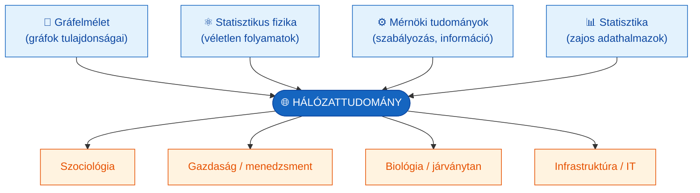

## 1.4 Kritika és modern relevancia

A hálózati szemlélet ereje az általánosíthatóság: ugyanazok a topológiai törvények írják le a sejtanyagcserét, az internetet és a baráti hálózatokat. **Kritikája**, hogy a túláltalánosítás veszélyes — a közös topológia nem jelent feltétlenül közös működési mechanizmust, és a hálózati metrikák önmagukban nem magyarázzák a *miérteket*. XXI. századi relevanciája vitathatatlan: a közösségi média, a platformgazdaság és a globális ellátási láncok mind hálózati logikát követnek, így a menedzser számára a hálózati gondolkodás ma alapkészség.

---

# 2. A gráfelmélet eredete és alapfogalmai
> » Kapcsolódó tétel: alapozó fejezet

## 2.1 A königsbergi hidak problémája (Euler, 1741)

A gráfelmélet születését **Leonhard Euler** 1741-es bizonyításához kötjük. Königsberg városát a Pregel folyó négy földrészre osztotta, amelyeket hét híd kötött össze. A kérdés: bejárható-e a város úgy, hogy minden hídon **pontosan egyszer** haladunk át? Euler bebizonyította, hogy **nem lehetséges**. A bizonyítás zsenialitása az absztrakcióban rejlett: a négy földrészt pontokkal (csúcsokkal), a hidakat vonalakkal (élekkel) helyettesítette. Ez volt az első gráf, és az első alkalom, hogy valaki gráffal oldott meg matematikai problémát. Euler felismerése: a bejárhatóság feltétele a csúcsok fokszámának paritásától függ (legfeljebb két páratlan fokú csúcs lehet).

## 2.2 Gráftípusok

A valós hálózatok modellezéséhez a gráfokat több szempont szerint osztályozzuk (Előadás_ppt1.pdf):

- **Irányítatlan / irányított** (*undirected/directed*): a kapcsolat kölcsönös (barátság) vagy egyirányú (követés, főnök–beosztott).
- **Súlyozatlan / súlyozott** (*unweighted/weighted*): a kapcsolatnak van-e erőssége (hívások száma, kereskedelmi volumen).
- **Összefüggő / nem összefüggő** (*connected/disconnected*).
- **Egyszerű / multigráf**: két csúcs között legfeljebb egy, illetve több párhuzamos él lehet-e.
- **Teljes gráf** (*complete*): minden csúcspár között van él.
- **Címkézett gráf**, **részgráf** (*subgraph*).

## 2.3 Gráfreprezentációk

Ugyanaz a gráf többféleképpen ábrázolható számítógépes feldolgozásra:

- **Szomszédossági mátrix** (*adjacency matrix*) **A**: az `N×N` méretű mátrix `A_ij` eleme 1, ha van él `i` és `j` között, különben 0 (súlyozott gráfnál a súly). Irányítatlan gráfnál a mátrix szimmetrikus (`A_ij = A_ji`).
- **Szomszédsági lista** (*neighborhood list*): minden csúcshoz felsoroljuk a szomszédait — ritka (sparse) hálózatoknál memóriatakarékos.
- **Él-lista** (*edge list*): a kapcsolatok párok listájaként.
- **Incidencia mátrix** (*incidence matrix*): csúcsok × élek mátrix; súlyozott gráf is leírható vele.

A szomszédossági mátrix a hálózati indikátorok (fokszám, utak, centralitás) számításának alapja: a fokszám a mátrix egy sorának/oszlopának összege, a legrövidebb utak a mátrix hatványaival vagy bejárással (BFS, Dijkstra) számíthatók.

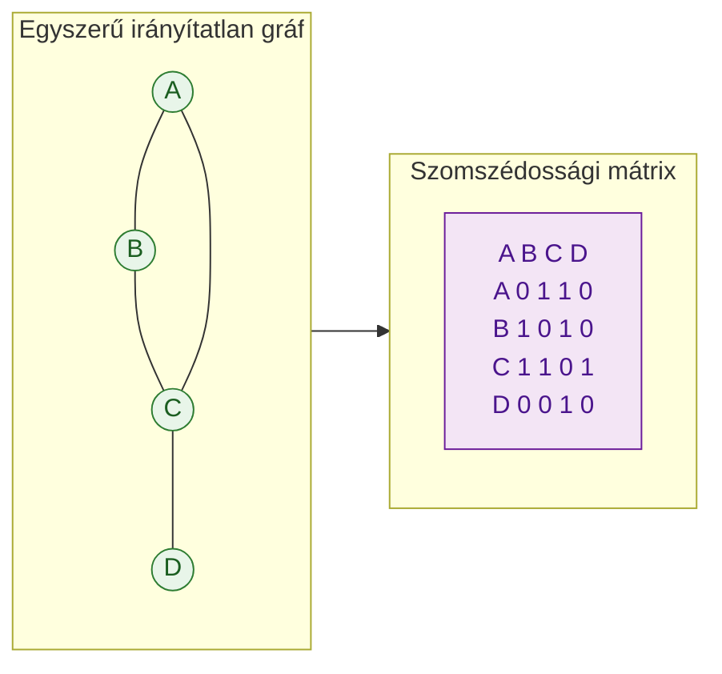

---

# 3. Korai szociológiai hálózatkutatás
> » Kapcsolódó tétel: **V16** (a valódi vs. formális struktúra), alapozó

## 3.1 Karinthy és a kis világ gondolat (1929)

A „kis világ" gondolat első irodalmi megfogalmazása **Karinthy Frigyes** *Láncszemek* (1929) című novellája: bárki bárkivel összeköthető legfeljebb öt ismerős láncán keresztül. Ez a „hat fokos szeparáció" sejtés irodalmi előképe, jóval a tudományos igazolás előtt (Barabási, 2016; Buchanan, 2003).

## 3.2 Moreno szociometriája (1933)

**Jacob Levy Moreno** 1933-ban dolgozta ki a **szociometria** módszerét a csoportok személyes kapcsolatainak feltérképezésére. Moreno megfigyelte, hogy a szervezetekben spontán barátságok, belső csoportok és csoportközi kapcsolatok jönnek létre — és ezek **különböznek a hivatalos szervezeti ábrától** (organigramtól). Ez a felismerés a tárgy egyik központi gondolata (lásd 13. fejezet).

A módszer menete: személyes preferencia-kérdéseket teszünk fel (pl. „Kivel dolgoznál szívesen egy szobában?"), a válaszokból **szociometriai mátrixot** építünk, amelyből **szociogramot** rajzolunk. A szociogram irányítatlan hálózat, és csak a **kölcsönös** választások adnak benne kapcsolatot. A szociometria tehát a csoporttagok személyes preferenciáit tárja fel. (A módszert Magyarországon Mérei Ferenc honosította meg.)

## 3.3 Milgram kis világ kísérlete

**Stanley Milgram** empirikusan tesztelte a kis világ sejtést. Két célszemélyt választott eltérő paraméterekkel, majd ~300 csomagot küldött véletlenszerűen kiválasztott embereknek azzal a kéréssel: „Próbálják elérni ezt a személyt ismerősi láncon keresztül!" A célba ért láncok átlagos hossza **5,5 kapcsolat** volt — innen a „hat lépés távolság" (six degrees of separation). **Módszertani korlátok:** a láncok jelentős része nem ért célba (lemorzsolódás), a minta nem reprezentatív, és az eredmény a *létező* rövid utakat mutatja, nem azt, hogy az emberek meg is *találják* őket. A jelenség matematikáját később Watts és Strogatz (9. fejezet), a társadalmi következményeit Buchanan (2003) tárgyalta.

## 3.4 A „Bacon-szám" szemléltetés

A kis világ jelenség játékos illusztrációja a **Bacon-szám**: két hollywoodi színész „távolsága" a közös filmek láncán mérve. A legtöbb színész Bacon-száma 2–3, ami a filmes együttműködési hálózat kis világ jellegét mutatja — ugyanaz a topológiai tulajdonság, amit Watts és Strogatz (1998) a színész-hálózaton ki is mutatott.

---

# 4. Granovetter: a gyenge kötések ereje (1973)
> » Kapcsolódó tétel: **V18** (a hálózati működés tudás-szempontja)

## 4.1 Az elmélet

**Mark Granovetter** „The Strength of Weak Ties" (1973) című tanulmánya a hálózati szociológia egyik legtöbbet idézett műve. Kiindulópontja egy meglepő empirikus megfigyelés: amikor megkérdezte, ki segített az embereknek új állást találni, a válasz jellemzően **nem** közeli barát, hanem **laza ismerős** volt.

A magyarázat a kapcsolatok **erősségében** rejlik. Granovetter a kötés erősségét négy tényezővel definiálta: az együtt töltött idő, az érzelmi intenzitás, a bizalmasság és a kölcsönös szívességek. A kulcsmechanizmus a **hídszerep**: a közeli barátaink jellemzően egymással is barátok (magas klaszterezettség), így tőlük nagyrészt **redundáns** információt kapunk — ugyanazt, amit már tudunk. A gyenge kötések ezzel szemben **különböző társadalmi körök közötti hidakat** képeznek, és **új** információt közvetítenek (pl. egy másik szakmai közegben megnyíló állást).

> **„A gyenge kötések a társadalmi hidak."** A híd élnek az a tulajdonsága, hogy eltávolítása megszünteti a leghatékonyabb (legrövidebb) utat két csoport között.

## 4.2 Erős vs. gyenge kötések

| Jellemző | Erős kötés | Gyenge kötés |
|---|---|---|
| Interakció gyakorisága | magas | alacsony |
| Érzelmi intenzitás, bizalom | magas | alacsony/közepes |
| Közös ismerősök (átfedés) | sok → magas klaszterezettség | kevés |
| Információ jellege | redundáns, megerősítő | új, nem redundáns |
| Hálózati szerep | klaszter-kohézió | **híd** (bridging) |
| Stratégiai érték | stabilitás, megbízhatóság | innováció, új lehetőségek |

## 4.3 Kritika, kiterjesztések és modern relevancia

Granovetter elméletét **Ronald Burt** (1992) fejlesztette tovább a strukturális lyukak fogalmával (19. fejezet): nem maga a kötés gyengesége a lényeg, hanem hogy **hidalja-e át** a hálózat üres tereit. **Kritika:** a gyenge kötések értéke kontextusfüggő — kritikus, bizalmat igénylő erőforrások (pl. komoly tőke, mély tudástranszfer) átadásához gyakran erős kötés kell. A modern relevancia óriási: a LinkedIn és más szakmai platformok lényegében a gyenge kötések tudatos menedzselésére épülnek; a 2022-es nagy mintás kísérleti vizsgálatok (Rajkumar et al., *Science*) is megerősítették, hogy a „közepesen gyenge" kötések segítik leginkább az álláskeresést. A tárgyban a gyenge kötések az IMP hálózati működés **tudás-szempontjához** (17. fejezet) kötődnek: az innováció a hídkapcsolatokon át áramlik.

---

*— B) blokk: Hálózati topológia, indikátorok és modellek (5–12. fejezet) —*

# 5. Hálózati indikátorok I.: fokszám, távolság, átmérő
> » Kapcsolódó tétel: alapozó fejezet (a V16 és V20 kvantitatív háttere)

## 5.1 Fokszám és fokszámeloszlás

A **fokszám** (*degree*) `k_i` egy csomópont kapcsolatainak száma — a csomópont legfontosabb lokális jellemzője. Irányított hálózatban megkülönböztetünk **be-fokszámot** `k_i^in` (befutó élek) és **ki-fokszámot** `k_i^out` (kifutó élek); a kettő eltérhet.

Az **átlagos fokszám** irányítatlan hálózatban (`L` az élek száma, `N` a csúcsoké):

$$\langle k \rangle = \frac{1}{N}\sum_{i=1}^{N} k_i = \frac{2L}{N}$$

(A 2-es szorzó oka: minden él két csúcs fokszámához járul hozzá.) Irányított hálózatban `⟨k^in⟩ = ⟨k^out⟩ = L/N`.

A **fokszámeloszlás** `p_k` annak valószínűsége, hogy egy véletlenszerűen kiválasztott csomópont fokszáma `k`. Normált: `Σ p_k = 1`, és `p_k = N_k / N`, ahol `N_k` a `k` fokszámú csúcsok száma. A fokszámeloszlás a hálózat „ujjlenyomata": ez különbözteti meg a véletlen (Poisson) és a skálafüggetlen (hatványfüggvény) hálózatokat (8. és 10. fejezet).

## 5.2 Távolságok a hálózatban

A hálózati távolság nem fizikai, hanem a **úthossz**: a két csomópontot összekötő úton lévő élek száma. A **legrövidebb út** (*shortest path*) `d_ij` a legkevesebb élt tartalmazó út (súlyozatlan hálózatban). Irányítatlan hálózatban `d_ij = d_ji`; irányítottban nem feltétlenül, sőt `i`-ből `j`-be vezető út léte nem garantálja a fordított út létét. A legrövidebb utak megkeresésére a **szélességi keresés** (BFS, súlyozatlan) és a **Dijkstra-algoritmus** (súlyozott) szolgál.

Az **átlagos úthossz** `⟨d⟩` az összes csúcspár legrövidebb távolságának átlaga:

$$\langle d \rangle = \frac{1}{N(N-1)}\sum_{i,j=1,\,i\neq j}^{N} d_{ij}$$

A **hálózati átmérő** `d_max` a legrövidebb utak közül a leghosszabb — a hálózat „legtávolabbi" pontpárjának távolsága. A kis világ hálózatok jellemzője, hogy `⟨d⟩` a hálózat méretéhez képest nagyon kicsi (lásd 9. fejezet).

## 5.3 Összefüggőség

A hálózat **összefüggő** (*connected*), ha bármely csúcspár között van út. Ha legalább egy pár között nincs (`d_ij = ∞`), a hálózat **nem összefüggő**, és két vagy több **komponensre** (klaszterre) esik szét. Az óriáskomponens megjelenése a véletlen hálózatok kulcsjelensége (8. fejezet), eltűnése pedig a robosztusság/perkoláció témaköréé (22. fejezet).

---

# 6. Hálózati indikátorok II.: centralitás és klaszterezés
> » Kapcsolódó tétel: **V20** (hálózati pozíció mint stratégiai alap)

## 6.1 Klaszterezési együttható

A **lokális klaszterezési együttható** `C_i` azt méri, mennyire kapcsolódnak egymáshoz egy csomópont szomszédai:

$$C_i = \frac{2L_i}{k_i(k_i-1)}$$

ahol `L_i` a csomópont `k_i` szomszédja közötti élek száma. `C_i ∈ [0,1]`: 1, ha a szomszédok teljes gráfot alkotnak (mindenki ismer mindenkit), 0, ha egyik sem kapcsolódik. A **globális (átlagos) klaszterezési együttható** `⟨C⟩` a lokális értékek átlaga `N` csúcsra. Magas klaszterezettség = sok „háromszög" = szoros, kohéziós csoportok — ez a kis világ hálózatok egyik jellemzője.

## 6.2 Centralitásmértékek

A centralitás azt méri, mennyire „fontos" egy csomópont — de a fontosságnak több értelme van, ezért több centralitásmérték létezik:

- **Fokszám-centralitás** (*degree centrality*): a kapcsolatok száma. A legegyszerűbb; a közvetlen befolyás/aktivitás mérője.
- **Közbeesettségi centralitás** (*betweenness*) `C_b(n)`: hány legrövidebb út halad át a csomóponton az összes legrövidebb útból:

$$C_b(n) = \sum_{i\neq j\neq n} \frac{g_{ij}(n)}{g_{ij}}$$

ahol `g_ij` az `i`–`j` közti legrövidebb utak száma, `g_ij(n)` pedig az `n`-en áthaladóké. A magas betweenness = **híd-/kapuőr-pozíció**: kontroll az információáramlás felett (lásd bróker, 19. fejezet).

- **Közelségi centralitás** (*closeness*): a csomópont átlagos távolságának reciproka az összes többitől. Magas closeness = a csomópont gyorsan elér mindenkit; a terjedés szempontjából előnyös pozíció.
- **Sajátvektor-centralitás** (*eigenvector centrality*): nem csak a kapcsolatok *száma* számít, hanem azok *fontossága* is — fontos vagyok, ha fontosakhoz kapcsolódom. A szomszédossági mátrix legnagyobb sajátértékéhez tartozó sajátvektor adja. A **PageRank** (Google) ennek irányított, súlyozott rokona: egy weboldal fontos, ha fontos oldalak hivatkoznak rá.

## 6.3 Melyiket mikor alkalmazzuk?

| Mérték | Mit ragad meg? | Tipikus stratégiai kérdés |
|---|---|---|
| Fokszám | közvetlen aktivitás, népszerűség | Ki a leglátványosabban összekapcsolt szereplő? |
| Betweenness | híd-/kapuőr-szerep | Kinek a kiesése szakítaná szét a kommunikációt? Ki a bróker? |
| Closeness | elérés gyorsasága | Honnan terjed leggyorsabban egy üzenet? |
| Eigenvector / PageRank | „fontosakhoz" kötöttség | Ki a befolyásos szereplők szövetségese? Kit érdemes megnyerni? |

A négy mérték eltérő szereplőt emelhet ki ugyanabban a hálózatban: egy alacsony fokszámú, de két klasztert összekötő szereplő betweenness-e magas lehet, miközben fokszám-centralitása alacsony. Stratégiai döntésnél ezért **több mértéket** együtt érdemes nézni.

---

# 7. Közösségdetektálás és modularitás
> » Kapcsolódó tétel: alapozó fejezet (a réteghálózatok és klaszterek mögötti módszertan)

A valós hálózatok jellemzően **közösségekre** (sűrűn összekötött csoportokra) bomlanak, amelyek között ritkábbak a kapcsolatok. A közösségek azonosítása (*community detection*) feltárja a hálózat moduláris szerkezetét — szervezeti kontextusban az informális csoportokat, klikkeket, „silókat".

A **Girvan–Newman algoritmus** (2002) az **él-betweenness** alapján működik: iteratívan eltávolítja a legmagasabb betweenness-ű éleket (amelyek hidat képeznek a közösségek között), így a hálózat fokozatosan közösségekre esik szét. A felbontás jóságát a **modularitás** `Q` méri: mennyivel sűrűbbek a közösségen belüli élek a véletlenszerűen várhatónál. Magas `Q` = jól elkülönülő közösségek. A módszer kapcsolódik a multiplex szemlélethez (12. fejezet): különböző rétegeken más-más közösségszerkezet rajzolódhat ki ugyanazon szereplők között. **Korlát:** a modularitás-maximalizálásnak van felbontási határa (kis közösségeket „összevonhat"), ezért több algoritmust (pl. Louvain) érdemes összevetni.

---

# 8. Erdős–Rényi véletlen hálózat
> » Kapcsolódó tétel: alapozó fejezet (referenciamodell a valós hálózatokhoz)

## 8.1 A G(N, p) modell

A véletlen hálózatelmélet alapját **Erdős Pál** és **Rényi Alfréd** rakta le, a valószínűségszámítást és a kombinatorikát egyesítve a gráfelmélettel (a modellt Edgar Gilbert egymástól függetlenül is leírta — innen a `G(N,p)` jelölés). A **G(N, p) modell**: adott `N` csomópont, és minden lehetséges csúcspárt egymástól függetlenül `p` valószínűséggel kötünk össze.

Konstrukció (Előadás_ppt1.pdf): (1) helyezzünk el `N` izolált csomópontot; (2) válasszunk ki egy párt, és generáljunk egy 0 és 1 közötti véletlen számot; (3) ha a szám kisebb, mint `p`, kössük össze a párt, különben ne; (4) ismételjük az összes `N(N−1)/2` párra.

Az átlagos fokszám: `⟨k⟩ = p(N−1)`.

## 8.2 Fokszámeloszlás és fázisátalakulás

A `G(N,p)` modell fokszámeloszlása **binomiális**, amely nagy `N` esetén **Poisson-eloszláshoz** tart. Ennek következménye, hogy a fokszámok egy jellemző érték (`⟨k⟩`) körül, haranggörbe-szerűen szóródnak: a legtöbb csomópontnak hasonló fokszáma van, és **nincsenek hubok** (kiugró fokszámú csomópontok).

A modell legfontosabb felfedezése a **fázisátalakulás**: ahogy `⟨k⟩` nő, hirtelen megjelenik egy **óriáskomponens** (a csúcsok jelentős hányadát összekötő összefüggő rész). A kritikus küszöb `⟨k⟩ = 1` körül van: alatta a hálózat sok apró, izolált komponensre esik, fölötte óriáskomponens dominál. (Rapoport és Solomonoff már korábban észlelte ezt a jelenséget.) Ez a hirtelen, küszöb-jellegű átmenet a perkoláció (22. fejezet) és a szervezeti tipping point (25. fejezet) rokona.

## 8.3 Miért nem ilyenek a valós hálózatok?

A véletlen hálózat **referenciamodell**, nem a valóság leírása. A valós hálózatok két ponton térnek el élesen: (1) **klaszterezettségük** sokkal magasabb, mint a véletlen hálózaté (a barátaink barátok — ezt a véletlen modell nem adja vissza → Watts–Strogatz, 9. fejezet); (2) **fokszámeloszlásuk** nem Poisson, hanem hatványfüggvény: vannak hubok (→ Barabási–Albert, 10. fejezet). A véletlen modell tehát a kontraszt, amelyhez a valós hálózatok eltéréseit mérjük.

---

# 9. Watts–Strogatz kis világ modell
> » Kapcsolódó tétel: alapozó fejezet

## 9.1 A probléma: két tulajdonság egyszerre

A valós hálózatok egyszerre mutatnak két, látszólag összeegyeztethetetlen tulajdonságot: **magas klaszterezettséget** (`⟨C⟩` nagy, mint egy szabályos rácsban) és **rövid átlagos úthosszat** (`⟨d⟩` kicsi, mint egy véletlen hálózatban). A szabályos rács klaszterezett, de „nagy világ" (hosszú utak); a véletlen hálózat „kis világ", de nem klaszterezett. A kis világ tulajdonság formális kritériuma:

$$\langle d \rangle \approx \frac{\ln N}{\ln \langle k \rangle}$$

vagyis az átlagos úthossz a hálózatmérettel csak **logaritmikusan** nő — ezért lehet több milliárd ember között is csak ~6 a távolság.

## 9.2 A béta-újrahuzalozási mechanizmus (Watts & Strogatz, 1998)

**Duncan Watts** és **Steven Strogatz** 1998-as *Nature*-cikke elegáns modellt adott. Induljunk egy szabályos gyűrűs rácsból, ahol minden csomópont a `k` legközelebbi szomszédjához kapcsolódik (ez magas klaszterezettséget ad). Majd minden élt `β` valószínűséggel **véletlenszerűen átkötünk** (*rewiring*) egy távoli csomóponthoz.

- `β = 0`: szabályos rács — magas `C`, hosszú `⟨d⟩`.
- `β = 1`: teljesen véletlen hálózat — alacsony `C`, rövid `⟨d⟩`.
- **Köztes `β` (kicsi, ~0,01–0,1):** néhány „rövidítő" (shortcut) él drámaian lecsökkenti `⟨d⟩`-t, miközben a klaszterezettség alig csökken. Ez a **kis világ tartomány**: magas `C` ÉS rövid `⟨d⟩` egyszerre.

A kulcsfelismerés: **kevés véletlen rövidítés** is elég ahhoz, hogy egy klaszterezett hálózat „kis világgá" váljon. Watts és Strogatz három valós hálózaton igazolta: a *C. elegans* idegrendszerén, az amerikai elektromos hálózaton és a hollywoodi színész-együttműködési hálózaton.

## 9.3 Korlátok

A WS-modell **nem reprodukálja** a valós hálózatok hatványfüggvény-fokszámeloszlását: a fokszámok továbbra is egy jellemző érték körül szóródnak, nincsenek igazi hubok. A hubok eredetét a Barabási–Albert modell magyarázza (10. fejezet). A WS-modell tehát a *rövid utak + klaszterezettség* együttesét magyarázza, de a *fokszám-heterogenitást* nem.

---

# 10. Barabási–Albert skálafüggetlen hálózat
> » Kapcsolódó tétel: **V20** (hub-stratégia, preferential attachment)

## 10.1 A skálafüggetlen tulajdonság

**Barabási Albert-László** és **Albert Réka** 1999-es *Science*-cikke felfedezte, hogy számos valós hálózat (a web, az internet, az idézési és a metabolikus hálózatok) fokszámeloszlása **hatványfüggvényt** (*power-law*) követ:

$$P(k) \sim k^{-\gamma}$$

ahol a `γ` kitevő tipikusan 2 és 3 között van. Az ilyen hálózat **skálafüggetlen** (*scale-free*): nincs jellemző fokszám-skála. Következménye, hogy a legtöbb csomópontnak nagyon kevés kapcsolata van, de néhány csomópont — a **hubok** — kiemelkedően sokkal rendelkezik. A Poisson-eloszlással (véletlen hálózat) szemben a hatványeloszlás „vastag farkú": a nagy fokszámú csomópontok valószínűsége sokkal nagyobb.

## 10.2 A mechanizmus: növekedés + preferenciális kapcsolódás

A skálafüggetlenség **két** egyidejű mechanizmusból ered, amelyek a véletlen modellből hiányoznak (Barabási & Albert, 1999):

1. **Növekedés** (*growth*): a valós hálózatok nem statikusak — `N` folyamatosan nő új csomópontok belépésével. (A `G(N,p)` modell `N`-je fix.)
2. **Preferenciális kapcsolódás** (*preferential attachment*): az új csomópont nem véletlenszerűen, hanem nagyobb valószínűséggel kapcsolódik a **már jól kapcsolt** csomópontokhoz. Annak valószínűsége, hogy az új csomópont az `i`-hez köt, arányos `i` fokszámával: `Π(k_i) = k_i / Σ_j k_j`.

A két mechanizmus együtt „a gazdag gazdagodik" (*rich get richer*, Matthew-effektus) dinamikát hoz létre: aki korán sok kapcsolatot szerez, aránytalanul többet vonz a továbbiakban. Ez állítja elő a hatványeloszlást és a hubokat. Kapcsolat a **Pareto-elvvel** (80/20): a kapcsolatok kis hányada koncentrálódik a csomópontok kis hányadán.

## 10.3 Kritika és korlátok

- **Nem minden valós hálózat skálafüggetlen.** Egyes hálózatok fokszámeloszlása csak részben, vagy levágott (truncated) hatványfüggvény. Broido és Clauset (2019) nagy elemzése szerint a „tisztán" skálafüggetlen hálózatok ritkábbak, mint korábban hitték — ez **vita tárgya** a szakirodalomban.
- A **fitness-modell** (Bianconi–Barabási) finomítása: nem csak a régi csomópontok nyernek; egy „rátermett" (fit) új belépő gyorsan hubbá válhat (pl. a Google megelőzte a korábbi keresőket). A puszta életkor tehát nem elég.
- **Csak a növekedés vagy csak a preferencia** önmagában nem ad hatványeloszlást — mindkettő kell.

## 10.4 Relevancia

A skálafüggetlen topológia magyarázza a digitális platformok hub-jellegét (Google, Amazon, Facebook), a hubok kettős természetét (robusztusság a véletlen hibára, sérülékenység a célzott támadásra — 22. fejezet), és a hub-stratégia logikáját (25. fejezet).

---

# 11. Hálózattípusok összehasonlítása
> » Kapcsolódó tétel: **V20** (a stratégiai pozíció topológiai háttere)

A három referenciamodell egymás melletti összevetése a tárgy egyik kulcstáblázata:

| Tulajdonság | Véletlen (Erdős–Rényi) | Kis világ (Watts–Strogatz) | Skálafüggetlen (Barabási–Albert) |
|---|---|---|---|
| Fokszámeloszlás | Poisson (haranggörbe) | csúcsos, Poisson-szerű | hatványfüggvény `k^{-γ}` |
| Hubok | nincsenek | nincsenek igazi hubok | **vannak** (meghatározók) |
| Átlagos úthossz `⟨d⟩` | rövid (`~ln N`) | **rövid** (`~ln N`) | nagyon rövid (ultrakicsi világ) |
| Klaszterezettség `⟨C⟩` | alacsony | **magas** | közepes/magas |
| Keletkezés | statikus, fix `N` | rács + átkötés | **növekedés + preferenciális kapcsolódás** |
| Véletlen hibatűrés | közepes | közepes | **magas** (robusztus) |
| Célzott támadás-tűrés | közepes | közepes | **alacsony** (hub-sérülékeny) |
| Tipikus példa | elméleti referencia | idegrendszer, áramhálózat, ismeretségi háló | web, internet, idézési és üzleti hálózatok |

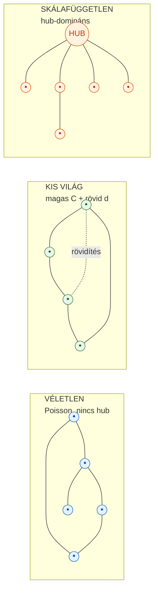

**Forrásütközés-jelzés:** a köznyelv és egyes források a „kis világ" és a „skálafüggetlen" jelzőt felcserélhetően használják, holott **különböző** tulajdonságról van szó: a *kis világ* az úthosszra és a klaszterezettségre vonatkozik, a *skálafüggetlen* a fokszámeloszlás alakjára. Egy hálózat lehet kis világ anélkül, hogy skálafüggetlen lenne (WS-modell), és a skálafüggetlen hálózatok jellemzően egyben „ultrakicsi világok" is. A tárgy ezt a megkülönböztetést hangsúlyozza.

---

# 12. Multiplex és multilayer hálózatok
> » Kapcsolódó tétel: **V16** (a vállalat mint multiplex hálózat)

## 12.1 A több rétegű hálózatok szükségessége

A valós kapcsolatok ritkán egyfélék: ugyanazok a szereplők többféle kapcsolatban is állhatnak (egy kolléga egyszerre főnök, baráti kapcsolat és tudásforrás). Az **egyszerű (monoplex) gráf** csak egy kapcsolattípust ír le. A **színezett gráf** több, eltérő típusú kapcsolatot enged meg ugyanazon csúcsok között — és felbontható azonos színű **részgráfokra**, amelyek az eredeti gráf homomorf leképezései. Ez a több rétegű (multilayer) szemlélet alapja.

## 12.2 Kivelä terminológiája (Kivelä et al., 2014)

A több rétegű hálózatok egységes formális keretét **Kivelä és munkatársai** (2014, *Journal of Complex Networks*) dolgozták ki. Az előadás az alábbi — részben a Kivelä-keretre épülő — terminológiát használja:

- **Monoplex (egyrétegű) hálózat:** két csomópont között csak egyféle kapcsolat.
- **Hálózati réteg** (*network layer*): az összekapcsolt hálózat egy-egy monoplex rétege (pl. a „tudásmegosztás" réteg).
- **Réteg-belüli (intra-layer) kapcsolatok:** egy adott rétegen belüli élek.
- **Réteg-közötti (inter-layer) kapcsolatok:** a különböző rétegek csomópontjai közötti élek.
- **Multilayer hálózat:** összekapcsolt hálózat, amelynek rétegei **azonos** csomópontokat tartalmaznak, és **bármely** csomópontok között lehet réteg-közötti él.
- **Multiplex hálózat:** olyan multilayer hálózat, ahol a rétegek csomópontjai azonosak, de réteg-közötti él **csak ugyanazon csomópont** rétegbeli másai között van (azaz „önmaga másik rétegbeli megfelelőjéhez" kötődik).

A megkülönböztetés gyakorlati jelentősége: a **szervezet multiplex hálózat** — ugyanazok a dolgozók szerepelnek minden rétegben (hierarchia, tudásmegosztás, pletyka stb.), és minden dolgozó „önmagával" azonos a rétegek között.

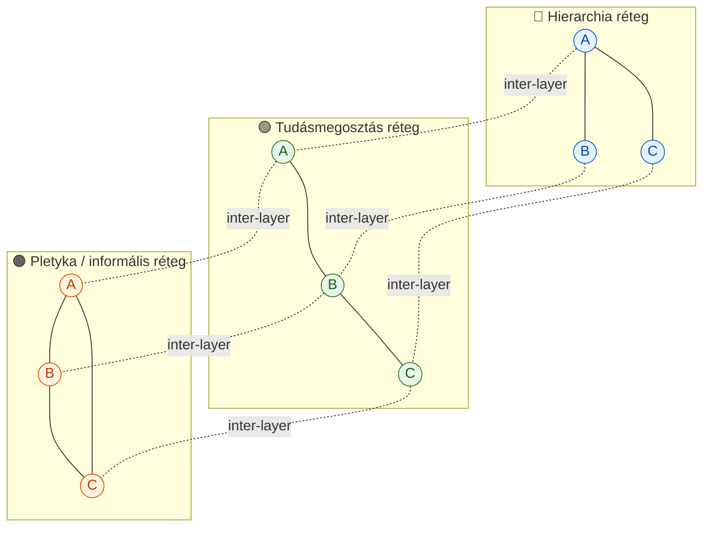

**Forrásütközés-jelzés:** a multilayer/multiplex terminológia a szakirodalomban nem teljesen egységes (Kivelä et al. maguk is felhívják erre a figyelmet). Az előadás definíciói a Kivelä-keretre épülnek, de helyenként eltérő hangsúllyal; a vizsgán az előadás definícióit érdemes követni, jelezve, hogy a fogalomhasználat forrásonként változhat.

---

*— C) blokk: Szervezeti réteghálózatok és üzleti kapcsolatok (13–19. fejezet) —*

# 13. Szervezeti réteghálózatok és a valódi struktúra
> » Kapcsolódó tétel: **V16** — A vállalat komplex hálózati modellje

## 13.1 A szervezet mint multiplex hálózat

A szervezet hagyományos ábrázolása az **organigram**: formális hierarchia, pozíciók, alá-fölé rendeltség. Ez azonban hamis egyszerűsítés. A valódi szervezet egymásra rakódott, **különböző logikájú kapcsolathálók** rendszere — multiplex hálózat, amelyben ugyanazon csomópontok (dolgozók, egységek) között több, egymástól elkülönülő, de kölcsönható réteg húzódik (12. fejezet).

## 13.2 A nyolc réteghálózat tipológiája

Az előadás az alábbi fő rétegtípusokat különbözteti meg; mindegyik egy-egy szociometriai kérdéssel térképezhető fel (a kérdés egyben az adattárás módszere is):

| Réteghálózat | Feltérképező kérdés | Kapcsolat típusa | Irányítottság | Menedzsment-jelentőség |
|---|---|---|---|---|
| Pozíción alapuló hatalom | „Ki a közvetlen felettese?" | formális, pozíció-alapú | irányított ↑↓ | a formális kontroll csatornái |
| Szakmai rendelés | „Kinek adhat szakmai utasítást?" | szaktudás-alapú | irányított | a szakmai tekintély valódi térképe |
| Formális tudásmegosztás | „Ki ad Önnek adatot, információt?" | feladatból fakadó | irányított | információs szűk keresztmetszetek |
| Önkéntes tudásmegosztás | „Kitől kér tanácsot önszántából?" | bizalom-alapú | irányított | rejtett tudáscsomópontok, mentorok |
| Helyettesítési | „Ki helyettesíti Önt?" | kompetencia-alapú | irányítatlan | kockázat, kulcsember-függőség |
| Folyamat | munkafolyamat-lépések sorrendje | procedurális | irányított | átfutási idő, koordináció |
| Térbeli | fizikai/szervezeti közelség | szomszédság | irányítatlan | véletlen találkozások, informális csere |
| Személyes preferencia / pletyka | „Kivel beszél napi szinten magánügyekről?" | szocio-emocionális | irányítatlan | csoportkohézió, normaterjedés, morál |

## 13.3 Formális vs. valódi struktúra

Ahogy Moreno (1933, lásd 3. fejezet) felismerte, a **szociogram eltér az organigramtól**. Egy esettanulmányban (Előadás_ppt1.pdf) ugyanazon szervezet három tudásmegosztási rétegét vetették össze:

| Réteg | Topológia | Tanulság |
|---|---|---|
| Szakmai rendelés (formális) | hierarchikus, centralizált | követi az organigramot |
| Önkéntes tudásmegosztás | hálószerű, elosztott | eltér a formális struktúrától |
| Pletykahálózat | sűrű, informális klaszterek | a tényleges szimpátiákat és csoportokat tükrözi |

A három réteg egymásra vetítve teljesen más képet ad, mint bármelyik önmagában — **ez a multiplex megközelítés lényege és vezetői értéke**: feltárhatók az informális hatalmi centrumok, a kommunikációs szűk keresztmetszetek és a rejtett tudáscsomópontok, amelyek az organigramon láthatatlanok.

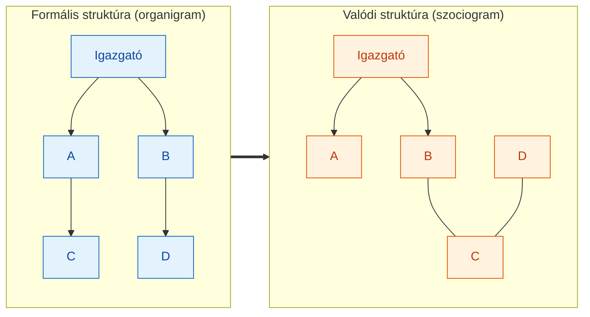

---

# 14. A tükrözési hipotézis (Conway; MacCormack, Baldwin & Rusnak)
> » Kapcsolódó tétel: **V16** — szervezeti és termékarchitektúra kettőssége

## 14.1 Conway-törvény (1968)

**Melvin Conway** 1968-as tételének („How Do Committees Invent?", *Datamation*) megfogalmazása:

> „Minden szervezet, amely rendszert tervez, olyan tervet hoz létre, amelynek **struktúrája a szervezet kommunikációs struktúrájának másolata**."

Vagyis a termék architektúrája **tükrözi** az azt fejlesztő szervezet kommunikációs hálózatát. Ha négy, egymással alig kommunikáló csapat ír egy fordítóprogramot, az négy lépésből álló fordító lesz.

## 14.2 A tükrözési hipotézis empirikus tesztje (MacCormack, Baldwin & Rusnak, 2012)

**MacCormack, Baldwin és Rusnak** (2012, *Research Policy* 41(8), 1309–1324) a Conway-törvényt általánosította „**tükrözési hipotézis**" (*mirroring hypothesis*) néven, és lektorált, empirikus tesztnek vetette alá. Kihasználtak egy „természetes kísérletet": ugyanazt a funkciót ellátó szoftvereket hasonlítottak össze, amelyeket gyökeresen eltérő szervezeti formák fejlesztettek:

- **Szorosan csatolt (tightly-coupled) szervezetek:** kereskedelmi szoftvercégek — közös cél, struktúra, együtt lévő csapatok.
- **Lazán csatolt (loosely-coupled) szervezetek:** nyílt forráskódú közösségek — földrajzilag szétszórt, önkéntes fejlesztők.

A hipotézis jóslata: a lazán csatolt szervezet **modulárisabb** terméket hoz létre. Párosított (matched-pair) mintán **erős bizonyítékot** találtak: minden vizsgált párban a lazán csatolt szervezet terméke szignifikánsan modulárisabb volt (a komponensek közötti csatoltságot mérve a különbség akár nyolcszoros is lehetett egy változás továbbterjedési potenciáljában).

## 14.3 Kapcsolat a tárgyhoz és menedzsment-implikáció

A tükrözési hipotézis a szervezeti réteghálózatok (13. fejezet) és a termék közötti **kétirányú** kapcsolatot mutatja: a kommunikációs réteg topológiája beíródik a termékarchitektúrába. **Menedzsment-implikáció:** a szervezeti tervezés (ki kivel kommunikál) egyben *termékarchitektúra-döntés* is. A „fordított Conway-manőver" (*inverse Conway maneuver*) ezt tudatosan kihasználja: a kívánt termékarchitektúrához igazítják a csapatszerkezetet (pl. mikroszolgáltatás-architektúrához önálló, lazán csatolt csapatok). **Kritika/korlát:** a tükröződés nem mindig tökéletes — részleges tükröződés és „architektúra-megsértések" is előfordulnak, főleg gyorsan változó vagy erősen integrált rendszereknél.

---

# 15. Az IMP csoport és a piac mint hálózat
> » Kapcsolódó tétel: **V19** — Az üzleti kölcsönhatások hálózatalapú megközelítése

## 15.1 Az IMP megközelítés helye

Az **IMP csoport** (*Industrial Marketing and Purchasing Group*) az 1970-es évektől fejlesztett üzleti hálózatelméletet, **Håkan Håkansson** vezető szerepével. Az IMP a vállalatközi (B2B) kapcsolatokat nem egyszeri tranzakcióként, hanem tartós, kölcsönösen alakuló **kölcsönhatásként** (*interaction*) értelmezi. Az elmélet két uralkodó hagyomány kritikájából nőtt ki.

## 15.2 A struktúra-alapú megközelítés kritikája

A **struktúra-alapú** (neoklasszikus mikroökonómia, Porter öt erő modellje) megközelítés szerint a piac egyensúly felé tartó, anonim versenytér; a szereplők racionális, önérdekkövetők; a kapcsolatok távolságtartók, tranzakció-orientáltak. Az IMP kritikája:

- **Statikus kép:** pillanatfelvételt ad, nem magyarázza a kapcsolatok időbeli alakulását.
- **Egyirányú tranzakcionalitás:** anonim, egyszeri ügyletként kezeli a valójában tartós, kölcsönösen adaptált kapcsolatokat.
- **A tudás figyelmen kívül hagyása:** a kapcsolat-specifikus tudás és a közösen épített kompetenciák nem jelennek meg.
- **Hiányzó hálózati kontextus:** egyetlen vállalat–piac párt vizsgál, nem a teljes kapcsolathálót.

## 15.3 A folyamat-alapú megközelítés kritikája

A **folyamat-alapú** megközelítés (Porter értéklánca) a vállalat belső folyamataiba helyezi az értékteremtést. Az IMP kritikája: **bezárt szemlélet** — az érték egyre inkább a *vállalatok közötti* interakcióban keletkezik; a belső optimalizáció figyelmen kívül hagyja, hogy a bemenetek minősége a kapcsolatoktól függ; a modern ellátási láncokban és innovációs ökoszisztémákban az értékteremtés hálózati, nem belső folyamat.

## 15.4 A piac mint hálózat

Az IMP a piacot **egyedi kapcsolatok hálózataként** értelmezi. Következményei:

1. **Nincs tökéletes verseny** — egyedi, nem homogén kapcsolatok; egy szállító nem cserélhető le súrlódásmentesen.
2. **Az ár csak az egyik koordináló mechanizmus** — a bizalom, a kölcsönös adaptáció és a kapcsolat-specifikus tudás legalább annyira fontos.
3. **A piaci pozíció = hálózati pozíció** — nem az iparági struktúrában elfoglalt hely, hanem a konkrét kapcsolatok minősége és száma számít.
4. **Az innováció hálózati folyamat** — az IMP empirikus kutatásai szerint az ipari innovációk döntő része vevő–szállító kapcsolatokban keletkezik, nem zárt laborokban.

## 15.5 Az IMP interakció-modell

A megközelítés operatív magja a vevő–szállító kapcsolatot négy dimenzióban írja le:

| Dimenzió | Tartalom |
|---|---|
| Interakciós epizódok | konkrét ügyletek, tárgyalások: termék-, pénz-, információ- és szociális csere |
| Kapcsolat légköre | hatalom/függőség; konfliktus/kooperáció; bizalom; közelség/távolság |
| Szervezetek és egyének | az interakció egyszerre szervezeti és személyes szinten zajlik |
| Környezet | iparági struktúra; dinamizmus; internacionalizáció; szociális rendszer |

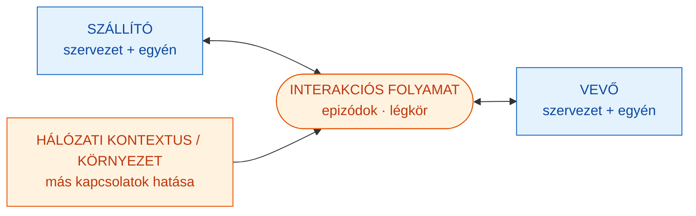

---

# 16. Az üzleti kölcsönhatás öt tényezője
> » Kapcsolódó tétel: **V17** — Az üzleti hálózatok kölcsönhatásait befolyásoló tényezők

Håkansson (2010) szerint az üzleti kölcsönhatásokat öt, egymást átszövő tényező határozza meg. Ezek **nem független változók** — egymást erősítik.

**1. Időbeliség (*temporality*).** Az üzleti kapcsolatok időben fejlődnek: múlt, jelen és jövőbeli elvárások együtt határozzák meg a viselkedést. A múltbeli tapasztalat (bizalom, konfliktus, teljesítmény) beépül a kapcsolat „tőkéjébe"; a felek idővel egymáshoz igazítják folyamataikat — ez a **kapcsolatspecifikus adaptáció**. Egy hosszú kapcsolat megszakítása nemcsak a jövőbeli ügyleteket, hanem a befektetett kapcsolat-specifikus eszközöket (tudás, rutinok) is elveszíti.

**2. Szubjektív értelmezés (*subjective/mutually defined interpretation*).** Ugyanazt a kapcsolatot a két fél eltérően értelmezi — nincs egyetlen „objektív" leírás. A vevő „stratégiai partnerségnek" láthatja, amit a szállító „rutinügyfélnek". A siker feltétele a **közösen konstruált értelmezési keret**.

**3. Kapcsoltság (*connectedness*).** Egyetlen kapcsolat sem létezik önmagában: minden A–B kapcsolatot befolyásol A és B többi kapcsolata. Egy szállítóváltás hullámokat indít a hálózatban; a jó hálózati pozíció önmagában versenyelőny (kapcsolat: Burt strukturális lyukai, 19. fejezet).

**4. Kölcsönös függőség (*mutual dependence*).** Mindkét fél függ a másiktól — gyakran aszimmetrikusan. A függőség nem gyengeség, hanem a specializáció és a munkamegosztás következménye. Forrásai: **erőforrás-függőség** (pótolhatatlan tudás, technológia, kapacitás), **rutin-függőség** (beágyazott koordinációs eljárások → magas váltási költség), **reputáció-függőség** (közös piaci hírnév).

**5. Viszonylagosság (*relativity*).** Egy kapcsolat értékét mindig más kapcsolatokhoz **viszonyítva** kell megítélni — nincs abszolút „jó" vagy „rossz" kapcsolat. Egy szállító értékét az alternatívákhoz (más szállítók, belső előállítás) mérjük; a hálózati pozíció is relatív (ami hub egy kis hálózatban, periféria lehet egy nagyobban).

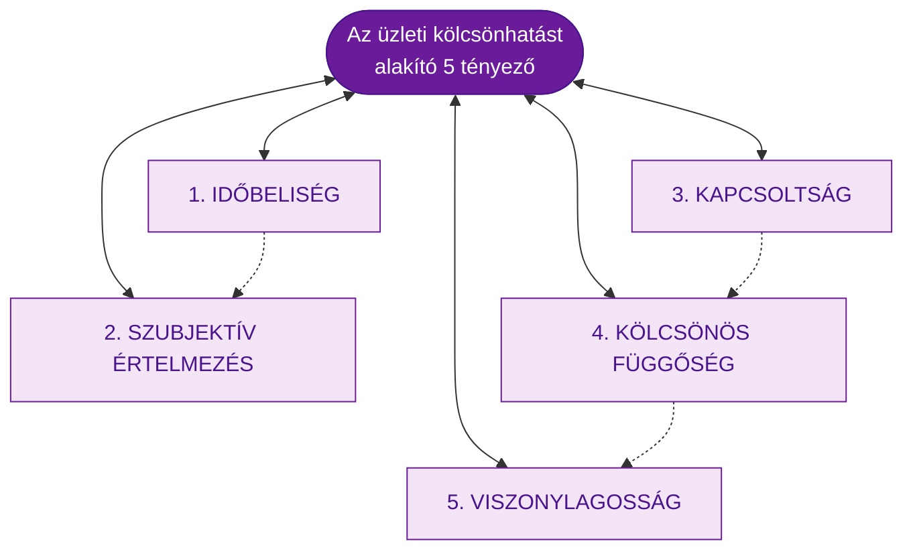

Az öt tényező együtt magyarázza, miért **nem egyszerűsíthető** az üzleti hálózat sem puszta erőforrás-tranzakciókra (neoklasszikus közgazdaságtan), sem tisztán strukturális viszonyokra (szociológiai hálózatelemzés): a vállalatközi kölcsönhatás **dinamikus, szubjektíven értelmezett, hálózatba ágyazott folyamat**.

---

# 17. A hálózati működés három szempontja
> » Kapcsolódó tétel: **V18** — Hálózati működés és szempontjai

A hálózatelvű megközelítés szerint egyetlen vállalat sem értelmezhető a kapcsolataitól függetlenül. Håkansson (2010) szerint a hálózatban való működés három szempontból különbözik az önálló vállalati működéstől.

**1. Irányíthatóság (*control*).** A hálózatban **senki sem uralja az egészet**. Minden szereplő befolyásolja a többieket, de teljesen egyik sem irányít; minél nagyobb és sűrűbb a hálózat, annál kisebb az egyes szereplő kontrollja. A menedzser feladata nem a kontroll maximalizálása, hanem a **hálózati pozíció tudatos alakítása** és a befolyási kör értelmes menedzselése.

**2. Tudás (*knowledge*).** A hálózatban elosztottan tárolt tudás messze meghaladja bármely szereplő egyéni tudását. Az innováció és a problémamegoldás egyre inkább **kapcsolatokon keresztül** történik. Itt kapcsolódik **Granovetter** gyenge kötések elmélete (4. fejezet): az erős kötések redundáns tudást adnak, a gyenge kötések **hídként** kötnek össze különböző tudásbázisokat. A vállalat kapcsolatai tehát **tudásforrások**, nem csak erőforrás-csere eszközei.

**3. Változás (*change*).** A hálózatban a változás folyamatos és részben spontán: bármely szereplő változása nehezen kiszámítható hullámokat indít (kapcsolat: kaszkád, 23. fejezet). A hálózat dinamikus egyensúlyban van, nem statikus struktúra. A változáskezelés ezért nem top-down tervezés, hanem **folyamatos alkalmazkodás** és a visszacsatolások figyelése.

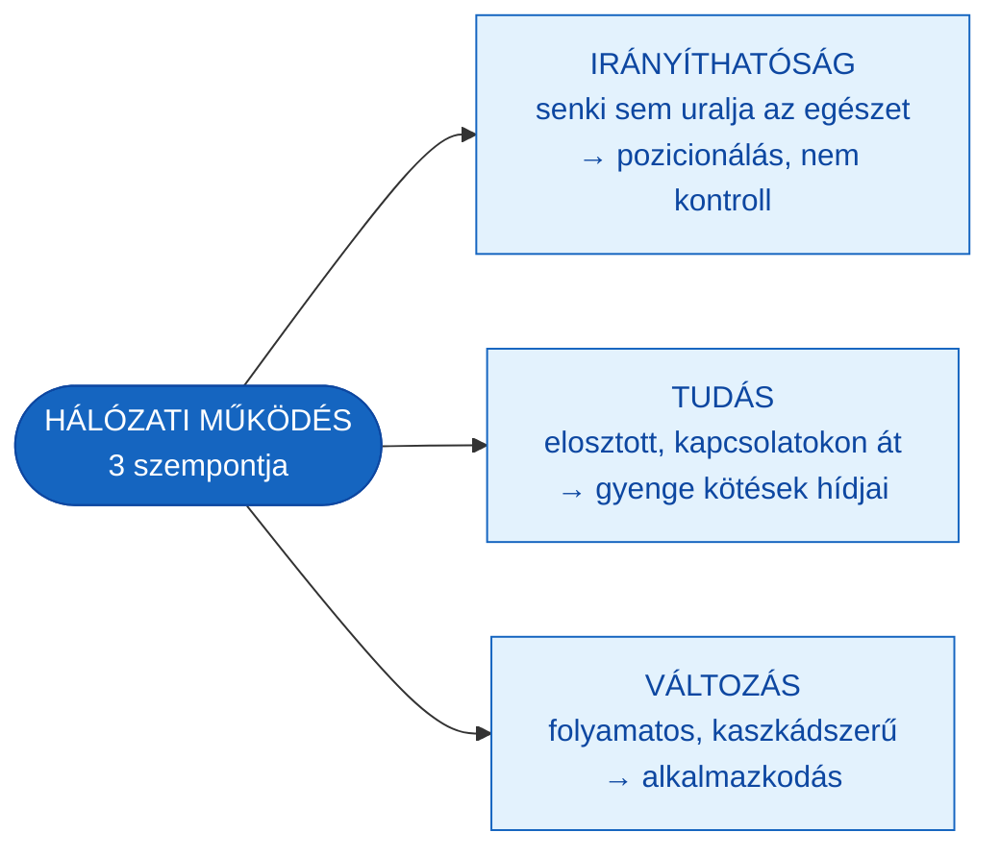

---

# 18. Az ARA modell
> » Kapcsolódó tétel: **V18** — Hálózati működés (tevékenységek és erőforrások)

## 18.1 A három alkotóelem

Håkansson és Snehota (1995, *Developing Relationships in Business Networks*) az üzleti hálózatot három, egymással összefonódó dimenzióban írja le — ez az **ARA modell** (*Actors–Resources–Activities*):

- **Szereplők (*Actors*):** vállalatok, divíziók, személyek, akik erőforrások felett rendelkeznek és tevékenységeket végeznek. Közöttük **szereplői kötések** (*actor bonds*) jönnek létre: bizalom, elkötelezettség, kölcsönös ismeret.
- **Erőforrások (*Resources*):** technológia, tudás, tőke, kapcsolatok. Értéküket nem önmagukban, hanem a **hálózati felhasználásban** nyerik. Közöttük **erőforrás-kötések** (*resource ties*) alakulnak: az egyik fél erőforrása a másikéhoz igazodik (pl. kompatibilis technológia).
- **Tevékenységek (*Activities*):** termelés, fejlesztés, logisztika, adminisztráció. Összekapcsolódó **tevékenység-láncokat** (*activity links*) alkotnak a vállalatok között (pl. egymásra épülő gyártási lépések).

## 18.2 A három réteg egymásra hatása

A három elem és a három kötéstípus **kölcsönösen meghatározza** egymást: a szereplők tevékenységeket végeznek erőforrásokkal; a tevékenységek erőforrásokat alakítanak; az erőforrások a szereplők kontrollja alatt állnak — de nem egyetlen szereplőé, hanem a kapcsolatok hálójában megosztva. Egy kapcsolat „fejlettsége" mérhető azon, milyen erősek benne az actor bond-ok, resource tie-ok és activity link-ek.

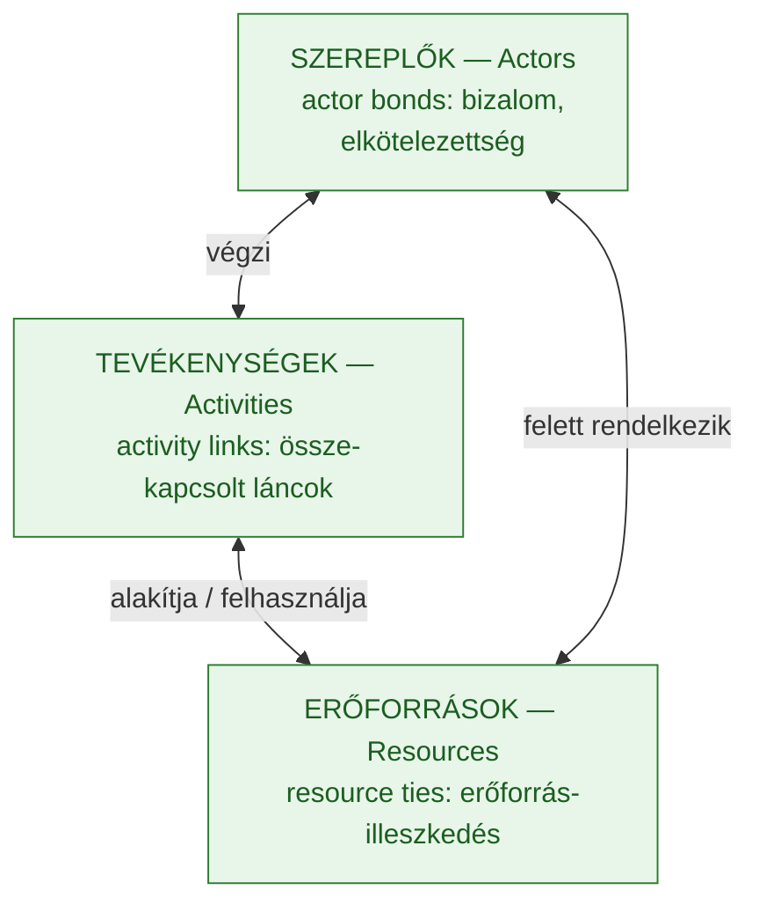

## 18.3 Kritika és relevancia

**Kritika:** az ARA modell erős **leíró** keret, de **statikus** és nehezen operacionalizálható — a kötések erőssége nehezen mérhető, és a modell nem ad pontos előrejelzést. Mégis a B2B kapcsolatmenedzsment egyik legbefolyásosabb kerete: rávilágít, hogy a kapcsolat háromrétegű (személyes, erőforrás- és tevékenységszintű), és a kapcsolat felmondása mindhárom szinten költséget okoz.

## 18.4 Erős és gyenge kapcsolatok a vállalati hálózatban

Granovetter elméletét az IMP keretbe illesztve a vállalat optimális stratégiája **vegyes kapcsolatportfólió**:

| Dimenzió | Erős kapcsolat | Gyenge kapcsolat |
|---|---|---|
| Interakció gyakorisága | magas | alacsony |
| Adaptáció (kapcsolatspecifikus) | magas | alacsony |
| Tudás-redundancia | magas | alacsony (új tudás) |
| Hálózati szerep | klaszter-kohézió | híd (bridging) |
| Stratégiai érték | stabilitás, megbízhatóság | innováció, diverzifikáció |

Erős kapcsolatok a kulcstevékenységekhez és a megbízható ellátáshoz; gyenge kapcsolatok az innovációhoz és a piaci szondázáshoz.

---

# 19. Burt: strukturális lyukak és brokerage
> » Kapcsolódó tétel: **V20** — Hálózati pozíció mint stratégiai erőforrás

## 19.1 A strukturális lyuk fogalma

**Ronald Burt** (1992, *Structural Holes*) Granovetter elméletét pozícióelméletté fejlesztette. A **strukturális lyuk** (*structural hole*) két, egymással nem összekötött csoport (klaszter) közötti „üres tér" a hálózatban. Aki ezt a lyukat **áthidalja** — a **bróker** (*broker*) —, stratégiai előnyt élvez.

## 19.2 A brokerage mechanizmusa

A bróker két előnyhöz jut: **információs előny** (előbb és többféle, nem redundáns információhoz fér hozzá, mert eltérő világokat lát) és **kontroll-előny** (ő közvetít a két csoport között, így befolyásolja az áramlást — magas betweenness centralitás, 6. fejezet). A bróker pozíció a nem redundáns kapcsolatok számával értékesebb: nem a kapcsolatok *mennyisége*, hanem a *strukturális változatossága* számít.

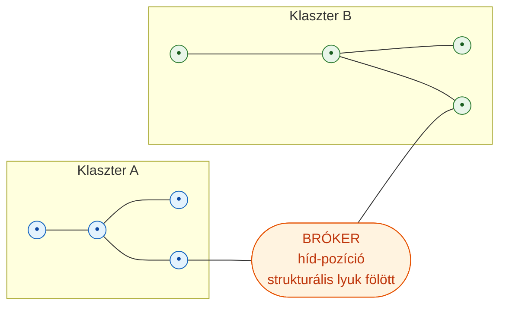

## 19.3 Brokerage vs. closure — vita Colemannal

Burt **brokerage** (híd-előny) elmélete szemben áll **James Coleman** **closure** (zártság) elméletével. Coleman szerint a **zárt, sűrű** hálózat (ahol mindenki ismer mindenkit) teremt **bizalmat és társadalmi tőkét**, mert érvényesíti a normákat és bünteti a csalást. Burt szerint épp a **nyitottság**, a strukturális lyukak áthidalása hoz **információs és innovációs előnyt**. A modern szintézis: a kettő **kiegészíti** egymást — a brokerage az új lehetőségek (innováció, információ) forrása, a closure a megvalósítás (bizalom, koordináció) feltétele. A sikeres szereplő mindkettőt használja: hidakat épít *és* zárt, megbízható magot tart fenn.

## 19.4 Stratégiai implikáció

A vállalat tudatosan keresheti a strukturális lyukakat: ágazatok, régiók, technológiai közösségek közötti híd-pozíciókat. Ez a **híd- (broker-) stratégia** alapja (25. fejezet). **Kritika:** a bróker-pozíció instabil lehet — ha a két klaszter közvetlenül összekapcsolódik, a strukturális lyuk „bezárul", és a bróker elveszíti előnyét; emellett a brokerage kulturálisan és kontextuálisan eltérő értékű lehet (egyes közegekben a megbízhatóságot többre tartják, mint az újdonságközvetítést).

---

*— D) blokk: Információterjedés, robosztusság és hatalmi struktúrák (20–24. fejezet) —*

# 20. Információ- és tudásterjedés a szervezeti hálózatban
> » Kapcsolódó tétel: **V16, V18** — a szervezeti hálózat dinamikája

## 20.1 A terjedés topológiafüggő

A szervezet komplex emberi hálózat, sok réteggel (13. fejezet), irányított és irányítatlan információs rétegekkel. Minden rétegen terjed információ, és **a terjedés a réteg topológiájától függ**: egy hierarchikus rétegen lassan, lépcsőzetesen, egy sűrű pletykahálózaton gyorsan terjed ugyanaz a hír.

## 20.2 Az iteratív terjedési modell (kiterjesztett szomszédossági mátrix)

Az előadás egy egyszerű, mátrix-alapú iteratív modellt mutat be:

- **Kiterjesztett szomszédossági mátrix `P`:** a hálózat kapcsolati mátrixa, kiegészítve az átadási/megtartási valószínűségekkel (egy csomópont a következő lépésben átadja-e a szomszédjainak az információt, illetve megtartja-e maga).
- **Állapotvektor `S_t`:** a csomópontok pillanatnyi „informáltsági" állapota a `t` időlépésben (ki tudja már az információt).
- **Iteráció:** `S_{t+1} = P · S_t` típusú frissítés, amíg az állapotvektor stabilizálódik (`S_t = S_{t+1}`). Az így kapott stacionárius állapot mutatja, **meddig jut el** és **milyen gyorsan** terjed az információ az adott topológián.

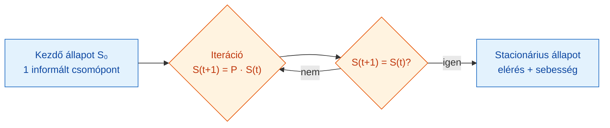

## 20.3 Az epidemiológiai analógia (SIR / SIS)

Az információterjedés rokon a **járványterjedéssel**. A klasszikus **SIR-modell** három állapotot különböztet meg: **S** (*susceptible*, fogékony — még nem hallotta), **I** (*infected*, fertőzött — tudja és terjeszti), **R** (*recovered/removed*, már nem terjeszti). A **SIS-modell** szerint a szereplő a „fertőzés" után visszatérhet a fogékony állapotba (újra terjeszthető hír). A terjedés kulcsparamétere a járványtani **`R_0`** (alap-reprodukciós szám) hálózati megfelelője: ha egy informált szereplő átlagosan egynél több továbbinak adja át (`R > 1`), az információ járványszerűen elterjed; ha kevesebbnek, kihal. Skálafüggetlen hálózatban a hubok miatt a **terjedési küszöb gyakorlatilag eltűnik** — ezért terjed a vírus (és az álhír) olyan hatékonyan a közösségi médiában.

## 20.4 Menedzsment-relevancia

A modell vezetői haszna: megmutatja, hol vannak a szervezetben az információs szűk keresztmetszetek és a kulcsközvetítők (magas betweenness), és hogyan gyorsítható a tudástranszfer (pl. híd-kapcsolatok, gyenge kötések tudatos ápolása).

---

# 21. Véleménybuborékok és echo chamber
> » Kapcsolódó tétel: kiegészítő (a 20. fejezet társadalmi következménye)

## 21.1 A mechanizmus

A **véleménybuborék** (*filter bubble*) és az **echo chamber** (visszhangkamra) két, egymást erősítő mechanizmusból ered:

- **Homofília:** az emberek hasonlókkal kapcsolódnak (4. fejezet erős kötései) — így a hálózat sűrű, hasonló véleményű klaszterekre bomlik, kevés híddal (cross-cutting tie) közöttük.
- **Algoritmusos szűrés:** a közösségi platformok ajánlórendszerei a korábbi viselkedés alapján egyre hasonlóbb tartalmat mutatnak, tovább szűkítve a kitettséget.

A kettő együtt **megerősítő visszacsatolást** hoz létre: a klaszter saját véleményét „visszhangozza", az eltérő nézetek pedig nem jutnak be. Ez a 7. fejezet közösségszerkezetének és a 20. fejezet terjedési dinamikájának egyenes következménye.

## 21.2 Kapcsolat a skálafüggetlen topológiához és menedzsment-implikáció

A közösségi média skálafüggetlen, hub-domináns (10. fejezet): néhány influenszer-hub aránytalan befolyással bír, ami felerősítheti a buborékokat. **Szervezeti megfelelője:** a „silók" és klikkek (7. fejezet) közötti hídhiány — a részlegek saját információs visszhangkamrában működnek, ami gátolja az innovációt és a tudástranszfert. **Menedzsment-eszköz:** tudatos híd-építés (gyenge kötések, keresztfunkciós csapatok, rotáció), hogy a cross-cutting kapcsolatok átszúrják a buborékokat.

---

# 22. Hálózati robosztusság és perkoláció
> » Kapcsolódó tétel: **V20** — robosztusság a stratégiai tervezésben

## 22.1 A robosztusság kérdése

A **robosztusság** (*robustness*) azt méri, mennyire őrzi meg a hálózat az alapfunkcióit, ha egyes komponensei meghibásodnak. Sok természeti és társadalmi rendszer akkor is működik, ha elemei kiesnek — ennek forrása a hálózati szerkezet.

## 22.2 Perkolációs elmélet

A **perkolációs elmélet** a csomópontok (vagy élek) eltávolításának hatását vizsgálja a hálózat összefüggőségére. Kérdés: **hány csomópontot kell eltávolítani**, hogy a hálózat izolált komponensekre essen? Egyetlen csomópont eltávolítása alig hat; sok csomóponté azonban egy **kritikus küszöbnél** (`f_c`) hirtelen szétszakítja a hálózatot — eltűnik az **óriáskomponens** (8. fejezet fázisátalakulásának „fordítottja"). A küszöb alatt a hálózat egyben marad, fölötte fragmentálódik.

## 22.3 Véletlen hiba vs. célzott támadás

A kulcsfelismerés (Albert, Jeong & Barabási, 2000), hogy a robosztusság **topológiafüggő**, és a két hibatípusra **ellentétesen** reagál:

| Szempont | Véletlen hiba (*failure*) | Célzott támadás (*attack*) |
|---|---|---|
| Mit távolít el? | véletlen csomópontot | a legnagyobb fokszámú hubot |
| Véletlen hálózat | fokozatos romlás | fokozatos romlás (nincs kitüntetett csomópont) |
| **Skálafüggetlen hálózat** | **rendkívül robusztus** (a véletlen csomópont szinte biztosan kis fokszámú) | **rendkívül sérülékeny** (a hubok kiesése azonnal szétszakítja) |

Ez a skálafüggetlen hálózatok **„Achilles-sarka"**: ami a véletlen hibákkal szemben erénye (a hubok tartják össze), az a célzott támadással szemben gyengesége.

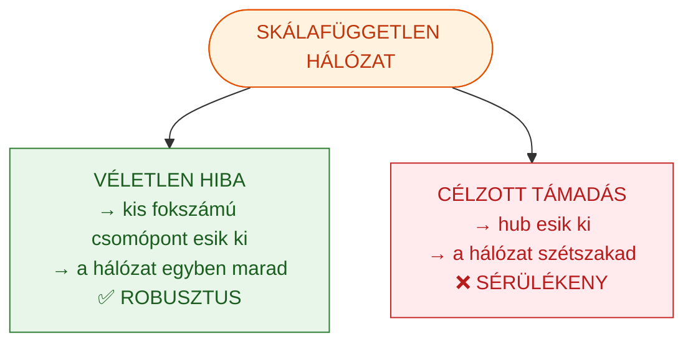

## 22.4 Menedzsment- és infrastruktúra-implikáció

A kritikus infrastruktúrák (internet, áramhálózat, ellátási lánc) skálafüggetlen jellege miatt a **hubok védelme** kiemelten fontos. Szervezeti megfelelője: ha a vállalat egy-két kulcsemberre vagy kulcspartnerre (hubra) támaszkodik, célzott kiesésük (felmondás, csőd) szétszakíthatja a működést — ezért kell **B-terv** a hub-kiesésre (redundancia, helyettesíthetőség; lásd 13. fejezet helyettesítési rétege).

---

# 23. Kaszkád meghibásodások
> » Kapcsolódó tétel: **V20** — rendszerreziliencia tervezése

A **kaszkád meghibásodás** (*cascading failure*) a robosztusság dinamikus változata: egyetlen csomópont kiesése **átterhelést** okoz a szomszédain, amelyek emiatt szintén kiesnek, láncreakciót indítva. Míg a perkoláció statikus (csomópontok eltávolítása), a kaszkád a terhelés **újraelosztásának** dinamikájáról szól.

**Valós példák:** a 2003-as észak-amerikai **áramszünet** (egy túlterhelt vezeték kiesése sorra terhelte túl a többit, 50 millió embert érintve); a 2008-as **pénzügyi válság** (egy intézmény bukása a kitettségi hálózaton át továbbgyűrűzött); ellátásilánc-szakadások (egy beszállító kiesése leállítja a downstream gyártást).

**Menedzsment-implikáció:** a reziliens rendszertervezés a kaszkád megelőzésére törekszik: **kapacitástartalék** (a csomópontok bírják a hirtelen többletterhelést), **moduláris leválaszthatóság** (a hibás rész izolálható, hogy ne terjedjen), és a **kritikus függőségek** feltérképezése. A hálózati szemlélet itt közvetlenül találkozik a kockázatmenedzsmenttel és az üzletmenet-folytonossági tervezéssel.

---

# 24. Mastenbroek négy szervezeti hálózata
> » Kapcsolódó tétel: **V16** — hatalmi struktúrák a vállalati hálózatban

## 24.1 A négy reláció

**Willem F. G. Mastenbroek** (1942–) holland szervezetszociológus négy alapvető szervezeti relációhálózatot különböztet meg. (Forrásütközés-jelzés: az előadás és a tétel-anyag a *Conflict Management and Organization Development* című művet **1988**-ra datálja; a Wiley első kiadása **1987**-es, bővített kiadása 1994-es. A vizsgán az 1988-as évszám az előadás konvenciója, de érdemes tudni az eredeti 1987-es kiadásról.)

| Hálózat | Lényege | Domináns elem | Jellemző feszültség / eszköz |
|---|---|---|---|
| **Instrumentális** | a tagok egymást a feladat eszközének tekintik; itt folyik a szakmai információcsere, adatszolgáltatás, döntéshozatal — a „munkafolyamat-háló" | munkamegosztás, koordináció | hatékonyság vs. túlszabályozás |
| **Szocio-emocionális** | szimpátián/antipátián alapuló kapcsolatok; csoportkohézió, közös nyelv, csoportidentitás, egyéni normák | érzelmek, hovatartozás | bevonás, csapatépítés |
| **Hatalmi és függőségi** | a szervezeti politikai játék terepe; erőforrásokért, pozíciókért folyó, gyakran rejtett küzdelem, a szervezeti érdek köntösében | hatalom, függőség | átláthatóság, koalíciókezelés |
| **Tárgyalási relációk** | a szervezet mint belső piac; az egyének/csoportok erőforrásokért alkudoznak, bővítik befolyási szférájukat | alku, érdekérvényesítés | tárgyalástechnika, win-win |

## 24.2 Az „egy a háromhoz" megközelítés

Mastenbroek szerint a **hatalmi és függőségi hálózat a legmeghatározóbb** és legáthatóbb reláció, és a **másik három ebből vezethető le**. A hatalmi/függőségi viszonyt három tényező határozza meg:

- **A bizonytalanság szintje:** akinek több (megbízhatóbb) információja van a jövőről, erősebb pozíciójú.
- **A helyettesíthetőség szintje:** a nehezen vagy nem helyettesíthető egyén/csoport nélkülözhetetlenségéből hatalmat nyer (ezért törekszenek a szereplők a pótolhatatlanságra).
- **A centralitás szintje és formája:** minél inkább nélkülözhetetlen valaki a hálózatban (kölcsönös függőségek metszéspontja), annál nagyobb a hatalma.

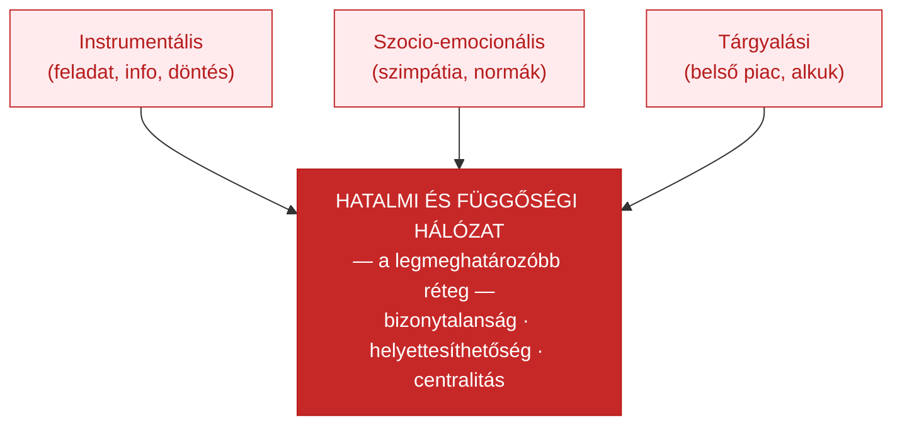

## 24.3 Menedzsment-relevancia

A négy hálózat **együttes** kezelése a szervezetfejlesztés feladata: a tisztán instrumentális (folyamat-)optimalizálás figyelmen kívül hagyja a szocio-emocionális és hatalmi dinamikát, ezért bukik el sok átszervezés. A modell összekapcsolja a kvantitatív hálózatelemzést (kit kérdezünk meg — szociometria, 3. fejezet) a szervezeti hatalom elméletével, és közvetlenül megalapozza a V16 komplex hálózati modelljét.

---

*— E) blokk: Hálózati stratégia és menedzsment (25–26. fejezet) —*

# 25. Hub-stratégia, fejlődő hálózatok és fázisátalakulás
> » Kapcsolódó tétel: **V20** — Hálózati üzleti stratégia

## 25.1 A hub-stratégia logikája

A Barabási–Albert modell (10. fejezet) **preferenciális kapcsolódása** stratégiai recept is: aki **korán** és hatékonyan épít kapcsolatokat, hub-pozícióba kerülhet, és ez a pozíció **önmagát erősítő** (a gazdag gazdagodik). A **hub-stratégia** célja a centrális pozíció megszerzése és megtartása: a hub magas betweenness-szel (6. fejezet) kontrollálja az információ- és erőforrásáramlást. **Példák:** Amazon (kereskedelmi hub), Google (információs hub), SAP (üzleti szoftver-ökoszisztéma hub). Az **első mozgó előny** (*first-mover advantage*) és az erőforrás-koncentráció itt találkozik a hálózati logikával.

A három stratégiai szint (V20):

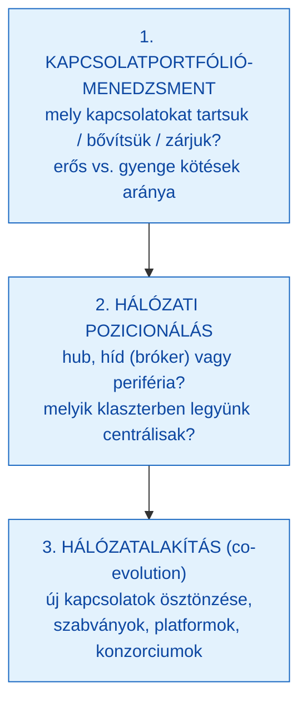

A hub- és a híd- (bróker-, 19. fejezet) stratégia **kiegészíti** egymást: a hub a centralitásra, a bróker a strukturális lyukak áthidalására épít. **Kritika:** a hub-pozíció a célzott támadásra sérülékeny (22. fejezet) és szabályozói/versenyjogi kockázatot hordoz (platform-dominancia), ezért a hub-függőség stratégiai kockázat is.

## 25.2 Fejlődő hálózatok és fázisátalakulás

A szervezetek **fejlődő (evolving) hálózatok**: a létszám és a struktúra együtt változik. A Syllabus külön kiemeli a **létszám és a hálózati fázisátalakulás összefüggését**. A jelenség az Erdős–Rényi fázisátalakulás (8. fejezet) szervezeti megfelelője: ahogy nő a szervezet és a kapcsolatsűrűség, egy **kritikus pontnál (tipping point)** a hálózat szerkezete hirtelen megváltozik — a kis, mindenki-mindenkit-ismer csapatból (közel teljes gráf, magas `⟨C⟩`) nagy szervezet lesz, ahol szükségszerűen megjelennek a koordinációs rétegek, hubok és klaszterek.

| Szakasz | Létszám | Hálózati jellemző |
|---|---|---|
| Kis csapat | ~5–15 fő | majdnem teljes gráf, közvetlen kommunikáció, alacsony formalizáltság |
| Növekedés | ~15–150 fő | klaszterek és hidak megjelenése; informális hubok (Dunbar-szám ~150 körüli határa) |
| Nagy szervezet | >150 fő | szükségszerű formalizáció, hierarchia-réteg, koordinációs hubok, silósodás kockázata |

**Menedzsment-implikáció:** a növekedés nem lineáris — a tipping point körül a korábbi (informális) koordinációs mechanizmusok hirtelen elégtelenné válnak, és tudatos struktúraváltás (új rétegek, hidak építése) kell. Aki ezt nem ismeri fel, „kinövi" a szervezeti formáját.

---

# 26. Hálózati menedzsment, szervezeti határok és szintézis
> » Kapcsolódó tétel: **V16, V20** — a vállalat komplex hálózati modellje

## 26.1 A hálózati menedzsment mint a hierarchikus menedzsment alternatívája

A hagyományos menedzsment a **kontrollra** és a belső folyamatok optimalizálására épül; a hálózati menedzsment a **pozicionálásra**, a kapcsolatmenedzsmentre és az alkalmazkodásra (17. fejezet). A stratégiai cél nem az egész uralása (lehetetlen), hanem a **kapcsolatportfólió** tudatos alakítása, a strukturális lyukak kihasználása és a híd-pozíciók építése.

## 26.2 Szervezeti határok újraértelmezése

A hagyományos vállalatelmélet a határt jogi/tulajdonosi alapon húzza meg. A hálózati szemlélet ezt **elmossa**:

| Határkoncepció | Hagyományos | Hálózati |
|---|---|---|
| Jogi határ | a vállalat tulajdonában lévő eszközök | formálisan megmarad, stratégiailag kevésbé releváns |
| Kompetencia-határ | amit a vállalat el tud végezni | kiterjed a partnerek kompetenciáira (kiszervezés, co-development) |
| Kapcsolati határ | nem értelmezett | a vállalat hálózati identitása: kit tekint partnernek |

A kiszervezés, a stratégiai szövetség, a joint venture és a platform-ökoszisztéma mind a hálózati szemlélet terméke (kapcsolat: tükrözési hipotézis, 14. fejezet — a határ a kommunikációs struktúrában is megjelenik).

## 26.3 A vállalat komplex hálózati modellje — szintézis

A tárgy záró szintézise: a vállalat egyszerre **multiplex hálózat** (12–13. fejezet: egymásra rakódott rétegek), **ARA-rendszer** (18. fejezet: szereplők, erőforrások, tevékenységek a vállalatközi térben) és **hatalmi struktúra** (24. fejezet: Mastenbroek négy hálózata). A három nézőpont ugyanazt a valóságot világítja meg eltérő oldalról:

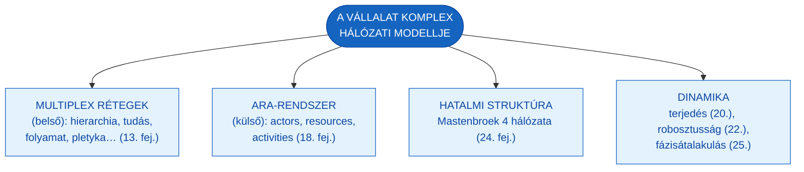

## 26.4 Szervezeti eredményesség hálózati nézőpontból

A hálózati megközelítés az **eredményességet** (effectiveness) hálózati kontextusban méri: nemcsak a saját folyamatok optimálisak, hanem a kapcsolatokon át elérhető értékteremtés is. Mérőszámai: a hálózati pozíció mutatói (betweenness-, closeness-, fokszám-centralitás), a kapcsolati portfólió minősége (kulcskapcsolatok stabilitása, erős/gyenge kötések aránya, hidak száma) és a hálózati robosztusság (perkolációs küszöb, hub-függőség kezelése). A preferenciális kapcsolódás logikájából a legfontosabb stratégiai tanulság: a **korai és tudatos pozicionálás** a legnagyobb hozamú hálózati lépés.

---

# A. függelék — Vizsgaösszefoglaló (V16–V20 cheat-sheet)

> Tömör, vizsgára hangolt összefoglaló. A részletes kifejtést a fenti fejezetek tartalmazzák; itt a V-tételek szerinti gyors átismétlés következik.

### V16 — A vállalat komplex hálózati modellje » 12–14., 24., 26. fejezet
A vállalat **multiplex hálózat**: ugyanazon csomópontok (dolgozók) között több réteg (hierarchia, szakmai rendelés, tudásmegosztás, helyettesítési, folyamat, térbeli, preferencia, pletyka). A **valódi struktúra** (szociogram — Moreno, 1933) eltér a **formálistól** (organigram). **Mastenbroek** (1987/1988) négy hálózata: instrumentális, szocio-emocionális, **hatalmi/függőségi** (a legmeghatározóbb, „egy a háromhoz"), tárgyalási. A hatalom három tényezője: bizonytalanság, helyettesíthetőség, centralitás. **Tükrözési hipotézis** (Conway, 1968; MacCormack et al., 2012): a termékarchitektúra a szervezet kommunikációs struktúráját tükrözi.

### V17 — Az üzleti kölcsönhatások tényezői » 16. fejezet
Håkansson (2010) **öt tényezője**: (1) **időbeliség** (a kapcsolat fejlődik, múltja van, kapcsolatspecifikus adaptáció), (2) **szubjektív értelmezés** (a felek eltérően látják), (3) **kapcsoltság** (nincs önálló kapcsolat, csak hálózati kontextus), (4) **kölcsönös függőség** (erőforrás-, rutin-, reputáció-függőség), (5) **viszonylagosság** (csak más kapcsolatokhoz mérten értékelhető). Együtt: dinamikus, szubjektíven értelmezett, hálózatba ágyazott folyamat.

### V18 — Hálózati működés és szempontjai » 17–18. fejezet (+4.)
**Három szempont** (Håkansson, 2010): (1) **irányíthatóság** (senki sem uralja az egészet → pozicionálás), (2) **tudás** (elosztott, kapcsolatokon át áramlik — Granovetter gyenge kötései: a hidak hozzák az új tudást), (3) **változás** (folyamatos, kaszkádszerű, nem teljesen tervezett). **ARA modell** (Håkansson & Snehota, 1995): Actors (actor bonds) – Resources (resource ties) – Activities (activity links). Vegyes kapcsolatportfólió: erős kötések a stabilitáshoz, gyenge kötések az innovációhoz.

### V19 — Üzleti kölcsönhatások hálózatalapú megközelítése » 15. fejezet
Az **IMP csoport** kritikája a **struktúra-alapú** (Porter, neoklasszikus: statikus, anonim, tranzakcionális, tudás-vak) és a **folyamat-alapú** (belső értéklánc: bezárt, az érték a kapcsolatokban keletkezik) megközelítésre. **Megoldás: a piac mint hálózat** — egyedi, tartós kapcsolatok; nincs tökéletes verseny; az ár csak egy koordináló mechanizmus; piaci pozíció = hálózati pozíció; az innováció hálózati folyamat. **IMP interakció-modell**: epizódok, légkör, szervezet+egyén, környezet.

### V20 — Hálózati üzleti stratégia » 6., 10–11., 19., 22., 25–26. fejezet
A stratégia a **hálózati pozícióból** is fakad, nem csak belülről. **Power-law** fokszámeloszlás + **preferenciális kapcsolódás** → korai pozicionálás önerősítő előny. **Hub-stratégia** (centralitás, magas betweenness) és **híd-/bróker-stratégia** (Burt, 1992: strukturális lyukak áthidalása). **Szervezeti határok** elmosódnak (jogi → kompetencia → kapcsolati). **Robosztusság:** skálafüggetlen hálózat robusztus a véletlen hibára, **sérülékeny** a célzott hub-támadásra → B-terv. **Fázisátalakulás**: a létszám növekedésével tipping point, struktúraváltás kényszere.

---

## Kulcsfogalmak

| Fogalom | Magyar megfelelő | Definíció |
|---|---|---|
| Network science | Hálózattudomány | Interdiszciplináris tudomány (gráfelmélet, statisztikus fizika, mérnöki és statisztikai módszerek) a valós hálózatok vizsgálatára |
| Node / Link | Csomópont / kapcsolat | A hálózat alapegysége, ill. két csomópont összeköttetése |
| Degree (k_i) | Fokszám | Egy csomóponthoz kapcsolódó élek száma; irányítottnál be- és ki-fokszám |
| Degree distribution (p_k) | Fokszámeloszlás | Annak valószínűsége, hogy egy véletlen csomópont fokszáma k; a hálózat „ujjlenyomata" |
| Average path length ⟨d⟩ | Átlagos útköltség | Az összes csúcspár legrövidebb távolságának átlaga |
| Network diameter | Hálózati átmérő | A legrövidebb utak közül a leghosszabb |
| Clustering coefficient | Klaszterezési együttható | Mennyire kapcsolódnak egymáshoz egy csomópont szomszédai (C_i ∈ [0,1]) |
| Betweenness centrality | Közbeesettségi centralitás | Hány legrövidebb út halad át egy csomóponton — híd-/kapuőr-szerep |
| Closeness centrality | Közelségi centralitás | A csomópont átlagos távolságának reciproka — elérés gyorsasága |
| Eigenvector centrality | Sajátvektor-centralitás | „Fontos vagyok, ha fontosakhoz kötődöm"; a PageRank rokona |
| Community detection / modularity | Közösségdetektálás / modularitás | Sűrűn kapcsolt csoportok azonosítása (Girvan–Newman); a felbontás jósága (Q) |
| Random network (Erdős–Rényi) | Véletlen hálózat | G(N,p): minden párt p valószínűséggel kötünk; Poisson-eloszlás, óriáskomponens-fázisátalakulás |
| Small world | Kis világ | Magas klaszterezettség + rövid átlagos úthossz (⟨d⟩ ≈ lnN/ln⟨k⟩); Watts–Strogatz |
| Scale-free network | Skálafüggetlen hálózat | Hatványfüggvény-fokszámeloszlás (P(k)~k^−γ); kevés hub, sok kis fokszámú csomópont |
| Hub | Hub | Kiemelkedően magas fokszámú csomópont skálafüggetlen hálózatban |
| Preferential attachment | Preferenciális kapcsolódás | Az új csomópont a jól kapcsolt csomópontokhoz köt („a gazdag gazdagodik") |
| Phase transition / tipping point | Fázisátalakulás | A hálózati szerkezet hirtelen, küszöb-jellegű megváltozása (pl. óriáskomponens, létszám-növekedés) |
| Multiplex network | Multiplex hálózat | Több réteg azonos csomópontokkal; réteg-közötti él csak ugyanazon csomópont másai közt |
| Multilayer / inter-/intra-layer | Multilayer / réteg-közötti, réteg-belüli | Több rétegű hálózat; rétegen belüli, ill. rétegek közötti kapcsolatok (Kivelä et al., 2014) |
| IMP Group | IMP csoport | Industrial Marketing and Purchasing Group; az üzleti hálózatelmélet vezető iskolája |
| ARA model | ARA modell | Actors–Resources–Activities; az üzleti hálózat három dimenziója (actor bonds, resource ties, activity links) |
| Activity links / resource ties / actor bonds | Tevékenység-kötések / erőforrás-kötések / szereplői kötések | Az ARA modell három kötéstípusa a kapcsolat „fejlettségének" mérésére |
| Structural hole | Strukturális lyuk | Két nem összekötött klaszter közötti „üres tér"; áthidalása stratégiai előny (Burt, 1992) |
| Brokerage vs. closure | Bróker- vs. zártság-előny | Híd-pozíció információs/kontroll-előnye (Burt) vs. a sűrű háló bizalmi tőkéje (Coleman) |
| Weak ties | Gyenge kötések | Laza ismeretségek, amelyek hídként új tudást közvetítenek (Granovetter, 1973) |
| Percolation | Perkoláció | Csomópontok eltávolításának hatása az összefüggőségre; kritikus küszöb, óriáskomponens |
| Robustness (failure vs. attack) | Robosztusság (hiba vs. támadás) | Skálafüggetlen háló: robusztus a véletlen hibára, sérülékeny a célzott hub-támadásra |
| Cascading failure | Kaszkád meghibásodás | Terhelés-újraelosztásból eredő láncreakciós kiesés (áramhálózat, pénzügy, ellátási lánc) |
| Information spreading model | Információterjedési modell | Kiterjesztett szomszédossági mátrix P + S_t állapotvektor iteratív frissítése; SIR/SIS analógia |
| Echo chamber / filter bubble | Visszhangkamra / véleménybuborék | Homofília + algoritmusos szűrés okozta megerősítő visszacsatolás |
| Mirroring hypothesis | Tükrözési hipotézis | A termékarchitektúra a szervezet kommunikációs struktúráját tükrözi (Conway, 1968; MacCormack et al., 2012) |
| Mastenbroek 4 networks | Mastenbroek 4 hálózata | Instrumentális, szocio-emocionális, hatalmi/függőségi, tárgyalási reláció |
| Sociometry | Szociometria | Moreno (1933): a csoport személyes preferenciáinak feltérképezése; szociogram ≠ organigram |

---

## Ajánlott irodalom

A Syllabus kötelező és ajánlott irodalma:

- **Barabási Albert-László** (2022): *Behálózva.* Open Books. — **kötelező irodalom** (eredeti: *Linked*, 2002).
- **Barabási Albert-László** (2024): *A hálózatok tudománya.* Open Books. — a *Network Science* tankönyv magyar kiadása; teljes tudományos apparátus.
- **Håkansson, Håkan** (2010): *Határtalan hálózatok.* Alinea Kiadó. (Eredeti: *Business in Networks*, Wiley, 2009.) — az IMP üzleti hálózatelmélet.
- **Csermely Péter** (2010): *Hálózatok bűvöletében.* Kairosz Kiadó.
- **Csermely Péter** (2005): *A rejtett hálózatok ereje.* Vince Kiadó.
- **Christakis, Nicholas A. – Fowler, James H.** (2010): *Kapcsolatok hálójában.* Typotex.
- **Buchanan, Mark** (2003): *Nexus.* Typotex. — kis világ hálózatok és társadalmi következményeik.

## Feldolgozott forrásanyagok a mappában

| Fájl | Típus | Tartalom | Fő fejezet-relevancia |
|---|---|---|---|
| Barabási Albert-László - Network Science.pdf | tankönyv (pre-pub, 2014) | gráfelmélet, indikátorok, véletlen / skálafüggetlen / BA hálózatok, robosztusság | 1–11., 22. |
| Előadás_ppt1.pdf | előadás (angol) | a tárgy teljes íve: alapok, indikátorok, hálózattípusok, multiplex, terjedés, robosztusság, Mastenbroek | 1–13., 20., 22., 24. |
| Hálózatelmélet a Startup Piackutatásban.docx | segédanyag | centralitás, gyenge kötések, strukturális lyukak üzleti/piackutatási kontextusban | 4., 6., 19. (szemléltetés) |
| MacCormack, Baldwin & Rusnak (2012).pdf | lektorált cikk | tükrözési hipotézis, Conway-törvény empirikus tesztje | 14. |
| Mark Buchanan - Nexus.pdf | ajánlott mű | kis világ, hat fokos szeparáció, hálózati törvények | 3., 9. |
| GMXVU2MBLF - Syllabus.pdf | syllabus | tantárgyadatok, heti tématérkép, irodalom | Tantárgy adatok, Témakörök |

> A *Hálózatelmélet a Startup Piackutatásban.docx* kontextualizáló segédanyag: szemléltető üzleti példákhoz hivatkozható, de önálló akadémiai forrásként nem — minden állítást az eredeti primér forrással (Granovetter, 1973; Burt, 1992 stb.) támasztunk alá.

---

## Felhasznált irodalom (APA 7)

Albert, R., Jeong, H., & Barabási, A.-L. (2000). Error and attack tolerance of complex networks. *Nature, 406*(6794), 378–382.

Barabási, A.-L. (2016). *Network science.* Cambridge University Press.

Barabási, A.-L. (2022). *Behálózva* (Linked). Open Books.

Barabási, A.-L., & Albert, R. (1999). Emergence of scaling in random networks. *Science, 286*(5439), 509–512.

Broido, A. D., & Clauset, A. (2019). Scale-free networks are rare. *Nature Communications, 10*, 1017.

Buchanan, M. (2003). *Nexus.* Typotex. (Eredeti: *Nexus: Small worlds and the groundbreaking science of networks*, Norton, 2002.)

Burt, R. S. (1992). *Structural holes: The social structure of competition.* Harvard University Press.

Christakis, N. A., & Fowler, J. H. (2010). *Kapcsolatok hálójában.* Typotex.

Conway, M. E. (1968). How do committees invent? *Datamation, 14*(4), 28–31.

Csermely, P. (2005). *A rejtett hálózatok ereje.* Vince Kiadó.

Csermely, P. (2010). *Hálózatok bűvöletében.* Kairosz Kiadó.

Erdős, P., & Rényi, A. (1959). On random graphs I. *Publicationes Mathematicae, 6*, 290–297.

Girvan, M., & Newman, M. E. J. (2002). Community structure in social and biological networks. *Proceedings of the National Academy of Sciences, 99*(12), 7821–7826.

Granovetter, M. S. (1973). The strength of weak ties. *American Journal of Sociology, 78*(6), 1360–1380.

Håkansson, H. (2010). *Határtalan hálózatok* (Business in networks). Alinea Kiadó.

Håkansson, H., & Snehota, I. (1995). *Developing relationships in business networks.* Routledge.

Karinthy, F. (1929). Láncszemek. In *Minden másképpen van.* Athenaeum.

Kivelä, M., Arenas, A., Barthelemy, M., Gleeson, J. P., Moreno, Y., & Porter, M. A. (2014). Multilayer networks. *Journal of Complex Networks, 2*(3), 203–271.

MacCormack, A., Baldwin, C., & Rusnak, J. (2012). Exploring the duality between product and organizational architectures: A test of the "mirroring" hypothesis. *Research Policy, 41*(8), 1309–1324.

Mastenbroek, W. F. G. (1987). *Conflict management and organization development.* Wiley. (Az előadás 1988-as évszámmal hivatkozza; bővített kiadás: 1994.)

Milgram, S. (1967). The small-world problem. *Psychology Today, 1*(1), 61–67.

Moreno, J. L. (1934). *Who shall survive? A new approach to the problem of human interrelations.* Nervous and Mental Disease Publishing. (A szociometria módszerét 1933-ban mutatta be.)

Newman, M. E. J. (2010). *Networks: An introduction.* Oxford University Press.

Porter, M. E. (1985). *Competitive advantage: Creating and sustaining superior performance.* Free Press.

Rajkumar, K., Saint-Jacques, G., Bojinov, I., Brynjolfsson, E., & Aral, S. (2022). A causal test of the strength of weak ties. *Science, 377*(6612), 1304–1310.

Wasserman, S., & Faust, K. (1994). *Social network analysis: Methods and applications.* Cambridge University Press.

Watts, D. J. (2003). *Six degrees: The science of a connected age.* Norton.

Watts, D. J., & Strogatz, S. H. (1998). Collective dynamics of "small-world" networks. *Nature, 393*(6684), 440–442.

---

*Forrás: GMXVU2MBLF Syllabus (2025/26-2); Előadás_ppt1.pdf (Dr. Szilágyi Győző Attila); Barabási (2016, 2022); Håkansson (2010); Håkansson & Snehota (1995); a fent felsorolt lektorált szakirodalom. Hivatkozási stílus: APA 7.*

