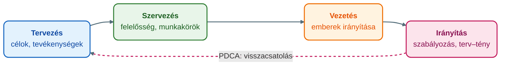

## K1 – Menedzsment fogalma, funkciói

### Beszerzendő anyagok

| Szerző | Mű | Jelleg | Indoklás / érintett rész |
|---|---|---|---|
| Farkas András | Illusztráció és ábragyűjtemény. Tanségédlet. VMJ, 2004. | ajánlott irodalom | A syllabus ajánlott irodalomként nevezi meg; az 1. előadás 21. diája a kulcskérdések ábráját Farkas András nevével hozza, de a magyarázata a helyi anyagban csak az ábra feliratainak szintjén van meg (R2 részkérdés). |

**Tétel:** Menedzsment fogalma, funkciói: Ismertesse a menedzsment fogalmát, kulcskérdéseit! Mutassa be a főbb szakterületeket és a menedzsment négy fő funkcióját!

---

### A szervezet mint kiindulópont

A menedzsment működési környezete és szükséges funkciói a szervezetek felépítéséből érthetők meg, ezért a szervezettel kezdjük. Chester Barnard megfogalmazásában a szervezet „két vagy több ember szándékosan összehangolt tevékenységeinek vagy erőinek rendszere" (Óbudai Egyetem, Keleti Károly Gazdasági Kar, Marketing, Menedzsment és Módszertani Intézet [ÓE KGK MMI], 2023b, 4. dia). A szervezet folyamatosan változó környezetben működik, rugalmasan kell alkalmazkodnia az egyre bonyolultabb környezethez, hosszú és rövid távú céljai vannak, a résztvevők a célok eléréséért együttműködnek, és elkülönül benne a felelősség és a hatáskör (ÓE KGK MMI, 2023b, 5. dia).

A szervezetet rendszerként a fekete doboz modell írja le. Bemenetei a tőke, a munkaerő, az anyag és az információ; kimenetei a termékek, a szolgáltatások, a profit, a hulladék és az információ. A dobozon belül határoló alrendszert, menedzsment alrendszert és technikai alrendszert különböztetünk meg (ÓE KGK MMI, 2023b, 7–8. dia).

A vállalkozás önálló gazdasági egység, amely saját nevében és felelősségére, üzletszerűen tevékenykedik, elsődleges célja a profitszerzés, és kockázatot vállal (ÓE KGK MMI, 2023b, 6. dia). Az EU-s méretbesorolás a létszámot és az éves nettó árbevételt vagy a mérlegfőösszeget veszi alapul: a középvállalkozás 250 fő alatti, árbevétele legfeljebb 50 millió, mérlegfőösszege legfeljebb 43 millió euró; a kisvállalkozás 50 fő alatti, 10 millió eurós árbevétel- és mérlegfőösszeg-határral; a mikrovállalkozás 10 fő alatti, 2 millió eurós határral (ÓE KGK MMI, 2023b, 12. dia). Hazai jogi formái például az egyéni vállalkozás, a társas vállalkozások (kkt., bt., kft., rt.) és a szövetkezet (ÓE KGK MMI, 2023b, 13. dia).

### A menedzsment fogalma

A **menedzsment** olyan folyamat, amelyet egy vagy több személy végez mások tevékenységének koordinálására, olyan eredmények elérése érdekében, amelyeket egyikük sem tudna egyedül elérni (ÓE KGK MMI, 2023b, 17. dia; ÓE KGK MMI, 2023a). Nem bizonyos szakma: mindenhol megjelenik, ahol emberek valamilyen céllal együtt tevékenykednek, például sportegyesületben, egyetemen vagy kórházi osztályon (ÓE KGK MMI, 2023a). A *management* kifejezés jelentheti a manager tevékenységét, a módszertani apparátust és a vezetői testületet is (ÓE KGK MMI, 2023a).

A **menedzsmenttudomány** az eredményes és hatékony csoportos tevékenység, az egyéni és szervezeti működés tudománya. Módszerek és gyakorlati tapasztalatokból leszűrt elméletek együttese arra, hogy az egyének csoportban, szervezetben tevékenykedve hogyan érik el a kitűzött célokat (eredményesség) a lehető legjobb hatásfokkal (ÓE KGK MMI, 2023b, 18. dia; Novák, 2023). Interdiszciplináris tudomány (Novák, 2023).

A **menedzsmentfolyamat** a menedzseléshez szükséges feladatok rendszere a tevékenységek végrehajtásához és a vállalkozási célok eléréséhez. A menedzselés irányulhat személyre és szervezetre is, és az irányítás során a vezető nem közvetlenül, hanem áttételesen hat a vezetettre (ÓE KGK MMI, 2023b, 18. dia). A **menedzser** az, akit arra neveznek ki, hogy a szervezeti egység adott hatásköri keretek között, meghatározott erőforrásokkal elérje a körülírt célokat. Feladata az irányítás, a szervezés és az ellenőrzés; magas szervezeti kompetencia jellemzi, és lemond a szakértői karrierről (ÓE KGK MMI, 2023b, 20. dia).

### A menedzsment kulcskérdései

Az előadás a menedzsment kulcskérdéseit Farkas András ábrája nyomán mutatja be (ÓE KGK MMI, 2023b, 21. dia). Az ábra közepén a szervezeti célok elérése áll. Körülötte három feladat kapcsolódik hozzá: másokkal dolgozni és másokat dolgoztatni; kiegyensúlyozni a hatásosságot és a hatékonyságot; a legtöbbet kihozni a korlátozottan rendelkezésre álló erőforrásokból. A változó környezet mindhárom oldalról hat a menedzsmentre.

Az erőforrások kérdését az előadás példával világítja meg: a menedzsment tevékenysége nem a cél elérésénél, hanem a rendelkezésre álló erőforrásokból való maximum kihozatalánál kezdődik. Egy nyaralás végén sokszor mondjuk, hogy nagyon jó volt, de a kérdés az, hogy hasonló összegből, megfelelő tervezéssel és kutatással nem lehetett volna-e még tartalmasabbat szervezni (ÓE KGK MMI, 2023b, 26. dia).

### A menedzsment főbb szakterületei

A menedzsment komplex, szerteágazó terület, amely leginkább a már létező szervezeti egységek optimalizálására és működésük elősegítésére irányul. Ismeretanyaga három körbe sorolható: humánismeretek (például szociálpszichológia, jogi, nyelvi, kommunikációs ismeretek), vezetéselméleti ismeretek (például döntéselmélet, stratégiai és taktikai tervezés, marketing, innováció, projektmenedzsment) és vezetés- és szervezéstechnikai ismeretek (informatika, szakértői rendszerek) (ÓE KGK MMI, 2023b, 32. dia). A főbb szakterületeket az előadás aszerint rendezi, hogy melyik milyen kérdést old meg a vállalkozásban (ÓE KGK MMI, 2023b, 31. dia):

| Szakterület | Megoldandó kérdés | Szakmai tartalom |
|---|---|---|
| **Stratégiai menedzsment** | Mit? Miért? (a vállalkozás tárgya, célja) | Küldetés, célok, alaperőforrások hasznosítása |
| **Marketingmenedzsment** | Kinek? Mennyit? (a vállalkozás méretezése) | Fogyasztói igények, piac, volumen, választék |
| **Projektmenedzsment** | Mivel? (a vállalkozás anyagi-technikai bázisa) | Erőforrás-szükségletek, beruházások, technológiák |
| **Termelésmenedzsment** | Mikor? Hol? Hogyan? (a vállalkozás működtetése) | Termelés/szolgáltatás feltételei, koordináció |
| **Pénzügyi/üzleti menedzsment** | Mennyiért? (a vállalkozás pénzügyei, gazdálkodása) | Pénzügyi, gazdálkodási, nyilvántartási kérdések |
| **Minőségmenedzsment** | Milyen minőségben? (a vállalkozás színvonala) | Minőségügyi rendszer létrehozása, fenntartása |
| **Humánmenedzsment** | Kikkel? (a vállalkozás emberi erőforrásai) | Munkaerő-mérleg, képzés, motiválás |
| **Információmenedzsment** | Hogy állunk? (a tájékoztatás megoldása) | Visszacsatolás, információtechnológia |
| **Innovációmenedzsment** | Hogyan tovább? (a vállalkozás megújítása) | Megújítási, cselekvési kényszer |
| **Változásmenedzsment** | Mit, miért változtassunk? | Környezeti kihívások, belső feszültségek, válságok |

Az alapfogalmi jegyzet ugyanezt a tíz területet sorolja, de a stratégiai menedzsment helyett a környezeti és vállalkozási kultúra menedzselését nevezi meg (ÓE KGK MMI, 2023a).

### A menedzsment négy fő funkciója

Az előadás szerint a menedzsment négy alapfunkciója a **tervezés**, a **szervezés**, a **vezetés** és az **irányítás**. Ezek segítik a menedzsmentet a tervezésben és a tervek megvalósításában, hogy a vállalkozások elérjék célkitűzéseiket, létrejöjjenek a megfelelő felelősségek és munkakörök, és végül meglegyenek a működéshez szükséges feltételek (ÓE KGK MMI, 2023b, 22. dia).

1. **Tervezés.** A szervezetek alapproblémája a változó környezethez való sikeres alkalmazkodás. A tervezés a problémák „elméleti" megoldásával kijelöli az elérendő célokat és az elérésükhöz vezető fontosabb tevékenységeket, a szervezet célhierarchiájának megfelelően több szinten. Feltétele a környezet és a működést befolyásoló tényezők elemzése, valamint a vízió és a hosszú távú célok ismerete. A tervezés tudatos, a szervezeti tudást és tapasztalatot kihasználó alkalmazkodás a környezeti változásokhoz, a kockázatok minimalizálásával (ÓE KGK MMI, 2023b, 23. dia).
2. **Szervezés.** Olyan struktúrafejlesztő tevékenység, amely valamilyen cél hatékony és eredményes elérése érdekében konkrét erőforrásokat és tevékenységeket rendel egymáshoz és hangol össze. Irányulhat a szervezetben zajló folyamatokra és a szervezet felépítésére is (ÓE KGK MMI, 2023c, 20. dia). Része a rugalmas hatáskör- és felelősségi hálózatok tervezése (ÓE KGK MMI, 2023b, 24. dia).
3. **Vezetés (az emberek irányítása).** A dolgozók irányítása közvetett és közvetlen utasításokkal, a szervezeti filozófia meghonosítása, folyamatos kommunikáció, a dolgozók bevonása a döntéshozatalba, konfliktuskezelés, motiváció, a szükséges információk és tudás megosztása, valamint a vezetői utánpótlás biztosítása (ÓE KGK MMI, 2023b, 27. dia).
4. **Irányítás (szabályozás).** Az előadás ezt szabályozásként tárgyalja: folyamatos nyomon követés, rendszeres kommunikáció, terv–tény összehasonlítás, az előrehaladás mérése és értékelése, a kockázatok elemzése, helyesbítő lépések, ellenőrzés és dokumentáció. Az ellenőrzés tehát az irányítás eleme. Ez a PDCA-ciklus (plan, do, check, act): folyamatos, véget nem érő tevékenység (ÓE KGK MMI, 2023b, 25. dia). Az irányításhoz tartozik az erőforrások optimális felhasználásának biztosítása, a működéshez szükséges erőforrások és környezet megteremtése, valamint az oktatás, továbbképzés és az információáramlás biztosítása (ÓE KGK MMI, 2023b, 26. dia).

A funkciók időigénye a szervezeti szinttől függ: a csúcsmenedzsmentben a tervezés és a szervezés, az első vonalbeli menedzsmentben a vezetés és az irányítás kap nagyobb súlyt (ÓE KGK MMI, 2023b, 30. dia).

### Menedzser és vezető

A menedzsment és a vezetés nem azonos. Kotter a menedzser és a leader (vezető) fő tevékenységei közötti különbségeket így határozza meg (ÓE KGK MMI, 2023b, 19. dia; Novák, 2023):

|  | Menedzser | Leader (vezető) |
|---|---|---|
| **Célkitűzés** | Tervezés, költségvetési keretek allokálása | Jövőkép, változási stratégiák |
| **Feltétel-biztosítás** | Szervezés, formális rendszerek kialakítása, emberi erőforrás menedzsment | Maga mellé állít, kommunikál, meggyőz, elfogadtat |
| **Végrehajtás** | Problémamegoldás, kontroll | Motivál, inspirál, megerősít |
| **Sikerkritérium** | Belső hatékonyság, a komplex szervezet zökkenőmentes működési rendszere | Eredményesség, a környezet kihívásainak megfelelő sikeres szervezési változás |

Az előadás másik megfogalmazásában a menedzselés az eredmények elérését szolgálja (tervezés, döntés, szervezés, irányítás, összehangolás, ellenőrzés), a vezetés pedig a rendszerek javítását (látomás, megvilágosodás, igazodás, hatáskörrel való felruházás, betanítás, törődés) (ÓE KGK MMI, 2023b, 17–18. dia). A kompetenciák szerint a menedzser magas szervezeti és alacsony szakértői kompetenciájú, a vezető mindkettőben magas, a szakértő csak a szakértői kompetenciában erős, a támogató munkatárs mindkettőben alacsony (ÓE KGK MMI, 2023c, 14. dia).

### Mintzberg menedzseri szerepei

Mintzberg vizsgálatai alapján a vezetők munkájának döntő hányada kommunikációval, hírek és információk közlésével és fogadásával telik (Mintzberg, 1973, idézi: ÓE KGK MMI, 2023c, 21. dia). Az előadás a menedzseri szerepeket három csoportba rendezi (ÓE KGK MMI, 2023b, 28. dia):

- *Magatartási szerepek*: formális képviselő, kapcsolattartó, vezető.
- *Információs szerepek*: megfigyelő, elterjesztő, szóvivő.
- *Döntési szerepek*: vállalkozó, zavarkezelő, erőforrás-elosztó, tárgyaló.

### Összegzés

A menedzsment tehát a koordinálás folyamata: a szervezet célját úgy kell elérni, hogy a korlátozott erőforrásokból a legtöbbet hozzuk ki, hatásosan és hatékonyan. A szakterületek azt mutatják meg, hogy a vállalkozás mely kérdéseit (mit, kinek, mivel, kikkel, hogyan tovább) kezeli a menedzsment. A négy funkció a folyamatot bontja fel: a tervezés kijelöli a célt, a szervezés felelősségeket és munkaköröket rendel hozzá, a vezetés az emberek irányítását végzi, az irányítás pedig a terv–tény összevetéssel visszacsatol. A menedzser–vezető megkülönböztetés a szerepet vizsgálja: a menedzser sikerkritériuma a belső hatékonyság, a leaderé az eredményesség és a környezet kihívásainak megfelelő változás (ÓE KGK MMI, 2023b, 19. dia). A menedzsment feladatkörei a vállalkozások létrehozására, üzemeltetésére és átalakítására terjednek ki (ÓE KGK MMI, 2023a).

---

### Várható vizsgáztatói kérdések

1. **Mi a különbség a hatékonyság és az eredményesség között?** — Kotter megkülönböztetése szerint a menedzser sikerkritériuma a belső hatékonyság, a leaderé az eredményesség, vagyis a környezet kihívásainak megfelelő változás (ÓE KGK MMI, 2023b, 19. dia). A menedzsmenttudomány a kitűzött célok elérését (eredményesség) a lehető legjobb hatásfokkal vizsgálja (Novák, 2023). Az előadás kulcskérdése szerint a hatásosság és a hatékonyság egyensúlyát kell megtalálni (ÓE KGK MMI, 2023b, 21. dia).
2. **Miben tér el a menedzser és a vezető?** — A menedzselés az eredmények elérésére, a vezetés a rendszerek javítására irányul; Kotter négy területen vet össze (célkitűzés, feltétel-biztosítás, végrehajtás, sikerkritérium) (ÓE KGK MMI, 2023b, 17–19. dia). A kompetenciamátrix szerint a menedzser szervezeti kompetenciája magas, szakértői kompetenciája alacsony (ÓE KGK MMI, 2023c, 14. dia).
3. **Hány funkciót különböztetünk meg, és hol az ellenőrzés?** — Az 1. előadás négyet nevez meg: tervezés, szervezés, vezetés, irányítás (ÓE KGK MMI, 2023b, 22. dia). Az alapfogalmi jegyzet a menedzselést három egymásra épülő feladatként (tervezés, szervezés, vezetés) írja le, a 24. dia pedig a tervezés mellé a szervezést, a személyzet biztosítását, a kommunikálást, a motiválást és vezetést, valamint az ellenőrzést is külön elemként tünteti fel. Az ellenőrzés (terv–tény összevetés, módosító lépések) a 25. dia szerint az irányítás/szabályozás tartalma, a jegyzet ábrája pedig az irányítási fázis elemeként nevezi meg (ÓE KGK MMI, 2023a, 2023b).
4. **Hogyan oszlik meg a funkciók időigénye a szervezeti szinteken?** — A csúcsmenedzsmentben a tervezés és a szervezés, az első vonalbeli menedzsmentben a vezetés és az irányítás kap nagyobb súlyt (ÓE KGK MMI, 2023b, 30. dia).
5. **Melyek Mintzberg szerepcsoportjai?** — Magatartási (formális képviselő, kapcsolattartó, vezető), információs (megfigyelő, elterjesztő, szóvivő) és döntési szerepek (vállalkozó, zavarkezelő, erőforrás-elosztó, tárgyaló) (ÓE KGK MMI, 2023b, 28. dia). Mintzberg vizsgálatai szerint a vezetők munkájának döntő hányada a kommunikáció (Mintzberg, 1973, idézi: ÓE KGK MMI, 2023c, 21. dia).
6. **Milyen alrendszerei vannak a szervezetnek a fekete doboz modellben?** — A szervezet bemenetekből (tőke, munkaerő, anyag, információ) termékeket, szolgáltatásokat, profitot, hulladékot és információt állít elő. A dobozon belül határoló, menedzsment és technikai alrendszer különíthető el, a menedzsment tehát önálló alrendszerként szerepel (ÓE KGK MMI, 2023b, 7–8. dia).

---

## Irodalom

* Novák, J. (2023). *Javaslatok Menedzsment c. tárgy gyakorlatához* [Gyakorlati anyag]. Óbudai Egyetem, Keleti Károly Gazdasági Kar.
* Óbudai Egyetem, Keleti Károly Gazdasági Kar, Marketing, Menedzsment és Módszertani Intézet. (2023a). *A menedzsment alapfogalmai* [Egyetemi jegyzet].
* Óbudai Egyetem, Keleti Károly Gazdasági Kar, Marketing, Menedzsment és Módszertani Intézet. (2023b). *Menedzsment alapjai* [Előadás-prezentáció, 1. ea.].
* Óbudai Egyetem, Keleti Károly Gazdasági Kar, Marketing, Menedzsment és Módszertani Intézet. (2023c). *A vezető* [Előadás-prezentáció, 4. ea.].
