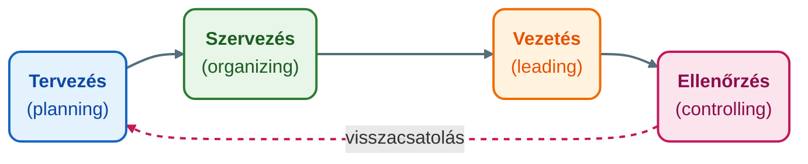

## K1. Menedzsment fogalma, funkciói

**Tétel:** „Ismertesse a menedzsment fogalmát, kulcskérdéseit! Mutassa be a főbb szakterületeket és a menedzsment négy fő funkcióját!"

### A szervezet mint kiindulópont

Mielőtt a menedzsmentről beszélünk, érdemes tisztázni, mit értünk szervezeten. **Chester Barnard** (1938) definíciója szerint a szervezet „két vagy több személy tudatosan koordinált tevékenységeinek rendszere." Ez a megfogalmazás három dolgot emel ki: az emberek részvételét, a tudatosságot és a koordinációt. Nem minden emberi együttlét szervezet — csak az, amelyben valamilyen közös cél érdekében összehangolt cselekvés zajlik.

A szervezet rendszerként is értelmezhető. A **fekete doboz modell** szerint: bemenet (erőforrások: ember, anyag, pénz, információ) → transzformáció (szervezet belső folyamatai) → kimenet (termék, szolgáltatás). A környezet visszajelzést ad a kimenetre, ez a visszacsatolás. A modell haszna, hogy a szervezetet a környezetével együtt, dinamikus egységként kezeli.

### A menedzsment fogalma

A **menedzsment** az a tevékenység, amelynek célja, hogy egy szervezet erőforrásait hatékonyan és eredményesen felhasználva elérje kitűzött céljait. Két kulcsszó: *hatékonyság* (a dolgokat jól csináljuk — a ráfordítás és az eredmény aránya kedvező) és *eredményesség* (a jó dolgokat csináljuk — a megfelelő célokat tűzzük ki).

A menedzsment egyszerre tudomány és művészet. Tudomány, mert elvei és módszerei empirikusan megalapozottak és általánosíthatók. Művészet, mert alkalmazásuk mindig konkrét helyzethez, személyekhez és kultúrához igazodik — ugyanaz az eszköz más kontextusban más eredményt ad.

### Vállalkozástípusok

A szervezetek céljaik és tulajdonformájuk szerint sokfélék lehetnek. Gazdasági társaságok (Kft., Zrt., Bt.) profitorientáltak; non-profit szervezetek (alapítványok, egyesületek) nem a haszonszerzés céljából működnek; állami szervek és közintézmények közfeladatot látnak el. A méret szerint megkülönböztetünk mikro-, kis-, közép- és nagyvállalatot — az EU-definíció szerint a KKV-szektor 250 főig terjed és a GDP jelentős részét adja.

### A menedzsment négy fő funkciója

A menedzsment funkcióit klasszikusan négy csoportba szokás sorolni. Ezek egymásra épülnek, de a gyakorlatban nem lineáris sorrendben követik egymást — inkább párhuzamosan zajlanak.

**1. Tervezés** (*planning*): A célok meghatározása és az azok eléréséhez vezető utak kidolgozása. Mit akarunk elérni? Milyen erőforrásokra van szükségünk? Mikor? A tervezés stratégiai (hosszú táv, 3–5 év), taktikai (középtáv, 1 év) és operatív (rövid táv, napok–hetek) szinten zajlik.

**2. Szervezés** (*organizing*): Az erőforrások és feladatok elosztása, a struktúra kialakítása. Ki mit csinál? Ki kinek jelent? Hogyan kapcsolódnak egymáshoz a részlegek? A szervezés eredménye a szervezeti struktúra és a munkamegosztás rendszere.

**3. Vezetés** (*leading*): Az emberek irányítása, motiválása, kommunikáció, konfliktuskezelés. Ez a leginkább „emberi" funkció — a terveket és struktúrát tényleges emberi cselekvéssé kell alakítani. Ide tartozik a motiváció, a kommunikáció, a csapatmunka és a változásmenedzsment.

**4. Ellenőrzés** (*controlling*): A tényleges teljesítmény összevetése a tervekkel, eltérések azonosítása, korrekció. Az ellenőrzés nem büntetés — visszacsatolási mechanizmus, amely lehetővé teszi a tanulást és az alkalmazkodást.

### A menedzsment főbb szakterületei

A szervezetek összetettségével párhuzamosan a menedzsment is szakosodott. A legfontosabb területek:

| Szakterület                       | Fókusz                                                |
| --------------------------------- | ----------------------------------------------------- |
| **HR-menedzsment**                | Toborzás, kiválasztás, képzés, teljesítményértékelés  |
| **Marketingmenedzsment**          | Piac, vevők, termékpozicionálás, értékesítés          |
| **Pénzügyi menedzsment**          | Tőkebevonás, likviditás, befektetések, controlling    |
| **Termelés-/operációmenedzsment** | Gyártási folyamatok, kapacitás, minőség               |
| **Logisztika**                    | Anyagáramlás, ellátási lánc, raktározás, szállítás    |
| **Controlling**                   | Tervezés-ellenőrzés-eltéréselemzés rendszere          |
| **Minőségmenedzsment**            | ISO-rendszerek, TQM, folyamatos fejlesztés            |
| **Projektmenedzsment**            | Egyszeri, komplex feladatok tervezése és végrehajtása |
| **Változásmenedzsment**           | Szervezeti átalakulások irányítása                    |
| **Stratégiai menedzsment**        | Hosszú távú célok, versenystratégia                   |

### Menedzser és vezető — nem ugyanaz

**John P. Kotter** (1990) tette meg azt a különbségtételt, amelyet ma már tankönyvi evidenciaként kezelünk: a menedzser és a vezető (*leader*) funkciója eltér.

|           | Menedzser                      | Vezető                            |
| --------- | ------------------------------ | --------------------------------- |
| Fókusz    | Komplexitás kezelése           | Változás kezelése                 |
| Tervezés  | Részletes tervek, ütemtervek   | Jövőkép, irány meghatározása      |
| Szervezés | Struktúra, szerepek, delegálás | Emberek összefogása, kommunikáció |
| Eredmény  | Kiszámíthatóság, rend          | Motiváció, inspiráció             |

A mai szervezetekben mindkettőre szükség van. A kizárólag menedzserként működő szervezet elveszti az irányt; a kizárólag vízionárius vezető irányította szervezet elveszti a kontrollt.

### Mintzberg szerepei

**Henry Mintzberg** (1973) empirikus kutatásai alapján a menedzserek munkáját tíz szerepbe sorolta, amelyek három csoportba rendezhetők:

- *Interperszonális szerepek*: nyilvános képviselő (figurehead), vezető (leader), kapcsolattartó (liaison)
- *Információs szerepek*: megfigyelő (monitor), információterjesztő (disseminator), szóvivő (spokesperson)
- *Döntési szerepek*: vállalkozó (entrepreneur), zavarelhárító (disturbance handler), erőforrás-elosztó (resource allocator), tárgyaló (negotiator)

Mintzberg szerint a menedzseri munka jellemzője a töredezettség, a rövid interakciók sorozata — nem a hosszú, átgondolt folyamatok. Ez éles ellentétben áll a korabeli „racionális tervező menedzser" képével.

---
