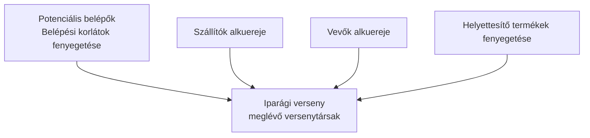
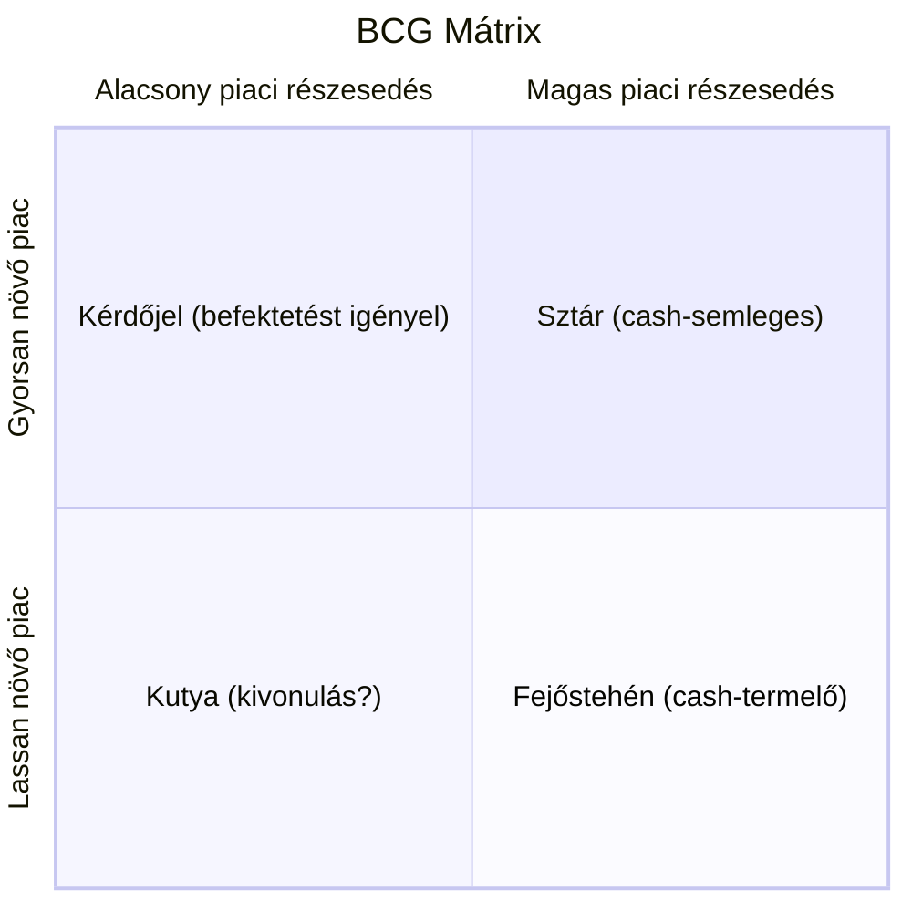

## K3. Tervezés

**Tétel:** „Mit jelent a cégek esetében a változó környezet, a szervezeti filozófia, a jövőkép, a küldetés, ezek milyen időtávra szólnak? Ismertesse a tervezés lépéseit és eszközeit! Ismertessen a környezet, továbbá a belső erőforrás elemzésére szolgáló módszereket!"

### A változó környezet és a stratégiai tervezés szükségessége

A vállalatok nem légüres térben működnek. A technológia felgyorsul, a fogyasztói szokások átalakulnak, a szabályozási környezet módosul, új versenytársak jelennek meg. Aki csak a napi operatív kérdésekkel foglalkozik, könnyen lejáratja magát. A stratégiai tervezés éppen arra való, hogy a szervezet ne sodródjon, hanem tudatosan alakítsa saját jövőjét.

### Vállalati célhierarchia és időtávok

A szervezeti célok és irányelvek egymásra épülő szintet alkotnak. Minél magasabb a szint, annál általánosabb és annál hosszabb az időtáv.

| Szint         | Időtáv       | Tartalom                          |
| ------------- | ------------ | --------------------------------- |
| Filozófia     | hosszú (10+) | értékek, etika, küldetés szelleme |
| Vízió         | 5–10 év      | gazdasági jövőkép, hova tartunk   |
| Misszió       | 3–5 év       | társadalmi szerep, kinek mit      |
| Célok         | 1–3 év       | konkrét, mérhető eredmények       |
| Stratégia     | 1–3 év       | hogyan érjük el a célokat         |
| Taktika       | 1 év         | részletes cselekvési tervek       |
| Operatív terv | napok–hetek  | napi feladatok                    |

**Szervezeti filozófia:** A legáltalánosabb iránymutatás — az értékek, alapelvek és etikai normák összessége. Nem változik, csak elvétve.

**Vízió (jövőkép):** Gazdasági fókuszú, „hova akarunk eljutni" kérdésre válaszol. Pl. „2030-ra piacvezető akarunk lenni a közép-európai régióban." Inspiráló, de konkrét iránymutatást ad.

**Misszió (küldetés):** Társadalmi fókuszú, „miért létezünk, kinek dolgozunk" kérdésre válaszol. Pl. „Megfizethető, fenntartható megoldásokat nyújtunk kis- és középvállalkozásoknak." A misszió kifelé is kommunikál — a vevőknek és a társadalomnak szól.

**Célok:** Konkrétak, mérhetők, határidőhöz kötöttek (SMART-elvek). A célok lefelé boncolódnak az egyéni szintű feladatokig.

### A tervezés lépései

A stratégiai tervezés nem egyszeri aktus, hanem körfolyamat:

1. **Helyzetfelmérés** — hol tartunk most? (belső és külső elemzés)
2. **Jövőkép meghatározása** — hova akarunk jutni?
3. **Alternatívák kidolgozása** — milyen utakon juthatunk oda?
4. **Választás** — melyik alternatívát valósítjuk meg?
5. **Megvalósítás** — erőforrások allokációja, felelősök kijelölése
6. **Ellenőrzés** — visszacsatolás, eltéréselemzés, korrekció

### Környezetelemzés: PESTEL

A **PESTEL-elemzés** a makrokörnyezet hat dimenzióját térképezi fel:

| Betű | Dimenzió     | Példák                                               |
| ---- | ------------ | ---------------------------------------------------- |
| P    | Politikai    | Kormánystabilitás, adópolitika, jogszabályok         |
| E    | Gazdasági    | GDP-növekedés, infláció, kamatlábak, munkanélküliség |
| S    | Társadalmi   | Demográfia, kulturális trendek, életmód              |
| T    | Technológiai | Digitalizáció, automatizáció, K+F intenzitás         |
| E    | Ökológiai    | Klímaváltozás, erőforrás-korlátok, fenntarthatóság   |
| L    | Jogi         | Munkajog, versenyjog, fogyasztóvédelem               |

### Iparági elemzés: Porter 5 erő modellje

**Michael E. Porter** (1979) szerint egy iparág vonzerejét öt erő határozza meg:

Minél erősebbek ezek az erők, annál kisebb az iparág jövedelmezősége. Porter elemzése segít megérteni, miért nyereséges az egyik iparág és miért nem a másik.

### Belső elemzés: SWOT

A **SWOT-elemzés** a szervezet belső és külső helyzetét egyidejűleg térképezi fel:

|         | Belső                        | Külső                           |
| ------- | ---------------------------- | ------------------------------- |
| Pozitív | **Strengths** (erősségek)    | **Opportunities** (lehetőségek) |
| Negatív | **Weaknesses** (gyengeségek) | **Threats** (fenyegetések)      |

Az erősségek és gyengeségek belső tényezők (amit a szervezet kontrollál); a lehetőségek és fenyegetések a külső környezetből fakadnak. A SWOT önmagában leíró eszköz — értéke az, ha a négy mező kombinálásával stratégiai irányokat fogalmaznak meg belőle (SO, ST, WO, WT stratégiák).

### Portfolió-elemzés: BCG mátrix

A **BCG mátrix** (Boston Consulting Group) a termék/üzletágportfoliót két dimenzió mentén értékeli: piaci részesedés és piacnövekedési ütem.

- **Sztár:** nagy piaci részesedés, gyorsan növő piacon — jövő nyertesei
- **Fejőstehén:** nagy piaci részesedés, érett piacon — a cég pénzügyi motorja
- **Kérdőjel:** kis részesedés, gyorsan növő piacon — dönteni kell: befektetés vagy kilépés
- **Kutya:** kis részesedés, stagnáló piacon — általában kivonulás a cél

### Ansoff-mátrix

**Igor Ansoff** (1957) a növekedési stratégiákat termék és piac dimenzióiban rendszerezi:

|                    | Meglévő piac     | Új piac        |
| ------------------ | ---------------- | -------------- |
| **Meglévő termék** | Piacbehatolás    | Piacfejlesztés |
| **Új termék**      | Termékfejlesztés | Diverzifikáció |

A diverzifikáció a legnagyobb kockázatú stratégia (sem a termék, sem a piac nem ismert); a piacbehatolás a legkisebb kockázatú (mindkettő ismerős).

---
