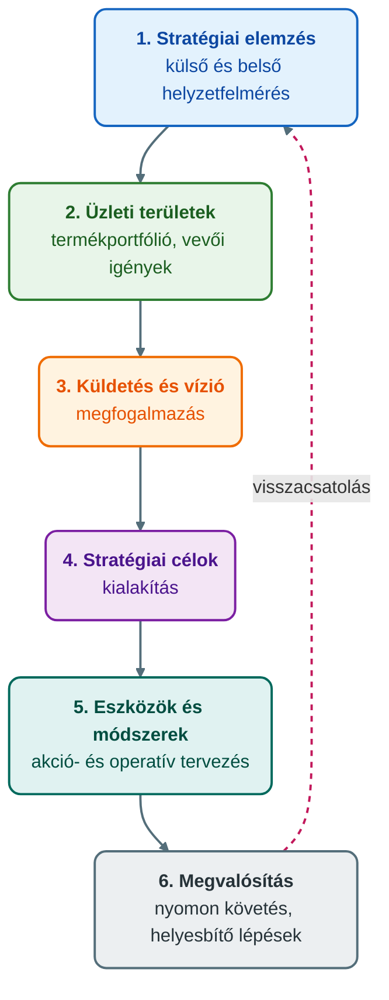
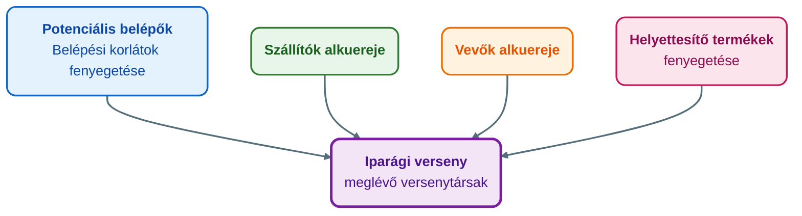
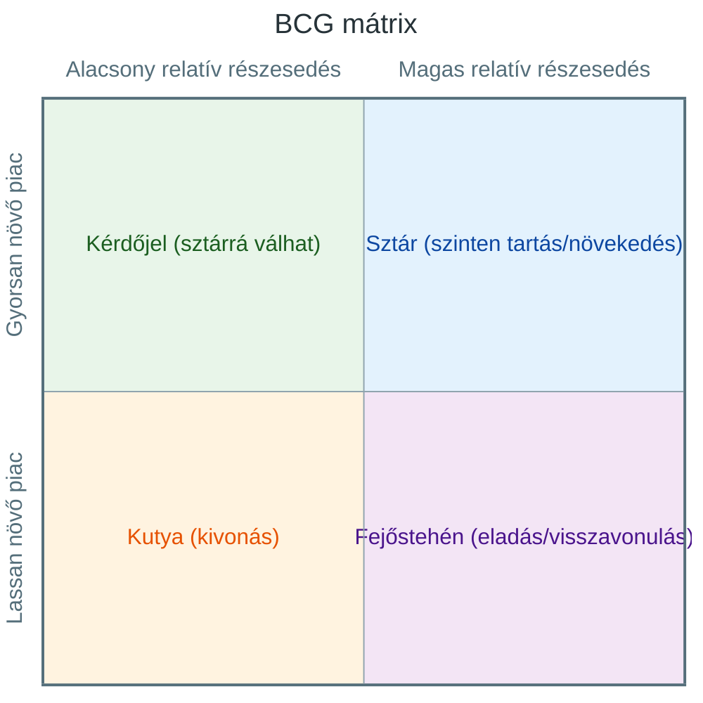

## K3 – Tervezés

### Beszerzendő anyagok

| Szerző | Mű | Jelleg | Indoklás / érintett rész |
|---|---|---|---|
| — | Moodle e-learning tananyag (GMXMD1MBLF) | kötelező irodalom | A syllabus ezt nevezi meg kötelező irodalomként; a célhierarchia időtávjainak és a tervezési lépéseknek a pontosítása (az időtávok és a lépések részkérdése) erre épülne. |
| Marosán, Gy. | Stratégiai menedzsment | ajánlott irodalom | A gyakorlati anyag ajánlott irodalomként nevezi meg a 7. gyakorlathoz; a környezet- és erőforrás-elemzési módszerek elmélyítéséhez kell. |

**Tétel:** Tervezés: Mit jelent a cégek esetében a változó környezet, a szervezeti filozófia, a jövőkép, a küldetés, ezek milyen időtávra szólnak? Ismertesse a tervezés lépéseit és eszközeit! Ismertessen a környezet, továbbá a belső erőforrás elemzésére szolgáló módszereket!

---

### A változó környezet és a tervezés szükségessége

A szervezetek folyamatosan változó környezetben működnek, és rugalmasan kell alkalmazkodniuk az egyre bonyolultabb környezethez (ÓE KGK MMI, 2023c, 5. dia). A környezet ma turbulensen változik: a vevői igények egyre gyorsabban módosulnak, aminek okai többek között a globalizáció, a telekommunikáció, az internet és a fogyasztói tudatosság (ÓE KGK MMI, 2023e, 3. dia). A változás kockázatokkal jár, mert a jövő eseményei csak becsülhetők (ÓE KGK MMI, 2023b, 4. dia).

A tervezés a menedzsment alapproblémájára, a változó környezethez való sikeres alkalmazkodásra válaszol: tudatos, a szervezeti tudást és tapasztalatot kihasználó alkalmazkodás a kockázatok minimalizálásával (ÓE KGK MMI, 2023c, 23. dia). A vállalati stratégia segíti a menedzsmentet a céltudatosságban, az erőforrásigény meghatározásában, az előrehaladás mérésében és a helyesbítő lépésekben (ÓE KGK MMI, 2023d, 3. dia). A vállalat dönthet proaktív magatartás (a környezeti változások kihasználása, a környezet alakítása) vagy reaktív magatartás (a már bekövetkezett eseményekre való késői reakció) mellett (ÓE KGK MMI, 2023d, 7. dia).

### Szervezeti filozófia, vízió, misszió és célok

**Szervezeti filozófia.** Olyan egyértelműen meghatározott gondolatiság, amely a vállalat valamennyi tevékenységét áthatja. Eszmerendszer, amely a szervezet önmagáról alkotott képét foglalja magában a különböző szerepeiben (például gazdálkodó szervezet, piaci szereplő, munkaadó), és arra válaszol, hogyan gondolkodik a vállalat a körülötte lévő világról. A filozófiát a vezetésben és az egész kollektívában tudatosítani kell: így a környezet bármely szereplője egybehangzó képet kap a cégről, a dolgozók pedig önálló, megfelelő döntéseket is hozhatnak (ÓE KGK MMI, 2023d, 11. dia). A küldetést és a filozófiát a tulajdonosok határozzák meg (ÓE KGK MMI, 2023c, 9. dia).

**Vízió (jövőkép).** A szervezet alapvető törekvéseit és a távolabbi jövőben elérendő állapotokat rögzíti; a cég jövőjének ma elképzelt, reális, hiteles és vonzó leírása. Egy adott időtáv végére elérendő kívánatos állapotot határoz meg, leginkább gazdasági szempontból közelít, és motiváló erőként is működik. A vállalat irányításában hozott döntéseknek mind a víziót kell szolgálniuk. A víziót a vállalati célokhoz vezető út végének tekintik (ÓE KGK MMI, 2023d, 12. dia). *Szemléltető példa (nem forrásból):* „2030-ra piacvezető akarunk lenni a közép-európai régióban.”

**Misszió (küldetés).** A vállalat nyilatkozata arról, mi a létezésének indoka, kiket és hogyan kíván szolgálni, és milyen társadalmi értékekben hisz. Alapelemei: cél, magatartási norma, vállalati értékek, minőséghez való hozzáállás. Leginkább társadalmi szempontból vizsgálja a vállalat céljait és létezésének okát, és sokszor a célokhoz vezető út elejének tekintik (ÓE KGK MMI, 2023d, 13. dia). *Szemléltető példa (nem forrásból):* „Megfizethető, fenntartható megoldásokat nyújtunk kis- és középvállalkozásoknak.”

**Célok.** A célok azok a mérföldkövek, amelyeket a cégnek el kell érnie ahhoz, hogy a jövőképpel leírt állapotba kerülhessen. Pontos időkorlátot, erőforrásokat és felelősöket kell hozzájuk rendelni, és meg kell felelniük a filozófiának és a víziónak. Szintjeik: vállalati célok, üzleti célok (konkretizált célok, folyamatokra bontás) és funkcionális célok (erőforrás-hatékonyság, minőség, fejlődés, oktatás) (ÓE KGK MMI, 2023d, 17. dia).

**Üzleti etika és érintettek.** Az üzleti etika az etikai értékek, alapelvek és normák üzleti magatartásra történő alkalmazása, amely túlmutat a jogi követelményeken. A társadalmi felelősségvállalás a társadalomra gyakorolt negatív hatások minimalizálását és a nyújtott értékek maximalizálását jelenti (ÓE KGK MMI, 2023d, 18–19. dia). Az érintettek (stakeholderek) eltérő érdekkel és befolyással bírnak a vállalat működésére (ÓE KGK MMI, 2023d, 20. dia).

### Időtávok

A tananyag nem ad egységes, számszerű időtáv-rendszert. A gyakorlati anyag szerint a vállalat céljait mindig befolyásolja az időtáv: a küldetés 15–25 vagy több évre szól, a stratégia 3–5 évre, a taktikai célok 0,5–1 évre (Novák, 2023). A filozófia, a vízió és az operatív tervezés számszerű időtávját a rendelkezésre álló anyagok nem rögzítik.

| Szint | Mire válaszol | Időtáv | Forrás |
|---|---|---|---|
| Filozófia | hogyan gondolkodik a vállalat a világról | a tananyag nem rögzít számot | 11. dia |
| Misszió | miért létezik, kiket és hogyan szolgál | 15–25 vagy több év | 13. dia; Novák (2023) |
| Vízió | milyen állapotot akar elérni | adott időtáv végére; a tananyag nem rögzít számot | 12. dia |
| Stratégia | hogyan érjük el a célokat | 3–5 év | Novák (2023) |
| Taktikai célok | részletesebb, rövidebb távú célok | 0,5–1 év | Novák (2023) |
| Operatív tervezés | akciók, napi megvalósítás | a tananyag nem rögzít számot | 15. dia |

A távlat a stratégia jellegét is meghatározza: a rövidlátó szervezetnél nincs formálisan dokumentált stratégia, a hangsúly a rövid távú profiton van, a hosszúlátónál a dokumentált stratégia a hosszú távú missziához kapcsolódik, és a növekedésen van a hangsúly (ÓE KGK MMI, 2023d, 8–9. dia).

### A tervezés lépései

A *stratégia* a jövőre vonatkozó célok kitűzése és az eszközök, módszerek meghatározása. A *stratégiai tervezés* szabályozott keretek között zajló elemzési tevékenység, amely a *stratégiai vezetéshez* ad tudást és információt; a stratégiai vezetés a nyomon követést és a helyesbítő lépéseket is magában foglalja (ÓE KGK MMI, 2023d, 10. dia).

A 7. előadás szerint a tervezés lépései (ÓE KGK MMI, 2023d, 15. dia):

1. **Stratégiai elemzés:** a külső környezet és a belső vállalati helyzet széleskörű felmérése.
2. **Üzleti területek kiválasztása:** a termékportfólió meghatározása a vevői igények alapján.
3. **Küldetés és vízió megfogalmazása.**
4. **Stratégiai célok kialakítása.**
5. **Eszközök és módszerek meghatározása:** akció- és operatív tervezés.
6. **Megvalósítás:** folyamatos nyomon követés, koordináció, kommunikáció, dokumentáció, helyesbítő lépések, fejlődés.

A 16. dia ugyanezt négy szakaszban, visszacsatolással mutatja be. Az első az alapstratégia megfogalmazása: a tervezők meghatározzák, hogyan hajtható végre a misszió. A második a stratégiai tervek megfogalmazása: formális tervek, politikák és költségvetés. A harmadik a tervek kivitelezése: a közép- és alsószintű menedzserek kidolgozzák a középtávú és operatív terveket. A negyedik a stratégiai ellenőrzés: a felső vezetés a kapott információk alapján ellenőrzi a feltételeket, az előrehaladást és az akadályokat. Minden szakasz után ellenőrző kérdés áll (például reálisak-e a célok a változó körülmények tükrében), és a folyamat korrekciós akciókkal visszacsatol (ÓE KGK MMI, 2023d, 16. dia). Ez a logika a menedzsment PDCA-ciklusában (tervezés, cselekvés, ellenőrzés, helyesbítő lépések) is megjelenik (ÓE KGK MMI, 2023c, 25. dia).

### A tervezés eszközei

A stratégiák megvalósításának legelterjedtebb eszközei (ÓE KGK MMI, 2023d, 14. dia):

- **Üzleti terv:** általában több évre szóló cselekvési terv, amely stratégiai akciókon és projekteken keresztül valósul meg.
- **Program:** több projektből felépülő, több éves, egyértelmű céllal és idő- és erőforrásigénnyel rendelkező tevékenységsor; előnye a célorientáltság és a nyomon követhetőség.
- **Projekt:** egyedi tevékenységsorozat pontos céllal, idő- és erőforrásigénnyel; célja a vállalati változások és a fejlődés lebonyolítása.

A stratégiának három szintje van: a vállalati stratégia a hosszú távú célokat és elérésük módszereit rögzíti, az üzleti stratégia a vállalati versenyt és versenyképességet, a funkcionális stratégia az adott funkcióban elérendő célokat és a szükséges erőforrásokat (ÓE KGK MMI, 2023d, 14. dia). Az elemzési és stratégiaválasztási módszereket a következő szakaszok tárgyalják.

### Környezetelemzés

A vállalati környezetnek három szintje van, mindegyikhez más módszer tartozik (ÓE KGK MMI, 2023d, 21. dia):

| Szint | Módszerek |
|---|---|
| Makrókörnyezet | PESTEL-elemzés, Gyémánt modell (Porter) |
| Iparági környezet | Porter 5 erő modellje, iparági életciklus-modell |
| Közvetlen versenykörnyezet | stratégiai csoport-elemzés, versenytárs-elemzés |
| Belső, szervezeti környezet | 7S modell, SWOT-analízis, BCG mátrix |

**PESTEL-elemzés.** A makrókörnyezet elemeit hat szegmensre bontja. Lépései: a releváns szegmensek meghatározása; a leginkább ható tényezők kiválasztása; a jelenlegi hatások és összefüggések elemzése; a várható tendenciák elemzése a stratégiai időhorizonton. Ha a változásoknak többféle kimenetele lehet, ajánlott optimista, pesszimista és realista forgatókönyvet készíteni (ÓE KGK MMI, 2023d, 22. dia).

| Betű | Dimenzió | Példák (23. dia) |
|---|---|---|
| P | Politikai (Political) | a politikai környezet stabilitása, adózási politika, kereskedelmi egyezmények, külkereskedelmi szabályozás, szociálpolitika |
| E | Gazdasági (Economic) | gazdasági növekedés üteme, infláció, kamatláb, GDP, árfolyampolitika, munkanélküliség |
| S | Társadalmi (Social) | életmódváltozás, jövedelemelosztás, demográfiai folyamatok, fogyasztási szokások, képzettségi szint |
| T | Technológiai (Technological) | technológiai fejlettség szintje, fejlesztési támogatások, innovációk, technológia-transzfer sebessége, elavulási sebesség |
| E | Természeti (Environmental) | környezettudatosság, hulladék- és energiafogyasztási szokások, környezetvédelmi szervezetek, a természeti környezet állapota |
| L | Jogi (Legal) | versenyjogi, tulajdonjogi, fogyasztóvédelmi, foglalkoztatási és biztonsági előírások |

**Gyémánt modell.** Porter szerint a stabil gazdasági, politikai és jogi környezet a versenyképesség szükséges, de nem elégséges feltétele. A modell a nemzetgazdasági környezetet négy tényező szerint csoportosítja: a termelési tényezők (inputok) minősége; a vállalati stratégia és a versenyképesség kontextusa; a helyi keresleti tényezők minősége; a kapcsolódó és támogató iparágak léte. A klaszter a földrajzilag közel álló, hasonló vagy kiegészítő tevékenységű vállalatok, beszállítók, szolgáltatók és intézmények összekapcsolódása (Porter, 2004, idézi ÓE KGK MMI, 2023d, 24. dia).

**Iparági környezet.** Iparág az azonos vagy egymással közvetlenül helyettesíthető termékeket előállító vállalatok csoportja (ÓE KGK MMI, 2023d, 25. dia). Az iparági életciklus-modell az iparág termékeinek szakaszait elemzi, az egyes szakaszokhoz való alkalmazkodást és a vállalati stratégia szerinti lépések meghatározását szolgálja (ÓE KGK MMI, 2023d, 27. dia).

**Porter 5 erő modellje.** Minden szereplő fenyegető erőként hat a vállalatra, de az iparágon belüli pozíció pontos megfogalmazása segíti a működést. Az öt fenyegetettség: az új belépők, a helyettesítő termékek és szolgáltatások, a vásárlók alkuereje, a beszállítók alkuereje és az iparági verseny intenzitása. További jellemzők: a koncentráció, a méretgazdaságosság (economies of scale), a termékek megkülönböztethetősége, a piacra lépés korlátai és a növekedés várható üteme (ÓE KGK MMI, 2023d, 26. dia).

**Közvetlen versenykörnyezet.** A stratégiai csoport az iparág vállalatainak azon köre, amelynek tagjai hasonló stratégiát követnek, azonos piaci szegmenseket szolgálnak ki, közel azonos források felhasználásával, és hasonlóan reagálnak a lehetőségekre és veszélyekre (Porter, 1980, idézi ÓE KGK MMI, 2023d, 28. dia). A versenytárs-elemzés kérdései: a versenytársak célkitűzései, stratégiája, feltevései, erősségei és gyengeségei (ÓE KGK MMI, 2023d, 28. dia).

### Belső erőforrások elemzése

A stratégiai tervezés alapja a saját kompetenciák és lehetőségek tökéletes ismerete (ÓE KGK MMI, 2023d, 29. dia).

**Vállalati kompetenciák.** A vállalatok egyedi, nehezen transzferálható erőforrásokkal és képességekkel rendelkeznek, és az alapvető képességeikre építve dolgozzák ki stratégiájukat, hosszú távon fenntartható versenyelőnyre törekedve. A versenyelőny akkor fenntartható, ha az erőforrások heterogének és nehezen másolhatók. Az alapképességek egyediek, nem termékspecifikusak, hozzáférést adnak a piacokhoz, és idővel fejlődnek (ÓE KGK MMI, 2023d, 30. dia).

**7S modell.** A McKinsey tanácsadó cég modellje szerint a vállalati struktúra hét (3+4) elemből áll. A „kemény” elemek mérhetők és tervezhetők: struktúra (structure), rendszerek (systems), stratégia (strategy). A „lágy” elemek az emberi tényezőkhöz kötődnek, nehezen mérhetők és alakíthatók: munkatársak (staff), képességek (skills), viselkedési formák (style), közös értékek (shared values). Az elemek összefüggnek, ezért egy elem változása a többire is hat, és tervezéskor a döntés hatásait az egész szervezetre figyelembe kell venni (ÓE KGK MMI, 2023a, 28. dia).

**SWOT-analízis.** A külső adottságok és a belső tényezők szétválasztása: a vállalat belső erősségeit és gyengeségeit, valamint a külső lehetőségeket és fenyegetéseket vizsgálja. Célja, hogy a vezetés pontos képet kapjon a vállalat helyzetéről, képességeiről és lehetőségeiről (ÓE KGK MMI, 2023d, 29. dia).

|         | Belső                        | Külső                           |
| ------- | ---------------------------- | ------------------------------- |
| Pozitív | **Strengths** (erősségek)    | **Opportunities** (lehetőségek) |
| Negatív | **Weaknesses** (gyengeségek) | **Threats** (fenyegetések)      |

**BCG mátrix.** A vállalati portfóliót az üzletágak növekedési potenciálja és piaci részesedése alapján értékeli, és segít eldönteni, mely üzletágakat vegyük a portfólióba, és milyen stratégiát kövessünk velük (kiépítés, fenntartás, szüretelés, kivonulás). Alapfeltevése, hogy a piaci részesedés növelésére növekvő piacon van lehetőség, és a domináns pozícióhoz folyamatosan növelni kell a befektetéseket (ÓE KGK MMI, 2023d, 31. dia). A relatív piaci részesedés a termék értékesítési volumenének és a versenytárs értékesítésének viszonya; 1 fölötti érték esetén a vállalat a piac vezetője (Novák, 2023).

- **Sztár:** magas részesedés, gyors növekedés; a legjobb pozíció, gyakran a vállalati profil magja. A vállalat a szinten tartást vagy a további növekedést választhatja.
- **Fejőstehén:** magas részesedés, alacsony növekedés; korábbi sztárokból jön létre. A vállalat a további értékesítést vagy a korai visszavonulást választhatja.
- **Kérdőjel:** alacsony részesedés, gyors növekedés; megfelelő vállalati lépésekkel a termék sztárrá válhat.
- **Kutya:** alacsony részesedés, alacsony növekedés; kedvezőtlen pozíció, a terméket általában kivonják a piacról (ÓE KGK MMI, 2023d, 32. dia).

A mátrix fő hibája a leegyszerűsítés: csak a jelenlegi piaci helyzetet mutatja, és csak két tengely mentén vizsgál (ÓE KGK MMI, 2023d, 31. dia).

### Stratégiaválasztás: versenystratégiák, adaptáció, növekedés

**Általános versenystratégiák.** Lehetőséget teremtenek a konkurensek lekörözésére az ipari versenyben. Általában csak egy álláspontot képviselnek a siker érdekében, de a vállalatok akár több stratégiát is integrálhatnak (ÓE KGK MMI, 2023d, 34. dia).

| Stratégia | Lényeg | Hátrány (a dia szerint) |
|---|---|---|
| **Költségdiktáló** | Tömegszerű termeléssel, optimalizálással és a veszteségek csökkentésével a lehető legalacsonyabb árat kínálja, és ellehetetleníti az új belépőket | magas fix költségek; sok vevő az olcsóságot a minőségtelenséggel azonosítja |
| **Megkülönböztető** | Marketinggel és vevői hűséggel elkülöníti a termékét a piacon, így szabadabban határozhatja meg az árakat | a dia nem említ |
| **Összpontosító** | Egy nagy vállalatok által kevésbé kihasznált szegmensre fókuszál, személyre szabottabb termékekkel | nehéz terjeszkedés; kérdéses profit egyetlen szegmens kiszolgálásából |

**Adaptációs stratégiák.** Miles és Snow (1978) kutatásai alapján négy típus különböztethető meg (Miles & Snow, 1978, idézi ÓE KGK MMI, 2023d, 33. dia):

- **Kutató (innováció):** folyamatosan új megoldásokat keres, párhuzamos technológiai fejlesztéseket folytat; kialakuló vagy felfutó iparágakban működik.
- **Védő (konszolidáció):** egyetlen központi technológiát alkalmaz, amelynek hatékonysága a siker alapja.
- **Elemző (kivárás):** a kutató és a védő pozíció között egyensúlyoz, néhány technológiát használ, egyikhez sem kötődik véglegesen.
- **Reagáló (sodródás):** késői reagálás, a trendek kései követése jellemzi; jól bejáratott bázistechnológiákat alkalmaz.

**Ansoff-mátrix.** A növekedési irányokat a termék és a piac dimenziói szerint rendszerezi (ÓE KGK MMI, 2023d, 35–36. dia):

|                    | Meglévő piac                      | Új piac                       |
| ------------------ | --------------------------------- | ----------------------------- |
| **Meglévő termék** | Piackiaknázás (alacsony kockázat) | Piacfejlesztés (közepes)      |
| **Új termék**      | Termékfejlesztés (közepes)        | Diverzifikáció (magas)        |

A piackiaknázás a piaci részesedés növelése; a termékfejlesztés új termék kínálása a meglévő vevőknek; a piacfejlesztés akár nemzetközi terjeszkedés. A diverzifikáció lehet horizontális (a régi tevékenységhez piaci és/vagy technológiai szempontból kapcsolódik), vertikális (a megelőző vagy követő fázisokkal egészíti ki a tevékenységet) vagy laterális (sem a piac, sem a technológia oldaláról nem kapcsolódik).

### Összegzés

A tervezés a változó környezethez való tudatos alkalmazkodás. A filozófia, a misszió és a vízió adja az irányt, a célok mérföldkövekre bontják, a stratégia és az akciók (üzleti terv, program, projekt) pedig megvalósítják. A folyamat a külső és a belső elemzéssel indul, a stratégiaválasztást a versenystratégiák, az adaptációs típusok és az Ansoff-mátrix támogatják, a nyomon követés és a helyesbítő lépések pedig visszacsatolnak az elemzésre (ÓE KGK MMI, 2023d, 15–16. dia).

---

### Várható vizsgáztatói kérdések

1. **Miben különbözik a vízió és a misszió?** — A vízió a távolabbi jövőben elérendő kívánatos állapot, leginkább gazdasági szempontból közelítve, és a célokhoz vezető út végének tekintik (ÓE KGK MMI, 2023d, 12. dia). A misszió a létezés indokát, a kiszolgált kört és a társadalmi értékeket rögzíti, társadalmi szempontú, és az út elejének tekintik (ÓE KGK MMI, 2023d, 13. dia). A célok a jövőképhez vezető mérföldkövek, és meg kell felelniük a filozófiának és a víziónak (ÓE KGK MMI, 2023d, 17. dia).
2. **Mi a különbség a stratégia, a stratégiai terv, a stratégiai tervezés és a stratégiai vezetés között?** — A stratégia a célok kitűzése és az eszközök, módszerek meghatározása; a stratégiai terv tudatos lépések sorozata a célok eléréséhez; a stratégiai tervezés szabályozott keretek közötti elemzési tevékenység, amely a stratégiai vezetéshez ad tudást és információt; a stratégiai vezetés a célkitűzés és az akciók meghatározása a nyomon követéssel, a koordinációval és a helyesbítő lépésekkel együtt (ÓE KGK MMI, 2023d, 10. dia).
3. **Miért érdemes a PESTEL-elemzésnél forgatókönyveket készíteni?** — Az elemzés lényege, hogy feltárja a makrókörnyezet jelenlegi és jövőbeli állapota között várható változásokat. Ha a változásoknak többféle kimenetele lehet, ajánlott optimista, pesszimista és realista forgatókönyvet készíteni (ÓE KGK MMI, 2023d, 22. dia).
4. **Miben különbözik a SWOT a BCG mátrixtól?** — A SWOT a külső adottságokat és a belső tényezőket választja szét (erősségek, gyengeségek, lehetőségek, fenyegetések), és a vezetés helyzetképét szolgálja (ÓE KGK MMI, 2023d, 29. dia). A BCG mátrix a portfóliót az üzletágak növekedési potenciálja és piaci részesedése alapján értékeli, és az üzletágak portfólióba vételéről, valamint a hozzájuk kapcsolódó stratégiáról segít dönteni (ÓE KGK MMI, 2023d, 31. dia).
5. **Melyek a BCG mátrix korlátai?** — A fő hiba a leegyszerűsítés: a piacnak csak a jelenlegi helyzetét mutatja, csak két tengely mentén vizsgálja a termékeket, és más tényezőket nem vesz figyelembe (ÓE KGK MMI, 2023d, 31. dia). Alapfeltevése, hogy a részesedésnövelés növekvő piacon lehetséges, és a domináns pozícióhoz folyamatosan növelni kell a befektetéseket (ÓE KGK MMI, 2023d, 31. dia).
6. **Miért a legkockázatosabb irány a diverzifikáció az Ansoff-mátrixban?** — Új termékkel lép új piacra (ÓE KGK MMI, 2023d, 35. dia). A 36. dia szerint a piackiaknázás kockázata alacsony, a termék- és a piacfejlesztésé közepes, a diverzifikációé magas. Típusai a horizontális, a vertikális és a laterális diverzifikáció (ÓE KGK MMI, 2023d, 35. dia).

---

## Irodalom

* Novák, J. (2023). *Javaslatok Menedzsment c. tárgy gyakorlatához* [Gyakorlati anyag]. Óbudai Egyetem, Keleti Károly Gazdasági Kar.
* Óbudai Egyetem, Keleti Károly Gazdasági Kar, Marketing, Menedzsment és Módszertani Intézet. (2023a). *A csoport és a szervezetek* [Előadás-prezentáció, 3. ea.].
* Óbudai Egyetem, Keleti Károly Gazdasági Kar, Marketing, Menedzsment és Módszertani Intézet. (2023b). *Kockázatmenedzsment* [Előadás-prezentáció, 12. ea.].
* Óbudai Egyetem, Keleti Károly Gazdasági Kar, Marketing, Menedzsment és Módszertani Intézet. (2023c). *Menedzsment alapjai* [Előadás-prezentáció, 1. ea.].
* Óbudai Egyetem, Keleti Károly Gazdasági Kar, Marketing, Menedzsment és Módszertani Intézet. (2023d). *Stratégiai tervezés* [Előadás-prezentáció, 7. ea.].
* Óbudai Egyetem, Keleti Károly Gazdasági Kar, Marketing, Menedzsment és Módszertani Intézet. (2023e). *Válság és változásmenedzsment* [Előadás-prezentáció, 11. ea.].
