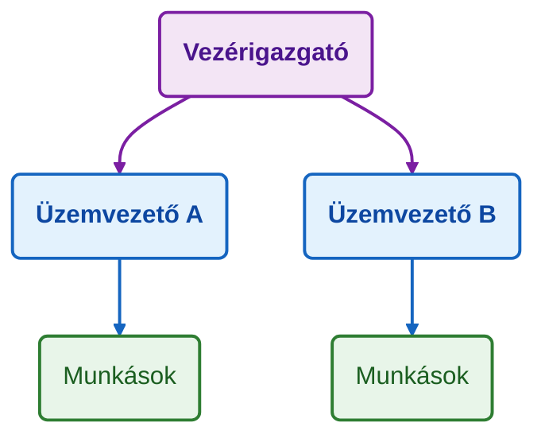
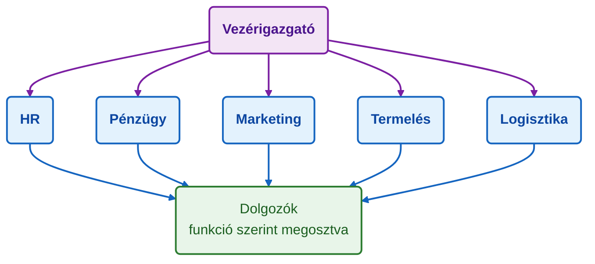
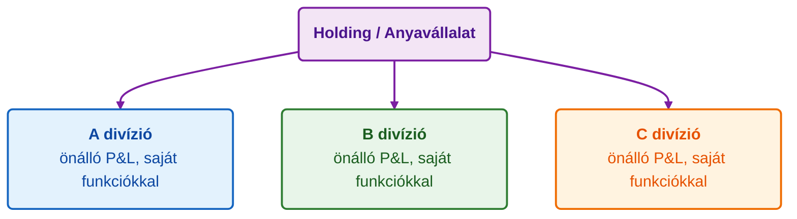
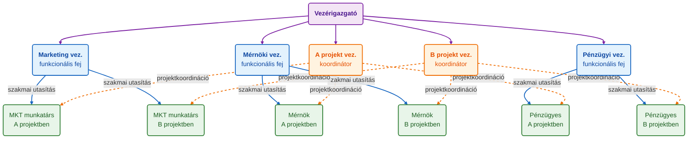

## K4. Szervezetek, szervezeti formák

**Tétel:** „Mi a különbség a munkaszervezet és a tulajdonosi szervezet között? Ismertesse a szervezetek működését meghatározó strukturális jellemzők (munkamegosztás, hatáskör megosztás, koordináció) alapján a főbb szervezeti típusokat!"

### Munkaszervezet és tulajdonosi szervezet

A szervezeten belül két párhuzamos struktúra létezik, amelyeket nem szabad összekeverni.

**Tulajdonosi szervezet (tőkestruktúra):** A tulajdon, a tőke és az érdekeltség rendje. Ki a részvényes, ki dönt a stratégiai irányról, ki kap osztalékot. A Kft.-ben a taggyűlés, a Zrt.-ben a közgyűlés és az igazgatóság a kulcsszereplők.

**Munkaszervezet (funkcionális struktúra):** Az operatív feladatok elosztásának rendje — ki kinek a beosztottja, ki milyen feladatot lát el, hogyan koordinálódnak az egységek. Ez az, amit szervezeti ábra (*organogram*) ábrázol.

A két struktúra elvben különválik: a tulajdonos nem feltétlenül menedzser, a menedzser nem feltétlenül tulajdonos. A kis- és középvállalkozásokban azonban sok esetben összefonódnak.

### Mechanikus és organikus szervezet

**Tom Burns és G. M. Stalker** (1961) különbséget tett mechanikus és organikus szervezetek között:

| | Mechanikus | Organikus |
|---|---|---|
| Környezet | Stabil | Dinamikus, változó |
| Struktúra | Merev, hierarchikus | Rugalmas, hálózatos |
| Kommunikáció | Vertikális (felülről le) | Horizontális, informális |
| Szabályozás | Írott szabályok | Értékek, kultúra |
| Példa | Közigazgatás, gyáripar | IT-startup, kutatóintézet |

### Strukturális jellemzők

A munkaszervezet három alapvető strukturális jellemző mentén írható le:

**1. Munkamegosztás:** A feladatok részfeladatokra bontása és személyekhez/egységekhez rendelése. Minél mélyebb a specializáció, annál hatékonyabb lehet az egyes feladat elvégzése — de annál nehezebb a koordináció.

**2. Hatáskörmegosztás:** Ki dönthet, ki utasíthat kit?
- **Centralizáció:** a döntések a csúcson összpontosulnak — egységes irány, de lassú reakcióidő
- **Decentralizáció:** a döntések közel kerülnek a végrehajtóhoz — rugalmas, de koordinációt igényel

**3. Koordináció típusai:**
- *Vertikális (hierarchikus):* a felsőbb szint irányítja az alsóbbat utasításokkal és szabályokkal
- *Horizontális:* azonos szintű egységek közötti egyeztetés (bizottságok, teamek, projektcsoportok)
- *Technokratikus:* szabályok, eljárások, normák közvetítik a koordinációt (pl. ISO-standardok)
- *Személyorientált (kulturális):* közös értékek, szocializáció, bizalom tartja össze a szervezetet

### Lineáris szervezet

A legegyszerűbb forma. Minden szintnek egy felettese van; az utasítások egyértelműen fentről lefelé haladnak.

**Előnyök:** Egyértelmű felelősség, gyors döntéshozatal, átlátható.
**Hátrányok:** A vezető túlterhelt (minden hozzá fut); rugalmatlan nagyobb szervezetben.
**Mikor jó:** Kis szervezetekben, stabil, egyszerű feladatkörnyezetben.

### Funkcionális szervezet

A munkamegosztás szaktevékenységek (funkciók) szerint történik. A beosztottak több, szaktudás szerint illetékes felettestől is kaphatnak utasítást.

Sok szervezetben a funkcionális struktúrát **törzskarral** egészítik ki: a vezető mellé szakértő tanácsadói csoportot rendelnek (pl. jogi osztály, controlling), amely nem utasíthat, csak tanácsol.

**Előnyök:** Magas szakmai színvonal, gazdaságos specializáció.
**Hátrányok:** „Silóhatás" — az egységek egymástól elszigetelten dolgoznak; Fayol egységes utasítás elvének sérülése.

### Divizionális szervezet

Nagy, diverzifikált szervezetekben alkalmazzák. Az egységeket (*divíziókat*) tárgyi elv szerint szervezik:

- **Termék szerint:** minden divízió egy termékcsaládért felelős (pl. Unilever: élelmiszer, tisztítószer, személygondozás)
- **Vevő/piac szerint:** különböző vásárlói szegmensek (pl. B2B vs. B2C divízió)
- **Földrajzi régió szerint:** területi önállóság (pl. európai, ázsiai, amerikai divízió)

**Előnyök:** Rugalmasság, piachoz közeli döntéshozatal, az egységek teljesítménye jól mérhető.
**Hátrányok:** Erőforrás-duplikáció, koordináció az egységek között nehéz.

### Mátrix szervezet

A funkcionális és a projektalapú/divizionális szervezet keresztezése. Kettős alárendeltség: minden dolgozónak van egy funkcionális főnöke (pl. mérnöki osztályvezető) és egy projekt- vagy termékfelelőse.

**Előnyök:** Rugalmas erőforrás-allokáció, szakmai és projektszemlélet egyszerre érvényesül.
**Hátrányok:** A kettős alárendeltség konfliktushoz vezet; az egységes utasítás elve sérül; sok koordinációs energiát emészt fel.

**Mikor jó:** Dinamikus, projektalapú iparágakban (szoftver, építőipar, tanácsadás, K+F).

### Mintzberg szervezeti konfigurációi

**Henry Mintzberg** (1979) empirikus alapon azonosította, hogy a szervezetek a valóságban öt alaptípus egyikéhez hasonlítanak, amelyeket az összetevők (csúcs, operatív mag, középvonal, technostruktúra, támogató stáb) eltérő súlya határoz meg:

| Konfiguráció | Domináns összetevő | Koordinációs mechanizmus | Tipikus példa |
|---|---|---|---|
| **Egyszerű struktúra** | Csúcsvezetés | Közvetlen felügyelet | Kisvállalat, startup |
| **Gépi bürokrácia** | Technostruktúra | Munkafolyamatok standardizálása | Tömeggyártó, bank |
| **Szakmai bürokrácia** | Operatív mag | Készségek standardizálása | Kórház, egyetem |
| **Diverzifikált forma** | Középvonal | Outputok standardizálása | Holding, konszern |
| **Adhokrácia** | Támogató stáb | Kölcsönös alkalmazkodás | K+F labor, tanácsadó cég |

A konfiguráció-elmélet üzenete: nincs univerzálisan legjobb szervezeti forma — az illeszkedés (*fit*) a környezettel és a stratégiával döntő.

---
