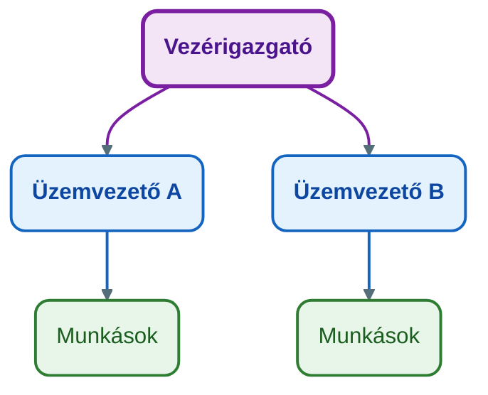
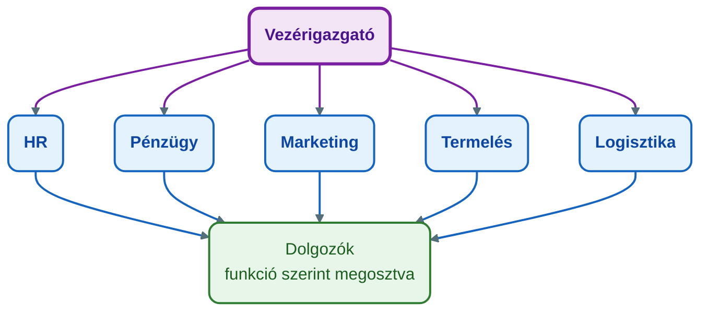
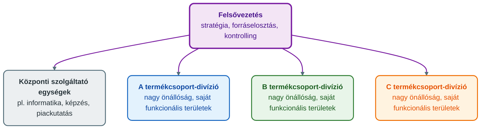
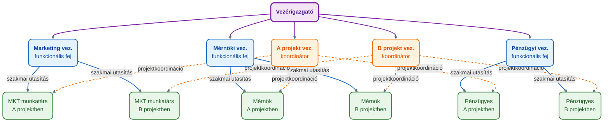

## K4 – Szervezetek, szervezeti formák

### Beszerzendő anyagok

| Szerző | Mű | Jelleg | Indoklás / érintett rész |
|---|---|---|---|
| Dobák | *Szervezeti formák és vezetés* | ajánlott irodalom | A gyakorlati anyag ajánlott irodalomként nevezi meg; címe alapján az R1 fogalompárját (tulajdonosi szervezet – munkaszervezet) és az R2–R3 strukturális jellemzőit pontosíthatná (a tartalma nem ellenőrizhető). |
| Forróné Szvitacs | *Menedzsment mérnököknek IV. Szervezetek vezetése* | ajánlott irodalom | A gyakorlati anyag ajánlott irodalomként nevezi meg; címe alapján az R1 és az R2–R3 szervezeti ismereteit érintheti (a tartalma nem ellenőrizhető). |

**Tétel:** Szervezetek, szervezeti formák: Mi a különbség a munkaszervezet és a tulajdonosi szervezet között? Ismertesse a szervezetek működését meghatározó strukturális jellemzők (munkamegosztás, hatáskör megosztás, koordináció) alapján a főbb szervezeti típusokat!

---

### A szervezet és érintettjei: tulajdonosi és működtetői oldal

A szervezet Chester Barnard megfogalmazása szerint két vagy több ember szándékosan összehangolt tevékenységeinek vagy erőinek rendszere (ÓE KGK MMI, 2023b, 4. dia). A vállalkozói szervezet célja, hogy tőkebefektetéssel és kockázatvállalással profitot érjen el (ÓE KGK MMI, 2023b, 4. dia). A szervezet formális csoport, optimális működésének kulcskérdése a megfelelő struktúra, koordináció és kommunikáció megválasztása (ÓE KGK MMI, 2023a, 25. dia).

> **Forrásmegjegyzés.** A „tulajdonosi szervezet” és a „munkaszervezet” fogalompár szó szerint nem szerepel a tantárgy elérhető anyagaiban. Az alábbi megkülönböztetés a belső érintettek szerepeiből következik (ÓE KGK MMI, 2023b, 9. és 17. dia). A munkaszervezetet a szervezeti struktúra tárgyalásával azonosítom (ÓE KGK MMI, 2023a, 29. dia). A pár pontos meghatározása a „Beszerzendő anyagok” között megnevezett irodalomban ellenőrizendő.

A szervezet belső érintettjei három csoportba tartoznak (ÓE KGK MMI, 2023b, 9. dia):

| Belső érintett | Státusz, funkció | Időtáv | Jövedelem | Cél |
|---|---|---|---|---|
| Tulajdonos | befektető; a küldetés és a filozófia meghatározása | határozatlan | profit vagy kamat | a befektetés értékének növelése |
| Menedzser | szakalkalmazott; a hatékony működtetés | rövid táv | munkabér | jövedelemszerzés, szakmai karrier |
| Alkalmazott | végrehajtás | rövid táv | munkabér | fogyasztási szükségletek kielégítése |

A **tulajdonosi oldalt** a tőke és a hozzá kötődő érdek határozza meg: a tulajdonos befekteti a tőkét, kijelöli a küldetést és a filozófiát, és határozatlan időtávon a befektetése értékének növelésében érdekelt. A **működtetői, munkaszervezeti oldalt** a menedzserek és az alkalmazottak alkotják: a menedzser a hatékony működtetésért, az alkalmazott a végrehajtásért felel, mindkettejük érdekeltsége rövid távú, és munkabért kapnak.

A kettő elválik egymástól: a vezetőnek szakértelemre, a tulajdonosnak tőkére van szüksége. A szervezet méretétől függően azonban egybe is eshetnek, érdekeik pedig különbözhetnek. A tulajdonos feladata, hogy az érdekeltségi rendszer kiépítésével összehangolja a vezetői célokat a sajátjával (ÓE KGK MMI, 2023b, 17. dia). A szervezet hatékonysága szempontjából a befektető, az alkalmazott és a vevő érdeke általában nem esik egybe, és bármelyik egyoldalú érvényesítése a szervezet létét veszélyezteti (Novák, 2023).

A tétel további része a munkaszervezet felépítését, vagyis a szervezeti struktúrát és típusait tárgyalja.

---

### A szervezeti struktúra jellemzői

A szervezeti struktúra kialakítása a külső és belső környezet elemzésével és a stratégiatervezéssel kezdődik (ÓE KGK MMI, 2023a, 29. dia). A McKinsey 7S modellje szerint a struktúra a „kemény” elemek egyike a stratégiával és a rendszerekkel együtt. A „lágy” elemek a munkatársak, a képességek, a viselkedési formák és a közös értékek. Az elemek összefüggnek, ezért egy változtatás a többire is hat (ÓE KGK MMI, 2023a, 28. dia).

A struktúrát három elsődleges jellemző és egy másodlagos jellemző írja le (ÓE KGK MMI, 2023b, 14. dia; ÓE KGK MMI, 2023a, 29. dia).

**1. Munkamegosztás.** A nagyobb feladatot részfeladatokra bontja, és szervezeti egységekhez rendeli. Lényege, hogy minden egység a komparatív előnyének megfelelő feladattal foglalkozik, és a termékből vagy szolgáltatásból csak egy részelemet állít elő. A hozzárendelés történhet funkció, termék(csoport), vevő vagy régió szerint (ÓE KGK MMI, 2023a, 30. dia).

**2. Hatáskörmegosztás.** A döntési és utasítási jogok megoszlása a szervezeti tagok között; ideális esetben kompetencia alapján történik. A stratégiai döntések a felsővezetéshez tartoznak, a napi operatív döntéseket célszerű ott meghozni, ahol a döntési igény megjelenik (ÓE KGK MMI, 2023a, 46. dia).
- *Centralizált* a szervezet, ha a stratégiai és az operatív döntéseket is a hierarchia csúcsán hozzák; *decentralizált*, ha az operatív döntési hatáskörök egy része alacsonyabb szintre kerül (46. dia).
- *Egyvonalas* a szervezet, ha az egységek csak egy vezetőtől kaphatnak utasítást. Világos és áttekinthető, de növekedéskor hosszabb utasítási láncok, átláthatatlan függőségek és a felsővezetés túlterhelése jelennek meg.
- *Többvonalas* a szervezet, ha a munkamegosztás több dimenzió mentén történik. Az egységek több vezetőtől is kaphatnak utasítást, ez specializációt és közvetlen utasítási utakat ad, de sok konfliktus forrása (47. dia).

**3. Koordináció.** A koordináció a kommunikáció célzott formája. *Vertikális* a felettes és az alárendelt egységek közötti kommunikáció (utasítás, jelentés), *horizontális* az azonos szinten lévő egységek közötti. Történhet kölcsönös megegyezéssel, közvetlen irányítással vagy szabályozással (ÓE KGK MMI, 2023a, 48. dia). Három eszközcsoportja van (ÓE KGK MMI, 2023a, 49. dia):
- *technokratikus*: szabályok, szabályzatok, eljárások, tervek és programok; visszakereshetők és egyértelműek, de konkrét helyzetekben az alkalmazott önállóan haladhat;
- *személyorientált*: a 7S lágy elemeihez, a szervezeti kultúrához és az értékrendhez kötődik (konfliktuskezelés, vezetőképzés, kiválasztás); az alkalmazottak önálló, a vállalati érdeket képviselő döntéseket hozhatnak, de kialakítása sok időt, elköteleződést és vezetői példamutatást igényel;
- *strukturális*: bizottságok (ad hoc és állandó), projektteamek és termékmenedzseri rendszer, amelyek a vezetői döntések és az egységek működése közötti összhangot teremtik meg.

**4. Konfiguráció.** Másodlagos jellemző: a másik hármas együtt alakítja ki, és vizualizációs technika, a szervezeti ábra segít áttekinteni. Jellemzői a mélységi tagoltság (a hierarchiaszintek száma), a szélességi tagoltság (egy vezető alá közvetlenül tartozók száma) és az egységek mérete. A konfigurációból látszik a hatáskörmegosztás, és meghatározza a projektmenedzsment helyét a hierarchiában (ÓE KGK MMI, 2023a, 50. dia).

---

### Mechanikus és organikus szervezet

A 3. előadás két szervezeti szemléletet különít el (ÓE KGK MMI, 2023a, 26–27. dia). A **mechanikus** (klasszikus) szervezetben szinte minden munkatevékenységre szigorú szabály vonatkozik. A vezetői és végrehajtói feladatok élesen elválnak, nagy a távolság vezető és beosztott között, hangsúlyos a rang és a szolgálati út, a kommunikációs csatornák kötöttek, fontos az írásbeliség és az ellenőrzés. A szervezet gondosan megtervezett gépként működik. Az **organikus** (rugalmas, modern) szervezetben a vezetők és a beosztottak közötti szakadék elmosódik, a dolgozók bekapcsolódnak a döntésekbe, a vezető támogató szerepű, folyamatos a teammunka és az innováció, a szervezet decentralizált, és a szolgálati út betartása nem kötelező. Az irányítás alapja a kommunikáció, a szervezet élőlényként nyitott a változásra.

---

### A főbb szervezeti típusok

Minden típust a három jellemző (munkamegosztás, hatáskörmegosztás, koordináció) mentén írok le.

#### Lineáris szervezet

Egyszerű, jól áttekinthető, egyértelmű alá- és fölérendeltségi viszonyok jellemzik, ezért az utasítások teljesítése jól követhető. A hatáskörmegosztás egyvonalas, a hiányzó specializáció viszont a felső vezetők terhelését növeli. Költsége alacsony, az adminisztráció kevés, szélességben és mélységben is bővíthető. Általában kis- és családi vállalkozásokban alkalmazzák. Hátránya, hogy nem elég rugalmas, és növekedéskor átláthatatlanná válhat (ÓE KGK MMI, 2023a, 32. dia).

#### Funkcionális szervezet és törzskar

Az elsődleges munkamegosztás funkciónként történik. A döntési jogkör centralizált: a stratégiai és az operatív döntések a csúcsmenedzsmentben összpontosulnak. Az alsóbb szintek több vezetőtől is kaphatnak utasítást. Erős a szabályozottság, a koordináció főként vertikális, a horizontális koordinációra kevés lehetőség van. Hatékony működésének feltétele a stabil piaci, tudományos-technikai és technológiai környezet, az áttekinthető termelés és a nem túl széles termékskála (ÓE KGK MMI, 2023a, 34. dia).

*Előnyei:* a szakszerűség növeli a termelékenységet és csökkenti az egységköltséget, a kisebb vertikális tagoltság gyors működést tesz lehetővé, a szabályozottság csökkenti a koordinációs ráfordítást. *Hátrányai:* növekvő diverzifikációnál megnő a koordinációs ráfordítás, a szakszerűség öncélúvá válhat, és a centralizált, szabályozott irányítás megnehezíti az alkalmazkodást (ÓE KGK MMI, 2023a, 35. dia). A többvonalas utasítás szemben áll Fayol rendelkezés-egysége elvével, amely szerint valaki csak egy embertől kaphat utasítást (ÓE KGK MMI, 2023c, 11. dia). A gyakorlati anyag szerint a függelmi kapcsolat lazulása a fegyelem és a felelősség lazulásához vezet (Novák, 2023).

A **törzskar** a vezető túlterheltségét csökkenti, és növeli a szakma színvonalát. Szakértőkből áll, akik véleményt alkotnak, de utasítási joguk nincs, és főként a funkcionális forma előnyeire épít (ÓE KGK MMI, 2023a, 36. dia). A gyakorlati anyag a törzskari formát a lineáris és a funkcionális szervezet kombinációjának tekinti, és kockázatként említi, hogy a törzskar létszáma túlzottan megnőhet (Novák, 2023).

#### Divizionális szervezet

Kialakulásának okai a növekvő vállalati méret és internacionalizáció, az erőteljes termékdiverzifikáció és a viszonylag dinamikus környezet. A munkamegosztás tárgyi elvű: termék(csoport), vevő(csoport) vagy földrajzi piaci régió szerint tagolják a szervezetet. A hatáskörök jelentős része a nagy önállóságú divíziók vezetőinek kezében van. A felsővezetés és a központi egységek irányítási, koordinációs és ellenőrzési (kontrolling) feladatot látnak el, kijelölik a hosszú távú célokat és a stratégiát, elosztják a forrásokat, és hatékonysági kritériumokat dolgoznak ki. Az információ lefelé és felfelé is áramlik (ÓE KGK MMI, 2023a, 38. dia).

*Előnyei:* a felsővezetés a hosszú távú célokra fókuszálhat, a divíziók autonómiája rugalmasságot ad, a piaci változások csak az adott divíziót érintik, és a vevők hatékonyabban kiszolgálhatók. *Hátrányai:* a felsővezetés és a divízióvezetők érdekei eltérhetnek, érdekellentétnél több ellenőrzés kell, a divíziók fenntartása magas fix költséggel jár, és a forma kevésbé rugalmas (ÓE KGK MMI, 2023a, 39. dia).

#### Mátrix szervezet

Az elsődleges munkamegosztás szintjén két elvet alkalmaz egyszerre (funkció–termék, termék- vagy vevőorientáltan; funkció/termék–régió; funkció–projekt). Dinamikusan változó, összetett, jelentős innovációs igényű feladatokra való, és konfliktuskezelési készséget igényel. A hatáskörmegosztás decentralizált és többvonalas: a funkcionális és a tárgyi elvű vezetők azonos kompetenciával, együtt döntenek. A szabályozottság és a formalizáltság alacsony. A horizontális és vertikális koordinációt strukturális megoldások biztosítják, és a személyorientált koordinációs eszközök a meghatározók (ÓE KGK MMI, 2023a, 41. dia).

*Előnyei:* adaptív, innovatív szemlélet érvényesíthető, rugalmas, a konfliktuskezelés egyben tanulási folyamat. *Hátrányai:* állandó konfliktushelyzet, a vezetők rivalizálása, a döntések és a felelősségvállalás elhárítása, a konfliktusok moderálása pedig leterheli a felsővezetést. Magas szervezeti kompetenciát és elköteleződést kíván, ezért csak rugalmas, indokolt környezetben érdemes alkalmazni (ÓE KGK MMI, 2023a, 42. dia).

#### Projektorientáció és csoportszerű formák

Egyre több szervezet a projektek megvalósítását választja elsődleges hajtómotorjának. A projekt egyedi tevékenység, pontos céllal, erőforrás- és időigénnyel, amelyet a vállalat csak egyszer valósít meg. Segíti a rugalmasságot, a szervezeti tanulást és a változást, és mérhető folyamatokat ad. A funkció–projekt mátrix egyik megvalósulása (ÓE KGK MMI, 2023a, 43. dia). A *Project Based Operation* (PBO) modellben a vállalat egyszerre több párhuzamos és egymást követő projektet visz, a projektmenedzser magas pozíciót tölt be a hierarchiában, szakértői csoportok támogatják, és a vállalat a projektek körforgásában gondolkodik (ÓE KGK MMI, 2023a, 45. dia). A gyakorlati anyag a team-szervezeti formát célfeladatok megoldására említi, amely a feladat elvégzése után megszűnik (Novák, 2023).

---

### Típusok összevetése a három jellemző szerint

| Típus | Munkamegosztás | Hatáskörmegosztás | Koordináció | Tipikus környezet |
|---|---|---|---|---|
| Lineáris | kevéssé specializált (a specializáció hiányzik) | egyvonalas, egyértelmű alá-fölérendeltség | vertikális: utasítás és jelentés* | kis, egyszerű szervezet (kis- és családi vállalkozás) |
| Funkcionális | funkció szerint | centralizált; több vezetőtől is kaphatnak utasítást | főként vertikális, erős szabályozottság | stabil környezet, áttekinthető tevékenység, szűk termékskála |
| Divizionális | tárgyi elv (termék, vevő, régió) | decentralizált: önálló divíziók, központi irányítás és ellenőrzés | központi egységek irányítása, koordinációja és kontrollingja; felfelé és lefelé is áramlik az információ | növekvő méret, termékdiverzifikáció, viszonylag dinamikus környezet |
| Mátrix | két elv egyszerre (pl. funkció–termék, funkció–projekt) | decentralizált, többvonalas; a két vezető együtt dönt | horizontális és vertikális strukturális megoldások, személyorientált eszközök | dinamikusan változó, összetett, innovatív feladatok |

\* A lineáris szervezet koordinációját a 32. és a 48. dia összevetéséből következtetem, a dia külön nem nevezi meg.

---

### Összegzés

A tulajdonosi oldal a tőke és a stratégiai irány, a munkaszervezet pedig a feladatok, hatáskörök és az összehangolás rendje. A munkaszervezetet a munkamegosztás, a hatáskörmegosztás és a koordináció írja le, a konfiguráció ezekből adódó ábrázolási jellemző. A lineáris szervezet kicsi és egyszerű feladatkörnyezethez illik, a funkcionális stabil környezethez, a divizionális növekvő, diverzifikált és dinamikusabb környezethez, a mátrix pedig összetett, innovatív feladatokhoz. Nincs olyan szervezeti forma, amely minden esetben ideális keretet adna: a formának összhangban kell lennie a követelményekkel és a lehetőségekkel (Novák, 2023). A struktúra megválasztása ezért a környezet és a stratégia elemzésével indul (ÓE KGK MMI, 2023a, 29. dia).

---

### Várható vizsgáztatói kérdések

1. **Miben különbözik a mechanikus és az organikus szervezet?** — A mechanikus szervezetben szigorú szabályok, éles vezetői-végrehajtói szétválasztás, kötött kommunikációs csatornák és hangsúlyos szolgálati út jellemző, ezért gépként működik. Az organikus szervezetben elmosódik a vezető és a beosztott közötti távolság, a dolgozók részt vesznek a döntésekben, a szervezet decentralizált és a kommunikáció az irányítás alapja (ÓE KGK MMI, 2023a, 26–27. dia).
2. **Miért másodlagos jellemző a konfiguráció?** — Mert a munkamegosztás, a hatáskörmegosztás és a koordináció együtt alakítja ki, és vizualizációs technikaként segít átlátni a szervezetet. Mélységi és szélességi tagoltsággal, valamint az egységek méretével írható le, és megmutatja a hatáskörmegosztást is (ÓE KGK MMI, 2023a, 50. dia).
3. **Mikor érdemes funkcionális helyett divizionális szervezetet választani?** — A funkcionális forma stabil környezetben és szűk termékskála mellett hatékony. Növekvő diverzifikációnál megnő a koordinációs ráfordítás, és a centralizált irányítás megnehezíti az alkalmazkodást (ÓE KGK MMI, 2023a, 34–35. dia). A divizionális forma a növekvő méretre, az internacionalizációra és a termékdiverzifikációra ad választ, a divíziók autonómiájával, de magas fix költséggel (ÓE KGK MMI, 2023a, 38–39. dia).
4. **Miért konfliktusos a mátrix szervezet, és mikor alkalmazzák mégis?** — Az egységek több vezetőtől is kapnak utasítást, a két vezető azonos kompetenciával együtt dönt, ezért állandó a konfliktushelyzet, és a vezetők rivalizálhatnak. Dinamikus, összetett, innovatív feladatokra mégis alkalmas, mert adaptív, rugalmas, és a konfliktuskezelés tanulási folyamat is (ÓE KGK MMI, 2023a, 41–42. dia).
5. **Mi a különbség a centralizált és a decentralizált, illetve az egyvonalas és a többvonalas szervezet között?** — A centralizált szervezetben a stratégiai és az operatív döntést is a csúcs hozza, a decentralizáltban az operatív hatáskörök egy része lejjebb kerül. Az egyvonalas szervezetben az egységek csak egy vezetőtől kapnak utasítást, a többvonalasban több vezetőtől is (ÓE KGK MMI, 2023a, 46–47. dia).
6. **Hogyan kapcsolódik a szervezeti struktúra a stratégiához?** — A struktúra kialakítása a környezet- és a stratégiaelemzéssel kezdődik (ÓE KGK MMI, 2023a, 29. dia). A 7S modell szerint a struktúra a stratégiával és a rendszerekkel együtt a „kemény” elemek közé tartozik, és az elemek összefüggnek (ÓE KGK MMI, 2023a, 28. dia). A tervezés részleteit a K3 tétel tárgyalja.

---

## Irodalom

* Novák, J. (2023). *Javaslatok Menedzsment c. tárgy gyakorlatához* [Gyakorlati anyag]. Óbudai Egyetem, Keleti Károly Gazdasági Kar.
* Óbudai Egyetem, Keleti Károly Gazdasági Kar, Marketing, Menedzsment és Módszertani Intézet. (2023a). *A csoport és a szervezetek* [Előadás-prezentáció, 3. ea.].
* Óbudai Egyetem, Keleti Károly Gazdasági Kar, Marketing, Menedzsment és Módszertani Intézet. (2023b). *Menedzsment alapjai* [Előadás-prezentáció, 1. ea.].
* Óbudai Egyetem, Keleti Károly Gazdasági Kar, Marketing, Menedzsment és Módszertani Intézet. (2023c). *Menedzsment iskolák* [Előadás-prezentáció, 2. ea.].
