## K5. Vezetői stílusok

**Tétel:** Vezetői stílusok: Hogyan definiálja a vezetői stílust? Mitől függ, és mik befolyásolják a vezető stílusát? Milyen különbségek vannak a vezetői és a menedzseri szerepkörök között? Milyen helyzetben milyen vezetői stílus a megfelelő?

---

### A vezetői stílus fogalma

A **vezetői stílus** a vezető és beosztottak közötti viszony jellegzetes, visszatérő mintázata — az a mód, ahogyan a vezető döntéseket hoz, utasít, kommunikál és motivál. A stílus nem csupán személyiségfüggő: a helyzet, a feladat és a beosztottak érettségétől is nagymértékben függ, melyik stílus eredményes.

### A stílust befolyásoló tényezők

- **A vezető személyisége és értékei:** dominancia, empátia, kockázatvállalási hajlandóság
- **A feladat jellege:** rutinszerű vagy kreatív, egyértelmű vagy bizonytalan
- **A beosztottak érettsége:** szakmai kompetencia és motiváció szintje
- **A szervezeti kultúra:** mit fogad el, mit vár el a szervezet a vezetőktől
- **A szituáció:** válsághelyzet más stílust igényel, mint békeidő

### Lewin három stílusa

**Kurt Lewin** (Lewin et al., 1939) szociálpszichológiai kísérletei alapján három alapstílust különített el, és mérte ezek hatékonyságát:

| Stílus | Döntés | Kommunikáció | Légkör | Termelékenység |
|---|---|---|---|---|
| **Autokratikus** | Vezető dönt egyedül | Egyirányú, utasítás | Feszült | Magas jelenlétkor (70%) |
| **Demokratikus** | Csoport részt vesz | Kétirányú | Jó | Stabil (50%), öntevékeny |
| **Laissez-faire** | Csoport dönt | Minimális | Kaotikus | Alacsony (33%) |

Az autokratikus stílus rövid távon magas termelékenységet ad, de a vezető jelenléte nélkül a csoport „leáll." A demokratikus stílus tartósabb eredményt hoz, mert a csoport belső motivációja nagyobb. A laissez-faire („hagyjuk menni") stílus csak rendkívül kompetens, belülről hajtott csoportoknál működik — általában nem hatékony.

### Likert négy típusa

**Rensis Likert** (1961) finomabb, 4-fokozatú skálát alakított ki:

1. **Kizsákmányoló-autokratikus:** félelem és kényszer alapú, büntetéscentrikus
2. **Jóakaratú-autokratikus:** paternalisztikus, jutalmaz is, de a döntés fent marad
3. **Konzultatív:** meghallgatja a beosztottakat, de végső döntést maga hozza
4. **Participatív-csoport:** a döntésekbe valóban bevonja a csoportot; bizalom és kölcsönös tisztelet

Likert mérései szerint a 4-es rendszer adja a legjobb hosszú távú eredményt.

### Tannenbaum–Schmidt skálája

**Robert Tannenbaum és Warren Schmidt** (1958) a vezető és a csoport döntési részvételét egy 7 fokozatú kontinuumon ábrázolta:

```mermaid
graph LR
    A1["<b>1</b><br/>Vezető dönt<br/>és bejelenti"]:::rozsa --> A2["<b>2</b><br/>Vezető dönt<br/>és megmagyarázza"]:::narancs
    A2 --> A3["<b>3</b><br/>Vezető dönt,<br/>kérdések engedélyezve"]:::sarga
    A3 --> A4["<b>4</b><br/>Vezető javasol,<br/>csoport módosíthat"]:::zold
    A4 --> A5["<b>5</b><br/>Csoport javasol,<br/>vezető dönt"]:::turkiz
    A5 --> A6["<b>6</b><br/>Csoport dönt,<br/>vezető határt szab"]:::kek
    A6 --> A7["<b>7</b><br/>Csoport dönt<br/>teljes autonómiával"]:::lila

    classDef kek     fill:#e3f2fd,stroke:#1565c0,stroke-width:2px,color:#0d47a1,rx:10,ry:10;
    classDef zold    fill:#e8f5e9,stroke:#2e7d32,stroke-width:2px,color:#1b5e20,rx:10,ry:10;
    classDef narancs fill:#fff3e0,stroke:#ef6c00,stroke-width:2px,color:#e65100,rx:10,ry:10;
    classDef rozsa   fill:#fce4ec,stroke:#c2185b,stroke-width:2px,color:#880e4f,rx:10,ry:10;
    classDef lila    fill:#f3e5f5,stroke:#7b1fa2,stroke-width:2px,color:#4a148c,rx:10,ry:10;
    classDef turkiz  fill:#e0f2f1,stroke:#00695c,stroke-width:2px,color:#004d40,rx:10,ry:10;
    classDef sarga   fill:#fffde7,stroke:#f9a825,stroke-width:2px,color:#f57f17,rx:10,ry:10;

    linkStyle default stroke:#546e7a,stroke-width:2px;
```

Ez az ábrázolás jól mutatja, hogy a „demokratikus" és „autokratikus" nem bináris — egy spektrumon helyezkednek el.

### Blake–Mouton vezetői rács

**Robert Blake és Jane Mouton** (1964) két dimenzió mentén ábrázolta a vezetési stílusokat: *feladatorientáció* (termelésre való figyelem) és *emberorientáció* (kapcsolatokra való figyelem), mindkettő 1–9-es skálán.

| Stílus | Feladatorient. | Emberorient. | Jellemzők |
|---|---|---|---|
| **Szegény menedzsment** (1,1) | Alacsony | Alacsony | Minimális erőfeszítés, passzív |
| **Tekintélyelvű** (9,1) | Magas | Alacsony | Termelésközpontú, merev |
| **Falusi klub** (1,9) | Alacsony | Magas | Kellemes légkör, gyenge eredmény |
| **Középút** (5,5) | Közepes | Közepes | Kompromisszumos, átlagos |
| **Csapatmenedzsment** (9,9) | Magas | Magas | Optimális — elkötelezett csapat és magas teljesítmény |

A modell normatív üzenete: a (9,9) stílus a kívánt cél, amelyhez fejlesztéssel lehet közelíteni.

### Transzformatív és tranzakciós leadership

**James MacGregor Burns** (1978) és **Bernard Bass** (1985) különbséget tett a vezetés két alapvető típusa között:

| | Tranzakciós | Transzformatív |
|---|---|---|
| Alapelv | Csere — teljesítmény ↔ jutalom | Inspiráció, jövőkép, belső motiváció |
| Kommunikáció | „Ha eléred a célt, megkapod a bónuszt" | „Változtathatjuk a szervezetet — te is részese vagy ennek" |
| Hatás | Fenntartja a status quo-t | Átformálja az embereket és a szervezetet |
| Eszközök | Feltételes jutalom, aktív/passzív kontroll | Karizmatikus inspiráció, intellektuális stimuláció, egyéni figyelem |

A transzformatív leader nem helyettesíti a tranzakciós alapokat (a bér fontos marad), hanem azokra épít rá — a „plusz" az, ami tartós elköteleződést teremt.

### Menedzser és vezető — Kotter

**John P. Kotter** (1990) szerint a menedzseri és a vezetői szerep különböző kihívásokra ad választ:

| Dimenzió | Menedzser | Vezető |
|---|---|---|
| Fő kihívás | Komplexitás | Változás |
| Tervezés | Részletes tervek, erőforrásallokáció | Jövőkép, irány meghatározása |
| Szervezés | Struktúra, szerepek, felelősségek | Emberek összefogása, elköteleződés |
| Eredmény | Kiszámíthatóság, rendetartás | Motiváció, inspiráció, energizálás |

Kotter nem mondja, hogy az egyik fontosabb a másiknál — mindkettő szükséges. A nagy szervezetek kudarcai leggyakrabban abból erednek, hogy „túl sok menedzsment, kevés leadership" van.

### Szituatív vezetés: mikor melyik stílus?

**Paul Hersey és Ken Blanchard** (1969) szituatív vezető modellje szerint a hatékony vezető alkalmazkodik a beosztott *érettségéhez* — vagyis szakmai kompetenciájának és motivációjának kombinációjához:

| Érettség szintje | Jellemzők | Ajánlott stílus |
|---|---|---|
| M1 — Alacsony | Nem tudja, nem akarja (vagy fél) | Utasító (*telling*) — magas feladatorientáció |
| M2 — Közepes-alacsony | Akarja, de még nem tudja | Coachológus (*selling*) — magas mindkét dimenzióban |
| M3 — Közepes-magas | Tudja, de nem akarja | Részvételi (*participating*) — magas kapcsolatorientáció |
| M4 — Magas | Tudja is, akarja is | Delegáló (*delegating*) — alacsony mindkét dimenzióban |

A modell fő üzenete: nincs egyetlen „legjobb" stílus. Ugyanaz a vezető különböző stílust alkalmaz különböző beosztottakkal, sőt ugyanazzal a személlyel különböző feladatokban.

---
