## K5 – Vezetői stílusok

### Beszerzendő anyagok

| Szerző | Mű | Jelleg | Indoklás / érintett rész |
|---|---|---|---|
| Bakacsi | *Szervezeti magatartás és vezetés* | ajánlott irodalom | A gyakorlati anyag ajánlott irodalomként nevezi meg; címe alapján az R2 (a stílust befolyásoló tényezők) és az R4 (a helyzethez illő stílus) részkérdést érintheti (a tartalma nem ellenőrizhető). |
| Klein | *Vezetés- és szervezetpszichológia* | ajánlott irodalom | A gyakorlati anyag ajánlott irodalomként nevezi meg; címe alapján az R2 és az R4 részkérdést érintheti (a tartalma nem ellenőrizhető). |
| Deák–Heinrich–Heinrich | *Vezetési ismeretek* | ajánlott irodalom | A gyakorlati anyag ajánlott irodalomként nevezi meg; címe alapján az R1–R4 részkérdéseket érintheti (a tartalma nem ellenőrizhető). |
| Have et al. | *Legsikeresebb vezetési modellek* | ajánlott irodalom | A syllabus ajánlott irodalomként nevezi meg; címe alapján az R4 helyzetfüggő vezetési modelljei épülhetnének rá (a tartalma nem ellenőrizhető). |

**Tétel:** Vezetői stílusok: Hogyan definiálja a vezetői stílust? Mitől függ, és mik befolyásolják a vezető stílusát? Milyen különbségek vannak a vezetői és a menedzseri szerepkörök között? Milyen helyzetben milyen vezetői stílus a megfelelő?

---

### A vezetői stílus fogalma

A vezetés lényege, hogy egy feladatot más emberek segítségével oldunk meg. A vezető az, aki el tudja érni, hogy csoportjának tagjai elkötelezetten, képességeiket és energiáikat felhasználva együttműködjenek vele egy közös cél érdekében (Óbudai Egyetem, Keleti Károly Gazdasági Kar, Marketing, Menedzsment és Módszertani Intézet [ÓE KGK MMI], 2023d, 3–4. dia). A vezetés az emberek befolyásolására irányul (ÓE KGK MMI, 2023d, 4. dia). A személyes vezetés három eleme a kommunikáció, a megfelelő vezetési stílus megválasztása és a motiválás (ÓE KGK MMI, 2023d, 21. dia).

A **vezetői stílus** a vezető mások által érzékelt viselkedésmintája, amely szavakban és tettekben nyilvánul meg (ÓE KGK MMI, 2023d, 5. dia; Novák, 2023, 3. gyak.). Ebből a szempontból nem az számít, hogy a vezető milyennek látja magát, hanem az, hogy milyennek látják azok, akiket befolyásolni akar (ÓE KGK MMI, 2023d, 5. dia). A stíluselméletek alapfeltevése, hogy a dolgozók bizonyos stílusú vezető irányítása alatt keményebben és hatékonyabban dolgoznak, mint más stílusú vezetőknél (ÓE KGK MMI, 2023d, 5. dia). A behavioristák olyan viselkedési modelleket kezdtek keresni, amelyek valamennyire garantálják a vezetők sikerességét: azt figyelték, mit és hogyan csinálnak a vezetők (Novák, 2023, 3. gyak.). A döntésközpontú leadership-elméletek a stílusokat a döntéshozatal módja szerint tipologizálják: hogyan hozza a vezető a döntést, és milyen részvételt enged ebben másoknak (ÓE KGK MMI, 2023c, 21. dia).

### Mitől függ, és mi befolyásolja a vezető stílusát?

A vezetési stílus kérdése sosem szakítható el a csoport által követett tevékenység szerkezeti körülményeitől. Bizonyos feladatok ellátásakor, például a mentőknél vagy a tűzoltóknál, nem használható más, csak autokratikus stílus (Novák, 2023, 3. gyak.). A konkrét, alkalmazott stílust a gyakorlati anyag szerint ezek befolyásolják (Novák, 2023, 3. gyak.):

- a vezető személyisége,
- a csoporttagok személyisége,
- a csoportszituáció és a szervezeti célok,
- a csoporttagok céljai és szükségletei.

A vezető személyiségének oldalát az előadás tulajdonságcsoportokkal írja le: fizikai, értelmi, erkölcsi, műveltségbeli, műszaki, tapasztalati, kommunikációs és konfliktuskezelő tulajdonságok (ÓE KGK MMI, 2023d, 13. dia).

A stílus mögött mélyebb meghatározók is állnak. McGregor kiindulópontja, hogy minden vezető tevékenysége és döntése mögött felfedezhetők az emberi természetről és viselkedésről alkotott feltételezések (ÓE KGK MMI, 2023c, 19. dia). Az **X-elmélet** szerint az átlagember eleve idegenkedik a munkától, kerüli a felelősséget, ezért kényszeríteni, ellenőrizni, irányítani kell, és büntetéssel kell fenyegetni. Az **Y-elmélet** szerint az ember nem idegenkedik a munkától, elkötelezettség esetén képes saját viselkedését irányítani és ellenőrizni, megfelelő feltételek mellett pedig a felelősséget is keresi (ÓE KGK MMI, 2023c, 19–20. dia). Az X-elmélet az irányító és ellenőrző vezetői szerepeket erősítette, a vezető negatív attitűdje pedig csapdába is ejtheti őt (ÓE KGK MMI, 2023c, 19. dia).

A szervezet típusa is szerepet játszik. A mechanikus szervezetben szigorú szabályok vannak, élesen elválik a vezetői és a végrehajtói feladat, és nagy a távolság vezető és beosztott között. Az organikus szervezetben ez a szakadék elmosódik, a dolgozók részt vesznek a döntésekben, és egyre inkább támogató vezetői szerepkör jellemző (ÓE KGK MMI, 2023a, 26–27. dia).

A kapcsolat kétirányú. A csoportlégkör kialakulásában nagy szerepe van a vezetői stílusnak, a légkör pedig meghatározza a tagok pszichés közérzetét, munkáját és teljesítményét (ÓE KGK MMI, 2023a, 8. dia).

### A vezetői stílusok tipológiái

#### Lewin hármas felosztása

Kurt Lewin három alapstílust különböztetett meg. A vizsgálat a tevékenységek szabályozására, a feladatok megosztására, a csoporton belüli együttműködésre és az eredmény értékelésére terjedt ki (ÓE KGK MMI, 2023c, 22. dia).

| Stílus | A vezető magatartása | A csoport | Hatékonyság |
|---|---|---|---|
| **Autokratikus** („Én beszélek, te hallgatsz, és én döntök") | Egyedül dönt, a munkatársak véleményét nem veszi figyelembe; visszatartja az információt, így függőségben tartja a tagokat; önkényesen utasít és értékel | Agresszív légkör, merev szabályok; behódolás, döntésképtelenség, bűnbakképzés; a munkatársak itt érzik legkevésbé jól magukat | A legmagasabb: 70%, de csak a vezető jelenlétében; távollétében kb. 25% |
| **Demokratikus** („Én problémákat vetek fel, megbeszéljük, és döntünk") | A célok meghatározásától a feladat befejezéséig bevonja a munkatársakat; dicsérete és bírálata objektív | Kreatívabb megoldások, jobb közérzet, nagyobb autonómia és biztonságérzet; „mi" tudat | Stabil: 50% |
| **Laissez-faire** („Döntesz, ahogy akarsz, engem hagyj békén") | Gyakorlatilag nem vesz részt a csoport életében; anyagot biztosít, de a szervezéssel nem törődik, a vitát a csoportra hagyja, megerősítést nem ad | Rossz munkaminőség, a csoport felbomlik; játékos agresszió, bizonytalanság | 33% |

(ÓE KGK MMI, 2023d, 6–8. dia; Novák, 2023, 3. gyak.)

Az autokratikus stílus tehát magas teljesítményt ad, de csak a vezető jelenlétében és a legrosszabb közérzet árán. A demokratikus stílusban a teljesítmény esetenként rosszabb lehet, de a megoldások kreatívabbak (ÓE KGK MMI, 2023d, 7. dia). A demokratikus vezetés nem jelent engedékenységet: a munka elvégzése a munkatárs felelőssége, a feltételek biztosítása, az ellenőrzés és a támogatás pedig a vezetőé. A bevonás gyakran az előkészítésre és a problémamegoldásra vonatkozik, a megvalósítás és a számonkérés viszont a következetes vezetői magatartás része (ÓE KGK MMI, 2023d, 7. dia). A laissez-faire stílus csak speciális helyzetben ajánlható (ÓE KGK MMI, 2023d, 8. dia).

A gyakorlati anyag kissé eltérő számokat közöl, a konstruktív munka az összes idő százalékában: az autokratikus vezetőnél 74% a vezető jelenlétében és 29% távollétében, a demokratikusnál 50%, illetve 46% (Novák, 2023, 3. gyak.).

#### Likert négyfokozatú tipológiája

Likert és munkatársai a participatív, támogató vezetési stílust ajánlották. Négyfokozatú tipológiájának két szélső értéke megfelel Lewin autokratikus és demokratikus stílusának. Koontz és társai Likert nyomán így írják le a négy típust (ÓE KGK MMI, 2023c, 23. dia):

| Típus | Bizalom a beosztottak iránt | Motiválás | Kommunikáció és döntés |
|---|---|---|---|
| **Keménykezű parancsoló** (autokratikus) | Bizalmatlan | Rendszerint fenyeget, ritkábban jutalmaz | Lefelé irányuló kommunikáció, központosított döntéshozatal és ellenőrzés |
| **Jóakaratú parancsoló** | Némi bizalom | Ritkábban fenyeget | Valamelyest működteti a felfelé irányuló csatornákat is; a döntések bizonyos körét alárendeltjei hatáskörébe utalja, de szorosan ellenőrzi őket |
| **Konzultatív** | Alapvetően bízik, véleményüket konstruktívan felhasználja | Jutalmazás, igen ritka büntetés | Kommunikáció felfelé és lefelé; átfogó döntéseknél testületi elv, a speciális döntések széles körben eloszlanak |
| **Részvételi csoport** | Teljes bizalom | Anyagi elismerés, a csoporttagok bekapcsolása a célkitűzési folyamatba | Állandóan igényli a beosztottak ötleteit |

#### Tannenbaum–Schmidt: hatalom–részvétel modell

Tannenbaum és Schmidt árnyalt, hétfokozatú skálán írta le, hogy a beosztottak mennyire vesznek részt a hatalomban. A két szélső típus a főnök-központú és a beosztott-központú vezetés. A döntéshozatal kapcsán azt vizsgálták, hogy ki fogalmazza meg a problémát, ki javasol megoldási alternatívát, ki véleményezi a javaslatokat, ki határozza meg a döntéshozatal szabályait, és végső soron ki dönt (ÓE KGK MMI, 2023c, 24. dia). A hét fokozat névvel és tartalommal (ÓE KGK MMI, 2023c, 24. dia; ÓE KGK MMI, 2023d, 9. dia):

```mermaid
graph LR
    A1["<b>1. Autokratikus</b><br/>a vezető döntést hoz<br/>és kihirdeti"]:::rozsa --> A2["<b>2. Patriarchális</b><br/>a vezető „eladja”<br/>a döntését"]:::narancs
    A2 --> A3["<b>3. Szakértői</b><br/>a vezető elmondja<br/>gondolatait,<br/>kérdésekre ösztönöz"]:::sarga
    A3 --> A4["<b>4. Tanácskozó</b><br/>a döntés bejelentve,<br/>de még változtatható"]:::zold
    A4 --> A5["<b>5. Részvételi</b><br/>problémát előad,<br/>javaslatot hallgat,<br/>majd dönt"]:::turkiz
    A5 --> A6["<b>6. Delegáló</b><br/>a vezető határt szab,<br/>a csoport dönt"]:::kek
    A6 --> A7["<b>7. Együttműködő</b><br/>korlátokon belül<br/>a csoport önálló"]:::lila

    classDef kek     fill:#e3f2fd,stroke:#1565c0,stroke-width:2px,color:#0d47a1,rx:10,ry:10;
    classDef zold    fill:#e8f5e9,stroke:#2e7d32,stroke-width:2px,color:#1b5e20,rx:10,ry:10;
    classDef narancs fill:#fff3e0,stroke:#ef6c00,stroke-width:2px,color:#e65100,rx:10,ry:10;
    classDef rozsa   fill:#fce4ec,stroke:#c2185b,stroke-width:2px,color:#880e4f,rx:10,ry:10;
    classDef lila    fill:#f3e5f5,stroke:#7b1fa2,stroke-width:2px,color:#4a148c,rx:10,ry:10;
    classDef turkiz  fill:#e0f2f1,stroke:#00695c,stroke-width:2px,color:#004d40,rx:10,ry:10;
    classDef sarga   fill:#fffde7,stroke:#f9a825,stroke-width:2px,color:#f57f17,rx:10,ry:10;

    linkStyle default stroke:#546e7a,stroke-width:2px;
```

A skála azt mutatja, hogy az autokratikus és a demokratikus vezetés nem két külön kategória, hanem egy sor két vége: a vezető fokozatosan egyre többet enged át a döntésből a csoportnak.

#### Ohio State és Michigan: feladat- és emberközpontúság

A viselkedéses kutatások két dimenziót azonosítottak. Az Ohio State University kutatása szerint a **gondoskodó** vezető a beosztottak kényelmével, karrierjével és jólétével törődik, barátságos légkört alakít ki, munkatársait magával egyenlőnek tekinti, dicsér és jutalmaz. A dolgozók szeretik, és a stílus jó hatással van a teljesítményükre, a motivációjukra és az együttműködésükre. A **strukturáló** vezetőt a tervezés, a szervezés, az irányítás és az ellenőrzés jellemzi: pontosan kiadja a feladatokat, jól mérhető teljesítménynormákat tűz ki, meghatározza a feladatok sorrendjét, időtartamát és fontosságát, és mindenkitől azonos eljárások követését várja el. Ennél nagyobb a fluktuáció és kisebb a dolgozók megelégedettsége (Novák, 2023, 3. gyak.).

A kutatások szerint az eredményes vezetők mindkét tevékenységet alkalmazzák: a beosztottak akkor dolgoznak igazán hatékonyan, ha a strukturáló vezető egyben gondoskodó is. A Michigani Egyetem hasonló eredményre jutott, de dolgozóközpontú és termelésközpontú vezetőnek nevezte a két típust (Novák, 2023, 3. gyak.).

### Vezetői és menedzseri szerepkör

A tananyag a kettő viszonyát több oldalról világítja meg.

**1. Két eltérő szerep.** Kotter a menedzser és a leader (vezető) fő tevékenységei közötti különbségeket négy területen határozza meg (ÓE KGK MMI, 2023b, 19. dia; Novák, 2023):

| | Menedzser | Leader (vezető) |
|---|---|---|
| Célkitűzés | Tervezés, költségvetési keretek allokálása | Jövőkép, változási stratégiák |
| Feltétel-biztosítás | Szervezés, formális rendszerek kialakítása, emberi erőforrás menedzsment | Maga mellé állít, kommunikál, meggyőz, elfogadtat |
| Végrehajtás | Problémamegoldás, kontroll | Motivál, inspirál, megerősít |
| Sikerkritérium | Belső hatékonyság, a komplex szervezet zökkenőmentes működése | Eredményesség, a környezet kihívásainak megfelelő sikeres szervezési változás |

Az 1. előadás másik megfogalmazása szerint a menedzselés az eredmények elérésére irányul (tervezés, döntés, szervezés, irányítás, összehangolás, ellenőrzés), a vezetés a rendszerek javítására (látomás, megvilágosodás, igazodás, hatáskörrel való felruházás, betanítás, törődés) (ÓE KGK MMI, 2023b, 17–18. dia). A menedzser az, akit arra neveznek ki, hogy a szervezeti egység adott hatásköri keretek között, meghatározott erőforrásokkal körülírt célokat érjen el. Magas szervezeti kompetenciával rendelkezik, és lemond a szakértői karrierről (ÓE KGK MMI, 2023b, 20. dia).

A 4. előadás a különbséget így rajzolja meg (ÓE KGK MMI, 2023d, 15–16. dia):

| | Menedzser | Vezető |
|---|---|---|
| Irányultság | Célok kitűzése és megvalósítása; humán, pénzügyi és anyagi források felhasználása; a szervezetet rendszerként működteti | Személyek és csoportok befolyásolása a célok meghatározása és megvalósítása érdekében; tevékenysége az emberekre irányul |
| Alap | Racionális alapon kezeli a szervezeti élet összetett elemeit (problémamegoldás, költségvetés, controlling) | Érzelmekre hagyatkozik, az embereket egy vízió mögé sorakoztatja, inspirálja |
| Funkciók | Tervezés, szervezés, személyügyek, irányítás, ellenőrzés | Nevelés, tanácsadás, ítéletalkotás, képviselet |

**2. Kompetenciák szerint.** Az előadás mátrixa két kompetencia mentén különíti el a szerepeket (ÓE KGK MMI, 2023d, 14. dia):

| | Alacsony szervezeti kompetencia | Magas szervezeti kompetencia |
|---|---|---|
| **Magas szakértői kompetencia** | Szakértő | Vezető |
| **Alacsony szakértői kompetencia** | Támogató munkatárs | Menedzser |

A szakértő szereti a komplex problémákat, idegenkedik a szabályoktól, a rutinmunkától és a bürokráciától, és nem törődik a foglalkoztató szervezettel (ÓE KGK MMI, 2023d, 17. dia). A támogató munkatárs a szakértők és a menedzserek munkáját segíti. Nincs saját speciális kompetenciája, de a szervezetben rendkívül fontos, és egyre inkább menedzserré válik (ÓE KGK MMI, 2023d, 18. dia).

**3. A kettő viszonya.** A források nem egyformán kezelik a két fogalmat. Az előadás szerint nem minden vezető menedzser, de minden menedzser szerepkörébe beletartoznak a vezetés alapfunkciói (ÓE KGK MMI, 2023d, 3. dia), és a vezetés a menedzsment csupán egyik funkciója (ÓE KGK MMI, 2023d, 16. dia). Kotter táblája és a 4. előadás ugyanakkor két eltérő logikát mutat: a menedzseré a tervezés, a források és a kontroll, a vezetőé az emberek befolyásolása és inspirálása. Szóban úgy foglalható össze, hogy a menedzseri szerepkör magában foglalja a vezetést, de a vezetés nem merül ki a menedzselésben. A vezetői szerepek részletezését a K11 tétel tárgyalja.

### Milyen helyzetben milyen vezetői stílus a megfelelő?

A források szerint egyetlen, mindig érvényes „legjobb" stílus nincs. A stílus sosem szakítható el a tevékenység szerkezeti körülményeitől (Novák, 2023, 3. gyak.), és a gyakorlati anyag külön „helyzettől függő" megközelítést is megnevez: előbb a helyzetet kell megvizsgálni, és csak azután a problémát megbeszélni (Novák, 2023, 3. gyak.).

Az előadás egy stílus–szituáció táblázatot közöl négy vezetői magatartásról (a táblázat szerzőjét az előadás nem nevezi meg; ÓE KGK MMI, 2023d, 10. dia):

| Stílus | Mit tesz a vezető? | Szituáció, amelyben alkalmas (az előadás szerint) |
|---|---|---|
| **Direktív** | Elmondja az elvárásait, útmutatást, ütemtervet, szabályokat és standardeket ad | Ambíciót igénylő feladatnál pozitívan hat a beosztottak elvárásaira és elégedettségére, jól definiált feladatnál negatívan |
| **Támogató** | Egyenlőnek tekinti a beosztottakat, barátságos, segíti őket a jólét elérésében | Nem kielégítő, stresszt és frusztrációt okozó feladatnál pozitívan hat a beosztottak elégedettségére |
| **Participatív** | Kommunikál a beosztottakkal, várja a javaslataikat, és figyelembe veszi azokat a döntésnél | Egoista típusú beosztottaknál, egyedi, nem ismétlődő feladatnál pozitívan hat az elégedettségre |
| **Teljesítményorientált** | Kihívásszerű célokat állít, hangsúlyozza a minőséget, fenntartja a bizalmat a beosztottakkal | Ambíciót igénylő, nem ismétlődő feladatnál, ha az erőfeszítés tényleges teljesítményhez vezet, pozitívan hat a beosztottak önbizalmára |

A többi forrásból további szempontok olvashatók ki:

- **Kötött, kritikus feladat.** Mentőknél és tűzoltóknál csak az autokratikus stílus használható (Novák, 2023, 3. gyak.). Lewin eredménye azt is mutatja, hogy az autokratikus stílus magas teljesítménye a vezető jelenlétéhez kötött (ÓE KGK MMI, 2023d, 6. dia).
- **Kreativitás és önállóság.** A demokratikus stílusban a megoldások kreatívabbak, a tagok autonómiája és biztonságérzete nagyobb (ÓE KGK MMI, 2023d, 7. dia). A laissez-faire csak speciális helyzetben ajánlható (ÓE KGK MMI, 2023d, 8. dia).
- **A szervezet típusa.** A mechanikus szervezetben szigorú szabályok és nagy távolság van vezető és beosztott között, az organikus szervezetben a dolgozók részt vesznek a döntésekben, és egyre inkább támogató vezetői szerepkör jellemző (ÓE KGK MMI, 2023a, 26–27. dia).
- **Az ajánlott irány.** Likert és munkatársai a participatív, támogató stílust ajánlották (ÓE KGK MMI, 2023c, 23. dia). Az Ohio State-kutatás szerint az eredményes vezető a strukturálást és a gondoskodást ötvözi (Novák, 2023, 3. gyak.).

**A modern vezetés.** A mai komplex tevékenységű vállalatokban a vezetők már nem érthetnek minden területhez, ezért fontos a csapat és a szakértők bevonása a döntéshozatalba (ÓE KGK MMI, 2023d, 26. dia). A McKinsey Intézet 81 vállalatra kiterjedő felmérése négy kulcsfunkciót emel ki: a problémamegoldást, az eredményorientáltságot, a különböző nézőpontokból való szemléletet és a támogató hozzáállást (ÓE KGK MMI, 2023d, 24–27. dia).

A **támogató vezető** nem határoz meg konkrét feladatokat, hanem biztosítja a feladatokhoz szükséges eszközöket, és a dolgozók tudását bővíti. Három alapfunkciója az érzelmek kezelése, a folyamatos fejlődés és oktatás, valamint az idő. Alapja a folyamatos kommunikáció, az iteratív munkakörnyezet és a napi beszámolók (ÓE KGK MMI, 2023d, 28. dia). A **rezonáns vezető** emberközpontú és rugalmas. Döntése előtt megvizsgálja annak lehetséges kimeneteleit a dolgozók és az egyéb érintettek szemszögéből is, tényekre épít, és bevonja a dolgozókat a döntéshozatalba. Célja a lehető legkevesebb kompromisszummal járó döntés (ÓE KGK MMI, 2023d, 29. dia).

A vezetéselméletek áttekintése megnevezi a kontingencia- (szituációs) elméletet és az üzletkötő-átalakító vezetést is, de ezek tartalmát a tananyag nem fejti ki (ÓE KGK MMI, 2023c, 3. és 5. dia).

### Összegzés

A vezetői stílus a vezető mások által érzékelt viselkedésmintája. Kialakulását a vezető és a csoporttagok személyisége, a csoportszituáció és a szervezeti célok, a tagok céljai, a vezető emberképe (X/Y) és a szervezet típusa befolyásolja, és maga is hat a csoportlégkörre. A tipológiák többsége a döntési részvétel skáláján helyezkedik el: Lewin három típusa, Likert négyfokozatú tipológiája és a Tannenbaum–Schmidt-féle hét fokozat a főnök-központú és a beosztott-központú vezetés között húz meg különböző felbontású osztásokat. Az Ohio State és a Michigan a feladat- és az emberközpontúságot különíti el. A vezető és a menedzser szerepe részben fedi egymást, részben eltérő logikát követ. A helyes stílus a helyzettől függ, és a modern szervezetekben a támogató, bevonó vezetés felé tolódik el. A vezetői szerepekről a K11, a motivációs hátterekről a K6 tétel szól.

---

### Várható vizsgáztatói kérdések

1. **Mit jelent, hogy a vezetői stílus „érzékelt" viselkedésminta?** — A stílus a vezető mások által érzékelt viselkedésmintája, amely szavakban és tettekben nyilvánul meg. Nem az számít, milyennek látja magát a vezető, hanem az, hogy milyennek látják azok, akiket befolyásolni akar (ÓE KGK MMI, 2023d, 5. dia).
2. **Miért nem mondható ki, hogy az autokratikus stílus a leghatékonyabb?** — Lewin szerint az autokratikus vezető érheti el a legmagasabb hatékonyságot (70%), de csak a jelenlétében, távollétében a teljesítmény kb. 25%. A csoport légköre agresszív, a tagok itt érzik legkevésbé jól magukat. A demokratikus stílus stabil 50%-ot ad kreatívabb megoldásokkal (ÓE KGK MMI, 2023d, 6–7. dia). A gyakorlati anyag kissé eltérő számokat közöl (Novák, 2023, 3. gyak.).
3. **Hogyan kapcsolódik egymáshoz Lewin, Likert és Tannenbaum–Schmidt?** — Likert négyfokozatú tipológiájának két szélső értéke megfelel Lewin autokratikus és demokratikus stílusának, és a participatív, támogató stílust ajánlotta (ÓE KGK MMI, 2023c, 23. dia). Tannenbaum és Schmidt hétfokozatú skálán írta le a beosztottak részvételét a hatalomban, két szélén a főnök-központú és a beosztott-központú vezetéssel (ÓE KGK MMI, 2023c, 24. dia).
4. **Mit jelent a gondoskodó és a strukturáló vezető, és melyik a jobb?** — A gondoskodó vezető a beosztottak jólétével és a barátságos légkörrel törődik, a strukturáló a tervezést, szervezést és ellenőrzést állítja előtérbe. Az eredményes vezető mindkettőt alkalmazza: a beosztottak akkor hatékonyak, ha a strukturáló vezető egyben gondoskodó is (Novák, 2023, 3. gyak.).
5. **Mi a különbség a menedzser és a vezető között?** — Kotter szerint a menedzser tervez, szervez, problémát old meg és kontrollál, a belső hatékonyságra törekszik. A leader jövőképet ad, meggyőz, motivál, inspirál, és a változásra képes eredményességet keresi (ÓE KGK MMI, 2023b, 19. dia). Az előadás szerint viszont minden menedzser szerepkörébe beletartoznak a vezetés alapfunkciói is (ÓE KGK MMI, 2023d, 3. dia).
6. **Mikor indokolt az autokratikus, és mikor a támogató vagy rezonáns stílus?** — Mentőknél és tűzoltóknál csak az autokratikus stílus használható (Novák, 2023, 3. gyak.). Az organikus szervezetben a dolgozók részt vesznek a döntésekben, és egyre inkább támogató vezetői szerepkör jellemző (ÓE KGK MMI, 2023a, 27. dia). A komplex tevékenységű vállalatokban a vezetők nem érthetnek mindenhez, ezért bevonják a csapatot és a szakértőket, a támogató és a rezonáns vezető pedig a dolgozók tudásának kibontakoztatására épít (ÓE KGK MMI, 2023d, 26., 28–29. dia).

---

## Irodalom

* Novák, J. (2023). *Javaslatok Menedzsment c. tárgy gyakorlatához* [Gyakorlati anyag]. Óbudai Egyetem, Keleti Károly Gazdasági Kar.
* Óbudai Egyetem, Keleti Károly Gazdasági Kar, Marketing, Menedzsment és Módszertani Intézet. (2023a). *A csoport és a szervezetek* [Előadás-prezentáció, 3. ea.].
* Óbudai Egyetem, Keleti Károly Gazdasági Kar, Marketing, Menedzsment és Módszertani Intézet. (2023b). *Menedzsment alapjai* [Előadás-prezentáció, 1. ea.].
* Óbudai Egyetem, Keleti Károly Gazdasági Kar, Marketing, Menedzsment és Módszertani Intézet. (2023c). *Menedzsment iskolák* [Előadás-prezentáció, 2. ea.].
* Óbudai Egyetem, Keleti Károly Gazdasági Kar, Marketing, Menedzsment és Módszertani Intézet. (2023d). *A vezető* [Előadás-prezentáció, 4. ea.].
