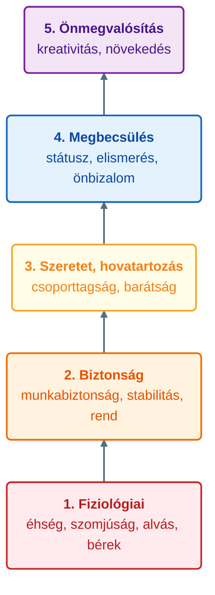
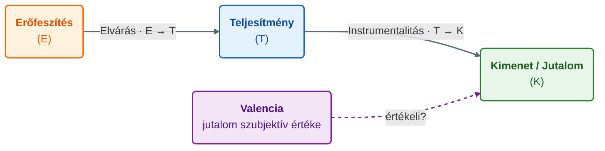
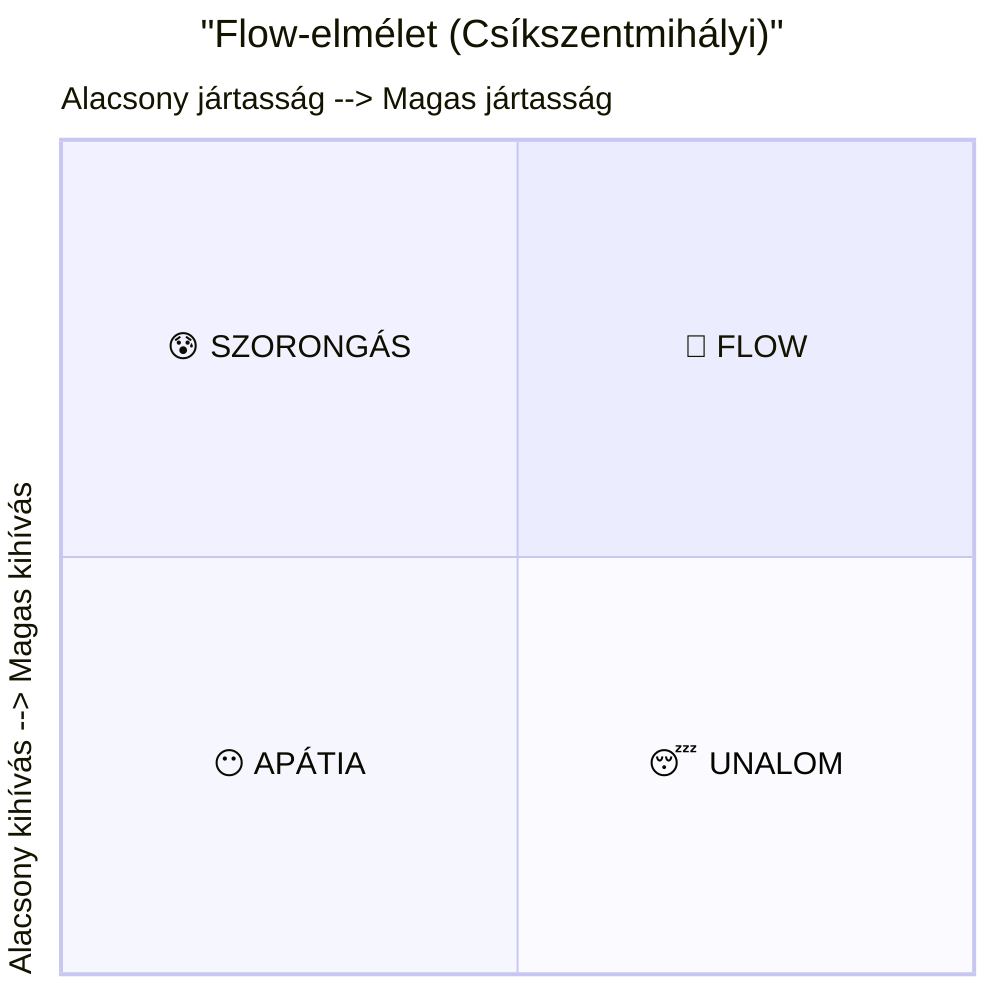

## K6. Motivációs elméletek

**Tétel:** Motivációs elméletek: Hogyan motiválhatják a vezetők/menedzserek az alkalmazottakat? Ismertessen legalább három motivációs elméletet!

### A motiváció fogalma és szerepe

**Motiváció** az a belső állapot, amely cselekvésre késztet, fenntartja és irányítja azt. A munkavégzés kontextusában a motiváció azt magyarázza meg, hogy valaki miért tesz erőfeszítést, miért tartja fenn azt, és miért éppen abba az irányba cselekszik, amerre.

Egy sokat idézett összefüggés:

> **Teljesítmény = Képesség × Motiváció**

Ebből következik, hogy a kiváló képességű, de demotivált munkás nem teljesít — és fordítva: a motivált, de képzetlen alkalmazott sem ér el magas eredményt. A vezető feladata mindkét tényezőre odafigyelni.

### 1. Maslow szükséglethierarchiája (1943/1954)

**Abraham Maslow** (1943, 1954) pszichológus szerint az emberi szükségletek egy piramisba rendezhetők, ahol az alacsonyabb szintek kielégítése előfeltétele a magasabbak megjelenésének:

**Munkáltatói következmények:**

- Az 1–2. szint: megfelelő bér, stabil munkaviszony, biztonságos munkahely
- A 3. szint: csapatszellem, kollegialitás, munkahelyi közösség
- A 4. szint: dicséret, előléptetés, felelős feladatok
- Az 5. szint: autonómia, alkotó munka, egyéni fejlődési lehetőség

**Kritika:** Az empirikus igazolás gyenge — az emberek nem mindig a „következő szintre" törekednek; kulturális különbségek is megkérdőjelezik az univerzalitást.

### 2. Herzberg kéttényezős elmélete (1968)

**Frederick Herzberg** (1959, 1968) munkavállalókat kérdezett arról, mikor érezték magukat a legjobban, illetve a legrosszabbul a munkahelyükön. Az eredmény meglepő volt: a jó és a rossz érzések *különböző* tényezőkre vezethetnők vissza.

| **Higiéniás tényezők**                                             | **Motiváló tényezők**                                            |
| ------------------------------------------------------------------ | ---------------------------------------------------------------- |
| Hiányuk elégedetlenséget okoz                                      | Jelenlétük motivál                                               |
| Jelenlétük *nem motivál*, csak a semleges állapotot állítja helyre | Hiányuk nem okoz elégedetlenséget, csak „nem motivált" állapotot |
| Fizetés, munkakörülmények, biztonság                               | Elért eredmények, elismerés                                      |
| Felettesi bánásmód, vállalati politika                             | Felelősség, előrelépés                                           |
| Státusz, munkaviszony biztonsága                                   | Maga a munka tartalma                                            |

**Üzenet a vezetőnek:** Ha a higiéniás tényezők hiányosak, az demotiválja a dolgozót. De ha csak ezeket javítja (béremel, kényelmes irodát biztosít), nem számíthat tartós motivációra. A valódi elköteleződéshez a motiváló tényezőket kell erősíteni: tartalmas munkát, felelősséget, elismerést adni.

### 3. Vroom elvárás-elmélete (1964)

**Victor Vroom** szerint az egyén motivációját három tényező szorzata határozza meg:

> **Motiváció = Elvárás × Instrumentalitás × Valenciák**

- **Elvárás (E → T):** Hiszi-e a dolgozó, hogy az erőfeszítése (E) teljesítményhez (T) vezet? „Ha keményen dolgozom, sikerülni fog?"
- **Instrumentalitás (T → K):** Hiszi-e, hogy a teljesítmény (T) jutalomhoz (K, kimenet) vezet? „Ha jól teljesítek, megkapom az előléptetést?"
- **Valencia:** Mennyire értékes számára az a jutalom? „Akarom-e egyáltalán azt az előléptetést?"

Ha bármelyik tényező nulla (nem hiszi el, hogy az erőfeszítés teljesítményhez vezet, vagy a jutalmat nem tartja értékesnek), a motiváció nulla lesz — függetlenül a többi tényezőtől.

**Következmény a vezető számára:** Érdemes megkérdezni, hogy a dolgozó mit értékel — a vezető által felkínált jutalom csak akkor motivál, ha a beosztott számára is értékes.

### 4. Alderfer ERG-modellje (1969)

**Clayton Alderfer** (1969) Maslow piramisát háromszintű, rugalmasabb modellé alakította át. Az ERG-betűszó három szükségletcsoportot jelöl:

- **E — Existence (Létezési szükségletek):** anyagi és fizikai biztonság — Maslow 1–2. szintjének felel meg
- **R — Relatedness (Kapcsolati szükségletek):** interperszonális kapcsolatok, elismerés — Maslow 3–4. szintje
- **G — Growth (Növekedési szükségletek):** önfejlődés, alkotás, önmegvalósítás — Maslow 5. szintje

Az ERG-modell két fontos eltérést mutat Maslow-tól: (1) egyszerre több szint is aktív lehet, és (2) *frusztrációs regresszió* lép fel — ha a magasabb szintű szükséglet nem elégíthető ki, az egyén visszatér az alacsonyabb szintű igények erőteljesebb keresésére. Ez magyarázza, miért emelnek bérigényt olyan munkavállalók, akiknek fejlődési lehetőségük nincs.

### Röviden: további elméletek

**McClelland (1961)** szerint három szerzett szükséglet motivál felnőtt korban: affiliációs igény (kapcsolatok, elfogadás), teljesítményigény (*need for achievement*) és hatalomigény. A különböző embereket különböző arányban hajtják ezek — a menedzsernek érdemes felismerni, melyik dominál egy adott beosztottnál.

**Adams méltányosság-elmélete:** Az emberek összehasonlítják saját erőfeszítés-jutalom arányukat mások arányával. Ha igazságtalanságot észlelnek, csökkentik az erőfeszítést vagy kérnek emelést. Az egyenlőtlenség érzete erős demotivátor.

**Locke célkitűzés-elmélete (1968):** A specifikus, kihívó, de elérhető célok magasabb teljesítményhez vezetnek, mint a homályos „dolgozzon jól" típusú utasítások. A részvétel a célkitűzésben növeli az elköteleződést.

**Skinner megerősítéselmélete (1953):** A viselkedés következményei alakítják a jövőbeni magatartást. Pozitív megerősítés (jutalom) növeli, negatív következmény (büntetés vagy jutalom elvonása) csökkenti a viselkedés ismétlődésének valószínűségét. Szervezeti alkalmazása: teljesítményarányos bér, azonnali visszajelzés, elismerési programok.

**Csíkszentmihályi Mihály flow-elmélete (1990):** Az optimális élmény (*flow*) akkor keletkezik, amikor a feladat kihívásszintje és a személy jártassága egyensúlyban van. Ha a kihívás túl nagy, szorongás; ha túl kis, unalom. A vezető feladata megtalálni azt a tartományt, ahol a munka önmagában jutalmazó.

---
