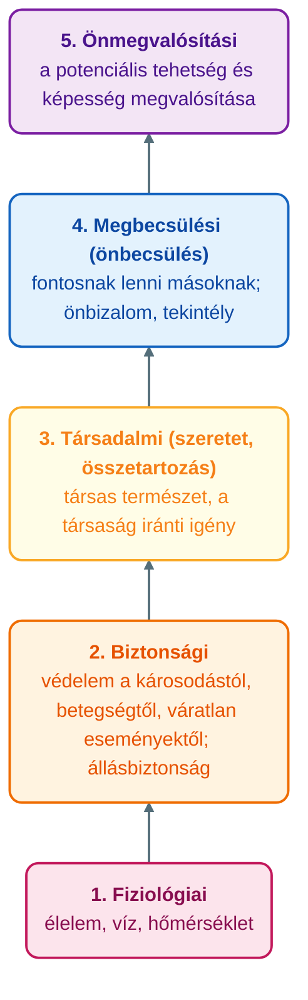
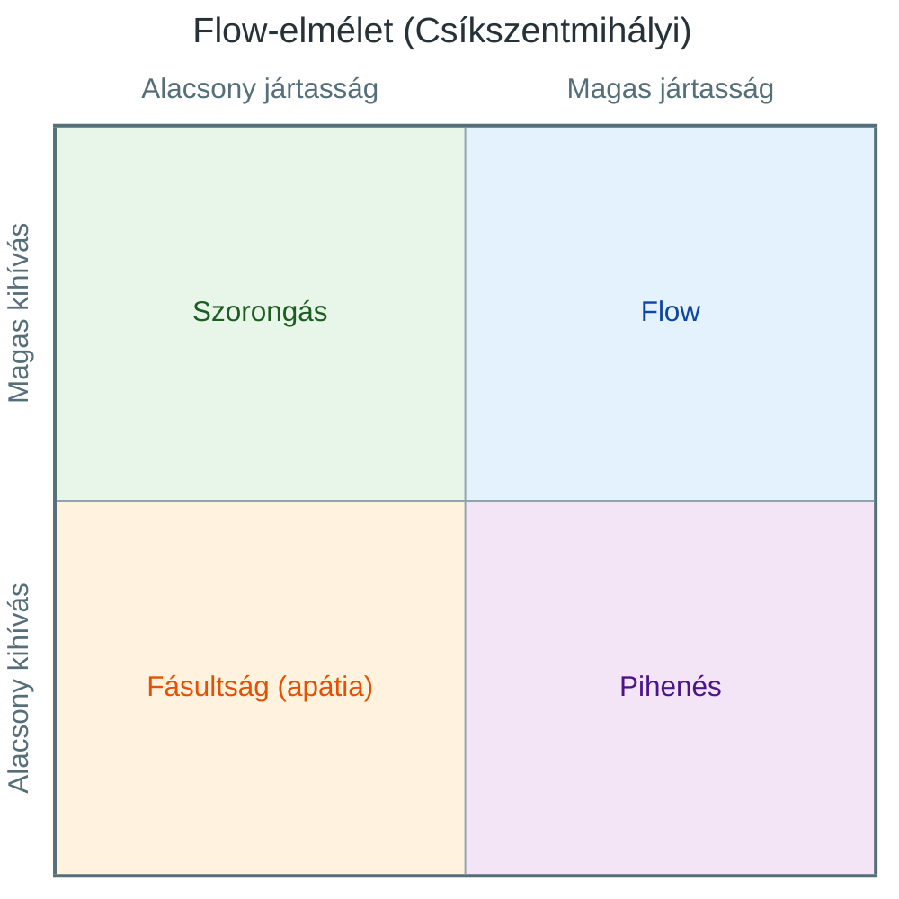

## K6 – Motivációs elméletek

### Beszerzendő anyagok

| Szerző | Mű | Jelleg | Indoklás / érintett rész |
|---|---|---|---|
| Fowler | *Motiváció magasabb szinten* | ajánlott irodalom | A syllabus ajánlott irodalomként nevezi meg; címe alapján az R1 (a vezetői motiválás gyakorlata) épülhetne rá (a tartalma nem ellenőrizhető). |

**Tétel:** Motivációs elméletek: Hogyan motiválhatják a vezetők/menedzserek az alkalmazottakat? Ismertessen legalább három motivációs elméletet!

---

### A motiváció fogalma és folyamata

A motiváció (a latin *movere*, vagyis mozgás, késztetés szóból) a viselkedés hajtóereje, az ösztönzők által előállított indíték, amely konkrét cselekvéshez vezet. Alapja a szükséglet. Mindazon belső indíttatású szükségletek összessége, amelyeket kívánságként, vágyként, hajtóerőként írunk le. Aktiváló és mozgatóerő, belső állapot, amely erőfeszítést, állhatatosságot és célokat is magába foglal (Óbudai Egyetem, Keleti Károly Gazdasági Kar, Marketing, Menedzsment és Módszertani Intézet [ÓE KGK MMI], 2023, 4. dia; Novák, 2023, 5. gyak.).

A motiváció folyamata kielégítetlen szükséglettel, vagyis az egyénen belüli hiánnyal indul. A hiány belső feszültséget kelt, ez hajtóerőt, a hajtóerő kereső magatartást eredményez. A szükséglet kielégítése végül csökkenti a belső feszültséget (ÓE KGK MMI, 2023, 5. dia). A motívumok lehetnek biológiai eredetűek (túlélés) vagy tanultak, szocializációsak (ÓE KGK MMI, 2023, 6. dia).

Vezetéselméleti fogalomként a motiváció ösztönzést, a szervezeti célok érdekében történő mozgósítást és vezetői magatartást jelent (ÓE KGK MMI, 2023, 6. dia). A teljesítmény a képesség és a motiváció szorzata (ÓE KGK MMI, 2023, 7. dia). A menedzser feladata, hogy az embereket a meghatározott cél elérésére ösztönözze úgy, hogy képességeiket és kapacitásukat teljes körűen felhasználják (ÓE KGK MMI, 2023, 7. dia).

Az elméletek célja, hogy megértsük az egyén magatartásának okait, előre jelezzük a vezetői lépések következményeit, és úgy irányítsuk a viselkedést, hogy az egyéni és a szervezeti célok egyaránt teljesüljenek (ÓE KGK MMI, 2023, 10. dia).

### Tartalom- és folyamatelméletek

A korai elméletek a hedonizmus és az ösztönelmélet voltak. A későbbieket két csoportra osztjuk (ÓE KGK MMI, 2023, 10. dia).

- A **tartalomelméletek** azt keresik, mi van az egyénben vagy a munkakörnyezetében, ami a cselekvéshez energiát ad és fenntartja a viselkedést, vagyis milyen elemek motiválják az embert.
- A **folyamatelméletek** azt magyarázzák, hogy milyen folyamatok útján és milyen energiát ad a motiváció, hogyan irányítható a viselkedés, hogyan tartjuk fenn, és mikor áll le (ÓE KGK MMI, 2023, 10. és 24. dia).

Az előadás tartalomelméletként Maslow, McClelland, Herzberg, Alderfer és Hunt elméletét, folyamatelméletként Skinner, Vroom, Locke és Adams elméletét sorolja fel (ÓE KGK MMI, 2023, 11. dia).

### Tartalomelméletek

#### Maslow szükséglethierarchiája (1950)

Maslow szerint az ember aktuális szükségletei attól függenek, hogy a korábbiak közül melyek elégültek ki, és viselkedését csak a ki nem elégített szükségletek befolyásolják. A szükségletek fontossági hierarchiában állnak: ha egyet kielégítettünk, egy másik kerül előtérbe (ÓE KGK MMI, 2023, 12–14. dia; Novák, 2023, 5. gyak.). A szükségletnek öt szintje van:

Ha a vezető felismeri, hogy a beosztottak a hierarchia melyik szintjén állnak, megtalálhatja a motiválás legjobb módját. A cél a dolgozók alapvető igényeinek folyamatos biztosítása, például kávéval, étellel, relaxációs szobával. A biztonsági szükséglet azt jelenti, hogy az alkalmazott biztonságban tudja az állását (ÓE KGK MMI, 2023, 12. és 14. dia).

**Kritika:** a hierarchia kérdéses („Hierarchia?”). Maslow említi a tudás és megismerés szükségletét, de nem építi be a hierarchiába (ÓE KGK MMI, 2023, 14. dia; Novák, 2023, 5. gyak.).

#### McClelland teljesítmény–hatalom–affiliáció elmélete (1965)

McClelland szerint minden emberben születésétől fogva, öröklötten jelen van három motívum (ÓE KGK MMI, 2023, 16. dia; Novák, 2023, 5. gyak.).

- **Affiliációs motívum:** a mások általi elfogadás fontosságát tükröző hajtóerő. Motiválni emberközpontú feladatokkal, folyamatos elismeréssel és dicsérettel lehet.
- **Teljesítménymotívum:** a siker fontosságát tükröző belső hajtóerő. Őket a siker és az elégedettség érzése motiválja, jutalommal nem, csak kihívó, de megoldható feladattal, amelyben megmutathatják a képességeiket.
- **Hatalmi motívum:** a másokra való hatás fontosságát tükröző belső hajtóerő. Akiknek ez erős, azoknak a vezetői pozíció a legfontosabb, mások irányítására és befolyásolására törekednek.

#### Herzberg kéttényezős elmélete (1968)

Herzberg szerint bizonyos munkahelyi feltételek hiánya elégedetlenséget kelt, megléte azonban nem motivál. Ezeket fenntartó (higiéniás) tényezőknek nevezi, mert az elfogadható szintű elégedettség fenntartásához szükségesek. Más munkakörülmények rendkívül erősen motiválnak: ezek a motiváló tényezők (ÓE KGK MMI, 2023, 17–19. dia; Novák, 2023, 5. gyak.).

| | **Fenntartó (higiéniás) tényezők** | **Motiváló tényezők** |
|---|---|---|
| **Hatás** | Hiányuk elégedetlenséghez vezet; jelenlétük nem vezet hatékonyabb munkához | Jelenlétük növeli a teljesítményt, az elkötelezettséget, javítja a munka minőségét; hiányuk nem bizonyul erősen elégedetlenséget keltő tényezőnek |
| **Tényezők** | Tíz tényező: vállalati politika és vezetés, műszaki vezetés, személyes kapcsolat a vezetővel, az egyenrangúakkal és az alárendeltekkel, fizetés, állásbiztonság, személyes élet, munkafeltételek, rang | Hat tényező: eredményesség, elismerés és megbecsülés, előléptetés, maga a munka, a személyes fejlődés lehetősége, felelősség |

A motiváló tényezők munkakör-központúak, hasonlóak a pszichológusok belső motivátoraihoz: a munka önmagában hordja a jutalmat. A külső motivátorok olyan jutalmak, amelyeknek a munka elvégzése után van jelentőségük (Novák, 2023, 5. gyak.).

A vezetőnek tehát nem elég a higiéniás tényezőket javítania, mert ezek nem vezetnek hatékonyabb munkához (ÓE KGK MMI, 2023, 17. dia). A motiváló tényezőkre épít a munkakör-gazdagítás: az előadás ábrája szerint a munka jellemzői (például autonómia, visszacsatolás, a munka jelentősége) kritikus pszichológiai állapotokon át belső munkamotivációhoz, elégedettséghez és hatékonysághoz vezetnek (ÓE KGK MMI, 2023, 20. dia).

**Kritika:** az elmélet inkább attitűdvizsgálat, és nem egyértelmű a kapcsolat a motiváció és a teljesítmény között (ÓE KGK MMI, 2023, 19. dia).

#### Alderfer szükségletelmélete (1969)

Alderfer három szükségletcsoportot emel ki (ÓE KGK MMI, 2023, 21. dia).

- **Létezés:** az anyagi szükségletek.
- **Kapcsolat:** a társas kapcsolatok iránti vágy.
- **Fejlődés:** a személyes fejlődés. A többitől eltér: kielégítése esetén még inkább fontossá válik, és tovább növeli a motivációt.

Az elmélet lazább a Maslow-félénél: egyidejűleg több szint is befolyásolhatja a motivációt, és a környezet határozza meg az igények erősségét. A vezető feladata, hogy a szükségletek felismerésével, személyre szabott eszközökkel motiválja a beosztottakat (ÓE KGK MMI, 2023, 21. dia).

#### Hunt cél–motiváció elmélete (1969)

John Hunt szerint a motiváció az egyéni célokból érthető meg. A célok irányítják a munkahelyi magatartást, folyamatosan alakulnak, erősségükben és fontosságukban különböznek, és az értékeinket, hiedelmeinket tükrözik. Megértésükkel a vezetők személyre szabott eszközökkel motiválhatnak, de ez nehéz és energiaigényes feladat. Hat célt különböztet meg (ÓE KGK MMI, 2023, 22–23. dia):

1. **Komfort, anyagi jólét:** az életszínvonalat biztosító anyagiak, a stresszhelyzetek kerülése.
2. **Strukturáltság:** tisztázott munkakör, stabilitás, bizonyosság, egyértelmű elvárások és szabályok.
3. **Kapcsolat:** a csoporthoz tartozás, az elfogadottság, az egyedüli munkavégzés kerülése.
4. **Elismertség:** a teljesítmény mások általi elismerése, megfelelő státusz, visszacsatolás, teljesítménnyel arányos javadalmazás, pozitív énkép.
5. **Hatalom:** mások irányítása, kontrollálása, dominancia, de csak vezetői hatalom értelmében.
6. **Autonómia, kreativitás, fejlődés:** önmegvalósítás, kihívás, tanulás, a munkavégzés szabadsága, kreatív problémamegoldás.

### Folyamatelméletek

#### Skinner megerősítéselmélete (1953)

Az elmélet a viselkedést a környezet okozatának tekinti, a visszajelzések irányítják, a szükségletekkel nem foglalkozik. Alapja, hogy a kellemes következményekkel járó viselkedést valószínűleg megismétlik, a kellemetlennel járót nem. Megfelelően ütemezett jutalmakkal az egyéni viselkedés befolyásolható (ÓE KGK MMI, 2023, 25–26. dia; Novák, 2023, 5. gyak.).

A megerősítés típusai a pozitív megerősítés, a negatív megerősítés (a következményektől való félelem miatti cselekvés), a büntetés és a kioltás. A kioltásnál bármennyire vágyik is valaki a jutalomra, amíg le nem szokik a nem kívánt viselkedésről, addig nem kapja meg. A vezetők a pozitív megerősítést folyamatos vagy időszakos ütemezéssel alkalmazhatják (ÓE KGK MMI, 2023, 26. dia).

#### Vroom elvárás-elmélete (1964)

Vroom a motivációt olyan folyamatnak tekinti, amely az egyén választásait irányítja: az egyén szabadon választ a különféle viselkedések és a munka különféle intenzitásai között. Az elmélet négy alapvető tényezője a választás, az elvárás, a preferencia és az instrumentalitás (ÓE KGK MMI, 2023, 27. dia; Novák, 2023, 5. gyak.).

- **Elvárás (erőfeszítés → teljesítmény):** az a hit, hogy az elhatározott viselkedés sikeres lesz, vagyis hogy az erőfeszítés (E) az adott teljesítményhez (T) vezet.
- **Instrumentalitás (teljesítmény → következmény):** az a szubjektív valószínűség, hogy a teljesítmény (T) meghatározott értékű következményhez (K), jutalomhoz vagy büntetéshez vezet.
- **Preferencia (valencia):** az az érték, amelyet az egyén az erőfeszítései következményeihez kapcsol.

Az előadás a valenciát nem egységesen használja: a 27. dia a preferenciát értékként határozza meg, a 29. dia a jutalom érzékelt értékéről beszél, a 28. dia viszont a valenciát valószínűségként írja le. A tételben értékként használom (ÓE KGK MMI, 2023, 27–29. dia). A motivációs erőt a jutalom érzékelt értéke és a két valószínűség együtt határozza meg (ÓE KGK MMI, 2023, 29. dia).

#### Adams méltányosság-elmélete

Az elmélet abból indul ki, hogy az összeférhetetlen vélekedések kényelmetlenek, és harmónia teremtésére motiválnak. A dolgozó a befektetett energia és a várható személyes eredmény arányát mérlegeli, elsősorban az általa fontosnak tartott személyek hasonló arányához viszonyítva. Ha az arányok hasonlók, a helyzetet méltányosnak érzi. Lényeges eltérésnél feszültséget érez, és motivált lesz annak csökkentésére (ÓE KGK MMI, 2023, 30. dia). A feszültség csökkentésének öt módja (ÓE KGK MMI, 2023, 31. dia):

1. az inputok csökkentése (kevesebb erőfeszítés, gyakran a minőség rovására);
2. az outputok változtatása (fizetésemelés, jutalom vagy előléptetés kérése);
3. a saját input/output arány átértékelése, pszichológiai torzításokkal;
4. a referenciaszemély input/output arányának átértékelése;
5. a szituáció megváltoztatása, például a munkahelyről való kilépés.

#### Locke célkitűzés-elmélete (1968)

A célok legyenek konkrétak, és a vállalat céljai legyenek összhangban az egyén céljaival. A cél és a teljesítmény sikerélményt és megerősítést ad, a nehéz célok és az elkötelezettség együtt nagyobb teljesítményhez vezetnek. A cél–teljesítmény kapcsolatot az elkötelezettség, a feladat jellemzői és a kulturális környezet befolyásolja. Az előadás felveti azt is, hogy önellenőrzés vagy külső ellenőrzés legyen-e (ÓE KGK MMI, 2023, 32. dia).

### További elméletek

Az előadás további elméleteket is említ (ÓE KGK MMI, 2023, 33–36. dia).

- **McGregor X–Y elmélete:** az X-elmélet szerint az átlagember hanyag, kerüli a felelősséget és szereti, ha irányítják, ezért a vezetőnek kell irányítania és motiválnia. Az Y-elmélet szerint a munkavégzés természetes, az ember megfelelő feltételek között keresi a felelősséget, ezért a vezetőnek a feltételeket kell megteremtenie. A vezetői stílussal való kapcsolatát a K5 tétel tárgyalja.
- **Ouchi Z-elmélete:** a munkakörülmények humanizálása és az együttműködés szolgálja jobban a hosszú távú sikert; jellemzői a tartós foglalkoztatás, a vezetőfejlesztés, a kölcsönös bizalom és a holisztikus orientáció.
- **Chapman, a munkahelyi elismerés öt nyelve:** elismerő szavak, minőségi idő, ajándékok, szívességek, elismerő érintés; a vezetői feladat felismerni a kollégákhoz vezető eszközt.
- **Csíkszentmihályi Mihály flow-elmélete:** a tökéletes élmény pszichológiája, két tengelye a kihívás és a jártasság. Magas kihívás és magas jártasság egyensúlyában jön létre a flow; a szélső mezők a szorongás, a fásultság (apátia) és a pihenés, a köztes sávokban az ébredés, a kontroll, az aggodalom és az unalom helyezkedik el (ÓE KGK MMI, 2023, 35. dia).

### Hogyan motiválhatják a vezetők az alkalmazottakat?

A dolgozók motiválása a menedzseri feladatkör elengedhetetlen része: a menedzser megteremti a tevékenységekhez szükséges környezetet, biztosítja a vezetői támogatást, és fenntartja a dolgozók elégedettségét és elkötelezettségét (ÓE KGK MMI, 2023, 3. dia). A motiváció–eredmény modell szerint a teljesítményt és az elégedettséget az emberi összetevők, a szervezeti tényezők és a vezetői motivációs stratégiák együtt határozzák meg (ÓE KGK MMI, 2023, 7. dia).

Az ösztönzési rendszernél három célrendszert kell együtt figyelembe venni: a szervezet tagjaiét (kereset, előremenetel), a szervezetét (termelékenység, hírnév) és a társadalmét (törvényesség, környezetvédelem). Az ösztönzés csak akkor hatékony, ha mindegyik érdekcsoportra kiterjed. Az egyes személyekre és csoportokra a tényezők nem egyformán hatnak, ezért csak a konkrét motívumaiknak megfelelő ösztönzők működnek. Az ösztönzést a közvetlen vezetők tudják hatékonyan végezni, ezért decentralizáltan kell alkalmazni, az azonos munkáért azonos bér elvével (Novák, 2023, 5. gyak.).

Az ösztönzők csoportosíthatók a szükséglet kielégítése szerint (alapvető és magasabb rendű), anyagi és erkölcsi, valamint pozitív és negatív ösztönzőkre. Az erkölcsi ösztönző az anyagival párosítva a leghatásosabb. A motiválás főbb formái a bérezés, a foglalkoztatottság és biztonságérzet, a munkakollektívába tartozás, az elismerés és megbecsülés, valamint az érvényesülés és a sikerre törekvés (Novák, 2023, 5. gyak.).

### Összegzés

A tartalomelméletek a motiváció forrását keresik: Maslow, Alderfer és Hunt a szükségletekből és célokból, McClelland az öröklött motívumokból, Herzberg a munka tényezőiből indul ki. A folyamatelméletek a mechanizmust írják le: Skinner a következmények szerepét, Vroom a választást és az elvárásokat, Adams az igazságosság-érzetet, Locke a célokat emeli ki (ÓE KGK MMI, 2023, 10–11. dia). Egyik elmélet sem ad önmagában egyértelműen elfogadható magyarázatot arra, hogy mi váltja ki az emberekből a munkára késztetést, és hogyan alakul ki a motiváció (Novák, 2023, 5. gyak.). A vezetőnek ezért a beosztottak konkrét szükségleteit és céljait kell felismernie, és ehhez igazítania az ösztönzőket (ÓE KGK MMI, 2023, 21–22. dia; Novák, 2023, 5. gyak.).

---

### Várható vizsgáztatói kérdések

1. **Mi a különbség a tartalom- és a folyamatelméletek között?** — A tartalomelméletek azt keresik, mi van az egyénben vagy a munkakörnyezetben, ami energiát ad a cselekvéshez (például Maslow, Herzberg). A folyamatelméletek azt magyarázzák, hogyan megy végbe a motiváció, hogyan irányítható és tartható fenn a viselkedés (például Skinner, Vroom) (ÓE KGK MMI, 2023, 10. dia).
2. **Miért nem elég a béremelés Herzberg szerint?** — A fizetés a fenntartó (higiéniás) tényezők közé tartozik: hiánya elégedetlenséget okoz, jelenléte viszont nem vezet hatékonyabb munkához. A teljesítményt a motiváló tényezők (elismerés, felelősség, előléptetés, maga a munka) növelik (ÓE KGK MMI, 2023, 17–19. dia).
3. **Miben tér el Alderfer modellje Maslow-étól, és milyen kritika éri Maslow-t?** — Alderfer három szükségletcsoportot használ, a modell lazább, és egyidejűleg több szint is hathat (ÓE KGK MMI, 2023, 21. dia). Maslow hierarchiáját a „Hierarchia?” kérdés kritizálja, és a tudás szükségletét nem építi be (ÓE KGK MMI, 2023, 14. dia).
4. **Mire figyeljen a vezető Vroom elmélete alapján?** — Az egyén azt méri, hogy az erőfeszítése teljesítményhez vezet-e, a teljesítmény jutalomhoz vezet-e, és mennyire értékes számára a jutalom (ÓE KGK MMI, 2023, 27–29. dia). Ezért az ösztönzőket az egyén vagy a csoport konkrét motívumaihoz kell igazítani (Novák, 2023, 5. gyak.).
5. **Hogyan keletkezik feszültség Adams elmélete szerint, és hogyan csökkenthető?** — A dolgozó összeveti a saját input/output arányát a referenciaszemélyek arányával, eltérésnél feszültséget érez. Csökkentheti az inputot, változtathatja az outputot, átértékelheti a saját vagy a referenciaszemély arányát, vagy megváltoztathatja a szituációt, például kiléphet (ÓE KGK MMI, 2023, 30–31. dia).
6. **Hogyan kapcsolódik McGregor X–Y elmélete a motivációhoz?** — Az X-elmélet szerint a dolgozót irányítani kell, az Y-elmélet szerint megfelelő feltételek között keresi a felelősséget, ezért a vezetőnek a munkavégzés feltételeit kell megteremtenie (ÓE KGK MMI, 2023, 33. dia). A vezetői stílussal való összefüggését a K5 tétel tárgyalja.

---

## Irodalom

* Novák, J. (2023). *Javaslatok Menedzsment c. tárgy gyakorlatához* [Gyakorlati anyag]. Óbudai Egyetem, Keleti Károly Gazdasági Kar.
* Óbudai Egyetem, Keleti Károly Gazdasági Kar, Marketing, Menedzsment és Módszertani Intézet. (2023). *Motiváció* [Előadás-prezentáció, 5. ea.].
