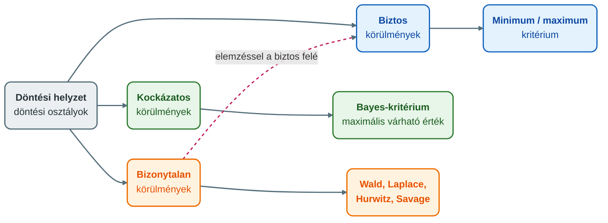

## K7 – Döntés mint vezetői feladat

### Beszerzendő anyagok

| Szerző | Mű | Jelleg | Indoklás / érintett rész |
|---|---|---|---|
| — | Moodle e-learning tananyag (GMXMD1MBLF) | kötelező irodalom | A syllabus ezt nevezi meg kötelező irodalomként; a döntéshozatali lépések (R2) és a döntést hátráltató tényezők (R4) pontosítása erre épülhetne. |
| Zoltayné Paprika, Z. | *Döntéselmélet* (Alinea, 2005) | ajánlott irodalom | A syllabus ajánlott irodalomként nevezi meg; a tétel egész témája (R3 döntési modellek, R4 hátráltató tényezők) erre épülne (a tartalma nem ellenőrizhető). |

**Tétel:** Ismertesse a vezetői döntés szerepét, a döntést, mint vezetői feladatot! Mutassa be a döntési modelleket és ismertesse a döntést hátráltató tényezőket!

---

### A vezetői döntés szerepe

A döntés Kornai János megfogalmazásában „alternatívák közötti célirányos választás, előre rögzített kritériumok szerint, valamilyen stratégiával" (Óbudai Egyetem, Keleti Károly Gazdasági Kar, Marketing, Menedzsment és Módszertani Intézet [ÓE KGK MMI], 2023b, 4. dia).

A döntés a menedzseri tevékenység szerves része. Az eredmények eléréséért felelős menedzser feladatai: tervezés, döntés, szervezés, irányítás, összehangolás, ellenőrzés (ÓE KGK MMI, 2023d, 18. dia). A menedzsment kezében van a felelősség, hogy az adott helyzetben a lehető legmegfelelőbb döntést hozza meg, és a helyes döntések nagyban befolyásolhatják a vállalat későbbi működését (ÓE KGK MMI, 2023b, 3. dia). A tervezés is megfelelő hosszú távú döntések meghozatalát jelenti (ÓE KGK MMI, 2023d, 23. dia), az emberek irányítása pedig a dolgozók bevonását a döntéshozásba (ÓE KGK MMI, 2023d, 27. dia).

A döntés a vezetői szerepekben is megjelenik. Mintzberg döntési szerepei: vállalkozó, zavarkezelő, erőforrás-elosztó és tárgyaló (ÓE KGK MMI, 2023d, 28. dia). A szervezeten belül a hatáskörmegosztás dönti el, ki dönt mit. A hosszú távú, stratégiai döntések általában a felsővezetéshez kapcsolódnak, a mindennapi operatív döntéseket ideális esetben ott hozzák, ahol a döntési igény megjelenik. Ha mindkettő a hierarchia csúcsán dől el, a szervezet centralizált, ha az operatív döntési hatáskörök lejjebb kerülnek, decentralizált (ÓE KGK MMI, 2023a, 46. dia).

A vezetési stílusokat a döntéshozatal módja szerint is tipologizálják: az a kérdés, hogy a vezető milyen részvételt enged másoknak (ÓE KGK MMI, 2023e, 21. dia). Tannenbaum és Schmidt hétfokozatú skálája az autokratikus vezetőtől (a vezető dönt és kihirdeti) a delegálóig (a csoport dönt a vezető által kijelölt határokon belül) terjed (ÓE KGK MMI, 2023g, 9. dia). A vezetők döntéseiket intuícióra és tényekre alapozzák (ÓE KGK MMI, 2023g, 22. dia).

### A döntés mint vezetői feladat

Az előadás a döntés fajtáit statikus és dinamikus csoportra osztja, de csak megnevezi őket (ÓE KGK MMI, 2023b, 7. dia).

**A megalapozott döntés feltételei** (ÓE KGK MMI, 2023b, 6. dia):

1. a döntéshez szükséges hatáskör;
2. a döntéshozó felelőssége a döntésért;
3. a döntéshozó felkészültsége;
4. a megalapozott döntéshez szükséges információ;
5. a döntés-előkészítés alapossága;
6. a döntéshozó érdekeltsége a döntés helyességében.

**Munkamegosztás.** A döntés-előkészítés, vagyis az alternatívák kidolgozása a szakértői csoport dolga. A döntés megfogalmazása a menedzser feladata (ÓE KGK MMI, 2023b, 7. dia). A menedzselés fázisai közt külön szerepel a döntés-előkészítési és a döntési fázis (Novák, 2023, 1. gyak.).

**A döntéshozatal lépései.** Az előadás több változatot ad, 5, 6, 7 és 8 lépéssel (ÓE KGK MMI, 2023b, 28–31. dia). A legrészletesebb, eszközöket is megnevező változat hat lépésből áll (ÓE KGK MMI, 2023b, 30. dia):

1. a probléma felismerése és megfogalmazása (halszálka- (Ishikawa-) diagram, Pareto-diagram, erőtér-elemzés, érintettek térképe);
2. információgyűjtés (primer vagy szekunder, külső vagy belső, formális vagy informális, múltbeli vagy jövőbeli);
3. az alternatívák előállítása, majd szűkítése;
4. a választás (a döntés);
5. a megvalósítás;
6. az ellenőrzés.

**Követelmények az utasításokkal szemben** (ÓE KGK MMI, 2023b, 32. dia): a döntést pontosan kell rögzíteni; a nyelvezet feleljen meg az érintettek szakmai felkészültségének; a tartalom ne legyen ellentétes a szervezeti célokkal; a logikai szerkezet legyen megfelelő; a döntés tényeken alapuljon; kommunikálni kell, és az érintetteknek tisztában kell lenniük a változásokkal.

### Döntési modellek

A „döntési modell" kifejezés az előadásban két szinten szerepel: a döntési helyzet szerkezeteként (elemek, osztályok, kritériumok) és a döntéshozatal típusaiként (három modellcsoport).

#### A döntési modell elemei

| Elem | Tartalma |
|---|---|
| **Döntéshozó** | Aki a döntést meghozza. |
| **Tényállapot** | A döntéshozótól független, a döntés eredményét befolyásoló tényező (ÓE KGK MMI, 2023b, 18. dia). |
| **Tényállapotok valószínűségi eloszlása** | A tényállapotok bekövetkezési valószínűsége. |
| **Cselekvési változatok** | A választható alternatívák. |
| **Döntési kritérium** | A választás szempontja, amely a döntési osztálytól függ. |
| **Eredmény** | Az egyes változatok és tényállapotok kombinációjához tartozó kimenet. |

Forrás: ÓE KGK MMI, 2023b, 5. dia.

#### A modellek három csoportja

Az előadás három csoportot nevez meg: a racionális (logikai), a nem racionális (intuitív) és a prejudikatív (előítéletes) döntési modellt. A döntéshozatal résztvevői szerint a döntés lehet egyéni vagy csoportos (ÓE KGK MMI, 2023b, 27. dia). Az előadás ezeket csak megnevezi, részletes kifejtésük a helyi anyagban nem szerepel.

#### Döntési osztályok

Az információ természete szerint három osztályt különítünk el: biztos, bizonytalan és kockázatos körülmények között hozott döntést (ÓE KGK MMI, 2023b, 13. dia).

- **Biztos körülmények:** a döntéshozó konkrét feltételek mellett a maximális eredményre törekszik, ezért a kritérium a minimum vagy maximum. Ez ritkán fordul elő (ÓE KGK MMI, 2023b, 14–15. dia).
- **Kockázatos körülmények:** a tényállapotokhoz valószínűség rendelhető (statisztikai adatok alapján becsülhető), a kritérium a Bayes-kritérium (ÓE KGK MMI, 2023b, 24–25. dia).
- **Bizonytalan körülmények:** a kritériumok a Wald, a Laplace, a Hurwitz és a Savage kritérium (ÓE KGK MMI, 2023b, 15. dia).

Elemzésekkel a bizonytalan döntéstől a biztos körülmények felé haladhatunk, de az elemzés idő- és erőforrást igényel, ezért az „arany középutat" kell megtalálni (ÓE KGK MMI, 2023b, 13. dia).

#### Számpélda: a szezoncikk-feladat

Egy vállalat szezoncikk gyártásáról dönt. A termék csak egy szezonban adható el, eladási ára 1500 Ft/db. Két gyártási eljárás áll rendelkezésre. Az „A" eljárás beruházási költsége 1000 eFt, darabonkénti arányos költsége 1000 Ft; a „B" eljárás felszerszámozási költsége 3000 eFt, arányos költsége 500 Ft/db (ÓE KGK MMI, 2023b, 16. dia). A cselekvési változatok: S1 (nem gyártunk), S2 („A" eljárás), S3 („B" eljárás). A tényállapotok a lehetséges kereslet: T1 = 1000, T2 = 3000, T3 = 5000 db (ÓE KGK MMI, 2023b, 17–18. dia). A profitmátrix (eFt) (ÓE KGK MMI, 2023b, 19. dia):

| | T1 (1000 db) | T2 (3000 db) | T3 (5000 db) |
|---|---|---|---|
| **S1** | 0 | 0 | 0 |
| **S2** | −500 | 500 | 1500 |
| **S3** | −2000 | 0 | 2000 |

**Bizonytalan körülmények.** A Wald-kritérium pesszimista döntéshozót tételez fel: a sorminimumok maximumát választja (mini-max), az optimista változat, a max-max a sormaximumok maximumát (ÓE KGK MMI, 2023b, 20. dia). A Hurwitz-kritérium a két szélsőértéket súlyozza, és a súlyozott átlag minél nagyobb, annál jobb (ÓE KGK MMI, 2023b, 21. dia). A Laplace-kritérium az elégtelen ok elve alapján egyenlő valószínűségeket tételez fel, és az alternatívák várható értékét számolja (ÓE KGK MMI, 2023b, 22. dia). A Savage–Niehans-kritérium származtatott célváltozóval, az elmaradt haszonnal (*opportunity cost*) dolgozik: minden tényállapotnál az optimális és a tényleges eredmény különbségét képezi. A kritérium innen háromféleképp folytatódhat: a maxi-max, a Hurwitz- és a Laplace-logika szerint (ÓE KGK MMI, 2023b, 23. dia). A 23. dia megfogalmazása a maxi-max változatnál nem egyértelmű.

Az előadás mátrixából számolt eredmények (a Hurwitz-súly az előadás szemléltető 0,2 és 0,8 értéke):

| Kritérium | Számítás | Választás |
|---|---|---|
| Wald (mini-max) | sorminimumok: 0; −500; −2000 | **S1** (nem gyártunk) |
| Max-max | sormaximumok: 0; 1500; 2000 | **S3** |
| Hurwitz (0,2 a legjobb, 0,8 a legrosszabb kimenetre) | S1: 0; S2: 0,2·1500 + 0,8·(−500) = −100; S3: 0,2·2000 + 0,8·(−2000) = −1200 | **S1** |
| Laplace | S1: 0; S2: (−500 + 500 + 1500)/3 = 500; S3: (−2000 + 0 + 2000)/3 = 0 | **S2** |
| Savage–Niehans | elmaradt haszon S1: 0, 500, 2000; S2: 500, 0, 500; S3: 2000, 500, 0; a legnagyobb elmaradt haszon S1: 2000, S2: 500, S3: 2000 | **S2** (a legkisebb legnagyobb elmaradt haszon) |

**Kockázatos körülmények.** A kritérium a Bayes-kritérium: a valószínűségekkel súlyozott összegek közül a legmagasabbat választjuk (ÓE KGK MMI, 2023b, 24. dia). A példában P(T1) = 1/2, P(T2) = 1/3, P(T3) = 1/6. M(S1) = 0; M(S2) = 1/2·(−500) + 1/3·500 + 1/6·1500 ≈ 166,7; M(S3) = 1/2·(−2000) + 1/3·0 + 1/6·2000 ≈ −666,7 (az előadás 166-ot és −667-et ad). A döntés az S2, az „A" technológia (ÓE KGK MMI, 2023b, 25–26. dia).

Ugyanabból a mátrixból tehát a kritérium dönti el a választást. Ez a döntéshozó hozzáállását is tükrözi: pesszimista, optimista vagy súlyozó (ÓE KGK MMI, 2023b, 20–21. dia).

#### Döntési mátrix és döntési fagráf

A döntési helyzet ábrázolásának két eszköze a döntési mátrix és a döntési fagráf (ÓE KGK MMI, 2023b, 7. dia).

A **döntési mátrix** soraiban a lehetséges cselekvések (a₁…aₘ), oszlopaiban a környezeti állapotok (s₁…sₙ) állnak, az állapotok bekövetkezési valószínűségével (p₁…pₙ). A cellák az eredményeket (eᵢⱼ) tartalmazzák. A befolyásoló tényezők hatásának nagysága és bekövetkezésük valószínűségének szorzata adja a kockázat mértékét (ÓE KGK MMI, 2023b, 8. dia).

A **döntési fagráf** a megvalósítható döntési lehetőségeket és a hozzájuk kapcsolódó kockázatokat mutatja. Két csomóponttípust használ: döntési csomópontot (*decision node*) és véletlen csomópontot (*chance node*) (ÓE KGK MMI, 2023b, 9–10. dia). Az elemzés alapja a tényezők bekövetkezési valószínűségének és hatásának lehető legpontosabb becslése, szükség esetén szakértők bevonásával (ÓE KGK MMI, 2023b, 9. dia).

Az előadás példájában a vállalat szoftvert vásárol vagy fejleszt. A vásárlás 50 000 $, de 40% az esély, hogy kielégíti az igényt, és 60%, hogy nem, ekkor 200 000 $ a várható veszteség. A vásárlás várható költsége 0,4·50 000 + 0,6·(50 000 + 200 000) = 20 000 + 150 000 = 170 000 $ (ÓE KGK MMI, 2023b, 11. dia). A fejlesztés 120 000 $, 80% eséllyel működik, 20% eséllyel nem, ekkor további 30 000 $ költség jelentkezik. Az ábra szerint a fejlesztés várható költsége 126 000 $ (ÓE KGK MMI, 2023b, 10. dia). A csapat feladata, hogy a legolcsóbb vagy legmegbízhatóbb utat válassza (ÓE KGK MMI, 2023b, 11. dia). A döntési fa elemzése a kockázatmenedzsment kvantitatív eszközei közé is tartozik (ÓE KGK MMI, 2023c, 13. dia).

### A döntést hátráltató tényezők

> **Forrásmegjegyzés.** A tananyag nem tartalmaz önálló „hátráltató tényezők" listát. Az alábbi csoportosítás a megalapozott döntés feltételeiből, a döntést befolyásoló tényezőkből és más előadások helyzeti hatásaiból áll össze. A kapcsolatot a döntéshozatallal a tétel szintézise teremti meg.

1. **A megalapozottság feltételeinek hiánya.** Ha hiányzik a hatáskör, a felelősség, a felkészültség, a szükséges információ, az alapos előkészítés vagy a döntéshozó érdekeltsége, a döntés nem megalapozott (ÓE KGK MMI, 2023b, 6. dia).
2. **Információ és bizonytalanság.** Az elemzés csak akkor lehet sikeres, ha a csapat a környezet és a tényezők lehető legszélesebb körű ismeretével rendelkezik, a becslések pedig releváns, megbízható adatokból készülnek (ÓE KGK MMI, 2023b, 9. dia). Az elemzés maga is idő- és erőforrásigényes (ÓE KGK MMI, 2023b, 13. dia).
3. **Egymással ütköző szempontok.** A döntést a költségen túl a vállalt kockázatok, a siker valószínűsége, a döntés minősége és fontossága, valamint a szakértők és a csapat véleménye is befolyásolja. A menedzsmentnek ezeket kell mérlegelnie, akár a költségek kárára is, a legmegbízhatóbb döntés érdekében (ÓE KGK MMI, 2023b, 12. dia).
4. **Viszonyulás a kockázathoz.** Az emberek természetükből fakadóan nagyon nehezen válnak meg a már megszerzett vagyonuktól vagy értékeiktől (ÓE KGK MMI, 2023c, 5. dia).
5. **Stresszhelyzet** (ÓE KGK MMI, 2023f, 45. dia):
   - *csőlátás:* a figyelem beszűkül, a vészjeleket figyelmen kívül hagyják, rutin alapú a reagálás, makacs kitartás a kevésbé jó döntések mellett;
   - *merevség:* csökken az alternatívák iránti készség, türelmetlenség, erősödő autokratizmus, kapkodás;
   - *rövid időtávú gondolkodás:* a komplex problémák háttérbe szorulnak, nincs idő modellezésre és tervezésre, az érintettek bevonása elmarad.
6. **Csoporthatások.** A csoportnyomás a tagok észlelését és vélekedését befolyásolja, elnyomja vagy eltorzítja, és alkalmazkodást vár a csoportszellem jegyében (ÓE KGK MMI, 2023a, 10. dia). A konformitás három foka a behódolás, az azonosulás és az internalizáció (ÓE KGK MMI, 2023a, 11. dia). Ezek a hatások a csoportos döntéshozatalt (ÓE KGK MMI, 2023b, 27. dia) is érinthetik.
7. **Szervezeti reakciók válságban** (ÓE KGK MMI, 2023f, 50. dia): a Pató Pál szemléletű szervezet döntésképtelenné válik, az ortodox nem ismeri el a problémát, a tervgazdaság szemléletű, információhiányos szervezet rossz módszert vagy rossz döntést hoz. A tudás alapú, dinamikus szervezet érzékeli a helyzetet, megoldást dolgoz ki és sikeresen alkalmazza.

A jó döntést a folyamatos kommunikáció, a szakértelem, a célok pontos ismerete, a rugalmasság és a környezet széleskörű ismerete segíti (ÓE KGK MMI, 2023b, 3. dia).

### Összegzés

A döntés a menedzseri munka alapfeladata. A döntési modell hat eleme írja le a helyzetet, az információ természete szerinti osztály (biztos, kockázatos, bizonytalan) pedig meghatározza a kritériumot. A kritérium megválasztása a döntéshozó hozzáállását is kifejezi, ezért ugyanabból a mátrixból eltérő döntés születhet. A tárgyon belül a téma kapcsolódik a vezetési stílusokhoz (a döntésben való részvétel foka, Tannenbaum–Schmidt), a tervezéshez (hosszú távú döntések) és a kockázatmenedzsmenthez (a kockázat mértéke a hatás és a valószínűség szorzata).

---

### Várható vizsgáztatói kérdések

1. **Mi a döntés definíciója, és melyek a döntési modell elemei?** — Kornai szerint a döntés alternatívák közötti célirányos választás, előre rögzített kritériumok szerint, valamilyen stratégiával. Az elemek: döntéshozó, tényállapot, a tényállapotok valószínűségi eloszlása, cselekvési változatok, döntési kritérium, eredmény (ÓE KGK MMI, 2023b, 4–5. dia).
2. **Melyik döntési osztályhoz melyik kritérium tartozik?** — Biztos körülmények közt minimum vagy maximum, bizonytalan körülmények közt Wald, Laplace, Hurwitz és Savage, kockázatos körülmények közt Bayes (ÓE KGK MMI, 2023b, 15. dia).
3. **Miben különbözik a Wald- és a Hurwitz-kritérium?** — A Wald csak az egyik szélsőértéket nézi: a pesszimista döntéshozó a sorminimumok maximumát, az optimista (max-max) a sormaximumok maximumát választja. A Hurwitz mindkét szélsőértéket figyelembe veszi, súlyt rendel hozzájuk, és a súlyozott átlagot maximalizálja (ÓE KGK MMI, 2023b, 20–21. dia).
4. **Hogyan számolja a döntési fagráf a várható költséget?** — Az ágak költségét az ág valószínűségével súlyozza, és az ágakat összegzi. A szoftver-vásárlás ága 0,4·50 000 + 0,6·250 000 = 170 000 $, a fejlesztésé az ábra szerint 126 000 $ (ÓE KGK MMI, 2023b, 10–11. dia).
5. **Hogyan kapcsolódik a döntés a vezetési stílusokhoz?** — A döntésközpontú elméletek a vezetési stílusokat a döntéshozatal módja szerint tipologizálják. Tannenbaum és Schmidt hét fokozata a vezető döntésétől a csoport döntéséig terjed (ÓE KGK MMI, 2023e, 21. és 24. dia).
6. **Miért nem érdemes az elemzést a végtelenségig finomítani?** — Az elemzés a bizonytalan döntéstől a biztos körülmények felé visz, de idő- és erőforrásigényes, ezért az arany középutat kell megtalálni (ÓE KGK MMI, 2023b, 13. dia).

---

## Irodalom

* Novák, J. (2023). *Javaslatok Menedzsment c. tárgy gyakorlatához* [Gyakorlati anyag]. Óbudai Egyetem, Keleti Károly Gazdasági Kar.
* Óbudai Egyetem, Keleti Károly Gazdasági Kar, Marketing, Menedzsment és Módszertani Intézet. (2023a). *A csoport és a szervezetek* [Előadás-prezentáció, 3. ea.].
* Óbudai Egyetem, Keleti Károly Gazdasági Kar, Marketing, Menedzsment és Módszertani Intézet. (2023b). *Döntési modellek* [Előadás-prezentáció, 8. ea.].
* Óbudai Egyetem, Keleti Károly Gazdasági Kar, Marketing, Menedzsment és Módszertani Intézet. (2023c). *Kockázatmenedzsment* [Előadás-prezentáció, 12. ea.].
* Óbudai Egyetem, Keleti Károly Gazdasági Kar, Marketing, Menedzsment és Módszertani Intézet. (2023d). *Menedzsment alapjai* [Előadás-prezentáció, 1. ea.].
* Óbudai Egyetem, Keleti Károly Gazdasági Kar, Marketing, Menedzsment és Módszertani Intézet. (2023e). *Menedzsment iskolák* [Előadás-prezentáció, 2. ea.].
* Óbudai Egyetem, Keleti Károly Gazdasági Kar, Marketing, Menedzsment és Módszertani Intézet. (2023f). *Válság és változásmenedzsment* [Előadás-prezentáció, 11. ea.].
* Óbudai Egyetem, Keleti Károly Gazdasági Kar, Marketing, Menedzsment és Módszertani Intézet. (2023g). *A vezető* [Előadás-prezentáció, 4. ea.].
