## K8 – HRM fogalma, céljai, fő funkciói, HR stratégia

### Beszerzendő anyagok

| Szerző | Mű | Jelleg | Indoklás / érintett rész |
|---|---|---|---|
| Karácsony P. | LEV_3 – 4. heti előadás (Emberi erőforrás tervezés, emberi erőforrás stratégiák) | előadás-prezentáció | A tantárgynyilvántartó heti bontása szerint az R3–R4 (a HR stratégiai szerepe, a HR és a vállalati stratégia kapcsolata) ehhez a héthez tartozik; az előadás a mappából hiányzik. |
| Bakacsi Gy., Bokor A., Császár Cs., Gelei A., Kováts K., Takács S. | Stratégiai emberi erőforrás menedzsment (KJK KERSZÖV, 2000) | kötelező irodalom | A syllabus kötelező irodalomként nevezi meg; az R4 (HR és vállalati stratégia kapcsolata) erre épül, helyi forrás nincs rá. |
| Armstrong, M., Taylor, S. | Armstrong kézikönyve az emberi erőforrás menedzsment gyakorlatáról (Kogan, 2016) | kötelező irodalom | A syllabus kötelező irodalomként nevezi meg; az R1 definíciója, valamint a LEV_2 cél- és trendlistájának kifejtése erre épül. |
| Borgulya I.-né, Dobay P., Farkas F., Karoliny M.-né, László Gy., Mohácsi G., Poór J. | Emberi erőforrás menedzsment kézikönyv (CompLex, 2006) | kötelező irodalom | A syllabus kötelező irodalomként nevezi meg; az R1–R2 (fogalom, funkciók) magyar nyelvű, tankönyvi kifejtése hiányzik a mappából. |
| Milkovich, G. T., Glueck, F. W. | Personnel/Human Resource Management. A Diagnostic Approach (Business Publications, 1995) | kötelező irodalom | A syllabus kötelező irodalomként nevezi meg; a 3. heti „Emberi erőforrás menedzsment modellje” témához a mappában nincs anyag, az R1 modellszintű kifejtése innen pótolható. |

**Tétel:** Humánerőforrás menedzsment fogalma és szerepe: Ismertesse a humánerőforrás menedzsment (HRM) fogalmát és célját! Mutassa be a HRM fő funkcióit! Ismertesse a HR stratégiai szerepét a szervezetek működésében, valamint a HR és a vállalati stratégia kapcsolatát!

---

### Az emberi erőforrás menedzsment fogalma

Az emberi erőforrás menedzsment (human resource management, HRM; magyar rövidítéssel EEM) az a szervezeti funkció, amely a szervezeten belül az embereket kezeli, és iránymutatást ad a munkaerő-ellátás (staffing), a bérezés (compensation), a juttatások (benefits), a képzés és fejlesztés (training and development), a teljesítményértékelés (performance appraisal), a munkaegészség és -biztonság (health and safety), a munkaügyi kapcsolatok (labour relations), a munkavállalói elkötelezettség (employee engagement) és a jóllét (wellness) területén, valamint minden egyéb, a munkavállalókat érintő kérdésben (Karácsony, 2024a). Ezek a területek átfedik és kölcsönösen befolyásolják egymást. A tananyag szerint már alapszintű ismeretük is csökkenti a jogi viták (lawsuits) kockázatát, mélyebb ismeretük pedig a szervezet sikeréhez járul hozzá (Karácsony, 2024a).

**A HR mint a szervezet gyökérzete.** Az előadás hasonlata szerint a mindennapi működésből általában csak a felét látjuk annak, ami történik: egy fánál a törzset, az ágakat és a lombot, miközben ugyanakkora gyökérzet tartja és táplálja. A szervezetre ugyanez igaz: erős HR-gyakorlat és HR-funkció mint gyökérzet nélkül a szervezet nem egészséges, nem életerős, és nem képes növekedni (Karácsony, 2024a).

**Emberi tőke.** A HRM szemléleti alapja az emberi tőke (human capital) fogalma: a szervezet munkaerejének tudása, készségei, élettapasztalata és motivációja együttes értéke. Ugyanezt intellektuális tőkének (intellectual capital) is nevezik, hogy a munkavállalók hozzájárulásának jellegére utaljon: a gondolkodásra, a tudásra, a kreativitásra és a döntéshozatalra (Karácsony, 2024a). Azt, hogy az egyének hogyan teljesítenek, két fő tényező befolyásolja: a személyes motiváció és a szervezetben jelen lévő vezetés típusa. Ezt a két fogalmat összekapcsolva és az egyéni helyzettől függően kell vizsgálni (Karácsony, 2024a). Ez a kettősség köti össze a tárgy HRM-tömbjét a vezetési tömbbel: a motiváció és a vezetési stílus (K11) ugyanannak az emberi tőkének a működtetését magyarázza.

**A HRM helye a menedzsmentben.** A humán erőforrás menedzsment a menedzsment szakterületeinek egyike a stratégiai, a marketing-, a projekt-, a változás-, a minőség-, a termelés-, az innováció- és a pénzügyi menedzsment mellett (Karácsony, 2024b). A vezetői tevékenység az erőforrások – az emberi, a fizikai, a pénzügyi és az információs erőforrások – hatékony és eredményes felhasználásával éri el a célt; a vezetés célja a kívánt magatartásformák előidézése az egyéneknél és a csoportoknál (Karácsony, 2024b). A HRM tehát a négy erőforrástípus közül az emberi erőforrás felelős kezelője.

### A HRM céljai

A tananyag a HRM öt célját nevezi meg (Karácsony, 2024a):

1. a szervezeti hatékonyság és képesség növelése;
2. a HRM-politikák kommunikálása minden munkavállaló felé;
3. az etikus politikák és a társadalmilag felelős magatartás fenntartásának segítése;
4. olyan munkaminőség (quality of work life) kialakítása és fenntartása, amely a szervezetben való foglalkoztatást kívánatossá teszi;
5. a változás kezelése az egyének, a csoportok, a vállalat és a köz kölcsönös előnyére.

**Etikai dimenzió.** A HRM alkalmazása társadalmi felelősségvállalást kíván: a HR-nek a munkavállalók érdekeivel és jóllétével kell törődnie, és etikusan kell eljárnia a szervezet és a közösség tagjainak igényei tekintetében (Karácsony, 2024a). Ez a harmadik és az ötödik cél közös alapja.

### A HRM rendszer funkciói

A tananyag a HRM funkcióit két csoportban sorolja fel (Karácsony, 2024a):

```mermaid
flowchart LR
    subgraph B1["HRM funkciók – 1. csoport"]
        direction TB
        A1("<b>Munkaerő-szükséglet tervezése</b><br/>(HR planning)"):::kek
        A2("<b>Munkakörelemzés</b><br/>(job analysis)"):::kek
        A3("<b>Toborzás, kiválasztás, előléptetés</b><br/>(recruitment and selection, promotion)"):::kek
        A4("<b>Képzés és fejlesztés</b><br/>(training and development)"):::kek
        A5("<b>Bérek, ösztönzők, juttatások kezelése</b><br/>(compensation management)"):::kek
        A1 --> A2 --> A3 --> A4 --> A5
    end
    subgraph B2["HRM funkciók – 2. csoport"]
        direction TB
        C1("<b>Teljesítménymenedzsment</b><br/>(performance management)"):::zold
        C2("<b>Munkaegészség és -biztonság</b><br/>(health and safety)"):::zold
        C3("<b>Kollektív alku</b><br/>(collective bargaining)"):::zold
        C4("<b>Kapcsolatok kezelése</b><br/>(managing relations)"):::zold
        C1 --> C2 --> C3 --> C4
    end
    B1 --> B2

    classDef kek  fill:#e3f2fd,stroke:#1565c0,stroke-width:2px,color:#0d47a1,rx:10,ry:10;
    classDef zold fill:#e8f5e9,stroke:#2e7d32,stroke-width:2px,color:#1b5e20,rx:10,ry:10;

    style B1 fill:#f5f9ff,stroke:#90caf9,stroke-width:1.5px,color:#1565c0;
    style B2 fill:#f4fbf5,stroke:#a5d6a7,stroke-width:1.5px,color:#2e7d32;

    linkStyle default stroke:#546e7a,stroke-width:2px;
```

Az **első csoport** a munkaerő-szükséglet tervezését (HR planning), a munkakörelemzést (job analysis, vagyis az egyes munkavállalói munkakörök jellegének meghatározását), a toborzást, kiválasztást és előléptetést, a képzést és fejlesztést, valamint a bérek, fizetések, ösztönzők és juttatások kezelését (compensation management) foglalja magában. A **második csoport** a teljesítménymenedzsmentet, a munkaegészséget és -biztonságot, a kollektív alkut és a kapcsolatok kezelését (managing relations) tartalmazza (Karácsony, 2024a). Az előadás rendszerábrája a HRM köré többek között a toborzás-, a bérszámfejtés-, a munkavállaló-, a teljesítmény- és a távollét-menedzsment területeit rendezi (Karácsony, 2024a).

A funkciók a tárgy további tételeiben bomlanak ki: a tervezés és a toborzás (K9), a kiválasztás (K10), valamint a teljesítménymenedzsment és -értékelés (K13) ennek a rendszernek egy-egy eleme.

### A HR szerepe a szervezet működésében

A tananyag a HR jelentőségét a hiányának következményein keresztül mutatja be (Karácsony, 2024a). A legtöbb szervezetben a munkavállalók állítják elő a terméket vagy bonyolítják le az üzletet, amely a szervezetet sikeressé teszi. Megfelelő politikák és eljárások nélkül a munkát nem megfelelően végzik, a termelékenység alacsony, a költségek nőnek, és a szervezet elszalasztja a fejlődés és a növekedés lehetőségét. A munkavállalók megfelelő kezelése nélkül a költségek emelkednek (például a hiányzás, absenteeism miatt), és elmaradnak a hatékonyságjavító lehetőségek, a jobb munkamódszerek. Az előadás ezt tömören így fogalmazza meg: vagy HR-t szerez a szervezet, vagy egy jó ügyvédet (Karácsony, 2024a).

A HR hiánya négy területre hat (Karácsony, 2024a):

- **Jogi kockázat.** HR-iránymutatás nélkül olyan döntések születnek, amelyek jogilag megtámadhatók, jelentős költséggel.
- **Szabályozatlanság.** Megfelelő munkahelyi politikák nélkül a munkavállalók kihasználják a szervezetet, és nincs mód a problémák rendezésére, mert nincsenek egységes szabályok.
- **Irány hiánya.** A következetes irányítás hiánya a munkavállalók felé csökkenő termelékenységet és bevételkiesést jelent.
- **Fluktuáció.** A következetlen és méltánytalan bánásmód a munkavállalók távozásához és pótlási költségekhez vezet.

Ezek a következmények mutatják, hogy a HR nem adminisztratív háttérfunkció, hanem a szervezet eredményességének – termelékenységének, jogbiztonságának és munkaerő-megtartásának – feltétele: a fent említett gyökérzet.

**A HRM mai fejlődési irányai.** A tananyag szerint az új érdeklődési területek és fejlemények közé tartozik az emberitőke-menedzsment (human capital management), az elköteleződés-menedzsment (engagement management), a kompetenciaalapú HRM (competency-based HRM), az e-HRM, valamint a teljesítmény- és javadalmazás-menedzsment (performance and reward management) (Karácsony, 2024a).

### ⚠️ Tartalmi hiány — HR és vállalati stratégia kapcsolata (R4)

A tételsor a HR és a vállalati stratégia kapcsolatának ismertetését kéri. A tantárgynyilvántartó heti bontása szerint ez a 4. heti téma („Emberi erőforrás tervezés, emberi erőforrás stratégiák”) (Óbudai Egyetem, Keleti Károly Gazdasági Kar, 2024), amelynek előadása (LEV_3) a mappából hiányzik, és a syllabusban kötelező irodalomként megnevezett Bakacsi és munkatársai (2000) kötet sem érhető el. A mappában lévő előadások (LEV_1, LEV_2, LEV_4, LEV_5) a HR-stratégia, a stratégiai illeszkedés vagy a HR-stratégia és az üzleti stratégia viszonya témát nem tárgyalják. Forráson kívüli tartalmat nem írtam be; a korábbi, nem megengedett forrásokra épülő rész (best practice – best fit, Pfeffer, Ulrich) kikerült. Pótlás: lásd a Beszerzendő anyagokat; az újrafuttatáskor a szakasz bővül.

### Összegzés

A HRM a szervezet embereit kezelő funkció, amely a munkaerő-ellátástól a jóllétig kilenc, egymást átfedő területen ad iránymutatást. Szemléleti alapja az emberi tőke, amelynek működését a motiváció és a vezetés együtt határozza meg. Céljai a szervezeti hatékonyságtól az etikus működésen és a munkaminőségen át a változás kölcsönös előnyű kezeléséig terjednek, funkciói pedig két csoportban – a tervezéstől a kompenzációig, illetve a teljesítménymenedzsmenttől a kapcsolatok kezeléséig – fedik le a foglalkoztatás teljes ciklusát. Stratégiai szerepét az adja, hogy hiánya közvetlenül jogi kockázatban, termelékenységveszteségben és fluktuációban jelenik meg (Karácsony, 2024a, 2024b).

---

### Várható vizsgáztatói kérdések

1. **Mi a különbség az emberi tőke és az intellektuális tőke között?** — A tananyag szerint nincs tartalmi különbség: az emberi tőke a munkaerő tudásának, készségeinek, élettapasztalatának és motivációjának együttes értéke, és ugyanezt intellektuális tőkének nevezik, amikor a munkavállalói hozzájárulás jellegét – gondolkodás, tudás, kreativitás, döntéshozatal – akarják kiemelni (Karácsony, 2024a).
2. **Melyik funkciócsoportba tartozik a kompenzáció kezelése, és mi tartozik még oda?** — Az első csoportba, a munkaerő-szükséglet tervezése, a munkakörelemzés, a toborzás–kiválasztás–előléptetés és a képzés–fejlesztés mellé; a második csoport a teljesítménymenedzsment, a munkaegészség és -biztonság, a kollektív alku és a kapcsolatok kezelése (Karácsony, 2024a).
3. **Hogyan kapcsolódik a HRM a vezetéshez és a motivációhoz?** — Az egyéni teljesítményt két fő tényező befolyásolja: a személyes motiváció és a jelen lévő vezetés típusa; ezeket összekapcsoltan, az egyéni helyzettől függően kell vizsgálni. Ezért tárgyalja a tárgy a HRM funkcióit és a vezetési stílusokat egy keretben (Karácsony, 2024a).
4. **Milyen következményekkel jár, ha egy szervezetben nincs működő HR-funkció?** — Jogilag megtámadható döntések és azok költsége; egységes szabályok hiányában rendezetlen problémák; következetlen irányítás miatt csökkenő termelékenység és bevételkiesés; méltánytalan bánásmód miatt kilépés és pótlási költség (Karácsony, 2024a).
5. **Melyek a HRM mai fejlődési irányai, és mit jelent az etikai dimenzió?** — Emberitőke-menedzsment, elköteleződés-menedzsment, kompetenciaalapú HRM, e-HRM, teljesítmény- és javadalmazás-menedzsment. Az etikai dimenzió azt jelenti, hogy a HRM alkalmazása társadalmi felelősségvállalást kíván: a munkavállalók jóllétével kell törődnie, és etikusan kell eljárnia a szervezet és a közösség tagjainak igényei iránt (Karácsony, 2024a).

---

## Irodalom

* Karácsony, P. (2024a). *Human Resource Management and Leadership Techniques* [Előadás-prezentáció, LEV_2]. Óbudai Egyetem, Keleti Károly Gazdasági Kar.
* Karácsony, P. (2024b). *Menedzsment – Menedzser feladatai és funkciói* [Előadás-prezentáció, LEV_4]. Óbudai Egyetem, Keleti Károly Gazdasági Kar.
* Óbudai Egyetem, Keleti Károly Gazdasági Kar. (2024). *HR menedzsment és vezetési technikák (GMXHR1MBLF) — Tantárgynyilvántartó adatlap* [Syllabus].
