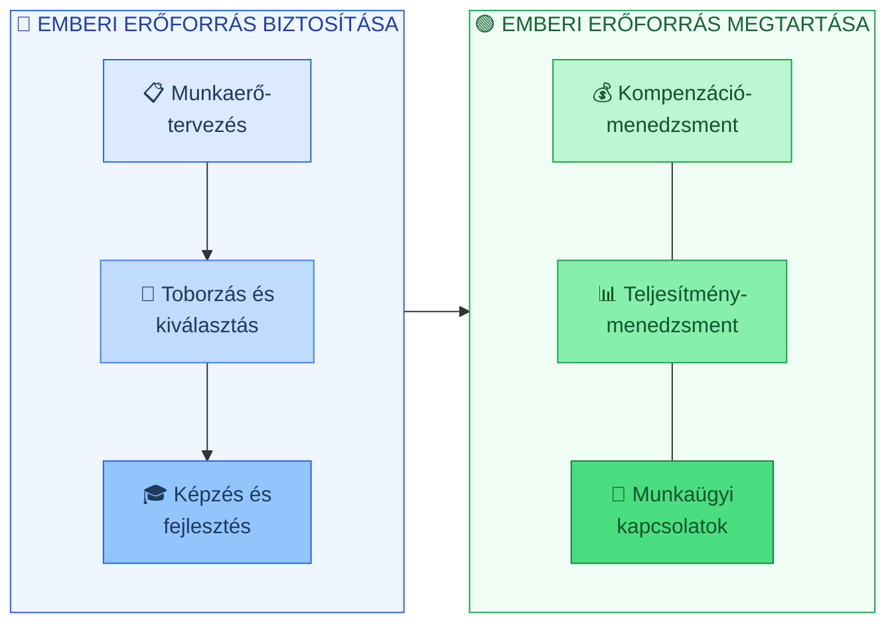

## K8 — HRM fogalma, céljai, fő funkciói, HR stratégia

### Az emberi erőforrás menedzsment fogalma

Az emberi erőforrás menedzsment (HRM / EEM) olyan szervezeti funkció, amely a szervezeten belüli emberekkel — toborzásuktól a kilépésükig — foglalkozik. Armstrong és Taylor (2016) meghatározása szerint a HRM stratégiai és koherens megközelítés a szervezet legértékesebb tőkéjének, az emberi tőkének a kezelésére. A humán tőke (human capital) fogalma az alkalmazottak tudásának, készségeinek, tapasztalatainak és motivációjának összesített értékét jelenti — amelyet intellektuális tőkének is neveznek (LEV_2).

A HRM nem pusztán adminisztratív tevékenység: Bakacsi és munkatársai (2000) szerint stratégiai szerepe van abban, hogy a szervezet versenyelőnyt szerezzen és tartson fenn.

### Célok

Armstrong és Taylor (2016) alapján a HRM négy célkör körül szerveződik. Az első a szervezeti hatékonyság: a megfelelő embert a megfelelő helyre, a megfelelő időben. A második az etikus és szociálisan felelős működés, vagyis a dolgozói érdekek tényleges védelme, nem csak papíron. A harmadik a munkaminőség fejlesztése — olyan munkakörnyezet megteremtése, amelyben az emberek tartósan teljesíteni akarnak, nem csak el akarják tölteni a munkaidőt. A negyedik a változásmenedzsment: az egyéni, csoportos és szervezeti érdekek egyidejű, nem sorrendbe állított kezelése.

### A HRM rendszer funkciói

A kurzusanyag (LEV_2) két csoportba sorolja a funkciókat. Az első az emberek megszerzésével és fejlesztésével foglalkozik: munkaerő-tervezés, munkakörelemzés, toborzás-kiválasztás-előléptetés, képzés-fejlesztés, kompenzációmenedzsment. A második csoport az alkalmazottakkal való folyamatos foglalkozást fedi le: teljesítménymenedzsment, egészség és munkabiztonság, kollektív tárgyalás, munkaügyi kapcsolatok.

### HR stratégia

A HR stratégia az üzleti stratégiából vezethető le, és meghatározza, milyen embereket, milyen kompetenciákkal, milyen szervezeti formában kell alkalmazni a célok eléréséhez. Bakacsi és munkatársai (2000) kétféle stratégiai illeszkedési modellt különböztetnek meg: a *legjobb gyakorlat (best practice)* és az *illeszkedés (best fit)* modelljét. Előbbi szerint egyes HRM megoldások általánosan érvényesek, utóbbi szerint a szervezeti kontextushoz kell igazítani őket.

A modern HRM trendek közé tartozik a kompetenciaalapú HRM, az e-HRM, az elköteleződés-menedzsment és a teljesítmény-alapú juttatási rendszerek (LEV_2).

---
