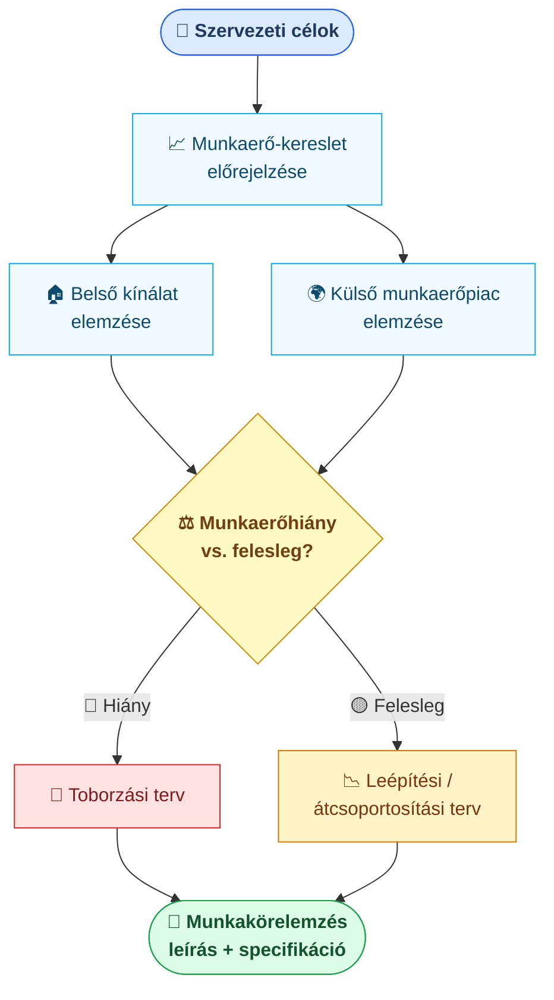

## K9 — Munkaerő-tervezés és toborzás

### Munkaerő-tervezés

A munkaerő-tervezés (HR planning / workforce planning) előrevetíti, hogy a szervezetnek milyen emberekre lesz szüksége, mikor és milyen számban, hogy stratégiai céljait elérje. Milkovich és Glueck (1995) szerint a folyamat két lépésből áll: a kereslet előrejelzéséből (hány és milyen kompetenciájú munkavállalóra van szükség) és a kínálat elemzéséből (kik állnak rendelkezésre belülről és kívülről).

A tervezés alapja a **munkakörelemzés (job analysis)**: minden munkakör feladatainak, felelősségeinek, szükséges kompetenciáinak és munkafeltételeinek szisztematikus feltárása. Eredménye a **munkaköri leírás** (job description) és a **munkaköri specifikáció** (job specification), amely meghatározza az alkalmazottal szemben támasztott követelményeket.

### Toborzás

A toborzás (recruitment) a potenciális jelöltek megtalálásának és bevonásának folyamata. Borgulya és munkatársai (2006) belső és külső csatornát különböztetnek meg. A belső toborzás — előléptetés, rotáció, belső álláshirdetés — olcsóbb és gyorsabb, és a jelölt már ismeri a szervezetet, de az újfajta tudást és külső perspektívát nem hozza be. A külső toborzás épp fordítva: álláshirdetések, fejvadász-cégek (executive search), campus recruitment vagy szakmai hálózatok révén friss tudást és más szervezetekből hozott tapasztalatot nyerünk, de a beilleszkedési idő és a költség is magasabb, a beválás kockázata nagyobb.

| Szempontok | Belső toborzás | Külső toborzás |
|------------|---------------|----------------|
| Költség | Alacsony | Magasabb |
| Gyorsaság | Gyors | Lassabb |
| Kockázat | Alacsonyabb | Magasabb |
| Innováció | Kevesebb | Több |
| Motivációs hatás | Ösztönzi a karriert | Belső feszültség |

Az Armstrong–Taylor szerzőpáros (2016) hangsúlyozza, hogy a toborzás hatékonysága a munkáltatói márka (employer brand) erősségétől is függ: azok a szervezetek, amelyek vonzó munkahelynek számítanak, kisebb erőforrással is jobb jelölteket vonzanak.

---
