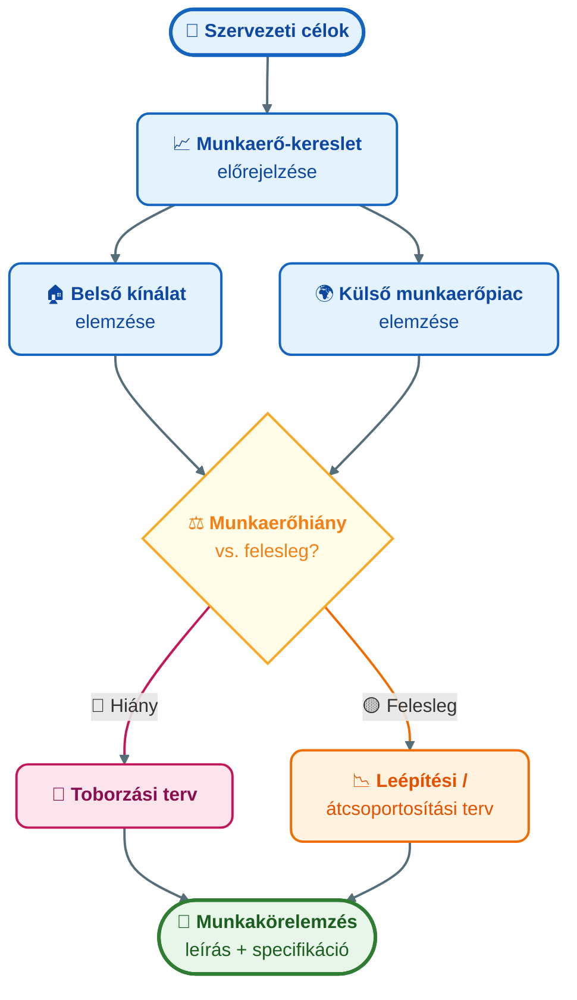

## K9 — Munkaerő-tervezés és toborzás

**Tétel:** Munkaerő tervezés és toborzás: Ismertesse a munkaerő tervezés fogalmát és jelentőségét! Mutassa be a toborzás fő formáit és csatornáit! Ismertesse a belső és külső toborzás előnyeit és hátrányait!

---

### Munkaerő-tervezés

A munkaerő-tervezés (HR planning / workforce planning) előrevetíti, hogy a szervezetnek milyen emberekre lesz szüksége, mikor és milyen számban, hogy stratégiai céljait elérje. Milkovich és Glueck (1995) szerint a folyamat két lépésből áll: a kereslet előrejelzéséből (hány és milyen kompetenciájú munkavállalóra van szükség) és a kínálat elemzéséből (kik állnak rendelkezésre belülről és kívülről).

A tervezés alapja a **munkakörelemzés (job analysis)**: minden munkakör feladatainak, felelősségeinek, szükséges kompetenciáinak és munkafeltételeinek szisztematikus feltárása. Két fő kimenete a **munkaköri leírás** (*job description* — mit kell csinálni) és a **munkaköri specifikáció** (*job specification* — milyen ember kell hozzá), amely meghatározza az alkalmazottal szemben támasztott kompetencia-, képesítési és tapasztalati követelményeket (Milkovich & Glueck, 1995).

A **munkakör-értékelés** (*job evaluation*) a munkakörök relatív szervezeti súlyának és értékének megállapítása — ez adja az igazságos bérrendszer alapját. Elkülönül a munkakörelemzéstől: míg az utóbbi leírja a munkakört, az értékelés annak szervezeti fontosságát rangsorolja.

### Toborzás

A toborzás (recruitment) a potenciális jelöltek megtalálásának és bevonásának folyamata. Borgulya és munkatársai (2006) belső és külső csatornát különböztetnek meg. A belső toborzás — előléptetés, rotáció, belső álláshirdetés — olcsóbb és gyorsabb, és a jelölt már ismeri a szervezetet, de az újfajta tudást és külső perspektívát nem hozza be. A külső toborzás épp fordítva: álláshirdetések, fejvadász-cégek (executive search), campus recruitment vagy szakmai hálózatok révén friss tudást és más szervezetekből hozott tapasztalatot nyerünk, de a beilleszkedési idő és a költség is magasabb, a beválás kockázata nagyobb.

| Szempontok | Belső toborzás | Külső toborzás |
|------------|---------------|----------------|
| Költség | Alacsony | Magasabb |
| Gyorsaság | Gyors | Lassabb |
| Kockázat | Alacsonyabb | Magasabb |
| Innováció | Kevesebb | Több |
| Motivációs hatás | Ösztönzi a karriert | Belső feszültség |

Dessler (2020) keretrendszere szerint a toborzási csatorna megválasztása a munkakör jellegétől, a munkaerőpiaci helyzettől és a rendelkezésre álló időtől függ.

**Munkáltatói márka (employer branding).** Armstrong és Taylor (2014) hangsúlyozza, hogy a toborzás hatékonysága a munkáltatói márka erősségétől függ: a szervezet mint munkahely vonzerejét a tudatosan épített *munkavállalói értékajánlat* (*EVP — employee value proposition*) alapozza meg. Azok a szervezetek, amelyek vonzó munkahelynek számítanak, kisebb erőforrással is jobb jelölteket vonzanak.

---

## Irodalom

- Armstrong, M. & Taylor, S. (2014). *Armstrong's handbook of human resource management practice* (13th ed.). Kogan Page.
- Borgulya I-né et al. (2006). *Emberi erőforrás menedzsment kézikönyv.* CompLex Kiadó, Budapest.
- Dessler, G. (2020). *Human resource management* (16th ed.). Pearson.
- Milkovich, G. T. & Glueck, F. W. (1995). *Personnel/Human Resource Management: A Diagnostic Approach.* Business Publications Inc., Texas.
