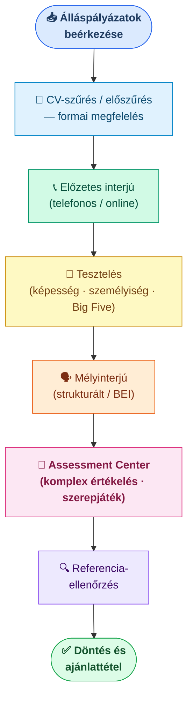

## K10 — Kiválasztási folyamat és módszerek

**Tétel:** Kiválasztási folyamat és módszerei: Ismertesse a kiválasztás fogalmát és célját! Mutassa be a kiválasztási folyamat fő lépéseit! Ismertesse a leggyakrabban alkalmazott kiválasztási módszereket!

### A kiválasztás mint döntési folyamat

A kiválasztás (selection) a toborzás során összegyűlt jelöltek közül a legalkalmasabb kiválasztását jelenti. Az alapelv az illeszkedés (fit): a jelölt kompetenciái, értékrendje és személyisége illeszkedjen a munkakör követelményeihez és a szervezeti kultúrához (Milkovich–Glueck, 1995).

### Kiválasztási módszerek

Az önéletrajz-elemzés (CV-szűrés) gyors előszűrő, de korlátja nyilvánvaló: az önéletrajz csak azt mutatja, amit a jelölt meg akar mutatni, és semmit abból, ahogy valójában dolgozik.

Az interjúk közül a strukturált változat — ahol minden jelölt ugyanazokat a kérdéseket kapja ugyanabban a sorrendben — magasabb prediktív validitást mutat, mint a kötetlen beszélgetés (Anderson et al., 2001). A viselkedésalapú interjú (BEI, *Behavioral Event Interview*) múltbeli szituációkra kérdez rá a **STAR-technika** keretében (*Situation — Task — Action — Result*): a jelölt leírja a helyzetet, a feladatát, a saját lépéseit és az eredményt. A mögöttes feltevés: a múltbeli viselkedés a jövőbeli viselkedés legjobb előrejelzője. A szituációs interjú hipotetikus eseteket tesz fel: nem azt kérdezi, mit tett, hanem azt, mit tenne.

A tesztek köre széles: képességtesztek (numerikus, verbális, logikai), személyiségtesztek — jellemzően a Big Five (OCEAN) modell alapján —, és szakmai tudástesztek. Ezek kevésbé szubjektívek, mint az interjúk, de nem helyettesítik azokat.

Az assessment center (értékelő központ) a legmegbízhatóbb, de egyben a legköltségesebb módszer. Szerepjátékokat, csoportgyakorlatokat, esetmegbeszéléseket és teszteket von össze, és több értékelő egyidejű megfigyelése csökkenti az egyéni torzítást. Főként felsővezetői pozíciókra alkalmazzák (Borgulya et al., 2006).

**Validitás és megbízhatóság.** A módszer *validitása* (valóban azt méri-e, ami a teljesítményt előrejelzi) és *megbízhatósága* (konzisztens-e, ismételhető-e) a két fő minőségi szempont. Schmidt és Hunter (1998) metaanalízise szerint a strukturált interjú, a kognitív képességtesztek és az assessment center tartoznak a legjobb prediktorok közé, míg a strukturálatlan interjú és a grafológia prediktív ereje gyenge.

| Módszer | Validitás | Költség | Jellemző alkalmazás |
|---------|-----------|---------|---------------------|
| Strukturált interjú | Közepes-magas | Alacsony | Minden szint |
| Képességteszt | Magas | Alacsony | Belépő szint |
| Assessment center | Magas | Magas | Felsővezető |
| CV elemzés | Alacsony | Nagyon alacsony | Előszűrés |

---

## Irodalom

- Anderson, N., Ones, D. S., Sinangil, H. K. & Viswesvaran, C. (Eds.). (2001). *Handbook of industrial, work and organizational psychology.* Sage.
- Borgulya I-né et al. (2006). *Emberi erőforrás menedzsment kézikönyv.* CompLex Kiadó, Budapest.
- Milkovich, G. T. & Glueck, F. W. (1995). *Personnel/Human Resource Management: A Diagnostic Approach.* Business Publications Inc., Texas.
- Schmidt, F. L. & Hunter, J. E. (1998). The validity and utility of selection methods in personnel psychology. *Psychological Bulletin, 124*(2), 262–274.