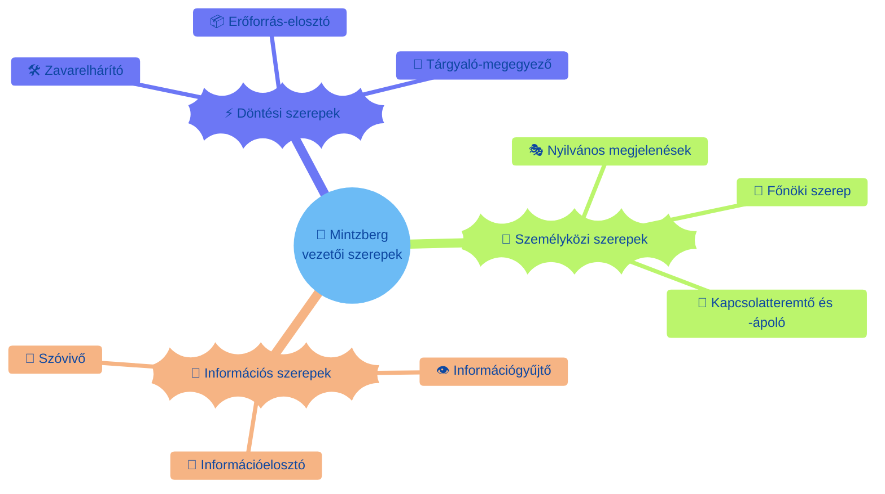
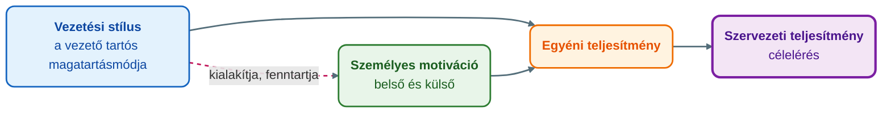

## K11 – Vezetés fogalma és vezetői szerepek

### Beszerzendő anyagok

| Szerző | Mű | Jelleg | Indoklás / érintett rész |
|---|---|---|---|
| Griffin, R. W. | *Management* (2016) | ajánlott irodalom | A tantárgynyilvántartó adatlap ajánlott irodalomként nevezi meg; a menedzsmentfunkciók, a vezetői szerepek és a vezetéselméletek (R1–R3) mélyíthetők vele, és pótolhatja a Fiedler-modell helyzetkedvezőségi szabályát, amely a helyi anyagból hiányzik (tartalma nem ellenőrizhető). |
| Knights, D. & Willmott, H. | *Introducing Organizational Behaviour and Management* (2017) | ajánlott irodalom | Az adatlap ajánlott irodalomként nevezi meg; a vezetés és a szervezeti teljesítmény kapcsolata (R3) épülhet rá (tartalma nem ellenőrizhető). |
| Pink, D. H. | *Motiváció 3.0 – Ösztönzés másképp* (2010) | kötelező irodalom | Az adatlap és az első előadás kötelező irodalomként nevezi meg; a motiváció mint a vezetési stílus és a teljesítmény közvetítője (R3) bontható ki belőle (a mappában nincs meg). |

**Tétel:** Vezetés fogalma és vezetői szerepek: Ismertesse a vezetés fogalmát! Mutassa be a vezetői szerepek fő típusait! Ismertesse, hogy a vezetői stílus milyen hatással van a szervezeti teljesítményre!

---

### A menedzsment és a vezetés fogalma

A tárgy előadásanyaga a vezetés fogalmát a menedzsment fogalmából kiindulva vezeti be. A menedzsment Kocsis József meghatározása szerint „az a folyamat, melyet egy vagy több személy végez mások tevékenységének koordinálására, olyan eredmények elérése érdekében, melyeket egyikük sem tudna egyedül elérni" (Karácsony, 2024b, 2. dia). A *manage* ige jelentése is ez: megvalósítani, sikerre vinni a kitűzött célt és elérni a definiált eredményt (Karácsony, 2024b, 3. dia).

A **vezetés célja** az előadás szerint „olyan tevékenység, amely az erőforrások hatékony és eredményes felhasználására irányul – bizonyos cél(ok) elérése érdekében", vagyis a kívánt magatartásformák előidézése az egyéneknél és a csoportoknál. Összetett, energiaigényes, feszültséggel járó és számos kihívást rejtő munka (Karácsony, 2024b, 4. dia). A vezetői tevékenység modellje ugyanezt a logikát írja le: a vezető a pénzügyi, emberi, információs és fizikai erőforrásokat hatékonyan és eredményesen használja fel a célelérés érdekében (Karácsony, 2024b, 13. dia).

A **menedzser** az a személy, akinek elgondolásai és cselekvése befolyásolja a szervezet tevékenységét, fejlődését és üzletpolitikáját, és akinek megadott időn belül el kell érnie a célként meghatározott eredményeket a személyi, műszaki és pénzügyi erőforrások hatékony felhasználásával (Poór Ferenc meghatározása; Karácsony, 2024b, 6. dia). A menedzserek kötődnek a legjobban a vállalkozáshoz: a mindennapi eredményesség az ő tevékenységükön múlik (Karácsony, 2024b, 7. dia).

A menedzsment **négy funkciója**: tervezés, szervezés, irányítás és vezetés (Karácsony, 2024b, 10–11. dia).

* A *tervezés* a jövőbeli működésre vonatkozó célok kitűzése, valamint döntés a szükséges tevékenységekről és erőforrásokról (kinek, mit, mikorra, milyen eszközökkel és sorrendben).
* A *szervezés* a feladatok, az azokat végző emberek és az egyéb erőforrások csoportosítása, elrendezése és összekapcsolása a legeredményesebb munkavégzés érdekében.
* Az *irányítás* a követelmények felállítása, megvalósulásuk ellenőrzése, az eredmények értékelése és a szükséges korrekciók végrehajtása.
* A *vezetés* „a szervezeti tagok viselkedésének tudatos befolyásolása, hogy azok a meghatározott célok eléréséért tevékenykedjenek": a közös értékeken alapuló jövőkép kialakításán és megvalósításán keresztül közvetlenül az emberekre összpontosít, motivációjuk kialakítása és fenntartása révén.

A vezetés tehát egyszerre a menedzsment egyik funkciója és a menedzsmentnek az emberekre irányuló oldala; a menedzsment valamennyi szakterületén (stratégiai, projekt-, minőség-, humánerőforrás-menedzsment stb.) ez a négy funkció működik (Karácsony, 2024b, 12. dia).

Az előadás a **főnök és a vezető** szembeállításával szemlélteti, mit jelent a vezetés az emberek oldaláról (Karácsony, 2024b, 9. dia):

| Főnök | Vezető |
|---|---|
| Irányítja az alkalmazottakat, félelmet generál | Tanítja őket, lelkesedést teremt |
| A hatalmára támaszkodik, azt mondja: „én" | Kivívja a dolgozók tiszteletét, azt mondja: „mi" |
| Tudja, hogyan kell csinálni; használja az embereket | Megmutatja, hogyan kell csinálni; fejleszti őket |
| Learatja a babérokat, utasít | Dicsér és támogat, kér |
| Másokat hibáztat a problémákért: „csináld" | Megoldást keres a problémára: „csináljuk együtt" |

### A vezetői szerepek fő típusai

**Mintzberg vezetői szerepei.** Az előadás Mintzberg nyomán a vezetői szerepek három fő típusát különíti el (Karácsony, 2024b, 5. dia):

* **személyközi (interperszonális) szerepek**: a nyilvános megjelenések szerepe, a főnöki szerep, valamint a kapcsolatteremtő és -ápoló szerep;
* **információs szerepek**: információgyűjtő, információelosztó és szóvivői szerep;
* **döntési szerepek**: zavarelhárító, erőforrás-elosztó, valamint tárgyaló-megegyező szerep.

A kapcsolatteremtő szerep négy irányban működik: emberi, cég-, intézményi és nemzetközi kapcsolatok (Karácsony, 2024b, 15. dia).

**Vezetői készségek.** A menedzseri munkához három készségtípus kell (Karácsony, 2024b, 7–8. dia):

* a **technikai készség** (tanulható): a szervezet munkájában alkalmazott módszerekkel, folyamatokkal, eljárásokkal kapcsolatos szaktudás, az adott (műszaki, számviteli, informatikai) szakterületen való jártasság;
* a **humán készség** (fejleszthető): az emberekkel és csoportokkal való együttműködés, a csapatmunka, a kommunikáció, mások beállítottságának és érdekeinek érzékelése és megértése, valamint a biztonságot nyújtó, a véleménykifejezést lehetővé tevő környezet megteremtésének képessége;
* a **konceptuális készség** (adottság): a szervezetről alkotott átfogó kép átlátása, a szituáció lényeges elemeinek felismerése és az elemek közötti összefüggések (például egy változás továbbgyűrűző hatásainak) megértése.

A készségek súlya a hierarchia mentén változik: a felső vezetésnél elsődlegesek a koncepcióalkotási ismeretek (a szervezet egészére vonatkozó célok meghatározása), a középvezetésnél a humán készségek (egy szervezeti részterület irányítása), a közvetlen munkairányítóknál pedig a technikai készségek (a napi működés feltételeinek biztosítása, a munkavégzés felügyelete és eredményének ellenőrzése); alattuk a végrehajtók állnak (Karácsony, 2024b, 14. dia).

**Emberi képességmátrix (Pietrasinski nyomán).** Az előadás a problémafelismerő és a problémamegoldó képesség két tengelyén négy alaptípust különít el: a *technikus* jó beosztott, rugalmas és pontos végrehajtó; a *mérnök* ötletgazdag problémamegoldó, de vár a feladatra; a *kutató* mélyre ható alkat, minimális gyakorlati érzékkel; a *vezető* széles horizontú gondolkodású, integráló alkat, aki mindkét képességgel rendelkezik (Karácsony, 2024b, 16. dia). Az előadás emellett W. D. Hitt *Mestervezető* című könyve nyomán is bemutat egy vezetőtípus-ábrát (Karácsony, 2024b, 17. dia).

### A vezetői magatartás és a vezetési stílus

A **vezetői magatartás** a vezető viselkedése egy adott vagy ismétlődő szituációban (személyiség és szituáció együtt), a **vezetési stílus** pedig a vezető kapcsolatrendszerében tartósan jellemző magatartásmód, amely a kapcsolatok kialakítására és fenntartására irányul (Karácsony, 2024c, 2. dia). A stílus függ a vezető személyes tulajdonságaitól (jellem, alkat, akarat, képességek, értékrend), motívumstruktúrájától, vezetési ismereteitől és készségeitől, erkölcsi-etikai alapjaitól, a környezettől és a szervezet típusától (Karácsony, 2024c, 3. dia).

Az előadás négy elméletcsaládot különít el (Karácsony, 2024c, 4. dia):

| Elméletcsalád | Alapkérdés | Fő modellek az előadásban |
|---|---|---|
| Döntésközpontú | Hogyan dönt a vezető, és mennyi részvételt enged a beosztottaknak? | Lewin; Likert egytényezős modellje; Tannenbaum–Schmidt |
| Tulajdonságelmélet | Milyen tulajdonságok kellenek a sikeres vezetéshez? | Ghiselli; „siker"-tulajdonságok |
| Személyiség–viselkedés elmélet | Milyen személyiség és viselkedésminta (stílus) jellemzi? | McClelland; McGregor; Maccoby; Blake–Mouton |
| Szituációs elmélet | Milyen helyzetben milyen viselkedés eredményes? | Vroom–Yetton; Hersey–Blanchard; Fiedler |

**Döntésközpontú elméletek.** Lewin három stílusa: az *autokratikus* vezető egymaga uralja a csoport tevékenységét, minden lényeges kérdésben ő határoz, szubjektív alapon értékel és szigorú fegyelmet tart; a *demokratikus* vezető minden eszközzel fokozza a csoport részvételét, és objektív teljesítményértékelésre törekszik; a *laissez faire* vezető passzív résztvevő, nem kezdeményez, csak kérésre segít, lényegében tanácsadó (Karácsony, 2024c, 5. dia). Likert a Michigani Egyetemen harminc évig kutatta a vezetőket, és a beosztottak részvételének mértéke mint egyetlen tényező mentén négyfokozatú tipológiát alkotott: *keménykezű parancsoló* (bizalmatlan, fenyegetéssel és büntetéssel él, lefelé irányuló kommunikáció, központosított döntés és ellenőrzés), *jóakaratú parancsoló* (némi bizalom, többnyire jutalmazással motivál, van felfelé irányuló kommunikáció, dönteni enged, de ellenőriz), *konzultatív* (bízik a beosztottakban, ötleteiket felhasználja, kétirányú kommunikáció, testületi elv az átfogó döntéseknél) és *részvételi csoport* (teljes bizalom, a csoporttagok aktívan részt vesznek a célkitűzésben és a teljesítményértékelésben) (Karácsony, 2024c, 7–9. dia). Tannenbaum és Schmidt hatalom-részvételi modellje a vezetőközpontú (a vezető dönt és kihirdeti) és a beosztottközpontú (a vezető a határokon belül szabad működést enged) vezetés között hét fokozatot ábrázol (Karácsony, 2024c, 10. dia).

**Tulajdonságelmélet.** Ghiselli szerint a vezető sikere a tulajdonságaitól függ. Nagyon fontos: szakmai felkészültség, intelligencia, önmegvalósítás, önbizalom, határozottság; mérsékelten fontos: kockázatvállalás, a munkavállalók iránti elkötelezettség, kezdeményezőkészség, jó kommunikációs készség, érettség (Karácsony, 2024c, 12. dia). A „siker"-tulajdonságok négy csoportja: interperszonális készségek (határozottság, emberismeret, kapcsolatteremtő képesség), érzelmi-akarati jellemzők (következetesség, kitartás, szorgalom), az intellektus és a kreativitás jellemzői (jó döntési képesség, gyors felfogás, előrelátás, nyitottság, rugalmasság), valamint a szervező- és vállalkozókészség (kockázatvállalás, szervezőkészség, gyakorlatiasság) (Karácsony, 2024c, 13. dia). Az elmélet korlátja, hogy nem vizsgálja a vezető és a vezetett viszonyát, sem a feladat jellegét (Karácsony, 2024c, 4. dia).

**Személyiség–viselkedés elméletek.** A vezető motiváltságát alapvető motívumok (a pozícióhoz illő jövedelem, állásbiztonság) és motívumpárok írják le: önállóság–hatalom, önbecsülés–megbecsültség, önmegvalósítás–a közösség szolgálata; az előbbi tagok befelé, az utóbbiak kifelé irányuló motivációk (Karácsony, 2024c, 14. dia). McClelland teljesítménymotivációs elmélete három igényt különít el: az eredményesség igényét (jobban teljesíteni másoknál, valami újat elérni, hosszú távú feladatok), a kapcsolat igényét (csapathoz tartozni, pozitív kapcsolatok, a konfliktusok minimalizálása) és a hatalom, a befolyásolás igényét (hírnév, pozíció, a szituációk uralása) (Karácsony, 2024c, 15. dia). McGregor a vezető attitűdjéből indul ki (Karácsony, 2024c, 16. dia):

| X beállítottságú vezető | Y beállítottságú vezető |
|---|---|
| Az alkalmazott nem szereti a munkát, kerüli a felelősséget, az állásbiztonság a legfontosabb neki | A munka olyan, mint a játék vagy a pihenés; az ember szereti az önirányítást, keresi és vállalja a felelősséget |
| Kényszeríteni és szorosan ellenőrizni kell | Találékonyságot, kreativitást mutat a problémák megoldásában |
| Autokrata: „furkósbot és mézesmadzag", kisajátítja az információt, ő dönt, nem tűri a kritikát | Demokrata vagy liberális: megosztja információit és problémáit, segíti a beosztottak fejlődését, csoportosan dönt vagy rájuk bízza a döntést |

Maccoby négy vezetőtípusa: a *mesterember* (az eredményesség motiválja, atyáskodó, nem épít csapatot), a *dzsungelharcos* (hataloméhes, a munka túlélésért folytatott harc), a *szervezeti ember* (törődik az emberekkel és az intézmény hírnevével, de nyomásra óvatos és konzervatív lesz) és a *játékos* (a verseny élteti, lelkesíteni tud, de meggondolatlan) (Karácsony, 2024c, 17–18. dia). Blake és Mouton rácsmodellje a termelésre és a beosztottakra fordított figyelem 1–9-es tengelyén öt stílust nevez meg: a *(9,9) csoportközpontú* vezetésben a munkateljesítmény forrása az emberek összefogása; az *(1,9) emberközpontú* vezetés barátságos légkört és kellemes munkatempót ad; az *(5,5) kompromisszumos* vezetés megfelelő teljesítményt ér el a munkateljesítmény és a morál egyensúlyával; a *(9,1) hajtós* vezetésben a termelési hatékonyság érdekében az emberi szempontok háttérbe szorulnak; az *(1,1) „fél"-vezetés* minimális erőfeszítést fordít a munkára (Karácsony, 2024c, 19–20. dia).

**Szituációs elméletek.** Vroom és Yetton öt stílusa a bevonás mértéke szerint: *Autokrata 1 (A1)* – a vezető a rendelkezésre álló információk alapján maga dönt; *Autokrata 2 (A2)* – a beosztottaktól információt szerez, de maga dönt; *Konzultatív 1 (K1)* – egyénenként ismerteti a problémát, de a döntés nem feltétlenül tükrözi a véleményeket; *Konzultatív 2 (K2)* – a csoporttal osztja meg a problémát, javaslatokat kér, majd dönt; *Csoportos (Cs)* – a csoport közösen dolgoz ki alternatívákat és konszenzussal dönt, a vezető elnököl (Karácsony, 2024c, 21. dia). Hersey és Blanchard a kapcsolatorientált (bátorítás, támogatás, elismerés) és a feladatorientált (irányítás, szervezés) viselkedés kombinációjából négy stílust vezet le: *felépítő (strukturáló) – diktáló*, *előkészítő – eladó*, *bátorító – résztvevő* és *megbízó – delegáló*; a hatékonyságot a beosztottak munkaképessége és akarata, a munka jellege és a szervezet atmoszférája (kultúrája) határozza meg (Karácsony, 2024c, 22–24. dia). Fiedler kontingenciamodelljének alapfeltevése, hogy különböző szituációkban más-más stílus eredményes; a feladat- és a kapcsolatorientált stílust a legkevésbé kedvelt munkatárs (LKM) tesztje különíti el: a feladatorientált vezető elmarasztalóan, a kapcsolatorientált többé-kevésbé kedvezően értékeli legkevésbé kedvelt munkatársát (Karácsony, 2024c, 25. dia).

### A vezetési stílus hatása a szervezeti teljesítményre

Az egyének teljesítményét két, egymással összefüggő tényező határozza meg: a személyes motiváció és a szervezetben létező vezetés típusa; a kettőt együtt, a konkrét helyzettől függően kell vizsgálni (Karácsony, 2024a, 7. dia). A vezetés funkciója éppen ezen a ponton kapcsolódik a teljesítményhez: a szervezeti tagok motivációjának kialakításán és fenntartásán keresztül befolyásolja viselkedésüket (Karácsony, 2024b, 11. dia).

A motiváció a menedzsment kulcstényezője: a legjobb eredményhez a szervezetnek motiváltan kell tartania a dolgozókat. A **belső (intrinsic) motiváció** a tevékenység saját öröméért, a **külső (extrinsic) motiváció** jutalomért vagy büntetés elkerüléséért mozgósít; ami a vezetőt motiválja, nem feltétlenül motiválja a beosztottait (Karácsony, 2024a, 8–11. dia). Az előadás kiemeli, mi *nem* motivál: a személyes támadás, a félelemmel kormányzás, minden felelősség magunkra vállalása és a dolgozók túlterhelése (Karácsony, 2024a, 12. dia) – ezek éppen a főnöki, nem a vezetői magatartás ismérvei.

A vezetéselméletek több ponton közvetlenül fogalmaznak a teljesítményről:

* **Likert** harmincéves kutatásának következtetése, hogy a participatív, támogató vezetési stílus növeli a vezetés hatékonyságát (Karácsony, 2024c, 7. dia).
* **Blake és Mouton** rácsában a (9,9) csoportközpontú stílusnál a munkateljesítmény forrása az emberek összefogása, a közös érdekeltség kölcsönös függést, bizalmat és megbecsülést teremt; az (5,5) stílus csak „megfelelő" teljesítményt ad; a (9,1) hajtós stílus a termelési hatékonyságot az emberi szempontok rovására éri el; az (1,1) stílus mellett a szervezet minimális erőfeszítéssel működik (Karácsony, 2024c, 20. dia).
* **McGregor** modelljében a vezető emberképe önbeteljesítő: az X-vezető kényszerítéssel és ellenőrzéssel, az Y-vezető a felelősség és a kreativitás bátorításával ér el erőfeszítést (Karácsony, 2024c, 16. dia).
* A **szituációs elméletek** szerint nincs egyetlen, minden helyzetben teljesítménynövelő stílus: Hersey és Blanchard a beosztottak munkaképességéhez és akaratához, a munka jellegéhez és a szervezet kultúrájához igazítja a stílust, Fiedler alapfeltevése pedig az, hogy különböző szituációkban más-más stílus eredményes (Karácsony, 2024c, 22., 25. dia).

A rossz vezetői stílus teljesítményrontó hatását az „elviselhetetlen főnök" típusai szemléltetik (Rue és Byars nyomán): az *alkalmatlan, de nyájas* főnök a Peter-elv áldozata, nyakig ül a gondjaiban; a *kiállhatatlan* főnök idővel önrombolóvá válik, vitázni hiábavaló vele; az *alkalmas, de tunya* főnök képes volna a feladatára, de nem motivált, ezért beosztottai nehezen teljesítenek színvonalasan; a *ráhagyó* főnök semmivel nem törődik (Karácsony, 2024c, 26–27. dia).

> ⚠️ **Tartalmi hiány:** a Fiedler-modellnek az a szabálya, hogy a helyzet kedvezősége szerint mikor a feladat-, mikor a kapcsolatorientált vezető hatékonyabb, a helyi tananyagban nem szerepel; az ajánlott irodalomból (Griffin) pótolható.

### Összegzés

A vezetés az erőforrások hatékony és eredményes felhasználására irányuló tevékenység, amely a menedzsment négy funkciója közül az emberekre, a viselkedés tudatos befolyásolására és a motivációra összpontosít. A vezető Mintzberg szerint személyközi, információs és döntési szerepeket tölt be, amelyekhez a hierarchia szintjétől függő arányban technikai, humán és konceptuális készség kell. A vezetési stílus a vezető tartós magatartásmódja; a döntésközpontú, a tulajdonság-, a személyiség–viselkedés és a szituációs elméletek más-más oldalról írják le. A teljesítményre gyakorolt hatása a motiváción keresztül érvényesül: a participatív, csoportközpontú és a helyzethez igazított stílus növeli, a főnöki, félelemre épülő magatartás rontja a szervezeti teljesítményt.

---

### Várható vizsgáztatói kérdések

1. **Mi a különbség a menedzsment és a vezetés között?** — A menedzsment mások tevékenységének koordinálása olyan eredményért, amelyet egyikük sem érne el egyedül; a vezetés a menedzsment egyik funkciója, amely a szervezeti tagok viselkedésének tudatos befolyásolására és motivációjuk fenntartására irányul (Karácsony, 2024b, 2., 11. dia). A főnök–vezető szembeállítás ugyanezt szemlélteti a magatartás szintjén (Karácsony, 2024b, 9. dia).
2. **Hány vezetői szerepet sorol fel Mintzberg, és melyik csoportba tartozik a szóvivő?** — Az előadás három csoportot és kilenc szerepet sorol: személyközi (nyilvános megjelenés, főnöki, kapcsolatteremtő), információs (információgyűjtő, -elosztó, szóvivő) és döntési (zavarelhárító, erőforrás-elosztó, tárgyaló-megegyező); a szóvivő információs szerep (Karácsony, 2024b, 5. dia).
3. **Hogyan változik a három készség súlya a hierarchiában?** — A felső vezetésnél a konceptuális, a középvezetésnél a humán, a közvetlen munkairányítóknál a technikai készség az elsődleges; a technikai tanulható, a humán fejleszthető, a konceptuális adottság (Karácsony, 2024b, 7., 14. dia).
4. **Mi a különbség a döntésközpontú és a szituációs elméletek között?** — A döntésközpontú elméletek (Lewin, Likert, Tannenbaum–Schmidt) azt vizsgálják, hogyan dönt a vezető és mennyi részvételt enged; a szituációs elméletek (Vroom–Yetton, Hersey–Blanchard, Fiedler) szerint a stílus nem a személyiségtől, hanem a helyzettől függ, ezért ugyanaz a vezető más helyzetben más stílust alkalmaz (Karácsony, 2024c, 4. dia).
5. **Melyik stílus a leghatékonyabb a teljesítmény szempontjából?** — Likert szerint a participatív, támogató stílus; Blake és Mouton szerint a (9,9) csoportközpontú vezetés, ahol a teljesítmény forrása az emberek összefogása; a szituációs elméletek azonban figyelmeztetnek, hogy a hatékonyság a beosztottak munkaképességétől és akaratától, a munka jellegétől és a szervezet kultúrájától is függ (Karácsony, 2024c, 7., 20., 22. dia).

---

## Irodalom

* Karácsony, P. (2024a). *Human Resource Management and leadership techniques* [Előadás-prezentáció, LEV_2]. Óbudai Egyetem, Keleti Károly Gazdasági Kar.
* Karácsony, P. (2024b). *Menedzsment – Menedzser feladatai és funkciói* [Előadás-prezentáció, LEV_4]. Óbudai Egyetem, Keleti Károly Gazdasági Kar.
* Karácsony, P. (2024c). *A vezető magatartása, stílusa* [Előadás-prezentáció, LEV_5]. Óbudai Egyetem, Keleti Károly Gazdasági Kar.
* Óbudai Egyetem, Keleti Károly Gazdasági Kar. (2024). *HR menedzsment és vezetési technikák (GMXHR1MBLF) — Tantárgynyilvántartó adatlap* [Syllabus].