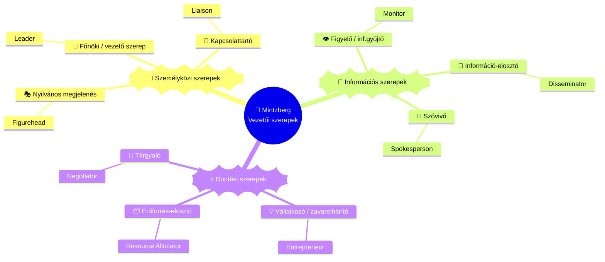

## K11 — Vezetés fogalma és vezetői szerepek

**Tétel:** Vezetés fogalma és vezetői szerepek: Ismertesse a vezetés fogalmát! Mutassa be a vezetői szerepek fő típusait! Ismertesse, hogy a vezetői stílus milyen hatással van a szervezeti teljesítményre!

---

### Leader és menedzser — fogalmi elhatárolás

A szakirodalom következetesen különválasztja a *menedzsment* és a *leadership* fogalmát. Bennis és Nanus (1985) szerint: „A menedzserek jól csinálják a dolgokat; a leaderek a jó dolgokat csinálják." A menedzser a *komplexitást* kezeli (tervezés, szervezés, ellenőrzés); a vezető a *változást* (irányadás, inspiráció, emberek mozgósítása). A menedzsment négy funkciója: **tervezés, szervezés, irányítás, vezetés**. Bakacsi (2010) szerint a leadership azt a képességet jelenti, amellyel a vezető mozgósítani tudja a szervezet tagjait a közös célok érdekében.

### Mintzberg szerepei

Mintzberg (1973) a menedzseri munkát tíz szerepbe rendezte, három csoportban:

### Vezetői készségek — Katz (1955)

Három készségtípus, amelyek súlya a hierarchiában felfelé haladva változik: a **technikai készség** (szakterületi szaktudás — tanulható) egyre kevésbé számít; a **humán készség** (együttműködés, kommunikáció, empátia — fejleszthető) végig fontos; a **konceptuális készség** (a szervezet egészének átlátása, összefüggések felismerése — részben adottság) egyre inkább felértékelődik.

### A klasszikus vezetéselméletek

| Elméletcsalád | Alapkérdés | Fő képviselők |
|---|---|---|
| Tulajdonságelmélet | Milyen a sikeres vezető? | Ghiselli (1971) |
| Döntésközpontú | Hogyan dönt, mennyi részvételt enged? | Lewin et al. (1939); Likert (1961/1967); Tannenbaum–Schmidt (1958) |
| Személyiség-/magatartásközpontú | Milyen attitűd/stílus jellemzi? | McGregor (1960); McClelland (1961); Maccoby (1976); Blake–Mouton (1964) |
| Szituációs / kontingencia | A helyzettől függő stílus | Hersey–Blanchard (1969); Fiedler (1967); Vroom–Yetton (1973) |

**Tulajdonságelmélet (Ghiselli, 1971).** A sikeres vezető azonosítható személyiségjegyekkel rendelkezik. A legfontosabbak: szakmai felkészültség, intelligencia, önmegvalósítás, önbizalom, határozottság. Gyengesége: nem vizsgálja a vezető–beosztott viszonyt és a helyzet szerepét.

**Döntésközpontú elméletek.** Lewin, Lippitt és White (1939) három stílust különít el: *autokratikus* (egyedüli döntés, fegyelmező, szubjektív értékelés), *demokratikus* (bevonó, objektív értékelés), *laissez-faire* (passzív). Likert (1967) négyfokozatú tipológiája a beosztottak részvételének mértéke szerint: System 1 — *keménykezű parancsoló* (bizalmatlan, fenyegetés, centralizált döntés), System 2 — *jóakaratú parancsoló*, System 3 — *konzultatív*, System 4 — *részvételi csoport* (teljes bizalom, közös célkitűzés). Tannenbaum és Schmidt (1958) *hatalom-részvételi kontinuuma* hét fokozaton ábrázolja az egyensúlyt a teljes vezetői döntéstől a beosztottak szabad döntéshozataláig.

**Személyiség- és magatartásközpontú elméletek.** McGregor (1960) X/Y modellje a munkavállalókról alkotott feltevésekre épít:

| X beállítottságú vezető | Y beállítottságú vezető |
|------------------------|------------------------|
| Az ember kerüli a munkát és a felelősséget | Az ember számára a munka természetes |
| Kényszerítés, ellenőrzés, „furkósbot" | Önirányítás, belső motiváció |
| Autokratikus, információ-kisajátítás | Demokratikus, fejlesztő, megosztó |

Blake és Mouton (1964) rácsmodelljében két dimenzió (emberközpontúság × feladatközpontúság, 1–9 skála) öt stílust definiál; az ideál a **(9,9) csoportközpontú**. McClelland (1961) három tanult szükségletet azonosít: *teljesítmény* (nAch), *kapcsolat* (nAff), *hatalom* (nPow) — arányuk határozza meg a preferált stílust. Maccoby (1976) négy típust különít el: *mesterember* (craftsman), *dzsungelharcos* (jungle fighter), *szervezeti ember* (company man), *játékos* (gamesman).

**Szituációs / kontingencia elméletek.** Hersey és Blanchard (1969) modelljében a stílust a beosztott aktuális érettségi szintjéhez kell igazítani: *diktáló* (S1: magas feladat, alacsony kapcsolat) → *meggyőző* (S2: magas-magas) → *résztvevő* (S3: alacsony feladat, magas kapcsolat) → *delegáló* (S4: alacsony-alacsony). Fiedler (1967) kontingenciamodelljében a vezető orientációját az LKM/LPC-teszttel állapítják meg; nagyon kedvező és nagyon kedvezőtlen helyzetben a feladatorientált, közepesen kedvezőben a kapcsolatorientált vezető hatékonyabb. Vroom és Yetton (1973) döntési fáján öt stílus áll a bevonás mértéke szerint: **A1** (vezető saját infóval dönt) → **A2** (infót kér, maga dönt) → **K1** (egyénenként konzultál) → **K2** (csoporttal konzultál) → **Cs** (konszenzusos csoportdöntés).

### Modern leadership-irányzatok

Burns (1978) és Bass (1985) megkülönbözteti a **tranzakciós** (cserekapcsolat: jutalom teljesítményért, kivételes beavatkozás) és a **transzformatív** vezetést, amely a követőket magasabb motivációs és morális szintre emeli. Bass négy „I"-je: *idealizált befolyás* (karizma), *inspiráló motiváció*, *intellektuális stimuláció*, *egyéni figyelem*. Greenleaf (1977) **szolgáló vezetésében** a vezető elsőként szolgál: a követők fejlődése és jólléte a cél. Avolio és Gardner (2005) **autentikus vezetése** négy komponensen alapul: önismeret, kiegyensúlyozott információfeldolgozás, belsővé tett morális perspektíva, relációs átláthatóság.

### Motiváció mint a vezetés eszköze

Az egyéni teljesítményt a személyes motiváció és a vezetés típusa együtt határozza meg. Megkülönböztetjük a **belső** (a tevékenység öröméért való) és a **külső** (jutalomért/büntetés elkerüléséért való) motivációt.

**Tartalomelméletek (mi motivál?):** Maslow (1943) szükséglethierarchiájában öt szint egymásra épül: fiziológiai → biztonság → szociális → elismerés → önmegvalósítás; a kielégített szükséglet már nem motivál. Alderfer (1969) ERG-modellje rugalmasabb: létezés (E), kapcsolat (R), növekedés (G) egyszerre is hathatnak, és frusztráció esetén regresszió léphet fel. Herzberg (1959/1968) kéttényezős modelljében a *higiénés tényezők* (fizetés, körülmények, biztonság) az elégedetlenséget szüntetik meg, de tartósan nem motiválnak; a *motivátorok* (teljesítmény, elismerés, felelősség, fejlődés) tartós motivációt adnak. McClelland (1961) nAch/nAff/nPow szükségletei egyúttal a preferált vezetési stílust is meghatározzák.

**Folyamatelméletek (hogyan motivál?):** Vroom (1964) elvárás-elmélete szerint Motiváció = *Elvárás* (erőfeszítés → teljesítmény) × *Eszközszerűség* (teljesítmény → jutalom) × *Vegyérték* (a jutalom vonzereje) — bármelyik tényező nullája lenullázza a motivációt. Adams (1965) méltányosságelmélete szerint az egyén a saját input/output arányát másokéhoz hasonlítja; az érzékelt méltánytalanság korrekciós viselkedést vált ki. Pink (2009/2010) Motiváció 3.0 modellje szerint a tudásalapú munkában a belső motiváció három pillére — **autonómia**, **mesterség** és **cél** — hatékonyabb a hagyományos „ha–akkor" ösztönzőknél.

---

## Irodalom

- Avolio, B. J. & Gardner, W. L. (2005). Authentic leadership development. *The Leadership Quarterly, 16*(3), 315–338.
- Bakacsi Gy. (2010). *A szervezeti magatartás alapjai.* AULA Kiadó, Budapest.
- Bass, B. M. (1985). *Leadership and performance beyond expectations.* Free Press.
- Bennis, W. & Nanus, B. (1985). *Leaders: The strategies for taking charge.* Harper & Row.
- Blake, R. R. & Mouton, J. S. (1964). *The managerial grid.* Gulf Publishing.
- Burns, J. M. (1978). *Leadership.* Harper & Row.
- Fiedler, F. E. (1967). *A theory of leadership effectiveness.* McGraw-Hill.
- Ghiselli, E. E. (1971). *Explorations in managerial talent.* Goodyear.
- Greenleaf, R. K. (1977). *Servant leadership.* Paulist Press.
- Hersey, P. & Blanchard, K. H. (1969). Life cycle theory of leadership. *Training and Development Journal, 23*(5), 26–34.
- Katz, R. L. (1955). Skills of an effective administrator. *Harvard Business Review, 33*(1), 33–42.
- Lewin, K., Lippitt, R. & White, R. K. (1939). Patterns of aggressive behavior in experimentally created social climates. *The Journal of Social Psychology, 10*(2), 269–299.
- Likert, R. (1967). *The human organization.* McGraw-Hill.
- Maccoby, M. (1976). *The gamesman.* Simon & Schuster.
- McClelland, D. C. (1961). *The achieving society.* Van Nostrand.
- McGregor, D. (1960). *The human side of enterprise.* McGraw-Hill.
- Mintzberg, H. (1973). *The nature of managerial work.* Harper & Row.
- Pink, D. H. (2010). *Motiváció 3.0.* HVG Könyvek, Budapest. (Eredeti: *Drive*, 2009.)
- Tannenbaum, R. & Schmidt, W. H. (1958). How to choose a leadership pattern. *Harvard Business Review, 36*(2), 95–101.
- Vroom, V. H. (1964). *Work and motivation.* Wiley.
- Vroom, V. H. & Yetton, P. W. (1973). *Leadership and decision-making.* University of Pittsburgh Press.
