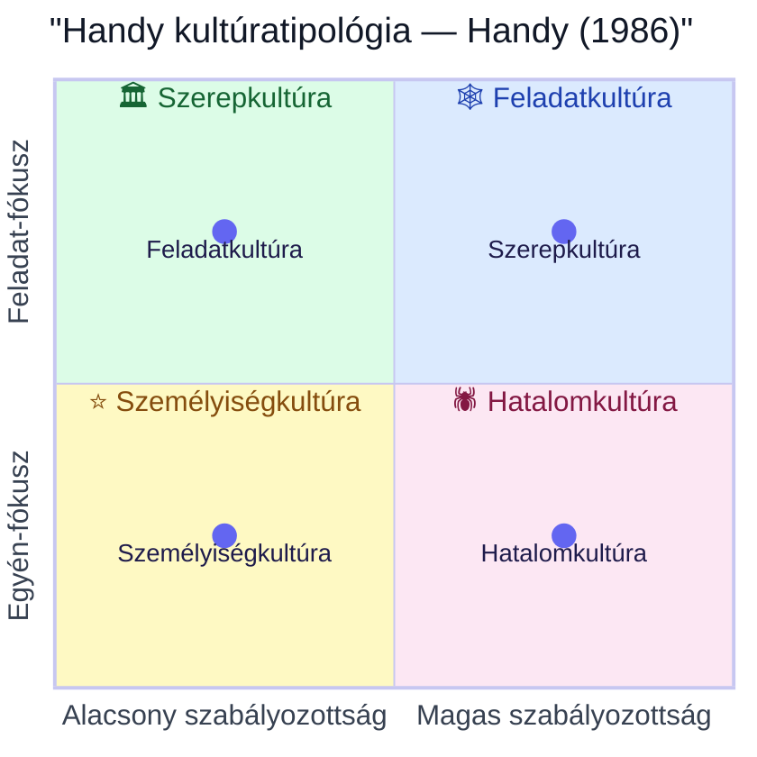
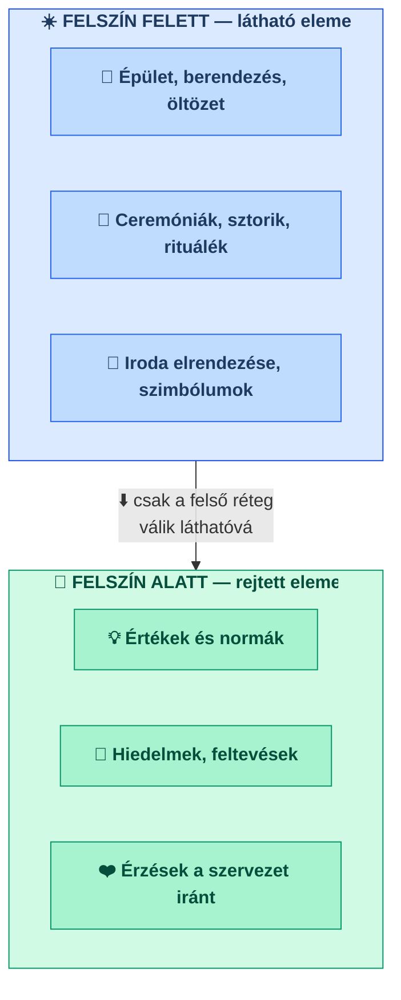

## K12 — Szervezeti kultúra

**Tétel:** Szervezeti kultúra: Ismertesse a szervezeti kultúra fogalmát! Mutassa be a szervezeti kultúra fő elemeit! Ismertesse a vezető szerepét a szervezeti kultúra formálásában és működtetésében!

---

### Fogalom

A szervezeti kultúra meghatározása nem egységes a szakirodalomban. Deal és Kennedy (1982) köznapi megfogalmazása: *„Ahogy mi itt a dolgunkat tesszük."* Schein (1985) átfogóbb definíciója szerint a szervezeti kultúra a szervezet tagjai által egyöntetűen elfogadott előfeltevések, értékek, meggyőződések és hiedelmek összessége.

Buchowicz (1990) a munkavállalói perspektívát emeli ki: a kultúra az alkalmazottak vállalatukkal kapcsolatos véleményeinek, szokásainak, értékítéleteinek és gondolkodásmódjainak összessége.

**Schein háromszintű modellje (Schein, 1985).** A szervezeti kultúra három egymásra épülő szinten ragadható meg: (1) **Artefaktumok** — a látható, de nehezen értelmezhető felszíni jelenségek (épület, öltözet, rítusok, nyelv, szimbólumok); (2) **Vallott értékek** (*espoused values*) — kinyilvánított stratégiák, célok, normák és filozófiák; (3) **Alapvető előfeltevések** (*basic underlying assumptions*) — tudattalan, magától értetődőnek tartott hiedelmek, a kultúra valódi magja, amelyek nehezen változtathatók. Ez a modell párhuzamba állítható Daft jéghegy-modelljével: az artefaktumok a felszín felett láthatók, az előfeltevések a víz alatt rejtőznek.

### Handy kultúratipológiája

Handy (1986) négy alaptípust különböztet meg, amelyek különböző szervezeti formákhoz kapcsolódnak:

### Jéghegy-modell

Daft (1992) jéghegy-modellje szemlélteti, hogy a szervezeti kultúrának csak kis része látható kívülről:

### Kultúra és leadership kapcsolata

Schein (1985) szerint a vezető a kultúra elsődleges formálója. Hat **elsődleges** mechanizmust azonosít: mire figyel és mit mér a vezető; hogyan reagál kritikus helyzetekben; erőforrás-allokáció; szerepmodellezés; jutalmazás és büntetés; ki- és beválasztás és eltávolítás. Hat **másodlagos** (megerősítő) mechanizmus is formálja a kultúrát: szervezeti felépítés és struktúra; rendszerek és eljárások; rítusok és ceremóniák; történetek és legendák; fizikai tér kialakítása; hivatalos küldetésnyilatkozat (Szabó–Molnár, 2022). A másodlagos mechanizmusok hatása gyengébb és ellentmondásos lehet, ha nem konzisztensek az elsődleges mechanizmusokkal.

A Leadership Shadow modell (Champions of Change, 2023) négy dimenzióban foglalja össze a vezető kultúraformáló hatását:

| Dimenzió          | Mit jelent                                  |
| ----------------- | ------------------------------------------- |
| What I say        | Amit a vezető kommunikál — szavai, üzenetei |
| How I act         | Ahogy viselkedik — példamutatás             |
| What I prioritise | Amire időt és erőforrást fordít             |
| How I measure     | Mit mér és mit jutalmaz                     |

Cameron és Quinn (1999/2006) OCAI modellje két dimenzió (befelé/kifelé fókusz × rugalmasság/kontroll) mentén négy kultúratípust különít el: **klán** (belső, rugalmas — bizalom, csapat), **adhokrácia** (külső, rugalmas — innováció, kockázat), **piac** (külső, kontroll — eredmény, verseny), **hierarchia** (belső, kontroll — stabilitás, szabályok). Az OCAI kérdőív a jelenlegi és a kívánatos kultúraprofilt egyaránt méri. Szabó és Molnár (2022) hazai állami szervezeteken végzett kutatása (N=70) alapján a munkavállalók jelenlegi kultúráját hierarchia típusúnak (32%), ideálisát klán típusúnak (36%) érzékelik — a kettő között feszültség mutatható ki.

---

## Irodalom

- Cameron, K. S. & Quinn, R. E. (2006). *Diagnosing and changing organizational culture* (Rev. ed.). Jossey-Bass.
- Champions of Change Coalition. (2023). *The leadership shadow.*
- Daft, R. L. (1992). *Organization theory and design.* West.
- Deal, T. E. & Kennedy, A. A. (1982). *Corporate cultures.* Addison-Wesley.
- Handy, C. B. (1993). *Understanding organizations* (4th ed.). Penguin.
- Schein, E. H. (2010). *Organizational culture and leadership* (4th ed.). Jossey-Bass. (Eredeti: 1985.)
- Szabó T. & Molnár E. (2022). A szervezeti kultúra és a vezetés kapcsolata. *Gradus, 9*(1). https://doi.org/10.47833/2022.1.ECO.002
