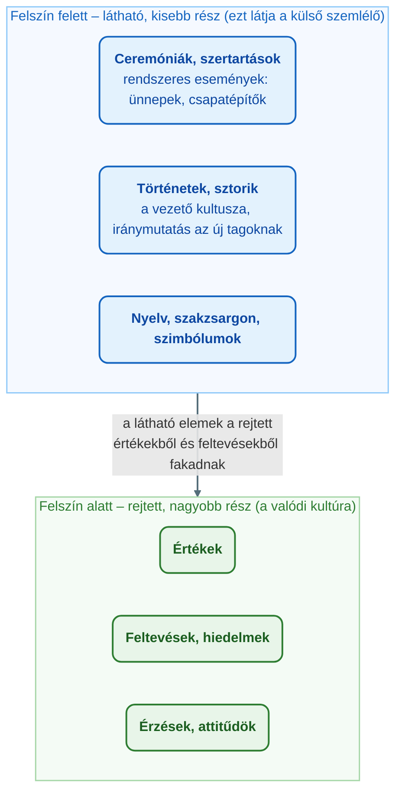
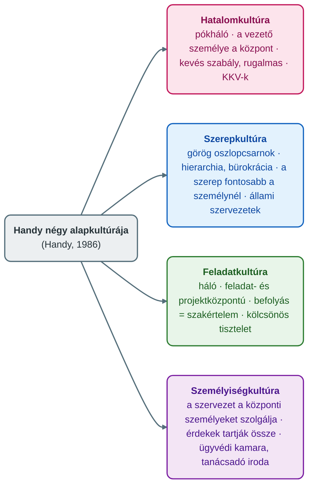

## K12 – Szervezeti kultúra

### Beszerzendő anyagok

| Szerző | Mű | Jelleg | Indoklás / érintett rész |
|---|---|---|---|
| Armstrong, M. & Taylor, S. | Armstrong kézikönyve az emberi erőforrás menedzsment gyakorlatáról (Kogan, 2016) | kötelező irodalom | Az adatlap kötelező irodalma (Óbudai Egyetem, 2024); a tárgy helyi tananyaga a szervezeti kultúrát önálló témaként nem tárgyalja, így R1–R3 egyetlen megengedett, ellenőrizhető tankönyvi forrása lehetne (pl. Schein háromszintű modellje, az OCAI dimenziói). |
| Knights, D. & Willmott, H. | Introducing Organizational Behaviour and Management (Cengage, 2017) | ajánlott irodalom | Az adatlap ajánlott irodalma; szervezeti magatartás-tankönyv, az R1–R2 (fogalom, fő elemek) lehetséges lelőhelye. |
| Griffin, R. W. | Management (Cengage, 2016) | ajánlott irodalom | Az adatlap ajánlott irodalma; általános menedzsment-tankönyv, az R3 (a vezető és a kultúra) lehetséges lelőhelye. |
| — | LEV_3 előadás-prezentáció (GMXHR1MBLF) | előadás-prezentáció | A mappából hiányzik a 3. konzultáció anyaga (LEV_1, 2, 4, 5 megvan); nem tudni, érinti-e a szervezeti kultúrát. |

**Tétel:** Szervezeti kultúra: Ismertesse a szervezeti kultúra fogalmát! Mutassa be a szervezeti kultúra fő elemeit! Ismertesse a vezető szerepét a szervezeti kultúra formálásában és működtetésében!

---

### Bevezetés

A szervezeti kultúra és a vezetés szorosan összefüggő jelenségek: a megfelelő kultúra kialakítása és fenntartása elsősorban a vezető feladata és felelőssége, a kultúra fejlesztése pedig a harmonikus és eredményes működés feltétele (Szabó & Molnár, 2022). A felelet három lépésben halad: először a kultúra fogalmát és funkcióit tisztázza, majd az elemeit két modell (jéghegy-modell, Handy-tipológia) és egy mérési keret (OCAI) segítségével mutatja be, végül a vezető kultúraformáló és -fenntartó szerepét tárgyalja Schein mechanizmusai, Trice és Beyer tipológiája és egy hazai empirikus kutatás alapján.

### A szervezeti kultúra fogalma

A szervezeti kultúra definiálása a jelenség komplexitása miatt nehéz, a szakirodalom több, egymást kiegészítő megfogalmazást használ (Szabó & Molnár, 2022):

* **Deal és Kennedy** köznapi megfogalmazása: a kultúra az, *„Ahogy mi itt a dolgunkat tesszük."* (Deal & Kennedy, 1982, idézi Szabó & Molnár, 2022).
* **Handy** szerint a szervezeti kultúra mélyen beágyazott hitek és meggyőződések rendszere (Handy, 1986, idézi Szabó & Molnár, 2022).
* **Buchowicz** a munkavállalói nézőpontot emeli ki: a vállalati kultúra az alkalmazottak vállalatukkal kapcsolatos véleményeinek, szokásainak, értékítéleteinek, magatartásának, gondolkodási és cselekvési módjainak összessége (Buchowicz, 1990, idézi Szabó & Molnár, 2022).
* **Schein** általános értelmezése szerint a szervezeti kultúra a szervezet tagjai által egyöntetűen elfogadott és értelmezett előfeltevések, értékek, meggyőződések és hiedelmek összessége (Schein, 1985, idézi Szabó & Molnár, 2022).

A kultúra **funkciója** a hagyományos megközelítésben az emberi viselkedés „programozása"; Hofstede szerint a kultúra az ember legegyetemesebb mentális programozottsága (Hofstede, 1980, idézi Szabó & Molnár, 2022). Schein a kultúrának két funkcionális feladatát különíti el: a **belső integrációt** és a **külső integrációt** (Schein, 1985, idézi Szabó & Molnár, 2022). A belső integráció lényege, hogy a kultúra összetartja a szervezetet: a vezetők és a munkavállalók irányított módon, szabályozott keretek között, együttműködve haladnak közös céljaik felé. Az „irányított" jelző már itt jelzi, hogy a kultúra nem létezik vezető nélkül (Szabó & Molnár, 2022).

### A szervezeti kultúra fő elemei

#### A jéghegy-modell

A kultúra elemeinek szemléltetésére a szakirodalom a **jéghegy-modellt** használja (Daft, 1992, idézi Szabó & Molnár, 2022). Ahogy a jéghegynek, a kultúrának is vannak látható és nem látható elemei. A felszín feletti, **kisebb** rész kapcsolódik a környezethez: külső szemlélőként ezt látjuk a szervezetből. Ide tartoznak a ceremóniák és szertartások (a kultúrába beépült, rendszeresen megtartott események, például a születésnapok közös ünneplése, a csapatépítő rendezvények, a közös reggelizés), a történetek és sztorik (ezek jellemzően a vezető személyének kultuszát növelik, és iránymutatást adnak az új tagoknak az elfogadott viselkedésformákról), a nyelv és a szakzsargon, valamint a szimbólumok. A felszín alatti részben jelennek meg az értékek, feltevések, hiedelmek, érzések és attitűdök — a valódi szervezeti kultúra itt érhető tetten (Szabó & Molnár, 2022).

#### Handy kultúratipológiája

A szervezeti kultúra tipologizálásának legelterjedtebb módja a **Handy-féle modell**, amely négy alapkultúrát különböztet meg (Handy, 1986, idézi Szabó & Molnár, 2022):

* **Hatalomkultúra.** Középpontjában a vezető személye áll; metaforája a **pókháló**. Nem jellemzi bürokrácia, mert az egyénre és annak tapasztalatára épít. Nagy előnye a rugalmasság, amelynek oka a kevés szabály. Jellemzően a kis- és középvállalkozások kultúrája, ahol a központi szereplő kultusza a legerősebb.
* **Szerepkultúra.** Elsődleges jellemzője a hierarchikus felépítés; a bürokratikusan működő szervezet mintapéldája. Bakacsi megfogalmazásában *„e kultúrában a szerep, a munkaköri leírás fontosabb, mint a személy, aki betölti"* (Bakacsi, 2010, idézi Szabó & Molnár, 2022). Metaforája a **görög oszlopcsarnok**: az oszlopok a szakterületeket, az őket összekötő timpanon a szűk körű vezetést jelképezi. Az együttműködést ügyrendek, írott és íratlan szabályozások biztosítják. Az állami szervezetek jellemző kultúrája.
* **Feladatkultúra.** Középpontjában a feladat és a projekt áll, a tevékenységeket nagyfokú rugalmasság jellemzi. Metaforája a **háló**, amelynek rácspontjai a hatalmat és a befolyást szimbolizálják; a befolyás a szakértelemhez kötődik, és kevésbé koncentrált, mint a többi típusban. A csoporton belüli kapcsolatokat a kölcsönös tisztelet jellemzi.
* **Személyiségkultúra.** Az egész szervezet arra épül, hogy a középpontban lévő személyeket kiszolgálja. Nem közös cél vagy stratégia tartja össze, hanem az érdekek, ezért a tagok között szoros viszony alakul ki. Tipikusan ügyvédi kamarák és tanácsadó irodák sorolhatók ide.

#### A versengő értékek négy kultúratípusa (OCAI)

A kultúra mérésére a kutatók gyakran a Cameron és Quinn nevéhez fűződő **OCAI** kérdőívet használják, amely egy-egy kultúratípust hat dimenzió mentén ír le, és lehetővé teszi a szervezet **jelenlegi** és a munkavállalók számára **ideális** kultúrájának meghatározását és összehasonlítását (Cameron & Quinn, 2006, idézi Szabó & Molnár, 2022). A négy típus jellemzői (Szabó & Molnár, 2022):

| Típus | Jellemzők | A vezető szerepe |
|---|---|---|
| **Hierarchia** | szabályorientált, nagyfokú szervezettség, az előírások fontosak, a stabilitás a legfontosabb | koordináló; a foglalkoztatás biztonsága, kiszámíthatóság, kevésbé kockázatvállaló |
| **Klán** | összetartás, családias légkör, kötődés és emberi kapcsolatok, az emberi erőforrás fejlesztése elsőbbséget élvez | mentor, támogató; csapatmunka, folyamatos kommunikáció, személyes részvétel |
| **Adhokrácia** | vállalkozó kedv, folyamatos növekedés és innováció | vállalja a kockázatot |
| **Piac** | racionális tervezés, központi célmeghatározás, termelés, minél több profit; hatékonyság és teljesítmény folyamatos ellenőrzés mellett | — |

### A vezető szerepe a kultúra formálásában és működtetésében

#### Vezetés és kultúra: a kapcsolat jellege

A leadership Bakacsi szerint a vezetői tevékenységnek az az eleme, amely az erőforrások közül az emberi erőforrással foglalkozik, és azt a képességet jelenti, amellyel a vezető a szervezeti célok érdekében mozgósítani tudja a tagokat (Bakacsi, 2010, idézi Szabó & Molnár, 2022). Bennis és Nanus megkülönböztetése szerint a menedzserek azok, akik jól csinálják a dolgukat, a leaderek pedig azok, akik a jó dolgokat csinálják (Bennis & Nanus, 1985, idézi Szabó & Molnár, 2022). A vezetésfelfogás fejlődése maga is a kultúra felé mutat: a klasszikus felfogás a beosztottak utasításának és irányításának megfelelő módját értette vezetésen, és a hatékonyságot a rendszerben, nem az emberben kereste; az ezredforduló vezetője ezzel szemben érdekeik helyett (mellett) az **értékeiken** keresztül közelít munkatársaihoz, magasabb rendű célokat és vonzó jövőképet rajzol eléjük, amelyet karizmatikus személyiségével tesz hitelessé (Bakacsi, 2010, idézi Szabó & Molnár, 2022). Az értékek közvetítése éppen a kultúra felszín alatti rétegére hat.

A szakirodalom többsége szerint a két fogalom összefügg. **Trice és Beyer** a kultúrához való viszony alapján négyféle vezetőt különböztet meg: **kultúrateremtő**, **kultúraváltoztató**, **kultúramegerősítő** és **kultúraintegráló** vezetőt (Trice & Beyer, 1992, idézi Szabó & Molnár, 2022). Ez a tipológia egyben a tétel két kulcsszavát is lefedi: a teremtés és a változtatás a kultúra **formálása**, a megerősítés és az integrálás a kultúra **működtetése**.

#### Schein: a kultúra forrásai és a formálás mechanizmusai

Schein szerint a vezető kiemelt jelentőségű feladata a szervezeti kultúra **alakítása, fenntartása és fejlesztése** (Schein, 1985, idézi Szabó & Molnár, 2022). A kultúrának három forrása van: (1) a szervezet alapítóinak értékei, hiedelmei és előfeltevései; (2) a csoport által feldolgozott események; (3) az új szervezeti tagok és vezetők értékei (Schein, 1985; Karácsonyi, 2007, idézi Szabó & Molnár, 2022). A kultúra kialakítására és fenntartására Schein hat **elsődleges** és hat **másodlagos** mechanizmust ír le (Szabó & Molnár, 2022):

| Elsődleges mechanizmusok (a vezető közvetlen eszközei) | Másodlagos mechanizmusok (a szervezet közvetítette eszközök) |
|---|---|
| a vezető figyelme (mire figyel) | szervezeti felépítés és struktúra |
| a vezető reagálása a kritikus eseményekre | szervezeti rendszerek és eljárások |
| vezetői erőforrás-elosztás | szervezeti rítusok és rituálék |
| a vezető mint tudatos szerepminta | a fizikai tér, az épületek elhelyezése |
| a jutalmak elosztása | történetek a fontos eseményekről és személyekről |
| előléptetés és elküldés a szervezettől | a szervezet céljainak, küldetésének formális megnyilvánulása |

Az elsődleges mechanizmusok a vezető mindennapi magatartásán keresztül hatnak, a másodlagosak a szervezeti kereteken és szimbólumokon keresztül. A tipológiákkal összevetve: az elsődleges mechanizmusok a formálás (teremtés, változtatás), a másodlagosak inkább a működtetés (megerősítés, beágyazás) eszközei.

#### Empirikus kapcsolat: a Szabó–Molnár-kutatás

Szabó és Molnár (2022) Jász-Nagykun-Szolnok megyei állami szervezetek munkavállalói körében, az OCAI magyar fordításával, online és anonim módon végzett felmérést (74 kitöltő, ebből 70 értékelhető). A 12 kérdésből hat a jelenlegi, hat az ideális szervezetre vonatkozott. Eredményeik:

* **Jelenleg észlelt kultúra:** domináns a hierarchia (32 %), a piac (24 %), a klán (23 %) és az adhokrácia (21 %) között nincs releváns különbség.
* **Ideális kultúra:** a klán (36 %) a legkívánatosabb, a hierarchia (25 %) a második, az adhokrácia (20 %) és a piac (19 %) a legkevésbé vonzó.
* **Leadership-dimenzió:** a jelenlegi vezetés a hierarchia, az ideális vezető a klán típusba tartozik — vagyis a vezetésre kapott eredmény mindkét esetben megegyezik a teljes szervezetre kapott kultúratípussal. A szerzők szerint ez mutatja, milyen szorosan kapcsolódik a kultúra a vezetéshez.

A kutatás következtetése, hogy a dolgozói preferenciák megértése, értékelése és a kultúrába való beépítése kiemelt vezetői feladat; korlátja a kis mintaelemszám (Szabó & Molnár, 2022).

#### Kapcsolódás a tárgy vezetési anyagához

A tárgy hivatalos tematikája a szervezeti kultúrát önálló témakörként nem tartalmazza (Óbudai Egyetem, 2024); az előadásanyag a kultúrát a vezetési stílus felől közelíti: a Hersey–Blanchard-féle szituációs modellben a stílus hatékonyságát a beosztottak munkaképessége és akarata, a munka jellege és **a szervezet atmoszférája (kultúrája)** befolyásolja; a vezető stílusa pedig egyebek mellett a környezettől és a szervezet típusától függ (Karácsony, 2024). A kapcsolat tehát kétirányú: a vezető formálja a kultúrát, de a meglévő kultúra is behatárolja, milyen vezetési stílus lehet eredményes.

### Összegzés

A szervezeti kultúra a tagok által osztott előfeltevések, értékek és hiedelmek rendszere, amelynek csak kisebb része látható (jéghegy-modell), és amely jól típusokba sorolható (Handy négy alapkultúrája, a versengő értékek négy típusa). A vezető a kultúra alapítója, fenntartója és fejlesztője: elsődleges mechanizmusokkal (figyelem, reagálás, erőforrás-elosztás, szerepminta, jutalmazás, előléptetés) közvetlenül, másodlagos mechanizmusokkal (struktúra, eljárások, rítusok, tér, történetek, küldetés) közvetve formálja és működteti azt. Az empirikus eredmények szerint a munkavállalók által észlelt és kívánt vezetés típusa egybeesik a kultúra típusával, ami a két jelenség szoros összefüggését igazolja.

---

### Várható vizsgáztatói kérdések

1. **Miért nehéz a szervezeti kultúrát definiálni, és melyik definíciót tartja a legátfogóbbnak?** — A jelenség komplex, ezért a szakirodalom több megfogalmazást használ: Deal és Kennedy köznapi („ahogy mi itt a dolgunkat tesszük"), Handy (beágyazott hitek és meggyőződések), Buchowicz (munkavállalói vélemények, szokások, értékítéletek, magatartás) és Schein általános definíciója (elfogadott előfeltevések, értékek, meggyőződések, hiedelmek). Az utóbbi a legátfogóbb, mert a kultúra rejtett rétegét is megnevezi (Szabó & Molnár, 2022).
2. **Mi a különbség a jéghegy-modell felszín feletti és alatti elemei között, és melyik fontosabb a vezető számára?** — A felszín felett a ceremóniák, történetek, nyelv és szimbólumok láthatók, ezt látja a külső szemlélő; a felszín alatt az értékek, feltevések, hiedelmek és attitűdök vannak, és a valódi kultúra itt érhető tetten (Daft, 1992, idézi Szabó & Molnár, 2022). A vezető a látható elemeken keresztül (például történetek, rítusok) hat a rejtett rétegre, de a tartós változás az értékekben dől el.
3. **Hasonlítsa össze Handy szerep- és hatalomkultúráját!** — A hatalomkultúra a vezető személye köré épül (pókháló), kevés szabály, rugalmasság, jellemzően KKV; a szerepkultúra hierarchikus és bürokratikus (oszlopcsarnok), a szerep fontosabb a személynél, az együttműködést ügyrendek biztosítják, jellemzően állami szervezet (Handy, 1986; Bakacsi, 2010, idézi Szabó & Molnár, 2022).
4. **Melyek Schein elsődleges és másodlagos kultúraformáló mechanizmusai, és miben különböznek?** — Elsődleges: a vezető figyelme, reagálása a kritikus eseményekre, erőforrás-elosztás, tudatos szerepminta, jutalmak elosztása, előléptetés/elküldés; másodlagos: struktúra, rendszerek és eljárások, rítusok, fizikai tér, történetek, a küldetés formális megnyilvánulása. Az elsődlegesek a vezető közvetlen magatartásán, a másodlagosak a szervezeti kereteken keresztül hatnak (Schein, 1985, idézi Szabó & Molnár, 2022).
5. **Milyen összefüggést mutatott ki a Szabó–Molnár-kutatás a kultúra és a vezetés között, és mi a módszertani korlátja?** — Állami szervezetek 70 munkavállalójának OCAI-válaszai szerint a jelenlegi kultúra hierarchia (32 %), az ideális klán (36 %); a leadership-dimenzió mindkét esetben ugyanazt a típust adta, ami a szoros kapcsolatot igazolja. Korlát: kis minta, egy megye állami szervezetei (Szabó & Molnár, 2022).
6. **Hogyan kapcsolódik a kultúra a tárgyban tanult vezetési stílusokhoz?** — A Hersey–Blanchard-modellben a stílus hatékonysága a beosztottak képességétől és akaratától, a munka jellegétől és a szervezet atmoszférájától (kultúrájától) függ; a stílust a környezet és a szervezet típusa is alakítja (Karácsony, 2024). A kultúra tehát nemcsak következménye, hanem feltétele is a vezetési stílusnak.

---

## Irodalom

* Karácsony, P. (2024). *A vezető magatartása, stílusa* [Előadás-prezentáció, LEV_5]. Óbudai Egyetem, Keleti Károly Gazdasági Kar.
* Óbudai Egyetem, Keleti Károly Gazdasági Kar. (2024). *HR menedzsment és vezetési technikák (GMXHR1MBLF) — Tantárgynyilvántartó adatlap* [Syllabus].
* Szabó, T., & Molnár, E. (2022). A szervezeti kultúra és a vezetés kapcsolata. *Gradus, 9*(1). https://doi.org/10.47833/2022.1.ECO.002
