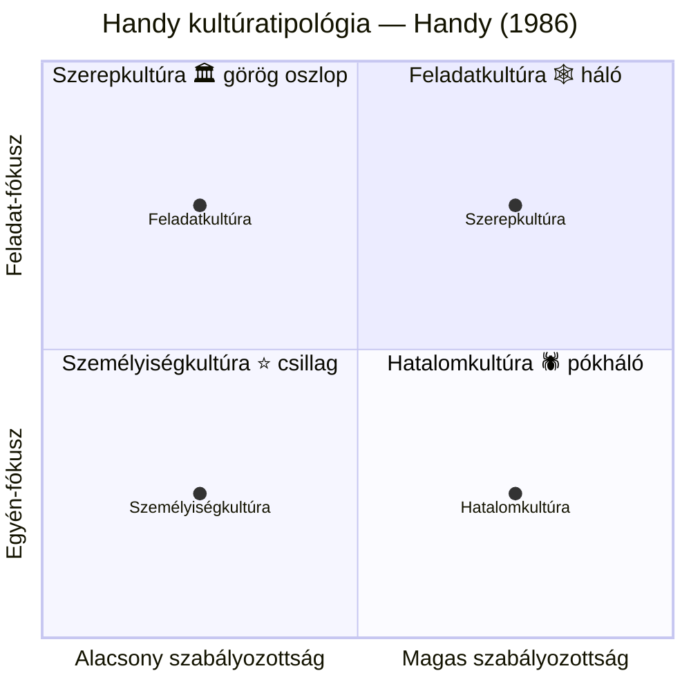
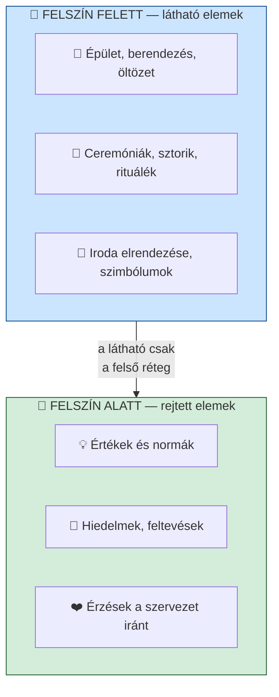

## K12 — Szervezeti kultúra

### Fogalom

A szervezeti kultúra meghatározása nem egységes a szakirodalomban. Deal és Kennedy (1982) köznapi megfogalmazása: *„Ahogy mi itt a dolgunkat tesszük."* Schein (1985) átfogóbb definíciója szerint a szervezeti kultúra a szervezet tagjai által egyöntetűen elfogadott előfeltevések, értékek, meggyőződések és hiedelmek összessége.

Buchowicz (1990) a munkavállalói perspektívát emeli ki: a kultúra az alkalmazottak vállalatukkal kapcsolatos véleményeinek, szokásainak, értékítéleteinek és gondolkodásmódjainak összessége.

### Handy kultúratipológiája

Handy (1986) négy alaptípust különböztet meg, amelyek különböző szervezeti formákhoz kapcsolódnak:

### Jéghegy-modell

Daft (1992) jéghegy-modellje szemlélteti, hogy a szervezeti kultúrának csak kis része látható kívülről:

### Kultúra és leadership kapcsolata

Schein (1985) szerint a vezető a kultúra elsődleges formálója. Hat elsődleges mechanizmust azonosít: a vezető figyelme, reagálása kritikus eseményekre, erőforrás-elosztása, tudatos szerepmodell-viselkedése, jutalmak elosztása és a ki- és beléptetés szokása (Szabó–Molnár, 2022).

A Leadership Shadow modell (Champions of Change, 2023) négy dimenzióban foglalja össze a vezető kultúraformáló hatását:

| Dimenzió | Mit jelent |
|----------|-----------|
| What I say | Amit a vezető kommunikál — szavai, üzenetei |
| How I act | Ahogy viselkedik — példamutatás |
| What I prioritise | Amire időt és erőforrást fordít |
| How I measure | Mit mér és mit jutalmaz |

Cameron és Quinn (2006) OCAI modellje négy kultúratípust különít el: klán, adhokrácia, piac és hierarchia. Szabó és Molnár (2022) hazai állami szervezeteken végzett kutatása alapján a munkavállalók jelenlegi kultúráját hierarchia típusúnak (32%), ideálisát klán típusúnak (36%) érzékelik.

---