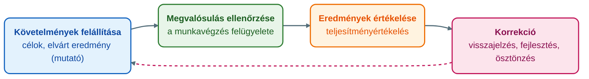
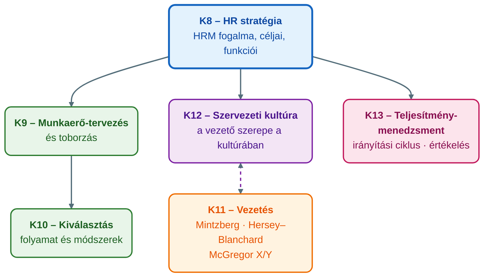

## K13 – Teljesítménymenedzsment és értékelés

### Beszerzendő anyagok

| Szerző | Mű | Jelleg | Indoklás / érintett rész |
|---|---|---|---|
| — | GMXHR1MBLF 8. heti előadás: „Teljesítményértékelés, teljesítmény menedzsment” (vélhetően LEV_3) | előadás-prezentáció | A tétel mindhárom részkérdése (R1–R3) erre épülne; a mappában LEV_1, 2, 4, 5 van, a LEV_3 hiányzik. |
| — | GMXHR1MBLF 7. heti előadás: „Ösztönzésmenedzsment, ösztönzési rendszerek” | előadás-prezentáció | R1 (cél) és R2 (szerep): a teljesítmény és az ösztönzés kapcsolata. |
| Armstrong, M. & Taylor, S. | *Armstrong kézikönyve az emberi erőforrás menedzsment gyakorlatáról* (2016) | kötelező irodalom | A syllabus kötelező irodalma; az R1 definíció és az R3 módszerek (a ⚠️ szakasz) ellenőrzéséhez. |
| Borgulya I.-né et al. | *Emberi erőforrás menedzsment kézikönyv* (2006) | kötelező irodalom | R3: a teljesítményértékelés módszereinek magyar terminológiájú leírása; R2: a rendszerek szerepe. |
| Bakacsi Gy. et al. | *Stratégiai emberi erőforrás menedzsment* (2000) | kötelező irodalom | R2: a teljesítménymenedzsment stratégiai HR-szerepe. |
| Pink, D. H. | *Motiváció 3.0* (2010) | kötelező irodalom | A motivációs kapcsolódás (Pink-bekezdés) jelenleg nem ellenőrzött. |

**Tétel:** Ismertesse a teljesítmény menedzsment fogalmát és célját! Mutassa be a teljesítményértékelési rendszerek szerepét a szervezetek működésében! Ismertesse a teljesítményértékelés leggyakoribb módszereit!

---

### A teljesítménymenedzsment fogalma és célja

A teljesítménymenedzsment (performance management) a tantárgy tematikájában az emberi erőforrás menedzsment funkcióciklusának eleme: a tantárgynyilvántartó adatlap 8. heti témaköre „Teljesítményértékelés, teljesítmény menedzsment”, amely közvetlenül az ösztönzésmenedzsment (7. hét) után következik (Óbudai Egyetem, Keleti Károly Gazdasági Kar, 2024). Az előadás a HRM funkcióit két blokkra bontja: az első blokk a munkaerő-tervezést, a munkakörelemzést, a toborzást és kiválasztást, a képzés-fejlesztést és a kompenzációmenedzsmentet, a második blokk a teljesítménymenedzsmentet, a munkaegészséget és -biztonságot, a kollektív alkut és a munkaügyi kapcsolatok kezelését tartalmazza (Karácsony, 2024a). Maga a HR-funkció definíciója is nevesíti a teljesítményértékelést (performance appraisal) azon területek között, ahol a HR iránymutatást ad a szervezetnek (Karácsony, 2024a).

A fogalom tartalmát a menedzsment alapdefiníciójából lehet levezetni. Az előadás szerint a menedzsment lényege „sikerre vinni a célt, elérni azt az eredményt, amit definiáltunk”: a *manage* ige megvalósítást jelent, a kérdés mindig a cél és a hozzá rendelt eredménymutató (Karácsony, 2024b). A teljesítménymenedzsment ennek az emberi oldalát fedi le: azt a folyamatot, amelyben a szervezet a munkavállalóival szemben követelményeket állít fel, figyelemmel kíséri a megvalósulást, értékeli az eredményt, és szükség esetén korrigál. Ez pontosan az irányítás (controlling) menedzsmentfunkció tartalma: „az irányítás a követelmények felállítását, azok megvalósulásának ellenőrzését, az eredmények értékelését és az esetleg szükséges korrekciók végrehajtását jelenti” (Karácsony, 2024b). *(Nem ellenőrzött kiegészítés: a syllabus kötelező irodalma, Armstrong és Taylor kézikönyve [2016] a teljesítménymenedzsmentet folyamatos, a vezető és a beosztott közötti párbeszédre épülő ciklusként írja le; a mű a mappában nem elérhető, az állítás beszerzés után ellenőrizendő.)*

A teljesítménymenedzsment célja a HRM céljaiból következik. Az előadás szerint a HRM első számú célja a szervezeti eredményesség és képesség növelése, emellett a HR-politikák kommunikálása, az etikus és társadalmilag felelős működés fenntartása, a munka minőségének (quality of work life) biztosítása és a változás kezelése az egyén, a csoport és a vállalat kölcsönös előnyére (Karácsony, 2024a). A teljesítménymenedzsment ebben a célrendszerben az a HR-eszköz, amely az egyéni munkavégzést a szervezeti célokhoz köti. Az előadás humántőke-felfogása szerint a szervezet humán tőkéje a dolgozók tudásának, képességeinek, élettapasztalatának és motivációjának együttes értéke, és az egyén teljesítményét két fő tényező befolyásolja: a személyes motiváció és a vezetés típusa (Karácsony, 2024a). A teljesítménymenedzsment célja tehát kettős: egyrészt a szervezeti célok eléréséhez szükséges teljesítmény biztosítása (irányítási cél), másrészt a motiváció és a fejlődés fenntartása (vezetési cél). Ez utóbbit az előadás a vezetés funkciójához köti: a vezetés „a szervezeti tagok viselkedésének tudatos befolyásolása, hogy azok a meghatározott célok eléréséért tevékenykedjenek”, amely „a motiváció kialakításán és fenntartásán keresztül” hat (Karácsony, 2024b).

### A teljesítménymenedzsment mint irányítási ciklus

A teljesítménymenedzsment lépései az irányítási funkció négy elemét követik, és a vezetési funkción keresztül záródnak ciklussá: az értékelés eredménye visszahat a következő időszak követelményeire és a munkavállaló motivációjára (Karácsony, 2024b).

A ciklus a szervezeti hierarchia minden szintjén megjelenik, de más tartalommal. Az előadás szerint a felsővezetők feladata a szervezet egészére vonatkozó célok meghatározása, a középvezetőké egy szervezeti részterület tervezése, szervezése és irányítása, a közvetlen munkairányítóké pedig a napi működés feltételeinek biztosítása, a munkavégzés felügyelete és eredményének ellenőrzése (Karácsony, 2024b). A teljesítménymenedzsment tehát fentről lefelé bontja le a célokat, és lentről felfelé összesíti az eredményeket.

### A teljesítményértékelési rendszerek szerepe a szervezetek működésében

Az előadás a HR-funkció jelentőségét azzal indokolja, hogy a legtöbb szervezetben a munkavállalók állítják elő a terméket és bonyolítják az üzletet; megfelelő szabályok és eljárások nélkül a munka nem megfelelően folyik, a termelékenység alacsony, a költségek nőnek, és a szervezet elveszíti a fejlődés lehetőségét. A következetlen és méltánytalan bánásmód a dolgozók távozásához és pótlási költségekhez vezet (Karácsony, 2024a). A teljesítményértékelési rendszer ebben az összefüggésben a következetesség és a méltányosság intézményes biztosítéka: egységes mérce, amely alapján a vezetői döntések (fejlesztés, előléptetés, ösztönzés) megalapozhatók és megvédhetők.

A vezetéselméletek felől nézve az értékelés módja maga is a vezetési stílus része. Lewin tipológiájában az autokratikus vezető „szubjektív alapon értékel”, míg a demokratikus vezető „objektív teljesítményértékelésre törekszik” és minden eszközzel fokozza a csoport részvételét (Karácsony, 2024c). Likert egytényezős modelljében a négy fokozatot egyetlen tényező, a beosztott részvételének mértéke különbözteti meg: a keménykezű parancsoló fenyegetéssel és büntetéssel, ritkábban jutalmazással él, a részvételi csoport szintjén viszont a csoporttagok aktívan részt vesznek a célok kitűzésében és a teljesítmény értékelésében, a motiválás anyagi és elismerés jellegű (Karácsony, 2024c). A teljesítményértékelési rendszer kialakítása ezért nem csak technikai kérdés: a részvétel és az objektivitás foka a vezetési stílusról is üzen.

Blake és Mouton rácsmodellje a teljesítmény és az emberi szempontok egyensúlyát állítja középpontba. A (9,1) hajtós vezetésnél a termelési hatékonyság érdekében az emberi szempontok háttérbe szorulnak; a (5,5) kompromisszumos vezetésnél megfelelő szervezeti teljesítmény érhető el az elvárt munkateljesítmény és a dolgozói morál egyensúlyával; a (9,9) csoportközpontú vezetésnél a munkateljesítmény forrása az emberek összefogása, a közös érdekeltség kölcsönös bizalmat és megbecsülést teremt (Karácsony, 2024c). Egy jól működő értékelési rendszer a (9,9) irányába tol: a teljesítményelvárást nem az emberi szempontok rovására érvényesíti.

A szituációs elméletek a visszajelzés módját a beosztott érettségéhez kötik. Hersey és Blanchard modelljében a felépítő (strukturáló) stílusnál a vezető közli az elvárást és azt, hogyan lehet teljesíteni, a megfelelő elvégzést elismeri és jutalmazza; a bátorító stílus kelléke a nyílt, támogató viselkedés és a gyakori dicséret; a megbízó (delegáló) stílusnál a kapcsolat a bizalomra épül, feltétele a beosztott tudása, tapasztalata és felelősségtudata (Karácsony, 2024c). Az értékelési rendszer ezért akkor hatékony, ha a visszajelzés gyakoriságát és részletességét a beosztotthoz igazítja.

### Kapcsolat a motivációval

Az előadás szerint a motiváció a menedzsment egyik kulcskérdése: a legjobb eredmény eléréséhez a szervezetnek motiváltan kell tartania a dolgozóit, és ami a vezetőt motiválja, nem feltétlenül motiválja a beosztottait. Az előadás megkülönbözteti a belső (intrinsic) motivációt, amikor valaki a tevékenység saját öröméért vesz részt benne, és a külső (extrinsic) motivációt, amikor jutalomért vagy büntetés elkerüléséért cselekszik (Karácsony, 2024a). A teljesítményértékelés tipikusan a külső motiváció eszköze (jutalom és következmény), de a visszajelzés és a fejlődés támogatása a belső motivációt is erősítheti. Az előadás azt is felsorolja, ami biztosan nem motivál: a személyeskedő támadás, a félelemmel kormányzás, a felelősség teljes magunkra vállalása és a dolgozók túlterhelése (Karácsony, 2024a). Ezek a rosszul működő értékelési gyakorlat tipikus hibái is.

McGregor szerint az X beállítottságú vezető abból indul ki, hogy az alkalmazott nem szereti a munkát, kényszeríteni és szorosan ellenőrizni kell, eszköztára a „furkósbot és mézesmadzag”, vagyis a büntetés-jutalmazás; az Y beállítottságú vezető szerint az emberek szeretik az önirányítást, keresik és vállalják a felelősséget, ha bátorítják őket, ezért megosztja az információt, elősegíti a beosztottak fejlődését, és döntéseit csoportosan hozza vagy rájuk bízza (Karácsony, 2024c). Az értékelési rendszer tehát lehet ellenőrző jellegű (X) vagy fejlesztő jellegű (Y). McClelland teljesítménymotivációs elmélete szerint az eredményesség igénye azt jelenti, hogy valaki jobban akar teljesíteni másoknál, kiváló akar lenni és valami újat akar elérni; az ilyen munkavállaló számára a világos célok és a teljesítményről szóló visszajelzés önmagában motiváló (Karácsony, 2024c).

*(Nem ellenőrzött kiegészítés, a syllabus kötelező irodalma alapján: Pink [2010] *Motiváció 3.0* című műve szerint a tartós belső motiváció három pillére az autonómia, a mesterségbeli tudás és a cél; a külső ösztönzők a tudásmunkában rövid távon hatnak. A mű a mappában nem elérhető, az állítás beszerzés után ellenőrizendő.)* A motivációs tartalom- és folyamatelméleteket (Maslow, Herzberg, Vroom, Adams) a K6 tétel tárgyalja.

### ⚠️ Tartalmi hiány — a teljesítményértékelés módszerei (R3)

A tételsor a teljesítményértékelés leggyakoribb módszereinek ismertetését kéri. A megengedett forrásokban (tantárgynyilvántartó adatlap, LEV_1, LEV_2, LEV_4, LEV_5 előadás) egyetlen értékelési módszer sem szerepel; a témakör a hiányzó 8. heti előadásban és a kötelező irodalomban (Armstrong & Taylor, 2016; Borgulya et al., 2006) található. Az egyetlen forráshű kapcsolódás: az előadás a HRM mai irányai között nevesíti a kompetenciaalapú HRM-et (competency-based HRM) és a teljesítmény- és jutalmazásmenedzsmentet (performance and reward management) (Karácsony, 2024a), amelyből következik, hogy az értékelés egyik korszerű alapja a munkakörhöz szükséges kompetenciák mérése.

**Az alábbi módszerleírás nem ellenőrzött vázlat:** a korábbi kidolgozásból megtartott, forráshivatkozás nélküli összefoglaló, amelyet a kötelező irodalom beszerzése után kell ellenőrizni és hivatkozással ellátni.

A célok szerinti irányítás (MBO, *Management by Objectives*) szerint a vezető és a beosztott közösen határozzák meg a célokat; a bevonás növeli az elköteleződést. A célok a SMART elveket követik: specifikus, mérhető, elérhető, releváns, időhöz kötött. Erőssége a konkrétság és a motiváló hatás; gyengesége, hogy a célok idővel merevednek, és a nem mérhető dimenziók (pl. csapatmunka) kieshetnek. Újabb változata az OKR (*Objectives and Key Results*), amely inspiráló célokat és mérhető kulcseredményeket köt össze.

Az értékelési skálák (*rating scales*) viselkedési vagy eredményalapú skálákon, jellemzően 1–5 fokozaton mérik a teljesítményt. A BARS (*Behaviorally Anchored Rating Scale*, viselkedéshorgonyos skála) a fokozatokat konkrét viselkedésleírásokhoz köti, csökkentve a szubjektivitást; a BOS (*Behavioral Observation Scale*) a megfigyelt viselkedések gyakoriságát méri. Mindkettő objektívebb a hagyományos grafikus skálánál, de elkészítésük időigényes.

A 360 fokos visszajelzés a közvetlen vezető értékelését kiegészíti a kollégák, a beosztottak és esetenként az ügyfelek véleményével. Átfogóbb képet ad és csökkenti az egyoldalú értékelés kockázatát, de adminisztratív igénye magas, és anonim kitöltés esetén is termelhet torzításokat.

A kompetenciaalapú értékelés azt méri, mennyire rendelkezik a munkavállaló az adott munkakör sikerességéhez szükséges kompetenciákkal (pl. kommunikáció, döntéshozás, együttműködés), és a fejlesztési célok kijelölésére teszi a hangsúlyt.

| Módszer | Előnyök | Hátrányok |
|---------|---------|-----------|
| MBO / OKR | Konkrét célok, motiváló, bevonó | Célok merevedhetnek, mérhetetlen dimenziók kiesnek |
| 360°-os | Komplex, többforrású visszajelzés | Időigényes, anonim torzítás kockázata |
| BARS / BOS | Viselkedéshorgonyos, objektívebb | Elkészítése időigényes |
| Kompetencia-alapú | Fejlesztés-orientált | Nehezen mérhető |

**Értékelési torzítások.** A teljesítményértékelés objektivitását számos kognitív torzítás veszélyezteti: *halo-hatás* (egy kiemelkedő dimenzió felülírja a többit), *horn-hatás* (egy negatív dimenzió húzza le az összképet), *frissesség-hatás* (a közelmúlt teljesítménye felülreprezentált), *hasonlóság-torzítás* (a vezető a magához hasonlókat értékeli jobban), *engedékenység/szigorúság* (a vezető szisztematikusan magas vagy alacsony értékeket ad), *centrális tendencia* (mindenki közepes értéket kap). Ezeket strukturált skálákkal és értékelőképzéssel lehet csökkenteni.

### Összegzés és kapcsolódás a K8–K12 tételekhez

A teljesítménymenedzsment az irányítási funkció HR-re alkalmazott ciklusa (követelmény, ellenőrzés, értékelés, korrekció), amelynek célja a szervezeti eredményesség és a motiváció együttes fenntartása (Karácsony, 2024a, 2024b). Az értékelési rendszer szerepe a következetesség és méltányosság biztosítása, módja pedig a vezetési stílus (Lewin, Likert, Blake–Mouton, McGregor) lenyomata (Karácsony, 2024c). A módszerek (R3) a hiányzó tananyag pótlása után egészítendők ki.

A hat tétel egyetlen logikai ívet alkot: a szervezet emberigényének meghatározásától (K8–K9) a megfelelő személyek kiválasztásán (K10) és irányításán (K11) át a kultúra tudatos formálásáig (K12) és a teljesítmény értékeléséig (K13).

---

### Várható vizsgáztatói kérdések

1. **Melyik menedzsmentfunkcióhoz tartozik a teljesítménymenedzsment, és miért?** — Elsősorban az irányításhoz: az irányítás a követelmények felállítása, a megvalósulás ellenőrzése, az eredmények értékelése és a korrekció (Karácsony, 2024b). A korrekció és a visszajelzés azonban a vezetés funkciójához is kapcsolódik, mert a motiváció kialakításán és fenntartásán keresztül hat (Karácsony, 2024b).
2. **Hogyan függ össze az értékelés módja a vezetési stílussal?** — Lewin szerint az autokratikus vezető szubjektíven értékel, a demokratikus objektív teljesítményértékelésre törekszik; Likert részvételi csoport szintjén a beosztottak részt vesznek a célkitűzésben és az értékelésben (Karácsony, 2024c). McGregor X-vezetője büntetés-jutalmazással ellenőriz, Y-vezetője a fejlődést segíti (Karácsony, 2024c).
3. **Mi a különbség a belső és a külső motiváció között, és melyiket szolgálja az értékelés?** — A belső motivációnál a tevékenység saját öröméért cselekszünk, a külsőnél jutalomért vagy büntetés elkerüléséért (Karácsony, 2024a). Az értékeléshez kötött jutalom külső ösztönző; a fejlesztő visszajelzés a belső motivációt is erősítheti.
4. **Mit nevez az előadás olyan vezetői magatartásnak, amely biztosan nem motivál?** — A személyeskedő támadást, a félelemmel kormányzást, a felelősség teljes magunkra vállalását és a dolgozók túlterhelését (Karácsony, 2024a). Ezek egyben a rosszul működő teljesítményértékelés tünetei is.
5. **Hogyan értelmezhető a teljesítmény Blake és Mouton rácsán?** — A (9,1) hajtós vezetés a hatékonyságot az emberi szempontok rovására érvényesíti, a (5,5) a teljesítmény és a morál egyensúlyára törekszik, a (9,9) csoportközpontú vezetésnél a teljesítmény forrása az emberek összefogása és a kölcsönös bizalom (Karácsony, 2024c).
6. **Milyen értékelési módszereket ismer?** — Az MBO/OKR, a skálás módszerek (BARS, BOS), a 360 fokos visszajelzés és a kompetenciaalapú értékelés; ezek leírása a tétel ⚠️ szakaszában szerepel, forrása a kötelező irodalom (Armstrong & Taylor, 2016; Borgulya et al., 2006), amely a helyi anyagban nem ellenőrizhető.

---

## Irodalom

* Armstrong, M., & Taylor, S. (2016). *Armstrong kézikönyve az emberi erőforrás menedzsment gyakorlatáról.* Kogan Page.
* Borgulya, I.-né, Dobay, P., Farkas, F., Karoliny, M.-né, László, Gy., Mohácsi, G., & Poór, J. (2006). *Emberi erőforrás menedzsment kézikönyv.* CompLex Kiadó.
* Karácsony, P. (2024a). *Human Resource Management and Leadership Techniques* [Előadás-prezentáció, LEV_2]. Óbudai Egyetem, Keleti Károly Gazdasági Kar.
* Karácsony, P. (2024b). *Menedzsment – Menedzser feladatai és funkciói* [Előadás-prezentáció, LEV_4]. Óbudai Egyetem, Keleti Károly Gazdasági Kar.
* Karácsony, P. (2024c). *A vezető magatartása, stílusa* [Előadás-prezentáció, LEV_5]. Óbudai Egyetem, Keleti Károly Gazdasági Kar.
* Óbudai Egyetem, Keleti Károly Gazdasági Kar. (2024). *HR menedzsment és vezetési technikák (GMXHR1MBLF) — Tantárgynyilvántartó adatlap* [Syllabus].
* Pink, D. H. (2010). *Motiváció 3.0 – Ösztönzés másképp.* HVG Könyvek.
