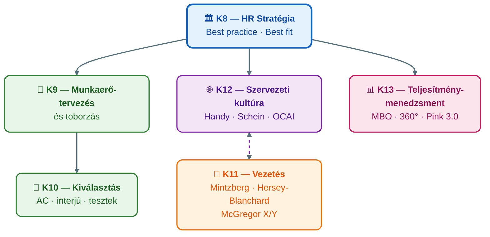

## K13 — Teljesítménymenedzsment és értékelés

**Tétel:** Teljesítménymenedzsment és értékelés: Ismertesse a teljesítmény menedzsment fogalmát és célját! Mutassa be a teljesítményértékelési rendszerek szerepét a szervezetek működésében! Ismertesse a teljesítményértékelés leggyakoribb módszereit!

---

### A teljesítménymenedzsment fogalma és célja

A teljesítménymenedzsment (performance management) folyamatos ciklus, amely összehangítja az egyéni teljesítményt a szervezeti célokkal. Armstrong és Taylor (2016) meghatározása szerint nem egyszeri értékelési esemény, hanem folyamatos párbeszéd a vezető és a beosztott között.

A Vázlat (kurzusanyag) alapján a teljesítményösztönzés kulcselemei: kihívást jelentő célok kitűzése, rendszeres visszajelzés adása és a teljesítmény értékelése.

### A teljesítménymenedzsment ciklusa

### Teljesítményértékelési módszerek

A célok szerinti irányítás (MBO, *Management by Objectives* — Drucker, 1954) szerint a vezető és a beosztott **közösen** határozzák meg a célokat; a bevonás növeli az elköteleződést. A célok a **SMART** elveket követik: Specifikus, Mérhető, Elérhető (*Achievable*), Releváns, Időhöz kötött (*Time-bound*). Erőssége a konkrétság és a motiváló hatás; gyengesége, hogy a célok idővel merevednek, és a nem mérhető dimenziók (pl. csapatmunka) kieshetnek. Modern változata az **OKR** (*Objectives and Key Results*), amely merészebb, inspiráló célokat és mérhető kulcseredményeket köt össze — egyre több szervezet váltja ki vele az MBO-t.

Az értékelési skálák (*rating scales*) viselkedési vagy eredményalapú skálákon — jellemzően 1–5 fokozaton — mérik a teljesítményt. Fejlettebb változata a **BARS** (*Behaviorally Anchored Rating Scale* — viselkedéshorgonyos skála), amely a fokozatokat konkrét viselkedésleírásokhoz köti, csökkentve a szubjektivitást; a **BOS** (*Behavioral Observation Scale*) a megfigyelt viselkedések gyakoriságát méri. Mindkettő objektívebb a hagyományos grafikus skálánál, de elkészítésük időigényes.

A 360 fokos visszajelzés a közvetlen vezető értékelését kiegészíti a kollégák, a beosztottak és esetenként az ügyfelek véleményével. Átfogóbb képet ad, és csökkenti az egyoldalú értékelés kockázatát, de adminisztratív igénye magas, és anonim kitöltés esetén is termelhet torzításokat.

A kompetenciaalapú értékelés azt méri, mennyire rendelkezik a munkavállaló az adott munkakör sikerességéhez szükséges kompetenciákkal — kommunikáció, döntéshozás, együttműködés. A kurzusanyag (Vázlat) erre a megközelítésre épít, és a fejlesztési célok kijelölésére teszi a hangsúlyt.

| Módszer | Előnyök | Hátrányok |
|---------|---------|-----------|
| MBO / OKR | Konkrét célok, motiváló, bevonó | Célok merevedhetnek, mérhetetlen dimenziók kiesnek |
| 360°-os | Komplex, többforrású visszajelzés | Időigényes, anonim torzítás kockázata |
| BARS / BOS | Viselkedéshorgonyos, objektívebb | Elkészítése időigényes |
| Kompetencia-alapú | Fejlesztés-orientált | Nehezen mérhető |

**Értékelési torzítások.** A teljesítményértékelés objektivitását számos kognitív torzítás veszélyezteti: *halo-hatás* (egy kiemelkedő dimenzió felülírja a többit), *horn-hatás* (egy negatív dimenzió húzza le az összképet), *frissesség-hatás* (a közelmúlt teljesítménye felülreprezentált), *hasonlóság-torzítás* (a vezető a magához hasonlókat értékeli jobban), *engedékenység/szigorúság* (a vezető szisztematikusan magas vagy alacsony értékeket ad), *centrális tendencia* (mindenki közepes értéket kap). Ezeket strukturált skálákkal (BARS) és értékelőképzéssel lehet csökkenteni.

### Kapcsolat a motivációval és a kultúrával

A teljesítménymenedzsment hatékonysága szorosan összefügg a motivációs rendszerrel és a szervezeti kultúrával.

A **tartalomelméletek** szempontjából: Maslow (1943) szükséglethierarchiájában a teljesítménymenedzsment elsősorban az elismerés és az önmegvalósítás szintjét érinti. Herzberg (1959/1968) szerint a teljesítmény, az elismerés és a fejlődési lehetőség valódi *motivátorok* — a pénzbeli bónusz önmagában inkább higiénés tényező, amely hiánya elégedetlenséget okoz, de megléte nem motivál tartósan.

A **folyamatelméletek** szempontjából: Vroom (1964) elvárás-elmélete szerint az értékelési rendszer csak akkor motivál, ha a munkavállaló elhiszi, hogy az erőfeszítése teljesítményre vezet (elvárás), a teljesítmény jutalomra (eszközszerűség), és a jutalom vonzó számára (vegyérték). Adams (1965) méltányosságelmélete alapján a méltánytalannak érzékelt értékelés demotiváló — ezért kulcsfontosságú a transzparens, következetes és indoklással ellátott visszajelzés.

Pink (2009/2010) *Motiváció 3.0* modellje szerint a belső motiváció három pillére — **autonómia**, **mesterség** és **cél** — tartósabb teljesítményt eredményez, mint a külső ösztönzők. Ahol a kultúra a hibázást bünteti és a negatív visszajelzés dominál, ott a munkavállalók elkerülik a kockázatot — ami gátolja az innovációt és a fejlődést.

---

## Összefoglalás: K8–K13 kapcsolódási pontjai

A hat tétel egyetlen logikai ívet alkot: a szervezet emberigényének meghatározásától (K8–K9) a megfelelő személyek kiválasztásán (K10) és irányításán (K11) át a kultúra tudatos formálásáig (K12) és a teljesítmény értékeléséig (K13).

---

## Irodalom

- Adams, J. S. (1965). Inequity in social exchange. In L. Berkowitz (Ed.), *Advances in experimental social psychology* (Vol. 2, pp. 267–299). Academic Press.
- Armstrong, M. & Taylor, S. (2014). *Armstrong's handbook of human resource management practice* (13th ed.). Kogan Page.
- Bakacsi Gy. (2010). *A szervezeti magatartás alapjai.* AULA Kiadó, Budapest.
- Borgulya I-né et al. (2006). *Emberi erőforrás menedzsment kézikönyv.* CompLex Kiadó, Budapest.
- Drucker, P. F. (1954). *The practice of management.* Harper & Row.
- Herzberg, F. (1968). One more time: How do you motivate employees? *Harvard Business Review, 46*(1), 53–62.
- Maslow, A. H. (1943). A theory of human motivation. *Psychological Review, 50*(4), 370–396.
- Milkovich, G. T. & Glueck, F. W. (1995). *Personnel/Human Resource Management: A Diagnostic Approach.* Business Publications Inc., Texas.
- Pink, D. H. (2010). *Motiváció 3.0.* HVG Könyvek, Budapest. (Eredeti: *Drive*, 2009.)
- Szabó T. & Molnár E. (2022). A szervezeti kultúra és a vezetés kapcsolata. *Gradus, 9*(1). https://doi.org/10.47833/2022.1.ECO.002
- Vroom, V. H. (1964). *Work and motivation.* Wiley.
