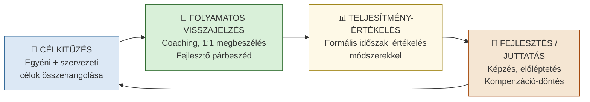
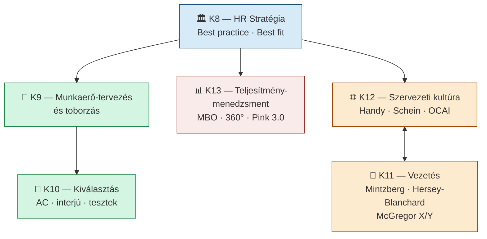

## K13 — Teljesítménymenedzsment és értékelés

### A teljesítménymenedzsment fogalma és célja

A teljesítménymenedzsment (performance management) folyamatos ciklus, amely összehangítja az egyéni teljesítményt a szervezeti célokkal. Armstrong és Taylor (2016) meghatározása szerint nem egyszeri értékelési esemény, hanem folyamatos párbeszéd a vezető és a beosztott között.

A Vázlat (kurzusanyag) alapján a teljesítményösztönzés kulcselemei: kihívást jelentő célok kitűzése, rendszeres visszajelzés adása és a teljesítmény értékelése.

### A teljesítménymenedzsment ciklusa

### Teljesítményértékelési módszerek

A célok szerinti irányítás (MBO, Management by Objectives) Drucker nevéhez kötődik: a vezető és a beosztott közösen határozzák meg a mérható célokat, az értékelés pedig ezek teljesítéséhez képest történik. Erőssége a konkrétság, gyengesége, hogy a célok idővel merevednek, és a nem mérhető dimenziók (pl. csapatmunka) kiesnek.

Az értékelési skálák (rating scales) viselkedési vagy eredményalapú skálákon — jellemzően 1–5 fokozaton — mérik a teljesítményt. Egyszerű és gyors módszer, de a szubjektív torzításra (halo-hatás, engedékenység) különösen érzékeny.

A 360 fokos visszajelzés a közvetlen vezető értékelését kiegészíti a kollégák, a beosztottak és esetenként az ügyfelek véleményével. Átfogóbb képet ad, és csökkenti az egyoldalú értékelés kockázatát, de adminisztratív igénye magas, és anonim kitöltés esetén is termelhet torzításokat.

A kompetenciaalapú értékelés azt méri, mennyire rendelkezik a munkavállaló az adott munkakör sikerességéhez szükséges kompetenciákkal — kommunikáció, döntéshozás, együttműködés. A kurzusanyag (Vázlat) erre a megközelítésre épít, és a fejlesztési célok kijelölésére teszi a hangsúlyt.

| Módszer | Előnyök | Hátrányok |
|---------|---------|-----------|
| MBO | Konkrét célok, motiváló | Célok lehetnek merevek |
| 360°-os | Komplex visszajelzés | Időigényes, kényes |
| Skálás értékelés | Egyszerű, gyors | Szubjektív torzítás |
| Kompetencia-alapú | Fejlesztés-orientált | Nehezen mérhető |

### Kapcsolat a motivációval és a kultúrával

A teljesítménymenedzsment hatékonysága szorosan összefügg a motivációs rendszerrel és a szervezeti kultúrával. Ahol a kultúra a hibázást bünteti (negatív visszajelzés dominál), ott a munkavállalók elkerülik a kockázatot — ami gátolja az innovációt (LEV_5; Szervezeti kultúra dia). Pink (2010) *Motiváció 3.0* modellje szerint a belső motiváció (autonómia, mesterség, cél/értelem) tartósabb teljesítményt eredményez, mint a külső ösztönzők (bér, bónusz).

---

## Összefoglalás: K8–K13 kapcsolódási pontjai

A hat tétel egyetlen logikai ívet alkot: a szervezet emberigényének meghatározásától (K8–K9) a megfelelő személyek kiválasztásán (K10) és irányításán (K11) át a kultúra tudatos formálásáig (K12) és a teljesítmény értékeléséig (K13).

---

## Irodalom

- Armstrong, M. – Taylor, S. (2016): *Armstrong kézikönyve az emberi erőforrás menedzsment gyakorlatáról.* Kogan.
- Bakacsi Gy. (2010): *Szervezeti magatartás alapjai.* AULA Kiadó, Budapest.
- Bakacsi Gy. et al. (2000): *Stratégiai emberi erőforrás menedzsment.* KJK KERSZÖV, Budapest.
- Bennis, W. – Nanus, B. (1985): *Leaders: The Strategies for Taking Charge.* Harper & Row.
- Borgulya I-né et al. (2006): *Emberi erőforrás menedzsment kézikönyv.* CompLex Kiadó, Budapest.
- Cameron, K. S. – Quinn, R. E. (2006): *Diagnosing and Changing Organizational Culture.* Jossey-Bass.
- Champions of Change Coalition (2023): *The Leadership Shadow.* Goldman Sachs adaptation.
- Daft, R. L. (1992): *Organization Theory and Design.* West, St. Paul.
- Deal, T. E. – Kennedy, A. A. (1982): *Corporate Cultures.* Addison-Wesley.
- Handy, C. B. (1986): *Szervezetek irányítása a változó világban.* Mezőgazdasági Kiadó, Budapest.
- Milkovich, G. T. – Glueck, F. W. (1995): *Personnel/Human Resource Management: A Diagnostic Approach.* Business Publications Inc., Texas.
- Mintzberg, H. (1973): *The Nature of Managerial Work.* Harper & Row.
- Pink, D. (2010): *Motiváció 3.0.* HVG könyvek, Budapest.
- Schein, E. H. (1985): *Organizational Culture and Leadership.* Jossey-Bass.
- Szabó T. – Molnár E. (2022): A szervezeti kultúra és a vezetés kapcsolata. *Gradus,* Vol. 9, No. 1. DOI: 10.47833/2022.1.ECO.002
