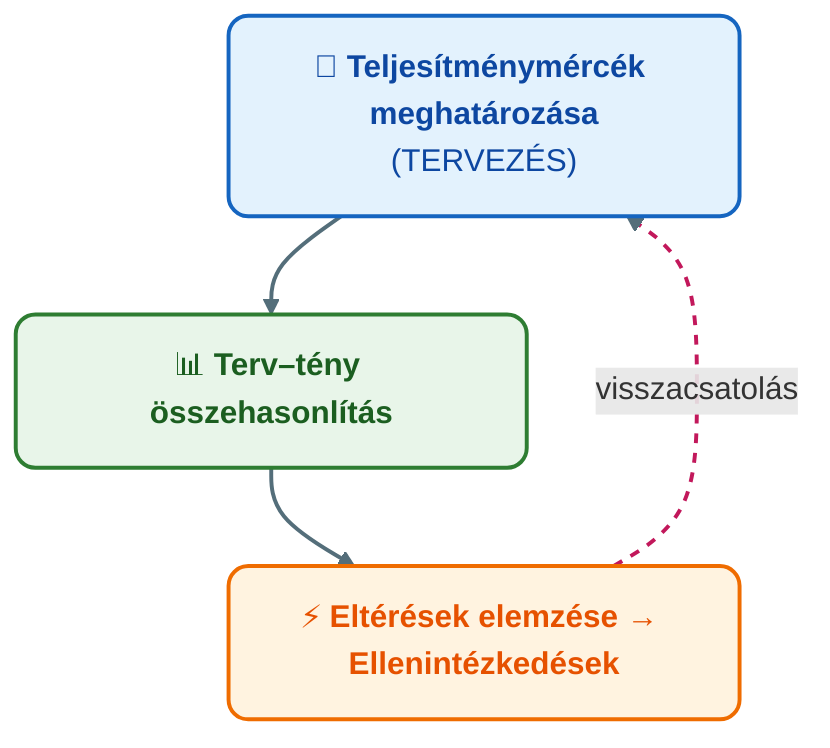

## K14 – A controlling szemléletmód és a controlling rendszer szerepe a vállalatirányításban

### Beszerzendő anyagok

| Szerző | Mű | Jelleg | Indoklás / érintett rész |
|---|---|---|---|
| — | GIXVS2MBLF syllabus / tantárgynyilvántartó adatlap | syllabus | A tárgy mappájában nincs; a heti tematika és a kötelező irodalom csak az 1. előadás 2. diájából rekonstruálható. |
| Francsovics A. | *Controlling – elmélet és módszertan* (Budapest, 2010) | kötelező irodalom | Az 1. előadás kötelező irodalomként nevezi meg; a controlling kettős értelmezése (R1–R2) erre épül, a mappában csak a 2011-es elektronikus jegyzet van. |

**Tétel:** A controlling szemléletmód és a controlling rendszer szerepe a vállalatirányításban. A controlling fogalma és szemléletmódja. A controlling feladatai és főbb területei. A controlling haszna a vállalati működésben.

---

### A controlling fogalma és kialakulása

A „to control" angol kifejezés szabályozást, irányítást jelent, nem elsődlegesen ellenőrzést (Francsovics, 2011). Az angolszász szakirodalom – és nyomában Dobák és munkatársai – a „menedzsment-kontroll" kifejezést a controlling szinonimájaként használja (Dobák, 1999, idézi Francsovics, 2011); Anthony stratégiai, menedzsment- és operatív kontroll szinteket különböztet meg (Anthony, 1993, idézi Francsovics, 2011).

A controlling az államháztartás kincstárnoki funkciójából fejlődött ki; vállalatvezetési funkcióként a 20. század első felében az USA-ban erősödött meg (1931: Controllers Institute of America), a kontinentális Európában az 1950–60-as években, Magyarországon 1990-től terjedt el (Francsovics, 2011).

A hazai gyakorlatban klasszikussá vált definíció szerint a controlling – funkcionális szempontból – **a vezetés alrendszere, amely a tervezést, az ellenőrzést és az információellátást koordinálja**; így teszi lehetővé, hogy a vezető célorientáltan, a környezeti változásokhoz igazodva irányítsa a vállalatot (Horváth & Dobák, 1990, idézi Francsovics, 2011). Ladó szerint a controlling tartalma röviden **nyereségmenedzsment**, úgy, hogy a vagyon, a pénzügyi helyzet és a nyereség kapcsolata állandóan szem előtt van (Ladó, 1992, idézi Francsovics, 2011). Francsovics kettős értelmezése: a controlling egyrészt **információmenedzsment szerinti vezetési funkció**, másrészt **a vállalati események tervezésére, ellenőrzésére, elemzésére és irányítására szolgáló vezetési eszköz** (Francsovics, 2011).

Az előadás további meghatározásai: a tervezés és a számvitel vezetési szempontú összekapcsolása; költség- és eredménymenedzsment. A definíciók közös vonása, hogy **a controlling mindenképpen a vezetés alrendszere**, koordinációs és integrációs feladatai pedig a költség- és eredménymenedzsmentre irányulnak. A controlling „divatos" fogalom, amelynek gyakran varázserőt tulajdonítanak – ilyen ereje nincs (Katona, 2022).

**A vezető és a controller feladatainak metszete.** A controller nem tervez, hanem összehangolja, segíti, értelmezi és konszolidálja a tervezést; a tervek tartalmáért a vezetés felel. A controller felelős a tényadatok gyűjtésének struktúrájáért (vezetői számvitel), legfontosabb feladata a beszámolórendszerben az eltérések felfedése és elemzése, az eltéréseket pedig a felelős vezetőkkel közösen vitatja meg (Katona, 2022). A szakirodalom hasonlata szerint a menedzser a felelősséget viselő kapitány, a controller a hajó kormányosa, akinek a „SIKER" (likviditás, profit, hatékonyság) nevű kikötőbe kell befuttatnia a hajót, és időben jeleznie a zátonyokat (Francsovics, 2011).

### A controlling szemléletmódja és iskolái

A fogalom meghatározása három súlypontot emel ki: a **célraorientáltságot**, a **szűk keresztmetszetek feloldását** és a **jövőre irányítottságot (feed-forward gondolkodást)** (Francsovics, 2011). Az előadás ezt hat orientációvá bontja (Horváth nyomán; Katona, 2022):

1. **Szűk keresztmetszet-orientáció** – az eredménypotenciálokra koncentrálás; a hatékonyság a szűk keresztmetszetek kiszűrésével növelhető.
2. **Jövőorientáció** – a vállalati adatbázis a múltról szól, a controlling a jövőre fókuszál; ennek lépcsői az éves terv (analitikai szint), a 3–5 éves középtávú terv (aggregált szint) és a stratégiai terv (felső szintű célok és akciók).
3. **Célorientáltság** – reális, elérhető célok megfogalmazása.
4. **Költségorientáltság** – a költségek mindig egy adott cél érdekében és jól definiálható helyeken merülnek fel.
5. **Döntésorientáltság** – jól előkészített döntésekkel a vezetést állandó versenyhelyzetben tartani; ez az alapja a controlling szabályozó funkciójának stratégiai és operatív szinten.
6. **Cselekvés-, eredmény- és megoldásorientáció** – nem elég a tények közlése, javaslat is kell.

**Controlling iskolák.** Az angolszász iskola a controllingot vezetési funkcióként értelmezi, a kontrollfolyamatot négy lépésben írja le (kívánt teljesítmény paraméterei – érzékelés és információtovábbítás – tény és standard összehasonlítása – visszacsatolás és korrekció), és a CFO alá, a pénzügyi vezetés részeként helyezi el. A német iskola üzemgazdasági alapú: a controlling a vezetés eszköze, amely a vezetési funkciókat támogatja. A magyar felfogásban a controlling célorientált vezetési funkció, koordináló és információszolgáltató rendszer, valamint a tervezés, ellenőrzés, elemzés és irányítás vezetési eszköze (Katona, 2022). A német iskola közvetlen célként az információs és a koordinációs célt jelöli meg, az angolszász a menedzsment-kontrollal azonosítja; a fejlődés iránya a vezetési eszköztől a vezetési funkció felé mutat (Francsovics, 2011).

### A controllingrendszer és szerepe a vállalatirányításban

A controlling nem egyetlen eszköz, hanem rendszer. Elemei: (1) a célképző folyamat kialakítása és működtetése (stratégiai és operatív tervezési és ellenőrzési rendszer); (2) részletes költség-, eredmény- és teljesítményelszámolási rendszer (vezetésorientált számvitel); (3) mutatószámrendszerek; (4) a vezetési szinteknek megfelelő beszámolási rendszer; (5) a controlling szempontjából releváns információkat szolgáltató vezetői információs rendszer (Francsovics, 2011). Működőképességének feltétele, hogy a célmeghatározás–tervezés, az ellenőrzés–elemzés és a beszámolás alrendszerei a megvalósítással és az irányítással összekapcsolt **szabályozási kör** teljes rendszerét alkossák, állandó visszacsatolással (Francsovics, 2011). A controlling előfeltétele egy decentralizált tervezési és ellenőrzési rendszer (Francsovics, 2011).

Az előadás Horváth & Partners rendszerábráját mutatja be: a stratégiából kiinduló irányítási rendszerben a controllingrendszer a **tervezési rendszer** (stratégiai, taktikai/üzleti, operatív) és az **információellátási rendszer** (vezetői számvitel, beszámolórendszer) között helyezkedik el, a működési folyamatokra, a szervezeti felépítésre és a számítástechnikai háttérre támaszkodva (Katona, 2022). A **controlling koncepció** négy eleme ugyanitt: a controlling elvek (számszerűsített és mérhető teljesítmények alapján történő irányítás, megszemélyesített felelősség, célmegállapodások, reagálás a tervtől való eltérésekre, a hatáskörrel rendelkezők intézkedési és előrejelzési kötelezettsége); a controlling feladatok (vezetői számvitel, tervezés, beszámolórendszer); a controlling szervezet (központi, üzletági és funkcionális controlling); valamint a controllingot támogató információs rendszerek (Katona, 2022).

A rendszer működésének alaplogikája a **controlling-szabályozókör**:

Alapelv: **az eltérés nem terhelő bizonyíték, hanem a meghozandó intézkedések kiindulópontja** (Katona, 2022). A vállalatirányításban betöltött szerepet Francsovics így foglalja össze: a közvetlen vezetési alrendszer és a controlling alrendszer a menedzsmentrendszer két tartópillére, amelyeket a vállalati célrendszer kapcsol egybe; a controlling alrendszer szabályozó funkciót valósít meg, átveszi a vezetés tervező, információellátó és ellenőrző funkcióit, a végrehajtó rendszerrel pedig a közvetlen vezetés köti össze (Francsovics, 2011).

### A controlling és a controller feladatai

**A controller küldetése (IGC, 2002, idézi Katona, 2022):** a controllerek alakítják és nyomon követik a célkitűzés, a tervezés és az irányítás vezetői folyamatait, és **osztoznak a célok elérésének felelősségében**; gondoskodnak a stratégia, az eredmény, a pénzügyek és a folyamatok átláthatóságáról. A controller minden döntéshozó belső gazdasági tanácsadója, aki navigátorként támogatja a célok megvalósulását (Katona, 2022).

**A controllerek öt fő feladata** (IGC, 2002, idézi Katona, 2022):

1. **A controlling folyamat menedzselése** – a célkitűzés, tervezés és irányítás folyamatának kialakítása és támogatása.
2. **Jövőbe tekintő koordináció** – a szervezet tudatosan foglalkozzon a jövővel: esélyek kihasználása, kockázatok kezelése.
3. **Célok összekapcsolása a szervezet minden szintjén** – a résztvevők céljainak és terveinek egységes egésszé integrálása.
4. **A controllingrendszerek fejlesztése és az adatminőség biztosítása** – a döntésekhez szükséges információk.
5. **A gazdasági racionalitás feltételeinek biztosítása** – a controller „a szervezet közgazdasági lelkiismerete".

**A controlleri szerepkör négy felelősségi köre** (Katona, 2021a): (a) **rendszerfelelősség** – a költség- és teljesítményszámítási, eredményszámítási és mutatószámrendszerek felépítése a felelősség, a befolyásolhatóság és a terv–tény összehasonlíthatóság elve szerint; (b) **tervezési felelősség** – működő, a munkatársak által értett tervezési rendszer, terv–várható–tény számítás, a stratégiai tervezési folyamat irányítása; (c) **irányelvek meghatározásának felelőssége** – előírások a költségterhelésre, a jelentések tartalmára és gyakoriságára, a tervezési sémákra, a befektetési kérelmekre és a belső elszámolóárakra; (d) **tanácsadási funkció** – a vezetés támogatása a terv–tény összehasonlításnál és a korrekciós intézkedések értékelésénél.

A controlling **folyamatmodellje tíz főfolyamatból áll**, köztük a stratégiai és az operatív tervezés, a költség- és eredményszámítás, a management reporting, a beruházási és projektcontrolling, a kockázatmenedzsment, a funkcionális controlling, valamint a partnering és döntéstámogatás (Katona, 2021a).

### A controlling főbb területei

A stratégiai és az operatív célmeghatározást meg kell különböztetni, ennek megfelelően a controlling **stratégiai és operatív controllingra** tagozódik (Francsovics, 2011).

| Terület | Tartalom a forrás szerint | Tipikus eszközök |
|---|---|---|
| Stratégiai controlling | A jövőbeli esélyek és kockázatok szisztematikus felismerése, a vállalati politika ehhez igazítása; a sikerpotenciálok elemzése; a stratégiai folyamatok koordinálása és információellátás (Francsovics, 2011; Katona, 2021b) | SWOT, GAP-elemzés, BCG-mátrix, BSC (Katona, 2021b) |
| Operatív controlling | A tervezéssel, az előirányzott és a tényleges értékek összehasonlításával a szokásos nyereség- és fizetőképességi előirányzat elérése (Francsovics, 2011) | Éves terv, terv–tény összehasonlítás, eltéréselemzés |
| Projektcontrolling | Előre definiált végtermékkel, céllal, idő- és erőforráskerettel jellemezhető projekt: ami projektkódot kap, és elsődleges-másodlagos költségei tervezhetők, mérhetők, elemezhetők; projektmenedzsment-iroda (PMO) (Katona, 2021a) | Projektkód, projektköltség-tervezés és -mérés, program- és portfóliómenedzsment |
| Funkcionális controlling | Egy-egy szakterület controllingja: beruházási, marketing-, termelési, pénzügyi, K+F-, személyügyi, logisztika-controlling (Katona, 2022; Francsovics, 2011) | A szakterület saját teljesítmény- és költségmutatói |

**A controlling szervezeti elhelyezése.** A controllingrendszerre ható tényezők: a környezet, a technológia, a szervezeti felépítés, a vállalati méret, a stratégia és a vállalati kultúra (Katona, 2021a). Francsovics külső (piaci, tudományos-technikai, társadalmi-gazdasági, kulturális környezet) és belső tényezőket (méret, profil, technológia, informatika, hagyományok, telephely, szervezeti felépítés) különböztet meg; a szervezetbe illesztés többnyire önálló egységgel történik, hüvelykujjszabályként 150–200 fős létszámra jut egy controlling-szakember, és a tipikus elhelyezés a **lineáris-törzskari** (központi controller a felső vezetés mellett, profitcenter-controllerek az egységeknél) vagy a **mátrix** szervezet (Francsovics, 2011).

A döntés kulcskérdése, hogy mely feladatokat végez a központ és melyeket a decentralizált controlling (Katona, 2021a). A **csak központi** controlling előnye, hogy minden folyamat és eszköz egy kézben van, rövid az egyeztetés; hátránya az operatív üzlettől való eltávolodás és az üzletági know-how korlátozott felhasználása – a decentralizált felelősség decentralizált controllingot feltételez. A **decentralizált** controlling közelebb kerül az operatív üzlethez és tehermentesíti a központot, de a koordináció többletráfordítást igényel, és szigetmegoldások, dupla munka veszélye fenyeget. A decentralizált egység háromféleképpen sorolható be: (1) az üzletági vezetés alá – magas elfogadottság és jó információhozzáférés, de hiányzó objektivitás és az összvállalati érdek háttérbe szorulása; (2) a központi controlling alá – egységes folyamatok és függetlenség, de a controller „a központ kémje", alacsony szolgáltatási haszon; (3) **dotted-line** megoldás – a kettő kompromisszuma, amely mindkét előnyt részben egyesíti, ára a folyamatos kettős konfliktus; Németországban ez a leggyakoribb (Katona, 2021a). Az elhelyezést leginkább az üzletágak jellemzői – a nyereségközpontok mérete és bonyolultsága – befolyásolják (Katona, 2021a). Francsovics szerint a központ a rendszerek kiépítéséért (eredményelszámolás, integrált terv–ellenőrzés, kockázatelemzés), a decentralizált controlling a végrehajtásért (budget-készítés, eltéréselemzés) felel (Francsovics, 2011).

**Controllertípusok és szerepváltozás.** A szakirodalom három controllertípust ismer (Francsovics, 2011):

| Típus | Jellemző | Környezet |
|---|---|---|
| Regisztrátor | Az eseményeket megbízhatóan rögzíti, az információkat rendszerezi, nyilvántartja | Stabil gazdasági környezet |
| Navigátor | Dinamikusan változó, bizonytalan feltételek között is eligazodik, tájékoztatja a vezetést | Változó környezet |
| Indikátor | Közvetlenül részt vesz és kezdeményez a problémamegoldásban, tanácsaival segíti a vezetést | Proaktív szerep |

Az előadás a controlling felfogásának változását a **hagyományos** és az **üzleti partner** szerep szembeállításával írja le: őrkutya helyett partner, csak operatív helyett stratégiai és operatív, igazgató helyett támogató, stabilizáló helyett „change agent", információt gyűjtő helyett információt megosztó, csak pénzügyi helyett nem csak pénzügyi mutatók (Katona, 2022). A controllerrel szemben magas szakmai és erkölcsi igényeket támasztanak (nyitott, piacorientált, stratégiai szemléletű, innovatív); a controlling team-munka (Francsovics, 2011).

### A controlling haszna a vállalati működésben

A controlling hasznáról akkor beszélhetünk, ha a haszon felülmúlja a kifejlesztési és bevezetési költségeket; hatását tanulási folyamatban, a vállalat minden területén fejti ki, és megvalósítása elkerülhetetlenül hatalmi kérdéseket is felvet (Francsovics, 2011). A controlling időszerű információt szolgáltat a piac és az értékesítés alakulásáról, a fedezeti hozzájárulásról, a költségek összetételéről és tervtől való eltéréséről, a rendelésállományról és tovagyűrűző hatásáról, a mérleg és eredménykimutatás elemzéséről, a fizetőképesség egyensúlyáról, valamint a befektetések és fejlesztések előrehaladásáról (Francsovics, 2011).

Witt és Witt empirikus összefoglalója a hasznokat négy csoportba sorolja (Witt & Witt, idézi Francsovics, 2011): (1) **transzparencia** (közvetett gazdaságosság: árkialakítás, make-or-buy információk, differenciált költséghely-számítás, költségterv) és „napi hasznok" (több megbeszélés a menedzsmenttel, folyamatos beszámolás); (2) **közvetlen gazdaságossági hatások** (csökkenő logisztikai és általános költségek, konkrét árképzési javaslatok, segítség a beruházási döntésekben, javuló likviditás); (3) a **munkahelyi légkör** változása (vezetők, munkatársak és a controller elégedettsége); (4) **új feladatok felismerése** (személyzeti, jogi, adózási, informatikai controlling, stratégiai gondolkodás).

A controlling bevezetésének szükségessége **nyolc kérdéssel** tesztelhető (Katona, 2022). Tudja-e a vezető pontosan, (1) mely termékek hozzák és melyek viszik a pénzt; (2) milyen hatást gyakorolnak az egyes intézkedések az eredményre; (3) mekkora eredményt ért el vállalatgazdasági szempontból, az adózás és a mérlegkészítés torzító hatása nélkül; (4) sikerül-e a tervezésben kihívó célokat kitűzni és az erőforrásokat ezekhez igazítani; (5) minden terv szerint halad-e, vagy elhagyták a kijelölt pályát; (6) időben kiderül-e, ha döntésre van szükség, és megteszik-e az intézkedéseket; (7) át tudja-e ültetni a stratégiát konkrét eredmény- és intézkedési tervekbe; (8) tisztában van-e azzal, mitől emelkednek folyamatosan az általános költségek? Ha ezekre nincs megbízható válasz, a vállalat controlling nélkül navigál.

### Összegzés

A controlling a vezetés koordináló alrendszere, nem önálló cél és nem varázsszer: a tervezés, az ellenőrzés és az információellátás összekapcsolásával teszi célorientálttá és jövőorientálttá a vállalatirányítást. Szemléletének magja a cél-, jövő- és szűk keresztmetszet-orientáció; rendszerének magja a terv–tény–eltérés–intézkedés szabályozókör; a controller a döntést hozó vezető navigátora és üzleti partnere. Haszna akkor igazolható, ha a transzparencia és a közvetlen gazdaságossági hatások meghaladják a rendszer kiépítésének költségét.

---

### Várható vizsgáztatói kérdések

1. **Miben különbözik a controlling az ellenőrzéstől és a számviteltől?** — A „to control" szabályozást, irányítást jelent, nem ellenőrzést; a controlling jövőorientált és döntés-előkészítő, míg a hagyományos számvitel múltbeli tényadatokat utólagos igazolásra rögzít, és a formális pontosságot a célszerűség elé helyezi (Francsovics, 2011). A controller nem ellenőr, hanem a vezető belső gazdasági tanácsadója (Katona, 2022).
2. **Mi a vezető és a controller feladatmegosztása a tervezésben?** — A controller nem tervez, hanem koordinálja, segíti és konszolidálja a tervezést; a tervek tartalmáért a vezetés felel; az eltéréseket a controller tárja fel, de a felelős vezetőkkel közösen vitatják meg az intézkedéseket (Katona, 2022). Az IGC küldetés szerint a célok elérésének felelősségében osztoznak (IGC, 2002, idézi Katona, 2022).
3. **Hogyan különbözik az angolszász és a német controlling-felfogás?** — Az angolszász iskola a controllingot vezetési funkcióként, a menedzsment-kontroll szinonimájaként kezeli és a CFO alá helyezi; a német iskola üzemgazdasági alapú, a controlling a vezetést támogató eszköz, közvetlen célja az információs és a koordinációs cél (Katona, 2022; Francsovics, 2011).
4. **Mikor célszerű decentralizálni a controllingot, és mi a dotted-line megoldás?** — Ha a felelősség decentralizált (nagy és bonyolult nyereségközpontok), a controlling is decentralizálandó; a dotted-line megoldásban a helyi controller szakmailag a központi controllinghoz, szervezetileg az üzletági vezetéshez tartozik – ez egyesíti a két tiszta megoldás előnyeit, de állandó kettős konfliktussal jár (Katona, 2021a).
5. **Hogyan igazolható a controlling haszna?** — Akkor, ha a haszon meghaladja a kifejlesztési és bevezetési költséget; Witt és Witt négy haszoncsoportot mutat ki: transzparencia, közvetlen gazdaságossági hatások, munkahelyi légkör, új feladatok felismerése (Francsovics, 2011). Gyakorlati teszt a nyolc kérdés (Katona, 2022).

---

## Irodalom

* Francsovics, A. (2011). *Controlling* [Elektronikus jegyzet]. Óbudai Egyetem, Keleti Károly Gazdasági Kar.
* Katona, F. (2021a). *CONTROLLING 8. előadás: A controlling helye a szervezetben* [Előadás-prezentáció]. Óbudai Egyetem, Keleti Károly Gazdasági Kar.
* Katona, F. (2021b). *CONTROLLING 9. előadás* [Előadás-prezentáció]. Óbudai Egyetem, Keleti Károly Gazdasági Kar.
* Katona, F. (2022). *CONTROLLING 1. előadás: A controlling fogalma, controlling koncepció, controllingrendszer, controlling feladata* [Előadás-prezentáció]. Óbudai Egyetem, Keleti Károly Gazdasági Kar.
