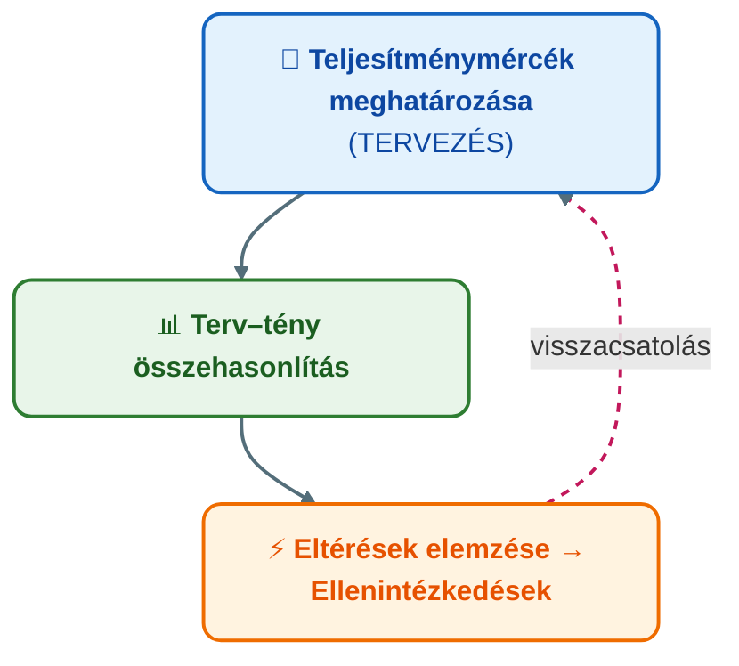

## K14 – A controlling szemléletmód és a controlling rendszer szerepe a vállalatirányításban

**Tétel:** Controlling szemléletmód és rendszer: A controlling szemléletmód és a controlling rendszer szerepe a vállalatirányításban. A controlling fogalma és szemléletmódja. A controlling feladatai és főbb területei. A controlling haszna a vállalati működésben.

---

### A controlling fogalma

A „to control" angol ige szabályozást, irányítást jelent – nem csupán ellenőrzést. A controlling a **tervezést, ellenőrzést és információellátást koordináló vezetési alrendszer** (Horváth–Dobák, 1990). Röviden: a controlling a vállalat nyereségmenedzsmentje, amely a vagyon, a likviditás és az eredmény kapcsolatát folyamatosan szem előtt tartja (Ladó, 1992).

A controlling **nem varázsszer**: nem old meg minden problémát, és nem helyettesíti a menedzseri döntést. A controller olyan révkalauz, aki navigál – de a felelős kapitány a vezető marad.

### A controlling szemléletmódja

A controlling szemlélet három alapelvben foglalható össze:

1. **Célorientáltság** – minden tevékenységet a vállalati célhoz mérünk.
2. **Jövőorientáltság (feed-forward)** – nem csak utólag konstatálunk, hanem előre jelzünk.
3. **Terv–tény összehasonlítás** – az eltérés nem bűnjel, hanem döntési kiindulópont.

### A controlling szabályozóköre

### A controller öt fő feladata (IGC, 2002)

1. **A controlling folyamat menedzselése** – célkitűzés, tervezés, irányítás koordinációja.
2. **Jövőbe tekintő koordináció** – esélyek kihasználása, kockázatok kezelése.
3. **Célok összekapcsolása a szervezet minden szintjén** – részcélok integrálása.
4. **Controlling rendszerek fejlesztése, adatminőség** – döntéstámogatáshoz szükséges információk.
5. **Gazdasági racionalitás biztosítása** – a szervezet közgazdasági lelkiismerete.

### A controlling főbb területei

| Terület | Időhorizont | Tipikus eszközök |
|---|---|---|
| Stratégiai controlling | 3–5+ év | BSC, stratégiai térkép, SWOT, GAP-elemzés |
| Operatív controlling | 1 év | Éves terv, terv–tény, eltéréselemzés |
| Projekt-controlling | Projekt ideje | Mérföldkövek, költségkontroll |
| Funkcionális controlling | Folyamatos | Logisztika-, marketing-, HR-controlling |

### A controlling szervezeti elhelyezése

A controller pozíciója a szervezeti hierarchiában meghatározza a függetlenségét és a befolyását (Horváth & Partners, 2008).

**Törzskari (staff) vs. vonalbeli (line) controlling.** Törzskariként a controller tanácsadó, nincs utasítási joga – ez megőrzi a függetlenségét, de gyengíti a befolyását. Vonalbeliként beépül a hierarchiába – erősebb befolyás, de a függetlensége sérülhet.

**Centralizált vs. decentralizált.** Centralizált controlling: egy központi szervezet egységes módszertant biztosít, de távolabb kerül a szakterületektől. Decentralizált controlling: helyi controllerek az egységeknél – nagyobb közelség, de módszertani szétszabdaltság kockázata. A gyakorlatban elterjedt a **dotted-line** (kettős alárendeltség): a helyi controller szakmailag a központi controllinghoz, szervezetileg az egységvezetőhöz tartozik.

**A controller–vezető viszony fejlődési fokozatai:**

| Fokozat | Szerep | Fókusz |
|---|---|---|
| Regisztráló | Adatszolgáltató | Visszatekintő riportok |
| Navigációs | Terv–tény + előrejelzés | Eltérések és trendek |
| Innovációs (business partner) | Döntéstámogató társszereplő | Üzleti modell, stratégia |

A modern felfogásban a controller **business partner**: nem „rendőr", hanem a vezető belső gazdasági tanácsadója – a „szervezet közgazdasági lelkiismerete" (IGC, 2002).

### A controlling haszna – 8 ellenőrző kérdés

A controlling bevezetésének szükségessége azzal tesztelhető, hogy a vezető tudja-e:
- Mely termékek hoznak, és melyek visznek el pénzt?
- Mekkora a valós vállalatgazdasági eredmény (adózás torzítása nélkül)?
- Minden terv szerint halad-e, és időben derül-e ki a döntési igény?
- Átültethető-e a stratégia konkrét eredmény- és intézkedési tervekbe?

Ha ezekre a kérdésekre nincs megbízható válasz, a vállalat **controlling nélkül navigál**.

> **Irodalom:** Horváth & Partners. (2008). *Controlling: Út egy hatékony controllingrendszerhez*. Complex Kiadó. — IGC. (2002). *Controller-Leitbild*. — Francsovics, A. (é. n.). *Controlling* [elektronikus tankönyv]. — Katona F.: CONTROLLING 1. ea. (2022); CONTROLLING 8. ea. (2021).

---
