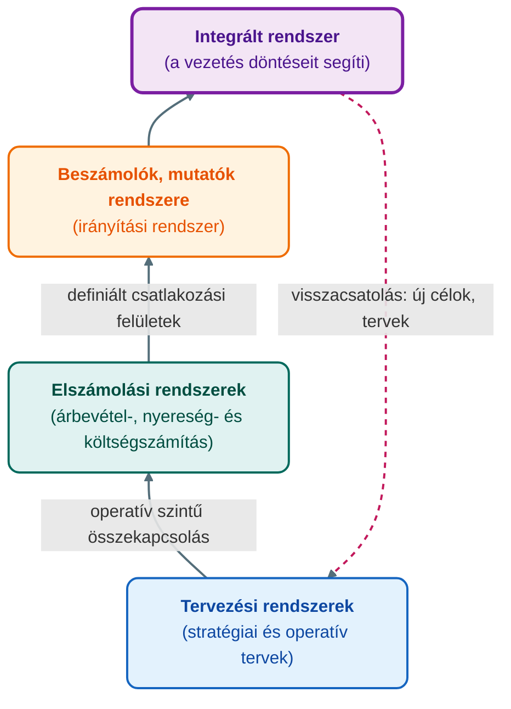
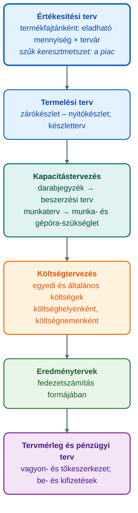

## K15 – A controlling információs rendszere és a vezetői információmenedzsment

### Beszerzendő anyagok

| Szerző | Mű | Jelleg | Indoklás / érintett rész |
|---|---|---|---|
| — | GIXVS2MBLF syllabus / tantárgynyilvántartó adatlap | syllabus | Nincs a mappában; a heti tematika és a hivatalos irodalomjegyzék csak az 1. előadás diájáról rekonstruálható. |
| Francsovics A. | Controlling – elmélet és módszertan (2010) | kötelező irodalom | Az 1. előadás kötelező irodalomként nevezi meg; a szabályozási kör és a kettős értelmezés (R2, R5) erre épül, helyben csak a 2011-es elektronikus jegyzet van. |
| Francsovics A. | Controlling integrált elmélete és gyakorlata (2013) | kötelező irodalom | Az 1. előadás kötelező irodalomként nevezi meg; az integrált információs rendszer (R2) frissebb kifejtése. |
| Horváth & Partners | Controlling – út egy hatékony controlling rendszerhez (2008) | ajánlott irodalom | Az 1. előadás controllingrendszer-ábrája és szemlélete innen származik, de csak képként; az R2 és R5 hivatkozásához kellene. |

**Tétel:** A controlling információs rendszere és a vezetői információmenedzsment. A controlling információs rendszer felépítése. Tervezési és beszámolási rendszer szerepe. Mutatószámok szerepe a controllingban. A controlling mint információmenedzsment rendszer.

---

### Fogalmi keret: a controlling mint információs rendszer

A controlling a tervezést, az ellenőrzést és az információellátást koordináló vezetési alrendszer, másként a tervezés és a számvitel vezetési szempontú összekapcsolása; a magyar felfogás öt eleme között egyszerre célorientált vezetési funkció, koordináló és információszolgáltató rendszer, a vezetési funkciók koordinációja, **információmenedzsment-funkció**, valamint a tervezés, ellenőrzés, elemzés és irányítás eszköze (Katona, 2022).

Francsovics ezt **kettős értelmezésként** rögzíti: a controlling egyrészt az információmenedzsment szerinti vezetési funkció, másrészt a vállalati események tervezésére, ellenőrzésére, elemzésére és irányítására szolgáló vezetési eszköz. A koordináció súlypontilag a tervezési, az ellenőrzési, a vezetői számviteli és az információs rendszerekre irányul; leegyszerűsítve a controlling a vállalatvezetést támogató koordináló és információszolgáltató rendszer (Francsovics, 2011, 9. o.).

A controlling legfontosabb információforrása a számvitel. A hagyományos számvitel azonban nem minden esetben szolgál controlling célokat: információi nem a szükséglethez igazodnak, a tényadatok rögzítése az utólagos igazolást és nem a döntés-előkészítést szolgálja, a formális pontosság elnyomja a célszerűséget, és a középpontban a költségszámítás áll az árbevétel helyett. A megoldás a **vezetésorientált (vezetői) számvitel**, amely a vezetésorientált költség- és teljesítményelszámolást, a gazdaságossági számításokat és a pénzügyi elszámolást foglalja magában (Francsovics, 2011, 13. o.). Az előadás szerint a vezetői számvitel a controllingfeladatok ellátásának alapvető eszköze (Katona, 2021a).

Az információs folyamat három lépése: a számviteli rendszer a bizonylatokból nyert adatokból indul ki; az adatokat **tömörítik és szervezeti egységekhez rendelik**; végül **döntés-előkészítő számítások** céljából értékelik. Az így előkészített információ a vállalat belső (döntési és megvalósítási) és külső (jogszabályi) információigényét egyaránt kielégíti (Katona, 2021a).

### A controlling információs rendszer felépítése

A controllingrendszer működőképességének feltétele, hogy a folyamat alrendszerei – célmeghatározás és tervezés, ellenőrzés és elemzés, beszámolás – a megvalósítással és az irányítással összekapcsolt **szabályozási kör** teljes rendszerét alkossák, állandó visszacsatolással. Az irányítás oldalán a céltervezési, a beszámolási és az elemzési rendszerek, a megvalósítás oldalán az erőforrás-tervezési és a diszpozíciós rendszerek állnak; a terv- és tényadatok összehasonlítása a vezetői számvitel révén válik irányítási információvá (Francsovics, 2011, 9–10. o.).

Az **információmenedzsment felépítését** Francsovics négy, egymásra épülő szintben adja meg. Az integrációt operatív szinten kell kezdeni a tervezési és az elszámolási rendszerek összekapcsolásával; az elszámolási rendszerek irányítási rendszerhez kapcsolása az adatszolgáltatás (árbevétel, nyereség- és költségszámítás) csatlakozási felületeinek pontos definiálását feltételezi; az irányítási rendszer a beszámolók, mutatók és mutatószámrendszerek rendszere; a modell a vezetés döntéseit segítő integrált rendszerben kapcsolódik össze (Francsovics, 2011, 103. o.).

Az információs rendszer kialakítása a vezetés információellátásának kritikájából indul ki. Horváth és Dobák nyomán a jellemző panaszok: nincs elég információ; túl későn érkezik; túl részletes és terjedelmes; a múltra irányul a jövő tendenciái helyett; csak számszerű adatokat tartalmaz, vagy éppen elmarad a számszerűsítés; és az egyes vezetési szintek egymásnak ellentmondó információt kapnak. Az információszükséglet függ a gazdasági környezettől, a vállalat szervezeti és jogi formájától, méretétől, profiljától, az információ fajtájától és ütemességétől, valamint a költség/haszon viszonytól; a szükségletet **interjútechnikával** mérik fel – a jegyzet nyomdaipari példájában a felső vezetők tizenegy kiemelt információt rendeltek címzettekhez napi, heti és havi gyakorisággal –, majd ehhez határozzák meg az információtechnológiát úgy, hogy a beszámolók és a mutatószámrendszerek a vállalkozás céljait szolgálják (Francsovics, 2011, 104–105. o.).

### A tervezési rendszer szerepe

Az éves tervezés a vezetői számvitel információira alapozva dolgozza ki az egyes vállalati egységek konkrét céljait – teljesítmény, költség és bevétel formájában, számszerűen –, hátterét a stratégiai és a többéves üzleti tervezés adja; az egyedi tervek összességéből adódik a következő időszak tervezett eredménye (Katona, 2021b).

A tervezést mindig azzal a területtel kell kezdeni, amely az előrejelezhetőség szempontjából a **szűk keresztmetszet**; ez rendszerint a piac, ezért a tervezés az értékesítési tervvel indul (Katona, 2021b) – Francsovics szerint is a hazai gyakorlatban az értékesítési piac a szűk keresztmetszet, és az értékesítési terv a mennyiségi és az árterv szorzata (Francsovics, 2011, 71. o.).

A termelendő mennyiség a tervezett zárókészlet és a tényleges nyitókészlet különbsége; a termelési programot a kapacitástervezés darabjegyzékek (beszerzési terv) és munkatervek (munka- és gépóra-szükséglet) mentén bontja fel, a kapacitáshiány vagy -többlet pedig beruházási és HR-feladatokat, végső esetben áttervezést alapoz meg. A termelési terv a költségtervezés kiindulópontja: külön tervezik az egyedi és az általános költségeket, utóbbiakat költséghelyenként, előbb az elsődleges, majd a belső teljesítményelszámolás révén a másodlagos költségeket. Az összes részterv után készül az eredményterv, gyakran fedezetszámítás formájában; a vagyon- és tőkeszerkezetre gyakorolt hatást a tervmérleg, a pénzmozgásokat a pénzügyi terv mutatja (Katona, 2021b).

A **kerettervezés** (budget) a tervezési rendszer formalizált, pénzértékben kifejezett céljait tartalmazza, szemben az akciótervezés szakmai céljaival. Folyamata: a vezetés a stratégiát sarokszámokká fordítja; a divíziók ezek alapján készítik terveiket, előbb mennyiségben, majd értékben; a controlling összehangolja és eredménytervvé ötvözi őket; a koordináció eszköze a **tervezési naptár**; a keretek betartása a keretellenőrzés, azaz a beszámolás tárgya, amely az eltérések okait és jelentőségét is feltárja (Katona, 2021b). A controller nem tervez, hanem összehangolja, segíti, értelmezi és konszolidálja a tervezést; a tervek tartalmáért a vezetés felel (Katona, 2022).

A nehezen mérhető outputú, nagyrészt fix általános költségű költséghelyek (igazgatás, K+F, minőségbiztosítás) kerettervezését az általános költségek értékelemzése (ÁÉE) és a **nulla bázisú tervezés (ZBB)** segíti; utóbbinál az általános költségeket a tevékenységek nulláról induló megtervezéséből vezetik le, nem az előző évi érték százalékos módosításával. A ZBB hat lépése: a költségterület és a célok kijelölése; döntési egységek képzése; teljesítményszínvonalak meghatározása; alternatívák rangsorolása és döntés; megvalósítás; ellenőrzés. Az általános költségek jellemzően 7–14%-kal csökkenthetők (Katona, 2021b).

A kerettervezés kritikája, hogy a vezetők munkaidejének 15–20%-át és a controller kapacitásának felét köti le, miközben nem igazodik a stratégiához, mereven az időszak végéig szól, a tervek gyorsan elértéktelenednek, és hiányoznak az előretekintő, nem pénzügyi mutatók. Három válasz született: a **better budgeting** evolúciós úton egyszerűsíti a kerettervezést; a **beyond budgeting** keretek nélküli irányítást javasol, a kerettervezést balanced scorecard, folyamatorientált teljesítménymérés, benchmarking és gördülő tervezés váltja ki, relatív célokkal és decentralizált döntésekkel; az **advanced budgeting** globális kereteket, gördülő időtávot, a stratégiai tervezés integrálását és benchmarking-alapú relatív célokat ajánl (Katona, 2021b).

### A beszámolási rendszer szerepe

A beszámolási controllingmodul célja, hogy a vállalat valamennyi vezetési szintjét szabványosított, egységes és a döntés szempontjából lényeges információval lássa el; az információ akkor megfelelő, ha a tervezést és az ellenőrzést kielégítően támogatja. A beszámolórendszer három követelménye: **szignalizáló hatású** legyen, vagyis impulzust adjon a helyes döntésekhez; rendszerezetté tegye a belső kommunikációt; egységes felépítésével teremtse meg a controlling kommunikációs csatornáit. Az elvek átültetése négy jellemző mentén történik: a beszámolórendszer strukturális felépítése, az egyes beszámolók alakja, tartalma, valamint címzettjei és periodicitása (Francsovics, 2011, 106. o.).

A tervezett beszámolófajták: likviditási beszámoló; mérleg- és eredménybeszámoló; terv–tény költségfelhasználás és eltéréselemzés; beruházási beszámoló. A likviditás legalább olyan fontos, mint a nyereség – a jegyzet szerint egy angol statisztikában a likviditási gondok miatt tönkrement vállalkozások 60%-a nyereséges volt –, ezért a likviditási terv és beszámoló azonos tartalmú, havi, heti vagy napi bontású. A **terv–tény összehasonlítás a controlling központi művelete**: az eltéréseket abszolút és relatív értékben, vállalati szintről területekre és költséghelyekre bontva számítják; az elemzés feltárja az okot (például a fejlődés helytelen becslése vagy pontatlan adatok), és indokolt esetben új célt fogalmaz meg (Francsovics, 2011, 106–117. o.).

Az előadás ugyanezt a controlling-szabályozókörként mutatja be: teljesítménymércék meghatározása → terv–tény összehasonlítás → az eltérések korrigálása. Alapelv, hogy **az eltérés nem terhelő bizonyíték, hanem a meghozandó intézkedések kiindulópontja**; a controller legfontosabb feladata a beszámolórendszerben az eltérések felfedése és elemzése, amelyeket a felelős vezetőkkel közösen vitat meg (Katona, 2022). A controlling tíz főfolyamata között önálló a management reporting és a forecast, és a reportingnak saját teljesítménymutatói vannak, például a riport költsége, az adatminőség és az átfutási idő (Katona, 2021c, 6., 26. dia).

### Mutatószámok szerepe a controllingban

A mutatók és mutatószámrendszerek fontos vezetési eszközök, a beszámolók szerves részei; elsődleges szerepük a tervezés, az irányítás és az ellenőrzés támogatása és az eltéréselemzés. Hármas szerepük: a tervezés, irányítás és ellenőrzés segédeszközei; a vállalati, ágazati és nemzetgazdasági összehasonlítás eszközei; a menedzsmentinformációk szerves alkotórészei. Kialakításuk négy szempontja: mérhetőség; azonos időhorizont a terv–tény összehasonlításnál; kontinuitás; költség/haszon vizsgálat az információbővítésnél (Francsovics, 2011, 117–118. o.).

A legismertebb **mutatószámrendszer az ROI-fa**: a befektetett tőke megtérülése (Return on Investment) az árbevételarányos nyereség és a tőke forgási sebességének szorzata; az előbbi a jövedelmezőségi és költségstruktúrát (fedezet, fix és változó költség), az utóbbi a vagyonösszetételt (befektetett és forgóeszközök) bontja tovább (Francsovics, 2011, 120. o.). Az ROI mérése történetileg a DuPont Powder Company diverzifikált szervezetéhez kötődik, és a General Motorsnál fejlesztették tovább (Francsovics, 2011, 20–21. o.).

| Mutató | Képlet | Tartalom |
|---|---|---|
| ROI | árbevételarányos nyereség × tőke forgási sebessége | a befektetett tőke megtérülése |
| Árbevételarányos nyereség | nyereség / árbevétel | jövedelmezőségi és költségstruktúra |
| Tőke forgási sebessége | árbevétel / tőke (befektetett + forgóeszközök) | vagyonösszetétel, tőkehatékonyság |
| Likviditási mutató I. | (pénzeszközök + követelések + rövid lejáratú értékpapírok) / rövid lejáratú kötelezettségek | fizetőképesség; 1 fölött kedvező |
| Likviditási mutató II. | (pénzeszközök + követelések + rövid lej. értékpapírok + készletek) / rövid lejáratú kötelezettségek | fizetőképesség készletekkel |
| Árbevételarányos jövedelmezőség | adózás előtti eredmény / bevétel összesen × 100 | egységnyi bevétel eredménye |

(Francsovics, 2011, 116–117., 120. o.)

A mérlegből és eredménykimutatásból vagyoni, pénzügyi és jövedelmezőségi mutatók képezhetők (Francsovics, 2011, 110–117. o.); a jegyzet bemutat egy német kis- és középvállalati, Preißler kutatásain alapuló rendszert is, amely jövedelmezőségi, termelékenységi, valamint finanszírozási és likviditási csoportból áll, és minden mutatóhoz megadja a számítás gyakoriságát (Francsovics, 2011, 118–124. o.).

A controlling felfogásának változásával a tisztán pénzügyi mutatók helyét a **nem csak pénzügyi mutatók** veszik át (Katona, 2022). A kiegyensúlyozott mutatószámrendszer (BSC) abból indul ki, hogy a vállalat mint komplex rendszer csak sokféle mutatóval követhető: a pénzügyi, a piaci, a működési és a tanulási képesség nézőpontjából írja le az állapotot, és azt a stratégiai célokhoz méri (Katona, 2021d). A controller rendszerfelelőssége kiterjed az input-, output-, folyamat-, gazdaságossági és hatékonysági jelzőszámrendszerekre (Katona, 2021c, 3. dia); Francsovics empirikus megállapítása szerint a controlling mint információforrás a reálfolyamatokra, természetes mértékegységben is kiterjed (Francsovics, 2011, 156. o.).

### A controlling mint információmenedzsment rendszer

A német iskola a controlling közvetlen célját információs célként jelöli meg, és minden szerzőnél megjelenik a koordinációs cél is; az angolszász iskola a controllingot vezetési funkcióként, a menedzsmentkontroll szinonimájaként értelmezi. A controlling alrendszer szabályozó funkciót valósít meg: átveszi a vezetés tervező, információellátó és ellenőrző funkcióit; fejlődésének sajátossága, hogy fő funkcióját a koordináció és az információs rendszer jelenti (Francsovics, 2011, 153–155. o.). Az empirikus vizsgálatok szerint a controllingeszközök alkalmazása a jelentéskészítésben és a visszacsatolásban az átlagosnál jobb, a mutatószámok felépítésében jó, a stratégiai tervezésben a leggyengébb; az alkalmazott információs rendszerek a controllingrendszer információinak hordozói (Francsovics, 2011, 156. o.).

A controller ebben a rendszerben **információs menedzser, révkalauz**: az IGC (2002) küldetésnyilatkozata szerint a controllerek gondoskodnak a stratégia, az eredmény, a pénzügyek és a folyamatok átláthatóságáról; összehangolják a részterveket, és az egész vállalatra megszervezik a jövőorientált, időszakos beszámolórendszert; biztosítják az ehhez szükséges adat- és információszolgáltatást; alakítják és gondozzák a controllingrendszereket. Az öt fő feladat közül a negyedik kifejezetten a controllingrendszerek fejlesztése és az adatminőség biztosítása; a controller minden döntéshozó belső gazdasági tanácsadója és navigátora, akitől a vezetői számvitel mellett a vezetői információs rendszerek ismeretét is elvárják (Katona, 2022).

A controlleri szerepkör négy felelősségi körbe rendezhető. A **rendszerfelelősség** a költség- és teljesítményszámítási rendszer felépítése a terv–tény összehasonlíthatóság figyelembevételével, a mutatószámrendszerek, továbbá az ezeket támogató számítástechnikai rendszerek kiválasztása és a vezetők oktatása. A **tervezési felelősség** a terv-, várható- és tényszámítás, a szimulációs modellek és egy gyors reagálású jelzőrendszer működtetése. Az **irányelvek meghatározása** körébe tartozik a költségterhelés előírásainak, az elszámolóáraknak, valamint a jelentések tartalmának és gyakoriságának rögzítése. A **tanácsadási funkció** a vezetés támogatása a terv–tény összehasonlításoknál és a korrekciós intézkedések értékelésénél (Katona, 2021c, 3–5. dia).

A felfogás változása az információmenedzsment oldaláról is megragadható: a hagyományos „őrkutya” információt gyűjt és a felső vezetésnek szolgáltat belső adatokból és pénzügyi mutatókból; az üzleti partner szerepű controlling információt oszt meg, mindenkinek szolgáltat, piac- és folyamatorientált, és nem csak pénzügyi mutatókkal dolgozik (Katona, 2022).

**Összegzés.** A controlling információs rendszere a tervezési, az elszámolási és a beszámolási-mutatószám rendszerek integrációja, amelyet a vezetői számvitel táplál adatokkal és a szabályozási kör visszacsatolása tart mozgásban: a tervezés számszerűsíti a célokat, a beszámolás a terv–tény eltérésekkel szignalizál, a mutatószámok tömörítik és összehasonlíthatóvá teszik az információt. Mindezt a controller mint információs menedzser működteti – ezért információmenedzsment szerinti vezetési funkció a controlling.

---

### Várható vizsgáztatói kérdések

1. **Mit jelent a controlling kettős értelmezése, és melyik oldal felel meg a tétel címének?** — Francsovics szerint a controlling egyrészt az információmenedzsment szerinti vezetési funkció, másrészt a vállalati események tervezésére, ellenőrzésére, elemzésére és irányítására szolgáló vezetési eszköz (Francsovics, 2011, 9., 154. o.). A tétel az első oldalt bontja ki; a német iskola ezt információs célként, az angolszász iskola vezetési funkcióként ragadja meg.
2. **Miért az értékesítési tervvel kezdődik az éves tervezés?** — Mert a tervezést mindig az előrejelezhetőség szempontjából szűk keresztmetszetet jelentő területtel kell kezdeni, és ez a vállalatok számára rendszerint a piac; az értékesítési terv a termelési terv legfontosabb kiinduló alapja, a termelési terv pedig a költségtervezésé (Katona, 2021b; Francsovics, 2011, 71. o.).
3. **Milyen követelményeknek kell megfelelnie egy controlling-beszámolónak?** — Szignalizáló hatású legyen, rendszerezze a belső kommunikációt, és egységes felépítésével teremtse meg a controlling kommunikációs csatornáit; a gyakorlatban a struktúra, az alak, a tartalom, valamint a címzettek és a periodicitás szerint tervezik (Francsovics, 2011, 106. o.).
4. **Hogyan bontható fel az ROI, és mire jó ez a controllingban?** — ROI = árbevételarányos nyereség × tőke forgási sebessége; az első a nyereség/árbevétel, a második az árbevétel/tőke hányados, amelyek tovább bonthatók fedezetre, fix és változó költségre, befektetett és forgóeszközökre. A mutatószámfa így megmutatja, melyik tényezőn keresztül javítható a megtérülés, és a mutatók a tervezés, irányítás és ellenőrzés segédeszközeiként, az eltéréselemzés alapjaként szolgálnak (Francsovics, 2011, 117., 120. o.).
5. **Mi a kerettervezés fő kritikája, és mit kínál helyette a beyond budgeting?** — A kerettervezés sok erőforrást köt le, nem igazodik a stratégiához, merev az időszakhoz, a tervek gyorsan elértéktelenednek és hiányoznak a nem pénzügyi mutatók; a beyond budgeting keretek nélküli irányítást javasol relatív célokkal, decentralizálással, BSC-vel, folyamatorientált teljesítményméréssel, benchmarkinggal és gördülő tervezéssel, míg a better és az advanced budgeting a meglévő rendszer javítását célozza (Katona, 2021b).
6. **Mi a controller legfontosabb feladata a beszámolórendszerben, és milyen alapelv vezérli?** — Az eltérések felfedése és elemzése, majd megbeszélése a felelős vezetőkkel; az alapelv, hogy az eltérés nem terhelő bizonyíték, hanem a meghozandó intézkedések kiindulópontja (Katona, 2022; Francsovics, 2011, 117. o.).

---

## Irodalom

* Francsovics, A. (2011). *Controlling* [Elektronikus jegyzet]. Óbudai Egyetem, Keleti Károly Gazdasági Kar.
* Katona, F. (2021a). *Controlling 2. előadás: Vezetői számvitel, költségszámítás* [Előadás-prezentáció]. Óbudai Egyetem, Keleti Károly Gazdasági Kar.
* Katona, F. (2021b). *Controlling 7. előadás: Éves tervezés* [Előadás-prezentáció]. Óbudai Egyetem, Keleti Károly Gazdasági Kar.
* Katona, F. (2021c). *Controlling 8. előadás: A controlling helye a szervezetben* [Előadás-prezentáció]. Óbudai Egyetem, Keleti Károly Gazdasági Kar.
* Katona, F. (2021d). *Controlling 9. előadás: Stratégiai menedzsment, stratégiai controlling* [Előadás-prezentáció]. Óbudai Egyetem, Keleti Károly Gazdasági Kar.
* Katona, F. (2022). *Controlling 1. előadás: A controlling fogalma, controlling koncepció, controllingrendszer, controlling feladata* [Előadás-prezentáció]. Óbudai Egyetem, Keleti Károly Gazdasági Kar.
