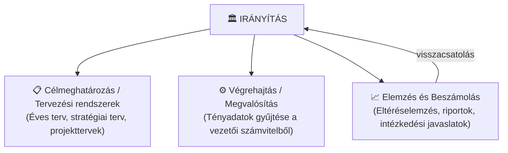
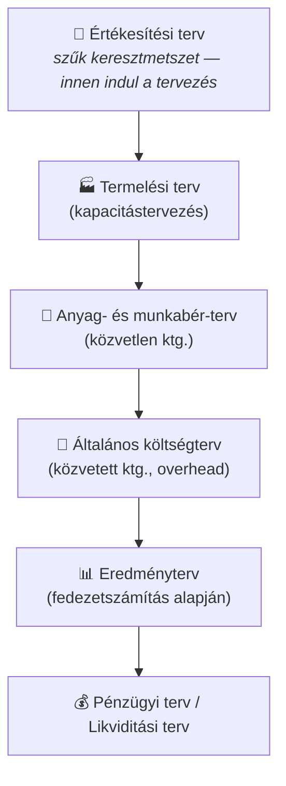

## K15 – A controlling információs rendszere és a vezetői információmenedzsment

### A controlling információs rendszer felépítése

A controlling egy **zárt szabályozási körként** működő információs rendszer. Három alrendszer kapcsolódik össze benne:

A controller feladata: **nem maga tervez**, hanem összefoglalja, konszolidálja és értelmezi a terveket, majd a tényadatokkal szembesíti azokat.

### Tervezési rendszer

Az operatív tervezés menete (7. ea., Katona):

A tervezés **szűk keresztmetszettől indul**: az esetek nagy részében a piac (értékesíthetőség) a korlát, ezért az értékesítési terv az egész tervezési ciklus alapja.

### Beszámolási rendszer

A controlling-riport alapjellemzői:
- **Rendszeresség** – havi, negyedéves, éves zárás
- **Eltérésfókusz** – nem az abszolút számok, hanem a terv–tény különbség és annak oka fontos
- **Akcióorientáltság** – a riport ne csak leírjon, hanem döntési javaslatot is tartalmazzon

### Mutatószámok szerepe

A controlling leggyakoribb mutatószámai két csoportba sorolhatók:

**Pénzügyi mutatók:**

| Mutató | Képlet | Tartalom |
|---|---|---|
| ROI (befektetés-arányos megtérülés) | Nyereség / Befektetett tőke | Tőkehatékonyság |
| ROS (értékesítés-arányos ny.) | Nyereség / Árbevétel | Profitmarzs |
| Tőkeáttétel | Árbevétel / Befektetett tőke | Eszközforgás |
| Likviditás (I. fokozat) | Likvid eszközök / Rövid lej. köt. | Fizetőképesség |

A **Du Pont-rendszer** ezeket hierarchikusan kapcsolja össze: az ROI = ROS × Tőkeáttétel összefüggéssel dekomponálható az eredményre ható tényezők hatása.

**Nem pénzügyi mutatók** (a BSC előzményei):
- Vevőelégedettségi index, reklamációs ráta
- Átfutási idő, készletforgás
- Munkatársi elégedettség, fluktuáció

### A controller mint információmenedzser

A controller legfontosabb tulajdonsága: **az eltéréseket felfedi, értelmezi és megbeszéli** a felelős vezetőkkel. Nem ítél – a terv-tény eltérés nem terhelő bizonyíték, hanem döntési kiindulópont.

> **Irodalom:** Katona F.: CONTROLLING 1., 2., 7., 8. ea.; Francsovics A.: Controlling, 5. fejezet; Kaplan–Atkinson: Vezetői üzleti gazdaságtan (2003)

---