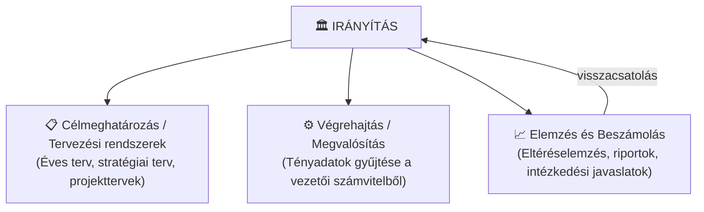
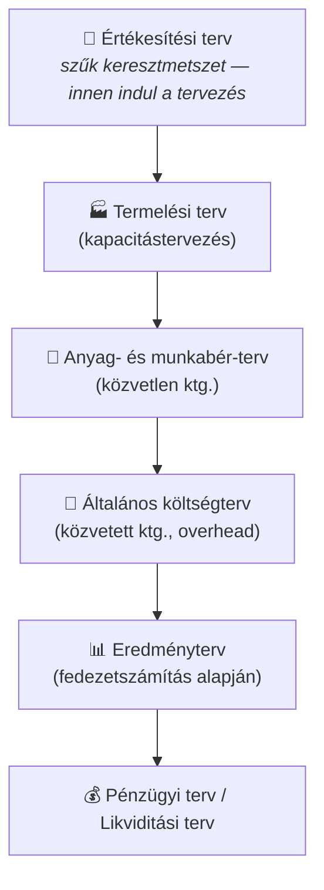

## K15 – A controlling információs rendszere és a vezetői információmenedzsment

### A controlling információs rendszer felépítése

A controlling egy **zárt szabályozási körként** működő információs rendszer. Három alrendszer kapcsolódik össze benne:

A controller feladata: **nem maga tervez**, hanem összefoglalja, konszolidálja és értelmezi a terveket, majd a tényadatokkal szembesíti azokat.

### Vezetői számvitel vs. pénzügyi számvitel

A controlling információs alapja a **vezetői számvitel (management accounting)**, amely lényegesen eltér a kötelező pénzügyi számviteltől (Drury, 2018; Kaplan & Atkinson, 2003):

| Szempont | Pénzügyi számvitel | Vezetői számvitel |
|---|---|---|
| Célközönség | Külső (tulajdonos, állam, hitelező) | Belső (vezetés) |
| Szabályozottság | Számviteli törvény, IFRS | Szabadon kialakítható |
| Időorientáció | Múlt (lezárt időszak) | Múlt + jelen + jövő (terv) |
| Tárgya | A vállalat egésze | Szegmensek, költséghelyek, termékek |
| Fókusz | Pontosság (auditálható) | Relevancia és gyorsaság |
| Periodicitás | Éves/negyedéves, kötött | Igény szerinti (havi, heti, ad hoc) |

### A VIM három funkciója

A **Vezetői Információs Rendszer (VIM / VIR)** három feladatot lát el:

1. **Adatgyűjtés és -tárolás** – az alapbizonylatokból és az operatív rendszerekből.
2. **Adattömörítés és szervezeti egységekhez rendelés** – aggregálás költséghelyekre és felelősségi egységekre.
3. **Döntés-előkészítő számítások** – terv–tény összehasonlítás, eltéréselemzés, előrejelzés.

A modern VIM technológiai megvalósítása az ERP-rendszer controlling modulja (pl. SAP CO).

### Tervezési rendszer

Az operatív tervezés menete (Katona F., 7. ea.):

A tervezés **szűk keresztmetszettől indul**: az esetek nagy részében a piac (értékesíthetőség) a korlát, ezért az értékesítési terv az egész tervezési ciklus alapja.

**Tervezési megközelítések.** A klasszikus bázisalapú tervezés mellett elterjedt a **nulla bázisú tervezés (ZBB)**, amelynél minden költséget nulláról kell újra igazolni (Pyhrr, 1970); a **gördülő előrejelzés (rolling forecast)**, amely a horizontot folyamatosan görgeti; és a **Beyond Budgeting** (Hope & Fraser, 2003), amely a fix éves költségvetés helyett adaptív, relatív célokat javasol. Mindhárom megközelítés az éves tervezési ciklus merevségére reagál – más-más kompromisszummal a pontosság és a rugalmasság között.

### Beszámolási rendszer

A controlling-riport alapjellemzői:
- **Rendszeresség** – havi, negyedéves, éves zárás
- **Eltérésfókusz** – nem az abszolút számok, hanem a terv–tény különbség és annak oka fontos
- **Akcióorientáltság** – a riport ne csak leírjon, hanem döntési javaslatot is tartalmazzon

### Mutatószámok szerepe

A controlling leggyakoribb mutatószámai két csoportba sorolhatók:

**Pénzügyi mutatók:**

| Mutató | Képlet | Tartalom |
|---|---|---|
| ROI (befektetés-arányos megtérülés) | Nyereség / Befektetett tőke | Tőkehatékonyság |
| ROS (értékesítés-arányos ny.) | Nyereség / Árbevétel | Profitmarzs |
| Tőkeáttétel | Árbevétel / Befektetett tőke | Eszközforgás |
| Likviditás (I. fokozat) | Likvid eszközök / Rövid lej. köt. | Fizetőképesség |

A **Du Pont-rendszer** ezeket hierarchikusan kapcsolja össze: az ROI = ROS × Tőkeáttétel összefüggéssel dekomponálható az eredményre ható tényezők hatása.

**Nem pénzügyi mutatók** (a BSC előzményei):
- Vevőelégedettségi index, reklamációs ráta
- Átfutási idő, készletforgás
- Munkatársi elégedettség, fluktuáció

### A controller mint információmenedzser

A controller legfontosabb tulajdonsága: **az eltéréseket felfedi, értelmezi és megbeszéli** a felelős vezetőkkel. Nem ítél – a terv-tény eltérés nem terhelő bizonyíték, hanem döntési kiindulópont.

> **Irodalom:** Drury, C. (2018). *Management and cost accounting* (10th ed.). Cengage Learning. — Hope, J., & Fraser, R. (2003). *Beyond budgeting*. Harvard Business School Press. — Kaplan, R. S., & Atkinson, A. A. (2003). *Vezetői üzleti gazdaságtan*. Panem. — Pyhrr, P. A. (1970). Zero-base budgeting. *Harvard Business Review, 48*(6), 111–121. — Francsovics, A. (é. n.). *Controlling* [elektronikus tankönyv]. — Katona F.: CONTROLLING 1., 2., 7., 8. ea.

---