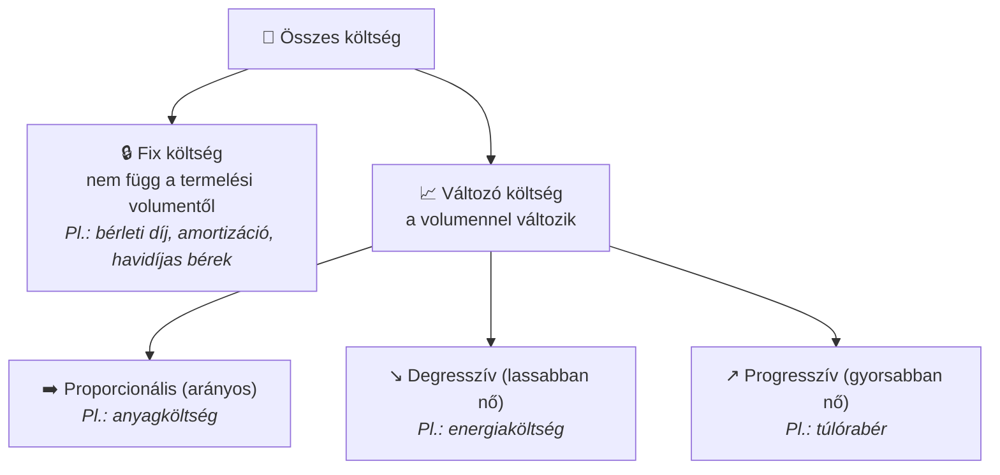

## K16 – A költségszámítás szerepe a controllingban

### A költség fogalma és különbsége a kiadástól

**Kiadás**: pénzeszköz tényleges kiáramlása (pl. gépvásárlás teljes vételára egy összegben).  
**Költség**: az adott időszakban felhasznált erőforrás értéke (pl. a gép éves értékcsökkenése).

A controlling a **gazdasági tartalmat**, nem a pénzmozgást figyeli. Ezért a számviteli eredmény és a controlling-eredmény eltérhet.

### A költségek csoportosítása

**1. Volumenhez való viszony szerint:**

**2. Elszámolhatóság szerint:**

| Típus | Jellemző | Példa |
|---|---|---|
| Közvetlen (primer) | Termékre közvetlenül ráterhelható | Alapanyag, közvetlen bér |
| Közvetett (overhead) | Csak felosztással rendelhető termékhez | Gyártási rezsi, admini ktg. |

**3. A háromszintű elszámolási rendszer:**

### A modern költség- és teljesítményelszámolás céljai

A hagyományos (pénzügyi) számvitel **külső** érdekeltek (adóhatóság, befektetők) számára készül. A **Management Accounting** (vezetői számvitel / vezetésorientált számvitel) **belső** döntéstámogatásra:

- Döntésorientált: az adott döntéshez szükséges releváns költség kiemelése
- Időszerű: gyors, akár heti adatszolgáltatás
- Rugalmas: különböző nézőpontokból elemezhető (termék, vevő, régió)

### A költségelszámolás rendszerei

| Rendszer | Alapelv | Előny | Korlát |
|---|---|---|---|
| Teljesköltség-számítás | Minden ktg. ráterhelése a termékre | Teljes önköltség látható | Fix ktg. felosztása torzíthat |
| Részköltség-számítás (Direct costing) | Csak változó ktg. + fedezet | Döntéstámogatáshoz jobb | Nem mutatja a teljes önköltséget |
| Tervköltség-számítás | Előzetesen tervezett ktg. + eltéréselemzés | Ellenőrzési funkció | Merev vs. rugalmas változat |
| ABC (Activity-Based Costing) | Tevékenységekhez rendeli az overheadet | Pontosabb overhead-felosztás | Adatigényes |

> **Irodalom:** Katona F.: CONTROLLING 2., 4. ea.; Francsovics A.: Controlling, 2. fejezet; Kaplan–Cooper: Költség & Hatás (2001); Drury, C.: Management Accounting for Business

---