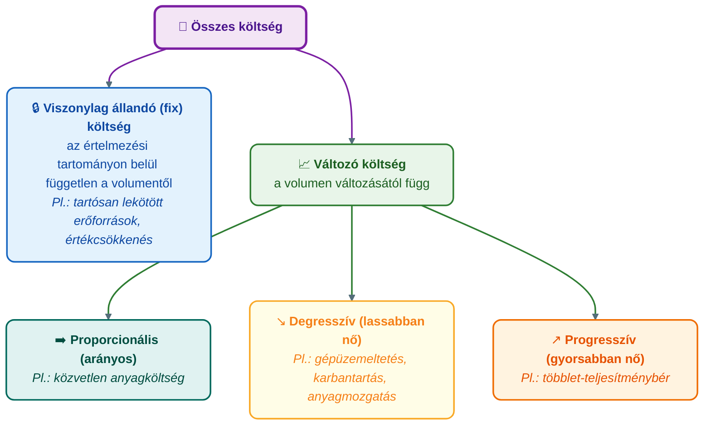
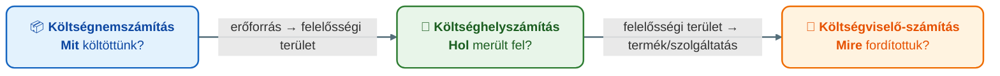

## K16 – A költségszámítás szerepe a controllingban

### Beszerzendő anyagok

| Szerző | Mű | Jelleg | Indoklás / érintett rész |
|---|---|---|---|
| — | GIXVS2MBLF syllabus / tantárgynyilvántartó adatlap | syllabus | A tárgy mappájában nincs; a heti tematika és a kötelező irodalom csak az 1. előadás 2. diájából rekonstruálható. |
| Francsovics A. | *Controlling – elmélet és módszertan* (Budapest, 2010) | kötelező irodalom | Az 1. előadás kötelező irodalomként nevezi meg; a költségfogalmak és a költségszámítás rendszerei (R2–R3, R6) a helyi 2011-es e-jegyzet 2. fejezetére épülnek, a nyomtatott kötet bővebb lehet. |

**Tétel:** A költségszámítás szerepe a controllingban. A költség fogalma és a költség–kiadás különbsége. A költségek csoportosítása. A modern költség- és teljesítményelszámolás céljai. A vezetésorientált számvitel (Management Accounting) szerepe. A költségelszámolás rendszerei.

---

### A költségszámítás szerepe a controllingban

A controlling legfontosabb információforrása a számvitel: a bevételek és a költségek elszámolása (Francsovics, 2011). A hagyományos számvitel fontossága vitathatatlan, mégsem szolgál minden esetben controlling-célokat. Francsovics (2011) öt hiányosságot sorol fel: a számvitelből nyert információk mennyisége és összetétele nem a vezetői szükségletekhez igazodik; a tényadatok rögzítése az utólagos igazolást segíti, nem a döntés-előkészítést és a jövőbe tekintést; a célszerűség másodlagos a formális pontosság mellett; az árbevétel nem kap kellő hangsúlyt, a középpontban a költségszámítás és -elemzés áll; végül a számvitel gépesítése nem komplex, kevésbé szolgál folyamatos eltéréselemzési és jövőbeni célokat. A megoldást a **vezetői számvitel** elterjesztése adja, amelynek során el kell érni, hogy a vezetők igényeljék a számviteli adatokat, és tudjanak olvasni a pénzügyi beszámolókból (Francsovics, 2011).

Az előadás szerint a vezetői számvitel a controlling-feladatok ellátásának alapvető eszköze: a termelési tényezők vállalkozáson belüli felhasználását követi nyomon, és főként a működés gazdaságosságának felügyeletét szolgálja (Katona, 2021a).

A költségek azért fontosak a vezetőknek, mert minden egységnyi költség csökkenti a nyereséget, és az ár és a költség függvényében döntenek a termelt és eladott mennyiségről. A **költségszámítás alapvető célja** ezért a szervezeten belül végbemenő termelési folyamat számszerű megragadása: nyomon kíséri a folyamatot az első költségfelmerüléstől az értékesítésig; tárgya mindig valamely tevékenység vagy teljesítmény (Francsovics, 2011). Fontos azonban a határ: a controlling gondolkodásmód, amely *nem azonosítható a költségszámítással*; a költségszámítás a controlling eszköze, nem maga a controlling (Francsovics, 2011).

### A költség fogalma és a költség–kiadás különbség

A vállalati tevékenységekhez élő- és holtmunka-ráfordítás szükséges; ennek pénzben kifejezett összege az **összköltség**. A termék (szolgáltatás) egységére vetített költség az **önköltség** (átlagköltség = összköltség / kibocsátás). A **határköltség** a kibocsátás újabb egységének előállításához szükséges többletköltség (Francsovics, 2011).

A költség a profit mellett többféle tartalommal szerepel a közgazdasági modellekben, és jelentősen eltér a számviteli rendszerek költségtartalmától. Ezért három fogalmat kell megkülönböztetni (Francsovics, 2011):

- **Kiadás**: pénzügyi fogalom, tényleges pénzkiadást, kifizetést jelent.
- **Ráfordítás**: az adott időszaki értékesítés, a kibocsátott teljesítmények előállításához felhasznált termelési tényezők (erőforrások) mennyisége. Vannak elemei, amelyeket az eredmény terhére számolunk el, és olyanok, amelyeket korábban költségként számoltunk el (saját termelésű készletek állományváltozása).
- **Költség**: a tevékenység érdekében történő élő- és holtmunka-felhasználás pénzben kifejezett értéke. A termelési költségekhez hozzászámíthatók a termelés áttételes, ún. **kvázi költségei** (környezetvédelem, egészségügy).

A különbség a controllingban gyakorlati jelentőségű. Az amortizáció költség, de nem kiadás; a gépvásárlás vételára kiadás, de az adott időszakban csak az értékcsökkenés a költség. Ezért a fedezeti elemzést a **likviditási pont** meghatározásával egészítik ki, amelyhez világosan látni kell a költség és a kiadás közötti különbséget (Francsovics, 2011).

### A költségek csoportosítása

Francsovics (2011) három alapvető csoportosítást ad: költségnemek (jelleg) szerint, a termelési volumenhez való viszony szerint, és az elszámolás módja szerint. Az előadás ezt további rendszerezési „dimenziókkal” egészíti ki: ráfordítás jellegű vagy kalkulált költségek; a felmerülés helye szerint (gyártási, K+F, értékesítési, igazgatási költségek); a költségviselőhöz való hozzárendelhetőség szerint; a keletkezés szerint elsődleges és másodlagos; valamint a kihasználtságtól függően fix, változó és lépcsőzetesen fix költségek (Katona, 2021a).

**1. Költségnemek (jelleg) szerint.** A költségeket fajta, megjelenési forma szerint különböztetjük meg: anyagköltség (alap-, segéd-, üzemanyag, vásárolt energia és alkatrész); bérköltség; a bérek járulékai; értékcsökkenési leírás (a tárgyi eszközök elhasználódása, mértékét a leírási kulcs fejezi ki); egyéb költségek (anyag- és bérjellegű egyéb, szolgáltatások, bankköltség) (Francsovics, 2011).

**2. A termelési volumenhez való viszony szerint.** Ez a csoportosítás elsősorban a vezetői döntések gazdasági megalapozását szolgálja. A **viszonylag állandó (fix) költség** bizonyos határok – az *értelmezési tartomány* – között független a volumentől; elméletileg zéró kibocsátásnál is felmerül. A **változó költség** a volumen változásától függ; a változás jellege szerint lehet **proporcionális** (a termeléssel arányosan változik, pl. közvetlen anyagköltség), **progresszív** (a költségnövekedés meghaladja a termelés növekedését, pl. az átlagosnál nagyobb termelést ösztönző többlet-teljesítménybér) és **degresszív** (a termelés növekedése meghaladja a költségnövekedést; jellemzően az általános költségek fix költségen felüli része, pl. gépüzemeltetés, karbantartás, anyagmozgatás). Egy termékre vetítve a proporcionális költség állandó, a fix költség egységre jutó része csökkenő (Francsovics, 2011).

A vállalat rövid távú összköltsége (TC) az állandó (FC) és a változó költség (VC) összege; az összköltségfüggvényt egy inflexiós pont bontja két szakaszra: alatta a termelés egységnyi növekedése kisebb, fölötte egyre nagyobb költségnövekménnyel jár (Francsovics, 2011). A költségek fix és változó részre bontásának gyakorlati eszköze a **reagálási fok** (költségváltozási tényező): a tervköltség változó hányadát adja meg, 0 értéke fix költséget jelent (Katona, 2021a; a tárgy gyakorlati anyaga ezzel bontja a költséghelyi tervköltséget fix és változó részre). A költségkocka harmadik tengelye éppen ez a reagálási fok (Katona, 2021a).

**3. Az elszámolás módja szerint.** A **közvetlenül elszámolható (közvetlen) költségekről** kétségtelenül megállapítható, melyik költségviselőt milyen mértékben terhelik. A **közvetetten elszámolható (közvetett, általános) költségeknél** a felmerülés időpontjában nem vagy csak körülményesen határozható meg a kapcsolat a költségviselővel, csak a felmerülés helye, a költséghely (Francsovics, 2011). Ettől eltérő fogalompár az **elsődleges** és a **másodlagos** költség: elsődleges minden közvetlen költség és minden olyan költség, amely a költségnem-számítást követően a költséghelyekre kerül; másodlagos a belső költség- és teljesítményszámítás során elszámolt költség, amelynek összege az egyidejű jóváírások és terhelések miatt mindig nulla (Katona, 2021a).

**4. Döntési relevancia.** A vezetői döntés alapja a releváns költség és a releváns bevétel: releváns az a költség, amely a döntési probléma cselekvési paramétereitől függ (Katona, 2021b). Ez a bontás vezet át a fedezetszámításhoz és a részköltségszámításhoz.

### A költségszámítás szakaszai: költségnem – költséghely – költségviselő

A controlling költségszámítása a **költségkocka** három dimenzióját járja végig: *mit* költöttünk (költségnem), *hol* merült fel (költséghely), *mire, melyik termék érdekében* (költségviselő) (Katona, 2021a).

**Költségnemszámítás.** A kiindulópont: szisztematikusan gyűjti a teljesítmény előállításakor és értékesítésekor felmerülő összes költséget, kizárólag az elsődleges (kívülről beszerzett javakhoz kötődő) költségekkel foglalkozik. A tagolást az információszükséglet és a gazdaságosság határozza meg – a részletesebb bontással az információ értéke és előállítási ráfordítása is nő –, a végleges tagolást a számlatükör rögzíti (Katona, 2021a).

**Költséghely-számítás.** A költséghely a költség keletkezésének helye; azt válaszolja meg, hol, milyen költség, milyen értékben merül fel. A belső (másodlagos) költségek elszámolását és az általános költségek költségviselőkre való továbbgörgetését szolgálja; az átadó költséghely jóváírásával egyidejűleg, azonos összeggel terhelik meg az átvevőt. A költséghely egyúttal felelős az ott felmerült költségekért, ezért itt történik a költségek ellenőrzése is (Katona, 2021a). A költséghelyek típusai: általános és segédköltséghelyek (belső teljesítmények előállítása a többi költséghelynek), fő- és mellékköltséghelyek (külső teljesítmények előállítása, elszámolás a költségviselőre). A segédüzemi teljesítmények végköltséghelyekre terhelésének négy eljárása (Katona, 2021a):

| Eljárás | Logika | Következmény |
|---|---|---|
| **Blokkeljárás (hozzáadó)** | Elhanyagolja a szolgáltató költséghelyek közti átadást; azok csak a végköltséghelyeknek adnak le | A legegyszerűbb, legdurvább |
| **Lépcsőzetes eljárás** | Az átadást csak egy irányban veszi figyelembe, a kölcsönös összefonódást tudatosan figyelmen kívül hagyja | Az eredmény függ az elszámolás sorrendjétől |
| **Kiegyenlítő eljárás** | A kölcsönös átadásokat több ismeretlenes lineáris egyenletrendszerrel írja le | Minden költség a végköltséghelyre kerül; a legpontosabb |
| **Elszámolóáras eljárás** | Az átadás elszámolóáron történik | Szintén kezeli a kölcsönös átadásokat |

**Költségviselő-számítás.** Az elszámolás utolsó lépcsője: megmutatja, mi okozta, melyik termék érdekében merült fel a költség. Az egy egységre vonatkozó számítás a **kalkuláció** (célja az előállítási költség, önköltség megállapítása, elsősorban az árképzéshez), az időszakra vonatkozó a **periodikus költségviselő-számítás**, amelynek árbevétellel való összevetése a rövid távú eredményszámítás keretében az üzemi eredményt adja (Katona, 2021a). A kalkulációs módszerek a K17 tétel tárgyát képezik.

### A modern költség- és teljesítményelszámolás céljai és a vezetésorientált számvitel (Management Accounting)

A vállalati menedzsment folyamata tervezés, megvalósítás és ellenőrzés szakaszokra bontható; a **vezetésorientált költség- és teljesítményelszámolás feladata** a vezetést segítő információk összegyűjtése, elemzése és feldolgozása. A hatékony vezetésorientált számvitel három elemet foglal magában: vezetésorientált költség- és teljesítményelszámolást, gazdaságossági számításokat és pénzügyi elszámolást. A vezetésorientált számvitel különleges követelménye a költség- és teljesítményelszámolási rendszer **jövőre orientáltsága**; a költségszámítás részletezettségét a vele szemben fellépő információigény határozza meg (Francsovics, 2011).

Az előadás a vezetői számvitel tartalmi elemeit tételesen sorolja fel (Katona, 2021a): költségnemszámítás a fix és változó költségek megbontásával; költséghelyek felelősségi területek szerint; költségviselő-számítás célszerű kalkulációs eljárásokkal, rendszeres elő-, közbenső és utókalkulációval, költségviselőnkénti rövid távú eredményszámítással és a döntésekhez kapcsolódó fedezetek meghatározásával; belső teljesítményelszámolás elszámolóárakkal, ok-okozati alapon; termékre, termékcsoportra, vevőre differenciált eredményszámítás; egységes beruházás-gazdaságossági számítások; a költségadatok egyeztetése a pénzügyi számvitellel; rendszeres likviditási kimutatások; szabályozott kapcsolat a költségszámítás és a tervezés között.

A számviteli rendszer a bizonylatokból nyert adatokat tömöríti, szervezeti egységekhez rendeli és döntés-előkészítő számítások céljából értékeli; az így előkészített információ egyszerre szolgálja a döntési folyamatok **belső** információigényét és a jogszabályi előírásokhoz igazodó **külső** szükségletet (Katona, 2021a). A vezetésorientált számvitel az előbbit szolgálja.

A **Management Accounting** kialakulását Francsovics (2011) történeti ívben mutatja be. A költségszámítási rendszerek a XIX. századi amerikai vezetői számvitelben alakultak ki (Chandler, 1977, idézi Francsovics, 2011); a korai rendszerek múltra orientáltak voltak, a tevékenységek hatékonyságát mérték, nem a szervezet eredményét vagy a tőke jövedelmezőségét (Johnson & Kaplan, 1987, idézi Francsovics, 2011). A XX. század elején megjelent a tény- és normaköltség eltéréselemzése (Taylor), majd a DuPontnál a befektetett tőke megtérülésének (ROI) mérése. A „japán módszerek” (kaizen költségszámítás, célköltségszámítás – target costing) a vállalati célok és a vezetői számvitel közvetlen kapcsolatát hangsúlyozzák. Az angolszász irodalomban a vezetői számvitel a 80-as években erősödött meg; Magyarországon a controlling elterjedésével, a 90-es években jelent meg (Francsovics, 2011).

### A költségelszámolás rendszerei

Francsovics (2011) a költségszámítás rendszereit két tengely mentén rendezi (2.5 ábra): az **időbeli vetület** (bázis-, terv- és tényköltség-számítás) és a **költségek beszámításának volumene** (teljes- és részköltség-számítás) szerint.

| Időbeli vetület \ Beszámítás volumene | Teljes költségszámítás | Részköltség-számítás |
|---|---|---|
| **Bázisköltség-számítás** | teljes költségek | részköltségek, fedezeti költségszámítás |
| **Tervköltség-számítás** | merev és rugalmas tervköltség-számítás, standard költségszámítás | relatív fedezeti költségszámítás, fedezeti költségszámítás |
| **Tényköltség-számítás** | kalkulációs módszerek | relatív fedezeti költségszámítás |

A **teljes költségszámítás** az értékelés alapjául szolgáló költség meghatározásánál az időszak összes termelési költségét figyelembe veszi; a **részköltség-számítás** a közvetett költségeket részben vagy teljesen figyelmen kívül hagyja. A választás elméleti vita tárgya: a teljes költségszámítás hívei szerint csak így látszik, mennyibe került a termék, és a vagyonértékeléshez is az összes költség kell; a részköltség-számítás hívei szerint a közvetett költség beszámítása mindig torzít, mert nincs olyan vetítési alap, amellyel az általános költség pontosan felosztható volna, és a pótlékoló felosztás törvényszerűen azokat a termékeket mutatja rosszabbnak, amelyek vetítési alapja az átlagot meghaladja (Francsovics, 2011). Az előadás szerint a hagyományos önköltségszámítás statikus (a volumen változásakor újra kell kalkulálni) és az általános költséget csak pontatlanul osztja szét, ezért a múlt elemzésére jó, de jövőbeni döntésekre nem vagy csak erős kritikával alkalmazható (Katona, 2021a).

**Tervköltség-számítás.** A jövőbe tekintve határozza meg a következő időszak költségeit a racionális, gazdaságos tevékenység alapján; célja a várható költség előrejelzése és – a tényköltséggel való szembeállítás révén – a hatékony költségellenőrzés. Nem létezik tervköltség-számítás hozzá tartozó tényköltség-számítás nélkül. A **merev** változat az összes általános költséget a költséghelyekre számolja el, nem bontja fix és változó részre, állandó kapacitáskihasználtságot feltételez, ezért csak a költséghelyi költségalakulás ellenőrzésére alkalmas. A **rugalmas** változat a költségeket fix és változó részre osztja, a kihasználtsági fokot tervezett és tényleges szinten is figyelembe veszi, vonatkozási paraméterekkel (gépóra, normaóra) és tervárral dolgozik, így az eltérések (ár-, felhasználási, kihasználtsági eltérés) részletesebben vizsgálhatók (Katona, 2022). A **standard költségszámítás** a költségstandardok alapján végzett eltéréselemzés, a tervezett és a realizált eredmény különbségének vizsgálatára (Francsovics, 2011).

**Részköltség-számítás (direct costing).** Alapgondolatát J. Harris alakította ki 1908-ban az USA-ban (Francsovics, 2011). A teljes költségszámítás ellentmondásainak kiküszöbölésére fedezeti elven csak a közvetlen (változó) költségekre végzi el a kalkulációt, termékszintű eredmény helyett fedezetet határoz meg, és képes figyelembe venni a kibocsátás volumenének változását; a fix költségeket egyetlen költségblokként az időszak terhére számolja el (Katona, 2022). Rendszerei: az **egyfokozatú** (proporcionális, határköltség-) számítás, amelynek bírálói a fix költség differenciálatlan kezelését róják fel, és a **többfokozatú**, amely a fix költséget termékre, termékcsoportra és területre bontja, így differenciált fedezeti összegeket ad (Francsovics, 2011; Katona, 2022). A direct costing a rövid távú alsó árhatár megállapításához, az optimális termelési program összeállításához és a fedezeti pont meghatározásához használható (Katona, 2022). A tevékenységalapú költségszámítás (ABC) ebben a rendszerezésben nem önálló rendszer, hanem a pótlékoló kalkulációra épülő kalkulációs módszer, amelyet a K17 tétel tárgyal (Katona, 2021c).

### Összegzés

A költségszámítás a controlling adat- és módszertani bázisa, de nem azonos vele: a controlling a számvitel tényadatait terv–tény összehasonlítássá és döntéstámogató információvá alakítja. Ehhez pontos fogalmakra (kiadás – ráfordítás – költség), célszerű csoportosításra (költségnem, volumen, elszámolhatóság), a költségnem–költséghely–költségviselő szakaszok következetes végigjárására és a döntési célnak megfelelő rendszerválasztásra (teljes vagy rész, bázis–terv–tény) van szükség. A vezetésorientált számvitel megkülönböztető jegye a jövőre orientáltság és a belső információigény kiszolgálása.

---

### Várható vizsgáztatói kérdések

1. **Miért nem elég a hagyományos számvitel a controllingnak?** — Mert információi nem a vezetői szükséglethez igazodnak, a tényadatok utólagos igazolást szolgálnak, a formális pontosság megelőzi a célszerűséget, az árbevétel háttérbe szorul, és a gépesítés nem szolgál folyamatos eltéréselemzést; a megoldás a vezetői számvitel elterjesztése (Francsovics, 2011).
2. **Mi a különbség a kiadás, a ráfordítás és a költség között? Mondjon példát olyan költségre, amely nem kiadás.** — A kiadás tényleges pénzkifizetés; a ráfordítás az időszaki kibocsátáshoz felhasznált erőforrás mennyisége; a költség a tevékenység érdekében felhasznált élő- és holtmunka pénzértéke. Az amortizáció költség, de nem kiadás – ezért tér el a fedezeti pont és a likviditási pont (Francsovics, 2011).
3. **Mi a különbség a közvetlen/közvetett és az elsődleges/másodlagos költség között?** — A közvetlen költség egyértelműen költségviselőhöz rendelhető, a közvetett csak költséghelyhez (Francsovics, 2011). Az elsődleges költség a költségnem-számításból kerül a költséghelyre, a másodlagos a belső teljesítményelszámolás során keletkezik, és összege mindig nulla (Katona, 2021a).
4. **Melyik belső teljesítményátadási eljárás a legpontosabb, és mi a lépcsőzetes eljárás korlátja?** — A kiegyenlítő eljárás, mert a kölcsönös átadásokat lineáris egyenletrendszerrel kezeli, és minden költség a végköltséghelyre kerül; a lépcsőzetes eljárás csak egy irányban számol, ezért az eredmény függ az elszámolási sorrendtől (Katona, 2021a).
5. **Mi a különbség a merev és a rugalmas tervköltség-számítás között?** — A merev nem bontja fix és változó részre a költségeket és állandó kihasználtságot feltételez, ezért csak költséghelyi ellenőrzésre jó; a rugalmas a tényleges kihasználtsághoz igazított tervköltséggel vet össze, és ár-, felhasználási és kihasználtsági eltérést is ki tud mutatni (Katona, 2022).
6. **Mikor melyik rendszert választaná: teljes vagy részköltség-számítást?** — Vagyonértékeléshez és a „mennyibe került” kérdéshez teljes költségszámítást; rövid távú döntésekhez (alsó árhatár, termékprogram, fedezeti pont) részköltség-számítást, mert az általános költség felosztása mindig torzít (Francsovics, 2011; Katona, 2022).

---

## Irodalom

* Francsovics, A. (2011). *Controlling* [Elektronikus jegyzet]. Óbudai Egyetem, Keleti Károly Gazdasági Kar.
* Katona, F. (2021a). *CONTROLLING 2. előadás: Vezetői számvitel, költségszámítás* [Előadás-prezentáció]. Óbudai Egyetem, Keleti Károly Gazdasági Kar.
* Katona, F. (2021b). *CONTROLLING 5. előadás: Költség–volumen–eredmény elemzés* [Előadás-prezentáció]. Óbudai Egyetem, Keleti Károly Gazdasági Kar.
* Katona, F. (2021c). *CONTROLLING 3. előadás: Vezetői költségelszámolás, kalkulációs módszerek* [Előadás-prezentáció]. Óbudai Egyetem, Keleti Károly Gazdasági Kar.
* Katona, F. (2022). *CONTROLLING 4. előadás: Költségszámítás hagyományos rendszerei* [Előadás-prezentáció]. Óbudai Egyetem, Keleti Károly Gazdasági Kar.
