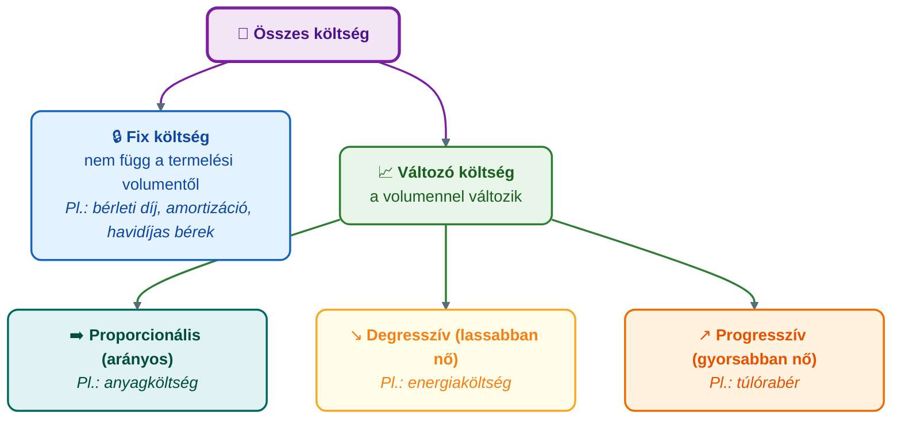
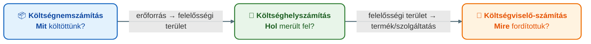

## K16 – A költségszámítás szerepe a controllingban

**Tétel:** Költségszámítás a controllingban: A költségszámítás szerepe a controllingban. A költség fogalma és a költség–kiadás különbsége. A költségek csoportosítása. A modern költség- és teljesítményelszámolás céljai. A vezetésorientált számvitel (Management Accounting) szerepe. A költségelszámolás rendszerei.

---

### A költség fogalma és különbsége a kiadástól

**Kiadás**: pénzeszköz tényleges kiáramlása (pl. gépvásárlás teljes vételára egy összegben).  
**Költség**: az adott időszakban felhasznált erőforrás értéke (pl. a gép éves értékcsökkenése).

A controlling a **gazdasági tartalmat**, nem a pénzmozgást figyeli. Ezért a számviteli eredmény és a controlling-eredmény eltérhet.

### A költségek csoportosítása

**1. Volumenhez való viszony szerint** — a változás mértékét a **reagálási fok** fejezi ki:

$$\text{reagálási fok} = \frac{\text{költségváltozás \%-a}}{\text{volumenváltozás \%-a}}$$

Reagálási fok = 1 → proporcionális; < 1 → degresszív; > 1 → progresszív; = 0 → fix.

**2. Elszámolhatóság szerint:**

| Típus | Jellemző | Példa |
|---|---|---|
| Közvetlen (primer) | Termékre közvetlenül ráterhelható | Alapanyag, közvetlen bér |
| Közvetett (overhead) | Csak felosztással rendelhető termékhez | Gyártási rezsi, admini ktg. |

**3. Döntési relevancia** — a kontrolling alapszemléletének kritikus eleme (Anthony & Govindarajan, 2007):

- **Releváns költség**: a vizsgált döntés következtében *változik* (jövőbeli, döntésfüggő pénzkiadás).
- **Irreleváns költség**: a döntéstől függetlenül felmerül.
- **Elsüllyedt költség (sunk cost)**: múltbeli, már elköltött, döntéssel nem megváltoztatható kiadás — a racionális döntésből **ki kell hagyni**. A „sunk cost fallacy" a már befektetett pénzbe való kapaszkodás kognitív hibája.

**4. Felelősségi egységek** — a decentralizált irányítás eszköze: minden egységet ahhoz a mutatóhoz mérünk, amelyet a vezető *ténylegesen befolyásolni tud*:

| Egységtípus | Fő mutató | Tipikus példa |
|---|---|---|
| Költségközpont (cost center) | Terv–tény költségeltérés | Gyártóüzem, IT |
| Bevételközpont (revenue center) | Árbevétel-terv teljesítése | Értékesítési régió |
| Profitközpont (profit center) | Fedezet / eredmény | Üzletág, divízió |
| Befektetési központ (investment center) | ROI, RI, EVA | Önálló leányvállalat |

**5. A háromszintű elszámolási rendszer:**

A **költséghelyszámítás** során a segédüzemi és kiszolgáló egységek teljesítményeit a végköltséghelyekre kell átterhelni. Ennek négy eljárása van:

| Eljárás | Logika | Pontosság |
|---|---|---|
| **Blokkeljárás (anonim)** | Segédüzemek csak végköltséghelyekre adnak, egymásra nem | Legdurvább |
| **Lépcsőzetes eljárás** | Egyirányú átadás meghatározott sorrendben | Közepes |
| **Kiegyenlítő eljárás** | Kölcsönös átadások lineáris egyenletrendszerrel | Legpontosabb |
| **Elszámolóáras eljárás** | Belső elszámolóáron terheli a teljesítményt | Gyakorlatias |

### A modern költség- és teljesítményelszámolás céljai

A hagyományos (pénzügyi) számvitel **külső** érdekeltek (adóhatóság, befektetők) számára készül. A **Management Accounting** (vezetői számvitel / vezetésorientált számvitel) **belső** döntéstámogatásra:

- Döntésorientált: az adott döntéshez szükséges releváns költség kiemelése
- Időszerű: gyors, akár heti adatszolgáltatás
- Rugalmas: különböző nézőpontokból elemezhető (termék, vevő, régió)

### A költségelszámolás rendszerei

| Rendszer | Alapelv | Előny | Korlát |
|---|---|---|---|
| Teljesköltség-számítás | Minden ktg. ráterhelése a termékre | Teljes önköltség látható | Fix ktg. felosztása torzíthat |
| Részköltség-számítás (Direct costing) | Csak változó ktg. + fedezet | Döntéstámogatáshoz jobb | Nem mutatja a teljes önköltséget |
| Tervköltség-számítás | Előzetesen tervezett ktg. + eltéréselemzés | Ellenőrzési funkció | Merev vs. rugalmas változat |
| ABC (Activity-Based Costing) | Tevékenységekhez rendeli az overheadet | Pontosabb overhead-felosztás | Adatigényes |

> **Irodalom:** Anthony, R. N., & Govindarajan, V. (2007). *Management control systems* (12th ed.). McGraw-Hill/Irwin. — Drury, C. (2018). *Management and cost accounting* (10th ed.). Cengage Learning. — Kaplan, R. S., & Cooper, R. (2001). *Költség & hatás*. Panem. — Francsovics, A. (é. n.). *Controlling* [elektronikus tankönyv]. — Katona F.: CONTROLLING 2., 4. ea.

---
