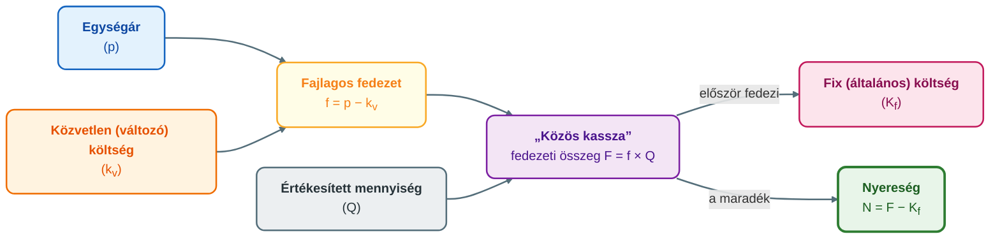
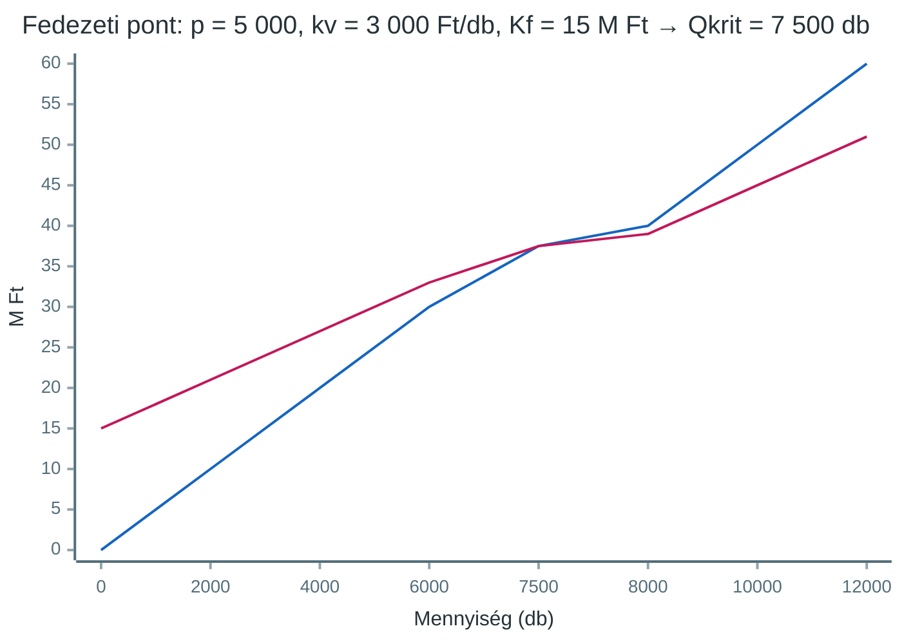

## K17 – Kalkulációs módszerek és fedezetszámítás a vezetői döntésekben

### Beszerzendő anyagok

| Szerző | Mű | Jelleg | Indoklás / érintett rész |
|---|---|---|---|
| — | GIXVS2MBLF syllabus / tantárgynyilvántartó adatlap | syllabus | A tárgy mappájában nincs; a heti tematika és az irodalomjegyzék csak az 1. előadás 2. diájából rekonstruálható. |
| Francsovics A. | *Controlling – elmélet és módszertan* (Budapest, 2010) | kötelező irodalom | Az 1. előadás kötelező irodalomként nevezi meg; a kalkuláció (R2–R3) és a fedezeti elemzés (R4–R5) a helyi 2011-es e-jegyzet 2.2–2.3 fejezetére épül, a nyomtatott kötet bővebb lehet. |

**Tétel:** Kalkulációs módszerek és fedezetszámítás a vezetői döntésekben. A kalkuláció fogalma és típusai (elő-, közbenső-, utókalkuláció). Kalkulációs módszerek: osztókalkuláció, egyenértékszámos kalkuláció, pótlékoló kalkuláció, normatív kalkuláció, ABC kalkuláció. Az ÁKFN struktúra és alkalmazása. Break-even elemzés és fedezeti pont szerepe.

---

### Kalkuláció és fedezetszámítás a vezetői döntésekben

A költségelszámolás utolsó lépcsője a **költségviselő-számítás**: megmutatja, melyik termék érdekében merültek fel a költségek. Egy egységre vetítve ez a **kalkuláció**, egy időszakra a periodikus költségviselő-számítás (Katona, 2021a, 2. dia). A **gazdasági kalkuláció** a vezetésorientált költségszámítás eszköze, tárgya a termék és a vele összefüggő tevékenység (Francsovics, 2011, 22. o.). A kalkuláció a termék önköltségét adja meg (árképzés, készletértékelés), a **fedezetszámítás** pedig azt, mennyivel járul hozzá a termék a fix költségek megtérüléséhez és a nyereséghez. A döntés alapja mindkettőnél a **releváns költség és bevétel**: az, ami a döntés cselekvési paramétereitől függ (Katona, 2021b, 12. dia).

### A kalkuláció fogalma és típusai

A kalkuláció fogalma alatt a **gazdasági kalkuláció** és az **önköltségszámítás** keretében végzett tevékenységek, eljárások és módszerek összességét értjük. Az **önköltség** a termék meghatározott egységének előállítására fordítható, illetve fordított élő- és holtmunka pénzben kifejezett összege; a „termék” fogalmát tágan, a szolgáltatásokra is értelmezzük (Francsovics, 2011, 22. o.).

A kalkuláció a gyártási (szolgáltatási) folyamat különböző szakaszaiban készül, és ettől függően más célt szolgál. Alapfeltétel a **módszerbeli azonosság**: az egyes költségtényezőket mindhárom típusban azonos módon kell számba venni, különben az összehasonlítás és az elemzés nem lehetséges (Francsovics, 2011, 23. o.).

| Típus | Mikor készül? | Cél, tartalom |
|---|---|---|
| **Előkalkuláció** | gyártás előtt | a várható önköltség meghatározása műszaki-gazdasági alapon: új termékre, új technológiára, saját termelésű készlet tervezett nyilvántartási árára, beruházásra, a költség-, fedezet- és nyereségtervezéshez. Fajtái: **norma szerinti előkalkuláció** (az érvényes normákkal) és **tervkalkuláció** (a tervezett beruházási, fejlesztési, bérintézkedések hatásával korrigálva). |
| **Közbenső kalkuláció** | a gyártással egy időben | hosszú átfutású, nagy volumenű, bonyolult termékeknél; kizárólag operatív célú, ezért formája kötetlen. Feladata a tervezett és tényleges költség megfigyelése, az eltérések elemzése, a beavatkozás; adatai legyenek felhasználhatók az utókalkulációban. |
| **Utókalkuláció** | a termelés befejezése után | a tényleges önköltség meghatározása bizonylatok és könyvviteli adatok alapján. Felhasználása: készletek mérlegértékelése, beruházások költsége, tervezési információ, a költséggazdálkodás és az árpolitika megítélése. |

*(Francsovics, 2011, 23–24. o.)*

A **kalkulációs módszer** azt fejezi ki, hogyan hozzuk kapcsolatba az előállított egységet és a gyűjtött költségeket. Hazai gyakorlat: osztó-, pótlékoló, gépóra- és normatív kalkuláció (Francsovics, 2011, 24. o.); a modern megközelítés a tevékenységalapú (ABC) kalkuláció (Katona, 2021a, 20. dia).

### Kalkulációs módszerek

**1. Osztókalkuláció.** A felmerült összes költséget a termelt mennyiséggel osztjuk. Ott alkalmazható, ahol csak egyfajta vagy rokon termékeket gyártanak, és a befejezetlen termelés állománya jelentéktelen vagy időszakról időszakra azonos (Francsovics, 2011, 24. o.; Katona, 2021a, 4. dia). Változatai:

- **Egyszerű osztókalkuláció:** egynemű termék, egyetlen termékfajta; `önköltség = összes költség / mennyiség`. Előfeltétel, hogy ne legyen félkésztermék-készletváltozás (Katona, 2021a, 7. dia).
- **Egyenértékszámos osztókalkuláció:** azonos főalkotó elemekből, azonos technológiával előállított, csak méretben vagy minőségben eltérő termékeknél (választék szerinti profil). Műszaki számítással **egyenértékszámot** dolgoznak ki, a mennyiségeket egy **vezértermékre** számítják át és összegzik, majd az összes költséget az egyenértékes mennyiséggel osztják (Francsovics, 2011, 24. o.).
- **Fázisonkénti (többlépcsős) osztókalkuláció:** technológiai fázisonként határozzuk meg az önköltséget, a félkésztermék-készlet változásának kezelésével; feltétele, hogy a fázisok műszakilag és számvitelileg egyértelműen elhatárolhatók legyenek (Francsovics, 2011, 24. o.; Katona, 2021a, 7. dia).

*Számpélda – egyenértékszámos* (ÓE KGK, é. n., gyak2): időszaki költség **10 500 eFt**; négy termék (egyenértékszám 0,5 / 1 / 0,8 / 1,9) vezértermékben **70 000 db** → **150 Ft/db** vezértermékben; az „A” termék (0,5) önköltsége **75 Ft/db**.

A **gépórakalkuláció** a gépköltséget a gépek óraköltsége és a termék gépidő-igénye alapján a közvetlen költségek közé sorolja (Francsovics, 2011, 26. o.).

**2. Pótlékoló kalkuláció.** A közvetlen költségeket felmerüléskor közvetlenül a termékre számoljuk el, az általános költségeket költséghelyenként gyűjtjük, majd **vetítési alap** segítségével osztjuk fel a költségviselőkre (Francsovics, 2011, 25. o.). A vetítési alap (naturália: gépóra, normaóra; vagy pénzérték: közvetlen anyag-, bérköltség) olyan mérőszám, amelynek változása a legjobban követi a közvetett költséget; ok-okozati kapcsolat hiányában az önköltség torzul (Katona, 2021a, 8. dia).

$$\text{pótlékkulcs} = \frac{\text{általános költség}}{\text{vetítési alap összege}}$$

A vetítési alapok száma szerint **egylépcsős** (egyetlen kulcs) és **többlépcsős** (költséghelyenként differenciált kulcsok) pótlékoló kalkulációt különböztetünk meg; az utóbbi javítja az okozathűséget (Katona, 2021a, 8., 14. dia).

*Számpélda* (ÓE KGK, é. n., gyak3): a) feladat – anyagmentes közvetlen költségre vetítve az üzemi általános kulcsa 0,32, a központi irányításé 0,8; az „A” termék teljes önköltsége **6,04**, a „B”-é 3,664 eFt/db. A b) feladat más vetítési alappal 5,3 és 3,96 eFt/db-ot kap – a vetítési alap megválasztása önmagában átrendezi a termékek megítélését.

**Korlát:** bármilyen vetítési alappal vitatható a felosztás a költségokozati elv alapján; a módszer mindig azokat a termékeket mutatja rosszabbnak, amelyek vetítési alapja az átlagot meghaladja. Teljes költségszámítási eljárás, ez a teljes- és részköltségszámítás vitájának gyökere (Francsovics, 2011, 25–26. o.) – és ez vezet az ABC-hez.

**3. Normatív kalkuláció.** A költségek tervezése, utalványozása, elszámolása és nyilvántartása **normák és normatívák** alapján történik. Előfeltételei: megalapozott normák, naprakész normanyilvántartás, normák szerinti utalványozás, és a normaeltérés olyan bizonylatolása, amelyből oka, helye és felelőse megállapítható (Katona, 2021a, 15. dia). Az utókalkulált önköltség levezetése:

```
Alapkalkuláció (norma) szerinti önköltség
±  Normaváltozások
=  Folyó norma szerinti önköltség
±  Normaeltérések
=  Utókalkulált tényleges önköltség
```

(Francsovics, 2011, 26–27. o.; Katona, 2021a, 16. dia.) Tömeg- és nagysorozatgyártásban célszerű. Előnyei: takarékosságra ösztönöz, gyorsan láthatóvá teszi a rendellenességeket, az eltérés felelőshöz köthető, és csökken a bizonylatolási munka (Katona, 2021a, 16. dia). A normatív kalkuláció a **standard költségszámítás** (K16) kalkulációs oldala.

**4. Tevékenységalapú kalkuláció (activity-based costing, ABC).** Célja a közvetett és támogató tevékenységek költségeinek pontosabb felosztása tevékenységek, folyamatok, termékek és vevők között; alapelve, hogy a működést tevékenységekre bontjuk, és a tevékenységek által okozott költséget rendeljük a költségviselőhöz. Lépései: (1) tevékenységek azonosítása, (2) a tevékenységek **költségokozóinak** (cost driver) azonosítása, (3) a tevékenységek költségeinek gyűjtése, (4) költségfelosztás. Módszertani alapja a pótlékoló kalkuláció: annyi vetítési alapot használ, ahány tevékenységet azonosít (Katona, 2021a, 20. dia). Költségokozó pl. a gépátállítások, rendelések, bizonylatok vagy mozgatások száma (Katona, 2021a, 22. dia).

*Számpélda* (ÓE KGK, é. n., gyak4): 400 M Ft közvetett költség három termékre. Közvetlen bérre vetítve A = 213,6, B = 414,1, C (10 000 db-os nagy széria) = 217,4 eFt/db. Öt költségokozóval (anyag, bér, gépóra, átállítások, rendelések száma) A **238,4**, B **453,2 eFt/db-ra nő**, C **211,0 eFt/db-ra csökken**: a kis szériájú, sok átállítást igénylő termék a hagyományos kalkulációban alulterhelt, a nagy széria túlterhelt volt.

**Előnyök:** reálisabb termékköltség; felismeri, hogy a tevékenységek okozzák a költséget; segíti a költségcsökkentést. **Hátrányok:** bonyolult és drága; költség-plusz árazású nagyvállalatokra fejlesztették ki, piaci áralapú árazásnál kevesebb előnyt ad (Katona, 2021a, 28. dia). Ott éri meg, ahol magas a közvetett költség aránya, széles a választék és gyakori a szériaváltás. Eredményeinek vezetési felhasználása az **ABM**: újraárazás, termékhelyettesítés, folyamatfejlesztés, termékmegszüntetés (Katona, 2021a, 29. dia).

### Az ÁKFN-struktúra és a fedezeti elv

A **fedezeti elemzés** az értékesítési döntéseket tervezi és ellenőrzi; alapgondolatát, a **direct costing** eljárást J. Harris alakította ki 1908-ban (Francsovics, 2011, 27. o.). Kiindulása a költségek volumen szerinti bontása **fix** és **változó** (proporcionális, degresszív, progresszív) költségre (Katona, 2021b, 2. dia); a gyakorlatban a közvetlen költséget proporcionálisnak, az általánosat fixnek tekintjük (Francsovics, 2011, 29. o.).

A **fedezeti elv**: a fix költség nem osztható fel pontosan a termékek között, ezért a döntési információt sem torzíthatja – a **nyereséggel együtt** kell kezelni. Az árbevételnek a közvetlen költség levonása után maradó része a vállalati **„közös kasszába”** kerül, ebből fedezik a fix költséget, a maradék a nyereség. A fix költség és a nyereség együtt: **fedezeti összeg** (hozzájárulás, bruttó nyereség) (Francsovics, 2011, 28. o.).



*A nyereségfedezeti számítás logikája (Francsovics, 2011, 2.7 ábra, 32. o.).*

Az **ÁKFN-séma**: Árbevétel − Változó költség = Fedezeti összeg; − Fix költség = Nyereség. Alapkategóriái: **fedezeti összeg**, **fedezeti pont** (az árbevétel- és összköltségfüggvény metszéspontja), **termékegység fedezete** (p − k<sub>v</sub>) és **kritikus mennyiség** (Q<sub>krit</sub>), amelynek fedezete éppen a fix költséget téríti meg (Francsovics, 2011, 28–29. o.).

### Az ÁKFN-struktúra alkalmazása

**Termékek megítélése.** Francsovics gépgyári példájában két, egyaránt 100 eFt áron eladható termék közül a 200 %-os bérpótlékos kalkuláció az anyagigényes „A”-t mutatja nyereségesnek (10 eFt), a munkaigényes „B”-t nullszaldósnak. Fedezeti szemléletben „A” **40**, „B” **60 eFt/db** fedezetet ad, tehát „B” a kedvezőbb: 24 000 eFt fix költségnél belőle 400, „A”-ból 600 db a kritikus mennyiség (Francsovics, 2011, 31–34. o.). Rangsorolási mutató a fajlagos fedezet és a **fedezeti hányad** (fedezet / egységár), kiegészítve a **fedezettömeggel** (Katona, 2021b, 14. dia).

**Célnyereség és versenyár.** Adott nyereséghez Q = (K<sub>f</sub> + N) / f: 6 000 eFt-hoz „B”-ből 500, „A”-ból 750 db. Az elért nyereség megtartása mellett adható legnagyobb **árengedmény** a fajlagos fedezet, így a **versenyár alsó határa** a változó költség – a gyakorlatban tompítva, mert a volumennövekedés közvetett költséget is növel (Francsovics, 2011, 34–35. o.). Rövid távon p ≥ k<sub>v</sub>; szűk keresztmetszetnél p ≥ k<sub>v</sub> + elmaradt haszon; hosszú távon p ≥ összköltség (Katona, 2021b, 29. dia).

**Reagálási érzékenység.** Minden vállalat ÁKFN-struktúrája más, ezért másként reagál az ár, a költség vagy a volumen változására. Katona példájában két vállalat árbevétele (100) és nyeresége (10) azonos, de „A” változó/fix költsége 80/10, „B”-é 10/80. 10 %-os volumencsökkenésnél:

| | „A” vállalat | „B” vállalat |
|---|---|---|
| Árbevétel (−10 %) | 90 | 90 |
| Változó költség | 72 | 9 |
| Fedezet | 18 | 81 |
| Fix költség | 10 | 80 |
| Nyereség | 8 (**−20 %**) | 1 (**−90 %**) |

A magas fixköltség-arányú „B” nyeresége rendkívül érzékeny a kapacitáskihasználásra (Katona, 2021b, 7. dia; Francsovics, 2011, 40–41. o.). Adott többletnyereséghez (ΔN) a szükséges beavatkozás: ΔÁ % = ΔN / Á; ΔK<sub>p</sub> % = ΔN / K<sub>p</sub>; ΔK<sub>f</sub> % = ΔN / K<sub>f</sub>; ΔVol % = ΔN / F (Francsovics, 2011, 38–39. o.; Katona, 2021b, 9. dia). A nyereség megduplázása árral mindenütt 10 % emelést kíván, volumennel vagy költségcsökkentéssel viszont struktúránként nagyon eltérőt, néha irreálisat (Francsovics, 2011, 39. o.).

**Felhasználási területek** (Katona, 2021b, 16. dia): fedezeti pont elemzés; optimális termelési és értékesítési program (új termék, speciális rendelés, szűkös erőforrás lekötése); alsó árhatár; saját gyártás vagy beszerzés. A jövedelmezőség javításának sorrendje: volumen, fajlagos fedezet, fix költség, végül kapacitáskorlátozás (Katona, 2021b, 22. dia).

### Break-even elemzés és a fedezeti pont szerepe

A **fedezeti pont** (break-even point) az a pont, ahol a nyereség nulla: árbevétel = változó + fix költség (Francsovics, 2011, 43. o.). Feltevései: egyfajta termék, adott kapacitáshatár, lineáris változó költség; az összköltségfüggvény a fix költségből indul (meredeksége k<sub>v</sub>), az árbevétel-függvény az origóból (meredeksége p) (Francsovics, 2011, 27–28. o.).

```
Q_krit = Fix költség / Fajlagos fedezet = K_f / (p − k_v)
TR_krit = p × Q_krit               (fedezeti árbevétel)
```

*Példa* (Katona, 2021b, 18. dia): p = 5 000 Ft/db, k<sub>v</sub> = 3 000 Ft/db, K<sub>f</sub> = 15 M Ft, ebből 5 M Ft amortizáció. **Q<sub>krit</sub> = 15 000 000 / 2 000 = 7 500 db**, fedezeti árbevétel 37,5 M Ft.



**Likviditási pont.** Az amortizáció költség, de nem kiadás; a likviditási pontnál csak a pénzkiadással járó fix költséget kell fedezni, ezért mindig a fedezeti pont alatt van (Francsovics, 2011, 43–44. o.): Q<sub>lik</sub> = (K<sub>f</sub> − amortizáció) / f = 10 M / 2 000 = **5 000 db** – e felett a cég fizetőképes, bár könyv szerint veszteséges lehet (Katona, 2021b, 18. dia).

**A fedezeti pont szerepe.** Az értékesítési tervet Q<sub>krit</sub> fölé kell tervezni; a **biztonsági koefficiens** = (Q − Q<sub>krit</sub>) / Q mutatja, hány százalékkal eshet vissza a forgalom a veszteségzónáig – 11 500 db kapacitásnál **34,8 %** (Katona, 2021b, 20. dia). Ugyanígy számítható a célnyereség volumenigénye vagy az ár- és költségváltozás hatása (Katona, 2021b, 19., 21. dia). Korlátja az egyszerűsítő feltevések (linearitás, egy termék), de az összefüggések megvilágítására nélkülözhetetlen (Francsovics, 2011, 35. o.).

### Többszintű fedezetszámítás és a szűk keresztmetszet

**Termékszintű ÁKFN és többszintű direct costing.** Termékszinten a fenntartási költséget nem osztjuk fel, csak a fajlagos fedezetet nézzük. Alapelvek: amíg a fedezet pozitív, termeld; korlát nélkül a magasabb fedezetűt, kapacitáskorlátnál a magasabb relatív fedezetűt; a felosztott fix költség miatt veszteségesnek látszó termék csak elgondolkodtató, nem automatikusan megszüntetendő (Katona, 2021b, 12–13. dia). A fix költség aszerint bontható, melyik szinten szüntethető meg (ÓE KGK, é. n., gyak7):

```
Nettó árbevétel
−  Változó költség
=  Fedezet I.          (termékenként)
−  Termékszintű fix költség
=  Fedezet II.
−  Termékcsoport-szintű fix költség
=  Fedezet III.        (termékcsoportonként)
−  Üzemi szintű fix költség
=  Fedezet IV.         (üzemenként)
−  Vállalati szintű fix költség
=  Vállalati eredmény
```

**Szűk keresztmetszet – relatív fedezet.** Szabad kapacitásnál az abszolút fedezet vagy a fedezeti hányad dönt; egyetlen szűk keresztmetszetnél (jellemzően gépóra) a **relatív fedezet** – az egységnyi szűkös erőforrásra jutó fedezet – szerint rangsorolunk; több szűk keresztmetszetnél lineáris programozás, hosszú távon beruházás kell (Francsovics, 2011, 45–46. o.).

$$\text{relatív fedezet} = \frac{\text{fajlagos fedezet}}{\text{szűkös erőforrás fajlagos igénye}}$$

*Számpélda* (ÓE KGK, é. n., gyak9, 2.13.):

| Termék | Fajlagos fedezet (Ft/db) | Normaóra-igény (nó/db) | Relatív fedezet (Ft/nó) | Rangsor |
|---|---|---|---|---|
| 1. sz. | 20 000 | 8 | 2 500 | 3. |
| 2. sz. | 14 000 | 10 | 1 400 | 4. |
| 3. sz. | 13 000 | 5 | 2 600 | 2. |
| 4. sz. | 14 000 | 4 | 3 500 | **1.** |

A 4. sz. termék fajlagos fedezete nem a legnagyobb, mégis első, mert egységnyi normaórára a legtöbb fedezetet adja. A szállítási kötelezettségek lekötése után a szabad 136 000 normaórát a rangsor szerint osztjuk el; a sor végén álló 2. sz. termékből 4 000 db-bal kevesebbet gyártunk, mint amennyit a piac felvenne. Katona példájában a relatív fedezet szerinti elosztás 396 500, a fajlagos szerinti csak 362 920 eFt összfedezetet ad (Katona, 2021b, 24. dia).

### Összegzés

A kalkuláció megmondja, mennyibe kerül a termék, de a teljes költségszámítási módszerek a fix költség felosztásával torzíthatnak; az ABC ezt költségokozók szerinti felosztással csökkenti, drágán. A fedezetszámítás ezért a fix költséget nem osztja fel: a fajlagos és relatív fedezet, a kritikus és likviditási mennyiség, a reagálási érzékenység a termékszerkezeti, árazási és kapacitásdöntések közvetlen kritériuma. A kettő együtt a vezetésorientált költségszámítás magja.

---

### Várható vizsgáztatói kérdések

1. **Miért félrevezető a pótlékoló kalkuláció a termékek összehasonlításában, és mit tesz másként az ABC?** — A pótlékoló kalkuláció a vetítési alappal arányosan terheli az általános költséget, ezért az átlagnál nagyobb vetítési alapú (pl. bérigényes) terméket mutatja rosszabbnak, függetlenül attól, hogy ténylegesen mi okozta a költséget (Francsovics, 2011, 25–26. o.). Az ABC a működést tevékenységekre bontja, és minden tevékenység költségét saját költségokozója szerint osztja fel; módszertanilag ez többkulcsos pótlékolás (Katona, 2021a, 20. dia). A `gyak4` példában a kis szériájú termékek önköltsége nő, a nagy szériáé csökken (ÓE KGK, é. n., gyak4).

2. **Mi a különbség a fedezeti pont és a likviditási pont között?** — A fedezeti pontnál az árbevétel a teljes fix és változó költséget fedezi (nyereség nulla). A likviditási pontnál csak a pénzkiadással járó fix költséget kell fedezni; az amortizáció költség, de nem kiadás, ezért a likviditási pont mindig alacsonyabb (Francsovics, 2011, 43–44. o.; Katona, 2021b, 17–18. dia).

3. **Mikor rangsorolunk fajlagos és mikor relatív fedezet szerint?** — Szabad kapacitásnál az abszolút fedezet vagy a fedezeti hányad dönt; ha egyetlen erőforrás szűkös, az egységnyi szűkös erőforrásra jutó relatív fedezet; több szűk keresztmetszetnél lineáris programozás (Francsovics, 2011, 45–46. o.; Katona, 2021b, 12. dia). A `gyak9` példában így a legkisebb fajlagos fedezetű 4. sz. termék kerül az első helyre.

4. **Hogyan függ össze az ÁKFN-struktúra és a vállalat kockázata?** — Azonos árbevétel és nyereség mellett a magas fixköltség-arányú vállalat nyeresége sokkal érzékenyebben reagál a volumenre: 10 %-os forgalomcsökkenés az „A” vállalatnál 20 %, a „B”-nél 90 % nyereségcsökkenést okoz (Katona, 2021b, 7. dia). Ezért a magas fix költségű ágazatokban (közlekedés, szállodák, színházak) a kapacitáskihasználás akár árengedmény árán is alapvető (Francsovics, 2011, 40–41. o.).

5. **Mi a versenyár alsó határa, és miért nem célszerű teljesen kihasználni?** — Rövid távon a változó (közvetlen) költség, mert a már elért nyereség megtartása mellett a fajlagos fedezetről lehet lemondani; szűk keresztmetszetnél ehhez az elmaradt haszon is hozzáadódik, hosszú távon az összköltséget kell fedezni. A gyakorlatban a volumennövekedés közvetett költséget is növel, ezért az elméleti maximális engedményt tompítani kell (Francsovics, 2011, 34–35. o.; Katona, 2021b, 29. dia).

6. **Miben különbözik a normatív kalkuláció a standard költségszámítástól?** — A normatív kalkuláció a termék önköltségét a norma szerinti önköltségből a normaváltozások és normaeltérések hozzáadásával vezeti le, és előfeltétele a normanyilvántartás és a normák szerinti utalványozás (Katona, 2021a, 15–16. dia; Francsovics, 2011, 26–27. o.). A standard költségszámítás (K16) ugyanezt az elvet a költséghelyi tervezés és az eltéréselemzés rendszerszintjén alkalmazza.

---

## Irodalom

* Francsovics, A. (2011). *Controlling* [Elektronikus jegyzet]. Óbudai Egyetem, Keleti Károly Gazdasági Kar.
* Katona, F. (2021a). *CONTROLLING 3. előadás: Vezetői költségelszámolás, kalkulációs módszerek* [Előadás-prezentáció]. Óbudai Egyetem, Keleti Károly Gazdasági Kar.
* Katona, F. (2021b). *CONTROLLING 5. előadás: Költség–volumen–eredmény elemzés, ár–költség–fedezet–nyereség elemzés* [Előadás-prezentáció]. Óbudai Egyetem, Keleti Károly Gazdasági Kar.
* Óbudai Egyetem, Keleti Károly Gazdasági Kar [ÓE KGK]. (é. n.). *Vezetői számvitel és controlling (GIXVS2MBLF) – gyakorlati feladatfájlok: gyak2_Önköltségszámítás, gyak3_pótlékoló kalk, gyak4_ABC, 19201gyak7, 19201gyak9* [Excel-munkafüzetek].
