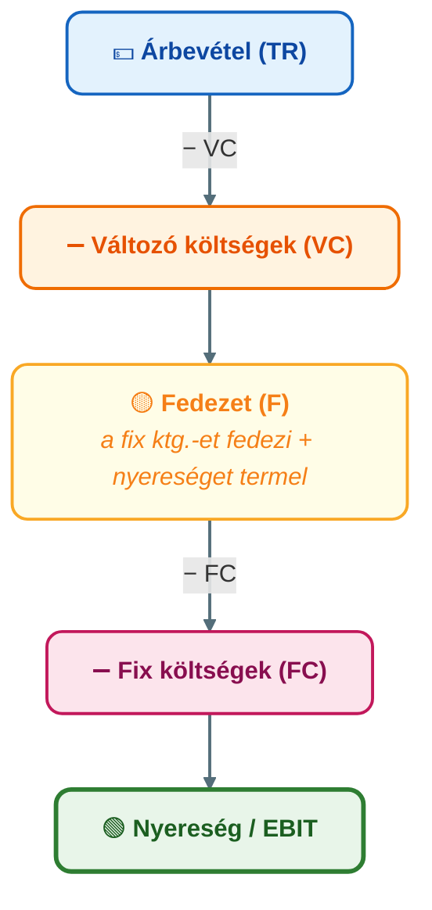
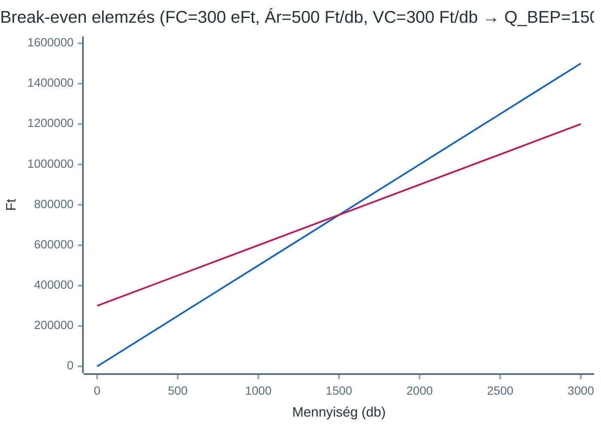

## K17 – Kalkulációs módszerek és fedezetszámítás a vezetői döntésekben

**Tétel:** Kalkulációs módszerek és fedezetszámítás: Kalkulációs módszerek és fedezetszámítás a vezetői döntésekben. A kalkuláció fogalma és típusai (elő-, közbenső-, utókalkuláció). Kalkulációs módszerek: osztókalkuláció, egyenértékszámos kalkuláció, pótlékoló kalkuláció, normatív kalkuláció, ABC kalkuláció. Az ÁKFN struktúra és alkalmazása. Break-even elemzés és fedezeti pont szerepe.

---

### A kalkuláció fogalma és típusai

A **kalkuláció** az egységnyi termékre (vagy szolgáltatásra) vetített önköltség meghatározása. Három időbeli típusa van:

| Típus | Mikor? | Cél |
|---|---|---|
| Előkalkuláció | Gyártás előtt | Árajánlat, döntési alap |
| Közbenső kalkuláció | Gyártás közben | Folyamatkövetés, eltérések |
| Utókalkuláció | Gyártás után | Tényleges önköltség, visszacsatolás |

### Kalkulációs módszerek

**1. Osztókalkuláció** – homogén termék esetén: `Önköltség = Összes ktg. / Mennyiség`. **Egyenértékszámos** változat rokon termékekre: minden terméket egy koefficiensekkel vezértermékre számítunk át.

*Számpélda (forrás: gyak2_Önköltségszámítás.xlsx):* Időszaki ktg. = 10 500 eFt; négy termék egyenértékmennyisége összesen 70 000 db vezértermékben → egységköltség = 10 500 000 / 70 000 = **150 Ft/db** vezértermékben. „A" termék koefficiense 0,5 → önköltség **75 Ft/db**.

**2. Pótlékoló kalkuláció** – heterogén termékmixnél a közvetett (általános) költségeket pótlékkulcs szerint vetítjük a termékekre:

$$\text{pótlékkulcs} = \frac{\text{általános költség}}{\text{vetítési alap (pl. közvetlen bér)}}$$

*Számpélda (forrás: gyak3_pótlékoló kalk.xlsx):* Közvetett ktg. = 3 500 000 Ft, közvetlen bér = 1 000 000 Ft → pótlékkulcs = **350%**. A-termék közvetlen bére 200 000 Ft → felszámított rezsi: **700 000 Ft**.

**Pótlékkulcs-torzítás:** egyetlen vetítési alap esetén a kis szériájú, bonyolult termék alultervezett, a nagy szériájú, egyszerű termék túltervezett önköltséget kap — ezt hívják „cost cross-subsidization"-nek. Ez vezet át az ABC-hez.

**3. ABC-kalkuláció (Activity-Based Costing)** – Cooper és Kaplan (1988) vezette be. Az általános költségeket **tevékenységekhez**, majd tevékenység-driverek szerint termékekhez rendeli. Négyszintű költséghierarchia: darabszintű, tételszintű (sorozat), termékszintű, üzemi szintű. A tételszintű driverek (pl. gépátállítások, rendelések száma) különösen fontosak: a nagy szériájú termékek ezekből aránytalanul keveset fogyasztanak.

*Tanulság:* ABC-ben a nagy szériájú termék önköltsége általában **kisebb**, a kis szériájúé **nagyobb**, mint a hagyományos módszerben — ez a piaci ár- és termékstratégiai döntések kritikus inputja.

**4. Normatív (standard cost) kalkuláció** – előre meghatározott normák alapján; az eltérés a hatékonysági különbséget mutatja (részletesen: K16).

### ÁKFN-struktúra és fedezetszámítás

Az **Ár–Költség–Fedezet–Nyereség** struktúra a controlling egyik leghasznosabb döntési kerete:



**Fedezet = az az összeg, amely a fix költségeket fedezi és nyereséget termel.**

Két vállalat összehasonlítása (10%-os forgalomcsökkenésnél):

| | A vállalat | B vállalat |
|---|---|---|
| Árbevétel (–10%) | 90 | 90 |
| Változó ktg. | 72 (magas VC) | 9 (alacsony VC) |
| Fedezet | 18 | 81 |
| Fix ktg. | 10 | 80 |
| Nyereség | 8 (–20%) | 1 (–90%) |

B vállalat rugalmasabb struktúrájú, de a magas fix ktg. miatt rendkívül érzékeny a forgalomcsökkenésre – ez az **operatív tőkeáttétel** hatása.

### Break-even elemzés (fedezeti pont)

A **fedezeti pont** az a termelési mennyiség, amelynél az összbevétel éppen fedezi az összes költséget (nyereség = 0):

```
Q_BEP = Fix ktg. / Fajlagos fedezet
      = FC / (Ár – Fajlagos változó ktg.)

Pl.: FC = 300 000 Ft, Ár = 500 Ft/db, VC/db = 300 Ft
    → Q_BEP = 300 000 / 200 = 1 500 db
```

**Grafikusan:**



**Likviditási pont:** csak a *pénzkiadással járó* fix költséget kell fedezni; az amortizáció nem pénzkiadás:

$$Q_{lik} = \frac{FC - \text{Amortizáció}}{\text{fajlagos fedezet}}$$

*Példa (forrás: 19201gyak7.xlsx):* Ár = 32 eFt/db, fajlagos változó ktg. = 28 eFt/db, FC = 128 000 eFt, amortizáció = 36 000 eFt. Fedezeti pont: 128 000 / 4 = **32 000 db**. Likviditási pont: (128 000 − 36 000) / 4 = **23 000 db**. A likviditási pont mindig a fedezeti pont *alatt* van — e szint felett a vállalat pénzforgalmilag pozitív, még ha könyv szerint veszteséges is.

### Többszintű fedezetszámítás (többlépcsős direct costing)

A fix költséget aszerint bontjuk, hogy melyik szinten szüntethető meg:

```
Nettó árbevétel
−  Változó költség
=  Fedezet I.           (termékenként)
−  Termékszintű fix ktg.
=  Fedezet II.
−  Termékcsoport fix ktg.
=  Fedezet III.         (termékcsoportonként)
−  Üzemi szintű fix ktg.
=  Fedezet IV.          (üzemenként)
−  Vállalati szintű fix ktg.
=  Vállalati eredmény
```

Egy termék megszüntetésekor csak az adott szinten *elkerülhető* fix költség tűnik el; a magasabb szintű fix ktg. megmarad. Egy pozitív fedezetű, de „veszteséges" (allokált általános ktg. miatt) termék megszüntetése **rontja** az összeredményt.

### Szűk keresztmetszet – relatív fedezet

Ha egy erőforrás szűkös (pl. gépóra, normaóra), nem a fajlagos, hanem az **egységnyi szűkös erőforrásra jutó fedezet** (relatív fedezet) alapján kell rangsorolni:

$$\text{relatív fedezet} = \frac{\text{fajlagos fedezet}}{\text{szűkös erőforrás fajlagos igénye}}$$

*Számpélda (forrás: 19201gyak9.xlsx):*

| Termék | Fajlagos fedezet (Ft/db) | Normaóra-igény (nó/db) | Relatív fedezet (Ft/nó) | Rangsor |
|---|---|---|---|---|
| 1. sz. | 20 000 | 8 | 2 500 | 3. |
| 2. sz. | 14 000 | 10 | 1 400 | 4. |
| 3. sz. | 13 000 | 5 | 2 600 | 2. |
| 4. sz. | 14 000 | 4 | 3 500 | **1.** |

A 4. sz. termék fajlagos fedezete nem a legnagyobb, mégis első a rangsorban, mert egységnyi szűkös erőforrásra a legtöbb fedezetet nyújtja. A szállítási kötelezettségek kielégítése után a maradék kapacitást a relatív fedezet rangsora szerint osztjuk fel.

> **Irodalom:** Cooper, R., & Kaplan, R. S. (1988). Measure costs right. *Harvard Business Review, 66*(5), 96–103. — Kaplan, R. S., & Cooper, R. (2001). *Költség & hatás*. Panem. — Francsovics, A. (é. n.). *Controlling* [elektronikus tankönyv]. — Katona F.: CONTROLLING 3., 4., 5. ea.

---
