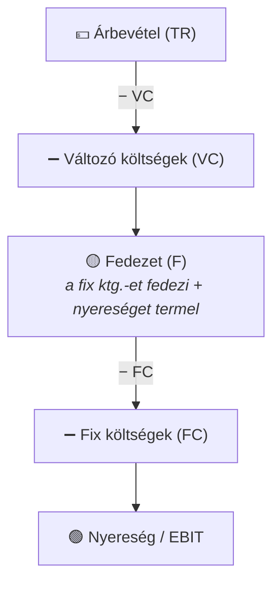
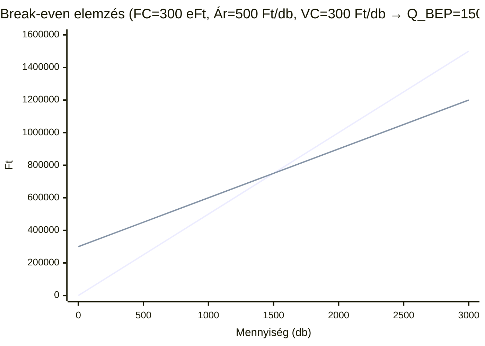

## K17 – Kalkulációs módszerek és fedezetszámítás a vezetői döntésekben

### A kalkuláció fogalma és típusai

A **kalkuláció** az egységnyi termékre (vagy szolgáltatásra) vetített önköltség meghatározása. Három időbeli típusa van:

| Típus | Mikor? | Cél |
|---|---|---|
| Előkalkuláció | Gyártás előtt | Árajánlat, döntési alap |
| Közbenső kalkuláció | Gyártás közben | Folyamatkövetés, eltérések |
| Utókalkuláció | Gyártás után | Tényleges önköltség, visszacsatolás |

### Kalkulációs módszerek

**1. Osztókalkuláció** – homogén termék esetén:

```
Önköltség = Összes költség / Termékmennyiség

Pl.: 10 000 db termék, összes ktg. = 5 000 000 Ft
    → Önköltség = 500 Ft/db
```

**2. Egyenértékszámos kalkuláció** – rokon termékek, ahol egy „alapcikk" többi arányát koefficiensekkel fejezzük ki:

```
Pl.: A termék = 1,0 ; B termék = 0,8 ; C termék = 1,3
    Egyenértékmennyiség = Σ(db × koefficiens)
    Önköltség/egység = Összes ktg / Egyenértékmennyiség × koefficiens
```

**3. Pótlékoló kalkuláció** – heterogén termékek esetén a közvetett költségeket vetítési alap arányában osztják szét:

```
Pótlékkulcs = Közvetett ktg. / Vetítési alap (pl. közvetlen bér)

Pl.: Közvetett ktg. = 3 500 000 Ft, Közvetlen bér = 1 000 000 Ft
    → Pótlékkulcs = 350%
    A-termék közvetlen bére: 200 000 Ft → Felszámított rezsi: 700 000 Ft
```

**4. Normatív (standard cost) kalkuláció** – előre meghatározott normák alapján; az eltérés a hatékonysági különbséget mutatja.

**5. ABC-kalkuláció (Activity-Based Costing)** – a közvetett költségeket **tevékenységekhez**, majd tevékenységekből termékekhez rendeli. Pontosabb, de adatigényesebb.

### ÁKFN-struktúra és fedezetszámítás

Az **Ár–Költség–Fedezet–Nyereség** struktúra a controlling egyik leghasznosabb döntési kerete:



**Fedezet = az az összeg, amely a fix költségeket fedezi és nyereséget termel.**

Két vállalat összehasonlítása (10%-os forgalomcsökkenésnél):

| | A vállalat | B vállalat |
|---|---|---|
| Árbevétel (–10%) | 90 | 90 |
| Változó ktg. | 72 (magas VC) | 9 (alacsony VC) |
| Fedezet | 18 | 81 |
| Fix ktg. | 10 | 80 |
| Nyereség | 8 (–20%) | 1 (–90%) |

B vállalat rugalmasabb struktúrájú, de a magas fix ktg. miatt rendkívül érzékeny a forgalomcsökkenésre – ez az **operatív tőkeáttétel** hatása.

### Break-even elemzés (fedezeti pont)

A **fedezeti pont** az a termelési mennyiség, amelynél az összbevétel éppen fedezi az összes költséget (nyereség = 0):

```
Q_BEP = Fix ktg. / Fajlagos fedezet
      = FC / (Ár – Fajlagos változó ktg.)

Pl.: FC = 300 000 Ft, Ár = 500 Ft/db, VC/db = 300 Ft
    → Q_BEP = 300 000 / 200 = 1 500 db
```

**Grafikusan:**



> **Irodalom:** Katona F.: CONTROLLING 3., 4., 5. ea.; Francsovics A.: Controlling, 2.2–2.3. alfejezet; Kaplan–Cooper: Költség & Hatás (2001)

---