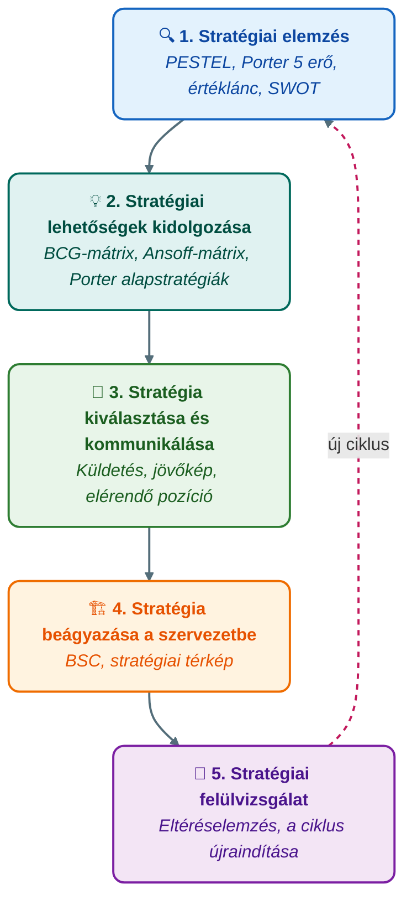
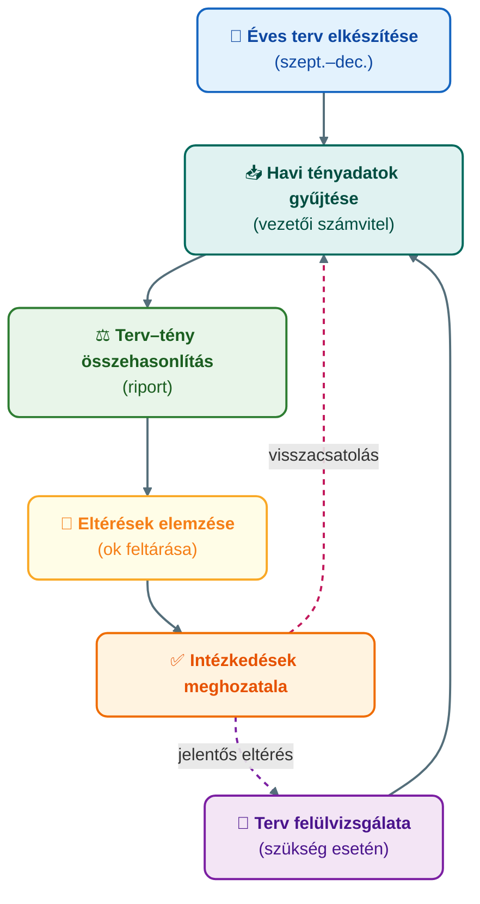

## K18 – Stratégiai és operatív controlling

**Tétel:** Stratégiai és operatív controlling: Stratégiai és operatív controlling. A stratégiai tervezés fogalma és szakaszai. A stratégiai controlling fogalma, feladata, eszközei. Az operatív controlling fogalma, szerepe, feladatai. Stratégiai és operatív controlling összehasonlítása. A controlling szerepe a versenyképesség javításában.

---

### A stratégiai tervezés fogalma és szakaszai

A stratégiai menedzsment a vállalat **hosszú távú versenyképességét** alapozza meg. Lépései (Katona, EA 9.):

### Stratégiai controlling

A stratégiai controlling legfontosabb feladata: **a stratégiai folyamatok koordinálása és a stratégiai döntések információellátása**.

Fő eszközei:

| Eszköz | Funkció |
|---|---|
| PESTEL-elemzés | Tág külső környezet feltérképezése |
| Porter 5 erő | Iparági versenyhelyzet elemzése |
| SWOT | Belső erőforrások vs. külső lehetőségek |
| GAP-elemzés | Jelenlegi és kívánt teljesítmény különbsége |
| Balanced Scorecard | Stratégiai célok lebontása és mérhetővé tétele |
| Stratégiai térkép | Ok-okozati összefüggések vizualizálása |

### Operatív controlling

Az operatív controlling az **éves tervezési ciklus** és a **folyamatos terv–tény követés** eszköze. Időhorizontja 1 év (vagy annál rövidebb).

Az operatív controlling folyamata:

### Stratégiai és operatív controlling összehasonlítása

| Szempont | Stratégiai controlling | Operatív controlling |
|---|---|---|
| Időhorizont | 3–10 év | ≤1 év |
| Cél | Versenyképesség megőrzése | Éves célok teljesítése |
| Fókusz | Lehetőségek, kockázatok | Hatékonyság, eltérések |
| Mutatók | Piaci pozíció, innováció, BSC | ROI, fedezet, forgalom |
| Eszközök | SWOT, BSC, stratégiai térkép | Éves terv, riport, eltéréselemzés |
| Döntések jellege | Strukturálatlan, komplex | Részben strukturált, rutinszerű |

### Teljesítménymérés és mutatószámrendszerek (KPI)

A controlling a stratégiai célokat **mérhető mutatószámokká (KPI)** fordítja le. Egy jó mutatószámrendszer hierarchikus és ok-okozati — a csúcsmutatóból részmutatókra bontható. Klasszikus példa a **DuPont-mutatószámfa**:

$$\text{ROI} = \underbrace{\frac{\text{Eredmény}}{\text{Árbevétel}}}_{\text{árbevétel-arányos nyereség (ROS)}} \times \underbrace{\frac{\text{Árbevétel}}{\text{Lekötött tőke}}}_{\text{eszközforgás}}$$

Ez megmutatja, hogy a megtérülés a **margin** és a **forgási sebesség** szorzata — két különböző irányból javítható. A mutatószámrendszer tervezésének elvei: a mutatók legyenek **befolyásolhatók** (a felelős egység által), **egyértelműek**, **konzisztensek** (ne ösztönözzenek ellentétes viselkedésre), és tartalmazzanak pénzügyi és nem pénzügyi mutatót egyaránt. A kizárólag pénzügyi, visszatekintő mutatók egyoldalúságát a Balanced Scorecard hivatott feloldani (részletesen: K20).

### EVA és értékalapú menedzsment

Az **EVA** (Economic Value Added; Stewart, 1991) azt méri, mennyivel hoz a vállalat **a tőke alternatívaköltsége felett**:

$$\text{EVA} = \text{NOPAT} - (\text{befektetett tőke} \times \text{WACC})$$

ahol NOPAT = adózott üzemi eredmény, WACC = súlyozott átlagos tőkeköltség.

*Példa:* NOPAT = 120 M Ft, befektetett tőke = 800 M Ft, WACC = 12% → EVA = 120 − 96 = **+24 M Ft** → értékteremtés. Pozitív EVA = értékteremtés; negatív EVA = értékrombolás akkor is, ha a számviteli eredmény pozitív.

Az EVA a befektetési központok (K16) teljesítményének piaci szemléletű mutatója, és a BSC pénzügyi nézőpontjának (K20) gyakori csúcsmutatója.

### A controlling szerepe a versenyképesség javításában

A stratégiai és operatív controlling **egymást erősítik**: a stratégiai célokat az operatív tervek valósítják meg, az operatív eltérések visszacsatolnak a stratégiai felülvizsgálatba. Ezt a kört a **BSC zárja össze** – részletesen: K20 tétel.

> **Irodalom:** Horváth & Partners. (2008). *Controlling: Út egy hatékony controllingrendszerhez*. Complex Kiadó. — Porter, M. E. (1985). *Competitive advantage*. Free Press. — Stewart, G. B. (1991). *The quest for value*. Harper Business. — Francsovics, A. (é. n.). *Controlling* [elektronikus tankönyv]. — Katona F.: CONTROLLING 7., 9. ea.

---
