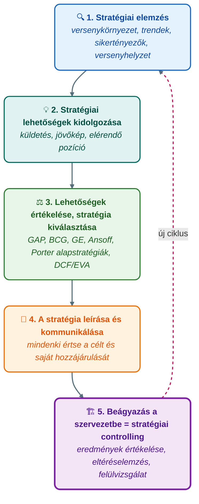
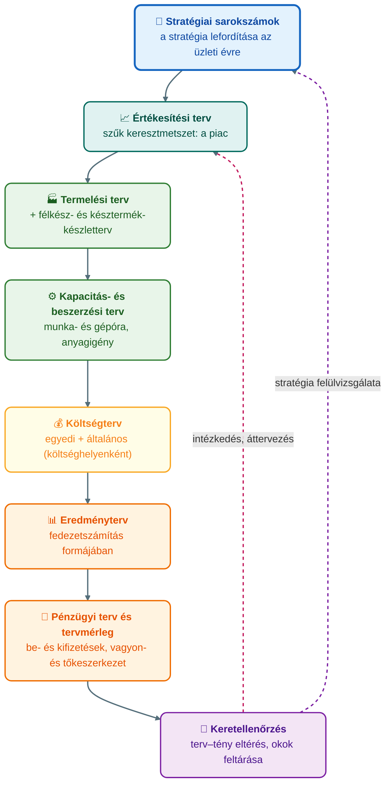

## K18 – Stratégiai és operatív controlling

### Beszerzendő anyagok

| Szerző | Mű | Jelleg | Indoklás / érintett rész |
|---|---|---|---|
| — | GIXVS2MBLF syllabus / tantárgynyilvántartó adatlap | syllabus | A tárgy mappájában nincs; a heti tematika és a kötelező irodalom csak az 1. előadás 2. diájából rekonstruálható. |
| Francsovics A. | *Controlling – elmélet és módszertan* (Budapest, 2010) | kötelező irodalom | Az 1. előadás kötelező irodalomként nevezi meg; a stratégiai és operatív tervezés, valamint a két controlling-szint (R1–R3) a helyi 2011-es e-jegyzet 3. fejezetére épül, a nyomtatott kötet bővebb lehet. |
| Horváth P. – Dobák M. | *Controlling: a sikeres vezetés eszköze* (KJK, Budapest, 1990) | ajánlott irodalom | A jegyzet hivatkozott forrásmunkája; a tervezés fogalma és a controlling stratégiai–operatív tagolása (R1, R4) erre épül, a mappában nincs meg. |

**Tétel:** Stratégiai és operatív controlling. A stratégiai tervezés fogalma és szakaszai. A stratégiai controlling fogalma, feladata, eszközei. Az operatív controlling fogalma, szerepe, feladatai. Stratégiai és operatív controlling összehasonlítása. A controlling szerepe a versenyképesség javításában.

---

### A stratégiai tervezés fogalma

A tervezés a controlling rendszer célképző eleme: a vállalati célok, az elérésükhöz szükséges eszközök és intézkedések összehangolása a tervezés keretében történik, és ez nem szorítkozhat a célok egyszerű kijelölésére, hanem az alkalmazkodási és igazgatási intézkedések folyamatos kidolgozására is ki kell terjednie (Horváth & Dobák, 1990, idézi Francsovics, 2011, 65. o.). A **stratégiai tervezés** a tervezői felfogásban olyan tervezési folyamat, amelynek során a vállalat részletesen elemzi jelenlegi helyzetét, meghatározza jövőre vonatkozó elképzeléseit és céljait, áttekinti ezek megvalósítási módjait, és kiválasztja közülük azt, amit követni tud (Chikán, 1992, idézi Francsovics, 2011, 65. o.). A stratégiai terv a stratégiai célok elérésére kidolgozott, dokumentált akciósorozat (Francsovics, 2011, 66. o.).

A jegyzet Mintzberg **5P-modelljével** árnyalja a fogalmat: a stratégia egyszerre terv (plan), sikert biztosító viselkedés (ploy), összehangolt rendszer (pattern), a vállalat helye a környezetben (position) és a jövőt építő koncepció (perspective) (Mintzberg, 1973, idézi Francsovics, 2011, 66. o.). Az eltervezett stratégia sosem valósul meg maradéktalanul: a szándékolt elemek mellett megvalósulatlan elemek és felmerülő tényezők alakítják a **megvalósult stratégiát** (Francsovics, 2011, 3.2 ábra) – ezért kell a stratégiát nemcsak megalkotni, hanem folyamatosan követni is; ez a stratégiai controlling létjogosultsága.

A stratégiai tervezés a controlling **célrendszerének** csúcsa: a **stratégiai vállalati célok** (piac, árbevétel, költségek, fedezeti mutatók, beruházás) **stratégiai szakterületi célokra** bomlanak (marketing, termelés, műszaki, gazdasági), ezekből erednek az **operatív intézkedések céljai** (forgalom-, munkaerő-, költség-, karbantartás-, beszerzéstervezés), végül az eredmény-, likviditás-, mérleg- és beruházástervezés (Francsovics, 2011, 3.4 ábra). A beruházások tervezése a stratégiai tervezés körébe tartozik, mert a beruházással a vállalkozás jövőbeni sorsát döntjük el (Francsovics, 2011, 47., 69. o.).

### A stratégiai tervezés szakaszai

A stratégiai tervezés az előadásanyagban a **stratégiai menedzsment** folyamatába ágyazva jelenik meg, öt lépésben (Katona, 2021b):

1. **Stratégiai elemzés:** a versenykörnyezet vizsgálata – trendek és forgatókönyvek, a kiszolgálni kívánt piacok és ügyfelek, az ágazat sikertényezői, a versenytársak és a vállalat versenyben elfoglalt helye.
2. **Stratégiai lehetőségek kidolgozása:** az elemzésből és a vezetők elképzeléseiből kialakul az alapvető stratégiai irányvonal, amely a **küldetésben** (a vállalat szerepe, létének értelme, értékei), a **jövőképben** (határidős fejlődési irányok; motivál és iránymutatást ad) és az **elérendő pozícióban** (a megcélzott jövőbeli versenyhelyzet) fogalmazódik meg; ebből ered a versenytársaktól megkülönböztető üzleti modell.
3. **A lehetőségek értékelése és a stratégia kiválasztása:** nincs egyetlen út; a lehetőségeket kvantitatív és kvalitatív módszerekkel értékelik.
4. **A stratégia leírása és kommunikálása:** a kiválasztásból még nem következik a magatartás megváltozása, ezért minden egységnek és személynek értenie kell a célállomást és a saját hozzájárulását.
5. **Beágyazás a szervezetbe – stratégiai controlling:** az operatív működésben folyamatosan értékelik az eredményeket, és az eltéréselemzés, valamint a stratégia felülvizsgálata alapján újra végigjárják a folyamat lépéseit (Katona, 2021b).

A jegyzet Könczöl (1989) nyomán ugyanezt három tömbben adja: **helyzetelemzés** (külső és belső) → **stratégiai döntések** (alternatívák, vállalati stratégia, stratégiai célok) → **megvalósítás** (teljesítmény); saját modelljében a környezet- és a belső helyzetelemzés közötti **egyensúlykeresést** emeli ki, amelyből a lehetséges akciók, a döntés és a megvalósítás következnek (Francsovics, 2011, 3.1 és 3.3 ábra).

### A stratégiai controlling fogalma, feladata és eszközei

A stratégia kialakításánál meg kell különböztetni a stratégiai és az operatív célmeghatározást és tervezést, ennek megfelelően a controlling is **stratégiai és operatív controllingra** tagozódik. A **stratégiai controlling** azt jelenti, hogy a jövőbeli esélyeket és kockázatokat szisztematikusan felismerjük, és a vállalati politikát ehhez igazítjuk; a lehetőségek és kockázatok csak meghatározott célokkal kapcsolatban értelmezhetők, az egyeztetett stratégiai célokból pedig alternatív stratégiákat kell kifejleszteni (Francsovics, 2011, 67. o.). Röviden: a stratégiai controlling a **sikerpotenciálokat** elemzi (Francsovics, 2011, 151. o.).

Az előadás szerint a stratégiai controlling legfontosabb **feladata** a stratégiai folyamatok koordinálása és a stratégiai döntésekhez szükséges információkkal való ellátás. A stratégiai menedzsment az eredménypotenciálok kiépítésére törekszik; feladatai: a vállalat és a környezet kapcsolatának vizsgálata, a környezethez való adaptáció; az esélyek és veszélyek, erős és gyenge pontok feltárása; a stratégiai terv kidolgozása és nyomon követése, a sikerpotenciálok meghatározása a vállalat jövőjének biztosítására (Katona, 2021b).

**Eszközei** az elemzés négy szintjén (Katona, 2021b):

| Szint | Eszközök |
|---|---|
| Tág környezet | PESTEL-elemzés, gyémánt-modell |
| Iparági környezet | Porter-féle versenyhelyzet-elemzés (öt erő), iparági életciklus-modell, sikertényezők meghatározása |
| Működési környezet | stratégiai csoportok, fogyasztói igény- és értékelemzés, versenytárselemzés, piaci szegmentáció |
| Belső erőforrások | Porter-féle értéklánc-elemzés, benchmarking, érintettek érdekeinek elemzése, SWOT |

A **stratégiaválasztás eszközei**: a vállalati célokhoz GAP- és szcenárióelemzés; a piaci növekedéshez BCG-, GE- és Ansoff-mátrix, Porter-féle alapstratégiák; a stratégiai opciók rendezéséhez morfológiai és szelekciós mátrix; az értékorientált módszerek közül a DCF-alapú vállalatértékelés és az EVA (gazdasági hozzáadott érték) (Katona, 2021b). A megvalósítás és a visszacsatolás eszköze a **Balanced Scorecard**: célja a stratégia megvalósításának támogatása, folyamata a jövőkép és a stratégia tisztázása, a stratégiai célok és mutatók összekapcsolása és lebontása, a stratégiai és az üzleti tervezés összekapcsolása, végül a stratégiai visszacsatolás és tanulás, a hipotézisek ellenőrzése (Katona, 2021b; részletesen a K20 tételben).

### Az operatív controlling fogalma, szerepe és feladatai

Az **operatív controlling** feladata, hogy a tervezéssel, az előirányzott és a tényleges értékek összehasonlításával elérje a szokásos **nyereség- és fizetőképességi előirányzatot** (Francsovics, 2011, 151. o.). A ráfordítással és eredménnyel kapcsolatos folyamatokra fókuszál, míg a stratégiai controlling a vezetést a környezet változásaihoz való rugalmas alkalmazkodásban, a hosszú távú működésben támogatja. Az operatív menedzsment feladatai: a vállalati folyamatok hatékonyságának biztosítása; a taktikai és operatív tervek, valamint a költségvetés kidolgozása; a tervek végrehajtásának nyomon követése; a ráfordítás–hozam, illetve költség–teljesítmény viszonyok optimumának biztosítása (Katona, 2021b). Időtávját tekintve a controlling jövőorientációja három szintet különböztet meg: éves tervek a vállalat egészére és egységeire analitikus szinten, 3–5 éves középtávú tervezés aggregált szinten, és stratégiai tervezés a felső szintű célokkal és akciókkal (Katona, 2022).

Az operatív tervben a teljesítmény-előállítás és -felhasználás **rövid távú összehangolása** történik: adott kapacitásokból és termékkínálatból indulunk ki; az erőforrások optimális felhasználása, a gyártási folyamat és a rendelések megtervezése operatív feladat (Francsovics, 2011, 69–70. o.). Az **éves tervezés** a vezetői számvitel információira alapozva dolgozza ki a konkrét célokat az egyes egységek számára, hátterét a stratégiai és a többéves üzleti tervezés adja; minden egység tervet kap, amely céljait teljesítmény, költség, bevétel formában számszerűen rögzíti (Katona, 2021a). A tervezést mindig a **szűk keresztmetszettel** kell kezdeni, ami rendszerint a piac, ezért az értékesítési tervvel indul; erre épül a termelési terv (a készlettervvel), a kapacitás- és beszerzési terv, a költségterv (egyedi és általános költségek, költséghelyenként), majd az eredményterv – gyakran fedezetszámítás formájában –, a pénzügyi terv (be- és kifizetések) és a tervmérleg (Katona, 2021a; Francsovics, 2011, 70–71. o.).

Az operatív controlling kulcseleme a **kerettervezés** (budget): minden vállalati tevékenységet a pénzértékben kifejezett, formalizált célokhoz igazít. Folyamata: a vezetés stratégiai elképzeléseit sarokszámokká fordítják az üzleti évre; a divíziók ezek alapján készítik egyéni terveiket, előbb mennyiségben, majd értékben; a controlling a tervezési naptár segítségével összehangolja a résztervezést, eredménytervvé ötvözi és a vezetés elé viszi; végül a keretek betartása a **keretellenőrzés** (beszámolás) tárgya, amely nem merül ki az eltérések rögzítésében, hanem az okok feltárását és a jelentőség megbecslését végzi az eltéréselemzés módszereivel (Katona, 2021a). A nehezen mérhető outputú költséghelyek kerettervezését az általános költségek értékelemzése (ÁÉE) és a nulla bázisú tervezés (ZBB) segíti, utóbbi az éves általános költségeket 7–14%-kal csökkentheti (Katona, 2021a).

Az operatív controlling információs eszközei a **mutatók és mutatószám-rendszerek**: a tervezés, irányítás és ellenőrzés segédeszközei, segítségükkel végezhetők el az eltéréselemzések. Kialakításuk szempontjai: a mutatók legyenek mérhetők, a terv–tény összehasonlítás azonos időhorizontra készüljön, biztosítani kell a kontinuitást, és az információbővítésnél költség/haszon vizsgálatot kell végezni (Francsovics, 2011, 117–118. o.). A jegyzet Preißler kis- és középüzemi mutatószámrendszerét mutatja be, amelynek csúcsmutatója a befektetett tőke megtérülése:

$$\text{ROI} = \underbrace{\frac{\text{nyereség}}{\text{árbevétel}}}_{\text{árbevételarányos nyereség}} \times \underbrace{\frac{\text{árbevétel}}{\text{tőke}}}_{\text{tőke forgási sebessége}}$$

A felbontás a jövedelmezőségi és költségstruktúra, illetve a vagyonösszetétel oldaláról egyaránt megmutatja, min keresztül javítható a megtérülés (Francsovics, 2011, 119. o.); az ROI mérése történetileg a DuPont Powder Company diverzifikált szervezetének ellenőrzéséből ered (Francsovics, 2011, 20. o.).

### Stratégiai és operatív controlling összehasonlítása

Az előadás a két szintet hat jellemző mentén állítja szembe (Katona, 2021b):

| Jellemző | Stratégiai controlling | Operatív controlling |
|---|---|---|
| Orientáció | környezet és vállalat adaptációja | a vállalati, üzemi folyamatok gazdaságossága |
| Vezetési célok | létbiztonság hosszú távon, eredménypotenciálok | nyereség, gazdaságosság, likviditás, termelékenység |
| Controlling-célok | jövőbeli sikerpotenciálok feltárása, megteremtése, megtartása | a vállalati, üzemi folyamatok rentabilitásának biztosítása |
| Tervezési fokozat | stratégiai tervezés | taktikai és operatív tervezés, költségvetés |
| Dimenziók | esélyek/veszélyek, erős/gyenge pontok | ráfordítás/hozam, költség/teljesítmény, bevétel/kiadás, vagyon/tőke |
| Információs források | elsődlegesen a környezet | elsődlegesen a belső számvitel |

A két szint között az előadás egy köztes réteget is megnevez, a **stratégiai költségmenedzsmentet**: ez a piac, a termék és az üzemi folyamatok összekapcsolására irányul, a termékéletciklus fázisait átfedve minden tervezési lépcsőt érint, dimenziói a piacorientált, hosszú távú költségértékek és -előirányzatok, célja a hosszú távú nyereség (Katona, 2021b).

### A controlling szerepe a versenyképesség javításában

A stratégia lehetővé teszi, hogy a vállalat hosszú távra **versenyképességet biztosító pozíciót** építsen ki, és tartósan növelje a vállalat értékét (Katona, 2021b); a controlling ehhez mindkét szinten hozzájárul. A controlling szemlélete eleve versenyorientált: a **döntésorientáltság** célja, hogy jól előkészített döntésekkel a vezetést állandó versenyhelyzetben tartsa, stratégiai és operatív szinten egyaránt; a **szűk keresztmetszet-orientáció** az eredménypotenciálokra koncentrál; a **jövőorientáció** a múltbeli tényadatok helyett a jövőre fókuszál; a cselekvés- és megoldásorientáltság a tények mellett javaslatokat követel (Katona, 2022).

Operatív szinten a versenyképesség a gazdaságosság, a nyereség és a likviditás folyamatos biztosítását jelenti: a controlling időszerű információt ad a piac és az értékesítés alakulásáról, a fedezeti hozzájárulásról, a költségek összetételéről és tervtől való eltéréséről, a rendelésállományról, a fizetőképesség egyensúlyáról és a beruházások előrehaladásáról, hatását pedig **tanulási folyamatban** fejti ki a vállalat minden területén (Francsovics, 2011, 151. o.). A ZBB és az értékelemzés közvetlen költségcsökkentést hoz, a keretellenőrzés pedig az eltérések okainak feltárásával korrekcióra ad lehetőséget (Katona, 2021a).

Stratégiai szinten a controlling a sikerpotenciálok feltárásával és megtartásával szolgálja a versenyképességet. Kaplan és Norton kritikája szerint a vállalatok nagy része nem hozza összhangba teljesítményértékelési rendszerét a stratégiájával, a meglévő folyamatok javítására törekszik a stratégiai folyamatok azonosítása helyett, a stratégiai és az operatív irányítás között nincs megfelelő kapcsolat, és a pénzügyi mutatók nem mutatják meg, honnan származnak az eredmények (Katona, 2021b). A BSC éppen ezt a szakadékot hidalja át, mert összekapcsolja a stratégiai és az üzleti tervezést, és a stratégiát a mindennapi tevékenységhez köti. Ugyanebbe az irányba mutat a controlling felfogásának változása: az „őrkutya” szerepből **üzleti partner** lesz, az operatív fókuszt stratégiai és operatív váltja fel, a tranzakciókezelést értékközpontúság, a kizárólag pénzügyi és belső adatokat nem csak pénzügyi mutatók és piacorientáltság (Katona, 2022).

### Összegzés

A stratégiai és az operatív controlling nem két külön rendszer, hanem a controlling szabályozókörének két szintje. A stratégiai tervezés a sikerpotenciálokat és a célokat jelöli ki, a stratégiai controlling ezek feltárását és nyomon követését koordinálja és látja el információval; az operatív tervezés a sarokszámokból kiindulva, a piaci szűk keresztmetszettől a tervmérlegig számszerűsíti az éves célokat, az operatív controlling pedig a terv–tény összehasonlítással a nyereség- és likviditási előirányzat teljesítését biztosítja. A keretellenőrzés eltéréselemzése és a stratégia felülvizsgálata zárja a kört: az operatív tapasztalat visszahat a stratégiára, a szándékolt és a megvalósult stratégia közötti távolság így csökkenthető – ez a controlling hozzájárulása a tartós versenyképességhez.

---

### Várható vizsgáztatói kérdések

1. **Mi a különbség a stratégiai és az operatív controlling kérdésfeltevése között?** — A stratégiai controlling a sikerpotenciálokat elemzi, a jövőbeli esélyek és kockázatok szisztematikus felismerésére és a vállalati politika ehhez igazítására irányul; az operatív controlling a tervezéssel és a terv–tény összehasonlítással a nyereség- és fizetőképességi előirányzat elérését biztosítja (Francsovics, 2011, 67., 151. o.). Az előadás táblája szerint az előbbi a környezethez való adaptációra és a környezeti információkra, az utóbbi az üzemi folyamatok gazdaságosságára és a belső számvitelre épül (Katona, 2021b).
2. **Miért az értékesítési tervvel kezdődik az operatív tervezés?** — Mert a tervezést mindig az előrejelezhetőség szempontjából szűk keresztmetszetet jelentő területtel kell kezdeni, ami a vállalatok többségénél a piac; az eladási terv a termelési terv kiinduló alapja, arra épül a kapacitás-, beszerzési, költség- és eredményterv (Katona, 2021a; Francsovics, 2011, 70. o.).
3. **Hogyan köti össze a Balanced Scorecard a két controlling-szintet?** — Kaplan és Norton szerint a stratégiai és az operatív irányítás közötti kapcsolat hiánya és a pénzügyi mutatók elégtelensége a fő probléma; a BSC a stratégiai célokat mutatókká bontja, összekapcsolja a stratégiai és az üzleti tervezést, és stratégiai visszacsatolást ad, így a stratégia megvalósításának ellenőrzési rendszerét teremti meg (Katona, 2021b).
4. **Mi a kerettervezés gyengesége, és mit javasol erre a beyond budgeting?** — A kerettervezés a vezetők munkaidejének 15–20%-át, a controller kapacitásának felét köti le, gyakran nem igazodik a stratégiához, a keretek mereven az időszak végéig szólnak és gyorsan elértéktelenednek, a pénzbeli tervezést ritkán egészítik ki nem pénzügyi mutatók; a better budgeting egyszerűsíteni akar, a beyond budgeting a kereteket BSC-vel, folyamatorientált teljesítményméréssel, benchmarkinggal és gördülő tervezéssel váltaná ki, relatív, kihívó célokkal és decentralizált döntésekkel (Katona, 2021a).
5. **Mi a különbség a szándékolt és a megvalósult stratégia között, és mi ebből a controlling feladata?** — Az eltervezett stratégiának csak a szándékolt elemei valósulnak meg, vannak megvalósulatlan elemek és felmerülő tényezők; ezért a stratégia beágyazásakor az operatív működésben folyamatosan értékelni kell az eredményeket, és az eltéréselemzés meg a felülvizsgálat alapján újra végig kell járni a stratégiai menedzsment lépéseit (Francsovics, 2011, 3.2 ábra; Katona, 2021b).
6. **Milyen szempontok szerint kell mutatószámrendszert kialakítani?** — A mutatók legyenek mérhetők, a terv–tény összehasonlítás azonos időhorizontra készüljön, biztosítani kell a kontinuitást, és az információbővítés költség/haszon arányát mérlegelni kell; a mutatók a tervezés, irányítás és ellenőrzés segédeszközei, és a vállalati, ágazati összehasonlítást is szolgálják (Francsovics, 2011, 117–118. o.).

---

## Irodalom

* Francsovics, A. (2011). *Controlling* [Elektronikus jegyzet]. Óbudai Egyetem, Keleti Károly Gazdasági Kar.
* Katona, F. (2021a). *CONTROLLING 7. előadás: Éves tervezés* [Előadás-prezentáció]. Óbudai Egyetem, Keleti Károly Gazdasági Kar.
* Katona, F. (2021b). *CONTROLLING 9. előadás: Stratégiai menedzsment, stratégiai controlling* [Előadás-prezentáció]. Óbudai Egyetem, Keleti Károly Gazdasági Kar.
* Katona, F. (2022). *CONTROLLING 1. előadás: A controlling fogalma, controlling koncepció, controllingrendszer, controlling feladata* [Előadás-prezentáció]. Óbudai Egyetem, Keleti Károly Gazdasági Kar.
