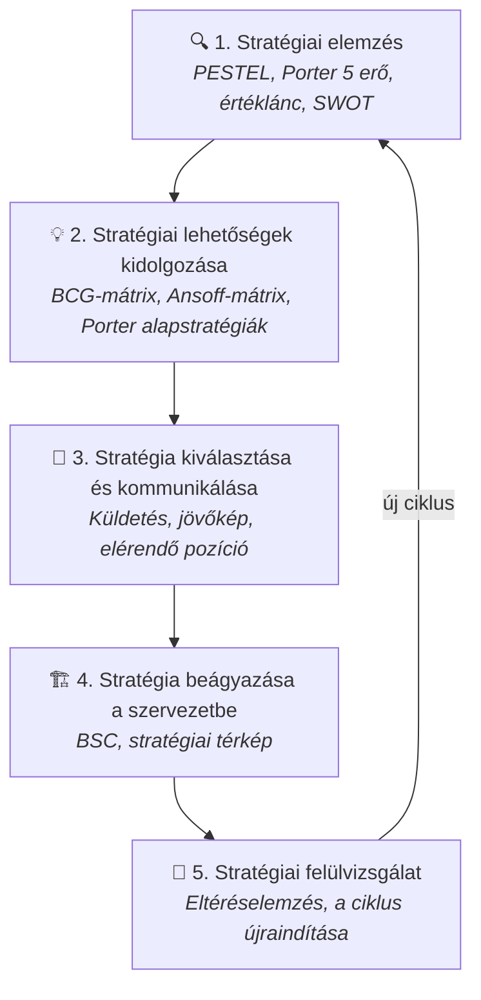
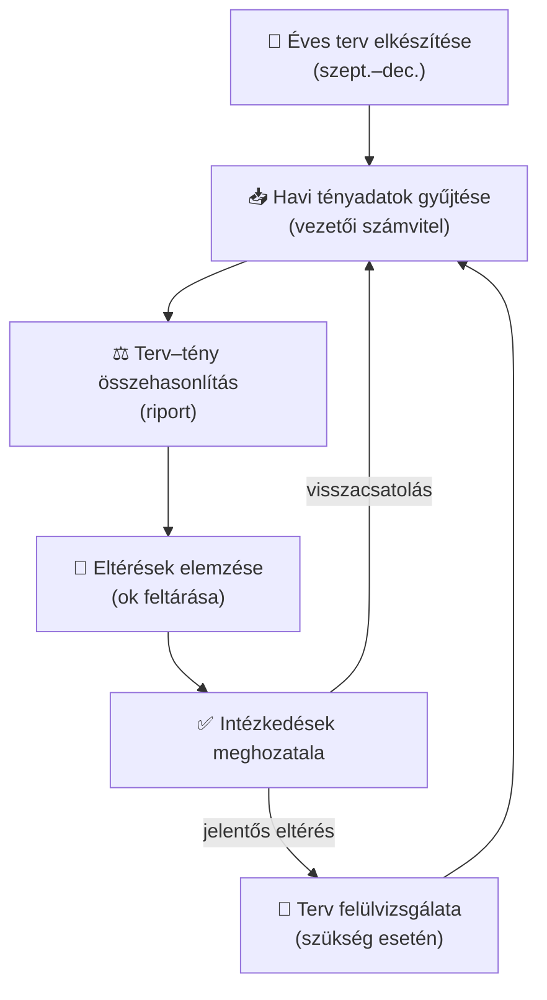

## K18 – Stratégiai és operatív controlling

### A stratégiai tervezés fogalma és szakaszai

A stratégiai menedzsment a vállalat **hosszú távú versenyképességét** alapozza meg. Lépései (Katona, EA 9.):

### Stratégiai controlling

A stratégiai controlling legfontosabb feladata: **a stratégiai folyamatok koordinálása és a stratégiai döntések információellátása**.

Fő eszközei:

| Eszköz | Funkció |
|---|---|
| PESTEL-elemzés | Tág külső környezet feltérképezése |
| Porter 5 erő | Iparági versenyhelyzet elemzése |
| SWOT | Belső erőforrások vs. külső lehetőségek |
| GAP-elemzés | Jelenlegi és kívánt teljesítmény különbsége |
| Balanced Scorecard | Stratégiai célok lebontása és mérhetővé tétele |
| Stratégiai térkép | Ok-okozati összefüggések vizualizálása |

### Operatív controlling

Az operatív controlling az **éves tervezési ciklus** és a **folyamatos terv–tény követés** eszköze. Időhorizontja 1 év (vagy annál rövidebb).

Az operatív controlling folyamata:

### Stratégiai és operatív controlling összehasonlítása

| Szempont | Stratégiai controlling | Operatív controlling |
|---|---|---|
| Időhorizont | 3–10 év | ≤1 év |
| Cél | Versenyképesség megőrzése | Éves célok teljesítése |
| Fókusz | Lehetőségek, kockázatok | Hatékonyság, eltérések |
| Mutatók | Piaci pozíció, innováció, BSC | ROI, fedezet, forgalom |
| Eszközök | SWOT, BSC, stratégiai térkép | Éves terv, riport, eltéréselemzés |
| Döntések jellege | Strukturálatlan, komplex | Részben strukturált, rutinszerű |

### A controlling szerepe a versenyképesség javításában

A stratégiai és operatív controlling **egymást erősítik**: a stratégiai célokat az operatív tervek valósítják meg, az operatív eltérések visszacsatolnak a stratégiai felülvizsgálatba. Ezt a kört a **BSC zárja össze** – részletesen: K20 tétel.

> **Irodalom:** Katona F.: CONTROLLING 7., 9. ea.; Francsovics A.: Controlling, 3. fejezet; Horváth & Partners: Controlling (2008); Porter, M.E.: Competitive Advantage (1985)

---