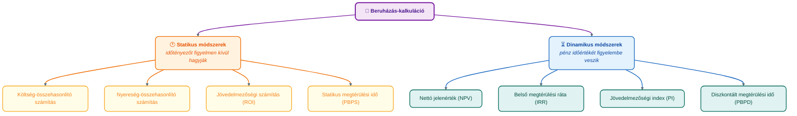

## K19 – Beruházási és befektetési döntések controlling szemléletben

**Tétel:** Beruházási döntések controlling szemléletben: Beruházási és befektetési döntések controlling szemléletben. Gazdaságossági számítások szerepe a controllingban. Statikus beruházásértékelési módszerek. Dinamikus beruházásértékelési módszerek. Nettó jelenérték (NPV) koncepció. Cash-flow szerepe a beruházási döntésekben.

---

### A beruházási controlling logikája

A beruházási controlling **nem ér véget a vásárlási döntéssel**. Három szakaszt fed le:


### Gazdaságossági számítások módszerei



### Statikus módszerek

**Megtérülési idő (PBPS)** – hány év alatt térül meg a befektetés a várható éves nyereségből/cash-flow-ból:

```
PBPS = Beruházási összeg / Éves nettó jövedelem
```

Egyszerű, de nem veszi figyelembe a pénz időértékét és az eszköz teljes élettartamát.

### Dinamikus módszerek – a pénz időértéke

Az időtényező figyelembevételéhez a jövőbeli pénzáramokat **diszkontálni** kell (jelenértékre hozni):

```
PV = CF_t / (1 + r)^t

ahol: CF_t = t-edik évben várható cash-flow
      r = elvárt hozam (diszkontráta)
```

**Nettó jelenérték (NPV):**

```
NPV = Σ [CF_t / (1+r)^t] – I₀

ahol I₀ = kezdeti beruházási összeg

Döntési szabály: NPV > 0 → gazdaságos a beruházás
```

**Belső megtérülési ráta (IRR):** az a diszkontráta, amelynél NPV = 0. Ha IRR > elvárt hozam → érdemes megvalósítani.

**Jövedelmezőségi index (PI):**

```
PI = GPV / I₀ = Σ[PV(CF_t)] / I₀

PI > 1 → gazdaságos
```

### Számítási példa

| Év | Cash-flow (MFt) | PV (14%-on) | Kumulált NPV |
|---|---|---|---|
| 0 | –500 | –500 | –500,00 |
| 1 | 90 | 78,95 | –421,05 |
| 2 | 250 | 192,37 | –228,68 |
| 3 | 300 | 202,49 | –26,19 |
| 4 | 200 | 118,42 | **+92,22** |

NPV = **+92,22 MFt** → a beruházás gazdaságos (pozitív jelenértékű többlethozam).  
PI = 592,22 / 500 = **1,18** → minden befektetett forint 1,18 Ft jelenértéket termel.  
Diszkontált megtérülési idő: PBPD ≈ 3,22 év.

### Az IRR korlátai

Az IRR praktikus mutató, de három kritikus korlátja van (Brealey, Myers & Allen, 2020):

1. **Többszörös IRR.** Ha a pénzáram előjele többször vált (nem konvencionális cash-flow), a polinomegyenletnek több (vagy nulla) valós megoldása is lehet — az IRR nem egyértelmű.
2. **Skálaérzéketlenség.** Két, egymást kizáró projekt közül a magasabb IRR-ű nem feltétlenül teremt több *abszolút* értéket. (Pl. 50% IRR egy 1 MFt-os projekten kevesebb értéket jelent, mint 20% IRR egy 100 MFt-os projekten.)
3. **Újrabefektetési feltevés.** Az IRR implicit feltételezi, hogy a köztes pénzáramok IRR-en fektethetők újra — ez gyors IRR esetén irreális. A **módosított IRR (MIRR)** ezt korrigálja: a köztes cash-flow-kat WACC-on fekteti újra.

**Általános szabály:** egymást kizáró projektek összehasonlításakor vagy nem konvencionális cash-flow esetén az **NPV az elsődleges döntési kritérium** — az IRR ütközés esetén félrevezethet.

### Kockázatelemzés beruházásoknál

A pontbecslés (egyetlen NPV) kockázati profillá egészíthető ki három módszerrel:

| Módszer | Lényeg | Eredmény |
|---|---|---|
| **Érzékenységvizsgálat** | Egy-egy paraméter (ár, volumen, WACC) változtatása | Melyik paraméter a legkritikusabb? |
| **Szcenárió-elemzés** | Összefüggő pesszimista / reális / optimista forgatókönyvek | NPV-eloszlás három ponton |
| **Monte Carlo-szimuláció** | A bemenetek eloszlásából véletlen mintavételezés | Az NPV teljes valószínűségi eloszlása |

A szcenárió-elemzés és Monte Carlo-szimuláció megmutatja, hogy a pozitív NPV mennyire robusztus — milyen valószínűséggel marad pozitív kedvezőtlen körülmények között.

### Cash-flow szerepe

A controlling **cash-flow-t használ**, nem könyvviteli nyereséget, mert:
- A cash-flow nem torzítható amortizációs politikával.
- A likviditást tükrözi, nem csak az eredményt.
- Beruházásoknál a pénzkiáramlás/befolyás tényleges időpontja számít.

> **Irodalom:** Brealey, R. A., Myers, S. C., & Allen, F. (2020). *Principles of corporate finance* (13th ed.). McGraw-Hill Education. — Francsovics, A. (é. n.). *Controlling* [elektronikus tankönyv]. — Katona F.: CONTROLLING 6. ea.; gyak_Beruházás-contr.pdf.

---
