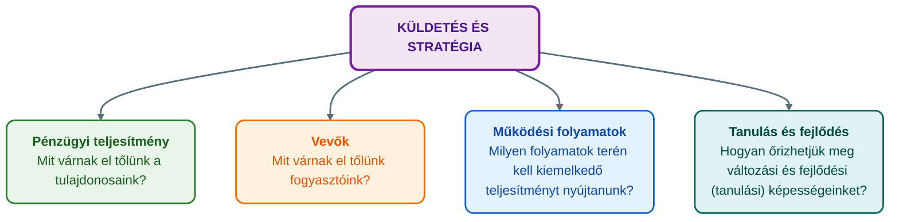

## K20 – Balanced Scorecard (BSC)

### Beszerzendő anyagok

| Szerző | Mű | Jelleg | Indoklás / érintett rész |
|---|---|---|---|
| — | GIXVS2MBLF syllabus / tantárgynyilvántartó adatlap | syllabus | A tárgy mappájában nincs; a BSC heti helye és a kötelező irodalom csak az 1. előadás 2. diájából rekonstruálható. |
| Francsovics A. | *Controlling – elmélet és módszertan* (Budapest, 2010) | kötelező irodalom | Az 1. előadás kötelező irodalomként nevezi meg; a helyi 2011-es e-jegyzet a BSC-t nem tárgyalja, a kötet pótolhatja a tétel egészét (R1–R7). |
| Francsovics A. | *Controlling integrált elmélete és gyakorlata* (Budapest, 2013) | kötelező irodalom | Az 1. előadás kötelező irodalomként nevezi meg; a BSC-fejezet a tétel egészét érintheti. |
| Kaplan, R. S. – Norton, D. P. | *Balanced Scorecard* (KJK-Kerszöv, Budapest, 2000) | ajánlott irodalom | A jegyzet irodalomjegyzékében megnevezett forrásmunka; a tétel erre épül, a mutatószám-példák és a BSC korlátainak bővítése innen volna ellenőrizhető. |
| Kaplan, R. S. – Norton, D. P. | *A stratégiaközpontú szervezet* (Panem, Budapest, 2002) | ajánlott irodalom | A jegyzet irodalomjegyzékében megnevezett; a stratégiai térkép és az ok-okozati lánc részletezése (a mutatók kapcsolata) erre épül. |

**Tétel:** Balanced Scorecard fogalma, szerepe, négy dimenziója (ezek fogalma), működése, alkalmazásnak folyamata. Mondjon példákat az alkalmazható mutatószámokra minden dimenziót tekintve, illetve mutassa be a rendszer működését és a mutatók kapcsolatát.

---

### Kiindulópont: a hagyományos teljesítménymérés problémái

A Balanced Scorecard (kiegyensúlyozott mutatószámrendszer, BSC) Kaplan és Norton nevéhez fűződik; a kutatásaik kiindulópontját az előadás 1990-re teszi (Katona, 2021b), a módszer magyarul is megjelent monográfiája Kaplan és Norton (2000). A szerzőpáros négy problémát azonosított a vállalatok teljesítményértékelési gyakorlatában (Katona, 2021b):

1. A vállalatok nagy része **nem hozza összhangba a teljesítményértékelési rendszerét a stratégiájával**.
2. A **meglévő folyamatok** teljesítményének javítására törekszenek, és nem azonosítják a **stratégiai folyamatokat**.
3. A vállalat **stratégiai és operatív irányítása** nincs megfelelő kapcsolatban egymással.
4. A **pénzügyi mutatók nem elegendőek** a teljesítmény értékeléséhez: nem mutatják meg, honnan és miből származnak az eredmények, és milyen ok-okozati összefüggés van az eredmény és a tevékenységek között.

A BSC tehát a stratégia megvalósításának eszköze, a stratégiai controlling eszköztárának része. A stratégiai controlling legfontosabb feladata a stratégiai folyamatok koordinálása és a stratégiai döntésekhez szükséges információk biztosítása (Katona, 2021b); Francsovics (2011, 67. o.) megfogalmazásában a stratégiai controlling azt jelenti, hogy a jövőbeli esélyeket és kockázatokat szisztematikusan felismerjük, és a vállalati politikát ehhez igazítjuk.

### A BSC fogalma és szerepe

A BSC arra épül, hogy a vállalat mint **komplex rendszer** viselkedése csak **sokféle mutató** alapján követhető nyomon. A BSC **két alapvetően fontos elemben** tér el a hagyományos vezetési rendszerektől (Katona, 2021b):

1. A szervezet működési állapotát **négy tényezőcsoport** – az üzleti szervezetek legfontosabb állapotjelzői – alapján írja le: a **pénzügyi**, a **piaci**, a **működési** és a **tanulási képesség** nézőpontjából.
2. Az állapotjelzők alakulását a **küldetéshez, illetve a stratégiai célokhoz méri**. Ezáltal közvetlen kapcsolatot teremt a távlatok és a szervezet mindennapi tevékenysége között, vagyis megteremti **a stratégia és a küldetés megvalósításának ellenőrzési rendszerét**.

A BSC **célja a stratégia megvalósításának támogatása** (Katona, 2021b). Ez a stratégiai menedzsment folyamatának utolsó lépéséhez, a stratégia szervezetbe ágyazásához kapcsolódik: a stratégiai szemléletnek valamennyi dolgozó cselekedetében vissza kell köszönnie, az eredményeket az operatív működésben folyamatosan értékelni kell, és az eltéréselemzésből nyert információk alapján a stratégiai folyamat lépéseit újra végig kell járni (Katona, 2021b). A BSC szerepét az is mutatja, hogy a kerettervezés megújítását célzó *beyond budgeting* irányzat a hagyományos éves kereteket éppen a balanced scorecarddal, a folyamatorientált teljesítményméréssel, a benchmarkinggal és a gördülő tervezéssel váltaná ki (Katona, 2021a).

### A négy nézőpont (dimenzió)

A BSC modelljének középpontjában a **küldetés és a stratégia** áll, körülötte a négy nézőpont, mindegyik egy-egy alapkérdéssel (Katona, 2021b):

**1. Pénzügyi nézőpont** – a tulajdonosok elvárásait fejezi ki. A stratégiai térkép sablonjában két pénzügyi stratégia jelenik meg: a **termelékenységi stratégia** (a költségstruktúra javítása, az eszközkihasználtság javítása) és a **növekedési stratégia** (a bevételi lehetőségek kiterjesztése, a vevői érték növelése) (Katona, 2021b).

**2. Vevői (piaci) nézőpont** – azt írja le, mit várnak el a fogyasztók. Középpontjában a **vevői értékelőirányzat** (vevői értékajánlat) áll, amelynek elemei a termék vagy szolgáltatás jellemzői (elérhetőség, funkcionalitás), a kiszolgálás és a kapcsolat, valamint az arculat (Katona, 2021b).

**3. Működési (belső) folyamatok nézőpontja** – azokat a folyamatokat emeli ki, amelyekben kiemelkedő teljesítményt kell nyújtani. A sablon négy folyamatcsoportot különböztet meg: a termékeket és szolgáltatásokat előállító és leszállító folyamatokat, a vevői értéket növelő folyamatokat, az új termék vagy szolgáltatás kifejlesztésének folyamatait, valamint a környezet és a közösség javítását célzó folyamatokat (Katona, 2021b).

**4. Tanulás és fejlődés nézőpontja** – a változási és fejlődési (tanulási) képesség megőrzéséről szól. Az immateriális javakat három csoportba rendezi: az emberekhez kötődő **készségek, képzés, tudás** (stratégiai munkakörcsaládok); a **rendszerek, adatbázisok, hálózatok** (stratégiai IT-portfólió); valamint a **kultúra, vezetés, összhang, teammunka** (szervezeti változás). Az értékteremtés érdekében ezeket az immateriális javakat **össze kell hangolni a stratégiával** (Katona, 2021b).

### A rendszer működése

A BSC működésének lényege, hogy a négy nézőpont állapotjelzőit nem önmagukban, hanem a küldetéshez és a stratégiai célokhoz mérve követi (Katona, 2021b). Az előadás légitársasági példája (Katona, 2021b) szerint ez a lánc minden stratégiai célnál ugyanúgy épül fel:

**stratégiai cél → mutató → célérték → kezdeményezés (akció) → költségvetés**

A stratégiai térkép a célokat és összefüggéseiket mutatja, a mutatószámrendszer minden célhoz mérőszámot és célértéket rendel, az akcióterv pedig a célérték eléréséhez szükséges kezdeményezéseket és azok költségvetését tartalmazza. A stratégiai témakör így meghatározza a stratégia egy részének teljesítéséhez szükséges folyamatot, az immateriális javakat és a kezdeményezéseket (Katona, 2021b). Ezzel a BSC a stratégiai tervezést összeköti az üzleti (operatív) tervezéssel és a kerettervezéssel.

A mutatókkal szemben a controlling általános követelményei a BSC-ben is érvényesek: a mutatóknak **mérhetőknek** kell lenniük, a terv–tény összehasonlítást **azonos időhorizontra** kell készíteni, biztosítani kell a **kontinuitást**, és az információbővítésnél **költség/haszon vizsgálatot** kell végezni (Francsovics, 2011, 117. o.). A mutatók a tervezés, az irányítás és az ellenőrzés segédeszközei, az összehasonlítás eszközei és a vezetői információk szerves részei (Francsovics, 2011, 117. o.).

### Példák az alkalmazható mutatószámokra

Az előadás légitársasági stratégiai térképe (Katona, 2021b) és a jegyzet mutatószámrendszere (Francsovics, 2011, 118–119. o.) alapján:

| Nézőpont | Stratégiai cél | Mutató | Célérték | Kezdeményezés |
|---|---|---|---|---|
| Pénzügyi | Jövedelmezőség (profit és RONA) | piaci érték | 30% éves növekedés (CAGR) | – |
| Pénzügyi | Bevételnövekedés | egy ülésre jutó bevétel | 20% CAGR | – |
| Pénzügyi | Kevesebb gép | repülőgép-lízingköltség | 5% CAGR | – |
| Vevői | Több ügyfél megszerzése és megtartása | visszatérő utasok száma; ügyfelek száma | 70%; évi 12% növekedés | CRM-rendszer alkalmazása, vevői hűségprogram |
| Vevői | Pontos szolgáltatás | FAA pontos érkezési mutató | első hely | minőségmenedzsment |
| Vevői | Legalacsonyabb ár | ügyfélrangsor | első hely | – |
| Működési folyamatok | Gyors földi fordulás | földön eltöltött idő; pontos indulás | 30 perc; 90% | ciklusidő-optimalizálás |
| Tanulás és fejlődés | Stratégiai munkakör (földi kiszolgálók) készségeinek fejlesztése | stratégiai munkakörök betöltöttsége (rendelkezésre állás) | 1. év 70%, 3. év 90%, 5. év 100% | a földi személyzet képzése |
| Tanulás és fejlődés | Stratégiai rendszerek (személyzetütemezés) | információs rendszer rendelkezésre állása | 100% | személyzetütemezési rendszer megújítása |
| Tanulás és fejlődés | A földi személyzet összehangolása a stratégiával | stratégiai tudatosság; részvényes dolgozók aránya | 100%; 100% | kommunikációs program, munkavállalói részvénytulajdon |

A pénzügyi nézőpont mutatóihoz a controlling hagyományos jövedelmezőségi mutatószámai is használhatók: az **árbevétel-arányos nyereség** (üzemi eredmény / nettó üzemi teljesítmény), a **cash flow** és annak aránya a nettó üzemi teljesítményhez, az **összes tőke jövedelmezősége**, a **saját tőke jövedelmezősége**, valamint a **ROI**, amely az árbevétel-arányos nyereség és a tőke forgási sebességének szorzataként bontható fel (Francsovics, 2011, 118–119. o.). A vevői nézőpont példái (ügyfélszám, visszatérő utasok, ügyfélrangsor) és a tanulási nézőpont példái (készségek rendelkezésre állása, stratégiai tudatosság) jól mutatják, hogy a BSC **nem pénzügyi mutatókat** is beemel, ezzel válaszol a pénzügyi mutatók elégtelenségére (Katona, 2021b).

### A mutatók kapcsolata: ok-okozati lánc és stratégiai térkép

A BSC-ben a mutatók nem egymástól független listát alkotnak, hanem a négy nézőpont **egymásra épül**. A stratégiai térkép (Katona, 2021b) ezt az összefüggésrendszert alulról felfelé mutatja be:

```mermaid
flowchart BT
    subgraph B4 ["Tanulás és fejlődés"]
        direction LR
        T1("<b>Készségek, képzés, tudás</b><br/>stratégiai munkakörcsaládok"):::turkiz
        T2("<b>Rendszerek, adatbázisok, hálózatok</b><br/>stratégiai IT-portfólió"):::turkiz
        T3("<b>Kultúra, vezetés, összhang, teammunka</b><br/>szervezeti változás"):::turkiz
    end
    subgraph B3 ["Működési folyamatok"]
        direction LR
        F1("<b>Előállító és leszállító</b><br/>folyamatok"):::kek
        F2("<b>Vevői értéket növelő</b><br/>folyamatok"):::kek
        F3("<b>Új termék / szolgáltatás</b><br/>fejlesztése"):::kek
        F4("<b>Környezet és közösség</b><br/>javítása"):::kek
    end
    subgraph B2 ["Vevői nézőpont"]
        direction LR
        V1("<b>Vevői értékelőirányzat</b><br/>elérhetőség, funkcionalitás, kiszolgálás, kapcsolat, arculat"):::narancs
    end
    subgraph B1 ["Pénzügyi nézőpont"]
        direction LR
        P1("<b>Termelékenységi stratégia</b><br/>költségstruktúra, eszközkihasználtság"):::zold
        P2("<b>Növekedési stratégia</b><br/>bevételi lehetőségek, vevői érték"):::zold
    end

    B4 -->|"immateriális javak összehangolása a stratégiával"| B3
    B3 -->|"kiemelkedő folyamatteljesítmény"| B2
    B2 -->|"vevői érték"| B1

    classDef kek     fill:#e3f2fd,stroke:#1565c0,stroke-width:2px,color:#0d47a1,rx:10,ry:10;
    classDef zold    fill:#e8f5e9,stroke:#2e7d32,stroke-width:2px,color:#1b5e20,rx:10,ry:10;
    classDef narancs fill:#fff3e0,stroke:#ef6c00,stroke-width:2px,color:#e65100,rx:10,ry:10;
    classDef turkiz  fill:#e0f2f1,stroke:#00695c,stroke-width:2px,color:#004d40,rx:10,ry:10;

    style B1 fill:#f4fbf5,stroke:#a5d6a7,stroke-width:1.5px,color:#2e7d32;
    style B2 fill:#f7f9fa,stroke:#b0bec5,stroke-width:1.5px,color:#546e7a;
    style B3 fill:#f5f9ff,stroke:#90caf9,stroke-width:1.5px,color:#1565c0;
    style B4 fill:#f7f9fa,stroke:#b0bec5,stroke-width:1.5px,color:#546e7a;

    linkStyle default stroke:#546e7a,stroke-width:2px;
```

A logika a légitársasági példán (Katona, 2021b) követhető végig: a földi személyzet képzése és a személyzetütemezési rendszer (tanulás és fejlődés) teszi lehetővé a gyors földi fordulást és a pontos indulást (működési folyamatok); ez adja a pontos szolgáltatást és – kevesebb géppel – a legalacsonyabb árat, amivel több ügyfél szerezhető és tartható meg (vevői nézőpont); a több ügyfél és a kevesebb gép együtt növeli a bevételt és a jövedelmezőséget (pénzügyi nézőpont). A mutatók kapcsolata így **ok-okozati**: az alsó nézőpontok mutatói a felsők **előrejelzői**, a pénzügyi mutatók pedig a lánc **eredményei**. Ez válaszolja meg Kaplan és Norton negyedik problémáját, vagyis hogy a pénzügyi eredmény mögött milyen tevékenységek állnak (Katona, 2021b).

### Az alkalmazás folyamata

A BSC bevezetésének és működtetésének folyamata az előadás szerint négy lépésből áll (Katona, 2021b):

1. **A jövőkép és a stratégia tisztázása**, a szervezeti egységek stratégiai céljainak meghatározása. Ez a stratégiai menedzsment korábbi lépéseire épül: a küldetés a vállalat létének értelmét, a jövőkép a fejlődés irányát és határidejét rögzíti (Katona, 2021b).
2. **A stratégiai célok és a mutatók összekapcsolása**, a stratégia megismertetése és lebontása a vállalaton belül a kidolgozott mutatók alapján. Itt készül a stratégiai térkép, és minden célhoz mutató, célérték és kezdeményezés társul.
3. **A stratégiai és az üzleti tervezés összekapcsolása**: a kezdeményezések költségvetést kapnak, így a stratégia beépül az éves tervezésbe.
4. **Stratégiai visszacsatolás**, a tanulás elősegítése és a **hipotézisek ellenőrzése**: a terv–tény eltérések alapján a vállalat felülvizsgálja a stratégiát, és szükség esetén újra végigjárja a stratégiai menedzsment lépéseit.

### Korlát

A nézőpontok közötti ok-okozati kapcsolatok a stratégiai térképen **feltevések** (hipotézisek), nem bizonyított összefüggések; éppen ezért a BSC folyamatának utolsó lépése a hipotézisek ellenőrzése és a tanulás (Katona, 2021b). A rendszer tehát csak akkor működik, ha a visszacsatolás valóban megtörténik, és a vállalat kész módosítani a célokat vagy a mutatókat, ha a feltételezett összefüggés nem igazolódik.

### A BSC és a controlling kapcsolata

A BSC a stratégiai controlling eszköze: a stratégiai folyamatok koordinálását és a döntésekhez szükséges információellátást (Katona, 2021b) azzal támogatja, hogy a hosszú távú célokat mérhető mutatókká bontja, és összeköti a stratégiai tervezést az üzleti tervezéssel. Így a K18-ban tárgyalt stratégiai és operatív controlling közötti kapcsolat – Kaplan és Norton harmadik problémája – a BSC segítségével válik kézzelfoghatóvá, a stratégia és a küldetés megvalósítása pedig ellenőrizhetővé (Katona, 2021b).

---

### Várható vizsgáztatói kérdések

1. **Miben tér el a BSC a hagyományos, pénzügyi mutatókra épülő irányítástól?** — Két elemben: négy állapotjelző-csoport (pénzügyi, piaci, működési, tanulási képesség) alapján írja le a szervezetet, és a mutatókat a küldetéshez és a stratégiai célokhoz méri, így a stratégia és a mindennapi működés között teremt kapcsolatot (Katona, 2021b). A pénzügyi mutatók önmagukban nem mutatják meg, honnan származik az eredmény (Katona, 2021b).
2. **Mi a stratégiai térkép, és mi a viszonya a mutatószámrendszerhez?** — A stratégiai térkép a négy nézőpont stratégiai céljait és ok-okozati összefüggéseit ábrázolja; a mutatószámrendszer minden célhoz mutatót és célértéket, az akcióterv kezdeményezést és költségvetést rendel (Katona, 2021b). A térkép a „miért”, a scorecard a „mennyit”, az akcióterv a „hogyan” kérdésre felel.
3. **Mondjon egy nem pénzügyi mutatót, és mutassa meg, hogyan hat a pénzügyi eredményre!** — Például a földön eltöltött idő (30 perc célérték): a gyors fordulás pontos indulást és kevesebb gép használatát teszi lehetővé, ami alacsonyabb árat és több ügyfelet, végül magasabb jövedelmezőséget eredményez (Katona, 2021b).
4. **Milyen követelményeket támaszt a controlling a mutatókkal szemben, és érvényesek-e ezek a BSC-re?** — Mérhetőség, azonos időhorizont a terv–tény összehasonlításnál, kontinuitás, költség/haszon mérlegelés az információbővítésnél (Francsovics, 2011, 117. o.). A BSC mutatóinál ugyanezek érvényesek, kiegészítve azzal, hogy minden mutatónak stratégiai célhoz kell kapcsolódnia (Katona, 2021b).
5. **Hogyan kapcsolódik a BSC a kerettervezés megújításához?** — A beyond budgeting a hagyományos éves kereteket balanced scorecarddal, folyamatorientált teljesítményméréssel, benchmarkinggal és gördülő tervezéssel váltaná ki, relatív és kihívó célokkal, decentralizált döntésekkel (Katona, 2021a).
6. **Mi a BSC fő korlátja?** — Az ok-okozati kapcsolatok hipotézisek; a módszer ezért építi be utolsó lépésként a stratégiai visszacsatolást és a hipotézisek ellenőrzését (Katona, 2021b).

---

## Irodalom

* Francsovics, A. (2011). *Controlling* [Elektronikus jegyzet]. Óbudai Egyetem, Keleti Károly Gazdasági Kar.
* Kaplan, R. S., & Norton, D. P. (2000). *Balanced Scorecard*. KJK-Kerszöv.
* Katona, F. (2021a). *CONTROLLING 7. előadás: Éves tervezés* [Előadás-prezentáció]. Óbudai Egyetem, Keleti Károly Gazdasági Kar.
* Katona, F. (2021b). *CONTROLLING 9. előadás: Stratégiai menedzsment, stratégiai controlling* [Előadás-prezentáció]. Óbudai Egyetem, Keleti Károly Gazdasági Kar.
