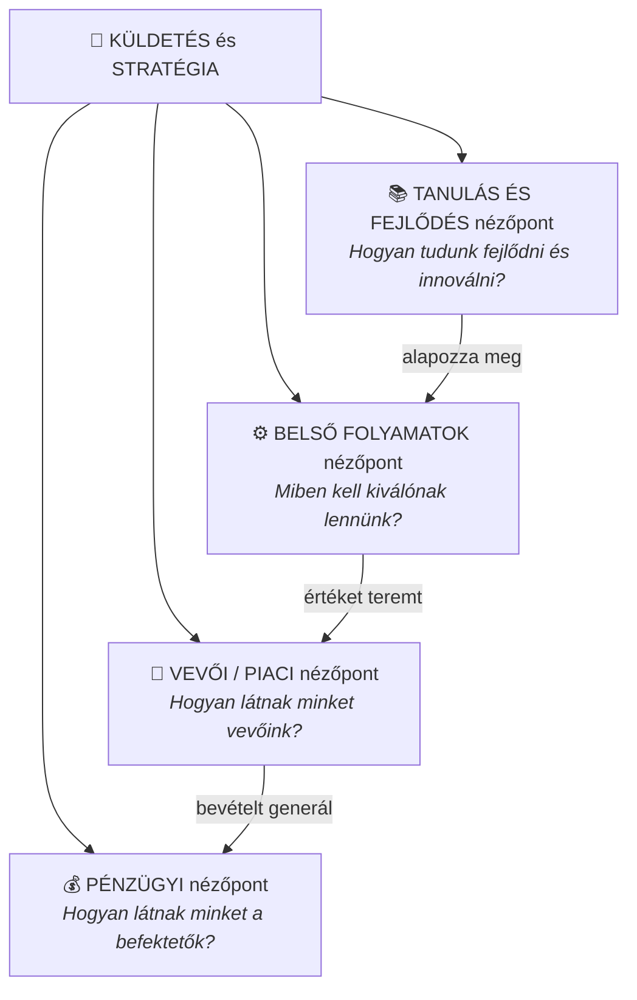
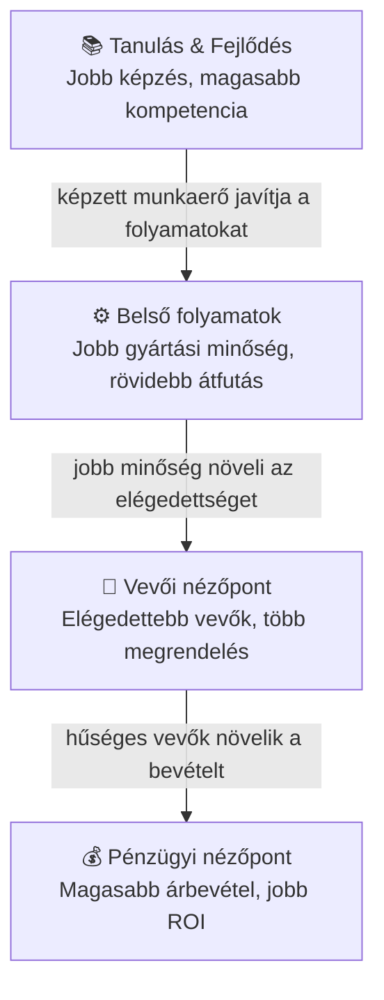

## K20 – Balanced Scorecard: fogalma, négy dimenziója, működése és alkalmazása

### A BSC fogalma és eredete

A **Balanced Scorecard (kiegyensúlyozott mutatószám-rendszer)** Kaplan és Norton nevéhez fűződik (Harvard Business Review, 1992). Alapgondolata: a vállalat működése **nem írható le csupán pénzügyi mutatókkal** – a teljesítmény csak több dimenzióból együttesen értelmezhető.

A BSC két alapvetésben tér el a hagyományos kontrolling-rendszerektől:
1. **Stratégiai célokat mér**, nem csupán pénzügyi eredményeket.
2. **Ok-okozati logikát** épít fel a négy nézőpont között.

### A BSC négy nézőpontja

### A négy nézőpont részletesen

**1. Pénzügyi nézőpont** – a tulajdonosi/befektetői szemszög:

| Stratégiai cél | Példa mutatószám |
|---|---|
| Jövedelmezőség növelése | ROE, ROI, EVA |
| Árbevétel-növekedés | Éves növekedési ütem (%) |
| Költségcsökkentés | Fajlagos önköltség (Ft/db) |
| Tőkemegtérülés | ROCE, nyereségmarzs |

**2. Vevői/piaci nézőpont** – a vevői értékajánlat mérése:

| Stratégiai cél | Példa mutatószám |
|---|---|
| Vevőelégedettség | NPS (Net Promoter Score), reklamációs ráta |
| Piaci részesedés | Piaci részesedés (%) |
| Vevőmegtartás | Churn-ráta, ismételt vásárlók aránya |
| Új vevők szerzése | Új ügyfélszerzési ráta |

**3. Belső folyamatok nézőpontja** – melyek azok a folyamatok, amelyekben kiválónak kell lennünk?

| Stratégiai cél | Példa mutatószám |
|---|---|
| Termékminőség | Selejt aránya (%), reklamáció/1000 db |
| Gyártási hatékonyság | OEE (Overall Equipment Effectiveness) |
| Átfutási idő csökkentése | Lead time, ciklusidő |
| Innováció | Új termékek aránya az árbevételből |

**4. Tanulás és fejlődés nézőpontja** – az infrastruktúra, amely az előző három nézőpontot táplálja:

| Stratégiai cél | Példa mutatószám |
|---|---|
| Dolgozói elégedettség | Dolgozói elégedettségi index |
| Képzettség fejlesztése | Képzési órák/dolgozó/év |
| Fluktuáció csökkentése | Fluktuációs ráta (%) |
| IT-rendszerek minősége | Rendszerleállás (óra/hónap) |

### Az ok-okozati lánc

A BSC kulcseleme, hogy a négy nézőpont **nem független egymástól**, hanem ok-okozati összefüggésben áll:

Ez a logika teszi a BSC-t **stratégiai irányítási rendszerré** – nem csupán mutatószám-listává.

### A BSC alkalmazásának folyamata

1. **Stratégiai célok meghatározása** (vállalatvezetés) – mi a jövőkép?
2. **Stratégiai térkép elkészítése** – az ok-okozati összefüggések vizualizálása a négy nézőponton átívelő nyilakkal (Kaplan & Norton, 2004). A stratégiai térkép azt mutatja meg, hogyan teremti meg a szervezet az értéket az immateriális eszközökből (kompetencia, kultúra, IT) kiindulva.
3. **Mutatószámok, célértékek és akciók hozzárendelése** minden nézőponthoz
4. **Felelősök és ütemterv** meghatározása
5. **Rendszeres riporting és felülvizsgálat** (negyedéves, éves)
6. **Visszacsatolás a stratégiába** – a BSC az *Execution Premium* modellben (Kaplan & Norton, 2008) a stratégia és az operatív tervezés összekötő kapcsaává válik.

### A BSC korlátai és kritikája

A BSC nem mentes a kritikáktól (Kaplan & Norton, 2008; Drury, 2018):

1. **Feltételezett ok-okozatiság.** Az ok-okozati kapcsolatok feltételezések — empirikusan nehezen igazolhatók, és **időbeli késleltetéssel** hatnak (pl. a képzési beruházás csak hónapok/évek múlva csapódik le pénzügyi eredményben). A lánc iránya megfordulhat: elégedett vevők nemcsak a jobb folyamatok, hanem pl. az alacsonyabb ár miatt is elégedettebbek.
2. **Szubjektivitás a mutatóválasztásban.** A négy nézőponthoz tartozó mutatók és célértékek kiválasztása értékítéletet igényel; különböző csapatok különböző BSC-t alkotnak ugyanarra a stratégiára.
3. **Bevezetési és karbantartási teher.** Az adatgyűjtés, IT-integráció és változásmenedzsment-igény komoly, különösen kis- és középvállalatoknál.
4. **Statikusság dinamikus környezetben.** Az évente felülvizsgált BSC lassan reagál a stratégiai fordulópontokra; dinamikus képességek és platformstratégiák (VUCA-környezet) nehezen ábrázolhatók benne.

### A BSC és a controlling kapcsolata

A BSC a stratégiai controlling egyik legfontosabb eszköze: **operacionalizálja a stratégiát** azáltal, hogy konkrét, mérhető mutatókká bontja le a hosszú távú célokat. Így a K18-ban tárgyalt stratégiai–operatív controlling kapcsolat a BSC segítségével válik kézzelfoghatóvá.

> **Irodalom:** Kaplan, R. S., & Norton, D. P. (1992). The balanced scorecard. *Harvard Business Review, 70*(1), 71–79. — Kaplan, R. S., & Norton, D. P. (1996). *The balanced scorecard*. Harvard Business School Press. — Kaplan, R. S., & Norton, D. P. (2004). *Strategy maps*. Harvard Business School Press. — Kaplan, R. S., & Norton, D. P. (2008). *The execution premium*. Harvard Business School Press. — Drury, C. (2018). *Management and cost accounting* (10th ed.). Cengage Learning. — Francsovics, A. (é. n.). *Controlling* [elektronikus tankönyv]. — Katona F.: CONTROLLING 9. ea.