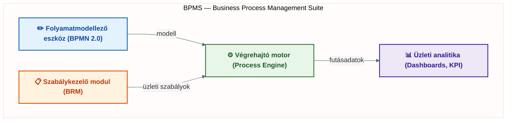

## V1 – Az üzleti folyamatmenedzsment (BPM) életciklusa és a BPMS rendszerek felépítése

**Tételkérdés:** Ismertesse a folyamatmenedzsment életciklusának szakaszait és a támogató informatikai rendszerek (BPMS) alapvető összetevőit! Értelmezze a BPMS hídszerepét az üzleti és informatikai oldal között!

---

### 1.1. A BPM fogalma

Az üzleti folyamatmenedzsment (Business Process Management, BPM) olyan irányítási szemlélet, amely a szervezet működését egymáshoz kapcsolódó folyamatok rendszereként vizsgálja és fejleszti. A BPM nemcsak folyamatábrák készítését jelenti, hanem teljes irányítási ciklust: a folyamatok azonosítását, modellezését, végrehajtását, mérését és folyamatos javítását (Dumas et al., 2018).

A modern szervezetekben a BPM szorosan összekapcsolódik az informatikával: a folyamatok zöme ERP-, CRM-, raktárkezelő vagy dokumentumkezelő rendszerekben zajlik. A BPM informatikai támogatására fejlesztették ki a BPMS-rendszereket.

### 1.2. A BPM életciklusa

A BPM életciklusa nem egyszeri projektet, hanem ismétlődő fejlesztési kört jelent. Az alábbi öt szakasz épül egymásra:

| Szakasz | Fő feladatok |
|---|---|
| **Tervezés** | Folyamatok azonosítása; folyamatgazdák kijelölése; stratégiai célok és KPI-k meghatározása |
| **Modellezés** | Vizuális folyamatleírás (BPMN, folyamatábra, értékáram-térkép); szimuláció |
| **Végrehajtás** | Manuális, félautomata vagy teljesen automatizált működtetés; BPMS-ben való indítás |
| **Monitorozás** | KPI-adatok gyűjtése; dashboardok; valós idejű felügyelet; eltérések azonosítása |
| **Optimalizálás** | Szűk keresztmetszetek megszüntetése; TO-BE folyamat bevezetése; Lean, Six Sigma, RPA |

A ciklus alapelve: az optimalizálás befejezése után a folyamat visszakerülhet a tervezési vagy modellezési szakaszba. Ez biztosítja a folyamatos fejlesztést, amely a BPM egyik sarokköve (Harmon, 2019).

### 1.3. BPMS – a BPM informatikai eszköztára

A Business Process Management Suite (BPMS) olyan integrált szoftverkörnyezet, amely az összes életciklus-szakaszt támogatja. Négy fő komponensből áll:

**Folyamatmodellező eszköz:** Grafikus felületen teszi lehetővé a BPMN 2.0-alapú modellek létrehozását. Az üzleti szakemberek programozói tudás nélkül is részt vehetnek a folyamatok tervezésében.

**Végrehajtó motor (process engine):** A folyamatmodell „lelke": elindítja a példányokat, kiosztja a feladatokat, kezeli a határidőket és döntési pontokat, kapcsolódik más rendszerekhez.

**Üzleti analitika:** KPI-mérés, riportok, dashboardok, trendek és eltérések elemzése. Ebből indul ki az optimalizálás.

**Szabálykezelő modul (Business Rules Management):** Az üzleti döntési logika (pl. értékhatár-alapú jóváhagyás) elkülönítése a programkódtól, rugalmas módosíthatóság érdekében.

### 1.4. A BPMS hídszerepe

A BPMS kulcsértéke, hogy összekötő szerepet tölt be az üzleti és IT oldal között. Az üzleti oldal folyamatalapú igényeket fogalmaz meg (gyorsabb ügyintézés, kevesebb hiba), az IT pedig rendszerekben gondolkodik. A folyamatmodell mindkét fél számára érthető közös nyelv: az üzleti oldal validálja a logikát, az IT oldal megvalósítja automatizálva.

**Összegzés:** A BPM életciklus (Tervezés→Modellezés→Végrehajtás→Monitorozás→Optimalizálás) ciklikus és folyamatos. A BPMS ennek informatikai infrastruktúrája, amelynek négy komponense (modellező, motor, analitika, szabálykezelő) együttesen teszi lehetővé a folyamatok irányítását, mérését és fejlesztését.

---
