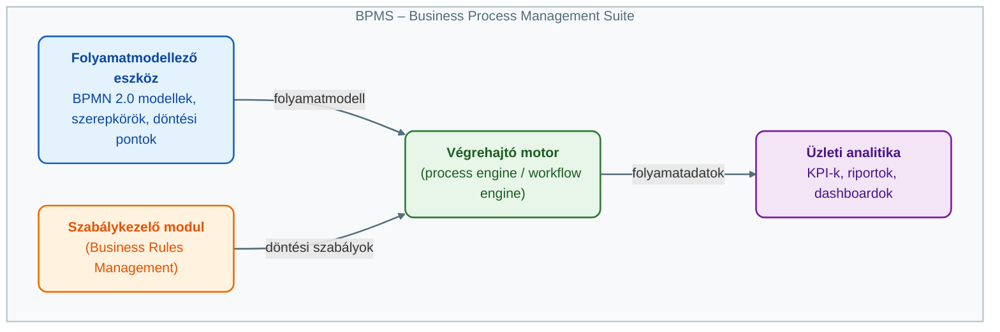

## V1 – Az üzleti folyamatmenedzsment (BPM) életciklusa és a BPMS rendszerek felépítése

**Tétel:** Az üzleti folyamatmenedzsment (BPM) életciklusa és a BPMS rendszerek felépítése: Ismertesse a folyamatmenedzsment életciklusának szakaszait és a támogató informatikai rendszerek (BPMS) alapvető összetevőit! A folyamatmenedzsment életciklusának lépései; BPMS (Business Process Management Suite) fő komponensei; Az informatika és az üzleti oldal közötti híd szerepének értelmezése a BPMS segítségével.

---

### 1.1. A BPM fogalma és szerepe

Az üzleti folyamat egymáshoz kapcsolódó, koordinált tevékenységek sorozata vagy hálózata, amely meghatározott üzleti cél elérésére irányul: bemeneteket alakít át kimenetekké, miközben értéket teremt a szervezet vagy az ügyfél számára (Novák, 2026; Óbudai Egyetem KKGK, é. n., 1. lecke). Üzleti folyamat például egy vevői rendelés feldolgozása, egy panasz kezelése vagy egy beszerzési igény jóváhagyása (Novák, 2026).

Az üzleti folyamatmenedzsment (Business Process Management, BPM) olyan vezetési és szervezési szemlélet, amelynek középpontjában a szervezet működését meghatározó üzleti folyamatok állnak. Célja, hogy ezek a folyamatok átláthatóbbak, mérhetőbbek, szabályozottabbak és fejleszthetőbbek legyenek. A BPM nem folyamatábrák készítését jelenti, hanem teljes irányítási ciklust: azonosítás, tervezés, modellezés, végrehajtás, ellenőrzés és folyamatos javítás (Novák, 2026).

A modern szervezetekben a BPM szorosan összekapcsolódik az informatikával, mert a legtöbb üzleti folyamat ma már informatikai rendszerben (ERP, CRM, HR, raktárkezelő, dokumentumkezelő) vagy annak támogatásával zajlik. A BPM informatikai támogatására alakultak ki a BPMS (Business Process Management Suite) rendszerek (Novák, 2026). A folyamatmenedzsment szervezetbe való beépítésének lépései között a tananyag külön nevesíti a technológiai támogatás kialakítását: informatikai rendszerek, workflow-megoldások és BPMS rendszerek segíthetik a folyamatok működtetését és mérését (Óbudai Egyetem KKGK, é. n., 2. lecke).

### 1.2. A BPM életciklusa

A folyamatmenedzsment nem egyszeri tevékenység, hanem ciklikus, ismétlődő fejlesztési folyamat. Egy szervezet folyamatai soha nem tekinthetők véglegesen késznek, mert a külső és belső környezet (vevői igények, jogszabályok, technológia, szervezeti struktúra) folyamatosan változik (Novák, 2026). A jegyzet szerint az életciklus leggyakrabban használt szakaszai: tervezés, modellezés, végrehajtás, monitorozás, optimalizálás. Az öt lépés egymásra épül, de nem egyszeri sorrendet jelent: az optimalizálás után a folyamat újra tervezési vagy modellezési szakaszba kerülhet, és ez biztosítja a folyamatos fejlesztést, a BPM egyik legfontosabb alapelvét (Novák, 2026).

A 9. lecke ugyanezt a körforgást hat szakaszra bontja: a tervezés elé egy önálló „előrelátás vagy stratégiai irány kijelölése” fázist tesz, amelyben a szervezet meghatározza, milyen stratégiai célokat kíván elérni (például gyorsabb ügyfélkiszolgálás, alacsonyabb működési költség), és ezekhez milyen folyamatokra van szükség (Óbudai Egyetem KKGK, é. n., 9. lecke). A két felosztás között tartalmi ellentmondás nincs: a jegyzet a stratégiai célok és a folyamatcélok összehangolását a tervezés részeként kezeli, a lecke külön fázisként nevesíti.

```mermaid
flowchart LR
    S("<b>Stratégiai irány</b><br/>(9. lecke szerint külön fázis)"):::szurke -.-> T
    T("<b>Tervezés</b><br/>folyamatok azonosítása, célok, folyamatgazda"):::kek --> M("<b>Modellezés</b><br/>AS-IS és TO-BE modell, BPMN"):::kek
    M --> V("<b>Végrehajtás</b><br/>manuális, részben vagy teljesen automatizált"):::zold
    V --> Mo("<b>Monitorozás</b><br/>KPI-k, dashboard, valós idejű felügyelet"):::narancs
    Mo --> O("<b>Optimalizálás</b><br/>fejlesztés adatok alapján"):::lila
    O --> T

    classDef kek     fill:#e3f2fd,stroke:#1565c0,stroke-width:2px,color:#0d47a1,rx:10,ry:10;
    classDef zold    fill:#e8f5e9,stroke:#2e7d32,stroke-width:2px,color:#1b5e20,rx:10,ry:10;
    classDef narancs fill:#fff3e0,stroke:#ef6c00,stroke-width:2px,color:#e65100,rx:10,ry:10;
    classDef lila    fill:#f3e5f5,stroke:#7b1fa2,stroke-width:2px,color:#4a148c,rx:10,ry:10;
    classDef szurke  fill:#eceff1,stroke:#546e7a,stroke-width:2px,color:#263238,rx:10,ry:10;

    linkStyle default stroke:#546e7a,stroke-width:2px;
    linkStyle 5 stroke:#c2185b,stroke-width:2px,stroke-dasharray: 5 5;
```

**Tervezés.** Az első szakaszban a szervezet meghatározza, milyen folyamatokat kíván kezelni, fejleszteni vagy automatizálni – nemcsak azt, hogy „mit”, hanem azt is, hogy „miért” és „kinek teremt értéket”. Fő feladatai: a folyamatok azonosítása, a folyamatgazdák kijelölése, a szervezeti célok és a folyamatcélok összehangolása, a folyamat határainak meghatározása, az érintettek azonosítása és a fő teljesítménymutatók előzetes kijelölése (Novák, 2026). Nem minden folyamat igényel ugyanolyan részletes elemzést (egy banknál a hitelbírálat, egy gyártónál a beszerzés lehet kiemelt). A tervezéshez gyakran folyamatarchitektúrát vagy folyamattérképet használnak, amely megmutatja a fő-, a támogató és az irányítási folyamatok kapcsolódását: a főfolyamatok közvetlenül értéket teremtenek a vevőnek, a támogató folyamatok (HR, pénzügy, informatika) a főfolyamatokat segítik, az irányítási folyamatok a stratégiai, vezetési és ellenőrzési feladatokat fogják össze. Kulcsszereplő a folyamatgazda, aki a folyamat teljesítményéért, szabályozottságáért és fejlesztéséért felel, és – mivel a folyamatok több szervezeti egységen haladnak át – az egész folyamatot látja (Novák, 2026).

**Modellezés.** A második szakasz célja, hogy a folyamatot vizuálisan, logikailag és szabályozási szempontból átláthatóvá tegye: tevékenységek, résztvevők, döntési pontok, kapcsolódó dokumentumok, adatok, rendszerek és a lépések sorrendje. Eszközei a folyamatábrák, a BPMN 2.0 modellek, az úszósávos diagramok, az értékáram-térképek, a döntési táblák és a szabálymodellek. Kiemelt jelentőségű a BPMN (Business Process Model and Notation), a szabványos jelölésrendszer, amellyel az üzleti és az informatikai szereplők közös nyelven írják le a folyamatokat (Novák, 2026). A modellezéshez szimuláció is kapcsolódhat, amely megmutatja, hogyan viselkedik a folyamat különböző feltételek mellett (Óbudai Egyetem KKGK, é. n., 9. lecke). A modellezés két állapotot különböztet meg: az AS-IS modell a jelenlegi működést mutatja, és a problémák, párhuzamosságok, felesleges lépések, szűk keresztmetszetek feltárását szolgálja; a TO-BE modell a tervezett, javított vagy automatizált működést írja le, és ebből vezethetők le a szükséges szervezeti, szabályozási és informatikai változtatások. A jó modell áttekinthető, szabványos, érthető, és alkalmas döntéstámogatásra vagy informatikai megvalósításra (Novák, 2026).

**Végrehajtás.** A harmadik szakaszban a modellezett folyamat ténylegesen működésbe lép. Ez történhet manuálisan (e-mail, űrlap, papír), részben automatizáltan (informatikai támogatás emberi döntésekkel) vagy teljesen automatizáltan (a rendszer önállóan végez adatellenőrzést, értesítést, rendszerközi adatátadást). Kiemelten fontos a szerepkörök és jogosultságok kezelése, a feladatkiosztás, a határidők figyelése, a döntési szabályok alkalmazása és a rendszerintegrációk működtetése. Ebben a szakaszban kap szerepet a BPMS végrehajtó motorja, amely gondoskodik arról, hogy a folyamat a modell és a szabályok szerint haladjon. Itt válik láthatóvá, hogy a modell működőképes-e; a kivételek és késedelmek tapasztalatai a következő szakaszokban hasznosulnak (Novák, 2026).

**Monitorozás.** A negyedik szakasz a folyamat működésének folyamatos megfigyelése és mérése: a tervek szerint működik-e, teljesíti-e céljait, hol jelentkeznek problémák. Gyakori teljesítménymutatók az átfutási és várakozási idő, a költség, a hibaarány, az újramunkák száma, az ügyfél-elégedettség, a határidőre teljesített ügyek aránya és a kapacitáskihasználtság. Fontos eszköz a dashboard (vezetői irányítópult), amely grafikusan mutatja a legfontosabb mutatókat. A monitorozás nemcsak utólagos elemzés, hanem valós idejű felügyelet is lehet: a BPMS jelez, ha egy jóváhagyás túl sokáig várakozik vagy egy határidő hamarosan lejár. A szervezet így adatok, nem megérzések alapján dönt; „amit mérni lehet, azt fejleszteni is lehet” (Novák, 2026).

**Optimalizálás.** Az ötödik szakasz a monitorozás adatai, tapasztalatai és visszajelzései alapján történő folyamatfejlesztés: a teljesítmény javítása, a költségek és az átfutási idő csökkentése, a hibák mérséklése, az ügyfélélmény javítása. Tipikus kérdései: hol vannak felesleges lépések, ismételt adatbevitel, várakozási idők; mely döntések automatizálhatók; mely lépések nem teremtenek értéket. Lehet kisebb javítás (űrlap egyszerűsítése, automatikus értesítés) vagy nagyobb átalakítás (újratervezés, digitalizálás, rendszerintegráció), és kapcsolódhat hozzá Lean menedzsment, Six Sigma, Kaizen, folyamat-újratervezés, automatizálás vagy robotizált folyamatautomatizálás (RPA). Az optimalizálás nem egyszeri projekt: utána a ciklus újraindul (Novák, 2026).

| Szakasz | Fő tartalom (Novák, 2026) |
|---|---|
| **Tervezés** | Folyamatok azonosítása, folyamatgazda, célok összehangolása, határok, érintettek, előzetes KPI-k; folyamattérkép |
| **Modellezés** | Vizuális és logikai leírás (BPMN 2.0, folyamatábra, úszósáv, értékáram-térkép, döntési tábla); AS-IS és TO-BE modell; szimuláció (9. lecke) |
| **Végrehajtás** | Manuális, részben vagy teljesen automatizált működtetés; szerepkörök, feladatkiosztás, határidők, integrációk; végrehajtó motor |
| **Monitorozás** | Teljesítménymutatók (átfutási idő, hibaarány, költség stb.); dashboard; valós idejű felügyelet |
| **Optimalizálás** | Felesleges lépések, várakozások, automatizálható döntések feltárása; kisebb javítás vagy nagyobb átalakítás; Lean, Six Sigma, Kaizen, újratervezés, RPA |

### 1.3. A BPMS rendszerek fogalma és fő komponensei

A BPMS (Business Process Management Suite) olyan integrált szoftveres környezet, amely a BPM életciklusának különböző szakaszait támogatja. Nem egyetlen program, hanem több funkcionális komponensből álló rendszer vagy platform. Célja, hogy lehetővé tegye a folyamatok grafikus modellezését, automatizált vagy félautomata végrehajtását, a feladatok és szerepkörök kezelését, a folyamatállapotok nyomon követését, az üzleti szabályok kezelését, a teljesítménymutatók elemzését és a rendszerek közötti adatkapcsolatok kialakítását. A BPMS így egyszerre szolgálja az üzleti és az informatikai igényeket: az üzleti oldal számára átláthatóvá és szabályozhatóvá teszi a folyamatokat, az informatika számára strukturált keretet ad a megvalósításhoz, integrációhoz és automatizáláshoz (Novák, 2026).

**Folyamatmodellező eszköz.** Grafikus felületen teszi lehetővé folyamatmodellek létrehozását, jellemzően a BPMN 2.0 szabvány támogatásával, így a folyamatok egységes, más rendszerek által is értelmezhető formában írhatók le. Feladatai: folyamatábrák, szereplők és szerepkörök, döntési pontok és feltételek, kivételek és alternatív útvonalak, dokumentáció és verziókezelés. Előnye, hogy az üzleti szakemberek programozói tudás nélkül is részt vehetnek a tervezésben, ami javítja az üzleti terület és az IT együttműködését (Novák, 2026).

**Végrehajtó motor (process engine, workflow engine).** A BPMS egyik legfontosabb technikai komponense: a folyamatmodell alapján ténylegesen irányítja a végrehajtást. Elindítja a folyamatpéldányokat, kiosztja a feladatokat a megfelelő szereplőknek, kezeli a döntési pontokat, figyeli a határidőket, továbbítja az adatokat a következő lépésekhez, kezeli a kivételeket, és kapcsolatot teremt más informatikai rendszerekkel. Egy folyamatmodell önmagában csak leírás; a végrehajtó motor teszi működő folyamattá. Egy szabadságigénylésnél például a motor továbbítja a kérelmet a vezetőnek, jóváhagyás után értesíti a HR-osztályt, és frissíti a nyilvántartást (Novák, 2026).

**Üzleti analitika.** A folyamatadatok gyűjtését, elemzését és megjelenítését támogatja: teljesítménymutatók mérése, folyamatstatisztikák, riportok, dashboardok, trendek és eltérések elemzése, vezetői döntéstámogatás. Kimutatható vele például, hogy egy folyamat átfutási ideje nő, vagy egyes feladatoknál rendszeresen torlódás keletkezik – ezek adják az optimalizálás alapját (Novák, 2026).

**Szabálykezelő modul (Business Rules Management).** Azokat a szabályokat kezeli, amelyek alapján a folyamatban döntések születnek: például 500 000 Ft alatti beszerzési igényhez elegendő az osztályvezetői, felette pénzügyi vezetői jóváhagyás is kell; kiemelt ügyfél panaszát 24 órán belül kezelni kell. Előnye, hogy az üzleti döntési logika elkülönül a programkódtól: egy értékhatár változásához elegendő lehet a szabály módosítása a szabálykezelő felületen, teljes informatikai fejlesztés nélkül (Novák, 2026).

### 1.4. A BPMS mint híd az üzleti és az informatikai oldal között

A BPMS egyik legfontosabb szerepe, hogy összekapcsolja az üzleti gondolkodást és az informatikai megvalósítást. A hagyományos szervezetekben gyakori probléma, hogy a két oldal eltérő nyelvet használ: az üzleti oldal gyorsabb ügyintézést, kevesebb hibát, egyszerűbb jóváhagyást kér; az informatika rendszerekben, adatstruktúrákban, jogosultságokban és integrációkban gondolkodik (Novák, 2026).

A BPMS azért jelent hidat, mert a folyamatmodell mindkét fél számára értelmezhető. Az üzleti szakemberek látják a folyamat logikáját, szereplőit és döntési pontjait; az informatikai szakemberek a modell alapján meg tudják határozni, milyen rendszerkapcsolatokra, adatokra, jogosultságokra és automatizmusokra van szükség. Ezzel csökken annak kockázata, hogy az IT-rendszer nem azt valósítja meg, amire az üzleti oldalnak valójában szüksége van: a közös modellezés, a szabványos jelölésrendszer és a mérhető folyamatadatok mind a jobb együttműködést szolgálják. A híd szerep különösen fontos a digitális transzformációs projektekben, mert a digitalizáció nem csupán a papíralapú folyamatok elektronikus formába helyezése; valódi eredmény akkor érhető el, ha a szervezet újragondolja folyamatait, megszünteti a felesleges lépéseket, automatizálja az ismétlődő feladatokat, és adatvezérelten fejleszt (Novák, 2026).

### 1.5. Példa: beszerzési igény kezelése BPMS-sel

A jegyzet példája egy helyen mutatja meg az életciklus és a komponensek kapcsolatát (Novák, 2026). Egy vállalatnál a beszerzési igények korábban e-mailben mentek, ezért nem lehetett tudni, kinél áll az ügy és milyen státuszban van. A **tervezési** szakaszban a vállalat stratégiai célként jelöli ki a beszerzési folyamat fejlesztését, mert sok késedelmet és hibát okoz. A **modellezés** során elkészül az AS-IS, majd a TO-BE folyamat elektronikus igénylőlappal, értékhatár szerinti jóváhagyással, automatikus értesítéssel és ERP-kapcsolattal. A **végrehajtásban** a BPMS indítja a folyamatot az űrlap kitöltésekor; a végrehajtó motor kiválasztja a jóváhagyót, továbbítja a feladatot, majd értesíti a beszerzési osztályt. A **monitorozásban** a vezetők látják, hány igény van folyamatban és hol van késedelem. Az **optimalizálás** során egyszerűsíthetők a jóváhagyási szabályok, bevezethető automatikus jóváhagyás kis értékű igényekre. A BPM adja a módszertani keretet, a BPMS az informatikai támogatást (Novák, 2026).

### 1.6. Előnyök, kihívások és bevezetési feltételek

A BPM és a BPMS alkalmazásának fő előnyei (Novák, 2026): **átláthatóság** (látható, hogyan működik a szervezet, tisztázódnak a felelősségek); **hatékonyság** (az ismétlődő adminisztráció automatizálása csökkenti a manuális munkát és a hibákat); **szabályozottság és megfelelőség** (a BPMS naplózza a lépéseket, így visszakereshető, ki, mikor, milyen döntést hozott); **rugalmasság** (egy új szabály vagy szervezeti változás gyorsabban átvezethető); **ügyfélélmény** (gyorsabb, kiszámíthatóbb folyamatok – szolgáltatóknál, bankoknál, közigazgatásban különösen).

A bevezetés kihívásai és korlátai (Novák, 2026): a leggyakoribb hiba, hogy a szervezet **túlzottan technológiai projektként** kezeli a BPMS bevezetését, holott az szervezeti és működési átalakítás eszköze is. Ha a folyamatokat csak külső tanácsadók vagy informatikusok tervezik, kimaradnak a valós tapasztalatok, és nő a felhasználói ellenállás. A másik veszély a **túlzott bonyolultság**: a sikeres projekt jól körülhatárolt, valóban fontos folyamatokra koncentrál, és fokozatosan halad. A sikeres bevezetés feltételei: vezetői támogatás, jól meghatározott folyamatcélok, az érintettek bevonása, megfelelő folyamatgazdák, reális hatókör, fokozatos bevezetés, képzés és változáskezelés. Ez egybevág a 2. leckével: a folyamatmenedzsment akkor válik a mindennapi működés részévé, ha beépül a vezetési, minőségirányítási és teljesítményértékelési rendszerbe (Óbudai Egyetem KKGK, é. n., 2. lecke).

**Összegzés.** A BPM a szervezet tevékenységeit folyamatként értelmezi, teljesítményüket méri és folyamatosan javítja. Életciklusa öt fő szakaszra bontható: tervezés, modellezés, végrehajtás, monitorozás, optimalizálás, amelyet a 9. lecke egy előzetes stratégiai fázissal egészít ki. A BPMS ezt az életciklust informatikai oldalról támogatja; fő komponensei a folyamatmodellező eszköz, a végrehajtó motor, az üzleti analitika és a szabálykezelő modul, amelyek együtt teszik a folyamatokat működtethetővé, mérhetővé és fejleszthetővé. Különleges jelentősége, hogy hidat képez az üzleti és az informatikai oldal között: az üzleti igények modellezhető és technikailag megvalósítható formába kerülnek. A BPM és a BPMS így egyszerre vezetési szemlélet, szervezési módszertan és informatikai támogatási keret (Novák, 2026).

---

### Várható vizsgáztatói kérdések

1. **Mi a különbség az AS-IS és a TO-BE folyamatmodell között?** — Az AS-IS a jelenlegi működést mutatja, célja a problémák, párhuzamosságok, felesleges lépések és szűk keresztmetszetek feltárása. A TO-BE a tervezett, javított vagy automatizált működést írja le; ebből vezethetők le a szükséges szervezeti, szabályozási és informatikai változtatások. Mindkettő a modellezési szakasz terméke (Novák, 2026).
2. **Mi a végrehajtó motor szerepe, és miért nem elég a folyamatmodell önmagában?** — A modell csak leírás; a process engine indítja a folyamatpéldányokat, kiosztja a feladatokat, kezeli a döntési pontokat és határidőket, továbbítja az adatokat, kezeli a kivételeket és kapcsolódik más rendszerekhez. Ez teszi a modellt működő folyamattá (Novák, 2026).
3. **Öt vagy hat szakaszból áll a BPM életciklus?** — A jegyzet az öt leggyakrabban használt szakaszt tanítja; a 9. lecke a tervezés elé külön „előrelátás / stratégiai irány” fázist tesz. Tartalmi ellentmondás nincs: a stratégiai célok és a folyamatcélok összehangolása a jegyzetben a tervezés része (Novák, 2026; Óbudai Egyetem KKGK, é. n., 9. lecke).
4. **Miért nem kezelhető a BPMS bevezetése pusztán informatikai projektként?** — Mert a BPMS szervezeti és működési átalakítás eszköze: felelősségeket, döntési pontokat és munkamódszereket változtat. Érintettek bevonása, folyamatgazdák, vezetői támogatás, reális hatókör, fokozatos bevezetés és változáskezelés nélkül nő az ellenállás és kimaradnak a valós tapasztalatok (Novák, 2026; Óbudai Egyetem KKGK, é. n., 2. lecke).
5. **Hogyan kapcsolódik a szabálykezelő modul a híd-szerephez?** — Az üzleti döntési logika (pl. jóváhagyási értékhatár) a programkódtól elkülönítve, az üzleti oldal számára is érthető formában kezelhető és módosítható, így egy szabályváltozáshoz nem kell teljes informatikai fejlesztés – ez közvetlenül csökkenti az üzlet és az IT közötti fordítási veszteséget (Novák, 2026).

---

## Irodalom

* Novák, G. (2026). *Számítógépes folyamatmenedzsment: Oktatási segédanyag* [Egyetemi jegyzet]. Óbudai Egyetem, Keleti Károly Gazdasági Kar.
* Óbudai Egyetem, Keleti Károly Gazdasági Kar. (é. n.). *1. A folyamat fogalma és a szervezeti folyamatmenedzsment megközelítései* [Elektronikus tananyag, Számítógépes folyamatmenedzsment (GMXSF2MBLF)].
* Óbudai Egyetem, Keleti Károly Gazdasági Kar. (é. n.). *2. A folyamatmenedzsment beépítése a szervezet működésébe* [Elektronikus tananyag, Számítógépes folyamatmenedzsment (GMXSF2MBLF)].
* Óbudai Egyetem, Keleti Károly Gazdasági Kar. (é. n.). *9. A folyamatmenedzsment életciklus modellje* [Elektronikus tananyag, Számítógépes folyamatmenedzsment (GMXSF2MBLF)].
