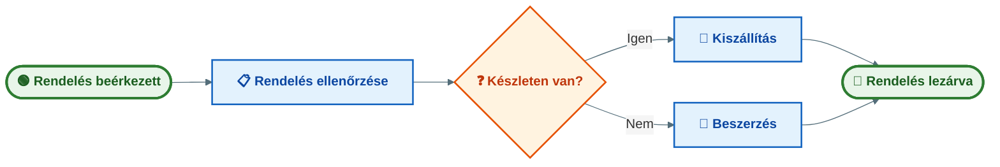
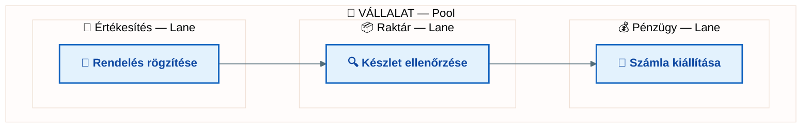

## V2 – Üzleti folyamatok modellezése BPMN 2.0 szabvány szerint

**Tételkérdés:** Mutassa be a BPMN 2.0 jelölésrendszer legfontosabb elemeit és a folyamatok strukturálásának lehetőségeit! Ismertesse az alapvető objektumtípusokat, a szervezési elemeket és az összekötő elemeket!

---

### 2.1. A BPMN célja és szerepe

A BPMN (Business Process Model and Notation) az Object Management Group (OMG) által standardizált folyamatmodellezési jelölésrendszer. Célja, hogy egységes vizuális nyelvet biztosítson az üzleti elemzők, folyamatgazdák és informatikusok között. A 2.0-s verzió (2011) végrehajtható modellek készítését is lehetővé teszi.

### 2.2. Alapvető objektumtípusok

#### Események

Az események valamilyen történést jelölnek és körrel ábrázolhatók:

| Eseménytípus | Jelölés | Példa |
|---|---|---|
| Start esemény | Vékony vonalú kör | „Vevői rendelés beérkezett" |
| Közbenső esemény | Kettős vonalú kör | „Aláírt szerződés megérkezett" |
| Vég esemény | Vastag vonalú kör | „Rendelés teljesítve" |

Speciális start/vég típusok: üzenet, időzítő, hiba, jel, eszkaláció.

#### Tevékenységek

A tevékenységek lekerekített sarkú téglalappal ábrázolt munkalépések:

- **Feladat (Task):** A folyamat legkisebb önálló munkalépése (pl. „Számla ellenőrzése")
- **Alfolyamat (Sub-process):** Több lépésből álló tevékenység, amely kibontható; az áttekinthetőség megőrzése érdekében hasznos

A tevékenység neve mindig cselekvést fejezzen ki (ige + főnév, pl. „Rendelés rögzítése").

#### Átjárók (Kapuk)

Az átjárók rombusz alakú döntési, elágazási vagy összesítési pontok:

| Átjárótípus | Jelölés | Logika |
|---|---|---|
| Exkluzív (XOR) | Rombusz (X jel) | Pontosan egy ág fut le |
| Párhuzamos (AND) | Rombusz (+ jel) | Minden ág egyszerre fut |
| Inkluzív (OR) | Rombusz (O jel) | Egy vagy több ág futhat le |

**Példa – rendelés feldolgozása:**

### 2.3. Szervezési elemek: medencék és sávok

**Medence (Pool):** Egy önálló résztvevőt vagy szervezetet jelöl. Pl. „Vállalat", „Ügyfél", „Beszállító". Külön medencékbe kerülnek azok a felek, amelyek egymással kommunikálnak, de belső folyamataik egymástól függetlenek.

**Sáv (Lane):** A medencén belüli felelősségi köröket jelöli. Pl. Értékesítés | Pénzügy | Raktár | Logisztika. Megmutatja, hogy melyik szervezeti egység felel az egyes tevékenységekért.

### 2.4. Összekötő elemek és használati szabályaik

| Összekötő | Jelölés | Hol használható | Mire való |
|---|---|---|---|
| **Szekvenciafolyam** | Folytonos nyíl | Medencén belül | A folyamatlépések sorrendje |
| **Üzenetfolyam** | Szaggatott nyíl | Medencék között | Szervezetek közötti kommunikáció |
| **Asszociáció** | Pontozott vonal | Bárhol | Dokumentumok, adatok, megjegyzések csatolása |

Alapszabály: szekvenciafolyam nem léphet át medencehatárokon; medencék között csak üzenetfolyamot szabad használni.

### 2.5. Strukturálási lehetőségek

A BPMN lehetővé teszi a folyamatok hierarchikus strukturálását: főfolyamat + alfolyamatok, különböző részletezettségi szintek (vezetői szintű áttekintés vs. operatív munkautasítás). Jó BPMN-modell ismérvei: áttekinthető, egységes elnevezések, feliratozottak az átjárók, jól meghatározott kezdet és vég.

**Összegzés:** A BPMN 2.0 három alapobjektum-típusból épül fel: esemény (kör), tevékenység (lekerekített téglalap), átjáró (rombusz). A szervezési elemek (medence, sáv) a felelősségi köröket mutatják, az összekötők (szekvencia, üzenet, asszociáció) az elemek kapcsolatait adják meg.

---
